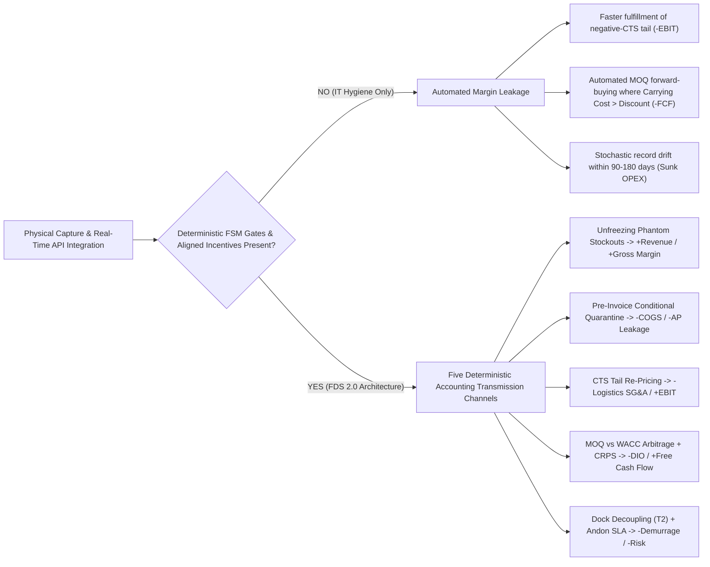
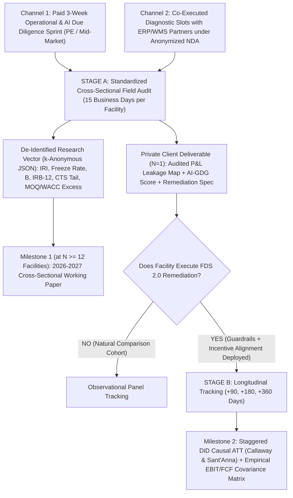

# Accounting Transmission to Operating Profit, the AI Gemba Deployment Gate (`AI-GDG`), and the 2026–2027 International Field Protocol

**Asset Code:** DOC-09  
**Date:** October 24, 2026  
**Author:** Marcos Stipicich  
**Jurisdictional & Technical Scope:** Jurisdiction-agnostic (`US / Europe / LatAm` · functional currency `USD` · accounting standards `IFRS / US GAAP` · reference transactional schemas applicable to `SAP S/4HANA`, `Oracle NetSuite`, `Microsoft Dynamics 365`, `Manhattan Active`, and `Odoo Enterprise`).  
**Target Audience:** Private Equity Operating Partners, CFOs, COOs, AI Investment Committees, Global Expert Networks, and Enterprise `ERP/WMS` Architects.  
**Relationship to Canonical Corpus:** Standalone financial, governance, and empirical field-study companion to the [24-Page Field Architecture Whitepaper (`PDF`)](papers/THE-DEPLOYMENT-CHASM-FIELD-ARCHITECTURE-PAPER-EN.pdf) ([Markdown source](papers/THE-DEPLOYMENT-CHASM-FIELD-ARCHITECTURE-PAPER-EN.md)) and [DOC-07 Formal Mechanics Specification](FORMAL-MECHANICS-EMPIRICAL-AUDIT.md).

**Mandatory Epistemic Evidence Taxonomy:**
* `[D]` Empirical finding read directly from a published primary source (peer-reviewed journal, regulatory `SEC 10-K/10-Q` filing, or institutional report with declared methodology).
* `[C]` Invariant verified via executable Python probe and automated test suite in this repository.
* `[M]` Closed-form accounting identity or analytical derivation.
* `[V]` Operational mechanism directly observed on industrial and distribution floors by the author.
* `[?]` Unresolved contemporary empirical unknown not yet jointly measured in published literature; explicit target of the **2026–2027 Cumulative Field Protocol** (§4).

---

## 1. Financial Thesis: Why "Clean Data and Better-Connected Systems" Do NOT Automatically Expand Operating Profit

In corporate AI business cases and Private Equity Value Creation Plans, executives frequently assume that cleaning master data and connecting `CRM + ERP + WMS + AI Agents` in real time automatically expands operating margin (`EBIT`). **As an accounting proposition, that inference is false `[M]`.**

Data hygiene and low-latency API integration are technical enablers, not profit generators; on the income statement, they initially register purely as operating expense (`OPEX`) or capitalized spend (`CAPEX`). Clean data and real-time integration convert into operating profit (`EBIT`) and Free Cash Flow (`FCF`) **if and only if** they govern **deterministic decision gates** and **aligned frontline incentives**. Whenever commercial, procurement, or dock-floor incentives remain distorted, faster system connectivity **accelerates value destruction** through three verifiable mechanisms:

1. **Accelerating the Negative Cost-to-Serve (`CTS`) Tail (`[D][M]`):** When sales representatives earn commissions on gross top-line revenue without line-level picking, rush-order, or return cost attribution, connecting a real-time `B2B` portal to the `WMS` simply dispatches fragmented, unprofitable orders faster for the bottom `10%–20%` of accounts operating at negative net contribution margin (Kaplan & Cooper, 1998 `[D]`).
2. **Automating Over-Purchasing Under Positive Real Interest Rates (`PPV` vs. `WACC`, `[D][M]`):** When buyers are rewarded on Purchase Price Variance (`PPV`), an `EDI` pipeline or autonomous procurement agent executes Minimum Order Quantities (`MOQ`) to capture nominal `2%–4%` unit discounts while incurring `22%–38%` annual carrying costs (`WACC` + storage + shrinkage + obsolescence). Despite the post-2022 global rise in capital costs, corporate Days Inventory Outstanding (`DIO`) remained sticky and trapped working capital exceeded `USD 1.94 trillion` in North America alone in *The Hackett Group* 2025–2026 benchmarks `[D]`.
3. **Stochastic Master-Data Re-Contamination (`[D][M][V]`):** A one-off physical inventory cleanup executed without lowering operational bypass pressure below the critical threshold ($B < 0.80$) or removing asymmetric penalties for reporting shortages ($\beta > \alpha$; Campbell, 1979 `[D]`) drifts back toward the `~59.5%–65%` record inaccuracy rates documented in large-scale physical retail and B2B audits (DeHoratius & Raman, 2008; Rekik, Syntetos & Glock, 2019 `[D]`).

---

## 2. Accounting Transmission Model (`P&L` & `FCF`) and Isolated Primary Evidence

To prevent the invalid consulting practice of summing percentage gains measured across unrelated industries and decades, the matrix below strictly isolates the **exact accounting transmission mechanism `[M]`**, **published single-lever empirical ranges `[D]`** (explicitly non-additive without plant-level covariance measurement), **auditable falsification metrics**, and **mandatory plant baseline inputs `[?]`**:

| Operational Lever | Causal Mechanism into `P&L` / Balance Sheet `[M]` | Isolated Primary Empirical Evidence `[D]` *(Non-additive without covariance)* | Accounting Falsification Metric | Required Plant Baseline Input (`3-Week Sprint`) |
| :--- | :--- | :--- | :--- | :--- |
| **P1. Eliminating Phantom Stockouts (*Freeze Effect*)** | When book stock $L_t \ge R$ overstates exhausted physical stock $I_t = 0$, the `MRP` engine suppresses replenishment orders indefinitely (Kang & Gershwin, 2005 `[D]`). Adjusting triggers to $L_t < R + \hat{D}_t$ with stratified blind `ABC` counts recovers lost unit sales multiplied by gross contribution margin $m_g$. | Baseline `IRI` affects `59.5%–65%` of audited retail SKUs (DeHoratius & Raman, 2008; Rekik et al., 2019 `[D]`). Estimated `~4%` annual revenue loss from `IRI` (Farias, Li & Peng, 2024 `[D]`); targeted physical correction lifts sales by **`+1.5% to +8.0%`** on treated SKUs (Hardgrave et al., 2009/2013; Rekik et al., 2019 `[D]`). | Line-level Fill Rate and Out-of-Stock (`OOS`) rate on Class A SKUs vs. untreated comparison cohort. | `[REQUIRED: Baseline Freeze Effect rate across top-200 Class A SKUs and weighted gross margin m_g]` |
| **P2. Pre-Invoice Conditional Quarantine (`GR` Blocked Stock)** | Blocking direct entry into unrestricted stock upon physical discrepancy (reference `103 -> 105 / 124 / 551` automaton verified in [`probes/cap3_delta_projection.py`](probes/cap3_delta_projection.py) `[C]`) halts automated `3-way match` Accounts Payable settlement on supplier shortages and separates supplier short-shipping from internal breakage. Flows **1:1 into `EBIT`** via lower `COGS`. | Unrecovered supplier shortages and unknown shrinkage typically represent `0.8% to 2.2%` of physical distribution and retail purchases `[D]`. | Pre-payment supplier credit memos / `BWART 124` origin returns + drop in annual net physical inventory write-offs. | `[REQUIRED: % of discrepant receipts currently posted directly to unrestricted stock and historical annual write-off %]` |
| **P3. Cost-to-Serve (`CTS`) Commercial Governance** | Attributing broken-case picking, `<24h` rush handling, delivery drops, and `DSO` financing cost at the order-line level exposes cross-subsidies. Enforcing minimum order thresholds or rush surcharges compresses logistics `SG&A`. | Restructuring the bottom `10%–20%` of the `CTS` curve recovers **`+200 to +500 bps`** of operating margin on sales in B2B distributors lacking prior service-tier governance (Kaplan & Cooper, 1998 `[D]`). | Post-logistics net contribution margin (`EBIT` per customer decile) at `t + 90` and `t + 180` days. | `[REQUIRED: Trailing 12-month post-CTS net margin distribution by customer decile]` |
| **P4. `MOQ` vs. `WACC` Arbitrage & `CRPS` Separation** | Blocking volume discounts whenever incremental average inventory $\frac{\Delta Q}{2}$ times annual holding rate $h(\text{WACC})$ exceeds unit price savings; decoupling probabilistic forecast accuracy (`CRPS`) from the financial critical fractile ($\frac{c_u}{c_u + c_o}$). | Biased manual forecast overrides under asymmetric political incentives degrade forecast accuracy by `4.5%–11.2%` on negative adjustments and inflate excess stock on positive overrides (Fildes et al., 2009 `[D]`). Releases cash directly into `FCF` and lowers obsolescence write-downs. | Delta in Days Inventory Outstanding (`DIO`), net working capital cash released, and annual obsolescence provision. | `[REQUIRED: Firm WACC, external 3PL overflow storage rate, and active supplier MOQ discount schedule]` |
| **P5. Dock Decoupling (`T2`) & *Andon SLA*** | Decoupling physical carrier exit (`DEPART`) from lot accounting quarantine (`BLOCKED_103`, Theorem `T2` in [`probes/cap3_delta_projection.py`](probes/cap3_delta_projection.py) `[C]`) while sizing quarantine bays via [`probes/quarantine_capacity.py`](probes/quarantine_capacity.py) eliminates detention charges; root-cause SLA routing reduces floor workarounds. | Frontline workers lose an average of `~10%` of shift capacity executing compensatory workarounds around unresolved operational failures (Tucker & Edmondson, 2003 `[D]`). | Monthly carrier detention (*demurrage*) spend, dock overtime hours, and median truck turnaround time. | `[REQUIRED: Audited annual demurrage + dock overtime spend and inbound physical retention rate r]` |

### Operating Profit Growth Identity and Mandatory `TCO` Deduction

Relative percentage growth in total company operating profit depends inversely on baseline `EBIT` margin (`bps_base`) and strictly requires deducting the Total Cost of Governance Ownership (`TCO_gov`) `[M]`:

$$\Delta \text{EBIT}_{\text{net}} = \sum_{k=1}^{5} \Delta \Pi_k - \text{Cov}(\Pi) - \text{TCO}_{\text{gov}}, \qquad \Delta \% \text{EBIT} = \frac{\text{Net bps gained}}{\text{Baseline EBIT bps}}$$

* **Baseline Margin Multiplier `[M]`:** In wholesale distribution, grocery, or commercial logistics operating on thin `300 to 500 bps` (`3%–5%`) baseline `EBIT` margins, a verified net improvement of `+150 bps` expands total operating profit by **`+30% to +50%`**. In specialty manufacturing operating at `1,200 bps` (`12%`) baseline `EBIT`, the exact same `+150 bps` equals **`+12.5%`** operating profit growth.
* **Mandatory `TCO_gov` Deduction `[M]`:** No projection presented to an investment committee or CFO is valid unless it explicitly subtracts: (i) diagnostic sprint fees and shift-leader calibration hours; (ii) dedicated exception-resolution staffing (`n`) and stratified blind cycle counting (`q`); (iii) industrial edge hardware (ruggedized scanners, physical Andon triggers, physical quarantine bay footprint $V$); and (iv) indirect transactional `ERP` licensing charges where applicable (e.g., `0.2x` document weighting on indirect material movements under *SAP Digital Access* licensing models).

---

## 3. Enterprise AI Readiness & Deployment Standard (`AI-GDG`: *AI Gemba Deployment Gate*)

Preliminary findings from MIT NANDA (July 2025; interviews across 52 organizations and 153 senior leader surveys `[D]`) indicate that roughly `95%` of enterprise generative AI initiatives have yet to deliver sustained `P&L` return, tracing stagnation to **brittle workflows, lack of contextual learning, and misalignment with day-to-day operations**—not foundation model capability. Similarly, RAND (2024) cites estimates that **more than 80% of AI projects fail**, roughly twice the failure rate of non-AI IT initiatives `[D]`.

To evaluate objectively whether an industrial or distribution operation is ready to deploy operational AI or tool-calling agents (`ERP / WMS / TMS / Procurement`), the **`AI-GDG` 4-Gate Rubric** (`0–25 points` per gate; `0–100` composite score, governed by **non-compensatory hard-stop vetoes**) enforces four pre-deployment checks:

| Gate | Field Audit Target (Causal Mechanism) | 3-Week Verification Test | Non-Compensatory Veto (*Hard-Stop* on Autonomous Write Access) | Score |
| :--- | :--- | :--- | :--- | :---: |
| **G1. Physical Signal Integrity (`Ground-Truth Gate`)** | Whether training and inference inputs reflect physical warehouse state or are right-censored by phantom stockouts and uncounted receipts. | Blind physical audit of `120` stratified bin locations (`60 A / 40 B / 20 C`) against frozen book stock at the exact same timestamp. | **VETO if Class A `IRI > 15%`** or if `>8%` of Class A SKUs sit in *Freeze Effect* ($I=0 \land L \ge R$). Autonomous algorithmic purchasing is forbidden until physical capture is remediated. | `0 – 25` |
| **G2. Sociotechnical Stability (`Bypass & Voice Gate`)** | Whether operators will feed real exceptions into the AI-assisted workflow or bypass it due to queue saturation or punitive fear. | Stopwatch measurement of $\lambda, p_e, h_{\text{res}}, n$ during peak hours + anonymous administration of the 12-item `IRB-12` instrument (see [Field Whitepaper Appendix A](papers/THE-DEPLOYMENT-CHASM-FIELD-ARCHITECTURE-PAPER-EN.md)). | **VETO if $B = \frac{\lambda p_e}{h_{\text{res}} n} \ge 0.80$** or if gross-volume piece-rate bonuses penalize exception reporting ($\beta > \alpha$). | `0 – 25` |
| **G3. Transactional Write Isolation (`OWASP LLM06 Gate`)** | Compliance with `OWASP LLM06:2025` (*Excessive Agency*) and `SEC Rule 15c3-5` pre-trade risk principles `[D]`: strict deterministic separation between probabilistic inference and financial ledgers. | Architecture inspection (`API / MCP / RPA`): verify presence of a deterministic `FSM` validator, idempotent staging (`src/fdekit/ithildin/`), and payload-bound cryptographic approval. | **IMMEDIATE VETO** if any model or agent holds direct write credentials to purchase orders, `ATP` stock, `AP` payment runs, or pricing masters without a fail-closed deterministic gate in front. | `0 – 25` |
| **G4. Economic Objective Alignment (`Unit-Economics Gate`)** | Whether the optimization objective maximizes net cash flow and true contribution margin rather than destructive proxy metrics (`PPV`, gross volume, naive turns). | Mathematical audit of the model's loss/reward function against current firm `WACC`, underage/overage costs ($c_u, c_o$), and customer `CTS` tiers. | **VETO** if the recommendation engine ignores capital carrying cost $h(\text{WACC})$ in `MOQ` sizing or allocates scarce inventory to negative-`CTS` accounts. | `0 – 25` |

### AI Deployment Sequencing by `AI-GDG` Tier

1. **Tier I — Read-Only Multimodal Floor Triage & Statistical Anomaly Detection (Zero Ledger Risk, Immediate Traction):**
   * *Examples:* Voice/photo clustering of dock friction events for Digital Andon routing (zero `ERP` write access, anonymized in compliance with *EU AI Act* Reg. `2024/1689` `[D]`); cross-sectional statistical detection of phantom inventory across SKU-store matrices to target blind physical counts (*low-rank Poisson* method of Farias, Li & Peng, 2024 `[D]`).
   * *Minimum `AI-GDG` threshold:* Deployable as soon as **`G3 = 25/25`** (strict read-only isolation), even while `G1` and `G2` are undergoing remediation—because **Tier I AI is used specifically to accelerate `G1` and `G2` repair**.
2. **Tier II — Structured Human-in-the-Loop S&OP & Commercial Co-Pilots:**
   * *Examples:* Probabilistic demand forecasting scored via `CRPS` + automated `CTS` minimum-order re-pricing proposals staged for manager sign-off.
   * *Minimum `AI-GDG` threshold:* Composite score **`>= 65/100`**, zero vetoes on `G3` or `G4`, and `G1 >= 15/25`.
3. **Tier III — Semi-Autonomous Transactional Agents (Bounded Replenishment Release, Conditional Receipt Hold, Order Allocation):**
   * *Minimum `AI-GDG` threshold:* Composite score **`>= 85/100`**, zero vetoes across `G1–G4`, verified deterministic state-machine guardrails (`probes/cap3_delta_projection.py`, `inbound_fsm_guardrail.py`, `src/fdekit/ithildin/`), and a clean 14-day *Shadow Run* with zero critical ledger divergences.

---

## 4. 2026–2027 International Field Research Protocol (*Two-Stage Cumulative Study*)

### 4.1 Contemporary Empirical Gap (`2020–2026`)

Foundational empirical studies in physical operations were predominantly collected between **1998 and 2019** (`Kaplan & Cooper, 1998`; `Kang & Gershwin, 2005`; `DeHoratius & Raman, 2008`; `Fildes et al., 2009`; `Hardgrave et al., 2009/2013`; `Rekik, Syntetos & Glock, 2019` `[D]`). Between 2020 and 2026, three structural shifts occurred simultaneously and **remain unmeasured jointly at the plant-and-P&L level `[?]`**:

1. **The Real-Time Hyper-Connectivity Paradox:** Mid-market and enterprise operators adopted cloud `ERPs`, instant `B2B/DTC` API connectors, and `<24h` fulfillment SLAs, yet no public study quantifies how higher transactional velocity amplifies *phantom stockout* freezes and bottom-decile `CTS` margin erosion `[?]`.
2. **Post-2022 Positive Real Interest Rate Regime:** Following a decade of near-zero rates (`ZIRP`), higher capital costs pushed annual inventory holding rates (`h`) into the `22%–38%` band, shifting the break-even frontier of legacy supplier `MOQ` contracts `[D][?]`.
3. **Cross-Lever Covariance and Empirical `AI-GDG` Readiness:** Open literature lacks a multi-jurisdictional dataset (`US / Europe / LatAm`) jointly linking blind dock-level `IRI`, operational bypass pressure ($B$), `IRB-12` sociological risk scores, `AI-GDG` readiness, and audited `P&L` margin leakage on the exact same facility `[?]`.

### 4.2 Two-Stage Cumulative Design (Executable from `N = 1` Facility)

Rather than requiring 20 corporations to enroll simultaneously before generating actionable output, the protocol operates as a **two-stage cumulative field study** where every single facility audit produces immediate standalone commercial value while contributing a de-identified standardized vector to the multi-site panel:

#### Stage A — Standardized Cross-Sectional Audit (*15 Business Days per Facility*, cumulative from `N = 1` to `N = 20+`)
* **Facility Inclusion Criteria:** B2B distribution, wholesale, omnichannel fulfillment, agribusiness, or discrete manufacturing plants across the `US, Europe, or Latin America` with `USD 10M–250M` annual facility throughput, `>= 1,000` active SKUs, and a live transactional `ERP/WMS`.
* **Standardized 15-Day Field Protocol:**
  * *Week 1 (Dock Physics & Blind Sample):* Stratified random sample of `120` bin locations (`60 A / 40 B / 20 C`) via double-blind physical count against frozen book balances; stopwatch measurement of $\lambda$, $p_e$, $h_{\text{res}}$, and exception headcount $n$ across two shifts (including night shift where active); anonymous `IRB-12` survey administration.
  * *Week 2 (Transactional Forensics & Unit Economics):* Extraction of trailing 12-month purchase receipts (direct unrestricted receipts vs. conditional quarantine holds, supplier credit memos, annual physical inventory write-offs), customer order lines to construct the empirical `CTS` curve, and active `MOQ` schedules benchmarked against Finance-verified `WACC`.
  * *Week 3 (`AI-GDG` Scoring & CFO Reconciliation):* Scoring of all four `AI-GDG` gates, bounded estimation of recoverable working capital and annual `EBIT` leakage (net of `TCO_gov`), and extraction of the de-identified research record.
* **Privacy-by-Design De-Identification:** Zero corporate names, tax IDs, raw SKU codes, or nominal unit prices leave the facility. The research vector stores strictly dimensionless ratios (`%` rates, basis points `bps` of total sales, `WACC` multiples, $B$ index, `IRB-12` and `AI-GDG` scores, 2-digit `NAICS` sector, and macro-region).

#### Stage B — Quasi-Experimental Longitudinal Cohort (`t + 90`, `t + 180`, `t + 360` Days)
* Across multi-site enterprise groups or Private Equity portfolios rolling out remediation in staggered waves, monthly pre- and post-intervention series track: (1) Class A `IRI` and *Freeze Effect* rate; (2) pre-invoice supplier recovery + annual shrinkage; (3) total and bottom-decile `CTS` operating margin (`bps`); (4) `DIO` and released operating cash flow; and (5) bypass incidents or blocked write anomalies on AI-assisted workflows.
* **Econometric Identification:** Doubly robust staggered Difference-in-Differences estimator (Callaway & Sant'Anna, 2021 `[D]`) paired with facility-level Wild Cluster Bootstrap inference (Cameron, Gelbach & Miller, 2008 `[D]`) and HonestDiD parallel-trends sensitivity bounds (Rambachan & Roth, 2023 `[D]`), calibrated in [`econometric_engine.py`](econometric_engine.py) `[C]`.

---

## 5. Skeptic's Perspective: Honest Limitations, Trade-Offs, and Three Hostile Objections

### Objection 1 (Econometric Selection Bias): *"Firms that commission a 3-week diagnostic sprint or enter via ERP rescue partners self-select for acute operational pain; your Stage A sample will overstate industry-wide dysfunction."*
* **Response & Methodological Control:** Correct—a sample recruited through diagnostic engagements is not a simple random sample of the industrial census. Stage A outputs therefore explicitly define the target population as *mid-market and enterprise facilities undergoing scaling friction, post-ERP/WMS cutover stabilization, or pre-AI investment due diligence* (the exact decision population faced by PE Operating Partners and AI investment committees). Whenever auditing a multi-site enterprise, the protocol requires sampling both the distressed facility and at least one "benchmark stable" sister facility within the same corporate group to bound intra-firm selection bias.

### Objection 2 (Algorithmic Substitution): *"If Farias, Li & Peng (2024) already detect and correct inventory record inaccuracy at scale using cross-sectional machine learning at a fraction of physical audit cost, why invest in conditional `103/105` quarantine states, incentive redesign, and physical edge hardware?"*
* **Response & Architectural Trade-Off:** Cross-sectional statistical inference (Farias et al., 2024 `[D]`) is a high-value tool for **locating existing book-to-physical drift** (which is why it is explicitly deployed in `AI-GDG` Tier I), but **it does not halt the causal generator of new ledger corruption**. If receiving docks continue posting short shipments directly into unrestricted stock (`101`) to clear truck queues, if buyers remain bonused on `PPV` to inflate `MOQ` batches, and if sales reps remain rewarded on gross volume across negative-`CTS` orders, purely statistical correction merely measures faster a hemorrhage that the incentive structure manufactures anew every shift. Statistical detection and deterministic physical-accounting guardrails are complements, not substitutes.

### Objection 3 (Financial Threshold / Governance Overhead): *"When does the ongoing `TCO_gov` of maintaining these guardrails destroy more value than it recovers?"*
* **Response (Explicit Quantitative No-Intervention Rule):** Full FDS 2.0 remediation **must NOT be deployed** whenever Week 1–2 diagnostics observe any of the following conditions:
  1. **Sub-scale physical throughput:** Annual physical facility throughput `< USD 5M/year` or `< 400` active SKUs without cold-chain/perishability risk or dock congestion, where fixed annual `TCO_gov` exceeds recoverable leakage.
  2. **Low-friction baseline:** Facilities exhibiting slack bypass pressure ($B < 0.40$), blind-verified Class A record accuracy `> 97%`, and `IRB-12 < 20`; in such plants, parameter recalibration (`MOQ/WACC` bounds and `CTS` order minimums) captures available cash flow without modifying `WMS` workflows or adding quarantine steps.
  3. **Executive veto on commercial/procurement incentive reform:** If leadership refuses to alter gross-volume sales commissions (`CTS`) and `PPV` buyer metrics, the CFO must be notified in writing prior to implementation that recoverable value is strictly capped at defensive warehouse levers (`P1` + `P2`), forfeiting commercial margin expansion (`P3` + `P4`).

---

## Primary References Cited

* Bassamboo, A., Moreno, A., & Stamatopoulos, I. (2020). Fixing phantom stockouts: Optimal data-driven shelf inspection policies. *Production and Operations Management*, 29(5), 1155–1173.
* Callaway, B., & Sant'Anna, P. H. C. (2021). Difference-in-differences with multiple time periods. *Journal of Econometrics*, 225(2), 200–230.
* Cameron, A. C., Gelbach, J. B., & Miller, D. L. (2008). Bootstrap-based improvements for inference with clustered errors. *The Review of Economics and Statistics*, 90(3), 414–427.
* Campbell, D. T. (1979). Assessing the impact of planned social change. *Evaluation and Program Planning*, 2(1), 67–90.
* DeHoratius, N., & Raman, A. (2008). Inventory record inaccuracy: An empirical analysis. *Management Science*, 54(4), 627–641.
* Farias, V. F., Li, A. A., & Peng, T. (2024). Fixing inventory inaccuracies at scale. *Manufacturing & Service Operations Management*, 26(3), 1102–1118.
* Fildes, R., Goodwin, P., Lawrence, M., & Nikolopoulos, K. (2009). Effective forecasting and judgmental adjustments: An empirical evaluation and strategies for improvement in supply-chain planning. *International Journal of Forecasting*, 25(1), 3–23.
* Hardgrave, B. C., Aloysius, J. A., & Goyal, S. (2009). Does RFID improve inventory accuracy? A preliminary analysis. *International Journal of RF Technologies*, 1(1), 44–56.
* Hardgrave, B. C., Aloysius, J. A., & Goyal, S. (2013). RFID-enabled visibility and retail inventory record inaccuracy: Experiments in the field. *Production and Operations Management*, 22(4), 843–856.
* Kang, Y., & Gershwin, S. B. (2005). Information inaccuracy in inventory systems: Stock loss and stockout. *IIE Transactions*, 37(9), 843–859.
* Kaplan, R. S., & Cooper, R. (1998). *Cost & Effect: Using Integrated Cost Systems to Drive Profitability and Performance*. Harvard Business School Press.
* MIT NANDA (Nanda et al.). (July 2025). *The GenAI Divide: State of AI in Business 2025* (Preliminary report: 52 organizations interviewed, 153 senior leader surveys).
* OWASP Foundation. (2025). *OWASP Top 10 for Large Language Model Applications (2025): LLM06 Excessive Agency*.
* RAND Corporation. (2024). *The Root Causes of Failure for Artificial Intelligence Projects*.
* Rambachan, A., & Roth, J. (2023). A more credible approach to parallel trends. *Review of Economic Studies*, 90(5), 2555–2591.
* Rekik, Y., Syntetos, A. A., & Glock, C. H. (2019). Modelling (and learning from) inventory inaccuracies in e-retailing/B2B contexts. *Decision Sciences*, 50(6), 1184–1223; and *ECR Retail Loss: Inventory Inaccuracy in Retailing*.
* The Hackett Group. (2025–2026). *U.S. & European Working Capital Survey: Cash Conversion Cycle, DIO Stickiness, and Working Capital Opportunity*.
* Tucker, A. L., & Edmondson, A. C. (2003). Why hospitals don't learn from failures: Organizational and psychological dynamics that inhibit system change. *California Management Review*, 45(2), 55–72.
* U.S. Securities and Exchange Commission (SEC). (2013). *Release No. 34-70694 (Rule 15c3-5 Market Access — Knight Capital Americas LLC)*.
