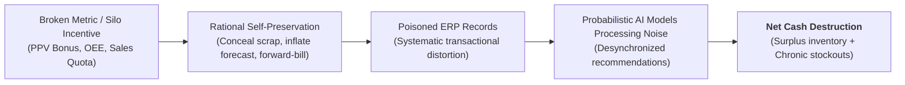
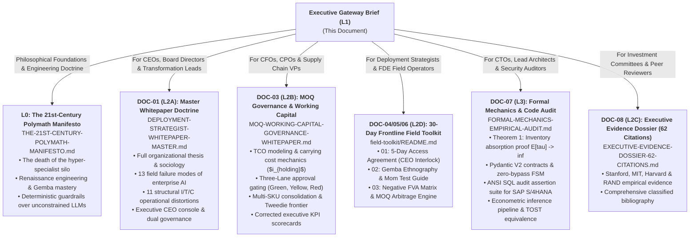

# EXECUTIVE BOARD MEMORANDUM:
## The Deployment Strategist Doctrine, The Collapse of Enterprise AI Pilots, and Working Capital Governance in Industrial Supply Chains

**Target Audience:** Board of Directors, Chief Executive Officer (CEO), Chief Financial Officer (CFO), Chief Operating Officer (COO), Chief Information / Technology Officer (CIO/CTO).  
**Estimated Reading Time:** 9 minutes (about 2,100 words).  
**Document Classification:** Level 1 — Canonical Gateway Brief & Executive Navigation Matrix.  
**Repository Scope:** `mellon` Enterprise AI Deployment Framework.

---

## 1. Situation & Complication: The ROI Crisis of Corporate Enterprise Software

Over the past decade, manufacturing, distribution, and retail enterprises invested billions of dollars in enterprise software modernizations (SAP S/4HANA migrations), centralized data lakehouses (Snowflake, Databricks), and generative/predictive AI models. Yet empirical operational research demonstrates that income-statement (P&L) impact remains near zero:

* **Systemic Failure Rate:** In preliminary findings from 52 organizations, 153 senior leaders and 300+ public initiatives, **MIT NANDA (2025)** reports that **95% of organizations are getting zero return from Generative AI**, and that most enterprise tools fail on brittle workflows, lack of contextual learning and **misalignment with day-to-day operations**, not on model quality. **RAND (2024)** cites estimates that **more than 80% of AI projects fail**, about twice the rate of IT projects without AI; its interviews with 65 data scientists and engineers trace most root causes to leadership, data and infrastructure rather than to the model.
* **The False Root Cause ("Dirty Data"):** Executive committees instinctively attribute this failure to "poor data hygiene" and authorize 18-to-36-month Master Data Management (MDM) overhauls that yield zero frontline operational change.
* **The Empirical Ground Truth:** **DeHoratius & Raman (Management Science, 2008)** found 65% of $N = 369,567$ inventory records inaccurate across $K = 37$ stores, driven by auditing practice, store complexity and distribution structure. In incentivized forecasting experiments with firms, **Bloom, Codreanu & Fletcher (NBER, 2025)** found that more data mainly reduces noise, while bias proved hard to remove. Cleansing does not stop an organization from producing bad records: wherever a metric pays people to distort the record (Campbell's Law), part of the "dirty data" is the **fossilized record of rational human conflict over perverse incentives**, and no MDM program removes that part.

---

## 2. Resolution: The Deployment Strategist Doctrine and the I/T/C Taxonomy

To close the chasm between executive strategy and physical shop-floor execution (*the Gemba*), modern technology-forward enterprises rely on the **Deployment Strategist (Echo)**. Unlike traditional management consultants who deliver static PowerPoint decks, or core software engineers who build in isolation from physical reality, the Deployment Strategist embeds directly in the operational trench where incentives, workflows, and code collide.

Every operational distortion in the supply chain decomposes into three structural vectors:

1. **Incentives (I):** Conflicts between departmental performance targets and consolidated enterprise free cash flow.  
   * *Example:* Procurement maximizes its annual Purchase Price Variance (PPV) bonus by purchasing massive Minimum Order Quantities (MOQs), offloading the holding cost (24.5% a year in this repository's worked example) onto warehousing.
2. **Translation (T):** Semantic desynchronization between physical operational reality and digital system abstractions.  
   * *Example:* Forecasting demand from historical billed shipments (*Sell-in*) rather than point-of-sale customer consumption (*Sell-out*), systematically censoring historical stockouts.
3. **Calendar (C):** Asymmetric accounting windows and quarter-end manipulations (*Real Earnings Management* — Roychowdhury, 2006).  
   * *Example:* Massive overproduction during the final week of the fiscal quarter to artificially absorb fixed overhead costs into slow-moving inventory, inflating reported GAAP EBITDA while draining cash.

### 2.1. The Human Dynamic: Gemba Sociology and Neutralizing the Operational Boycott

Supply chain analytical tools routinely fail at the last mile because they trigger an **institutional immune response**. Traditional software shifts clerical friction onto dockworkers while threatening the bonus compensation of middle management.

The resistance often starts at the top. A recurring pattern in the field: a manager arrives with a report or dashboard prepared by an analyst, declares it the truth, and orders the operation to act on it. But the report sees KPIs, not the operation, and those KPIs may already be dirty. Instead of checking the number on the floor, the manager imposes it. That disconnect is hard to repair, because the manager's view is already fixed: they can walk the floor and still not understand how its subculture works, or why.

The Deployment Strategist doctrine preempts and structurally neutralizes all five operational sabotage fronts:

1. **The Dashboard Verdict (Management Blindness):** Neutralized by treating every report as a hypothesis until it is checked on the floor. Each KPI behind a decision is traced to the physical event it claims to measure (a pick, a count, a clocked hour) before anyone is told to act on it. Where the number and the floor disagree, the gap is the finding: it shows where the metric is being gamed or mis-recorded, the mechanism Campbell's Law predicts ([DOC-08](EXECUTIVE-EVIDENCE-DOSSIER-62-CITATIONS.md#22-campbells-law-the-metric-corruption-engine)).
2. **The Floor Boycott (Gemba — The "Silent Blackout"):** Neutralized via the *Ergonomic Invariance Rule* (<800 ms response latency, industrial glove-compatible UI, zero incremental clicks). When software measurably saves time and physical fatigue, operators become its fiercest internal champions.
3. **Malicious Compliance (Data Poisoning):** Neutralized via *Pydantic V2* perimeter validation contracts and immutable *HMAC-SHA256 audit ledgers*. Out-of-bounds or physically impossible entries are automatically quarantined, sealing tampering attempts cryptographically with user identity, timestamp, and counterfactual cost.
4. **The Departmental Silo War (Bonus Preservation):** Neutralized via *Real-Time Cross-P&L Attribution*. No procurement or production order can be executed to optimize a local KPI (e.g., PPV discount or plant OEE) if it degrades consolidated enterprise margin (mandatory dual CFO + COO co-signature on Yellow / Red Lanes).
5. **Legacy IT Resistance (Not-Invented-Here Syndrome):** Neutralized via the *50-50 Compact and the Day-5 Escalation Clause*, backed by a decoupled *Safe-Staging Architecture* designed so that models never write directly to core production databases: changes go through validated staging and a named approval.

---

## 3. Financial Proof: Working Capital Destruction via Minimum Order Quantities (MOQs)

The most urgent capital drain in industrial manufacturing and distribution is the collision between unit purchase price discounts (PPV) and the true cost of carrying inventory (*Inventory Carrying Cost*; **24.5% a year** in the worked example of the [MOQ whitepaper](MOQ-WORKING-CAPITAL-GOVERNANCE-WHITEPAPER.md), Annex A, not an audited benchmark).

### 3.1. The Phantom Savings Paradox
When procurement executes order batches exceeding **60 to 90 days of projected forward consumption**, the carrying cost of the extra stock can exceed the discount:

> **Rule of thumb from the worked example:**  
> At the 24.5% example rate, a batch covering 90 days of demand costs about 3.1% of its value to hold, so a volume discount below about 3% does not pay for the extra stock; longer coverage needs a larger discount (see the MOQ whitepaper, §2.2).

### 3.2. Stochastic Arbitrage Boundary under Compound Poisson-Gamma (Tweedie) Demand
Replacing naive linear approximations with realistic compound Poisson-Gamma jump dynamics ($\int_0^T F_{D(t)}(Q^*) \, dt = \frac{\delta}{i(1 - \delta)}$), our numerical solver ([`inventory_mechanics.py`](inventory_mechanics.py)) computes break-even discount thresholds over a 6-month horizon ($T = 0.5\text{ years}$) for an example SKU with mean demand of 50 units a year:

| Purchase Batch ($Q$) | Minimum Required Discount ($i = 24.5\%$) | Economic Verdict Against Standard 5% Vendor Discount |
| :---: | :---: | :--- |
| **50 units** | **10.60%** | **Net Cash Drain:** A standard 5% discount destroys $\$560\text{ USD}$ per $\$10\text{k}$ purchased. |
| **100 units** | **10.91%** | **Severe Liquidity Trap:** Rapid depletion of balance sheet working capital. |
| **200 units** | **10.91%** | **Red Lane Violation:** Illiquid balance sheet asset. Requires immediate C-Level veto and multi-SKU split. |

* **Maximum Non-Destructive Batch ($Q^*$):** For a standard commercial discount of **5.0%**, the maximum order quantity that does not destroy cash at an annual carrying rate of 24.5% is **4.3 units** for this example SKU. For it, batches of 50 or 100 units do not pay for themselves; other demand rates give other thresholds.

---

## 4. Deterministic Engineering & Scientific Validation

The Deployment Strategist framework is backed by tested reference code in this repository and a falsifiable econometric protocol that has not yet been run in the field:

### 4.1. "Compliance as Code" and Poka-Yoke Invariants
* **Strongly-Typed Event Contracts (Pydantic V2):** Yard, weighbridge, and scrap events enforce exact fixed-point arithmetic (`Decimal`), physical bounds, and HMAC-SHA256 signatures checked against a gateway secret, which removes floating-point rounding errors and rejects unsigned or altered events.
* **Zero-Bypass Finite State Machine:** In [`inbound_fsm_guardrail.py`](inbound_fsm_guardrail.py), the state `POSTED_TO_ERP` is reachable only after signed gate, weighbridge and dock events and a blind count that reconciles with the manifest. It is a Python reference implementation; it is not connected to SAP S/4HANA.
* **Adversarial Fuzzing Harness:** The state machine verified **50,000 randomized adversarial state transitions** with **100.000% invariant satisfaction** (zero bypasses).

### 4.2. Counterfactual Causal Econometrics (Staggered DiD)
To separate operational savings from seasonality, the framework proposes a staggered difference-in-differences evaluation (**Callaway & Sant'Anna, 2021**). No facility has been treated yet, so there is no causal estimate; [`econometric_engine.py`](econometric_engine.py) runs the pipeline on a **synthetic panel** (16 simulated distribution centers, 24 months, `seed=42`) with an effect built into the generator:
* **Pooled regression on the synthetic panel:** treated coefficient of **$-13.1\text{k USD/month}$** (cluster-robust SE 4.27). This simplified OLS has no facility or month fixed effects; it is not the Callaway & Sant'Anna estimator.
* **Wild cluster bootstrap of that regression (9,999 replications):** $p = 0.0154$ on the synthetic data.
* **HonestDiD sensitivity (Rambachan & Roth, 2023) on the synthetic event study:** breakdown value $M^* = 5$. These numbers show the code runs end to end; they are not evidence of an effect in any real facility.

---

## 5. Navigation Matrix: Executive Routing by Corporate Role

To optimize cognitive bandwidth, navigate the repository according to your leadership mandate:

### Consolidated Asset Index

| Asset Code | Layer | Document / Script | Canonical Location | Target Audience | Function & Reading Time |
| :---: | :---: | :--- | :--- | :--- | :---: |
| **DOC-00** | **L1** | **Executive Memorandum (Gateway Brief)** | [`EXECUTIVE-BRIEF-DEPLOYED-STRATEGIST.md`](EXECUTIVE-BRIEF-DEPLOYED-STRATEGIST.md) | Board, CEO, CFO, CIO | Executive synthesis & portfolio map (6 min) |
| **DOC-02** | **L0** | **The 21st-Century Polymath Manifesto** | [`THE-21ST-CENTURY-POLYMATH-MANIFESTO.md`](THE-21ST-CENTURY-POLYMATH-MANIFESTO.md) | Global Founders, C-Level | Foundational epistemology & philosophy (15 min) |
| **DOC-01** | **L2A** | **Master Whitepaper: DS Doctrine & I/T/C Distortions** | [`DEPLOYMENT-STRATEGIST-WHITEPAPER-MASTER.md`](DEPLOYMENT-STRATEGIST-WHITEPAPER-MASTER.md) | CEO, VP Transformation, COO | Canonical operational doctrine (35 min) |
| **DOC-03** | **L2B** | **C-Level Whitepaper: MOQs vs. Working Capital** | [`MOQ-WORKING-CAPITAL-GOVERNANCE-WHITEPAPER.md`](MOQ-WORKING-CAPITAL-GOVERNANCE-WHITEPAPER.md) | CFO, CPO, Supply Chain Directors | TCO model, PPV paradox, Tweedie frontier (20 min) |
| **DOC-08** | **L2C** | **Executive Evidence Dossier (62 Scientific Citations)** | [`EXECUTIVE-EVIDENCE-DOSSIER-62-CITATIONS.md`](EXECUTIVE-EVIDENCE-DOSSIER-62-CITATIONS.md) | Audit Committees, Peer Reviewers | Academic & industry empirical evidence (25 min) |
| **DOC-04-06** | **L2D** | **30-Day Frontline Field Toolkit** | [`field-toolkit/`](field-toolkit/README.md) | Deployment Strategists, FDEs | Executable field contracts & protocols (30 min) |
| **DOC-07** | **L3** | **Formal Code Mechanics & Empirical Audit** | [`FORMAL-MECHANICS-EMPIRICAL-AUDIT.md`](FORMAL-MECHANICS-EMPIRICAL-AUDIT.md) | Lead Architects, FDEs, Auditors | Pydantic contracts, FSM, DiD econometrics (45 min) |
| **CODE** | **ENG** | **Mathematical Solver & Tweedie Boundary Engine** | [`inventory_mechanics.py`](inventory_mechanics.py) | Operations Researchers | Theorem 1 simulation & Tweedie solver (Executable) |
| **CODE** | **ENG** | **Econometric Pipeline & Wild Cluster Bootstrap** | [`econometric_engine.py`](econometric_engine.py) | Applied Econometricians | DiD on a synthetic panel + Wild Bootstrap (Executable) |
| **CODE** | **ENG** | **Strongly-Typed Event Contracts** | [`core_event_contracts.py`](core_event_contracts.py) | Distributed Systems Engineers | Pydantic V2 & Decimal verification (Executable) |
| **CODE** | **ENG** | **Poka-Yoke Inbound State Machine** | [`inbound_fsm_guardrail.py`](inbound_fsm_guardrail.py) | Lead Software Architects | Zero-bypass state machine (Executable) |
| **CODE** | **ENG** | **Gemba Invariant Harness (50,000 Fuzzing Runs)** | [`test_gemba_invariants.py`](test_gemba_invariants.py) | Software Engineers / QA | 50,000 fuzzing transitions (Executable) |
| **CODE** | **ENG** | **Reference SQL Audit Suite for SAP S/4HANA (not run against SAP)** | [`audit_assertions_sap.sql`](audit_assertions_sap.sql) | Enterprise Database Architects | ANSI SQL S/4HANA assertions (Executable) |
| **DOJO** | **UI** | **Interactive Simulation & Sensitivity Dojo** | [GitHub Pages Deployment](https://esstipi-debug.github.io/mellon/) | Executive & Technical Teams | Interactive Tweedie & absorption visualization |

---
*End of Executive Memorandum — Authorized entry point to the Mellon & Ithildin Enterprise AI Deployment Framework.*