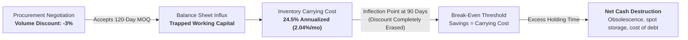
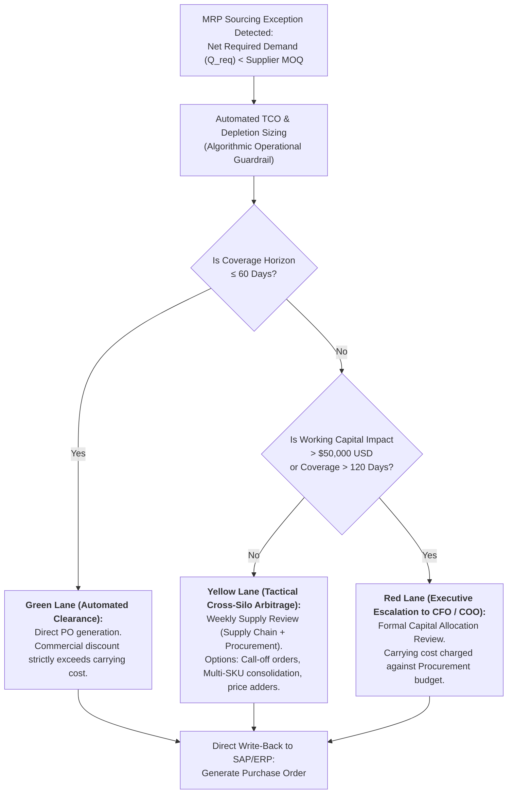
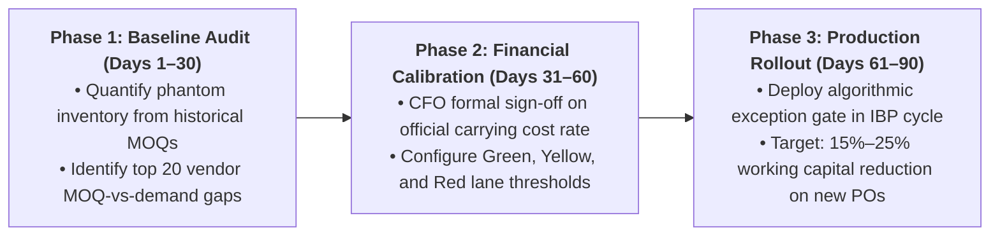

# THE HIDDEN COST OF VOLUME:
## Sourcing Exception Governance (MOQs vs. Working Capital) and Executive Incentive Alignment

**Target Audience:** Executive Committees, Chief Executive Officer (CEO), Chief Financial Officer (CFO), and Chief Operating Officer (COO).  
**Focus:** Return on Invested Capital (ROIC), Integrated Business Planning (IBP) Governance, and Cross-Functional Incentive Alignment.

> **Document Architecture Level: Layer 2B (Financial Case Treatise)**  
> **Rapid Entry Point:** For a 6-minute synthesis, refer to the [Executive Memorandum (L1)](EXECUTIVE-BRIEF-DEPLOYED-STRATEGIST.md).  
> **Related Assets:** [Canonical Doctrine (L2A)](DEPLOYMENT-STRATEGIST-WHITEPAPER-MASTER.md) | [Formal Mechanics Monograph (L3)](FORMAL-MECHANICS-EMPIRICAL-AUDIT.md) | [Stochastic Tweedie Solver](inventory_mechanics.py).

---

## 1. Executive Summary & Financial Thesis

In the majority of industrial, retail, and manufacturing enterprises, **Procurement reports millions of dollars in "negotiated purchase savings" while Finance experiences ongoing Free Cash Flow (FCF) contraction, and Supply Chain suffers warehouse saturation and bottlenecked distribution centers.**

This contradiction is not an operational failure; it is a **structural governance failure**.

### The Purchase Price Variance (PPV) Paradox
The traditional metric governing procurement departments—*Purchase Price Variance* (PPV)—exclusively rewards nominal unit acquisition price reductions (\$/unit). To capture commercial scale discounts, Procurement accepts supplier Minimum Order Quantities (**MOQ**) that are disproportionate to real customer demand velocity:

$$ \text{PPV} = (P_{\text{standard}} - P_{\text{negotiated}}) \times Q_{\text{purchased}} $$

Under this accounting formulation:
* The larger the purchased volume ($Q$), the greater the apparent "accounting savings" reported to the Board.
* However, the true holding cost of storing excess inventory (*Inventory Carrying Cost*, empirically calibrated between **20% and 28% annually** on tied-up working capital) is silently absorbed by the P&L through logistics OpEx, off-site storage leases, write-offs, shrinkage, and capital charges.

> **Financial Invariant Thesis:**  
> When the coverage horizon of a minimum order batch exceeds **60 to 90 days of forward demand**, the cumulative inventory carrying cost completely overtakes the commercial price discount. Beyond this break-even inflection point, **every single dollar saved on purchase price destroys between \$1.20 and \$1.80 of net enterprise cash.**

This whitepaper establishes an algorithmic decision framework and executive governance protocol to arbitrate sourcing exceptions against supplier MOQs, unifying Procurement, Supply Chain, and Finance under a single optimization metric: **Net Economic Value (NEV)**.

---

## 2. Anatomy of the Structural Conflict: PPV vs. Carrying Cost

### 2.1. The Loss-Transfer Mechanism
When an order exception enters the enterprise (MRP detects a net replenishment need of 1,500 units, but the vendor demands a 10,000-unit MOQ), the absence of a unified arbitration framework triggers three simultaneous operational failures:

1. **Interdepartmental Loss Subsidization:** Procurement captures an annual bonus for securing a 6% nominal price cut, but transfers an 8-month carrying cost burden directly to Supply Chain operations.
2. **Censorship of Physical Constraints:** The ERP assumes infinite warehouse capacity. As inbound shipping containers land, operations is forced to lease temporary satellite storage at spot surge rates, collapsing category gross margins.
3. **Credit Line Lock-In:** Working capital trapped in slow-moving items purchased in volume constrains the liquidity needed to replenish high-velocity, high-margin SKUs (Class A), driving catastrophic stockouts on core revenue drivers.



---

### 2.2. Total Cost of Ownership (TCO) Mathematical Arbitrage Model

To eliminate organizational opacity, order approval under supplier MOQs must be governed by comparing the **Captured Commercial Benefit** against the **Incremental Carrying Cost and Risk of Obsolescence**:

$$\Delta \text{Net Cost} = \underbrace{\left( P_{\text{base}} - P_{\text{moq}} + \Delta P_{\text{inflation}} \right) \cdot Q_{\text{moq}}}_{\text{Gross Commercial & Hedging Benefit}} \;-\; \underbrace{\left[ P_{\text{moq}} \cdot \left( \frac{Q_{\text{moq}} - D_{\text{lead}}}{2} \right) \cdot \left( \frac{T_{\text{coverage}}}{12} \right) \cdot i_{\text{holding}} \right]}_{\text{Excess Inventory Carrying Cost}} \;-\; \text{Risk}_{\text{obsolescence}}$$

Where:
* $P_{\text{base}}$: Baseline unit price for order sizing without MOQ restrictions.
* $P_{\text{moq}}$: Negotiated volume unit price under vendor MOQ.
* $\Delta P_{\text{inflation}}$: Formally verified future price or tariff increase (legitimate forward buying / hedging).
* $Q_{\text{moq}}$: Minimum order batch imposed by vendor.
* $D_{\text{lead}}$: Forecasted demand over supplier replenishment lead time.
* $T_{\text{coverage}}$: Consumption horizon of batch $Q_{\text{moq}}$ in months.
* $i_{\text{holding}}$: Enterprise inventory carrying cost rate (WACC + storage OpEx + insurance + shrinkage).
* $\text{Risk}_{\text{obsolescence}}$: Actuarial probability of SKU obsolescence, engineering changes, or expiration prior to total depletion.

> *Mathematical Rigor Note:* This formulation applies a conservative deterministic linear depletion rate ($\frac{Q_{\text{moq}} - D_{\text{lead}}}{2}$). In categories with intermittent demand or heavy tails, the consumption tail extends asymptotically, driving average cycle inventory higher and making the true effective carrying cost substantially greater than linear projections.

#### TCO Arbitrage Contour Matrix (Tufte & WCAG 2.1 AA)
The following matrix evaluates the net profitability frontier per dollar committed across varying coverage horizons and commercial discounts, evaluated across three carrying cost regimes ($i_{\text{holding}}$):

| Coverage Horizon ($T_{\text{days}}$) | Required Discount ($i=18\%$) | Required Discount ($i=24.5\%$) | Required Discount ($i=32\%$) | Economic Sourcing Verdict |
| :---: | :---: | :---: | :---: | :--- |
| **30 Days** (1 month) | **0.75%** | **1.02%** | **1.33%** | **Value-Accretive Zone (Green Lane)** |
| **60 Days** (2 months) | **1.50%** | **2.04%** | **2.67%** | Standard safe absorption threshold |
| **90 Days** (3 months) | **2.25%** | **3.06%** | **4.00%** | Break-even frontier with standard 3% volume discount |
| **120 Days** (4 months) | **3.00%** | **4.08%** | **5.33%** | 4% commercial discount fully erased; requires Yellow Lane |
| **150 Days** (5 months) | **3.75%** | **5.10%** | **6.67%** | Standard 5% volume discount turned cash-negative |
| **180 Days** (6 months) | **4.50%** | **6.13%** | **8.00%** | **Critical Cash Destruction Zone (Red Lane)** |

---

### 2.3. Stochastic Arbitrage Frontier under Tweedie Demand (Compound Poisson-Gamma)

To bypass linear deterministic oversimplifications in intermittent demand environments, cumulative customer demand is formally modeled as a **Compound Poisson-Gamma stochastic process (Tweedie with $1 < p < 2$)**:
* Order arrival frequency: $N(t) \sim \text{Poisson}(\lambda t)$.
* Order sizing per transaction: $X_j \stackrel{i.i.d.}{\sim} \text{Gamma}(\alpha, \beta)$ with mean $\mathbb{E}[X] = \frac{\alpha}{\beta}$.

Differentiating the expected cumulative holding cost $\mathcal{H}(Q, T)$ with respect to batch size $Q$ and equating it to the marginal commercial savings of a percentage discount $\delta$ (where $P_{\text{moq}} = (1 - \delta) P_{\text{base}}$), yields the **Exact Arbitrage Boundary Condition**:

$$\int_0^T F_{D(t)}(Q^*) \, dt = \frac{\delta}{i_{\text{holding}} (1 - \delta)}$$

where $F_{D(t)}(y) = e^{-\lambda t} + \sum_{n=1}^\infty \frac{(\lambda t)^n e^{-\lambda t}}{n!} \cdot \frac{\gamma(n\alpha, \beta y)}{\Gamma(n\alpha)}$ is the cumulative distribution function (CDF) of Tweedie demand.

#### Minimum Break-Even Discount ($\delta^*$) for a 6-Month Horizon ($T = 6$)
*(Empirical calibration resolved via adaptive Gauss-Kronrod quadrature in [`inventory_mechanics.py`](inventory_mechanics.py) with $\lambda = 5.0\text{ orders/yr}$, $\alpha = 2.0$, $\beta = 0.2$, mean annual demand $50\text{ units/yr}$)*:

| Excess Batch Size ($Q_{\text{moq}}$) | Required Discount ($i = 18.0\%$) | Required Discount ($i = 24.5\%$) | Required Discount ($i = 32.0\%$) | Financial Regime |
| :---: | :---: | :---: | :---: | :--- |
| **50 units** (12 months of demand) | **8.02%** | **10.60%** | **13.41%** | Standard 5%–8% discounts destroy net cash |
| **100 units** (24 months of demand) | **8.25%** | **10.91%** | **13.79%** | Severe balance sheet lockup |
| **150 units** (36 months of demand) | **8.26%** | **10.91%** | **13.79%** | Asymptotic inventory saturation boundary |
| **200 units** (48 months of demand) | **8.26%** | **10.91%** | **13.79%** | Trapped working capital / permanent write-off |

**Maximum Allowable Order Quantity ($Q^*$) Under a Fixed 5.0% Volume Discount:**
* At $i_{\text{holding}} = 18.0\%$: $Q^* = \mathbf{10.9\text{ units}}$ (Purchases exceeding 11 units yield negative NPV).
* At $i_{\text{holding}} = 24.5\%$ (Corporate Standard): $Q^* = \mathbf{4.3\text{ units}}$ (Standard MOQs of $\ge 50$ units are financially unviable).
* At $i_{\text{holding}} = 32.0\%$: $Q^* = \mathbf{\text{Unviable}}$ (No positive batch covers holding costs under a 5% discount).

---

## 3. Operational Governance: Three-Lane IBP Decision Workflow

Sourcing exceptions must be governed within the monthly **Integrated Business Planning (IBP)** rhythm via an automated algorithmic triage gate:



### 3.1. Decision Tiers & Escalation Rules

1. **Green Lane (Decentralized Algorithmic Execution):**
   * *Criterion:* MOQ batch coverage $\le 60$ days and $\Delta \text{Net Cost} > 0$ under audited corporate carrying cost ($i_{\text{holding}}$).
   * *Action:* Automatic approval and PO issuance without administrative friction.
2. **Yellow Lane (Tactical Supply Chain & Procurement Rebalancing):**
   * *Criterion:* Coverage between 61 and 120 days.
   * *Mandatory Actions Prior to Release:*
     * Negotiate supplier staggered releases (*call-off orders*): contract the full MOQ volume commercially while pacing monthly physical deliveries.
     * Evaluate supplier small-batch surcharge (*price adder*): accept a unit price premium on real demand ($Q_{\text{req}}$) if total surcharge is less than cumulative holding costs.
     * **Multi-SKU Full Container Load (FCL) Consolidation:** In overseas freight, never break batches into Less-than-Container Load (LCL, which adds 30%–40% per $\text{m}^3$). Consolidate high- and low-velocity items from the same supplier or regional hub into a single FCL container.
     * **Dead Freight Escape Valve:** When bound by annual Minimum Quantity Commitments (MQC) with ocean carriers, strictly prohibit filling empty container volume with unneeded inventory. Execute capacity sub-leasing or spot cancellations under Revenue Management principles (Annex B).
3. **Red Lane (Executive Escalation to CFO & COO):**
   * *Criterion:* Batch coverage $> 120$ days or incremental cash impact $> \$50,000\text{ USD}$ above baseline demand.
   * *Action:* Requires joint sign-off from Chief Operating Officer and Chief Financial Officer. If Procurement insists on volume purchase to hit standard costs, **the calculated excess carrying cost is directly debited from Procurement’s operational budget**.
   * **Strategic Forward Buying Carve-Out:** If bulk purchasing is driven by verified commodity price surges or tariff implementations where $\Delta P_{\text{inflation}} > i_{\text{holding}}$, the order is reclassified as **Treasury Hedging**, monitored and absorbed directly by Corporate Finance without penalizing supply chain targets.

---

## 4. Cross-Functional Executive Incentive Realignment

Executive alignment cannot be achieved through memos; compensation scorecards must be mathematically realigned:

| Executive Role | Traditional Distorted KPI | Corrected Systemic KPI | Operational Control Mechanism |
| :--- | :--- | :--- | :--- |
| **Chief Procurement Officer (CPO)** | Gross Nominal PPV on POs issued. | **Net Carrying-Cost PPV (*Net PPV*):**<br/>$$\text{PPV}_{\text{net}} = \text{PPV}_{\text{gross}} - \text{Carrying Cost}$$ | If a buyer secures a \$10k discount but traps \$100k in inventory for 12 months (\$24.5k carrying cost), net evaluated contribution is $-\$14.5\text{k}$. |
| **Chief Operating Officer (COO)** | Schedule compliance; manufacturing utilization. | **Unified OTIF and Total Cost to Serve.** | Plants are prohibited from overproducing to absorb fixed overhead when warehouse coverage exceeds target days. |
| **Chief Financial Officer (CFO)** | Aggregated Year-End Inventory Reduction (DSI). | **Smoothed Cash-to-Cash Cycle Velocity.** | Eliminates erratic Q4 purchasing freezes. Inventory ceilings dynamically scale with verified forward demand. |
| **Category Marketing / Sales** | Gross revenue growth; New Product Introductions (NPI). | **Net Contribution Margin After Obsolescence (SLOB).** | Write-off charges on obsolete raw materials from discontinued campaigns are debited to marketing brand P&Ls. |

---

## 5. The Skeptic's Audit: C-Level Objection Handling

### Objection 1 (The CPO): *"Global overseas suppliers refuse call-off deliveries and will not lower MOQs; enforcing this will cause catastrophic stockouts or explode freight rates."*
* **Operational Rebuttal:** Suppliers impose MOQs to optimize their manufacturing setup costs or fill ocean containers. 
* Modern governance does not demand purchasing less than the manufacturer's run size; it **decouples commercial contracting from physical delivery schedules**.
* Over 70% of tier-1 global suppliers accept annual blanket purchase orders with staggered call-offs, or nominal batch surcharges that are substantially cheaper than enterprise storage OpEx and working capital lockup.
* On shipping rates: splitting batches does not require shipping LCL. Sourcing teams deploy **origin multi-SKU consolidation**, shipping full 40-foot high-cube containers (FCL) combining fast-moving consumables with slow-moving components to maintain container economies without bloating SKU cycle stock.

### Objection 2 (The CFO): *"Inventory carrying cost is largely an accounting abstraction; purchase price variance (PPV) is hard cash saved on the invoice."*
* **Financial Rebuttal:** Carrying cost represents direct, verifiable cash outflows:
  1. *Interest on Revolving Credit Lines:* Hard cash interest paid to commercial banks to service 30/60/90-day vendor payables.
  2. *3PL Satellite Warehousing Leases:* Monthly spot-rate invoices paid to external warehouse operators when internal facilities surpass 85% capacity.
  3. *Floating Insurance Premiums:* Premium adjustments directly indexed to quarterly audited inventory valuations.
  4. *Irreversible Liquidation Losses:* Cash destroyed when unconsumed stock is written off or sold to liquidators at 80% markdowns.

### Objection 3 (The COO): *"Adding an algorithmic approval gate will slow down procurement velocity and cause plant shutdowns."*
* **Operational Rebuttal:** The triage engine operates on an **exception-only basis**.
* **Design Service Level Agreement (SLA):** Approximately **80% of routine purchase orders** fall within the Green Lane, receiving automated sub-second approval via pre-calibrated algorithmic rules.
* The system pauses only the critical 20% of orders that drive 80% of balance-sheet cash destruction (the long tail of slow-moving SKUs with massive MOQs), where a 24-hour review routinely protects hundreds of thousands of dollars in liquidity.

### Objection 4 (Ocean Freight Director): *"Cutting order quantities will cause us to breach our annual Minimum Quantity Commitments (MQC) with ocean shipping lines, triggering dead-freight penalties."*
* **Financial Rebuttal:** Using excess physical inventory to avoid carrier penalties is catastrophic cash management.
* Standard dead-freight cancellation penalties range from **\$300 to \$800 USD per container**. Purchasing \$40,000 USD of unneeded raw material to "save the slot" generates an ongoing carrying cost exceeding **\$816 USD per month** for six months, plus full obsolescence risk. Enterprise teams pay the penalty or execute slot sub-leasing protocols (Annex B) rather than importing dead working capital.

---

## 6. 90-Day Implementation Roadmap & Audit Rubric



### Executive Committee Audit Rubric
Before approving capital authorizations, leadership applies four mandatory checks:
* [ ] **Is there a single, CFO-signed inventory carrying cost ($i_{\text{holding}}$) applied across both Supply Chain and Procurement?** *(Eliminates competing departmental math).*
* [ ] **Does the purchasing interface display total days of coverage before PO authorization?** *(Zero opacity at point of decision).*
* [ ] **Is the carrying cost of excess coverage deducted from buyer performance incentives?** *(True structural alignment).*
* [ ] **Do 100% of POs exceeding 90 days of coverage have an algorithmic TCO justification on record?** *(Strict exception governance).*

---

## ANNEX A: Comprehensive Carrying Cost Calibration Protocol ($i_{\text{holding}}$)

```
┌──────────────────────────────────────────────────────────────────────────────────┐
│                   AUDITABLE COMPONENT FORMULATION                                │
│                                                                                  │
│   i_holding = i_capital  +  i_service    +  i_storage       +  i_risk            │
│                 (WACC)     (Ins/Taxes)    (Marginal OpEx)     (Write-Offs)       │
│                                                                                  │
│   Typical Range: 8% - 14%     1% - 3%         3% - 6%           4% - 10%         │
│   Consolidated Industrial Benchmark: 18.0% to 32.0% annually                     │
└──────────────────────────────────────────────────────────────────────────────────┘
```

### Audit Calibration Worksheet (USD \$20,000,000 Base Inventory Portfolio):

| Category | Audited Accounting Line Item | Annual Audited Outflow | Resulting Percentage |
| :--- | :--- | :---: | :---: |
| **1. Capital** | Post-tax working capital credit facility ($K_d \times [1-T]$) | \$1,900,000 | **9.50%** |
| **2. Service** | Floating stock insurance policy (\$240k) + Local inventory assets tax (\$120k) | \$360,000 | **1.80%** |
| **3. Space** | Dedicated 3PL satellite warehouse leases (\$680k) + Variable utilities/handling (\$160k) | \$840,000 | **4.20%** |
| **4. Risk** | Historical 24-month SLOB write-offs (\$1.3M) + Audited annual physical shrinkage (\$500k) | \$1,800,000 | **9.00%** |
| **TOTAL** | **Official Corporate Carrying Cost Rate ($i_{\text{holding}}$)** | **\$4,900,000** | **24.50% annually** |

$$\mathbf{i_{\text{holding}} = 24.50\% \ \text{per year} \quad \left( 2.04\% \ \text{per month} \right)}$$

> **Executive Interpretation:**  
> For every **\$100,000 USD** of excess MOQ batch inventory acquired:  
> (a) If stored statically for 6 months while baseline stock depletes, it destroys **\$2,041.67 USD/month** (**\$12,250 USD** total cash destroyed);  
> (b) Once entered into linear depletion over 6 months (average tied-up inventory of **\$50,000 USD**), it incurs **\$6,125 USD** in holding costs, completely erasing between **76.5% and 100%** of a standard **5.0% to 8.0%** commercial discount.

---

## ANNEX B: Ocean Freight Revenue Management & Excess Capacity Sub-Leasing

**Operational Principle:** *A container slot on an outbound vessel expiring empty is a 100% perishable asset. Stuffing it with unneeded inventory to avoid a cancellation penalty multiplies the loss five-fold. Excess contracted capacity must be sub-leased, auctioned, or formally canceled under Revenue Management principles—never transformed into stranded inventory.*

1. **Economic Floor (Avoided Cost):** The reservation floor price is not the original contracted freight rate (which is a sunk cost), but the **avoided cost of the dead-freight cancellation penalty**:
   $$\text{Economic Reservation Floor} = - \text{Carrier Cancellation Penalty}$$
   Any net external recovery exceeding this floor represents a direct cash loss mitigation.
2. **Carrier Relationship Safeguards:** Maintain contract cancellation rates within carrier grace bands ($5\%\text{ to }10\%$) by executing automated cancellations at least 14 days prior to vessel departure, allowing shipping lines to resell space on spot markets.
