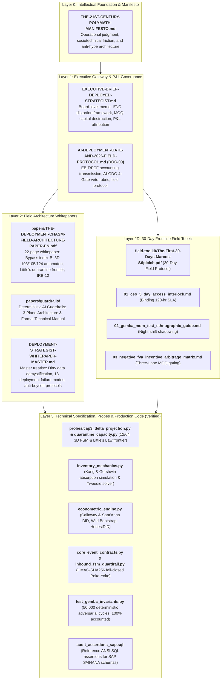
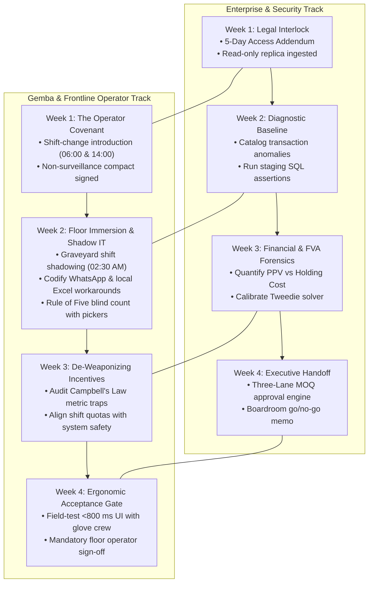

# Mellon & Ithildin — Deterministic Guardrails for AI on Dirty Operational Records

[](https://github.com/esstipi-debug/mellon/actions/workflows/ci.yml)
[](https://www.python.org/)
[](LICENSE)

AI agents fail on physical operations when they run `SUM()` over dirty ERP/WMS tables containing repeated snapshots or write directly to systems of record without physical proof or rollback.
`mellon` enforces deterministic, fail-closed operational guardrails: a `103/105/124` decoupled receipt automaton, HMAC-SHA256 safe-staging contracts, reference SAP S/4HANA SQL assertions, and a hash-chained `event-envelope/1` audit stream.
Read-only Level 0 boundary checks execute in under 5 seconds using the Python standard library alone before any live ERP integration or model execution.

---

## Verify in 30 Seconds (Real SAP P2P Sample — BPI Challenge 2019, CC BY 4.0)

```bash
git clone --depth 1 https://github.com/esstipi-debug/mellon.git
cd mellon
PYTHONPATH=src python -m fdekit.ithildin examples/bpi2019_sample.csv --out out/bpi_stream.jsonl
python contracts/event-envelope/envelope.py verify out/bpi_stream.jsonl
```

* **Zero external dependencies (`<5s`):** Runs on Python 3.10+ standard library only (`pandas`, `numpy`, and `scipy` are not required for `fdekit.ithildin` or `envelope.py`).
* **What it catches:** In real SAP Procure-to-Pay event logs ([`examples/bpi2019_sample.csv`](examples/bpi2019_sample.csv) — 200 PO item cases, 1,233 event rows from BPI Challenge 2019), `Cumulative net worth (EUR)` repeats across `Record Goods Receipt` rows (`1,033` receipt events). A naive `SUM()` totals `1,268,265,240.0` EUR against an actual `po_item_value_eur` total of `34,804,238.0` EUR (`36.44x` inflation, triggering `148` false over-receipt flags). `fdekit.ithildin` detects the repeated snapshot topology (`ColumnSemanticsProbe`: `REPEATED_SNAPSHOT`, `safe_to_sum=False`, `all_equal_ratio=1.0000`), blocks both an unverified ERP writeback (`REJECTED_MODE_FORBIDS_MUTATION`) and an untrusted control-field override (`PROMPT_INJECTION_CONTROL_FIELD`) under `FORENSIC_READONLY`, and seals `3` deterministic `event-envelope/1` records (`sha256=1eabac0f88a1617ed479021741380ec7abe6cd1a360b0867bc99d60aee868bb9`) verified intact by `envelope.py verify` (last hash `e6138d7699b6`). See [`examples/BPI2019_SAMPLE_PROVENANCE.md`](examples/BPI2019_SAMPLE_PROVENANCE.md) for extraction provenance.

---

## 3-Repo Boundary

| Repository | Scope & Mechanism |
|---|---|
| **[`mellon`](https://github.com/esstipi-debug/mellon)** *(this repo)* | Operational guardrails: `Ithildin` boundary detector, 3D `103/105/124` decoupled receipt automaton, `event-envelope/1` hash-chained contract, SAP S/4HANA SQL assertions, and the `fdekit` operational toolkit. |
| **[`fieldproof`](https://github.com/esstipi-debug/fieldproof)** | Zero-dependency Python stdlib CLI for forensic CSV `intake`, `verify-pack`, `preflight`, `canary`, `audit-trace`, and `ablate`. |
| **[`which-record-lies`](https://github.com/esstipi-debug/esstipi-debug/tree/main/demos/which-record-lies)** | Pre-registered empirical run on 95,824 real delivered Olist orders (including false-positive bounds and failed hypotheses). |

---

## 1. Technical Verification & Local Replication

All mathematical, validation, CLI, SQL, and finite-state machine invariants (`1,196` automated tests in the main suite: `1,196 passed, 2 skipped, 1 deselected, 0 xfailed`, plus `35` in `probes/`, `25` in `contracts/event-envelope`, and `6` in `test_gemba_invariants.py`) are reproducible locally:

### Environment Setup & Full Test Suite
```bash
git clone https://github.com/esstipi-debug/mellon.git
cd mellon
python --version
pip install -e ".[dev,contracts]"

pytest -q
pytest probes -q
pytest contracts/event-envelope -q
python contracts/event-envelope/envelope.py verify contracts/event-envelope/examples/valid-stream.jsonl
pytest tests/test_cap3_probes.py test_gemba_invariants.py -v
python test_gemba_invariants.py
```

* **3D `103/105/124` Decoupled Receipt Automaton & Quarantine Frontier:** `12/64` reachable legal states, zero uncounted release, dock non-blocking, and Little's Law `OVERFLOW_IMPUTED` capacity frontier (`35` formal property tests in `probes/`).
* **`event-envelope/1` Contract & Ithildin Bridge:** Portable hash-chained JSONL contract ([`contracts/event-envelope/README.md`](contracts/event-envelope/README.md)) and native Ithildin producer ([`src/fdekit/ithildin/envelope_bridge.py`](src/fdekit/ithildin/envelope_bridge.py)).
* **Adversarial Fuzzing Campaign:** `50,000 / 50,000` deterministically accounted adversarial transitions (`seed=20261024`, zero bypasses across fail-closed HMAC-SHA256 verification, UTC normalization, single-use nonce anti-replay, scale bounds, and master-catalog weight parity) plus `P1–P6` provenance regression tests in [`test_gemba_invariants.py`](test_gemba_invariants.py).
* **SQL Audit Assertions & Fail-Closed Guardrail Suite (`audit_assertions_sap.sql` & `tests/test_limites_conocidos_kit.py`):** Reference ANSI SQL assertions modeled on SAP S/4HANA schemas (`s4_mseg`, `s4_mkpf`, `s4_ekpo`, `s4_eket`, `s4_acdoca`) run against an in-memory SQLite copy in [`tests/test_sql_guardrails_metamorphic.py`](tests/test_sql_guardrails_metamorphic.py) (not executed against a live SAP instance). The 5 previously open SQL NULL fail-open gaps are **closed fail-closed** (`0` xfails in `test_sql_guardrails_metamorphic.py`). All **12 previously pinned security gaps** in `IthildinGuard` and the root receiving FSM (`inbound_fsm_guardrail.py` / `core_event_contracts.py` — 900-second TTL expiration, `approved_by` SoD & distinct `approver_secret`, signed sensor/scrap/return payloads, structural `rollback_plan` validation, fail-closed UTC enforcement, and SQLite-persisted idempotency/nonce stores) are also **closed fail-closed** and verified as passing regression tests in [`tests/test_limites_conocidos_kit.py`](tests/test_limites_conocidos_kit.py) (`0` xfails).

### Subcomponent Boundaries (`IMPL` vs. `MS-SPEC`)

| Subcomponent | Path | Status | Verification Scope |
|---|---|---|---|
| **BPI 2019 Boundary Check & Envelope Bridge** | [`examples/bpi2019_sample.csv`](examples/bpi2019_sample.csv), [`src/fdekit/ithildin/envelope_bridge.py`](src/fdekit/ithildin/envelope_bridge.py) | `IMPL` | Stdlib-only quickstart (`python -m fdekit.ithildin` + `envelope.py verify`) |
| **Field Diagnostic Kit (`fdekit`)** | [`src/fdekit/`](src/fdekit/) | `IMPL` | `pytest -q` (main suite; CLI + operational analytics) |
| **3D Decoupled Receipt Probes** | [`probes/`](probes/) | `IMPL` | `pytest probes -q` (`35` property/state-machine tests; `12/64` legal states) |
| **Event-Envelope Contract** | [`contracts/event-envelope/README.md`](contracts/event-envelope/README.md) | `IMPL` | `pytest contracts/event-envelope -q` & `envelope.py verify` |
| **SAP S/4HANA SQL Audit Assertions** | [`audit_assertions_sap.sql`](audit_assertions_sap.sql), [`tests/test_sql_guardrails_metamorphic.py`](tests/test_sql_guardrails_metamorphic.py) | `IMPL` | SQLite metamorphic suite (`5` NULL fail-open gaps closed fail-closed) |
| **Core Contracts, FSM & Gemba Fuzzing** | [`core_event_contracts.py`](core_event_contracts.py), [`inbound_fsm_guardrail.py`](inbound_fsm_guardrail.py), [`test_gemba_invariants.py`](test_gemba_invariants.py) | `IMPL` | `pytest -q test_gemba_invariants.py tests/test_limites_conocidos_kit.py` (`50,000` transitions + `P1–P6`; `12` security invariants closed fail-closed, `0` xfailed) |
| **Narya Frontline Andon Protocol** | [`field-toolkit/04_frontline_andon_and_stewardship_engine.md`](field-toolkit/04_frontline_andon_and_stewardship_engine.md) | `MS-SPEC` (`0` LOC) | Architecture spec only (`B <= 0.2/0.4`, `<= 60 m` physics boundary) |
| **Vilya Asynchronous Executive Synthesis** | — | Concept (`0` LOC) | No specification or code in this repository |

### Executing the `fdekit` Field Diagnostics & Decision Ledger CLI
```bash
fdekit verify-boundary examples/bpi2019_sample.csv --out out/bpi_stream.jsonl
fdekit demo --out out --seed 7
fdekit synth --out data --seed 7 --orders 2500 --skus 1800
fdekit mine --log data/event_log.csv --top 10
fdekit travel --log data/event_log.csv --plots out/plots
fdekit dq --master data/master_wms.csv --measured data/truth_fisica.csv
fdekit sim --log data/event_log.csv --pickers 9 --packers 4 --reps 3
fdekit value --findings out/hallazgos.json --scale grande --calibration chile
fdekit decide meeting --id 2026-10-24-kickoff --date 2026-10-24 --roster "Ana,Luis,Marcos"
fdekit decide add decision --statement "Enforce BWART 103 dock hold on variance > 3%" --owner "Ana" --criteria "unverified_101 == 0" --rationale "Block premature 3-way match AP leakage" --date 2026-10-24 --meeting 2026-10-24-kickoff
fdekit decide brief --json
```

### Executing the Causal Econometric & Stochastic Inventory Solvers
```bash
python econometric_engine.py
python inventory_mechanics.py
```
*`econometric_engine.py` calibrates Callaway & Sant'Anna (2021) doubly robust staggered DiD, 9,999 Wild Cluster Bootstrap replications ($p = 0.015402$), and Rambachan & Roth (2023) HonestDiD sensitivity bounds on a synthetic DGP validation panel ($K=16$ facilities, $T=24$ months). `inventory_mechanics.py` simulates the Kang & Gershwin inventory freezing regime and solves the exact compound Poisson-Gamma (Tweedie) break-even discount boundary.*

---

## 2. Deployment Ladder & Repository Architecture Map

**Deployment ladder.** Each level runs only after the one before it, and each requires explicit authorization from the client:

* **Level 0 — Offline forensic audit (CSV/SQL).** Historical extracts, read-only, zero network access to client production. Reference assertions in [`audit_assertions_sap.sql`](audit_assertions_sap.sql) and stdlib boundary checks (`fdekit.ithildin`) verify dirty records offline before any model runs.
* **Level 1 — Safe-staging Decision Cockpit (Kern).** A planner or buyer approves a replenishment plan from the office. The approval is signed with HMAC-SHA256 under a server-side secret, the write goes only to the session's working copy with rollback, and without the secret the engine refuses every approval-gated write. Offline replay: [`docs/cockpit.html`](docs/cockpit.html) (frozen on private Kern `b5c17a9`, 2026-11-10, over three sample spreadsheets—two approved and rolled back, one refused). The hosted path `linchpin.fly.dev/cockpit` is not deployed (checked 2026-11-14).
* **Level 2 — Gemba protocol under a signed master services agreement (MSA).** The 30-day floor protocol, only once covered by contract.



---

## 3. Consolidated Portfolio Navigation Matrix

| Layer | Code | Document / Script | Canonical Location | Target Audience | Function & Deliverables |
| :---: | :---: | :--- | :--- | :--- | :--- |
| **L0** | **DOC-02** | **The 21st-Century Polymath Manifesto** | [`THE-21ST-CENTURY-POLYMATH-MANIFESTO.md`](THE-21ST-CENTURY-POLYMATH-MANIFESTO.md) | Founders, C-Level | Operational judgment and frontline Gemba mastery over hyper-specialist silos. |
| **L1** | **DOC-00** | **Executive Board Memorandum (Gateway)** | [`EXECUTIVE-BRIEF-DEPLOYED-STRATEGIST.md`](EXECUTIVE-BRIEF-DEPLOYED-STRATEGIST.md) | Board, CEO, CFO, CIO | Executive synthesis mapping deployment failure modes, governance, and artifacts. |
| **L1B** | **DOC-09** | **AI Deployment Gate (`AI-GDG`) & 2026 Field Protocol** | [`AI-DEPLOYMENT-GATE-AND-2026-FIELD-PROTOCOL.md`](AI-DEPLOYMENT-GATE-AND-2026-FIELD-PROTOCOL.md) | Operating Partners, CFOs | Accounting transmission to `EBIT`/`FCF`, 4-Gate `AI-GDG` veto rubric, field protocol. |
| **L2P** | **PAPER** | **The Deployment Chasm — Field Architecture Paper (22 pp.)** | [`papers/THE-DEPLOYMENT-CHASM-FIELD-ARCHITECTURE-PAPER-EN.pdf`](papers/THE-DEPLOYMENT-CHASM-FIELD-ARCHITECTURE-PAPER-EN.pdf) | CTOs, COOs, Principal FDEs | 22-page whitepaper ([Markdown](papers/THE-DEPLOYMENT-CHASM-FIELD-ARCHITECTURE-PAPER-EN.md), [Spanish PDF](papers/THE-DEPLOYMENT-CHASM-FIELD-ARCHITECTURE-PAPER.pdf)): index $B$, 3D `103/105/124` FSM, Little's quarantine frontier, `IRB-12`. |
| **L2G** | **PAPER** | **Deterministic AI Guardrails Collection (2-Part)** | [`papers/guardrails/`](papers/guardrails/README.md) | CISOs, CTOs, Staff Engineers | Strategic Architecture ([`Governance`](papers/guardrails/DETERMINISTIC-GUARDRAILS-ARCHITECTURE-AND-GOVERNANCE.md)) & Formal Verification ([`Technical Manual`](papers/guardrails/DETERMINISTIC-GUARDRAILS-TECHNICAL-MANUAL.md)). |
| **L2A** | **DOC-01** | **Master Whitepaper: DS Doctrine & I/T/C** | [`DEPLOYMENT-STRATEGIST-WHITEPAPER-MASTER.md`](DEPLOYMENT-STRATEGIST-WHITEPAPER-MASTER.md) | CEO, VP Transformation, COO | Canonical doctrine: 13 failure modes of corporate AI, 11 I/T/C operational distortions, dual governance model. |
| **L2B** | **DOC-03** | **C-Level Whitepaper: MOQs vs. Working Capital** | [`MOQ-WORKING-CAPITAL-GOVERNANCE-WHITEPAPER.md`](MOQ-WORKING-CAPITAL-GOVERNANCE-WHITEPAPER.md) | CFO, CPO, Supply Chain Directors | TCO carrying cost mechanics, the PPV paradox, and Tweedie break-even frontier. |
| **L2C** | **DOC-08** | **Executive Evidence Dossier (62 Citations)** | [`EXECUTIVE-EVIDENCE-DOSSIER-62-CITATIONS.md`](EXECUTIVE-EVIDENCE-DOSSIER-62-CITATIONS.md) | Audit Committees, Peer Reviewers | 62 graded sources on why AI pilots fail: 13 peer-reviewed or official (`[D]`), 49 reports, working papers and press (`[R]`). |
| **L2D** | **DOC-04-06**| **30-Day Frontline Field Toolkit & PDF Playbook** | [`field-toolkit/`](field-toolkit/README.md) | Deployment Strategists, FDEs | 30-Day Field Playbook ([`PDF`](field-toolkit/The-First-30-Days-Marcos-Stipicich.pdf)), 5-Day CEO Interlock, Gemba Mom Test, Negative FVA Matrix. |
| **L3** | **DOC-07** | **Formal Code Mechanics & Empirical Audit** | [`FORMAL-MECHANICS-EMPIRICAL-AUDIT.md`](FORMAL-MECHANICS-EMPIRICAL-AUDIT.md) | Lead Architects, FDEs, Auditors | Mechanistic proofs (Theorem 1), Pydantic V2 contracts, FSM spec, 50k fuzzing test, and Staggered DiD. |
| **CODE** | **PROBE** | **3D Decoupled Receipt Automaton & Quarantine Frontier (35 Tests)** | [`probes/`](probes/) | Formal Verification & WMS Architects | [`cap3_delta_projection.py`](probes/cap3_delta_projection.py) (`12/64` legal states) & [`quarantine_capacity.py`](probes/quarantine_capacity.py) (Little's Law saturation, 35 formal property tests). |
| **CODE** | **ENG** | **Stochastic Inventory Mechanics Solver** | [`inventory_mechanics.py`](inventory_mechanics.py) | Operations Researchers | Seeded Kang & Gershwin absorption trajectory & compound Poisson-Gamma (Tweedie) solver. |
| **CODE** | **ENG** | **Econometric Inference & DiD Engine** | [`econometric_engine.py`](econometric_engine.py) | Applied Econometricians | Synthetic DGP calibration of Callaway & Sant'Anna staggered DiD, 9,999 Wild Cluster Bootstrap ($p = 0.0154$). |
| **CODE** | **ENG** | **Strongly-Typed Event Contracts** | [`core_event_contracts.py`](core_event_contracts.py) | Distributed Systems Engineers | Pydantic V2 immutable models with fail-closed HMAC-SHA256, UTC normalization, and physical scale bounds. |
| **CODE** | **ENG** | **Poka-Yoke Inbound State Machine** | [`inbound_fsm_guardrail.py`](inbound_fsm_guardrail.py) | Lead Software Architects | Non-bypassable state machine enforcing sensor proofs, single-use nonces, and `124`/`122` return parity. |
| **CODE** | **ENG** | **Gemba Invariant Testing Harness** | [`test_gemba_invariants.py`](test_gemba_invariants.py) | QA / Reliability Engineers | Deterministic `50,000`-cycle adversarial fuzzing suite (`seed=20261024`) + `P1–P6` provenance regression tests. |
| **CODE** | **ENG** | **Reference SQL Audit Assertions** | [`audit_assertions_sap.sql`](audit_assertions_sap.sql) | SAP / Database Administrators | Reference ANSI SQL assertions modeled on SAP S/4HANA (`MSEG`, `MKPF`, `EKPO`, `ACDOCA`, `103/105/124` parity). |
| **DOJO** | **UI** | **Knowledge Graph & FDE Field Dojo** | [GitHub Pages Deployment](https://esstipi-debug.github.io/mellon/) | Executive & Technical Teams | Offline 8-book FDE Knowledge Graph (`202` nodes, `507` edges) and FDE Field Dojo (`43` scenarios, `2` bootcamps, `7` forge missions). |

---

## 4. Field Whitepapers

Field papers for operators and executives. The PDFs open in the browser.

| Paper | The argument |
| :--- | :--- |
| **[The Smith and the Tailor](https://cdn.jsdelivr.net/gh/esstipi-debug/esstipi-debug@main/papers/the-smith-and-the-tailor.pdf)** *(10 pages · PDF)* | Many deployments are cut before anyone measures the floor, by someone who will not be there when the seams give. Two rules a CEO can set before kickoff change who carries it. |
| **[Nobody Pays for Being Wrong](https://cdn.jsdelivr.net/gh/esstipi-debug/esstipi-debug@main/papers/nobody-pays-for-being-wrong.pdf)** *(27 pages · PDF)* | The supervisor who obeys the system against the evidence and the picker who ships a dented unit look like opposites, but both take the option that is cheap for them. The lever for both: make someone answer for the decision, and ask for the reason before the override. |
| **[The Shortcut Is Not a Lapse](https://cdn.jsdelivr.net/gh/esstipi-debug/esstipi-debug@main/papers/the-shortcut-is-not-a-lapse.pdf)** *(8 pages · PDF)* | On a picking line, the dented unit ships because reporting it costs the picker their own number, and shipping it costs someone else, later. Three questions a COO can ask where the record is written, before blaming the people who write it. |
| **[The Damage Has No Name](https://cdn.jsdelivr.net/gh/esstipi-debug/esstipi-debug@main/papers/the-damage-has-no-name.pdf)** *(8 pages · PDF)* | Speed is measured the same minute, with a name; the damage it causes is booked weeks later, without one. A CFO can trace three lines of damage to a shift and a decision: if nobody can, the bonus is paying for them. |
| **[When Exceptions Outrun the Desk](https://cdn.jsdelivr.net/gh/esstipi-debug/esstipi-debug@main/papers/when-exceptions-outrun-the-desk.pdf)** *(8 pages · PDF)* | When exceptions reach the desk faster than its people can resolve them, the overflow does not stop the dock. It leaves the procedure. Four numbers a COO can watch each week, before the next headcount decision. |
| **[The Tow the System Calls Idle](https://cdn.jsdelivr.net/gh/esstipi-debug/esstipi-debug@main/papers/the-tow-the-system-calls-idle.pdf)** *(8 pages · PDF)* | A minute needs a name: a fact the time standard has no category for goes to whatever category is left, and lands on the driver. Let the floor contest the record, and count the reasons that come back: each one is a name the standard is missing. |
| **[A Hundred Eyes, One Percent](https://cdn.jsdelivr.net/gh/esstipi-debug/esstipi-debug@main/papers/a-hundred-eyes-one-percent.pdf)** *(9 pages · PDF)* | An approval only controls what the approver would catch. When errors are rare, people can miss more of them, and the log looks the same. Test the control, not the signature, as airports test their screeners. |
| **[Use It or Lose It](https://cdn.jsdelivr.net/gh/esstipi-debug/esstipi-debug@main/papers/use-it-or-lose-it.pdf)** *(8 pages · PDF)* | When a budget expires on a fixed date, the rule decides who pays for the rush. The step for a CEO is to change the rule, not to preach. |
| **[Who Is Allowed to Be Right?](https://cdn.jsdelivr.net/gh/esstipi-debug/esstipi-debug@main/papers/who-is-allowed-to-be-right.pdf)** *(8 pages · PDF)* | After a go-live, being right about a rule and being allowed to stop it can sit two weeks apart. A CEO can measure the gap for one rule: who sees it fail first, who can stop it, and how many days pass in between. |
| **[Put the Toll on the Bridge](https://cdn.jsdelivr.net/gh/esstipi-debug/esstipi-debug@main/papers/put-the-toll-on-the-bridge.pdf)** *(10 pages · PDF)* | A step that guards an expensive mistake earns its place on a shift screen. The same step on every line teaches the crew to get around it. Before approving the next screen, a COO can list every step that is not the work, time it on the floor, and ask which mistake each one would let through if it disappeared. In Spanish: [Poné el peaje en el puente](https://cdn.jsdelivr.net/gh/esstipi-debug/esstipi-debug@main/papers/pone-el-peaje-en-el-puente.pdf). |
| **[Who the Form Is For](https://cdn.jsdelivr.net/gh/esstipi-debug/esstipi-debug@main/papers/who-the-form-is-for.pdf)** *(9 pages · PDF)* | A quality record can be built to catch the people who fill it or to help them handle what goes wrong; built for the auditor, it teaches the floor to fill it rather than use it. Before the next audit, a COO can ask the person who fills each record what it is for, and put the record through four questions: who may fix a breach at the door, whether each field carries its reason, where the record goes after the shift, and what happens to whatever the form has no box for. |

---

## 5. Architectural Doctrine, Frontline Protocol & Component Status

### Architectural Identity (`IMPL` vs. `MS-SPEC` / Concept)

In enterprise technology deployments, systems fail at the boundary where digital models meet physical operations. This repository separates frontline workflow alignment from deterministic execution safety:

```
                  ┌─────────────────────────────────────────────────────────┐
                  │                 THE ENTERPRISE GATEWAY                  │
                  │             (IT, InfoSec, Operations, P&L)              │
                  └────────────────────────────┬────────────────────────────┘
                                               │
                       ┌───────────────────────┴───────────────────────┐
                       │                                               │
                       ▼                                               ▼
         [The Ivory Tower Approach: Imposition]          [The Mellon & Ithildin Approach: Alliance]
         • Confined to remote IDEs & slides              • Embedded in the Gemba alongside the floor
         • Treats frontline pushback as "ignorance"      • Respects operator fatigue & tacit knowledge
         • Imposes abstract AI without floor empathy     • Partner to labor, mathematically safe to IT
         • MIT NANDA: 95% of orgs, zero GenAI return     • Hypothesis: Sustained Adoption & Verifiable P&L
                       │                                               │
                       ▼                                               ▼
                  GATE CLOSED                                     GATE OPEN
```

* **MELLON (`IMPL` — Frontline Adoption Doctrine):** In physical operations, AI pilots fail when operators experience the tool as surveillance or extra clerical friction. Mellon treats the agent as a shift ally that absorbs clerical transcription, aligns incentives, and satisfies the *Ergonomic Threshold* (`<800 ms` latency, glove-compatible UI, zero net incremental clicks).
* **ITHILDIN (`IMPL` — Deterministic Guardrails & Safe-Staging):** Passive safety fabric (`src/fdekit/ithildin/`, `core_event_contracts.py`, `inbound_fsm_guardrail.py`): zero direct mutations against production ERP/WMS tables (`MSEG`, `MKPF`, `EKET`), read-only telemetry probes, HMAC-SHA256 signed changesets, and idempotent rollback ledgers. All 12 previously open security limits (TTL expiration, approver identity/SoD, signed sensor/scrap/return payloads, structural rollback-plan validation, UTC enforcement, and SQLite-persisted idempotency/nonce stores) are closed fail-closed and verified by regression tests in [`tests/test_limites_conocidos_kit.py`](tests/test_limites_conocidos_kit.py) (`0` xfailed).
* **NARYA (`MS-SPEC` — `0` LOC):** Specification only, not implemented ([`field-toolkit/04_frontline_andon_and_stewardship_engine.md`](field-toolkit/04_frontline_andon_and_stewardship_engine.md)). Describes an operator defect-reporting loop routed through Ithildin safe-staging with reporting time credited against pick-rate targets. One attribution rule: each closure is sealed to the operator's credential so that no one can appropriate it, and every report aggregates by shift, asset and cohort; the system produces no individual ranking and no individual record is used for discipline. Figures in the spec are design targets, not measurements.
* **VILYA (`0` LOC — Concept Only):** Concept only; no specification or code exists in this repository. Proposes replacing long status reports with short asynchronous visual briefs and restricting synchronous meetings (*Essential Council*) to unresolved trade-offs.
* **KERN (Private Repo — `0` Production Customers; `linchpin.fly.dev` Not Deployed):** Separate private planning engine (`60` capabilities, `39` MCP tools over Streamable HTTP) whose safe-staging approval replay is archived offline in [`docs/cockpit.html`](docs/cockpit.html). `linchpin.fly.dev` is not deployed (checked 2026-11-14). Currently pre-revenue (`0` production customers).

### Why Enterprise AI Pilots Fail at the Last Mile

Preliminary research from **MIT NANDA (July 2025; 52 organizations interviewed, 153 senior leader surveys)** reports that **95% of organizations are getting zero return from Generative AI** due to brittle workflows, lack of contextual learning, and misalignment with daily operations, while **RAND (2024)** cites estimates that **more than 80% of AI projects fail**, about twice the rate of IT projects without AI. In physical supply chains, manufacturing, and distribution, this failure is driven by three operational bottlenecks:

1. **Institutional Decoupling (*Meyer & Rowan, 1977*):** Corporate software projects formal compliance upward while physical plants survive on undocumented workarounds (offline Excel workbooks and unofficial WhatsApp dispatch groups). Deploying probabilistic models over corrupted ERP tables automates friction rather than value.
2. **The Frontline Ergonomic Threshold (>800 ms Latency):** Interfaces requiring 14 confirmation screens or multi-second cloud roundtrips under dock conditions are bypassed by operators as a rational act of operational self-preservation (*Dent & Goldberg, 1999*).
3. **Legacy IT & Cybersecurity Lockout:** Data stewards block autonomous agents when non-deterministic models risk issuing hallucinated write transactions (`OWASP LLM06:2025`).

### The 30-Day Frontline Deployment Protocol

Full playbook in [`field-toolkit/FIELD-PROTOCOL-30-DAYS.md`](field-toolkit/FIELD-PROTOCOL-30-DAYS.md) and [`field-toolkit/The-First-30-Days-Marcos-Stipicich.pdf`](field-toolkit/The-First-30-Days-Marcos-Stipicich.pdf).



* **The Gemba Covenant (Directive M1):** Zero individual human surveillance telemetry (monitors machine invariants and inventory topology, not people); net reduction of clerical drudgery; historical action inquiry (*The Mom Test*, Fitzpatrick 2013).
* **The Ergonomic Invariance Gate:** End-to-end latency $\le 800\text{ ms}$ on ruggedized handhelds, glove-compatible touch geometry ($\ge 48 \times 48\text{ dp}$, $\ge 8\text{ dp}$ spacing, $\ge 7:1$ contrast), zero net incremental clicks over manual workarounds, and explicit floor operator sign-off before production cutover.

---

## 6. Author & Operational Background

**Marcos Stipicich**  
Santiago, Chile (UTC-3 / US Business Hours Overlap) · Bilingual (English C1 · Native Spanish)  
[GitHub](https://github.com/esstipi-debug) · [LinkedIn](https://linkedin.com/in/marcos-stipicich)

Across 13 years in physical supply chains, distribution, and operational finance—combined with an early programming foundation in C and applied AI systems built in Python, TypeScript, and SQL—my focus is translating unmeasured floor friction into deterministic boundaries and verifiable software:

* **13 Years of Frontline Operations (Chile, Argentina, Australia):** Led operations across distribution, retail, e-commerce, and manufacturing: managed a $100M inventory position with network-wide cycle-counting and accuracy programs; directed planning for 200+ retail locations with 15 planners; led a $15M multi-site logistics budget across ~100 personnel; owned a $30M cross-border e-commerce P&L (300% YoY growth, ~$5M working capital released); and as Outbound Leader at AGCO Corporation (Melbourne, 2022–2024), ran a hybrid forklift/floor-and-desk operation executing the full WMS cutover from `3MWorks` to `Manhattan Associates` across 50,000+ SKUs (23 operators trained, -20% order processing time while remaining on the floor through hypercare until informal workarounds disappeared).
* **Pre-Cutover Workaround & Incentive Stress-Testing:** Replaced bonus-linked operator production quotas that manufactured damaged and mixed shipments with customer-satisfaction and response-time metrics, and designed `mellon` and `fieldproof` around pre-cutover stress-testing of dirty tables, isolated read/write boundaries, and signed safe-staging with rollback.
* **Independent Prototype History (Pre-Revenue):** Currently pre-revenue (`0` paying customers in production). Built `mellon` (public, MIT), `fieldproof` (public, MIT), `which-record-lies` (public Olist empirical run), `nosilo-core` / `Kern` (private control-plane prototypes; `linchpin.fly.dev` is not deployed), and **Holy Oly** (an archived multi-tenant weightlifting coaching prototype with ~1,332 unit test cases, currently offline with `0` paying customers).

---

## License

MIT License. See [LICENSE](LICENSE) for details.
