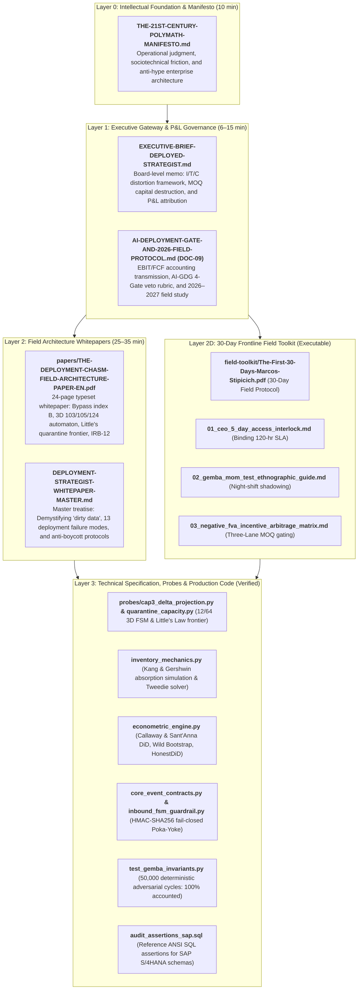
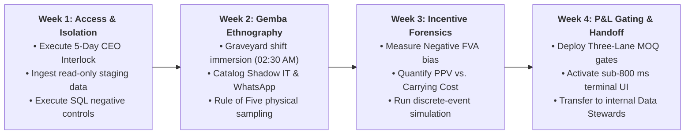

# Mellon 🗝️ & Ithildin 🌌
## Enterprise AI Deployment Framework & Forward Deployed Architecture

[](https://www.python.org/)
[](https://docs.pydantic.dev/)
[](https://modelcontextprotocol.io/)
[-brightgreen.svg)](test_gemba_invariants.py)
[](inbound_fsm_guardrail.py)
[](LICENSE)

> *"Ennyn Durin Aran Moria: pedo mellon a minno."*  
> **"The Doors of Durin, Lord of Moria. Speak, friend, and enter."**

---

## 1. Architectural Identity: Mellon & Ithildin

In enterprise technology deployments, systems fail at the boundary where digital models meet physical operations. Inspired by high-reliability forward deployed engineering (Palantir doctrine), this repository is organized around a dual architectural paradigm:

```
                  ┌─────────────────────────────────────────────────────────┐
                  │                 THE ENTERPRISE GATEWAY                  │
                  │             (IT, InfoSec, Operations, P&L)              │
                  └────────────────────────────┬────────────────────────────┘
                                               │
                       ┌───────────────────────┴───────────────────────┐
                       │                                               │
                       ▼                                               ▼
         [The Ivory Tower Approach: Imposition]          [The Mellon & Ithildin Approach: Alliance]
         • Confined to remote IDEs & slides              • Embedded in the Gemba alongside the floor
         • Treats frontline pushback as "ignorance"      • Respects operator fatigue & tacit knowledge
         • Imposes abstract AI without floor empathy     • Partner to labor, mathematically safe to IT
         • Result: 95% Pilot Failure Rate                • Result: Sustained Adoption & Verified P&L
                       │                                               │
                       ▼                                               ▼
                  GATE CLOSED                                     GATE OPEN
```

* **MELLON 🗝️ (The Human Alliance Protocol):** Frontline adoption protocol in the Gemba. In enterprise physical operations, AI pilots are rejected when workers perceive the system as an extractive surveillance mechanism or a career threat. Under the *Mellon* doctrine, the AI agent never acts as a punitive auditor; it acts strictly as an operational shift ally that absorbs clerical drudgery, protects workers from impossible scheduling quotas, and satisfies the *Ergonomic Threshold* (<800 ms latency, glove-compatible UI, zero net incremental clicks), removing the frontline reasons pilots get rejected.
* **ITHILDIN 🌌 (Deterministic Guardrails):** Passive, mathematically verifiable infrastructure. Just as Celebrimbor’s *ithildin* script remained dormant until illuminated by starlight, Ithildin operates as a passive safety fabric: zero direct mutations against production ERP/WMS databases (`MSEG`, `MKPF`, `EKET`), read-only telemetry probes across 5 canonical event dimensions, cryptographically signed changesets (HMAC-SHA256) with strict 900-second Time-To-Live (TTL), and bit-for-bit idempotent rollback ledgers.

---

## 2. The Executive Problem: Why 95% of Enterprise AI Pilots Fail at the Last Mile

Preliminary research from **MIT NANDA (July 2025; 52 organizations interviewed, 153 senior leader surveys)** reports that **95% of organizations are getting zero return from Generative AI** due to brittle workflows, lack of contextual learning, and misalignment with daily operations, while **RAND (2024)** cites estimates that **more than 80% of AI projects fail**, about twice the rate of IT projects without AI. In physical supply chains, manufacturing, and distribution, this systemic collapse is driven by a triadic operational bottleneck:

1. **Institutional Decoupling (*Meyer & Rowan, 1977*):** Executive committees purchase enterprise software to project modern governance to investors, while physical plants survive underneath via undocumented workarounds (Shadow IT: offline Excel workbooks and unofficial driver WhatsApp groups). When an abstract probabilistic model is deployed over corrupted ERP data, it automates friction rather than value.
2. **The Frontline Ergonomic Threshold (>800 ms Latency):** AI models designed in corporate innovation labs routinely transfer clerical friction to workers wearing industrial gloves on noisy loading docks. If confirming an inbound shipment requires 14 screens or incurs a 3-second cloud roundtrip, operators bypass the device. Frontline rejection is not irrational "resistance to change" (*Dent & Goldberg, 1999*); it is a rational act of operational self-preservation.
3. **Legacy IT & Cybersecurity Lockout:** Stewards of corporate data legitimately block autonomous agents out of well-founded fears that non-deterministic LLMs will execute hallucinated transactions, corrupt transactional database schemas, or violate compliance mandates (`OWASP LLM06:2025`).

**The Solution:** Mellon aligns human incentives on the floor through ergonomic empathy, while Ithildin provides CISOs and CFOs with deterministic runtime guarantees of zero unauthorized transactional mutation through cryptographic staging.

---

## 3. The 4-Layer Repository Architecture

The repository is structured hierarchically across four interconnected layers to address distinct corporate stakeholder mandates:



---

## 4. Production Integration: Kern & Anthropic Model Context Protocol (MCP)

In addition to the open architectural specifications versioned here, this framework connects directly to **Kern** (`linchpin.fly.dev`), an autonomous agentic supply chain planning engine:

* **Anthropic MCP Streamable HTTP Integration:** Kern implements an official **Model Context Protocol (MCP)** server operating over Streamable HTTP, exposing structured operational tools (lead-time stochastic solvers, inventory allocation gates, and freight arbitrage calculators) directly to Anthropic's Claude models.
* **Dual-Track Execution Engine:** Claude analyzes unstructured operational brief requests, while deterministic MCP tool gates validate safety stock intervals and working capital bounds before issuing recommendations.
* **Proprietary Core Intellectual Property:** In accordance with standard enterprise software practices, Kern’s underlying algorithmic core, multi-echelon optimization solvers, and proprietary trade-secret heuristics remain hosted as a private intellectual property repository. The public assets in `mellon` provide the exact, fully replicable architectural guardrails, event contracts, and econometric verification harnesses required to evaluate the methodology.

---

## 5. The 30-Day Frontline Deployment Protocol

Engineered to integrate seamlessly with 90-day transformation sprints (such as WON.ai Rapid Redesign cycles; full playbook in [`field-toolkit/FIELD-PROTOCOL-30-DAYS.md`](field-toolkit/FIELD-PROTOCOL-30-DAYS.md) and [`field-toolkit/The-First-30-Days-Marcos-Stipicich.pdf`](field-toolkit/The-First-30-Days-Marcos-Stipicich.pdf)):



| Deployment Phase | Timeframe | Core Operational Deliverable | Primary Stakeholder |
| :--- | :---: | :--- | :--- |
| **Phase 1: Legal Interlock & Ingestion** | Days 0–7 | 5-Day Access Addendum signed; read-only replica ingested; `audit_assertions_sap.sql` adapted to staging schemas. | CEO, CISO, Lead Architect |
| **Phase 2: Gemba Ground Truth** | Days 8–14 | Forensic night-shift shadowing completed; informal cheat sheets and WhatsApp channels mapped; Rule of Five inventory discrepancies audited. | Plant Managers, Dock Supervisors |
| **Phase 3: FVA Forensics & Simulation** | Days 15–21 | Stockout fear bias quantified; purchasing PPV trade-offs isolated; `inventory_mechanics.py` Tweedie solver calibrated. | CFO, Procurement Directors |
| **Phase 4: Gating, Pilot & Handoff** | Days 22–30 | Three-Lane MOQ approval engine live; `inbound_fsm_guardrail.py` active on pilot terminals; governance transferred to operational Data Stewards. | COO, Operational Data Stewards |

---

## 6. Verified Code & Local Replication

All mathematical, validation, CLI, and finite-state machine invariants (`1,075+` automated tests) are reproducible locally:

### Environment Setup
```bash
git clone https://github.com/esstipi-debug/mellon.git
cd mellon
python --version
pip install -e ".[dev]"
```

### Running the Full Repository Test Suite, 3D Automaton Probes & 50,000-Cycle Fuzzing Campaign
```bash
pytest -q
pytest tests/test_cap3_probes.py test_gemba_invariants.py -v
python test_gemba_invariants.py
```
*Verifies the 3-coordinate `103/105/124` decoupled receipt automaton (`12/64` reachable legal states, zero uncounted release, dock non-blocking, and Little's Law `OVERFLOW_IMPUTED` capacity frontier) alongside `50,000 / 50,000` deterministically accounted adversarial transitions (`seed=20261024`, zero bypasses across fail-closed HMAC-SHA256 verification, UTC normalization, single-use nonce anti-replay, scale bounds, and master-catalog weight parity).*

### Executing the `fdekit` Field Diagnostics & Decision Ledger CLI
```bash
fdekit demo --out out --seed 7
fdekit synth --out data --seed 7 --orders 2500 --skus 1800
fdekit mine --log data/event_log.csv --top 10
fdekit travel --log data/event_log.csv --plots out/plots
fdekit dq --master data/master_wms.csv --measured data/truth_fisica.csv
fdekit sim --log data/event_log.csv --pickers 9 --packers 4 --reps 3
fdekit spc --values data/series.csv --baseline 30
fdekit probe --edi data/edi
fdekit value --findings out/hallazgos.json --scale grande --calibration chile
fdekit decide meeting --id 2026-10-24-kickoff --date 2026-10-24 --roster "Ana,Luis,Marcos"
fdekit decide add decision --statement "Enforce BWART 103 dock hold on variance > 3%" --owner "Ana" --criteria "unverified_101 == 0" --rationale "Block premature 3-way match AP leakage" --date 2026-10-24 --meeting 2026-10-24-kickoff
fdekit decide brief --json
```

### Executing the Causal Econometric & Stochastic Inventory Solvers
```bash
python econometric_engine.py
python inventory_mechanics.py
```
*`econometric_engine.py` calibrates Callaway & Sant'Anna (2021) doubly robust staggered DiD, 9,999 Wild Cluster Bootstrap replications ($p = 0.015402$), and Rambachan & Roth (2023) HonestDiD sensitivity bounds on a synthetic DGP validation panel ($K=16$ facilities, $T=24$ months). `inventory_mechanics.py` simulates the Kang & Gershwin inventory freezing regime and solves the exact compound Poisson-Gamma (Tweedie) break-even discount boundary.*

---

## 7. Consolidated Portfolio Navigation Matrix

The repository is architected across modular epistemological layers—from foundational philosophy down to typeset whitepapers, executable runtime contracts, and econometric audits:

| Layer | Code | Document / Script | Canonical Location | Target Audience | Function & Deliverables |
| :---: | :---: | :--- | :--- | :--- | :--- |
| **L0** | **DOC-02** | **The 21st-Century Polymath Manifesto** | [`THE-21ST-CENTURY-POLYMATH-MANIFESTO.md`](THE-21ST-CENTURY-POLYMATH-MANIFESTO.md) | Global Founders, C-Level | Epistemological doctrine: renaissance engineering & frontline Gemba mastery over hyper-specialist silos. |
| **L1** | **DOC-00** | **Executive Board Memorandum (Gateway)** | [`EXECUTIVE-BRIEF-DEPLOYED-STRATEGIST.md`](EXECUTIVE-BRIEF-DEPLOYED-STRATEGIST.md) | Board, CEO, CFO, CIO | Rapid executive synthesis (6 min) mapping the failure modes, governance, and complete artifact suite. |
| **L1B** | **DOC-09** | **AI Deployment Gate (`AI-GDG`) & 2026 Field Protocol** | [`AI-DEPLOYMENT-GATE-AND-2026-FIELD-PROTOCOL.md`](AI-DEPLOYMENT-GATE-AND-2026-FIELD-PROTOCOL.md) | PE Operating Partners, CFOs, AI Committees | Accounting transmission to `EBIT`/`FCF`, 4-Gate `AI-GDG` veto rubric, and `N=1 -> N=20+` 2026–2027 field protocol. |
| **L2P** | **PAPER** | **The Deployment Chasm — Field Architecture Paper (24 pp.)** | [`papers/THE-DEPLOYMENT-CHASM-FIELD-ARCHITECTURE-PAPER-EN.pdf`](papers/THE-DEPLOYMENT-CHASM-FIELD-ARCHITECTURE-PAPER-EN.pdf) | CTOs, COOs, Principal FDEs | Print-ready 24-page whitepaper ([Markdown](papers/THE-DEPLOYMENT-CHASM-FIELD-ARCHITECTURE-PAPER-EN.md)): index $B$, 3D `103/105/124` FSM, Little's quarantine frontier, `IRB-12`. |
| **L2A** | **DOC-01** | **Master Whitepaper: DS Doctrine & I/T/C** | [`DEPLOYMENT-STRATEGIST-WHITEPAPER-MASTER.md`](DEPLOYMENT-STRATEGIST-WHITEPAPER-MASTER.md) | CEO, VP Transformation, COO | Canonical doctrine: 13 failure modes of corporate AI, 11 I/T/C operational distortions, dual governance model. |
| **L2B** | **DOC-03** | **C-Level Whitepaper: MOQs vs. Working Capital** | [`MOQ-WORKING-CAPITAL-GOVERNANCE-WHITEPAPER.md`](MOQ-WORKING-CAPITAL-GOVERNANCE-WHITEPAPER.md) | CFO, CPO, Supply Chain Directors | Capital stewardship: TCO carrying cost mechanics, the PPV paradox, and Tweedie break-even frontier. |
| **L2C** | **DOC-08** | **Executive Evidence Dossier (62 Citations)** | [`EXECUTIVE-EVIDENCE-DOSSIER-62-CITATIONS.md`](EXECUTIVE-EVIDENCE-DOSSIER-62-CITATIONS.md) | Audit Committees, Peer Reviewers | 62 academic and industry citations (MIT, Stanford, RAND, Harvard, NBER) establishing why AI pilots fail. |
| **L2D** | **DOC-04-06**| **30-Day Frontline Field Toolkit & PDF Playbook** | [`field-toolkit/`](field-toolkit/README.md) | Deployment Strategists, FDEs | 30-Day Field Playbook ([`PDF`](field-toolkit/The-First-30-Days-Marcos-Stipicich.pdf)), 5-Day CEO Interlock, Gemba Mom Test, Negative FVA Matrix. |
| **L3** | **DOC-07** | **Formal Code Mechanics & Empirical Audit** | [`FORMAL-MECHANICS-EMPIRICAL-AUDIT.md`](FORMAL-MECHANICS-EMPIRICAL-AUDIT.md) | Lead Architects, FDEs, Auditors | Mechanistic proofs (Theorem 1), Pydantic V2 contracts, FSM spec, 50k fuzzing test, and Staggered DiD. |
| **CODE** | **PROBE** | **3D Decoupled Receipt Automaton & Quarantine Frontier** | [`probes/`](probes/) | Formal Verification & WMS Architects | [`cap3_delta_projection.py`](probes/cap3_delta_projection.py) (`12/64` legal states) & [`quarantine_capacity.py`](probes/quarantine_capacity.py) (Little's Law saturation). |
| **CODE** | **ENG** | **Stochastic Inventory Mechanics Solver** | [`inventory_mechanics.py`](inventory_mechanics.py) | Operations Researchers | Seeded Kang & Gershwin absorption trajectory & compound Poisson-Gamma (Tweedie) solver. |
| **CODE** | **ENG** | **Econometric Inference & DiD Engine** | [`econometric_engine.py`](econometric_engine.py) | Applied Econometricians | Synthetic DGP calibration of Callaway & Sant'Anna staggered DiD, 9,999 Wild Cluster Bootstrap ($p = 0.0154$). |
| **CODE** | **ENG** | **Strongly-Typed Event Contracts** | [`core_event_contracts.py`](core_event_contracts.py) | Distributed Systems Engineers | Pydantic V2 immutable models with fail-closed HMAC-SHA256, UTC normalization, and physical scale bounds. |
| **CODE** | **ENG** | **Poka-Yoke Inbound State Machine** | [`inbound_fsm_guardrail.py`](inbound_fsm_guardrail.py) | Lead Software Architects | Non-bypassable state machine enforcing sensor proofs, single-use nonces, and `124`/`122` return parity. |
| **CODE** | **ENG** | **Gemba Invariant Testing Harness** | [`test_gemba_invariants.py`](test_gemba_invariants.py) | QA / Reliability Engineers | Deterministic `50,000`-cycle adversarial fuzzing suite (`seed=20261024`) + `P1–P6` provenance regression tests. |
| **CODE** | **ENG** | **Reference SQL Audit Assertions** | [`audit_assertions_sap.sql`](audit_assertions_sap.sql) | SAP / Database Administrators | Reference ANSI SQL assertions modeled on SAP S/4HANA (`MSEG`, `MKPF`, `EKPO`, `ACDOCA`, `103/105/124` parity). |
| **DOJO** | **UI** | **Interactive Simulation & Sensitivity Dojo** | [GitHub Pages Deployment](https://esstipi-debug.github.io/mellon/) | Executive & Technical Teams | Online browser simulation running live Monte Carlo inventory absorption and sensitivity curves. |

---

## 8. Author & Operational Background

**Marcos Stipicich**  
*Principal Forward Deployed Architect & Operational Systems Strategist*  
Santiago, Chile (UTC-3 / Full US Business Hours Overlap) · Bilingual (English C1/C2 · Native Spanish)  
[GitHub](https://github.com/esstipi-debug) · [LinkedIn](https://linkedin.com/in/marcos-stipicich)

### The Systems Philosophy
Systems break at the boundaries between disconnected silos. Across 13 years at the intersection of physical operations, enterprise finance, and software architecture, my operating principle has remained invariant: **first eliminate manual drudgery on the floor, then translate diffuse, unmeasured friction into deterministic numbers and verifiable models.**

### Core Track Record & Trajectory

* **13 Years of Frontline Operations (Chile, Argentina, Australia):** Led enterprise operations across manufacturing, retail, and heavy distribution. Owned consolidated P&Ls up to $30M (scaling multi-channel e-commerce 300% YoY while releasing ~$5M in working capital), managed multi-site operating budgets ($15M across ~100 personnel), directed end-to-end forecasting and replenishment for 200+ retail locations with 15 planners, and analyzed $100M inventory portfolios.
* **Gemba Discovery & Incentive Alignment:** Veteran of repeated shop-floor turnarounds where standard operating procedures diverged from reality. Identified and dismantled perverse incentives (such as bonus-linked picking volume quotas that actively manufactured mixed and damaged shipments) and replaced them with binary quality gates and floor-adopted standard work. Directed tier-1 WMS cutovers (including AGCO Melbourne across 50,000 SKUs) by running hypercare directly on the floor alongside operators until manual workarounds disappeared.
* **Full-Stack SaaS & Biometric Domain Modeling (`Holy Oly`):** Architected and deployed **Holy Oly**, a multi-tenant Olympic weightlifting SaaS and athlete readiness platform on Render (~1,332 test cases, Fastify, Prisma, PostgreSQL, React).
  * *Full Coach Editorial Agency:* Built on a two-level architecture (`catalog ↔ plan`) where the platform assists rather than restricts: the coach retains 100% editorial authority to override, fine-tune, or reconstruct every load, session, volume, or rep scheme.
  * *10 Methodological Weightlifting Schools:* Codified distinct periodization templates reflecting 10 international traditions (Soviet/Prilepin volume tables and waviness, Bulgarian daily max singles ≥90%, Chinese technique×strength with closing metabolic blocks, Cuban velocity complexes, Colombian leg-volume/peaking taper, etc.).
  * *Non-Standard Repetition & Complex Parser:* Engineered a deterministic notation engine to parse, count, and decompose non-standard Olympic complexes (ordered multi-movement links in one set with one bar, e.g., `(2 Snatch + 1 Overhead Squat) @ 80%`). Automatically enforces weakest-link percentage grounding (computing target weight against the weakest component's 1RM to prevent catastrophic failure) and decomposes fatigue across 4 orthogonal dimensions (neural/SNC, technical complexity 1..12, structural/axial load, and metabolic demand), with strict invariants guaranteeing missing telemetry never defaults to a false green.
* **Cross-Silo Control Planes (`nosilo` & `Kern`):** Designed `nosilo-core` and the `Kern` retail supply-chain engine (`linchpin.fly.dev` over Anthropic MCP) to eliminate the systemic blindness between Sales/Marketing and Supply Chain. Enforces deterministic campaign launch-readiness gates so commercial teams cannot schedule promotional surges on SKUs with critical stockout risk or unaligned supplier lead times.
* **Software Architecture Foundation (C to Modern Applied AI):** Early programming foundation in C, cultivating deep discipline in memory layout, deterministic state machines, and low-level data structures. Built modern applied AI systems in Python, TypeScript, and SQL directly against foundation model APIs (Anthropic, OpenAI): enforcing the strict architectural rule that **the deterministic engine owns state, mathematics, and transactional safety, while the language model acts strictly within a verified structural sandbox.**

---

## License

MIT License. See [LICENSE](LICENSE) for details.
