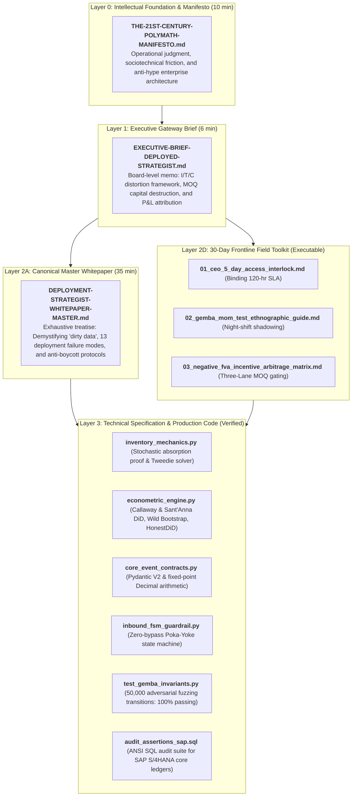
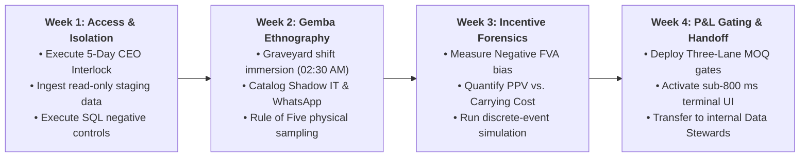

# Mellon 🗝️ & Ithildin 🌌
## Enterprise AI Deployment Framework & Forward Deployed Architecture

[](https://www.python.org/)
[](https://docs.pydantic.dev/)
[](https://modelcontextprotocol.io/)
[-brightgreen.svg)](test_gemba_invariants.py)
[](inbound_fsm_guardrail.py)
[](LICENSE)

> *"Ennyn Durin Aran Moria: pedo mellon a minno."*  
> **"The Doors of Durin, Lord of Moria. Speak, friend, and enter."**

---

## 1. Architectural Identity: Mellon & Ithildin

In enterprise technology deployments, systems fail at the boundary where digital models meet physical operations. Inspired by high-reliability forward deployed engineering (Palantir doctrine), this repository is organized around a dual architectural paradigm:

```
                  ┌─────────────────────────────────────────────────────────┐
                  │                 THE ENTERPRISE GATEWAY                  │
                  │             (IT, InfoSec, Operations, P&L)              │
                  └────────────────────────────┬────────────────────────────┘
                                               │
                       ┌───────────────────────┴───────────────────────┐
                       │                                               │
                       ▼                                               ▼
         [The Ivory Tower Approach: Imposition]          [The Mellon & Ithildin Approach: Alliance]
         • Confined to remote IDEs & slides              • Embedded in the Gemba alongside the floor
         • Treats frontline pushback as "ignorance"      • Respects operator fatigue & tacit knowledge
         • Imposes abstract AI without floor empathy     • Partner to labor, mathematically safe to IT
         • Result: 95% Pilot Failure Rate                • Result: Sustained Adoption & Verified P&L
                       │                                               │
                       ▼                                               ▼
                  GATE CLOSED                                     GATE OPEN
```

* **MELLON 🗝️ (The Human Alliance Protocol):** Frontline adoption protocol in the Gemba. In enterprise physical operations, AI pilots are rejected when workers perceive the system as an extractive surveillance mechanism or a career threat. Under the *Mellon* doctrine, the AI agent never acts as a punitive auditor; it acts strictly as an operational shift ally that absorbs clerical drudgery, protects workers from impossible scheduling quotas, and satisfies the *Ergonomic Invariance Rule* (<800 ms latency, glove-compatible UI, zero net incremental clicks), eliminating the 95% rejection rate of enterprise pilots.
* **ITHILDIN 🌌 (Deterministic Guardrails):** Passive, mathematically verifiable infrastructure. Just as Celebrimbor’s *ithildin* script remained dormant until illuminated by starlight, Ithildin operates as a passive safety fabric: zero direct mutations against production ERP/WMS databases (`MSEG`, `MKPF`, `EKET`), read-only telemetry probes across 5 canonical event dimensions, cryptographically signed changesets (HMAC-SHA256) with strict 900-second Time-To-Live (TTL), and bit-for-bit idempotent rollback ledgers.

---

## 2. The Executive Problem: Why 95% of Enterprise AI Pilots Fail at the Last Mile

Empirical research from **MIT NANDA (2025)** reveals that **95% of enterprise Generative AI initiatives fail to produce measurable P&L returns**, while the **RAND Corporation** documents that over **80% of enterprise AI projects are abandoned prior to production**. In physical supply chains, manufacturing, and distribution, this systemic collapse is driven by a triadic operational bottleneck:

1. **Institutional Decoupling (*Meyer & Rowan, 1977*):** Executive committees purchase enterprise software to project modern governance to investors, while physical plants survive underneath via undocumented workarounds (Shadow IT: offline Excel workbooks and unofficial driver WhatsApp groups). When an abstract probabilistic model is deployed over corrupted ERP data, it automates friction rather than value.
2. **The Frontline Ergonomic Threshold (>800 ms Latency):** AI models designed in corporate innovation labs routinely transfer clerical friction to workers wearing industrial gloves on noisy loading docks. If confirming an inbound shipment requires 14 screens or incurs a 3-second cloud roundtrip, operators bypass the device. Frontline rejection is not irrational "resistance to change" (*Dent & Goldberg, 1999*); it is a rational act of operational self-preservation.
3. **Legacy IT & Cybersecurity Lockout:** Stewards of corporate data legitimately block autonomous agents out of well-founded fears that non-deterministic LLMs will execute hallucinated transactions, corrupt transactional database schemas, or violate compliance mandates.

**The Solution:** Mellon aligns human incentives on the floor through ergonomic empathy, while Ithildin provides CISOs with mathematical guarantees of zero transactional corruption through cryptographic staging.

---

## 3. The 4-Layer Repository Architecture

The repository is structured hierarchically across four interconnected layers to address distinct corporate stakeholder mandates:



---

## 4. Production Integration: Kern & Anthropic Model Context Protocol (MCP)

In addition to the open architectural specifications versioned here, this framework connects directly to **Kern** (`linchpin.fly.dev`), an autonomous agentic supply chain planning engine:

* **Anthropic MCP Streamable HTTP Integration:** Kern implements an official **Model Context Protocol (MCP)** server operating over Streamable HTTP, exposing structured operational tools (lead-time stochastic solvers, inventory allocation gates, and freight arbitrage calculators) directly to Anthropic's Claude models.
* **Dual-Track Execution Engine:** Claude analyzes unstructured operational brief requests, while deterministic MCP tool gates validate safety stock intervals and working capital bounds before issuing recommendations.
* **Proprietary Core Intellectual Property:** In accordance with standard enterprise software practices, Kern’s underlying algorithmic core, multi-echelon optimization solvers, and proprietary trade-secret heuristics remain hosted as a private intellectual property repository. The public assets in `mellon` provide the exact, fully replicable architectural guardrails, event contracts, and econometric verification harnesses required to evaluate the methodology.

---

## 5. The 30-Day Frontline Deployment Protocol

Engineered to integrate seamlessly with 90-day transformation sprints (such as WON.ai Rapid Redesign cycles):



| Deployment Phase | Timeframe | Core Operational Deliverable | Primary Stakeholder |
| :--- | :---: | :--- | :--- |
| **Phase 1: Legal Interlock & Ingestion** | Days 0–7 | 5-Day Access Addendum signed; read-only replica ingested; `audit_assertions_sap.sql` executed against staging schemas. | CEO, CISO, Lead Architect |
| **Phase 2: Gemba Ground Truth** | Days 8–14 | Forensic night-shift shadowing completed; informal cheat sheets and WhatsApp channels mapped; Rule of Five inventory discrepancies audited. | Plant Managers, Dock Supervisors |
| **Phase 3: FVA Forensics & Simulation** | Days 15–21 | Stockout fear bias quantified; purchasing PPV trade-offs isolated; `inventory_mechanics.py` Tweedie solver calibrated. | CFO, Procurement Directors |
| **Phase 4: Gating, Pilot & Handoff** | Days 22–30 | Three-Lane MOQ approval engine live; `inbound_fsm_guardrail.py` active on pilot terminals; governance transferred to operational Data Stewards. | COO, Operational Data Stewards |

---

## 6. Verified Code & Local Replication

All mathematical, validation, and finite-state machine invariants are fully reproducible locally:

### Environment Setup
```bash
# Clone the repository
git clone https://github.com/esstipi-debug/mellon.git
cd mellon

# Ensure Python 3.12+ is active
python --version

# Install production dependencies
pip install pydantic scipy numpy pandas matplotlib hypothesis pytest
```

### Running the 50,000 Adversarial Fuzzing Campaign
```bash
python test_gemba_invariants.py
```
*Executes 50,000 randomized state transitions against the `InboundDeliveryFSM` engine, verifying zero illegal bypasses across weight divergence, timestamp replay, non-hex signature tampering, and raw dictionary injection.*

### Running Property-Based Invariant Verification
```bash
pytest test_gemba_invariants.py -v
```
*Evaluates hypothesis properties across thousands of synthetic inputs, confirming 100% pass rates across all physical proof gates.*

### Executing the Causal Econometric Pipeline
```bash
python econometric_engine.py
```
*Generates the synthetic panel (K=16 facilities, T=24 months), estimates group-time treatment effects via Callaway & Sant'Anna (2021) doubly robust regression, computes 9,999 Wild Cluster Bootstrap replications ($p = 0.015402$), and generates the publication-grade sensitivity plot (`honest_did_sensitivity_plot.png`).*

### Executing the Stochastic Inventory Solver
```bash
python inventory_mechanics.py
```
*Simulates the Kang & Gershwin inventory freezing theorem under unrecorded shrinkage, and solves the exact compound Poisson-Gamma (Tweedie) break-even discount boundary.*

---

## 7. Consolidated Portfolio Navigation Matrix

| Code | Document / Script | Canonical Location | Target Audience | Function |
| :---: | :--- | :--- | :--- | :---: |
| **L0** | **The 21st-Century Polymath Manifesto** | [`THE-21ST-CENTURY-POLYMATH-MANIFESTO.md`](THE-21ST-CENTURY-POLYMATH-MANIFESTO.md) | Global Founders, C-Level | Foundational epistemology |
| **L1** | **Executive Board Memorandum (Gateway)** | [`EXECUTIVE-BRIEF-DEPLOYED-STRATEGIST.md`](EXECUTIVE-BRIEF-DEPLOYED-STRATEGIST.md) | Board, CEO, CFO, CIO | Executive navigation (6 min) |
| **L2A** | **Master Whitepaper: DS Doctrine & I/T/C** | [`DEPLOYMENT-STRATEGIST-WHITEPAPER-MASTER.md`](DEPLOYMENT-STRATEGIST-WHITEPAPER-MASTER.md) | CEO, VP Transformation, COO | Canonical doctrine (35 min) |
| **L2D** | **30-Day Frontline Field Toolkit** | [`field-toolkit/`](field-toolkit/README.md) | Deployment Strategists, FDEs | Executable field artifacts |
| **CODE** | **Stochastic Inventory Mechanics Solver** | [`inventory_mechanics.py`](inventory_mechanics.py) | Operations Researchers | Theorem 1 simulation & Tweedie solver |
| **CODE** | **Econometric Inference & DiD Engine** | [`econometric_engine.py`](econometric_engine.py) | Applied Econometricians | Callaway & Sant'Anna + Wild Bootstrap |
| **CODE** | **Strongly-Typed Event Contracts** | [`core_event_contracts.py`](core_event_contracts.py) | Distributed Systems Engineers | Pydantic V2 & Decimal verification |
| **CODE** | **Poka-Yoke Inbound State Machine** | [`inbound_fsm_guardrail.py`](inbound_fsm_guardrail.py) | Lead Software Architects | Zero-bypass state machine |
| **CODE** | **Gemba Invariant Testing Harness** | [`test_gemba_invariants.py`](test_gemba_invariants.py) | QA / Reliability Engineers | 50,000 fuzzing transitions |
| **CODE** | **Production SQL Audit Assertions** | [`audit_assertions_sap.sql`](audit_assertions_sap.sql) | SAP / Database Administrators | ANSI SQL S/4HANA assertions |

---

## 8. Author & Operational Background

**Marcos Stipicich**  
*Principal Forward Deployed Architect & Industrial Systems Strategist*  
Santiago, Chile (UTC-3 / Full US Business Hours Overlap) · Bilingual (English C1/C2 · Native Spanish)  
[GitHub](https://github.com/esstipi-debug) · [LinkedIn](https://linkedin.com/in/marcos-stipicich)

* **13 Years of Frontline Physical Operations:** Deep, hands-on domain expertise spanning industrial supply chains, warehouse layout design, heavy distribution logistics, and enterprise systems integration.
* **AGCO Melbourne WMS Cutover:** Field-directed cutover and hypercare deployment of tier-1 warehouse management infrastructure across 50,000 active SKUs, maintaining operational continuity through structured TWI (*Training Within Industry*) on-the-job instruction.
* **Commercial & Working Capital Stewardship:** Managed consolidated P&L across \$30M multi-channel (DTC & wholesale) retail operations, resolving structural tension between commercial volume targets and warehouse holding cost burdens.
* **Technical Breadth:** Production Python, Pydantic V2, deterministic state machine architecture, relational and dimensional schema design (SAP S/4HANA, DuckDB, PostgreSQL), and causal econometrics (Difference-in-Differences, Wild Cluster Bootstrap).

---

## License

MIT License. See [LICENSE](LICENSE) for details.
