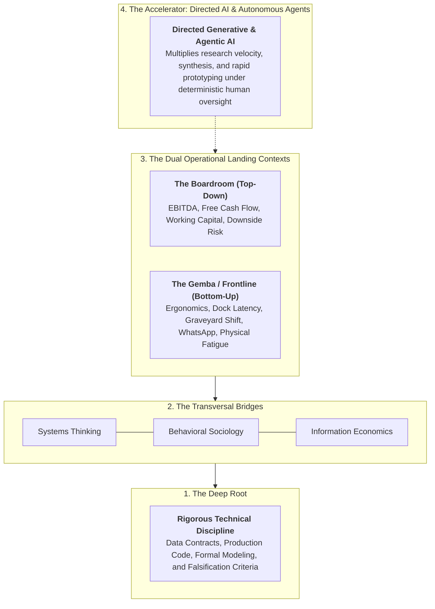

# The 21st-Century Polymath Manifesto
## Operational Judgment, Sociological Friction, and Anti-Hype Enterprise Architecture

Oct 2026 · @marcos

> *"In ambiguous and shifting environments, breadth combined with depth wins."*

---

## Preamble

The twenty-first century rewards breadth because the problems that truly matter no longer fit inside a single academic or operational discipline.

For two centuries, industrial progress rewarded the specialist: knowing more and more about less and less. That model succeeded while knowledge was scarce, organizational silos were rigid, and business problems had clean, predictable boundaries.

That world is gone. Today, foundation models summarize any academic field in seconds and inexorably automate tasks bounded by clear rules, abundant data, and singular correct answers. In these environments—which David Epstein terms "kind"—machines already outperform human practitioners.

The problems that determine enterprise survival are of an entirely different nature:
* An industrial organization deploying artificial intelligence that frontline operators actively resist and quietly sabotage.
* A corporate supply chain trapped between millions of dollars in trapped working capital and chronic stockouts.
* A commercial enterprise attempting to align executive EBITDA targets with the physical fatigue of graveyard-shift warehouse labor.

These are wicked, non-stationary environments: the rules are undocumented, incentives are misaligned, and the problem shifts while you attempt to solve it. In this terrain, algorithms alone fail. Breadth wins.

Yet breadth alone is insufficient. Spotting cross-disciplinary analogies is merely an intellectual pastime; the true discipline consists of transforming ambiguity into working, deterministic systems that survive operational friction and earn frontline adoption.

Today, this discipline has a defined archetype: the **Deployment Strategist**—the operational architect embedded in the trenches alongside the people who decide and the people who work. We treat this archetype as our benchmark, not our limit.

This manifesto is dedicated to those who operate in that territory: entering the fog of operational complexity and emerging with a falsifiable map others can run.

---

## Core Value Preferences

Seven operational preferences govern this manifesto:

- **Synthesis** over accumulation.
- **Operational judgment** over raw data volume.
- **Incisive diagnostic questions** over superficial speed.
- **The Gemba (the physical floor)** over boardroom slide decks.
- **Frontline adoption and ergonomics** over formal milestone sign-offs.
- **Systemic enterprise health** over local silo optimization.
- **Continuous learning** over defensive pride.

While the attributes on the right carry weight, the principles on the left take precedence unconditionally.

---

## How We Think

The first five principles articulate an epistemology of applied inquiry: deeply rooted, structurally connected, and governed by disciplined skepticism.

### I. Enter the Fog, Emerge with a Map

Where operational rules are clear and optimal answers exist, software automation dominates. We do not compete there. We seek ill-defined problems characterized by fragmented data, institutional politics, and operating conditions that shift mid-flight.

Traditional software and machine learning architectures suffer from a structural blind spot: they process vast quantities of data to reduce statistical noise, yet remain fundamentally blind to the deliberate distortion born of human fear, perverse incentives, and metric gaming (Bloom, Codreanu & Fletcher, Stanford / SIEPR, 2025). Treating transactional ERP data as neutral truth is the fastest route to industrializing operational error.

We do not linger in ambiguity. Our mandate is to exit the fog with a rigorous operational map: a bounded problem statement, an empirical baseline, a finite delivery schedule, and an auditable economic return on the income statement. When unexpected physical constraints surface, we adjust scope jointly with operational leadership rather than allowing project drift.

### II. Breadth with Deep Roots

We are not shallow generalists who dabble indiscriminately. We maintain deep technical mastery in one or two foundational disciplines—data engineering, causal econometrics, or physical operations—because only depth provides the judgment required to detect when an analytical model is fundamentally broken. Upon these deep roots, we extend branches across adjacent domains.

Empirical research validates this architecture. In a landmark study published in *Science* (Uzzi et al., 2013), research papers combining a deeply conventional disciplinary foundation with a small infusion of atypical, cross-domain connections were nearly twice as likely to achieve top-tier scientific impact.

Regardless of our foundational discipline, we maintain an uncompromising technical floor: data contracts, production Python, relational schema design, and deterministic API guardrails, ensuring peer-level technical collaboration with core engineering teams.

### III. Synthesize, Do Not Hoard

Accumulated static knowledge is no longer a competitive moat; information retrieval is a commodity. The true moat is structural synthesis: recognizing that an inventory allocation bottleneck in retail was solved decades ago in telecommunications queuing theory, or that an apparent "data quality issue" in an ERP is actually a sociological defense mechanism against a punitive management bonus structure.

We measure intellectual capital solely by connections that function reliably in physical reality, never by certificates framed on an office wall.

### IV. Systems Thinking over Silo Optimization

No corporate event occurs in isolation. We trace feedback loops, second-order consequences, and structural incentives across every stakeholder. Before asking *"Who failed?"*, we ask: *"What compensation scheme and governance structure made this failure the economically rational outcome for the individual?"*

Systems thinking is the operational antidote to Goodhart’s Law: *"When a measure becomes a target, it ceases to be a good measure."* If plant managers are measured strictly on Overall Equipment Effectiveness (OEE) while procurement is bonused on Purchase Price Variance (PPV), the enterprise will inevitably drown in unmarketable finished goods inventory while bleeding cash—all while departmental dashboards flash green.

### V. Disciplined Skepticism on the Jagged Frontier

We do not worship technology. We treat Artificial Intelligence as a stochastic, non-deterministic reasoning engine with an irregular performance boundary.

The experimental study conducted by Harvard, MIT, and BCG (Dell'Acqua, Mollick et al., 2023) demonstrated this dynamic empirically: on tasks situated inside AI's capability frontier, consultants using AI completed work 25% faster with 40% higher quality. However, on tasks falling outside that invisible frontier, consultants relying uncritically on AI were 19 percentage points more likely to produce incorrect solutions than colleagues working without the tool.

Navigating this jagged frontier requires methodological doubt: establishing strongly-typed contracts, zero-bypass state machines, and counterfactual econometric verification before granting autonomy to autonomous agents.

---

## How We Collaborate

The subsequent four principles define our interaction with human organizations and autonomous systems: nobody solves systemic friction in isolation.

### VI. AI Amplifies; Human Judgment Directs

We leverage modern AI as an intellectual force multiplier. With foundation models and targeted agents, we map new technical domains in days rather than quarters, enabling lean deployment pods to deliver the operational output of legacy consulting divisions.

Yet we never surrender executive judgment to the machine. A probabilistic model can generate infinite synthetic correlations; selecting the single operational leverage point that moves enterprise EBITDA—and standing accountable for the physical consequences—remains exclusively human work. The practitioner who understands how to frame falsifiable queries and stress-test assumptions extracts orders of magnitude more value from AI than one captivated by generative velocity.

### VII. The Human Dynamic Is Half the System

Technical elegance without sociological grounding collapses on contact with reality. Enterprise technology implementations fail not from algorithmic weakness, but because the host organization mounts an institutional immune response against top-down imposition.

This sociological dynamic was documented in 1951 when the Tavistock Institute studied mechanization in British coal mines (Trist & Bamforth). Mechanical coal-cutters destroyed the informal social solidarity of frontline worker teams, triggering absenteeism and declining productivity. From this research emerged the sociotechnical framework: **the technical architecture and the social organization must be designed concurrently.**

In modern corporations, a parallel pathology reigns: leadership adopts ISO standards, agile frameworks, and ERP suites as institutional rituals to signal external legitimacy, while day-to-day work survives decoupled underneath via informal workarounds (*Institutional Decoupling*, Meyer & Rowan, 1977).

When systems fail, executives routinely blame "employee resistance to change." Decades of organizational research dismantle this narrative (Dent & Goldberg, 1999; Ford et al., 2008): **frontline rejection is almost always a rational act of self-preservation.** If a new software interface requires fourteen clicks on a handheld scanner on a congested loading dock, the operator bypasses the system not out of ignorance, but to prevent terminal gridlock.

People reject systems that threaten their livelihoods or introduce cognitive friction. Consequently, we treat organizational sociology, microeconomics, and frontline psychology with the same mathematical rigor applied to distributed systems.

### VIII. Translate Across Tribes and Dismantle the Operational Boycott

Every industrial enterprise operates across three disjointed dialects: the Board speaks in EBITDA, free cash flow, and working capital; engineering speaks in architectural latency and schema integrity; frontline operators speak in physical exhaustion, shift handovers, and dock congestion. Our responsibility is to translate between these worlds without diluting ground truth.

Translating effectively requires dismantling the operational boycott:
* **The Floor Boycott:** Operators ignore tools that add physical fatigue. We neutralize this via the *Ergonomic Invariance Rule* (<800 ms latency, glove-compatible UI, zero incremental clicks).
* **The Silo Boycott:** Middle managers sabotage initiatives that threaten their local bonuses. We neutralize this via *Real-Time Cross-P&L Attribution*, exposing consolidated margin impacts across departmental boundaries.
* **The IT Boycott:** Legacy IT organizations stall deployments out of legitimate security concerns. We neutralize this via *Safe-Staging Architectures* (cryptographic HMAC-SHA256 writebacks and read-only telemetry probes).

Reading an executive room, deciphering an unspoken compensation incentive, and earning trust on a midnight loading dock are engineering capabilities as demanding as building a data pipeline.

### IX. Physical Ground Truth: The Wisdom of the Gemba

Moravec’s Paradox observes that what is computationally difficult for machines (symbolic logic, abstract calculations) is easy for humans, while what is trivial for humans (perception, physical dexterity, spatial reasoning) remains profoundly difficult for AI.

We respect physical craft, warehouse operations, and yard logistics as irreproducible reservoirs of operational judgment. We physically embed where work takes place: the cross-dock at 02:30 AM, the rail siding, and the dispatch trailer. Before prescribing a process modification, we shadow the frontline worker. The real operational bottleneck is never documented in the corporate standard operating procedure or the consultant's slide deck.

---

## How We Deliver

The final three principles dictate accountability, operational durability, and institutional self-reliance.

### X. Build, Verify, and Stand Accountable

An unverified hypothesis is indistinguishable from a hallucination. We build alongside engineering, implement deterministic code, and subject our work to public verification. We measure success by the audited income statement, not by the delivery of documentation.

When uniting algorithms, data, and human workflows, we do not merely ask *"Can this be coded?"* We ask: *"Should this be operationalized, and who bears the downside if this model degrades?"* Operational ethics and stewardship are not decorative add-ons; they are the bedrock upon which technical systems rest.

### XI. The 50-50 Compact: Measured by What Survives Our Exit

Success is not the ceremonial signing of a project acceptance memo. Success is what operators do with the system thirty days after the external team departs. If workers abandon the interface and revert to clandestine spreadsheets, the design failed.

Drawing from Peter Block’s *Flawless Consulting*, we establish a **50-50 Compact of Mutual Responsibility**: fifty percent of deployment success rests on flawless engineering and ergonomic usability; fifty percent rests on client executive courage to realign perverse departmental incentives. We train internal teams, transfer governance to operational Data Stewards, and exit.

A deployment that requires an external team's permanent presence to function is not an engineering achievement; it is a structural dependency. Building client self-sufficiency is our primary deliverable.

### XII. Learning as a Production Discipline

Our sole durable advantage is the speed and empirical rigor with which we learn. We study the mechanics of skill acquisition: spaced repetition, cross-domain transfer, and active experimentation under real operational feedback.

In wicked environments where feedback loops are distorted, we manufacture ground truth: deploying rapid, deterministic prototypes tested with live operators in days rather than quarters.

What we learn in the Gemba is formalized as reusable engineering doctrine: reproducible playbooks, deterministic code guardrails, architectural invariants, and sharper diagnostic frameworks.

We discard obsolete assumptions and willingly become apprentices in new domains. In a rapidly transforming world, whoever ceases to learn becomes the expert curator of a reality that no longer exists.

---

## The Polymath Architectural Stack

The 21st-century polymath is not a scattered dilettante. Operational judgment is structured across four concentric, interdependent layers:

1. **The Deep Root:** Rigorous technical mastery in at least one hard quantitative discipline (data engineering, causal inference, or mathematical optimization). Without deep roots, one lacks the judgment to separate ground truth from hallucination.
2. **The Transversal Bridges:** Interdisciplinary mental models (system dynamics, microeconomic incentives, cognitive heuristics, institutional sociology). These bridges form the connective tissue between technical feasibility and organizational behavior.
3. **The Dual Landing Contexts:** Bidirectional fluency operating simultaneously in the executive suite (translating engineering interventions into balance sheet liquidity) and on the physical plant floor (understanding the lived reality of operators and drivers).
4. **The Accelerator:** Agentic and generative AI deployed as a force multiplier under deterministic guardrails, accelerating synthesis while human judgment retains moral and technical stewardship.

---

## The Deployment Strategist Lifecycle

How does this polymath doctrine translate into field execution? The **Deployment Strategist** executes across six sequential stages:

### Execution Matrix of the Deployment Lifecycle

| Lifecycle Stage | Operational Action of the Deployment Strategist | Principles Activated | Tangible Deliverable |
| :--- | :--- | :---: | :--- |
| **1. SCQ Framing** | Structure business friction via the Minto Pyramid; formulate the economic hypothesis and EBITDA impact in the initial meeting. | I, IV, V | Falsifiable value hypothesis and bounded deployment scope. |
| **2. Gemba Ethnography** | Cross-dock and graveyard shift immersion applying *The Mom Test*; audit local departmental spreadsheets and informal WhatsApp coordination channels. | VII, IX | Ground-truth workflow map contrasting formal SOPs against real-world execution. |
| **3. I/T/C Forensics** | Deconstruct organizational distortions into Incentives (warring bonuses), Translation (ERP semantic mismatches), and Calendar (quarter-end accounting manipulations). | III, IV, VII | Causal incentive matrix and catalog of systematic data corruption. |
| **4. Safe-Staging** | Construct strongly-typed contracts (Pydantic V2), time-bounded cryptographic tokens (HMAC-SHA256), and bit-for-bit rollback ledgers without touching core production databases. | II, VI, X | Deterministic, verified execution pipeline with zero production database risk. |
| **5. Ergonomic Invariance** | Deliver sub-800 ms response times and zero incremental clicks; project live cross-silo P&L impacts onto user screens to eliminate local metric gaming. | VII, VIII, X | Frictionless frontline adoption and structural neutralization of operator boycotts. |
| **6. 50-50 Handoff** | Transfer operational ownership to internal Data Stewards, audit 14 consecutive days of autonomous execution, and complete project exit. | XI, XII | Permanent technical and operational capability embedded within the client organization. |

---

## Foundations & Scholarly Evidence

Fifteen foundational works anchor the epistemology, sociology, and engineering methodology of this manifesto:

| Source | Core Contribution to the Architecture | Relevant Section |
| :--- | :--- | :---: |
| [*Range: Why Generalists Triumph in a Specialized World*](https://www.grahammann.net/book-notes/range-why-generalists-triumph-in-a-specialized-world-david-epstein), David Epstein (2019) | In kind environments with clear rules, hyper-specialization dominates; in wicked environments with ambiguous feedback, conceptual breadth prevails. | I, XII |
| [“Atypical Combinations and Scientific Impact”](https://insight.kellogg.northwestern.edu/article/a_virtuous_mix_allows_innovation_to_thrive), Uzzi et al., *Science* (2013) | Empirical proof that conventional foundations combined with atypical cross-domain connections double the probability of high-impact breakthroughs. | II |
| [Latticework of Mental Models](https://25iq.com/2015/08/22/a-dozen-things-ive-learned-from-charlie-munger-about-mental-models-and-worldly-wisdom), Charlie Munger | The requirement to internalize core models from multiple disciplines to shoulder 90% of real-world operational judgment. | III, IV |
| [Complexity Explorer](https://www.complexityexplorer.org/courses/160-complexity-gains-curriculum/segments), Santa Fe Institute | Non-linear dynamics, feedback loops, and emergent properties as the foundational language of complex systems. | IV |
| [“Navigating the Jagged Technological Frontier”](https://www.oneusefulthing.org/p/centaurs-and-cyborgs-on-the-jagged?r=4rahd), Dell'Acqua, Mollick et al., Harvard/MIT/BCG (2023) | Randomized controlled trial with 758 consultants revealing the irregular boundary of AI and the severe hazard of uncritical delegation. | V, VI |
| [“Noise vs. Bias in Corporate Forecasting”](https://siepr.stanford.edu/), Nicholas Bloom, Codreanu & Fletcher (Stanford / SIEPR, 2025) | Econometric proof that expanding data volume dampens statistical noise while leaving systematic incentive-driven bias completely intact. | I, VI, VIII |
| [“Some Social and Psychological Consequences of the Longwall Method”](https://explore.psychsafety.com/n/trist-bamforth-1951/), E. L. Trist & K. W. Bamforth, *Human Relations* (1951) | Foundational field research on sociotechnical systems: technical design and social organization cannot be engineered independently. | VII |
| [“Institutionalized Organizations: Formal Structure as Myth and Ceremony”](https://acawiki.org/Institutionalized_organizations:_Formal_structure_as_myth_and_ceremony), Meyer & Rowan (1977) | Theory of institutional decoupling: the structural chasm between corporate formal structures (ERP/ISO) and physical shop-floor reality. | VII, VIII |
| [“Challenging ‘Resistance to Change’”](https://scholarscommons.fgcu.edu/esploro/outputs/journalArticle/Challenging--Resistance-to-Change/99383431964506570), Dent & Goldberg (1999) / Ford et al. (2008) | Deconstructing the resistance myth: frontline rejection is a rational, self-preserving response to broken workflows and punitive metrics. | VII, VIII |
| [*Flawless Consulting*](https://www.peterblock.com/), Peter Block (2011) | The 50-50 contract of mutual accountability between technical architects and client executive leadership, dismantling the external savior myth. | X, XI |
| [“AI Is Coming for Lawyers Before Plumbers”](https://www.psychologytoday.com/us/blog/the-evolving-workforce/202605/the-last-mile-why-ai-is-coming-for-lawyers-before-plumbers), Nathan Iverson (2026) | Moravec’s Paradox applied to enterprise automation: abstract cognitive analysis is automated far earlier than physical perception and frontline operational craft. | IX |
| [Deployment Strategist Doctrine](https://jobs.lever.co/palantir/2e193bdf-e668-49c1-ba32-66cc1aa131a4), Palantir Technologies | Connecting institutional blind spots in mission-critical environments, low-ego field culture, and bidirectional translation. | I, III, IX, Lifecycle |
| [Forward Deployed Strategist](https://jobs.thrivecap.com/companies/anysphere-2/jobs/87458891-forward-deployed-strategist), Cursor / Anysphere | Transforming ambiguous enterprise friction into production code with auditable ROI, measuring success by the obsolescence of the consultant. | I, VIII, XI |
| [Forward-Deployed Strategist Architecture](https://resumegeni.com/jobs/forward-deployed-strategist-workhelix-378442e869), Workhelix | Structuring uncharted workflows by combining quantitative data engineering with frontline commercial judgment in the field. | I, II |
| [“Palantir spin-outs: a deep dive”](https://concept.vc/news/palantir-spin-outs-a-deep-dive), Concept VC | Empirical analysis of over 100 high-scale technology companies founded by former forward deployed field engineers and strategists. | Lifecycle |

---

  <b>Where rules are deterministic and answers exist, let the machine dominate.</b> 
  <b>Where human incentives, operational friction, and systemic ambiguity reign, that is where we operate.</b> 
  <b>And when our engagement concludes, the installed capability and the map remain permanently in the hands of the client.</b>

