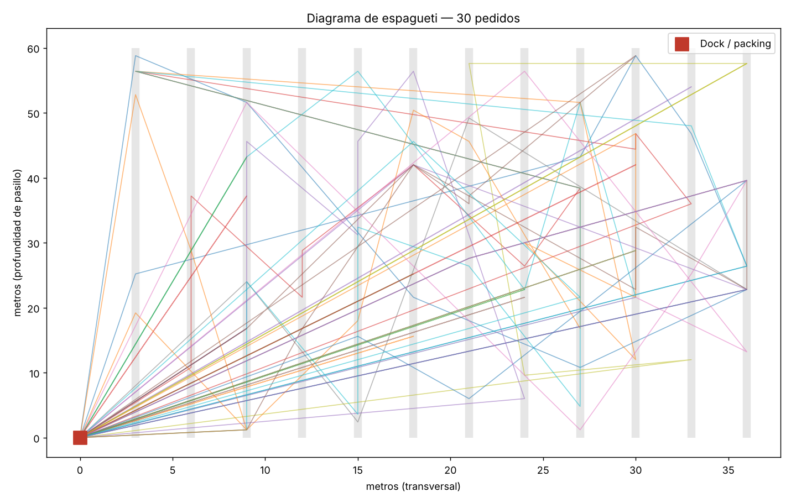
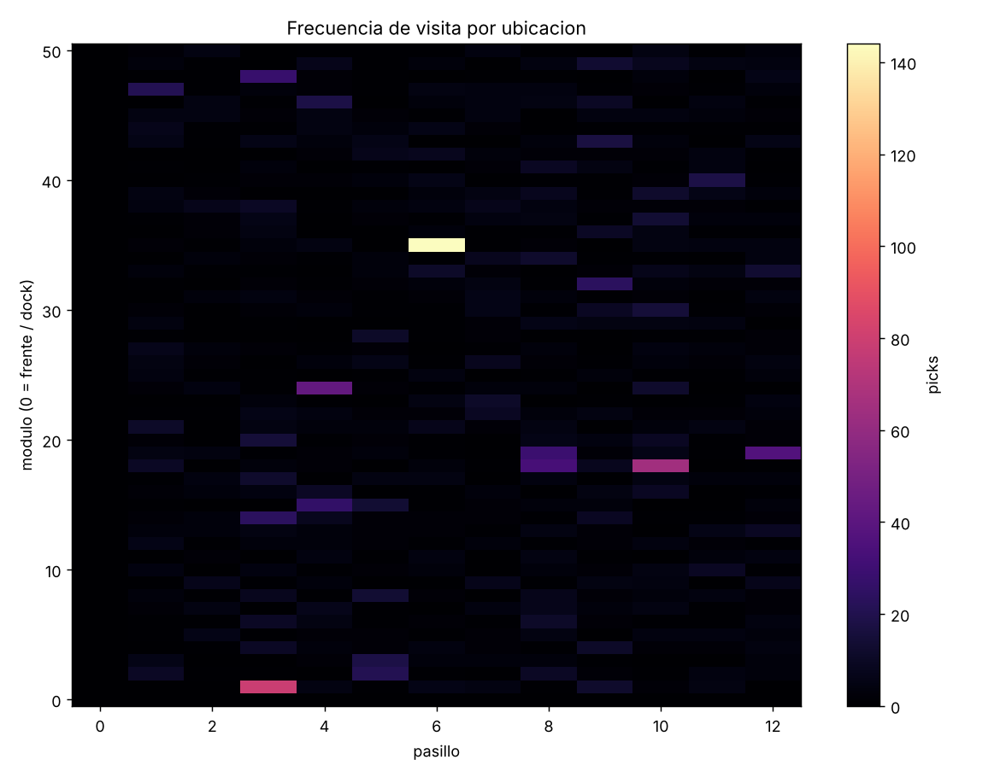
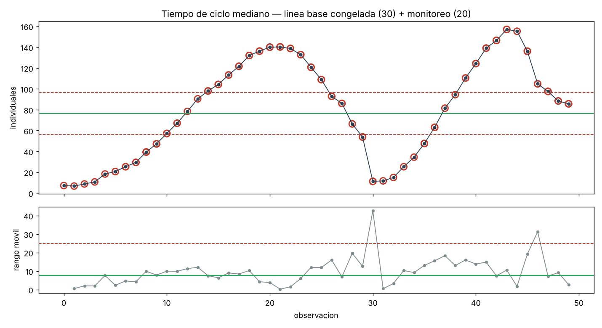

# A3 — Reproceso de packing y espera de picking en CD Pudahuel

**Dueno:** FDE  |  **Sitio:** CD Pudahuel  |  **Fecha:** 2026-10-19

## 1. Antecedentes
Diagnostico de 800 pedidos del log del WMS. El flujo declarado en el kickoff (ORDER_RELEASED -> PICK -> CONSOLIDATE -> PACK -> QC -> SHIP) cubre solo el 54.12% de los casos reales.

## 2. Condicion actual
- Conformidad con el flujo declarado: 54.12% (31 variantes distintas en el log).
- Actividades que ocurren y no estaban declaradas: CARTON_REWORK, PICK_EXCEPTION_LOCATION, REPACK, REPLENISH, SHORT_PICK.
- Mayor perdida de tiempo: ORDER_RELEASED -> PICK — 707.23h en la ventana (61.2% de toda la espera del proceso).
- Datos maestros: 25.6% de SKUs con defecto (IC95 21.1-30.8%). Donde hay error dimensional, el volumen calculado se desvia 150.7% (mediana).
- Caminata: 141.51 km en la ventana, 157.2 m por pedido (mediana).

## 3. Condicion objetivo
- Reducir en 50% el tiempo total de espera de la transicion critica.
- Bajar la tasa de defecto de datos maestros bajo 5% en clase A (hoy 26.1%).
- Medicion con grupo de control definida y firmada antes del go-live.

## 4. Analisis de causa raiz
- Los pedidos que tocan un SKU con dimensiones erradas se reprocesan 2.3x mas. Arreglar el maestro elimina ~14% del reproceso de carton, sin tocar una linea de codigo del producto.
- Riesgo relativo de reproceso por maestro errado: 2.26x (p=2.19e-11).
- La espera dominante es de cola, no de proceso: el recurso esta subdimensionado en el pico, no lento.

## 5. Contramedidas
| accion | dueno | fecha | efecto esperado |
|---|---|---|---|
| Corregir dimensiones de los SKUs clase A fuera de tolerancia | Cliente — jefe de datos maestros | semana 3 | elimina ~13.8% del reproceso de carton |
| Redimensionar la dotacion del recurso cuello en la ventana pico | Cliente — jefe de operaciones | semana 4 | reduce la espera dominante; validado por simulacion |
| Congelar limites de control y encender el monitor de degradacion | FDE | go-live | deteccion de degradacion antes del reclamo del cliente |

## 6. Plan
| paso | dueno | fecha |
|---|---|---|
| Auditoria fisica de la muestra estratificada | FDE + cliente | semana 1-2 |
| Linea base medida con grupo de control | FDE | semana 3-6 |
| Piloto en una zona / una ola | FDE | semana 7-10 |
| Traspaso: runbook + hojas TWI firmadas | FDE | semana 11-12 |

## 7. Seguimiento
- Revision semanal con el supervisor del turno, no con el sponsor.
- Grafico XmR de la metrica en la reunion de operaciones, no en un dashboard que nadie abre.
- Re-auditar el 10% de la muestra de datos maestros a los 90 dias.

---
_Generado con fde-field-kit. Los numeros de la seccion 2 son reproducibles:
correr `fdekit demo` sobre el mismo log devuelve los mismos valores._
