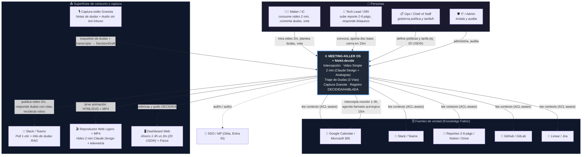
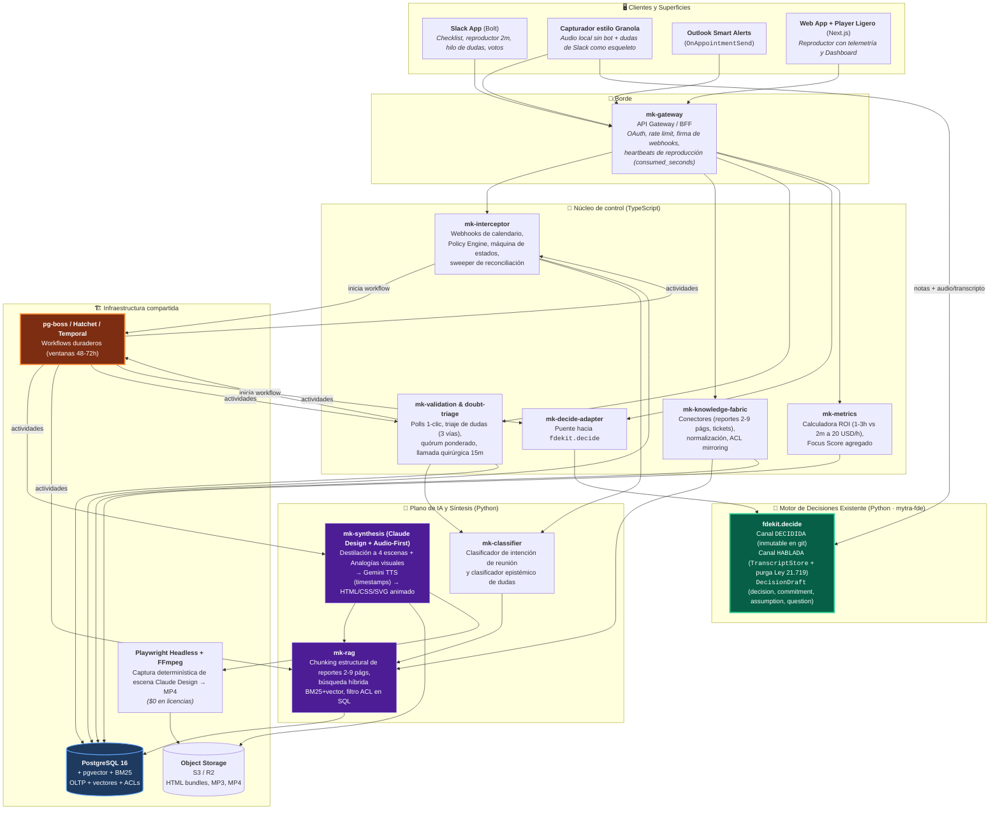
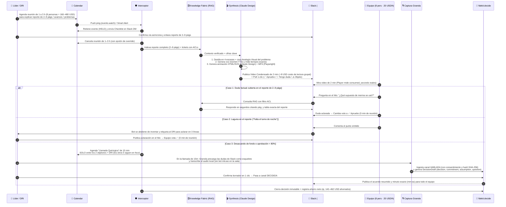
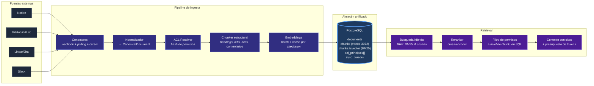
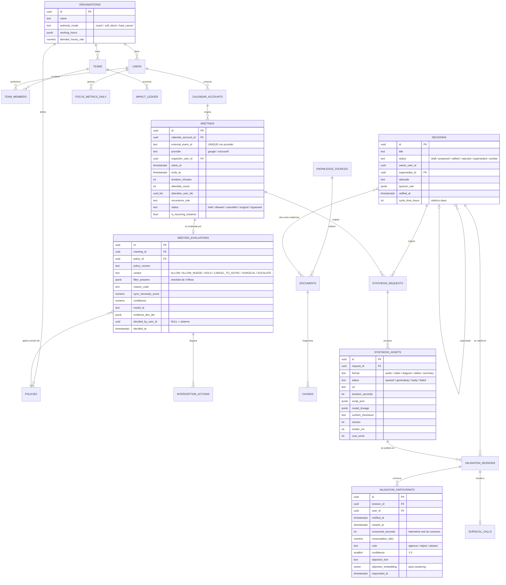
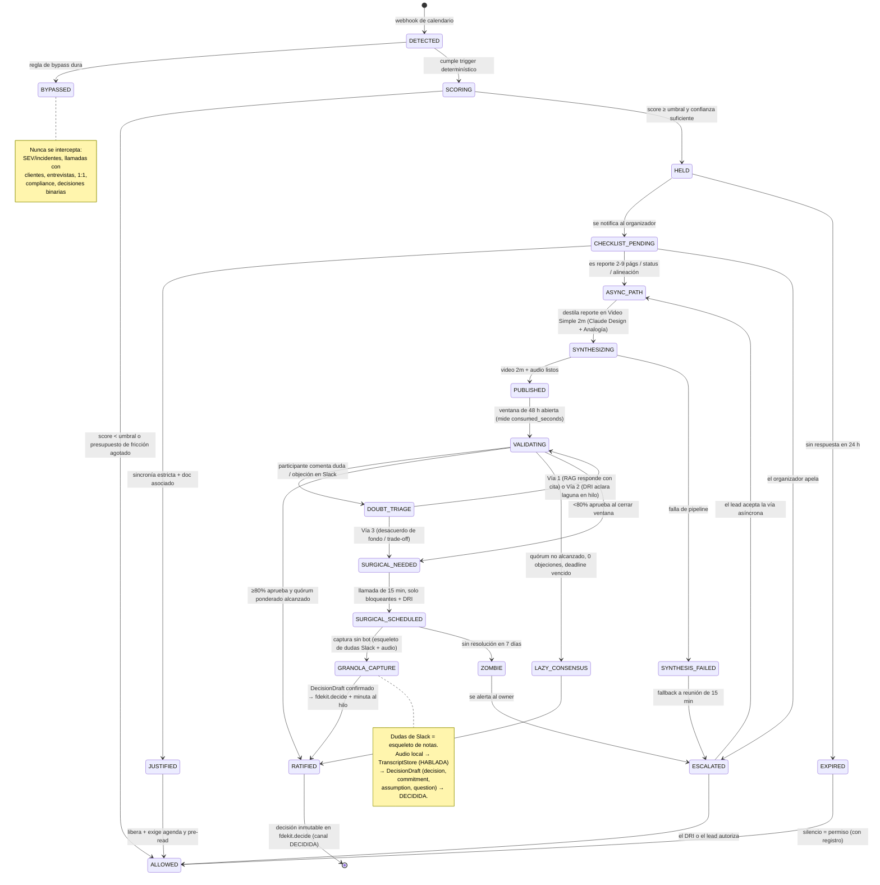

# MEETING-KILLER OS — Arquitectura v0.4

**Sistema Inteligente de Prevención, Optimización y Reemplazo de Reuniones**

| | |
|---|---|
| **Documento** | Entrega 1 de 5 — Arquitectura de Alto Nivel, Stack, Modelo de Datos, Algoritmo de Intercepción, Roadmap |
| **Estado** | Propuesta para revisión (borrador arquitectónico) — **revisado con verificación de APIs y síntesis en Videos Simples (Claude Design)** |
| **Fecha de verificación** | 2026-10-16 |
| **Documento complementario** | [02-verificacion-plataforma.md](C:\fde\meeting-killer-os\02-verificacion-plataforma.md) — informe de verificación con fuentes primarias y fechas de consulta |
| **Audiencia** | CTO / VP Engineering / Chief of Staff / Tech Leads |
| **Naturaleza** | Sistema interno *opinionado*. El 70% del riesgo es cultural y de gobernanza, no técnico. |

---

## Registro de correcciones — v0.1 → v0.2 → v0.3 → v0.4

Las siguientes afirmaciones de la v0.1 fueron **verificadas contra documentación oficial y resultaron incorrectas o incompletas**. Se documentan aquí en lugar de corregirse en silencio, porque dos de ellas cambian el orden de prioridades del roadmap. La **v0.3** integra el informe de verificación completo (precios de TTS y orquestación, licenciamiento de Remotion, marco legal). La **v0.4** redefine el motor de video: en lugar de sobre-ingeniería con Remotion Lambda, el foco es **reemplazar reportes densos de 2–9 páginas o presentaciones de 20 láminas por Videos Simples y Dinámicos (~2 min) generados con estilo Claude Design + analogías explicativas**, incorporando el contraste económico real (reunión de 1–3 h vs. video de 2 min a 20 USD/h) y el protocolo de canalización de dudas en 3 vías.

| # | Afirmación en v0.1 | Estado real verificado | Impacto |
|---|---|---|---|
| **C-1** | "Interceptar en el momento de composición es la superficie de mayor palanca del sistema" (ADR-002) | **Falso.** No existe trigger de composición en Google Calendar. En Outlook `OnNewAppointmentOrganizer` existe, pero `displayDialogAsync` y `messageParent` están **explícitamente bloqueados** en activación por eventos: no se puede mostrar un diálogo. | **ADR-002 reescrito.** Se reordena el roadmap: Outlook pasa antes que Google |
| **C-2** | "NotebookLM no tiene API pública verificada" (ADR-008) | **Parcialmente falso, pero la conclusión se mantiene.** Existen dos APIs; la standalone está **deprecada y sin admisión de nuevos clientes**; la otra es **Preview (`v1alpha`)** con acoplamiento a notebook | **ADR-008 reescrito** con la ruta viable y sus restricciones reales |
| **C-3** | Posibilidad de diálogo en add-ons de calendario | No confirmado en v0.1 | Se documenta lo que **sí** es posible (infobar, mutación del item, Smart Alerts al enviar) |
| **C-4** | — | **El informe de verificación final (§4) volvió a recomendar la Podcast API como "mejor opción", sin la nota de deprecación.** El error se repitió pese a haberse detectado y corregido en la ronda anterior | Se mantiene la decisión de ADR-008. Refuerza la disciplina de procedencia de §2.4 |
| **C-5** | Video pensado como superproducción en Remotion Lambda fuera del MVP (§2.3, §6.1, ADR-010) | **Sobre-ingeniería.** El problema real es que nadie lee reportes de 2–9 páginas ni decks largos. Un **Video Simple estilo Claude Design** (escenas HTML/CSS/SVG animadas + analogías + locución TTS sincronizada) cuesta $0 en licencias, toma <30 s en generarse y entra directo al MVP | **§2.3, §4.5, §5.2, §6.1 y ADR-010 actualizados.** El video simple de ~2 min entra en Semana 2 del MVP |

**Artefacto de respaldo:** el informe de verificación de plataforma completo, con fuentes y fechas de consulta, está en [02-verificacion-plataforma.md](C:\fde\meeting-killer-os\02-verificacion-plataforma.md) (consultado el 2026-10-14).

> **Nota metodológica.** Durante esta revisión, una pasada de investigación intermedia reportó el hallazgo C-2 como *"NotebookLM SÍ tiene API — es la ruta mejor"* y recomendó invertir la decisión. La verificación directa de la página citada mostró que **esa API está deprecada y Google no está admitiendo nuevos clientes** — el dato principal era correcto y la conclusión, opuesta. El informe final **repitió la misma recomendación errónea** (C-4). Se deja constancia porque es exactamente el modo de falla que este documento advierte en §5: **una conclusión estratégica construida sobre un resumen en lugar de sobre la fuente primaria.** El resto del informe final es sólido, está bien citado y su sección de TTS convergió de forma independiente con verificación directa — lo que da confianza en esas cifras.

---

## Relación con `fdekit.decide` — hallazgo de integración (2026-10-14)

Al preparar la incorporación de este documento al repo `mytra-fde`, aparece un hecho que **cambia el encuadre de todo el proyecto y responde por sí solo a la pregunta abierta #5 de §7**.

**El repo `mytra-fde` ya contiene `fdekit.decide`: un registro de decisiones de reunión en producción interna**, con separación de canales **decidida / hablada**, `Meeting.clase`/`canal`, `Decision.origen`, presupuesto de promoción (`promotion_ceiling`, `DECLARED_BUDGET`), retención con ejecutor real, y CLI operativo:

```bash
fdekit decide agenda --meeting <id>     # puede decir "proponer cancelar"
fdekit decide draft  --meeting <id> --file acta.txt
fdekit decide metrics                    # con compuerta de volumen
```

Es decir: **`mk-decision-ledger` (entidad central de esta arquitectura) ya existe, resuelto y testeado, en el mismo repositorio donde se propone construirlo.** La pregunta #6 de §7 — *"¿cuál es la fuente de verdad de decisiones hoy?"* — queda respondida: **es esta**.

### Convergencias que no son coincidencia

| Esta arquitectura (§) | `fdekit.decide` / reglas duras del repo |
|---|---|
| **§5.4** — agregación por equipo, datos individuales sólo para la propia persona | **Regla 9** — *"el sensor ve al operador; el archivo que sale del sensor, no"*, implementada en `privacy.py` y **verificada por `tests/test_field_privacy.py`** |
| **ADR-009** — grano de agregación, uso no punitivo | **H15** — `cierre.py` + `docs/politica-de-datos.md`: propiedad, salida y **uso no punitivo** |
| **§5.2** — honestidad metodológica en el ahorro | **Regla 3** — *"no prometemos resolver siempre; prometemos no mentir nunca en silencio"* y **regla 1** — *"un registro con huecos es peor que ninguno: genera falsa confianza"* |
| **§5.1** — North Star como decisiones, no reuniones | **Regla 7** — presupuesto de 7 decisiones por reunión, *"no levantarlo"* |
| **ADR-001** — autoridad configurable, nunca unilateral | `promotion_ceiling` — *"el único techo del sistema"*, y `slip()` (H11): **renegociar más barato que el silencio** |

**Conclusión:** `fdekit.decide` ya resolvió los problemas difíciles de procedencia, privacidad, retención y uso punitivo — y los resolvió **como propiedad del código verificada por tests**, no como promesa en un documento. Duplicar esa capa en un `mk-decision-ledger` nuevo violaría las reglas 1 y 9 del propio repo.

### Decisión que hay que tomar antes de construir

**¿MEETING-KILLER OS es una capa sobre `fdekit.decide`, o un sistema paralelo?**

Recomendación: **capa**. El reparto natural queda así:

- **`fdekit.decide` conserva** el registro de decisiones, la procedencia, la retención, la privacidad y la política de uso.
- **MEETING-KILLER OS aporta lo que `decide` no tiene**: intercepción en calendario (§4), Knowledge Fabric / RAG (§1.4, §2.2), motor de síntesis multimodal (§2.3) y el bucle de validación asíncrona (§4.2).
- El `mk-decision-ledger` de esta arquitectura **se elimina como componente** y pasa a ser un **adaptador hacia `fdekit.decide`**.

Esto reduce el alcance del MVP de forma sustancial: desaparecen del roadmap el modelo de retención, la gobernanza de agregación y el uso punitivo — porque ya están construidos y testeados.

### Advertencia sobre jurisdicción

La sección §5.4 cita **Alemania (§87 BetrVG), España (AEPD) y UE (art. 88 RGPD / STJUE C-34/21)**. El contexto de `mytra-fde` es **Chile** (Pudahuel, IMM Chile, `docs/calibracion-chile-2026.md`), donde el marco relevante es la **Ley 21.719**, que **rige desde el 1-dic-2026** — es decir, el mes próximo, no un problema teórico.

**Hay que confirmar la jurisdicción de despliegue antes de cerrar ADR-009.** Si es Chile, §5.4 se reescribe con la Ley 21.719 y el material alemán/español pasa a apéndice como referencia comparada; la conclusión de diseño (agregación en la capa de datos) no cambia, pero la base legal sí.

### Nota sobre método

El repo documenta su patrón de error dominante —*"no falla, miente"*— y una regla derivada de tres casos medidos:

> *"Los mecanismos que reportan son reales, los conteos no. Implementar por el mecanismo, nunca por la cifra."*

Eso describe con precisión lo ocurrido con la verificación de NotebookLM (C-2/C-4): **el mecanismo reportado era real** (las dos APIs existen, con esos parámetros y requisitos), **la conclusión no era reproducible contra la fuente**. La disciplina de procedencia de §2.4 es, en los hechos, la misma regla aplicada a la investigación de plataforma.

---

## 0. Confirmación de alcance y tesis arquitectónica

Entiendo el alcance: no se trata de un "bot de calendario" ni de un "resumidor de reuniones". Se trata de un **sistema operativo interno que cambia el default organizacional de `sync-first` a `async-by-default`**, y que para hacerlo necesita: (a) interceptar la intención de sincronizar en el momento en que nace, (b) fabricar la alternativa asíncrona con calidad suficiente para que sea *preferible* a la reunión, (c) medir si la alternativa funcionó, y (d) cerrar la decisión con trazabilidad.

Eso define **cuatro restricciones que mandan sobre todo el diseño**:

### Los tres riesgos que definen la arquitectura

1. **Riesgo de autoridad (el más grave).** Un bot no puede cancelar unilateralmente la reunión de un VP. Si lo intenta y falla una vez de forma visible, el sistema pierde legitimidad y muere en dos semanas. → **La arquitectura debe separar `decisión` de `ejecución` y ser configurable en autoridad** (coach → soft-block → hard-cancel) sin reescribir código. El veredicto es un dato versionado, no un `if`.

2. **Riesgo de calidad de la síntesis.** Si el audio/video asíncrono es mediocre, la gente *pedirá la reunión de vuelta*. El sistema se autodestruye por su propio output. → **La calidad del asset es un requisito funcional de primer orden**, con presupuesto de cómputo, revisión humana opcional y telemetría de consumo real (no de "enviado").

3. **Riesgo de Goodhart.** Si el KPI es "reuniones eliminadas", el sistema optimizará reuniones eliminadas — incluidas las necesarias — y las decisiones se volverán más lentas y peores. → **El North Star debe ser throughput de decisiones, no ahorro de reuniones.** Ver §5.

### Restricción transversal: durabilidad temporal

El ciclo de vida de una intercepción es: `invitación creada` → `checklist` → `síntesis (2–20 min)` → `ventana de validación (24–72 h)` → `ratificación o llamada quirúrgica`. **Es un proceso de días, con humanos en el medio, con timeouts, recordatorios, escalado y compensaciones.** Esto no es una app request/response: es un **motor de workflows duradero**. Es la decisión técnica #1 y condiciona el resto del stack.

---

## 1. Arquitectura de Alto Nivel

### 1.1 C4 — Nivel 1: Contexto



### 1.2 C4 — Nivel 2: Contenedores



### 1.3 Flujo end-to-end (De reunión de 1–3 h a Video de 2 min + Canalización de Dudas + Granola)



### 1.4 El plano de datos (por qué un solo Postgres al inicio)



**Decisión de diseño: empezar con Postgres único (OLTP + pgvector + full-text).** Razón: el 90% de los bugs iniciales de un sistema RAG provienen de la **desincronización entre el índice vectorial y los metadatos/ACLs**, no de la performance del índice. Tener una sola fuente transaccional elimina esa clase entera de bugs. La migración a un vector store dedicado (Qdrant/Turboplex) se justifica recién por encima de ~10M de chunks o si se necesita filtrado por payload de baja latencia a gran escala.

---

## 2. Stack Tecnológico Recomendado

### 2.1 Backend y orquestación

| Capa | Recomendación | Alternativa | Justificación |
|---|---|---|---|
| **Control plane** | **TypeScript** — NestJS (o Fastify + Zod) | Go | El ecosistema de integraciones (Slack Bolt, Google APIs, Graph SDK, Octokit) es de primera clase en TS. NestJS da módulos, DI y colas out-of-the-box. |
| **Plano de IA** | **Python 3.12 + FastAPI** | Todo en TS | El ecosistema multimodal (TTS, render, embeddings, evals) es Python-first. Forzar TS aquí es fricción permanente. |
| **Contrato entre planos** | **OpenAPI + JSON Schema + cola** | gRPC | Frontera explícita. Los dos planos se comunican por cola (Temporal activities / SQS), no por llamadas sincrónicas acopladas. |
| **Workflow duradero** | **Temporal** (Cloud o self-host) | Inngest (DX superior, más rápido de arrancar) / pg-boss o Graphile Worker (MVP) | El ciclo dura días con humanos y timeouts. Temporal da replay determinista, señales, timers, saga/compensación y visibilidad operativa. **Inngest es la elección pragmática si el MVP debe estar en 3 semanas.** |
| **Colas internas** | Redis Streams o SQS | RabbitMQ | Volumen bajo; no justifica Kafka. |
| **Base de datos** | **PostgreSQL 16** + `pgvector` + `pg_search` (ParadeDB) o `tsvector` | — | Ver §1.4. |
| **Object storage** | S3 / Cloudflare R2 | GCS | Assets de audio/video, renders. R2 sin egress fees es significativo si el equipo consume video. |
| **Cache / locks** | Redis | — | Idempotencia de webhooks, locks distribuidos, rate limiting. |
| **Warehouse** | **ClickHouse** o DuckDB + dbt | BigQuery | Métricas de series temporales de calendario. DuckDB es suficiente hasta ~100M de eventos. |
| **Infra** | Contenedores en ECS/Fly.io/Cloud Run + IaC (Terraform o Pulumi) | K8s | K8s es sobre-ingeniería hasta Fase 3. |

### 2.2 Plano de IA

| Componente | Recomendación | Notas |
|---|---|---|
| **LLM Gateway** | **LiteLLM** o **OpenRouter** como proxy propio | Un solo punto para routing de modelos, fallback, presupuesto por equipo, logging de prompts y *redaction*. Evita acoplamiento a un proveedor. |
| **Modelos — razonamiento** | Claude Sonnet/Opus o GPT-class vía gateway | Para guiones, clasificación de intención, clustering de objeciones. |
| **Modelos — volumen** | Modelo pequeño/rápido (Haiku / mini-class) | Clasificación de intención y resúmenes de hilos: 90% del volumen, 5% del costo. |
| **Salidas estructuradas** | **JSON Schema / Structured Outputs obligatorio** | El clasificador debe devolver `{verdict, reason_code, confidence, evidence[]}`. Nunca parsear texto libre para tomar decisiones. |
| **Embeddings** | `text-embedding-3-large`, `voyage-3` o `bge-m3` self-hosted | Self-host si hay repos con código propietario sensible. |
| **Reranker** | Cross-encoder (Cohere Rerank o `bge-reranker-v2`) | Mejora la precisión del retrieval más que cualquier cambio de modelo generativo. Es el mejor ROI del pipeline. |
| **Vector store** | `pgvector` + HNSW | Hasta ~10M chunks. Después: Qdrant. |
| **Orquestación de agentes** | **NO usar un framework de agentes pesado.** Temporal + llamadas directas al SDK | LangGraph/LlamaIndex añaden una segunda capa de estado que colisiona con Temporal. Usar frameworks solo *dentro* de una activity, y solo si aportan evals. |
| **Evals** | **Promptfoo** o **Braintrust** desde el día 1 | Sin evals no se puede cambiar un prompt sin miedo. Es infraestructura, no un lujo. |
| **Observabilidad LLM** | Langfuse (self-host) o similar | Trazas de prompt→respuesta, costo por decisión, latencia. |

### 2.3 Motor de síntesis multimodal: De reporte de 2–9 páginas a Video Simple (~2 min)

**El problema real que resuelve la síntesis:** En la práctica, nadie lee un reporte de 2 a 9 páginas ni un mazo de 20 diapositivas antes de una reunión — y por eso se convoca una reunión de 1 a 3 horas donde el autor "lee o explica el documento en vivo". El objetivo del motor multimodal **no es hacer cine**, sino transformar ese documento denso en un **video simple, dinámico y pedagógico de ~2 minutos (estilo Claude Design)** que comunique **avances, problemas u opciones** usando **analogías visuales**.

| Formato | Stack recomendado | Notas de arquitectura |
| :--- | :--- | :--- |
| **Video Simple Dinámico (90–120 s, estilo Claude Design)** | **Ruta primaria (MVP):** Claude genera un artefacto visual autocontenido (**HTML/CSS/SVG animado** estructurado en 4 escenas: *1. Avance, 2. Problema + Analogía, 3. Opciones/Impacto, 4. Decisión*) sincronizado con **Gemini TTS** (~0,03–0,11 USD). Se sirve como **Reproductor Web Ligero** (con telemetría exacta de `consumed_seconds`) y se exporta a **`.mp4` vía Playwright headless + FFmpeg** ($0 en licencias). | Reemplaza reportes de 2–9 páginas y decks de PowerPoint. **Regla Audio-First:** primero se genera el audio TTS por escena y sus tiempos exactos en milisegundos gobiernan la duración de cada transición visual (nunca al revés). **Remotion** queda solo como opción secundaria para Fase 2 si se requieren composiciones corporativas complejas. |
| **Uso de Analogías Visuales (Pedagogía del Video)** | Prompting estructurado de **traducción conceptual + analogía gráfica en SVG/HTML** | Cuando el reporte original (2–9 págs.) describe un cuello de botella técnico u operativo complejo, el guion incluye una **analogía cotidiana visual** (ej. ilustrar un bloqueo de colas o de recepción en almacén como *"un peaje de 4 carriles que se reduce a 1 embudo"*, o una fuga de margen como *"un balde con 3 perforaciones medidas"*). Permite que perfiles mixtos (operaciones, finanzas e ingeniería) comprendan el problema en 30 segundos sin jerga. |
| **Audio Overview (2–4 min, 2 locutores)** | **Ruta por defecto:** LLM genera guion dialogado con marcas de hablante → **TTS multi-hablante** — **Gemini TTS** (recomendado, ~0,11 USD/episodio) o ElevenLabs Text-to-Dialogue (~0,56 USD) → mezcla con FFmpeg → MP3/M4A. **Ruta alternativa verificada:** API de audio overview de Gemini Notebook Enterprise (ver ADR-008). | Ideal para escuchar en movimiento. ⚠️ **OpenAI TTS y Cartesia NO soportan multi-hablante nativo** (un `voice` por request). **Cachear por hash de contenido**: la misma decisión no se regenera. |
| **Diagramas interactivos** | LLM emite **Mermaid** (flowchart / sequence / state) o **SVG animado** → embebido directo en las escenas del video y en Slack | **Determinístico, diffeable y versionable**: el diagrama evoluciona con el repo y se ilumina paso a paso mientras la voz lo explica. |
| **Canvas interactivo** | **React Flow** en el dashboard web | Exploración del grafo de decisiones: qué supersede a qué, qué está bloqueado, quién objeta. |
| **Avatar / talking head** | HeyGen o similar, **solo para comunicaciones ejecutivas de alto valor** | Costo por minuto muy superior al video simple estilo Claude Design. Reservar para anuncios generales. |

> **Por qué "Claude Design (HTML/SVG animado) + Playwright/FFmpeg" supera a Remotion en el MVP:**
> 1. **Cero fricción de licencias:** Evita la *Company License* de Remotion y la infraestructura de Remotion Lambda desde el día 1.
> 2. **Velocidad de generación (<30 s):** Claude destaca generando layouts limpios de tarjetas, comparativas antes/después, gráficos de barras animados y diagramas explicativos en un solo archivo HTML/CSS autocontenido.
> 3. **Telemetría real integrada:** Al abrirse el video interactivo desde Slack, emite *heartbeats* cada 5 segundos para medir `consumed_seconds` de verdad (algo imposible si solo se sube un `.mp4` suelto a Slack), además de ofrecer el `.mp4` descargable para móviles.

### 2.4 Webhooks de calendario y superficies de intercepción

> **Provenance:** ✅ = verificado directamente contra documentación oficial durante esta revisión. ○ = reportado por la pasada de investigación, pendiente de verificación propia. No cerrar un ADR sobre un dato ○.

#### 2.4.1 Ingesta de eventos (la superficie **primaria** y universal)

| Proveedor | Mecanismo | Consideración crítica |
|---|---|---|
| **Google Calendar** | `events.watch` (canales push) + sincronización incremental por `syncToken` ✅ | **El push NO trae cuerpo.** Al crear un evento, la notificación llega como `X-Goog-Resource-State: exists` — un *ping*, no un payload — y **no distingue `created` / `updated` / `deleted`**. **Diseñar el handler como "algo cambió → sincronizar", nunca como "aquí está el evento".** ✅ Sin renovación automática: hay que re-`watch` con un `id` nuevo, con solapamiento, antes de la expiración; el valor real llega en la respuesta del `watch` y en `X-Goog-Channel-Expiration` ✅. `syncToken` caducado → **`410 GONE` → borrar el store y full sync** ✅. **Cuotas ✅:** 10.000 req/min por proyecto, 600 req/min por usuario, umbral de facturación 1.000.000 req/día. |
| **Microsoft Graph** | `change notifications` con `subscription` sobre `/users/{id}/events` ✅ | ✅ Duración máxima <7 días (10.080 min); **con *rich notifications* baja a <1 día** (1.440 min), mínimo 45 min — un tradeoff real: más datos por notificación a cambio de cuadruplicar la carga de renovación. ✅ 1.000 suscripciones activas por buzón (de todas las apps). ✅ **La latencia de entrega de `event` está documentada como "Unknown"**: sin SLA. El sistema **no puede asumir puntualidad** y necesita el *sweeper* de §4.4 como mecanismo de correctitud, no como optimización. Las *rich notifications* exigen `includeResourceData`, certificado RSA 2048–4096, **`$select` obligatorio** y validación de `validationTokens` (`azp = 0bf30f3b-4a52-48df-9a82-234910c4a086`) ✅ |
| **Lifecycle notifications (Graph)** | 3 tipos: `reauthorizationRequired`, `subscriptionRemoved`, `missed` ✅ | Exigen endpoint propio, respuesta `202` inmediata sin procesar, y **resincronizar con *delta query*** (en los huecos no llega nada) ✅. Reautorizar con `POST /subscriptions/{id}/reauthorize` **o** `PATCH` con nuevo `expirationDateTime` — **no ambas dentro de 10 minutos** ✅. **`lifecycleNotificationUrl` no se puede añadir a una suscripción existente: hay que recrearla.** ✅ Detalle que, descubierto tarde, fuerza a recrear todas las suscripciones. |

#### 2.4.1-bis Cuota, costo y verificación pendiente

**Cuota y costo a vigilar.** El umbral de **1.000.000 req/día** de Google Calendar pasaría a facturarse *"later in 2026"* ✅. Dado que estamos en **octubre de 2026**, esto es inminente, no teórico. Las cuotas son 10.000 req/min por proyecto y 600 req/min por usuario ✅. El *sweeper* de §4.4 consume cuota de forma proporcional a (número de buzones × frecuencia de reconciliación). **Dimensionar esa frecuencia contra el presupuesto de cuota antes de fijarla**, no después: un `sync` incremental agresivo sobre 500 buzones puede convertirse en el mayor costo operativo del sistema sin que nadie lo haya presupuestado. Este es ahora el ítem #9 de las preguntas abiertas de §7.

**Checklist de verificación — estado tras la ronda del 2026-10-14:**

| Ítem | Estado |
|---|---|
| Límites de suscripción Graph y valores de expiración | ✅ **Resuelto** (<7 días; <1 día con rich notifications; mín. 45 min) |
| Inmutabilidad de `lifecycleNotificationUrl` | ✅ **Resuelto** — no se puede añadir a una suscripción existente |
| Comportamiento de `eventUpdateTrigger` y `CalendarEventActionResponse` | ✅ **Resuelto** en cuanto a disparadores y acciones disponibles. **No establecido** que pueda *bloquear* el guardado → asumir que **no** |
| Precios de TTS multi-hablante | ✅ **Resuelto** — ver ADR-008 |
| Precios de orquestación duradera | ✅ **Resuelto** — ver ADR-003 |
| Licenciamiento de Remotion | ✅ **Resuelto** — ver ADR-010. **No es open source OSI** |
| Marco de cumplimiento (DE / ES / UE) | ✅ **Resuelto** — ver §5.4 |
| Límite numérico máximo de expiración de canales `events.watch` | ❌ **No confirmado** — Google no lo publica. Diseñar leyendo `X-Goog-Channel-Expiration`, nunca asumiendo un valor |
| Límite de canales push por usuario en Google | ❌ **No confirmado** — sin tope documentado |
| Número de voces del audio overview de Gemini Notebook | ❌ **No confirmado** |
| Precios de Creatomate y PlayHT | ❌ **No confirmado.** PlayHT además está **discontinuado** tras la compra por Meta → descartar |

**Regla de diseño ante lo no confirmado:** los dos ítems de Google son exactamente la clase de dato que no se debe asumir. La implementación correcta **lee la expiración de la respuesta del `watch`** y renueva con margen, en lugar de codificar un TTL. Así el día que Google cambie el límite, el sistema no se rompe.

#### 2.4.2 Superficies de intercepción *in-flow* — lo que realmente se puede hacer

Aquí está la corrección más importante respecto de la v0.1. **El diálogo de composición no es una opción viable en ninguna de las dos plataformas.**

| Superficie | Qué se puede hacer | Qué **no** se puede | Veredicto |
|---|---|---|---|
| **Outlook — `OnAppointmentSend`** (Smart Alerts, req. set 1.12) ✅ | Interceptar **en el momento del envío** de la invitación, con modos **`prompt user`** y **`soft block`** ✅ | Modo `block` sólo con despliegue por admin (no pasa validación de Marketplace) ✅ | ⭐ **La mejor superficie disponible.** Ver §2.4.3 |
| **Outlook — `OnNewAppointmentOrganizer`** (1.10) / **`OnAppointmentOrganizer`** (1.12) ✅ | Infobar; mutar el item (asunto, cuerpo, asistentes); `OfficeRuntime.auth` **sí funciona** para SSO ✅ | **`displayDialogAsync` y `messageParent` están bloqueados** ✅ → sin diálogo. Sin soporte móvil ✅. El usuario debe permanecer en el item o la operación se cancela ✅. Máx. 5 add-ins event-based activos ✅. Timeout ~300 s ✅ | Útil como *nudge* pasivo, insuficiente como interceptor |
| **Outlook — `OnAppointmentAttendeesChanged`** (1.11) ✅ | Reaccionar al agregar/quitar asistentes | — | Análogo al trigger de Google; buen disparador para el checklist |
| **Google Workspace Add-on** ○ | `eventUpdateTrigger` corre antes de guardar y permite mutar vía `CalendarEventActionResponse` (`addAttendees`, `setConferenceData`, `addAttachments`) | ○ Sólo dispara al añadir/quitar asistentes o cambiar la solución de conferencia. Sin capacidad de diálogo equivalente. Sin soporte móvil. No se persiste hasta que el usuario guarda | **La superficie más débil de las tres.** Despriorizar |

**Consecuencia arquitectónica:** la captura de contexto y el diálogo del checklist viven en **Slack**, no en el cliente de calendario. El calendario aporta *detección* y, donde se puede, un *nudge*; la conversación ocurre donde ya ocurre el trabajo.

#### 2.4.3 El hallazgo que sí mejora el diseño: los modos de Smart Alerts son la escalera de autoridad

Los modos de envío de Smart Alerts de Outlook — **`prompt user` / `soft block` / `block`** ✅ — se corresponden **uno a uno** con la escalera de autoridad de ADR-001 (**nudge / soft_cancel / escalate**). Esto no es una coincidencia afortunada: es una validación externa de que la escalera está bien diseñada, y provee implementación nativa para el nivel intermedio en la plataforma Microsoft.

Además, **`OnAppointmentSend` intercepta en el momento de mayor peso conductual**: el organizador ya terminó de componer y está a punto de imponer la reunión a otras personas. Es un punto de intercepción *mejor* que el de composición, porque la intención ya está formada y el costo social de reconsiderar es mínimo.

#### 2.4.4 Qué NO se puede hacer, y hay que decirlo antes de diseñar la UX

- **No se puede mostrar un diálogo modal en el flujo de creación de la invitación** en ninguna plataforma. La intercepción *in-flow* es asíncrona por naturaleza.
- **No se puede interceptar en móvil** con fidelidad (Outlook: los eventos de cita no listan Android/iOS ✅; Google: sin soporte móvil ○). Y una parte sustancial de las invitaciones se crean desde el móvil. **El webhook es la única cobertura universal.**
- **No hay SLA de entrega** en Graph ○. Todo el diseño debe tolerar notificaciones tardías o perdidas.


> ⚠️ **Restricción de autoridad.** Para cancelar o modificar el evento de otra persona, la app necesita **delegación domain-wide** (Google) o **admin consent con permisos de aplicación** (Graph), instalada como app de marketplace con revisión de seguridad. Esto es un proceso de **semanas**, no de días, y suele ser el camino crítico real del proyecto. **Debe iniciarse en la semana 1, en paralelo al código.**

---

## 3. Modelo de Datos y Entidades Principales

### 3.1 Diagrama entidad-relación (núcleo)



### 3.2 Campos y decisiones de modelado que importan

**`meeting_evaluations` — el registro de por qué.** Es la tabla que permite responder *"¿por qué me cancelaron la reunión del 3 de marzo?"* seis meses después, y la que permite hacer A/B testing de intensidad de intervención. Guarda: la **versión de la política** aplicada (no la política actual), las respuestas literales del checklist, el `reason_code`, el score, el modelo usado y las evidencias. Es **append-only**.

**`policies` — versionadas y por scope.** La config de gobernanza es el verdadero panel de control del producto:
```jsonc
{
  "scope": "team:platform",
  "version": 7,
  "bypass_rules": ["SEV*", "customer_call", "interview", "1on1", "compliance_training"],
  "triggers": {
    "min_attendees": 3,
    "min_duration_minutes": 25,
    "keyword_patterns": ["status", "sync", "alineación", "update", "check-in", "weekly"],
    "recurring_instances": true
  },
  "friction_budget_per_user_per_week": 3,
  "min_confidence_to_intercept": 0.72,
  "protected_focus_blocks": [{ "days": ["tue","thu"], "from": "09:00", "to": "13:00" }],
  "validation": {
    "quorum_rule": "max(3, ceil(0.6 * attendees))",
    "approval_threshold": 0.80,
    "window_hours": 48,
    "lazy_consensus_after_hours": 72
  },
  "escalation_ladder": ["nudge", "dm_organizer", "soft_cancel", "escalate_to_lead"]
}
```

**`validation_participants.consumed_seconds` — la métrica que casi todos omiten.** Sin telemetría real de consumo, el "ahorro de horas" es ficción: se contabilizan horas ahorradas y se ignora que 20 personas miraron un video de 4 minutos (= 80 minutos de costo). Es lo que hace que un CFO descarte el dashboard. **Medir consumo real (segundos escuchados / duración) y ponderar el ahorro por ese ratio.**

**ACLs a nivel de chunk.** Cada chunk lleva `acl_principals[]` (o un `acl_hash` que referencia un snapshot de permisos del origen). El filtro de permisos se aplica **en la consulta SQL**, no después del retrieval. Requisito duro: el RAG **nunca** puede mostrar a un usuario un documento que no puede ver en Notion/GitLab. Un solo leak visible destruye la confianza en el sistema completo.

**Idempotencia en todas las escrituras externas.** `(provider, external_event_id)` único, claves de idempotencia en cada llamada a Calendar/Slack/Graph. Los webhooks se entregan *at-least-once*: sin idempotencia hay eventos duplicados y cancelaciones dobles.

**`decisions` — el libro mayor.** Entidad de primera clase, no un subproducto de Slack. Es el activo de conocimiento que queda cuando el sistema tiene éxito: el histórico de *qué se decidió, con qué evidencia, quién objetó y cómo se resolvió*. Es lo que convierte al sistema en infraestructura y no en una herramienta descartable.

**`focus_metrics_daily` — agregación por defecto.** Ver §5.4 (gobernanza).

---

## 4. Algoritmo / Lógica de Intercepción de Reuniones

### 4.1 Máquina de estados



### 4.2 Evaluación, triaje de dudas y captura estilo Granola (pseudocódigo)

```python
# ═══════════════════════════════════════════════════════════════════════════
#  MEETING-KILLER OS · Policy Engine
#  Principio rector: el LLM PROPONE, la política DISPONE.
#  Ninguna decisión de cancelación se toma por salida de texto libre.
# ═══════════════════════════════════════════════════════════════════════════

REASON_CODES = {
    # Códigos que habilitan la vía asíncrona (Video Simple 2m Claude Design)
    "STATUS_UPDATE", "INFO_BROADCAST", "SYNC_ALIGNMENT", "DEMO_RECAP",
    "TRAINING", "RETROSPECTIVE",
    # Códigos que exigen sincronía
    "DECISION_REQUIRED", "CONFLICT_RESOLUTION", "INCIDENT",
    "BRAINSTORM", "RELATIONSHIP", "NEGOTIATION", "INTERVIEW", "CUSTOMER_CALL",
}

def evaluate(meeting: Meeting, policy: Policy, ctx: EvalContext) -> Evaluation:
    """
    Devuelve un veredicto. Función PURA y determinística dado (meeting, policy, ctx).
    La ejecución (cancelar, notificar) ocurre fuera, en un workflow duradero.
    Esto es lo que permite hacer replay, auditoría y A/B testing de políticas.
    """

    # ── ETAPA 0 · Bypass duro. Se evalúa PRIMERO y es absoluto. ────────────
    # Sin esto, un solo incidente interceptado destruye la credibilidad.
    for rule in policy.bypass_rules:
        if rule.matches(meeting, ctx):
            return Evaluation(
                verdict="ALLOW", reason_code=rule.code,
                bypass=True, confidence=1.0,
                explanation=f"Exento por regla '{rule.code}'")

    # ── ETAPA 1 · Triggers determinísticos. Baratos, explicables, sin LLM. ─
    triggers = []
    if meeting.attendee_count >= policy.triggers.min_attendees:
        triggers.append("ATTENDEE_COUNT")
    if meeting.duration_minutes > policy.triggers.min_duration_minutes:
        triggers.append("DURATION")
    if match_keywords(meeting.title, policy.triggers.keyword_patterns):
        triggers.append("KEYWORD")
    if meeting.is_recurring_instance and policy.triggers.recurring_instances:
        triggers.append("RECURRING")

    if not triggers:
        return Evaluation(verdict="ALLOW", reason_code="NO_TRIGGER")

    # ── ETAPA 2 · Presupuesto de fricción. ────────────────────────────────
    # Contrapresión deliberada: si interceptamos demasiado, la gente
    # aprende a rodear el sistema. Es mejor perder una intercepción
    # que agotar la paciencia del usuario.
    used = ctx.interceptions_this_week(meeting.organizer_id)
    if used >= policy.friction_budget_per_user_per_week:
        return Evaluation(
            verdict="ALLOW_NUDGE",
            reason_code="FRICTION_BUDGET_EXHAUSTED",
            explanation="Se sugiere vía asíncrona, pero no se bloquea (presupuesto agotado).",
            nudge={"checklist_url": build_checklist_url(meeting)})

    # ── ETAPA 3 · Recuperación de contexto desde Knowledge Fabric. ─────────
    # ACL-aware: solo documentos que la intersección de destinatarios puede ver.
    context = knowledge_fabric.retrieve(
        query=meeting.title + " " + meeting.description,
        attendees=meeting.attendee_user_ids,
        require_acl_for=meeting.attendee_user_ids,
        top_k=12)
    has_linked_artifact = bool(context.tickets or context.prs or context.docs)

    # ── ETAPA 4 · Clasificación de intención. Salida ESTRUCTURADA. ─────────
    cls = classify_meeting_intent(          # ← LLM con JSON Schema
        meeting=meeting,
        context_digest=context.summarize(max_tokens=3000),
        recent_threads=ctx.recent_slack_threads(meeting.attendee_user_ids),
        schema={
            "reason_code": "enum(REASON_CODES)",
            "sync_necessity_score": "number[0,1]",
            "confidence": "number[0,1]",
            "evidence_refs": "array[doc_id]",
            "topics": "array[string]",
            "explanation_es": "string"})

    # Guardarraíl: baja confianza ⇒ NO se bloquea. Se sugiere.
    if cls.confidence < policy.min_confidence_to_intercept:
        return Evaluation(verdict="ALLOW_NUDGE", reason_code="LOW_CONFIDENCE",
                          classifier=cls, evidence=context.refs)

    # ── ETAPA 5 · Veredicto. La política manda, no el modelo. ──────────────
    asyncable = cls.reason_code in ASYNC_ABLE_CODES
    if asyncable and cls.sync_necessity_score < policy.async_override_threshold:
        return Evaluation(
            verdict="HOLD",
            reason_code=cls.reason_code,
            sync_necessity_score=cls.sync_necessity_score,
            confidence=cls.confidence,
            evidence=context.refs,
            required_checklist=["REQUIRES_STRICT_SYNC",
                                "HAS_LINKED_ARTIFACT",
                                "IS_STATUS_OR_ALIGNMENT",
                                "WHAT_BREAKS_IF_ASYNC"],
            proposed_async=True)

    if not has_linked_artifact and cls.sync_necessity_score < 0.85:
        # Reunión sin documento: se exige pre-read antes de permitirla.
        return Evaluation(verdict="HOLD", reason_code="NO_LINKED_ARTIFACT",
                          require_preread=True, evidence=context.refs)

    return Evaluation(verdict="ALLOW", reason_code=cls.reason_code,
                      classifier=cls, evidence=context.refs)


# ═══════════════════════════════════════════════════════════════════════════
#  TRIAJE EPISTÉMICO DE DUDAS EN 3 VÍAS (POST-VIDEO DE 2 MIN)
# ═══════════════════════════════════════════════════════════════════════════

def triage_doubt_or_comment(comment: SlackComment, session: ValidationSession) -> DoubtAction:
    """
    Canaliza comentarios/dudas sobre el video de 2 min sin revivir la reunión de 1-3 h.
    """
    chunks = knowledge_fabric.retrieve(
        query=comment.text,
        require_acl_for=session.participant_ids,
        top_k=6)

    triage = classify_doubt_epistemic(
        question=comment.text,
        chunks=chunks,
        schema={
            "kind": "enum(FACTUAL_COVERED, SPEC_GAP, TRADEOFF_CONFLICT)",
            "exact_quote": "string | null",
            "source_ref": "string | null",
            "confidence": "number[0,1]"})

    # Vía 1: El dato sí estaba en el reporte de 2-9 págs → cita directa (0 min reunión)
    if triage.kind == "FACTUAL_COVERED" and triage.confidence >= 0.85 and triage.exact_quote:
        return DoubtAction(
            route="VIA_1_RAG_REPLY",
            reply_text=f"Según {triage.source_ref}: «{triage.exact_quote}»",
            prompt_vote_update=True)

    # Vía 2: Laguna en el reporte → abstención del bot + ping al autor (0 min reunión)
    if triage.kind == "SPEC_GAP":
        return DoubtAction(
            route="VIA_2_DRI_PATCH",
            notify_user_id=session.decision.owner_user_id,
            reply_text="Este punto no figura en el reporte base. Etiquetando al DRI para precisarlo en el hilo.")

    # Vía 3: Desacuerdo real de diseño/prioridad → entra al clustering para Llamada Quirúrgica
    return DoubtAction(
        route="VIA_3_REGISTER_OBJECTION",
        objection_embedding=embed(comment.text))


# ═══════════════════════════════════════════════════════════════════════════
#  BUCLE DE VALIDACIÓN, LLAMADA QUIRÚRGICA Y CAPTURA ESTILO GRANOLA
# ═══════════════════════════════════════════════════════════════════════════

def resolve_validation(session: ValidationSession) -> Resolution:
    """
    Se invoca al cerrar la ventana, o antes si se alcanza el quórum.
    """
    invited   = session.participants
    responded = [p for p in invited if p.vote is not None]

    quorum_n = max(3, ceil(0.60 * len(invited)))
    approvals = [p for p in responded if p.vote == "approve"]
    objections = [p for p in responded if p.vote == "object"]

    # Ponderación por consumo real del video de 2 min (heartbeats del reproductor):
    weighted_approval = sum(p.consumption_ratio for p in approvals) / \
                        max(sum(p.consumption_ratio for p in responded), 1e-6)

    if len(responded) >= quorum_n and weighted_approval >= 0.80:
        return Resolution("RATIFIED", artifacts=session.assets,
                          rationale=summarize_consensus(responded))

    if (session.deadline_passed()
            and len(objections) == 0
            and len(responded) >= max(2, quorum_n // 2)):
        return Resolution("RATIFIED_LAZY",
                          note="Aprobado por consenso perezoso: sin objeciones al vencer el plazo.")

    if objections:
        clusters = cluster_objections(
            embeddings=[o.objection_embedding for o in objections],
            min_cluster_size=1)
        clusters.sort(key=lambda c: blocking_power(c, session.decision), reverse=True)
        top = clusters[:2]                      # máximo 2 temas por llamada

        required = {o.user_id for c in top for o in c.members}
        required |= {session.decision.owner_user_id}
        required |= {session.decision.author_user_id}

        return Resolution(
            "SURGICAL",
            topics=[c.label for c in top],
            required_attendees=required,
            optional_attendees={p.user_id for p in invited} - required,
            duration_minutes=15,                # techo duro, no negociable
            granola_seed_notes=[o.objection_text for c in top for o in c.members],
            agenda=generate_surgical_agenda(top, session.decision),
            exclusions_note="Los no bloqueantes reciben la síntesis post-llamada; no asisten.")

    return Resolution("ESCALATE", to=session.decision.owner_user_id,
                      reason="SIN_RESPUESTA", retry_after_hours=48)


def finalize_surgical_call_with_granola(
    meeting_id: str,
    slack_doubt_notes: list[str],
    human_live_notes: list[str],
    audio_segments: list[dict],
    fdekit_root: str
) -> list[DecisionDraft]:
    """
    Patrón Granola sobre fdekit.decide:
    1. Guarda el audio transcrito en el canal HABLADA (con guardia de consentimiento y SHA-256).
    2. Usa las dudas de Slack + apuntes en vivo como esqueleto prioritario.
    3. Extrae borradores estructurados (decision, commitment, assumption, question) para confirmar en 1 clic.
    """
    store = TranscriptStore(fdekit_root, meeting_id)
    utterances = store.ingest_segments(audio_segments)  # exige consent.recording_allowed

    combined_skeleton = [*slack_doubt_notes, *human_live_notes]
    drafts = extract_granola_styled_drafts(
        skeleton_notes=combined_skeleton,
        utterances=utterances,
        meeting_id=meeting_id)
    return drafts
```

### 4.3 Los cuatro filtros del checklist (UX)

El checklist no es un formulario de compliance: es un **dispositivo de fricción cognitiva**. Su función es obligar al organizador a articular el propósito. Cada respuesta tiene consecuencia inmediata y visible:

| Filtro | Pregunta al organizador | Respuesta | Consecuencia |
|---|---|---|---|
| **1. Sincronía** | ¿Requiere sincronía estricta? | Sí | → Pasa al filtro 2 |
| | | No | → **Se cancela y se ofrece la vía asíncrona** |
| **2. Artefacto** | ¿Existe documento o ticket asociado? | Sí (link) | → Se hereda como contexto de la síntesis |
| | | No | → Se bloquea hasta crear pre-read (o se genera uno automático) |
| **3. Naturaleza** | ¿Es status / alineación / difusión? | Sí | → **Cancelación + síntesis multimedia** |
| | | No | → Pasa al filtro 4 |
| **4. Costo de la ausencia** | ¿Qué se rompe si esto es asíncrono? | Texto libre | → Se evalúa; si es débil, se cancela con coaching |

**Regla de UX crítica:** el botón de *override* ("Insisto, agendar de todas formas") está **siempre visible** y no requiere justificación. Un sistema sin salida de emergencia se rodea; un sistema con salida de emergencia genera datos sobre por qué la gente la usa. La fricción debe ser *social y visible*, no *técnica y opaca*.

#### 4.3.1 El "Bloque de Foco Recuperado": Por qué NO se deja el calendario en blanco al cancelar

**El modo de falla invisible de cancelar reuniones:** Si se intercepta una reunión de 2 horas para 8 personas y simplemente se elimina del calendario, el hueco queda marcado como "Disponible". En menos de 30 minutos, otro organizador ocupa ese espacio con otra reunión. El colaborador siente que el sistema le quitó una reunión solo para que le agendaran otra peor.

**Mecanismo de defensa activa (`PROTECTED_FOCUS_BLOCK`):**
1. **Slot de consumo asíncrono (primeros 5 min):** Los primeros 5 minutos del bloque original se mantienen con el enlace directo al **Video Simple de 2 minutos** y al botón de votación en Slack.
2. **Conversión automática a Foco Protegido (el tiempo restante, ej. 1 h 55 min):** El resto del bloque original no se libera al azar; se transforma automáticamente en el calendario de cada invitado en un evento privado y opaco (`transparency: "opaque"`, `visibility: "private"`):
   - **Título:** `🛡️ Bloque de Foco Recuperado (vía Meeting-Killer — ex "[Título original]")`
   - **Efecto psicológico y político:** Convierte al sistema de un "policía de calendario" en el **defensor personal del tiempo de cada ingeniero/operador**, haciéndole tangible cada semana cuántas horas limpias recuperó gracias al video de 2 minutos.

### 4.4 Confiabilidad: reconciliación, idempotencia y modos de falla

Un sistema construido sobre webhooks de terceros **pierde eventos**. Los canales push expiran, las entregas fallan, los procesos se reinician en medio de un workflow. Sin un mecanismo explícito de reparación, el modo de falla más común no será un crash visible sino algo mucho peor: **reuniones atascadas en `held` que nadie entiende por qué no ocurren**. Eso destruye la confianza más rápido que un error ruidoso.

**Tres mecanismos obligatorios:**

1. **Bucle de reconciliación (*sweeper*).** Trabajo periódico que compara el estado local (`meetings`) contra el estado real del proveedor y **repara la deriva**:
   - Eventos en el calendario que no existen localmente → ingerir y evaluar (webhook perdido o nunca entregado).
   - Eventos locales en `held` cuyo evento remoto fue movido o borrado por un humano → liberar el hold.
   - Eventos en `held` con más de 24 h sin respuesta al checklist → transición a `EXPIRED` (§4.1).
   - Canales push de Google próximos a expirar → renovar proactivamente con un `id` nuevo y alertar si falla (no hay renovación automática ○).
   - Suscripciones de Graph próximas a expirar → renovar; las *rich notifications* expiran en <1 día ○ y exigen renovación casi diaria.
   - Ante `410 GONE` de `syncToken` ○ → **resincronización completa**, no incremental.

   **Esto no es una optimización: es el mecanismo de correctitud.** Las razones son verificadas: el push de Google **no transporta el evento** (es un ping `exists` sin cuerpo ✅), y la latencia de entrega de Graph está documentada como **"Unknown", sin SLA** ○. Un sistema que dependa de que las notificaciones lleguen a tiempo y con contenido **está roto por diseño**. La arquitectura correcta trata el webhook como una *señal de "revisá ahora"* y la sincronización como la fuente de verdad.

   Métrica operativa asociada: **tasa de reconciliaciones que reparan deriva**. Si sube, el webhook está fallando en silencio.

2. **Idempotencia en todo borde.** Clave de idempotencia en cada escritura hacia Calendar/Slack/Graph, y restricción única `(provider, external_event_id)`. La entrega de webhooks es *at-least-once*: sin esto hay cancelaciones y notificaciones duplicadas, que el usuario percibe como un sistema roto.

3. **Degradación con preferencia por el statu quo.** Ante fallo del clasificador, del RAG o del pipeline de síntesis, el sistema **libera la reunión** y lo registra. Un falso negativo (una reunión que debió interrumpirse y no se interrumpió) cuesta una reunión. Un falso positivo por falla técnica (una reunión legítima bloqueada por un bug) cuesta la credibilidad del sistema. **La asimetría es enorme y la política de fallback debe reflejarla.**

**Observabilidad mínima para operar esto:** métrica de `held` sin resolver por antigüedad, tasa de reconciliaciones que reparan deriva, latencia p95 webhook→decisión, y tasa de fallo por etapa del pipeline de síntesis. Sin estas cuatro, el sistema no es operable.

### 4.5 ¿Qué pasa si quedan dudas o comentarios tras ver el video de 2 minutos? (Protocolo de Canalización en 3 Vías)

Un video condensado de 2 minutos reemplaza la exposición unidireccional de un reporte de 2 a 9 páginas, pero **es natural que surjan preguntas puntuales o matices**. Para que una duda no regenere la reunión de 1 a 3 horas que se acaba de evitar, toda reacción al video en Slack se canaliza por **tres vías escalonadas**:

1. **Vía 1 — Duda informativa cubierta en el reporte base (Resolución instantánea en el hilo — `0 min de reunión`):**
   - El colaborador comenta en el hilo del video (ej. *"¿Qué supuesto de merma se usó para el Q3?"*).
   - Como el **Knowledge Fabric** indexó las 2–9 páginas completas del reporte original (que el colaborador no leyó porque vio el video de 2 min), el bot responde en segundos citando el párrafo o tabla exacta del documento fuente.
   - Si eso despeja la duda, el colaborador marca `✅ Entendido y apruebo`.

2. **Vía 2 — Laguna o punto ciego en el reporte (Actualización asíncrona del autor — `0 min de reunión`):**
   - Si el comentario señala algo que el documento original omitió (ej. *"Falta considerar el turno de noche del centro de distribución"*), el bot **se abstiene de inventar** y etiqueta automáticamente al autor/DRI con un bloque de acción: *"Laguna detectada en el reporte base"*.
   - El autor responde en el hilo en 3 líneas (o actualiza el artefacto) y se notifica solo a quienes seguían esa pregunta.

3. **Vía 3 — Desacuerdo real o bloqueo de decisión (Llamada Quirúrgica de 15 min solo entre los involucrados):**
   - Si persiste una discrepancia sobre qué camino tomar o el voto de aprobación no llega al 80%, el sistema agrupa las objeciones y **agenda automáticamente una Llamada Quirúrgica de 15 minutos**.
   - **Regla de aislamiento:** Si el video fue enviado a 8 personas pero solo 1 o 2 tienen un desacuerdo con el responsable (DRI), **solo esas 2–3 personas asisten a los 15 minutos**. Las otras 5 personas no pierden su bloque de foco y reciben el acuerdo final por escrito en el hilo.

#### 4.5.1 Captura y síntesis de las dudas habladas en la reunión: Patrón **Granola** + `fdekit.decide`

Cuando sí ocurre una **Llamada Quirúrgica de 15 min** (o cualquier reunión justificada que pasó el filtro), el riesgo es que los comentarios, dudas y acuerdos hablados se pierdan en el aire o alguien tenga que redactar una minuta manual. Para canalizar toda esa conversación se utiliza el **patrón Granola** conectado directamente al motor de [`fdekit.decide`](file:///c:/fde/fde-field-kit/src/fdekit/decide):

1. **Por qué el enfoque de Granola es superior a los "bots de reunión" tradicionales:**
   - **Sin bot fantasma en la videollamada:** A diferencia de Otter o Fireflies (que meten un participante artificial a la sala y generan fricción), Granola captura el audio del sistema localmente.
   - **Fusión de Notas Crudas (Esqueleto) + Transcripción (Contexto):** El sistema precarga automáticamente como "esqueleto de notas" **las dudas y comentarios que la gente dejó en Slack tras ver el video de 2 minutos**, más los apuntes rápidos que el líder tome durante la llamada. La transcripción completa se usa para rellenar con precisión qué se respondió a cada punto, sin inventar.

2. **Conexión directa con lo ya construido en `fdekit.decide` (`transcript.py` + `draft.py`):**
   - **Ingesta al canal `HABLADA` ([`transcript.py`](file:///c:/fde/fde-field-kit/src/fdekit/decide/transcript.py)):** El transcripto de Granola (o del pipeline local con Whisper + vocabulario `DECISION_VOCAB`) entra a `TranscriptStore`, que exige la compuerta dura de consentimiento (`recording_allowed`), guarda las marcas de tiempo (`mm:ss`) con hash `sha256` y aplica la purga automática con lápida bajo la **Ley 21.719**.
   - **Extracción estructurada de 4 objetos ([`draft.py`](file:///c:/fde/fde-field-kit/src/fdekit/decide/draft.py)):** En lugar de producir solo un "resumen de texto libre" que nadie vuelve a leer, la síntesis clasifica cada bloque hablado en `DecisionDraft`:
     * **`decision`:** Qué se definió sobre la duda bloqueante (con cita congelada `mm:ss`).
     * **`commitment`:** Quién se comprometió a hacer qué y con qué fecha límite verificada (`role="due"`).
     * **`assumption`:** Qué supuesto se dio por válido para avanzar.
     * **`question` (`OpenQuestion`):** Qué duda quedó todavía sin respuesta y con qué responsable.
   - **Cierre del ciclo hacia el resto del equipo:** Al terminar los 15 minutos, el organizador confirma el borrador en 1 clic (`EXPIRA_EN_HORAS = 24`) y el bot publica en el hilo de Slack de todo el equipo un bloque de 30 segundos: *"Duda X resuelta en llamada de 15 min → Decisión ratificada: [Resumen + Cita]"* (y si la decisión cambió el diseño original, regenera la escena 4 del video de 2 minutos).

---

## 5. Métricas de Impacto (definiciones formales)

### 5.1 North Star Metric

> **Decisiones ratificadas por cada 100 horas-ingeniero consumidas.**

No "reuniones eliminadas". Si el sistema elimina reuniones pero las decisiones tardan el doble, **fracasó**, aunque el dashboard muestre ahorro. Esta métrica es el antídoto explícito contra la Ley de Goodhart.

### 5.2 Ahorro neto y Contraste Económico Real (Reunión de 1–3 h vs. Video Condensado de 2 min)

```
bruto_horas      = Σ (duración_reunión_evitada_h × n_asistentes)
costo_async_h    = Σ (duración_asset_h × n_consumidores × consumption_ratio)
overhead_horas   = Σ (min_autoría_organizador + min_revisión + min_llamada_quirúrgica) / 60
ahorro_neto_h    = bruto_horas − costo_async_h − overhead_horas

usd_ahorrado     = ahorro_neto_h × blended_loaded_rate
```

**La fórmula debe ser visible en la UI, con sus supuestos.** Un número de ahorro sin metodología publicada se descarta en la primera reunión de presupuesto. Se recomienda usar una **tarifa cargada media configurable** en lugar de datos salariales individuales del HRIS.

#### Caso de contraste directo: Empleados a 20 USD/hora (Equipo de 8 personas)

Cuando un líder escribe un reporte de 2 a 9 páginas o arma un PowerPoint de avances/problemas y convoca a **8 personas** (con un costo empresa de **20 USD/hora** por empleado = **160 USD/hora grupal**) para presentarlo y discutirlo, el contraste contra un **Video Simple de 2 minutos (estilo Claude Design con analogías)** es contundente:

| Escenario | Tiempo consumido por el equipo (8 pers.) | Costo directo en sueldos (a 20 USD/h) | Costo de IA (TTS + Claude) | **Costo Total del Evento** | **Ahorro Neto (Tiempo y Dinero)** |
| :--- | :--- | :--- | :--- | :--- | :--- |
| **A. Reunión tradicional de 1 hora** *(explicar el reporte en vivo)* | **8,0 horas-hombre** *(480 min)* | **160,00 USD** | 0 USD | **160,00 USD** | *(Línea base)* |
| **B. Reunión extendida de 3 horas** *(revisión mensual / comité largo)* | **24,0 horas-hombre** *(1.440 min)* | **480,00 USD** | 0 USD | **480,00 USD** | *(Línea base)* |
| **C. Video Condensado de 2 min + Voto en Slack** *(sin dudas bloqueantes, ~3 min/persona)* | **0,4 horas-hombre** *(24 min totales)* | **8,00 USD** | ~0,15 USD | **8,15 USD** | **Ahorra 95% vs. 1 h** *(151,85 USD y 7,6 h)*<br>**Ahorra 98% vs. 3 h** *(471,85 USD y 23,6 h)* |
| **D. Video de 2 min + Llamada Quirúrgica de 15 min** *(cuando 2 personas tienen dudas y hablan con el líder)* | **1,15 horas-hombre** *(24 min video + 45 min entre los 3 que llaman)* | **23,00 USD** | ~0,15 USD | **23,15 USD** | **Ahorra 86% vs. 1 h** *(136,85 USD y 6,85 h)*<br>**Ahorra 95% vs. 3 h** *(456,85 USD y 22,85 h)* |

> **Impacto anualizado en un solo equipo de 8 personas (a 20 USD/h):**
> Reemplazar apenas **3 reuniones de 1,5 horas por semana** por videos dinámicos de 2 minutos libera **~1.050 horas-hombre al año** y ahorra **~21.000 USD anuales por cada equipo de 8 personas**, sin contar el costo invisible de romper media mañana de concentración (*context switching*).

### 5.3 Focus Score (índice de fragmentación)

**Nivel individuo/día:**
```
bloques_foco(u,d)    = segmentos contiguos ≥30 min sin reuniones, dentro del horario laboral
bloque_max(u,d)      = max(bloques_foco)
switches(u,d)        = transiciones foco → reunión → foco
fragmentación(u,d)   = 1 − (Σ min_foco / min_disponibles)

maker_score(u,d) = 100 × [ 0.40 · norm(bloque_max / 240)
                         + 0.30 · (1 − min(reuniones_día / 6, 1))
                         + 0.20 · (1 − min(switches / 8, 1))
                         + 0.10 · pct_reuniones_≤30min ]
```

**Nivel equipo:** **mediana** de los scores individuales, no media. La media la aplasta un outlier (un manager en 8 h de reuniones diarias) y oculta el problema real del equipo.

### 5.4 Guardarraíles y gobernanza de la medición

Métricas de contrapeso — si empeoran, el sistema está haciendo daño aunque el ahorro suba:

- **`cycle_time_hours`** por decisión (¿las decisiones se volvieron más lentas?)
- **`rework_rate`**: decisiones ratificadas que se reabren en <30 días
- **`zombie_decisions`**: propuestas sin resolver >7 días (el modo de falla típico del async mal implementado)
- **`surgical_call_conversion`**: % de validaciones que terminan en llamada quirúrgica (si es alto, la síntesis no está funcionando)
- **`quality_of_remaining_meetings`**: encuesta de 1 pregunta post-reunión sobre las que sí ocurren
- **Sentimiento trimestral** (encuesta anónima dedicada)

> ⚠️ **Advertencia de gobernanza — leer antes de construir el dashboard.**
> Un sistema que mide el foco y la fragmentación por persona es, funcionalmente, **software de monitoreo de desempeño**. Esto no es una precaución genérica: tiene consecuencias jurídicas concretas y verificadas.
>
> | Jurisdicción | Norma | Consecuencia práctica |
> |---|---|---|
> | **Alemania** | **§ 87 BetrVG** | La introducción de dispositivos técnicos de vigilancia del rendimiento es **co-determinada por el Betriebsrat**. **Sin *Betriebsvereinbarung* previa, no se despliega.** Es un veto, no una consulta |
> | **España** | **AEPD, resolución PS-00454-2024** | Sanción de **200.000 €** por monitorizar mediante apps en móviles personales (arts. 5.1.c, 6.1 y 13 RGPD) → minimización estricta, información granular, **nunca dispositivos personales** |
> | **UE** | **Art. 88 RGPD + STJUE C-34/21** (`ECLI:EU:C:2023:270`) | Ni el convenio colectivo ni el consentimiento sustituyen la base del art. 6 ni las garantías del art. 88(2) |
>
> **Recomendación de diseño desde el día 1:** agregación **por equipo por defecto**; los datos individuales visibles **solo para la propia persona**; evaluación de impacto antes del piloto; y en Alemania, *Betriebsvereinbarung* **antes** de escribir código que mida personas. Esto no es solo cumplimiento: es la diferencia entre que el equipo adopte el sistema o lo sabotee.
>
> **Consecuencia de arquitectura:** si hay presencia en Alemania, el `sensitivity_tier` de ADR-007 necesita un nivel **T0 (prohibido indexar)** para datos de personas, y las métricas de foco deben nacer agregadas **en la capa de datos** — no como un filtro de la UI. Un filtro de presentación se revierte con un flag; una tabla con granularidad individual es un hallazgo en una auditoría.

---

## 6. Roadmap de Implementación

### 6.1 MVP — 3 semanas (1 escuadra de 2–3 ingenieros)

**Objetivo del MVP: demostrar el bucle completo end-to-end con UNA integración real y datos reales.** El error fatal aquí es intentar las 5 integraciones al mismo tiempo. El MVP debe cerrar *un* ciclo intercepción → video simple de 2 min + audio → validación y canalización de dudas → ledger en producción.

| Semana | Entregables | Criterio de aceptación |
|---|---|---|
| **S1 — Intercepción** | OAuth Google Calendar (domain-wide delegation **iniciado**), canales `events.watch` + renovación, ingestión de eventos, tablas `meetings` / `policies` / `meeting_evaluations`, Policy Engine con triggers determinísticos (sin LLM), Slack app con DM de checklist (Block Kit), audit log append-only, *feature flag* de `authority_mode`. | Una reunión de 3+ personas creada en Google Calendar produce un DM de checklist en Slack en <30 s, y el veredicto queda registrado con su versión de política. |
| **S2 — Síntesis (Video Simple Claude Design + Audio)** | Knowledge Fabric **solo lectura** con 2 conectores (Notion + Linear, *o* GitHub), ACL mirroring a nivel de chunk, RAG híbrido con citas, generador de **Video Simple Dinámico (~2 min, estilo Claude Design HTML/SVG animado con analogías + exportación MP4 vía Playwright/FFmpeg)** + **audio overview con Gemini TTS**, publicación en hilo de Slack con reproductor que mide `consumed_seconds`. | Dado un reporte de 2–9 páginas o ticket, el sistema publica en Slack en <3 min: un video dinámico de ~2 min con analogías visuales, diagrama y audio sincronizado. Sin fugas de ACL (test explícito). |
| **S3 — Validación, Canalización de Dudas y Métricas** | Poll de 1 clic + canalización de dudas en 3 vías (auto-respuesta RAG en hilo, ping al DRI por lagunas, o **Llamada Quirúrgica de 15 min** solo con bloqueantes), motor de quórum ponderado por consumo, adaptador hacia `fdekit.decide`, calculadora de ahorro real (ej. 20 USD/h: reunión 1–3 h vs. video 2 min). | Una decisión se cierra end-to-end sin reunión. Las dudas factuales se responden en el hilo con citas del reporte original, y un bloqueo real genera una llamada de 15 min solo con los involucrados. |

**Explícitamente FUERA del MVP** (y por qué): composiciones pesadas en Remotion Lambda (el video simple en HTML/SVG animado de Claude + Playwright/FFmpeg cubre el 95% del valor a $0 de licencia), Outlook/Graph (el ciclo de vida de suscripciones duplica el trabajo de S1), clasificador ML (las reglas determinísticas son auditables y suficientes para aprender), canvas interactivo, multi-tenant, política A/B.

**En paralelo y no negociable desde S1** (es el camino crítico real, no el código):
- Aprobación de seguridad/legal para delegación domain-wide y acceso de lectura a repos.
- Revisión de privacidad de las métricas de foco (§5.4).
- **Dos equipos piloto voluntarios** con un sponsor ejecutivo visible. El sistema debe llegar *invitado*, no impuesto.
- Definición de la política inicial **con los propios equipos** (los umbrales que ellos eligen los defienden ellos).

### 6.2 Fase 2 — Semanas 4–10: Profundidad y escala

- **Plantillas avanzadas de video** (opcionalmente Remotion o Revideo MIT si se requieren efectos multicapa corporativos más allá de las escenas HTML/SVG de Claude Design).
- **Microsoft 365 / Graph**: suscripciones con `lifecycleNotificationUrl` **definido en la creación** (no es modificable después ○), endpoint de ciclo de vida con `202` inmediato, resincronización por *delta query*. Decidir explícitamente si se usan *rich notifications* — dan más datos por notificación pero **reducen la vida de la suscripción a <1 día** ○, cuadruplicando la carga de renovación.
- **Outlook `OnAppointmentSend` con Smart Alerts** (req. set 1.12 ✅): **prioridad alta — va antes que el add-on de Google.** Mapea directo a la escalera de autoridad de ADR-001 (`prompt user` / `soft block` / `block`) y es la mejor intercepción *in-flow* disponible. Requiere despliegue por admin del tenant y consentimiento administrativo para cada cambio de manifest ✅.
- **Google Workspace Add-on** (`eventUpdateTrigger` + `CalendarEventActionResponse`): **prioridad reducida respecto de la v0.1.** Aporta un *nudge* limitado (sólo dispara ante cambios de asistentes o conferencia, sin diálogo, sin móvil). Construirlo después de Outlook, y sólo si los datos del piloto muestran que la intercepción vía Slack llega demasiado tarde.
- **Clasificador ML propio** entrenado con las decisiones humanas reales de las semanas 1–6 (el sistema genera su propio dataset de etiquetas desde el día 1 — diseñarlo así desde el inicio).
- **A/B testing de políticas**: intensidad de intercepción, copy del checklist, formato de síntesis preferido, longitud del audio. Con `policies` versionadas esto es casi gratis.
- **Focus Score dashboard** con la gobernanza de agregación de §5.4.
- **Modelo de costo** integrado (tarifa cargada configurable).
- SSO/SCIM, multi-equipo, hardening hacia SOC 2.

### 6.3 Fase 3 — Meses 3–6: De herramienta a sistema operativo

- **Canvas interactivo de decisiones** (React Flow): grafo de decisiones, supersessiones, bloqueos, quién objetó qué.
- **Pre-read generado automáticamente** para toda reunión que sobrevive al filtro: el sistema deja de solo bloquear y empieza a *mejorar* las reuniones que ocurren.
- **Overlay de costo en el calendario**: al agendar, el organizador ve el costo estimado en horas-hombre y dinero. Puro efecto de *feedback* conductual, sin bloqueo.
- **Agente proactivo**: detecta decisiones estancadas y propone cerrarlas; detecta reuniones recurrentes cuyo valor decae (asistencia, duración real vs. agendada, ausencia de outcome registrado) y propone retirarlas.
- **Analítica de cultura**: qué equipos adoptaron async, cuáles no, y por qué.
- **Productización multi-tenant** si el experimento interno valida.

---

## 7. Primeros Puntos de Decisión Técnica

Formato ADR abreviado. Cada uno con recomendación y *tradeoff*. **Los marcados con 🔴 son bloqueantes: condicionan el diseño de todo lo demás y necesitan decisión esta semana.**

---

### 🔴 ADR-001 · Modelo de autoridad del interceptor

**Pregunta:** ¿El sistema aconseja, bloquea suavemente o cancela unilateralmente?

| Opción | Tradeoff |
|---|---|
| **A. Coach** (solo sugiere) | Adopción indolora, impacto medible ≈ 0. Es un buen piloto, un mal producto. |
| **B. Soft-block** (mantiene el evento en *held* hasta que el organizador complete el checklist) | **Recomendado.** Fricción real y medible, pero el humano tiene la última palabra. Un *held* es reversible y no genera incidentes políticos. |
| **C. Hard-cancel** | Máximo impacto teórico, máxima probabilidad de revuelta. Requiere sponsorship ejecutivo explícito y un VP dispuesto a que le cancelen reuniones. |

**Recomendación:** implementar **B como default**, con `authority_mode` **configurable por organización y por equipo** desde el día 1 (esto es un campo en `organizations`, no una constante). Diseñar la escalera `nudge → dm → soft_cancel → escalate` como datos, y dejar C como opción que un equipo habilitará cuando ya confíe en el sistema. **Nunca hardcodear el nivel de autoridad.**

---

### 🔴 ADR-002 · Superficie de intercepción — **REESCRITO en v0.2**

**Pregunta:** ¿Dónde se intercepta: en el cliente de calendario o después de creada la invitación?

**La v0.1 recomendaba el add-on de Calendar como superficie primaria, describiéndolo como "la de mayor palanca". Eso era incorrecto.** La verificación contra documentación oficial (✅ §2.4) muestra que:

1. **No existe un trigger de composición** en Google Calendar.
2. En Outlook el trigger existe pero **`displayDialogAsync` y `messageParent` están explícitamente bloqueados** en activación por eventos: **no se puede mostrar un diálogo**.
3. Ninguna de las dos plataformas soporta intercepción en móvil con fidelidad — y buena parte de las invitaciones se crean desde el móvil.

**Recomendación revisada — en tres capas, en este orden de prioridad:**

| Prioridad | Capa | Rol | Por qué |
|---|---|---|---|
| **1** | **Webhook de calendario → Slack DM** | Intercepción **primaria** | Única cobertura universal (móvil, API, scripts, recurrencias). Única superficie con diálogo real. Es donde vive el checklist de 4 filtros |
| **2** | **Outlook `OnAppointmentSend` (Smart Alerts)** | Intercepción *in-flow* de alto valor | Intercepta en el momento de compromiso; sus modos `prompt user` / `soft block` / `block` **son** la escalera de ADR-001. Implementación nativa del nivel intermedio |
| **3** | **Google Workspace Add-on** (`eventUpdateTrigger` + `CalendarEventActionResponse`) | *Nudge* oportunista | La más débil de las tres: dispara sólo ante cambios de asistentes o conferencia, sin diálogo, sin móvil. **Despriorizada respecto de la v0.1** |

**Tradeoff asumido:** renunciar a la intercepción en el momento de composición significa que la fricción llega *después* de que el organizador ya se comprometió con la reunión. Es peor psicológicamente. **Se compensa con velocidad** — el DM debe llegar en segundos y ofrecer la alternativa asíncrona ya resuelta, no un formulario vacío. Si el sistema tarda 10 minutos en responder, el organizador ya movió la reunión a otro horario y la intercepción se pierde.

**Consecuencia de roadmap:** la superficie #2 (**Outlook**) pasa a construirse **antes** que la #3 (**Google add-on**) — el orden inverso al de la v0.1.

---

### 🔴 ADR-003 · Motor de workflow duradero

**Pregunta:** Temporal vs. Inngest vs. cola Postgres (pg-boss / Graphile Worker / Hatchet).

**Panorama verificado (2026-10-14):**

| Opción | Licencia / precio de entrada | Cuándo |
|---|---|---|
| **pg-boss** | **MIT, 0 USD** | Ya tenés Postgres; cron, reintentos, DLQ, TS nativo. **Riesgo: mantenedor único** |
| **Graphile Worker** | **MIT, 0 USD** | Cola Postgres minimalista, SQL-first |
| **Hatchet** | MIT + self-host; 30 USD/M runs | UI y durabilidad multi-paso sobre Postgres |
| **Inngest** | Free (50k ejecuciones); **Pro 99 USD/mes** | Durable por pasos + cron sin operar infraestructura |
| **Temporal Cloud** | **50 USD/M acciones** (25 USD/M por volumen) | Durabilidad fuerte; tolerás pagar SaaS |
| **Temporal OSS** | **MIT**, self-host gratis | Control total del clúster |

**Recomendación revisada:** **pg-boss** como default del MVP. Razones: ya hay Postgres en el stack (§1.4), es MIT y gratuito, soporta cron, reintentos y DLQ, y **elimina un proveedor externo del camino crítico** — lo que importa cuando el proyecto tiene que pasar una revisión de seguridad para la delegación domain-wide. Si se necesita UI y estado multi-paso visible: **Hatchet self-hosted** (MIT, sobre Postgres, mismo argumento de no introducir SaaS).

**Cuándo escalar a Temporal:** cuando la durabilidad sea el core y el volumen de acciones justifique el costo. Una validación de 72 h con escalado multinivel y multi-proveedor genera muchas más transiciones de las que parece; hacer el cálculo de acciones/mes **antes** de comprometerse, no después.

**El error caro no es elegir mal el motor: es acoplar la lógica de dominio al framework de turno.** Mantener el motor de política como **función pura y testeable** (§4.2) hace que cambiar de motor sea una semana de trabajo en lugar de una reescritura. Esa disciplina vale más que la elección en sí.

> **Nota:** el informe de verificación recomendaba pg-boss sobre Inngest; coincido, con la salvedad de que la DX de Inngest acorta el MVP de 3 semanas. Si el equipo es chico y el plazo manda, Inngest Free (50k ejecuciones) cubre el piloto completo sin costo y la migración posterior es barata **siempre que** se respete la separación dominio/infraestructura.

---

### 🔴 ADR-004 · Recuperación con conciencia de permisos (el riesgo de seguridad #1)

**Pregunta:** ¿Cómo se garantiza que el RAG nunca muestre a alguien un documento que no puede ver?

**Recomendación:** **filtrado a nivel de chunk en la consulta SQL, con `acl_principals[]` sincronizado y un `acl_hash` por documento que invalida el índice cuando cambian los permisos.** Nunca post-filtrar en la aplicación: es donde ocurren los leaks. **Consecuencia de diseño:** el pipeline de ingesta necesita un webhook de cambios de permisos por cada fuente (Notion, GitLab, Drive), y eso es trabajo real, no un detalle. **Test obligatorio en CI:** un suite que verifique que un usuario sin permiso no recupera el chunk prohibido. Sin ese test, no se lanza.

---

### ADR-005 · ¿Un lenguaje o dos?

**Recomendación:** **TypeScript para el control plane + Python para el plano de IA**, con la frontera en una cola y un contrato OpenAPI/JSON Schema. **Tradeoff:** dos toolchains, dos CI, dos perfiles de contratación. **Pero** forzar todo a TypeScript significa pelear permanentemente con el ecosistema de TTS, render, embeddings y evals, que es Python-first. La frontera por cola mantiene el acoplamiento bajo y permite que cada plano evolucione por separado.

---

### ADR-006 · Vector store: ¿`pgvector` o dedicado?

**Recomendación:** **`pgvector` + HNSW + búsqueda híbrida con BM25 (`tsvector` / ParadeDB).** Razón principal: **elimina la clase de bugs más peligrosa del sistema** (índice vectorial desincronizado de las ACLs y de los metadatos). Migrar a Qdrant solo ante evidencia: >10M chunks, o latencia de filtrado por payload inaceptable. El híbrido BM25+vectorial aporta más precisión que cualquier tuning del índice.

---

### ADR-007 · Política de proveedores de LLM y residencia de datos

**Pregunta:** ¿Qué modelos pueden ver código propietario, documentos de RRHH o hilos de incidentes?

**Recomendación:** **clasificar las fuentes por nivel de sensibilidad y mapear cada nivel a una política de modelo**: (T1) documentos públicos internos → modelos frontera de API con acuerdo de retención cero; (T2) código propietario y documentos estratégicos → modelo con retención cero y *no-training* contractual, o modelo self-hosted (Qwen/Llama en vLLM); (T3) datos de personas/RRHH → **excluidos del índice por completo**. Esto se implementa como un campo `sensitivity_tier` en `knowledge_sources` que el *router* del gateway respeta. **No es opcional si la empresa tiene clientes europeos o código con secretos.**

---

### ADR-008 · Estrategia de síntesis de audio — **REESCRITO en v0.2**

**Pregunta:** ¿Se usa una API gestionada de audio estilo NotebookLM, o se construye el pipeline de TTS propio?

**Estado real verificado de la oferta de Google (✅ 2026-10-14).** Existen **dos** APIs distintas, y la conclusión de la v0.1 se mantiene — pero por razones distintas de las que yo suponía:

| API | Estado | Requisitos | Viabilidad |
|---|---|---|---|
| **Podcast API** (`projects.locations.podcasts`) | ❌ **DEPRECADA.** *"The Podcast API is deprecated. Google isn't allowlisting new customers."* | — | **No viable.** No se puede adoptar |
| **Audio Overview** (`notebooks.audioOverviews.create`) | ⚠️ **Preview** — sujeta a términos *Pre-GA*, endpoint `v1alpha` | Licencia de Gemini Notebook Enterprise + notebook con fuentes cargadas. **Sólo un audio overview por notebook a la vez** | Viable con condiciones |

> **Corrección de un hallazgo erróneo.** Una pasada de investigación intermedia reportó que la Podcast API era *"la ruta MEJOR: no requiere notebook, ni licencia de Gemini Enterprise, ni data store"* y recomendó invertir este ADR. Esos requisitos técnicos eran correctos — **pero la API está deprecada y cerrada a nuevos clientes**, como dice la primera línea de la misma página citada. **La conclusión era la opuesta a la que correspondía.** Se documenta por transparencia y como recordatorio del riesgo de decidir sobre resúmenes en vez de fuentes primarias.

**Recomendación:** **construir el pipeline propio de TTS como ruta por defecto**, y tratar la API de Audio Overview como **acelerador opcional**, no como fundamento.

Razones para la ruta propia:
- Se necesita control sobre **longitud exacta** (el brief pide 60–90 s / 3–4 min), **branding**, **citas verificables** y **regeneración** cuando la decisión cambia de versión.
- Se necesita **redacción selectiva** de información sensible antes de enviar el texto a cualquier proveedor (ver ADR-007).
- El costo por asset debe ser predecible y auditable por equipo.

Condiciones bajo las cuales la API gestionada **sí** conviene, si la organización ya tiene licencias de Gemini Notebook Enterprise:
- El contenido a sintetizar es de **sensibilidad baja (T1)**.
- Se acepta la restricción de **un audio overview por notebook** — lo que en la práctica obliga a **un notebook por decisión**, con su ciclo de vida (crear → cargar fuentes → generar → archivar). Es una decisión de arquitectura de datos, no un detalle: implica que el notebook pasa a ser una entidad de primera clase del sistema.
- Se acepta que es **Preview (`v1alpha`)**: puede cambiar sin aviso y sin garantías. **No usarlo en el camino crítico del MVP.**
- A favor: soporta multi-región `us` / `eu` / `global` ✅ — relevante para residencia de datos en la UE — y la ruta de notebooks **sí** documenta CMEK, Model Armor y protección de datos sensibles, que la Podcast API no ofrecía.

**Decisión de implementación:** el `mk-synthesis` debe definir una **interfaz abstracta `AudioRenderer`** con dos implementaciones (`SelfHostedTTS`, `ManagedAudioOverview`). Esto cuesta poco, permite evaluar ambas con datos reales durante el piloto, y evita que un cambio de rumbo de Google obligue a reescribir el pipeline.

#### ADR-008-bis · Proveedor de TTS para el pipeline propio (precios verificados 2026-10-14)

| Proveedor | Multi-hablante nativo | Precio | Veredicto |
|---|---|---|---|
| **Google Gemini TTS** | **Sí** — `speech_config.speakers` + etiqueta `speaker` por turno. **Máx. 2 voces** con voces prebuilt. es-ES / es-US OK | Gemini 2.5 Flash TTS: 10 USD/1M tokens de audio ≈ **0,11 USD por episodio de 7 min** | ⭐ **Recomendado** |
| **ElevenLabs** | **Sí** — `POST /v1/text-to-dialogue`, ≤10 voces, ≤2.000 car./request. ⚠️ **Multilingual v2 y Turbo NO lo soportan** | 0,08 USD/1.000 car. (v3/v4) ≈ **0,56 USD/episodio** troceando | Si el realismo máximo es requisito |
| **Azure AI Speech** | Sí por SSML multi-`<voice>`; diálogo nativo `MultiTalker` **sólo en inglés** (preview) | Neural 15 USD/1M car.; HD 22 USD/1M | Alternativa corporativa |
| **OpenAI TTS** | **No** — un solo `voice` por request → trocear y unir | tts-1 15 USD/1M car. | No apto para diálogo |
| **Cartesia** | **No** — un `voice` por request | ≈37–50 USD/1M car. | No apto |
| **PlayHT / Play.ai** | — | — | ❌ **Descartar: producto discontinuado tras la compra por Meta** |

**Recomendación:** **Gemini TTS multi-voz** como default del pipeline propio — 0,11 USD por episodio de 7 minutos, español nativo, **una sola request** y sin troceado. Es ~5× más barato que ElevenLabs y elimina la complejidad de segmentar y recomponer audio. ElevenLabs queda como opción de calidad si el piloto muestra que la voz sintética de Gemini no alcanza el estándar necesario para que la gente *prefiera* el asíncrono.

**Dato operativo que evita un error de implementación:** **"Chirp 3: HD" de Google Cloud no soporta multi-locutor** — `multiSpeakerMarkup` funciona únicamente con la voz `en-US-Studio-MultiSpeaker`, **sin español**. La vía multi-voz de Google es Gemini TTS, no Cloud TTS. Confundir ambas cuesta días de trabajo.

**A escala del sistema, el audio es barato:** a 0,11 USD por episodio, incluso 2.000 episodios al año cuestan ~220 USD. **El costo del audio no es una restricción de diseño** — el costo real está en el video (§ADR-010) y en el cómputo de embeddings. Esto refuerza la recomendación de la ruta propia: la objeción económica desaparece.

---

### ADR-009 · Grano de agregación de las métricas de foco

**Recomendación:** **agregación por equipo por defecto; datos individuales visibles solo para la propia persona.** Ver §5.4. **Tradeoff:** se pierde granularidad analítica para detectar casos individuales de sobrecarga de reuniones — precisamente el caso donde una intervención temprana ayudaría más. **Mitigación:** un *opt-in* explícito del individuo para compartir sus datos con su manager, y alertas automáticas **al propio individuo** ("tu Focus Score cayó 30% este mes"), no a su jefe. Esto preserva el valor sin construir vigilancia.

---

### ADR-010 · Estrategia de video: De reporte de 2–9 páginas a Video Simple estilo Claude Design — **REESCRITO en v0.4**

**Recomendación primaria (MVP):** **Artefacto visual animado estilo Claude Design (HTML/CSS/SVG autocontenido) sincronizado con Gemini TTS + captura a `.mp4` con Playwright headless y FFmpeg ($0 en licencias).**

**Por qué cambia respecto de v0.3:**
1. **El objetivo no es editar cine, sino sustituir reportes de 2–9 páginas y presentaciones de 20 láminas** sobre avances, problemas o bloqueos.
2. **Uso de analogías visuales + diagramas dinámicos:** Claude genera 4 escenas limpias (*Avance, Problema explicado con analogía visual, Opciones/Costos, Decisión*) donde los elementos SVG/HTML se iluminan al ritmo exacto de los milisegundos del audio TTS (**regla Audio-First**).
3. **Doble entrega sin fricción:**
   - **Reproductor Web Ligero** enlazado desde Slack (carga instantánea, permite pausar e inspeccionar cifras, y emite *heartbeats* reales para `consumed_seconds`).
   - **Archivo `.mp4` grabado con Playwright + FFmpeg** para reproducción directa en móviles o en el hilo de chat.

**Cuándo considerar Remotion (Fase 2, opcional):**
Si en Fase 2 se requieren composiciones multicapa corporativas más complejas, **Remotion + Remotion Lambda** queda como ruta secundaria. **Advertencia de licenciamiento verificada:** **Remotion NO es open source OSI** (gratis hasta 3 personas; para empresas de 4+ requiere **Company License: 25 USD/asiento/mes** o **0,01 USD/render con mínimo de 100 USD/mes**; Remotion Lambda cobra solo AWS ≈0,02 USD/min). Alternativas MIT si se requiere código 100% abierto: **Motion Canvas** o **Revideo**.

---

### ADR-011 · Modelo de costo hora-hombre para el cálculo de dólares

**Recomendación:** **tarifa cargada media por banda de rol, configurable por Ops, con la fórmula publicada en la UI.** No usar salarios individuales del HRIS: introduce riesgo de privacidad, requiere una integración sensible y desvía la discusión hacia la legitimidad de los datos en lugar de hacia el ahorro. **Tradeoff:** menos precisión por persona. **Aceptable:** el objetivo del número es dimensionar el orden de magnitud para una decisión de inversión, no liquidar un presupuesto.

---

### ADR-012 · Dónde "vive" el producto para el usuario

**Recomendación:** **Slack-first para el bucle operativo** (intercepción, checklist, publicación, votación — todo ocurre donde la gente ya está), **web para los dashboards** y el canvas de decisiones. Razón: cada salto a una interfaz nueva es una pérdida de adopción medible. **Tradeoff:** Slack impone límites de formato (los assets de audio/video se consumen peor dentro de Slack que en un reproductor propio), lo que empuja hacia un reproductor web enlazado desde el mensaje, con medición de consumo vía *events* del reproductor.

---

### Preguntas abiertas que necesito responder con ustedes antes de la Entrega 2

1. **¿Cuál es el tamaño de la organización y cuántos equipos serían el piloto?** (Determina si el MVP es mono-tenant o necesita aislamiento desde el inicio.)
2. **¿Google Workspace, Microsoft 365 o ambos?** (Decide si se construye un conector o dos, y cambia el camino crítico de aprobaciones.)
3. **¿Existe ya un sponsor a nivel VP/C-level dispuesto a que le intercepten sus propias reuniones?** (Sin esto, ADR-001 se resuelve en "coach" y el impacto será marginal.)
4. **¿Hay Betriebsrat / comité de empresa / requisitos GDPR-EU en el alcance?** (Puede redefinir por completo el alcance de las métricas — §5.4.)
5. **¿Cuál es la restricción de presupuesto de cómputo de IA por mes?** (Determina qué formatos de síntesis entran al MVP: el video es 10–50× más caro que el audio por unidad consumida.)
6. ~~**¿Cuál es la fuente de verdad de decisiones hoy?**~~ ✅ **RESPONDIDA (2026-10-14) — es `fdekit.decide`, en este mismo repo.** Ver *Relación con `fdekit.decide`*. Consecuencia: el `mk-decision-ledger` se elimina como componente y pasa a ser un **adaptador**; el MVP se reduce.
7. **¿Existe una política de retención de grabaciones/transcripciones?** (Aplica a los assets de síntesis: ¿cuánto viven? ¿quién puede borrarlos?) — **Parcialmente respondida:** `fdekit.decide` ya tiene retención con ejecutor real (`tick`) y `docs/politica-de-datos.md`. La pregunta abierta es si los assets multimodales de MK OS caen bajo esa misma política o necesitan una propia.
8. **¿La organización tiene o planea licencias de Gemini Notebook Enterprise / Gemini Enterprise?** (Determina si ADR-008 puede usar la ruta gestionada como acelerador y si conviene invertir en la abstracción `AudioRenderer` desde el MVP.)
9. **¿Cuántos buzones habría que sondear y con qué frecuencia?** (Determina el consumo de cuota de Google Calendar y el costo operativo del *sweeper* — ver §2.4.1-bis. Con el umbral de facturación entrando en vigor en 2026, esto deja de ser un detalle de implementación y pasa a ser una partida de presupuesto.)
10. **¿La jurisdicción de despliegue es Chile (Ley 21.719, vigente 1-dic-2026) o la UE?** (Determina la base legal de §5.4 y de ADR-009. La conclusión de diseño no cambia; la fundamentación, sí.)

---

## Anexo A · Las 5 decisiones de producto que más determinan el éxito

Estas no son técnicas, y pesan más que cualquier elección de stack:

1. **El sistema debe llegar invitado, no impuesto.** Un piloto voluntario con dos equipos genera mejores datos y mejores defensores que un despliegue corporativo.
2. **La salida de emergencia tiene que estar siempre visible.** La fricción es social y visible; nunca técnica y opaca.
3. **La calidad de la síntesis es el producto.** Un audio malo justifica la próxima reunión. Presupuestar la calidad como requisito, no como pulido.
4. **Medir el consumo real, no el envío.** El ahorro de horas sin telemetría de consumo es una ficción que un CFO desarma en una pregunta.
5. **Definir el éxito como decisiones más rápidas y mejores, no como menos reuniones.** Todo el resto del dashboard se deriva de esta definición.

---

*Documento vivo. **v0.2** incorpora la verificación de APIs contra documentación oficial del 2026-10-14 (ver Registro de correcciones). Los ítems marcados ○ en §2.4 siguen pendientes de verificación propia y están listados como checklist en §2.4.1-bis.*

*Entrega 2 pendiente: modelo de datos completo con DDL e índices, políticas RLS de permisos por chunk, contratos de API (OpenAPI), y especificación del pipeline de síntesis multimodal con presupuestos de costo y latencia por formato.*
