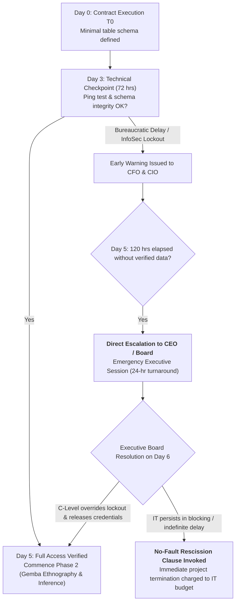

# OPERATIONAL INCEPTION PROTOCOL:
## 5-Day Data Access Agreement & Executive Interlock Clause (CEO Interlock)

> **Document Type:** Legally Binding Contractual Addendum & C-Level Commitment Template  
> **Purpose:** Preemptively neutralize *Anti-Pattern 3 (Pilot Purgatory)* and *Failure Mode 4 (Legacy IT Veto)* by establishing a non-negotiable 120-business-hour window for read-only replica ingestion under direct Executive Office governance.

---

### 1. Co-Responsibility Clause & Peremptory SLA (The 50-50 Compact)

**Between:**  
* **The Client** (represented by the Chief Executive Officer [CEO] and Chief Financial Officer [CFO])  
* **The Deployment Team** (led by the *Principal Forward Deployed Architect / Lead Deployment Strategist*)

Both parties expressly covenant that enterprise AI deployment success depends **50% on vendor technical architecture and ergonomics** and **50% on Client executive sponsorship and access governance**.

#### Mandatory Operational Stipulations:

1. **Data Delivery Window (120-Clock-Hour SLA):**  
   Commencing on the service agreement effective date ($T_0$), the Client’s Information Technology (IT), Infrastructure, and Chief Information Security Officer (CISO) teams are granted an unextendable period of **five (5) business days (120 clock hours)** to provision the following production read-only assets:
   * Read-only access (*Read-Only Replica*) or high-fidelity staging data extract (Parquet, read-only CDC stream, or cold staging database) mirroring core transactional inventory, purchasing, and sales order tables (in SAP environments: equivalent schemas to `MSEG`, `MKPF`, `EKET`, `EKPO`, `VBAK`, `VBAP`).
   * Master data dictionaries, unit-of-measure (UoM) conversion tables, and active BOM hierarchies.
   * Temporary staging credentials for read verification within a Quality Assurance (QA) or isolated sandbox environment.

2. **Safe-Staging Isolation Architecture (CISO Zero-Risk Warranty):**  
   To eliminate defensive cybersecurity objections, the Deployment Architecture formally certifies by design that:
   * **Zero Direct Mutation:** No automated agent, heuristic algorithm, or script shall issue write operations (`INSERT`, `UPDATE`, `DELETE`, `DROP`) directly against production databases during the initial 30-day causal discovery and inference phase.
   * **Cryptographic Safe-Staging:** All proposed operational adjustments operate strictly in *Safe-Staging Mode*: generating HMAC-SHA256 cryptographically signed changesets bounded by a 900-second Time-To-Live (TTL) and backed by an immutable, bit-for-bit idempotent rollback ledger (`Rollback Ledger`).

---

### 2. Automatic Day-5 Escalation Protocol (Executive Circuit-Breaker)

If upon the expiration of the 120-hour window ($T_0 + 5\text{ business days}$) data provisioning has not been formally verified by the Deployment Lead:

#### Kill-Switch and Safe Termination Clause:
If at 144 clock hours ($T_0 + 6\text{ business days}$) access remains obstructed due to Client-internal administrative or IT vetoes:
* Retainer and professional deployment fees accrued through the initial period remain 100% billable under committed personnel availability.
* The Deployment Lead is authorized to issue a formal **Operational Infeasibility Determination due to Institutional Decoupling**, discharging the engineering team from all downstream delivery milestones and P&L attribution targets.

---

### 3. Execution & Sign-Off Schedule

| Client Executive Leadership | Client Information Technology / CISO | Vendor Deployment Leadership |
| :--- | :--- | :--- |
| **Signature:** _______________________ | **Signature:** _______________________ | **Signature:** _______________________ |
| **Name:** ___________________________ | **Name:** ___________________________ | **Name:** ___________________________ |
| **Title:** Chief Executive Officer (CEO) | **Title:** Chief Information Officer (CIO) | **Title:** Principal Deployment Strategist |
| **Date:** ____ / ____ / 2026 | **Date:** ____ / ____ / 2026 | **Date:** ____ / ____ / 2026 |
