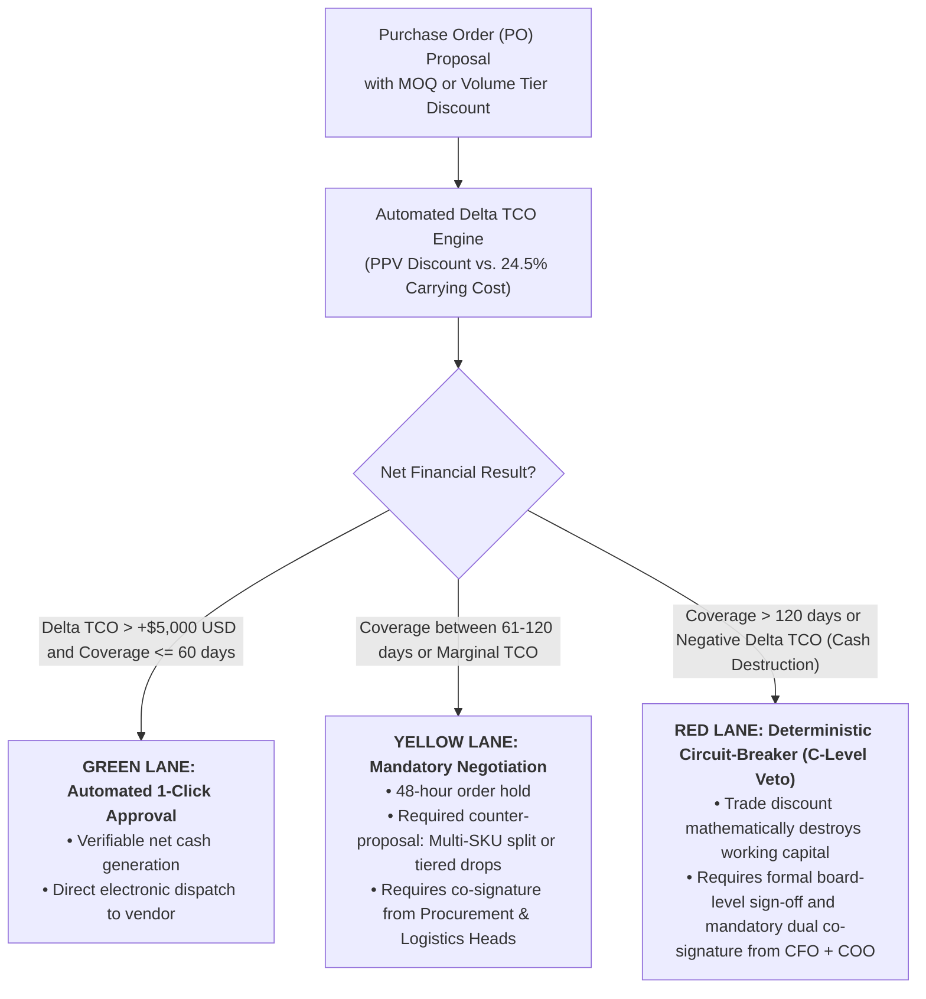

# OPERATIONAL PROTOCOL & DECISION CALCULATOR:
## Negative FVA Detection Matrix & Silo Incentive Arbitrage

> **Document Type:** Quantitative Decision Model & P&L Arbitrage Procedure  
> **Canonical Path:** `field-toolkit/03_negative_fva_incentive_arbitrage_matrix.md`  
> **Purpose:** Objectively audit whether manual planner overrides destroy forecast accuracy through stockout paranoia (*Negative Forecast Value Added - FVA*), and establish mathematical governance over Minimum Order Quantities (MOQs) by exposing consolidated financial destruction before purchase orders are issued.

---

### 1. Forecast Value Added (FVA) Audit: Paranoia as an Algorithm

**Forecast Value Added (FVA)** rigorously isolates whether manual human intervention improves or degrades accuracy relative to a baseline statistical model:

$$\text{FVA} = \text{MAPE}_{\text{Statistical Base}} - \text{MAPE}_{\text{Human Adjusted Forecast}}$$

```
┌────────────────────────────────────────────────────────────────────────────────────────────────────────┐
│                               OPERATIONAL INTERPRETATION BENCHMARK                                     │
├────────────────────────────────────────────────────────────────────────────────────────────────────────┤
│  If FVA > 0: Human domain expertise contributed measurable accuracy (captured an unmodeled dock       │
│              strike, undocumented commercial promotion, or sudden geopolitical disruption).           │
├────────────────────────────────────────────────────────────────────────────────────────────────────────┤
│  If FVA < 0: HUMAN OVERRIDE DESTROYED FORECAST QUALITY. The analyst injected systematic bias out       │
│              of stockout fear (asymmetric consequences), artificially inflating POs to protect bonuses.│
└────────────────────────────────────────────────────────────────────────────────────────────────────────┘
```

#### Protocol for Persistent Negative FVA ($N \ge 3\text{ consecutive cycles}$):
1. **Revoke Uncalibrated Manual Overrides:** The planner cannot modify ERP demand figures without selecting an authenticated causal trigger (customs embargo, closed-envelope tender, extreme climate event).
2. **Eliminate Asymmetric Compensation Penalties:** Executive leadership must formally certify that planners will not be disciplined for stockouts when models operate within Finance-authorized safety stock parameters.

---

### 2. P&L Arbitrage Calculator for Minimum Order Quantities (MOQs)

When Procurement requests authorization for volume-discounted purchase batches, the operational interface computes the net **Total Cost of Ownership differential ($\Delta \text{TCO}$)** over the projected consumption horizon:

$$\Delta \text{TCO} = \underbrace{(P_{\text{standard}} - P_{\text{negotiated}}) \cdot Q}_{\text{Purchase Price Variance Savings (PPV)}} - \underbrace{\left( \frac{Q - D_{\text{lead}}}{2} \right) \cdot P_{\text{negotiated}} \cdot i \cdot \frac{T_{\text{months}}}{12}}_{\text{Carrying Cost (Annualized benchmark: 24.50%)}} - \text{Surge Freight} - \text{Obsolescence Reserve}$$

Where:
* $Q$: Proposed minimum order batch quantity.
* $D_{\text{lead}}$: Forecasted demand over supplier lead time.
* $i = 0.2450$: Annualized inventory carrying cost rate (industrial WACC + warehousing lease + insurance + shrinkage).
* $T_{\text{months}}$: Estimated runway to deplete surplus batch inventory.

---

### 3. Decision Matrix & Three-Lane Approval Gating

Every proposed purchase order is dynamically routed through one of three deterministic governance lanes:



#### Executive Interlock Enforcement:
If an order in the **Red Lane** is granted an exceptional commercial waiver:
* The projected holding cost overrun ($\text{Carrying Cost}$) is debited directly from Procurement’s departmental incentive pool for the fiscal period.
* The hidden economic subsidy historically masking fictitious purchasing savings is eliminated before the Audit Committee.
