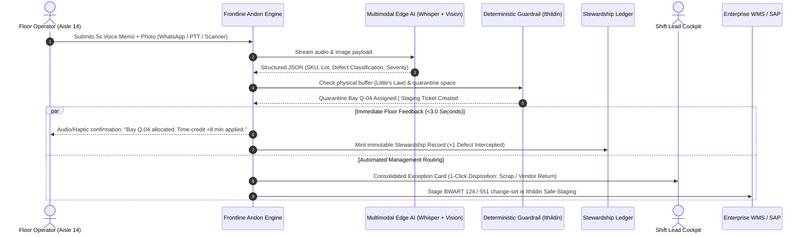

# NARYA 💍🔥 — FRONTLINE TACTICAL GUIDE:
## Multimodal Frontline Andon & Operator Stewardship Engine

> **Document Type:** Field Operational Protocol & Edge Architecture Specification  
> **Canonical Path:** `field-toolkit/04_frontline_andon_and_stewardship_engine.md`  
> **System Architecture:** Mellon (Frontline Adoption), Ithildin (Deterministic Safe-Staging) & Narya (Operator Stewardship)  
> **Core Purpose:** Transform frontline anomaly reporting from a bureaucratic penalty into a frictionless 10-second multimodal workflow (audio, image, text), disburdening middle management from clerical data entry and establishing an immutable Operator Stewardship Ledger.

---

## 1. The Operational & Sociological Problem

In industrial warehouses, cross-docks, and manufacturing plants, physical defects (crushed packaging, broken pallet skids, leaking containers, unreadable barcodes, mispicked SKUs) emerge continuously during high-velocity shifts. 

Despite multi-million-dollar ERP and WMS investments, operations suffer from a triadic breakdown:

```
┌────────────────────────────────────────────────────────────────────────────────────────┐
│                        THE FRONTLINE REPORTING COLLAPSE                                │
├────────────────────────────────────────────────────────────────────────────────────────┤
│ 1. THE REPORTING TAX (BUREAUCRATIC FRICTION):                                          │
│    Formally reporting a damaged box requires an operator to halt their forklift, walk │
│    150 meters to a supervisor's booth, log into a desktop terminal, and fill out 14    │
│    mandatory fields in SAP QM/MIGO. Elapsed time: 18–25 minutes.                       │
│                                                                                        │
│ 2. THE PERVERSE INCENTIVE TRAP (CAMPBELL'S LAW, 1979):                                 │
│    Forklift drivers and order pickers are measured strictly on speed quotas (picks/hr).│
│    Stopping to report a defect directly lowers their hourly productivity score and     │
│    destroys their monthly performance bonus. The rational floor response is to "stash" │
│    the damaged carton behind good inventory or pass it downstream.                     │
│                                                                                        │
│ 3. MIDDLE-MANAGEMENT ASPHYXIATION:                                                     │
│    Shift supervisors spend up to 65% of their working hours acting as high-cost data   │
│    entry clerks: collecting informal WhatsApp photos from drivers, manually re-keying  │
│    material numbers into spreadsheets, and arguing over blame.                         │
└────────────────────────────────────────────────────────────────────────────────────────┘
```

The system breaks this failure mode by replacing coercive paperwork with an **Enabling Frontline Andon** (*Adler & Borys, 1996*).

---

## 2. System Architecture: The Multimodal Closed Loop

The engine operates as a bidirectional, closed-loop communications fabric connecting the physical floor, the supervisor cockpit, and the enterprise ledger:



---

## 3. The Four Operational Mechanics

### 3.1. Zero-Friction Multimodal Ingestion (The 10-Second Barrier)
Operators never interact with complex UI forms while wearing cut-resistant work gloves. The interface meets the operator where they are:
* **Audio Voice Memo (PTT / WhatsApp / RF Handheld):** The operator presses a physical button on their scanner or mobile radio:  
  * *Floor vernacular:* "Pallet 4 in aisle 14, pallet base cracked, blue drum weeping mineral oil onto shelf B."
  * Local Speech-to-Text (Whisper / FastConformer) filters out 85 dB warehouse acoustic ambient noise and transcribes operational terminology directly.
* **Camera Capture:** The operator snaps a single photo of the damaged freight, barcode label, or shipping BOL. Multimodal edge models extract the GS1-128 barcode, container condition, and physical hazard class.
* **Single-Tap Confirmation:** No manual typing required.

### 3.2. The Operator Stewardship Ledger (Enabling Bureaucracy)
To neutralize Campbell's Law, the engine shifts the dynamic from punitive surveillance to **verifiable ownership**:
1. **The Time-Credit Guarantee (Directive M1):** Any time dedicated to identifying, documenting, and physically isolating an anomaly automatically issues a certified *Time-Credit Token*. This credit is passed to the labor management system (LMS), neutralizing any negative impact on the operator's shift pick-rate.
2. **The Frontline Stewardship Ledger:** Every validated anomaly logged by a worker creates an append-only, cryptographic record of value protected:
   $$\text{Value Protected} = \sum (\text{Replacement Cost of Contaminated Freight} + \text{Saved SLA Penalties})$$
   *Example:* An operator who catches a leaking solvent pallet before loading onto a line-haul truck receives formal recorded credit for preventing $\$14,500\text{ USD}$ in cargo damage and hazardous transit fines. This portfolio is auditable during quarterly wage reviews and promotions.

### 3.3. Disburdening Middle Management
Shift supervisors cease acting as data-entry buffers between floor workers and enterprise software:
* **Automated Triage & Routing:** The system identifies defect categories (Safety Hazard, Packaging Failure, Missing Quantity, Label Discrepancy) and routes them without supervisor intervention:
  * *Hazmat spills:* Triggers immediate audio alert to plant safety response team.
  * *Damaged packaging:* Allocates physical space in quarantine and generates barcoded disposal pallet tags.
* **1-Click Consolidated Cockpit:** Instead of entering 14 fields per event, supervisors review pre-triaged cards on their tablets:
  `[Approve Vendor Claim]` · `[Route to Rework]` · `[Scrap BWART 551]`

### 3.4. Deterministic Staging Writeback (Ithildin Interlock)
Under no circumstances does multimodal AI write directly to production tables (`MSEG`, `MKPF`, `ACDOCA`):
* The engine creates a strongly-typed `StagingActionProposal` with an HMAC-SHA256 signature and a 900-second TTL.
* If physical quarantine capacity is saturated ($r > r^*$, pursuant to Little's Law), the system automatically routes to `OVERFLOW_IMPUTED`, preserving plant throughput while maintaining inventory integrity.

---

## 4. Formal Event Schemas (Pydantic V2)

The engine standardizes frontline inputs into immutable, verifiable contracts:

```python
from decimal import Decimal
from datetime import datetime, timezone
from enum import Enum
from typing import Optional, List
from pydantic import BaseModel, Field, field_validator


class DefectSeverity(str, Enum):
    LOW = "LOW"            # Cosmetic carton crease, readable barcode
    MEDIUM = "MEDIUM"      # Broken outer master pack, intact primary unit
    HIGH = "HIGH"          # Compromised seal, crushed inner units, unreadable barcode
    CRITICAL = "CRITICAL"  # Active chemical leak, structural racking failure, fire risk


class AnomalyCategory(str, Enum):
    DAMAGED_PACKAGING = "DAMAGED_PACKAGING"
    CONTAMINATION_LEAK = "CONTAMINATION_LEAK"
    BARCODE_UNREADABLE = "BARCODE_UNREADABLE"
    MISPICK_OVERFLOW = "MISPICK_OVERFLOW"
    SAFETY_HAZARD = "SAFETY_HAZARD"


class FrontlineIncidentPayload(BaseModel):
    """Raw ingestion payload captured at the Gemba interface."""
    incident_id: str = Field(..., description="Unique UUIDv4 generated at client edge")
    operator_badge_id: str = Field(..., min_length=4, max_length=32)
    shift_code: str = Field(..., pattern=r"^(MORNING|AFTERNOON|GRAVEYARD)$")
    timestamp_utc: datetime = Field(default_factory=lambda: datetime.now(timezone.utc))
    location_tag: str = Field(..., description="Physical aisle, dock door, or rack coordinate, e.g. AISLE-14-RACK-B")
    raw_audio_url: Optional[str] = None
    raw_image_url: Optional[str] = None
    raw_text_transcript: Optional[str] = None


class FrontlineIncidentEvent(BaseModel):
    """Normalized, AI-enriched event validated against plant master schemas."""
    incident_id: str
    operator_badge_id: str
    timestamp_utc: datetime
    location_tag: str
    category: AnomalyCategory
    severity: DefectSeverity
    extracted_sku: Optional[str] = Field(None, pattern=r"^[A-Z0-9\-_]{4,24}$")
    extracted_lot_number: Optional[str] = None
    estimated_damaged_qty: Decimal = Field(default=Decimal("1.00"), ge=Decimal("0.01"))
    quarantine_allocated_bay: str = Field(..., description="Target physical buffer bay, e.g. BAY-Q-04")
    time_credit_awarded_minutes: int = Field(ge=5, le=30, description="Labor credit passed to LMS")
    estimated_value_protected_usd: Decimal = Field(default=Decimal("0.00"), ge=Decimal("0.00"))
    requires_safety_freeze: bool = Field(default=False)
    payload_hmac: str = Field(..., pattern=r"^[a-fA-F0-9]{64}$")

    @field_validator("timestamp_utc")
    @classmethod
    def ensure_utc(cls, v: datetime) -> datetime:
        if v.tzinfo is None or v.tzinfo != timezone.utc:
            raise ValueError("timestamp_utc must be explicit UTC aware")
        return v
```

---

## 5. Frontline Certification Acceptance Criteria

Before deploying this module on a live site, the field strategist must verify four binary conditions:

| Gate | Requirement | Falsification / Blocking Condition |
| :--- | :--- | :--- |
| **G-1: Sub-3-Second Floor SLA** | The end-to-end loop (Audio upload $\to$ Whisper transcription $\to$ Bay allocation $\to$ Operator notification) must resolve in $\le 3{,}000\text{ ms}$. | If latency exceeds 5 seconds under industrial LTE/Wi-Fi, operators abandon the system. |
| **G-2: Zero LMS Penalty** | The `time_credit_awarded_minutes` must demonstrably bridge into the facility's labor tracking engine. | If an operator's monthly bonus drops after reporting an anomaly, deployment halts immediately. |
| **G-3: 100% Supervisory Ingestion Bypass** | Basic defects (severity LOW/MEDIUM) must allocate quarantine locations and stage ERP changesets with zero supervisor typing. | If supervisors still re-enter data into spreadsheets, the disburdening objective has failed. |
| **G-4: Cryptographic Invariance** | Every staged transaction must carry an HMAC-SHA256 signature tied to the `operator_badge_id` and `incident_id`. | Any unsigned direct mutation to SAP/WMS is blocked fail-closed. |
