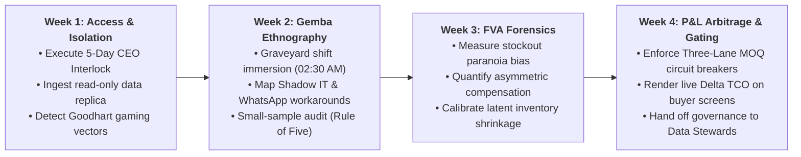

# FIELD TOOLKIT: THE DEPLOYMENT STRATEGIST'S FRONTLINE OPERATING SYSTEM
## Field-Executable Artifacts for Gemba Interventions & C-Level Governance

> **Canonical Repository:** `field-toolkit/`  
> **Purpose:** Provide operational artifacts, legally binding contracts, and forensic protocols to execute the principles of [*The 21st-Century Polymath Manifesto*](THE-21ST-CENTURY-POLYMATH-MANIFESTO.md) and the doctrine of the [*Deployment Strategist Master Whitepaper*](DEPLOYMENT-STRATEGIST-WHITEPAPER-MASTER.md) during the first 30 days of enterprise deployment.

---

### Frontline Artifact Catalog

| Artifact | File | Primary Audience & Function | Deployment Window |
| :--- | :--- | :--- | :---: |
| **1. 5-Day Access Agreement (CEO Interlock)** | [`01_ceo_5_day_access_interlock.md`](01_ceo_5_day_access_interlock.md) | Board of Directors, CEO, CISO, and IT. Establishes a peremptory 120-clock-hour SLA for read-only replica data extracts, eliminating pilot purgatory and IT vetoes. | **Day 0 (Inception)** |
| **2. Ethnographic Floor Protocol & The Mom Test** | [`02_gemba_mom_test_ethnographic_guide.md`](02_gemba_mom_test_ethnographic_guide.md) | Floor operators, dock workers, and forklift teams. Forensic graveyard-shift shadowing, cataloging of Shadow IT (WhatsApp/Excel), and verification of the <800 ms interface latency threshold. | **Weeks 1 & 2** |
| **3. Negative FVA Matrix & MOQ Arbitrage Engine** | [`03_negative_fva_incentive_arbitrage_matrix.md`](03_negative_fva_incentive_arbitrage_matrix.md) | Demand Planners, Procurement Buyers, and CFO. Quantitative $\Delta\text{TCO}$ calculator factoring a 24.50% carrying cost against volume discounts, with deterministic Three-Lane gating (Green, Yellow, Red). | **Weeks 3 & 4** |

---

### The 30-Day Frontline Implementation Protocol

Designed to align directly with 90-day enterprise transformation sprints (e.g., WON.ai Rapid Redesign cycles):

#### Detailed Milestone Breakdown:

* **Week 1 (Days 0–7) — Access, Legal Interlock & Data Ingestion:**
  * Day 0: Mutual execution of the *5-Day Access Addendum* signed by CEO, CFO, and Lead Deployment Strategist.
  * Days 1–3: Provisioning of read-only staging replicas or Parquet extracts (`MSEG`, `MKPF`, `EKPO`, `EKET`). Zero production writeback access requested or granted.
  * Days 4–5: Execution of `audit_assertions_sap.sql` against staging schemas to establish the baseline of unrecorded scrap, orphaned inventory line items, and negative controls.
  * Day 5: Formal gate review. If IT data delivery stalls, automatic escalation to the Executive Committee under the peremptory SLA.

* **Week 2 (Days 8–14) — Gemba Ethnography & Ground-Truth Forensics:**
  * Days 8–10: On-site participant observation across all operational shifts, with mandatory graveyard shift shadowing (02:00 AM – 06:00 AM).
  * Days 11–12: Execution of *The Mom Test* interviews with weighbridge clerks, receiving staff, and warehouse managers. Discovery and logging of unofficial cheat sheets, localized Excel macros, and operational WhatsApp routing groups.
  * Days 13–14: Application of *The Rule of Five* (Hubbard non-parametric sampling): blind physical inventory counts across 5 random high-velocity SKUs to calculate true baseline inventory record inaccuracy (IRI).

* **Week 3 (Days 15–21) — Incentive Forensics & FVA Calibration:**
  * Days 15–17: Backtesting demand planning records to isolate Forecast Value Added (FVA). Separation of statistical baseline error from human judgmental inflation driven by stockout fear.
  * Days 18–19: Incentive structure mapping: analyzing how purchasing bonuses (PPV) contradict logistics inventory carrying costs (24.50% WACC + warehousing burden).
  * Days 20–21: Execution of `inventory_mechanics.py` discrete-event simulation with client parameters to prove stochastic inventory absorption and identify the freezing threshold.

* **Week 4 (Days 22–30) — P&L Arbitrage, Guardrail Activation & Handoff:**
  * Days 22–25: Deployment of the *Three-Lane Governance Engine* (Green, Yellow, Red) inside procurement staging workflows. Live calculation of $\Delta\text{TCO}$ before PO release.
  * Days 26–28: Activation of `inbound_fsm_guardrail.py` and cryptographic HMAC-SHA256 safe-staging writebacks on pilot terminals. Verification of glove ergonomics and sub-800 ms latency.
  * Days 29–30: Executive readout with C-Level leadership. Delivery of audited Difference-in-Differences baseline specification (`econometric_engine.py`) and formal handover to internal operational Data Stewards.

---
*Direct programmatic integration with the root mathematical suite: [`inventory_mechanics.py`](../inventory_mechanics.py) · [`econometric_engine.py`](../econometric_engine.py) · [`core_event_contracts.py`](../core_event_contracts.py) · [`inbound_fsm_guardrail.py`](../inbound_fsm_guardrail.py).*
