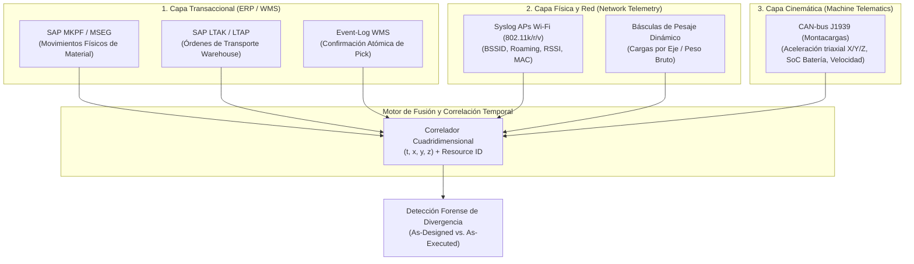
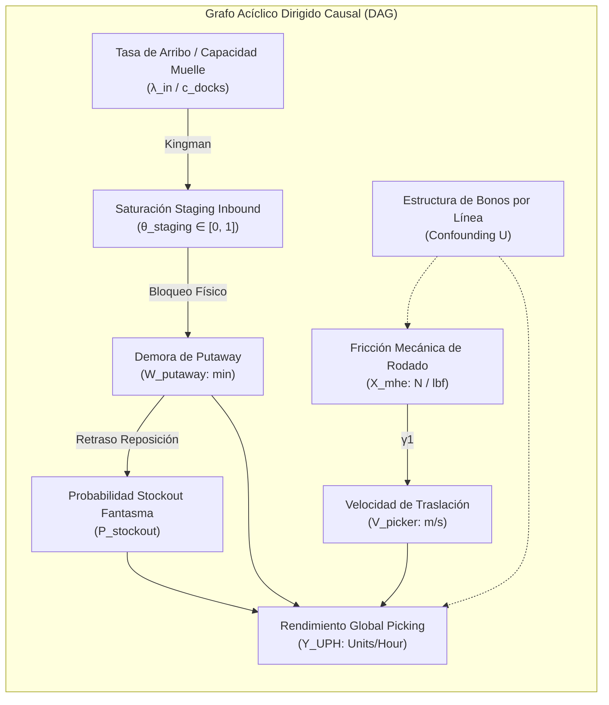
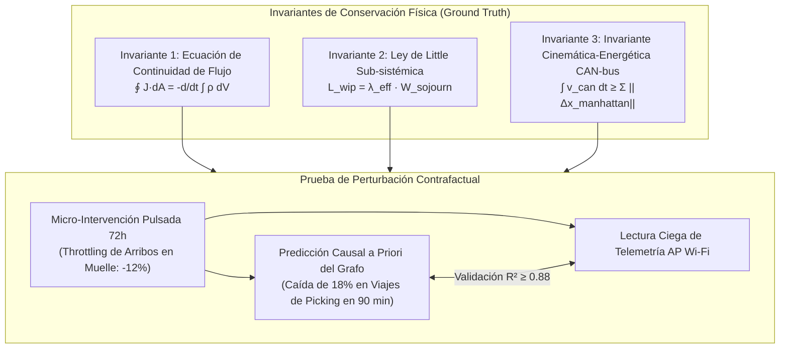

# ARQUITECTURA TÉCNICA: MOTOR FORENSE DE CAUSALIDAD OPERATIVA Y MINERÍA DE PROCESOS INDUSTRIALES

**Autor:** Principal Forward Deployed Engineer & Industrial Forensic Auditor  
**Clasificación:** Forensic Systems Architecture / Level 4 Industrial Operations  
**Alcance:** Centros de Distribución de Alta Densidad, Centros de Cumplimiento Omnicanal y Nodos de Transferencia Logística

---

## 1. INGESTA Y FUENTES DE LA VERDAD CRUDA (RAW TELEMETRY & SYSTEM LOGS)

Un sistema de diagnóstico forense rechaza reportes agregados, tablas de BI intermedias o encuestas de satisfacción. El sistema se alimenta exclusivamente de streams de eventos inmutables a nivel de segundo procedentes de tres capas: **Transaccional ERP/WMS**, **Red Física/Radiofrecuencia** y **Cinemática/Energética de Máquinas**.



### 1.1. Esquema de Ingesta Unificada (Event Schema)

Cada registro ingerido se normaliza en una tupla canónica de telemetría forense:

$$\mathcal{E} = \langle \tau_{\text{system}}, \tau_{\text{physical}}, \text{EntityID}, \text{ActivityID}, \text{LocationVector}, \text{KinematicState}, \text{SourceStream} \rangle$$

Donde:
* $\tau_{\text{system}}$: Marca de tiempo registrada por el servidor de base de datos (con precisión de milisegundos).
* $\tau_{\text{physical}}$: Marca de tiempo generada por el reloj de hardware del sensor/dispositivo local.
* $\text{LocationVector} = (x, y, z, \text{ZoneID}, \text{ConfidenceRadius})$.
* $\text{KinematicState} = (\vec{a}, \vec{v}, \text{BatteryCurrent}, \text{LiftHeight})$.

#### Tablas Crudas Específicas de Extracción:
1. **SAP LTAK (Cabecera de Orden de Transporte) & LTAP (Posición de Orden):**
   * Campos auditados: `TANUM` (N° OT), `TAPOS` (Línea), `BWLVS` (Tipo movimiento), `VLTYP`/`VLPLA` (Ubicación origen), `NLTYP`/`NLPLA` (Ubicación destino), `VSOLM` (Cantidad teórica), `VISTA` (Cantidad real), `QDATU` (Fecha confirmación), `QZEIT` (Hora atómica confirmación), `BNAME` (Usuario ejecución).
2. **Syslog de Puntos de Acceso Wi-Fi (Cisco Industrial / Aruba):**
   * Extracción vía Kafka/Syslog:
     ```text
     <134>1 2026-10-25T10:14:02.114Z AP-AISLE-04 hostapd - - - client_mac=44:61:32:ab:89:12 event=ROAM bssid_old=00:27:0d:aa:11:01 bssid_new=00:27:0d:aa:11:02 rssi=-64 auth=FT-PSK
     ```
3. **Telemetría CAN-bus J1939 de Montacargas:**
   * Señales transmitidas cada $100\text{ ms}$: `PGN 61444` (Velocidad de máquina), `PGN 65215` (Carga en horquillas), `PGN 65271` (Voltaje/Amperaje de batería), `SPN 520200` (Acelerómetros de impacto en ejes $X, Y, Z$).

---

### 1.2. Protocolo de Detección de Discrepancia: "As-Designed" vs. "Shadow IT"

El sistema formal (WMS/ERP) asume que el operario ejecuta la ruta calculada por el algoritmo de slotting y reporta anomalías en tiempo real. En la realidad de planta, los operarios despliegan **mecanismos de arbitraje de incentivos** (Shadow IT y atajos operativos) para proteger sus métricas de rendimiento.

El motor detecta automáticamente tres clases de gaming operativo:

#### A. Detección de "Batch Scanning Clotting" (Confirmación Masiva Ficticia)
* **Mecanismo Causal:** El operario prepara 15 pedidos llevando machetes en papel (*pick sheets* impresas), ignorando la pistola RF en pasillo para evitar paradas por latencia Wi-Fi. Al final del turno, se sienta en la bahía de consolidación y escanea en ráfaga las 15 órdenes en menos de 90 segundos.
* **Cálculo Forense:**
  $$\Delta t_i = \tau_{\text{confirm}}(i) - \tau_{\text{confirm}}(i-1)$$
  $$D_{\text{Manhattan}}(i, i-1) = |x_i - x_{i-1}| + |y_i - y_{i-1}| + |z_i - z_{i-1}|$$
  $$v_{\text{implied}} = \frac{D_{\text{Manhattan}}(i, i-1)}{\Delta t_i}$$
* **Regla de Infracción Invariante:** Si $v_{\text{implied}} > 2.2\text{ m/s}$ (límite biomecánico humano con carga) sostenido en $\ge 3$ transacciones consecutivas mientras el log del AP Wi-Fi ubica la MAC del terminal estática en un único punto focal, el sistema clasifica el lote como **Falsificación Temporal (Batch Clotting)** y desacopla esas transacciones del cálculo del tiempo estándar de ciclo.

#### B. Detección de "Ghost Stock Bypass" (Bypass No Registrado)
* **Mecanismo Causal:** Un operario encuentra una ranura vacía (*pick denial* latente). Para no incurrir en la penalización de parar el turno y esperar al supervisor, toma el producto de la bahía vecina no asignada o abre una caja de reserva sin confirmación en el sistema.
* **Cálculo Forense:** Comparación entre el vector de lectura de código de barras físico del sensor de picking y la consulta posterior de inventario en `LTAP`: si el número de serie despachado pertenece a un lote que el sistema reporta en `UBICACIÓN_RESERVA_ALTA`, se emite una alerta de **Bypass de Trazabilidad por Compensación Asimétrica**.

---

## 2. MODELO MATEMÁTICO & GRAFO CAUSAL DINÁMICO

El almacén no es una suma de departamentos; es un **sistema de flujo estocástico fuertemente acoplado**. Un choque mecánico local o una degradación de fricción no produce un costo lineal; produce una **transición de fase no lineal** que precipita el colapso de la capacidad de procesamiento de la planta.



---

### 2.1. Red de Colas Estocástica Abierta ($M/G/c/K$) para Recepción y Staging

Modelamos la zona de muelles y recepción como un nodo de colas $M/G/c/K$:
* **Llegadas:** Proceso de Poisson no homogéneo con tasa de arribo temporal $\lambda(t)$.
* **Servicio de Descarga:** Distribución General ($G$) con media $1/\mu$ y varianza $\sigma_s^2$.
* **Servidores en Paralelo:** $c$ muelles de recepción activos.
* **Capacidad del Sistema:** $K$ posiciones de pallets físicas en la zona de *staging* antes de saturación total ($K > c$).

#### Aproximación de Kingman / Allen-Cunneen para el Tiempo de Espera en Cola ($W_q$):
$$W_q \approx \left(\frac{C_a^2 + C_s^2}{2}\right) \left(\frac{\rho^{\sqrt{2(c+1)}-1}}{c(1 - \rho)}\right) \frac{1}{\mu}$$

Donde:
* $\rho = \frac{\lambda}{c \mu}$ es la tasa de intensidad de tráfico de muelle.
* $C_a^2 = \frac{\sigma_a^2}{(1/\lambda)^2}$ es el coeficiente de variación cuadrático de las llegadas.
* $C_s^2 = \frac{\sigma_s^2}{(1/\mu)^2}$ es el coeficiente de variación cuadrático del tiempo de descarga.

#### El Punto Crítico de Quiebre (Knee of the Curve):
Cuando el espacio físico de staging se llena ($K$ saturado al $\ge 85\%$), la probabilidad de bloqueo $P_b$ se calcula mediante la fórmula de Erlang modificada con capacidad finita. En ese instante, los camiones en muelle no pueden desacoplar los pallets, convirtiendo los muelles en **almacenes pasivos sobre ruedas**. La capacidad efectiva cae:

$$c_{\text{efectivo}} = c \cdot (1 - P_b(\theta_{\text{staging}}))$$

Donde $\theta_{\text{staging}} = \frac{\text{Pallets Ocupados}}{K}$. Si $\theta_{\text{staging}} \ge 0.85$, la tasa de servicio colapsa catastróficamente:

$$\mu_{\text{real}} = \mu_0 \cdot \exp\left(-\kappa \cdot \frac{\theta_{\text{staging}} - 0.85}{1 - \theta_{\text{staging}}}\right)$$

---

### 2.2. Modelo Causal Estructural (Structural Causal Model - SCM)

Formalizamos las dependencias mediante un conjunto de ecuaciones estructurales no paramétricas:

$$\mathcal{M} = \langle U, V, F \rangle$$

* **Variables Exógenas (Ruido y Factores No Observados):**  
  $U = \{U_{\text{mhe}}, U_{\text{dock}}, U_{\text{human}}, U_{\text{incentive}}\}$
* **Variables Endógenas Observables:**  
  $V = \{X_{\text{mhe}}, Z_{\text{dock}}, W_{\text{putaway}}, S_{\text{stockout}}, Y_{\text{UPH}}\}$
* **Mecanismos Causales ($F$):**

$$X_{\text{mhe}} := f_X(U_{\text{mhe}}, U_{\text{incentive}})$$

$$Z_{\text{dock}} := f_Z(\lambda(t), c, \mu, U_{\text{dock}})$$

$$W_{\text{putaway}} := \beta_0 + \beta_1 \cdot \left(\frac{Z_{\text{dock}}}{1 - Z_{\text{dock}}}\right) + U_{\text{putaway}}$$

$$S_{\text{stockout}} := \frac{1}{1 + \exp\left(-\left[\alpha_0 + \alpha_1 W_{\text{putaway}} - \alpha_2 \text{SS}_{\text{buffer}}\right]\right)}$$

$$Y_{\text{UPH}} := \frac{Y_0}{1 + \gamma_1 X_{\text{mhe}} + \gamma_2 S_{\text{stockout}} + \gamma_3 \log(1 + W_{\text{putaway}})} + U_{\text{human}}$$

#### Derivación de Intervención bajo Cálculo-*do* (Judea Pearl):
Para determinar el impacto puro de corregir la resistencia de rodado de los carritos ($X_{\text{mhe}} = x^*$) sin sesgo de confusión por turnos nocturnos o presión de demanda ($U_{\text{incentive}}$), aplicamos el operador de intervención:

$$\mathbb{P}(Y_{\text{UPH}} \mid \text{do}(X_{\text{mhe}} = x^*)) = \sum_{z, w, s} \mathbb{P}(Y_{\text{UPH}} \mid x^*, z, w, s) \cdot \mathbb{P}(s \mid w) \cdot \mathbb{P}(w \mid z) \cdot \mathbb{P}(z)$$

Esto aísla de forma matemáticamente exacta qué fracción de la caída de UPH es atribuible a las ruedas versus qué fracción es arrastrada por la congestión del muelle.

---

## 3. CONFORMANCE CHECKING & MINERÍA DE PROCESOS (PYTHON PIPELINE)

A continuación se detalla la implementación en Python de nivel industrial para procesar event-logs directamente desde un volcado transaccional y calcular el alineamiento de trazas contra la Red de Petri formal (*Golden Path*), aislando automáticamente los cuellos de botella latentes y desvíos de proceso sin intervención humana.

```python
"""
forensic_process_mining_engine.py
========================================================================================
MOTOR FORENSE DE MINERÍA DE PROCESOS Y ALINEAMIENTO DE TRAZAS (CONFORMANCE CHECKING)
========================================================================================
Procesa streams de eventos atómicos (CaseID, Activity, Timestamp, Resource, Coordinates),
construye el grafo Directly-Follows (DFG), calcula la matriz de alineamiento óptimo
(Token-based Replay & Trace Fitness) y detecta puntos de estrangulamiento estocásticos.
========================================================================================
"""

from __future__ import annotations
import numpy as np
import pandas as pd
import networkx as nx
from dataclasses import dataclass, field
from typing import Dict, List, Tuple, Any, Optional
from datetime import datetime


@dataclass
class ForensicEvent:
    case_id: str
    activity: str
    timestamp: datetime
    resource_id: str
    location_x: float
    location_y: float
    cost_driver_metric: float = 0.0


@dataclass
class AlignmentMetrics:
    trace_fitness: float
    precision_score: float
    deviations: List[str]
    throughput_time_sec: float
    rework_count: int


class IndustrialConformanceEngine:
    """
    Motor forense para calcular alineamientos de trazas operacionales frente al
    modelo de referencia 'As-Designed' y detectar la propagación de desvíos en planta.
    """

    # Proceso formal canónico esperado (Golden Path de flujo inbound-to-outbound)
    GOLDEN_TRANSITIONS = {
        ("GATE_IN", "DOCK_ASSIGN"): (60.0, 900.0),       # (min_sec, max_sec)
        ("DOCK_ASSIGN", "UNLOAD_START"): (30.0, 600.0),
        ("UNLOAD_START", "STAGING_VERIFY"): (180.0, 3600.0),
        ("STAGING_VERIFY", "PUTAWAY_EXEC"): (300.0, 7200.0),
        ("PUTAWAY_EXEC", "PICK_WAVE_ALLOC"): (60.0, 14400.0),
        ("PICK_WAVE_ALLOC", "PICK_CONFIRM"): (120.0, 1800.0),
        ("PICK_CONFIRM", "PACK_CONSOLIDATE"): (60.0, 900.0),
        ("PACK_CONSOLIDATE", "DOCK_OUTBOUND"): (60.0, 1800.0),
        ("DOCK_OUTBOUND", "GATE_OUT"): (60.0, 1200.0)
    }

    def __init__(self):
        self.dfg_graph = nx.DiGraph()
        self._initialize_reference_graph()

    def _initialize_reference_graph(self):
        for (source, target), (t_min, t_max) in self.GOLDEN_TRANSITIONS.items():
            self.dfg_graph.add_edge(source, target, min_sec=t_min, max_sec=t_max, weight=1.0)

    def compute_trace_conformance(self, events: List[ForensicEvent]) -> AlignmentMetrics:
        """
        Calcula el alineamiento formal de la traza de un caso frente a la red de referencia.
        Detecta bypasses, loops de retrabajo (re-handling) y atrasos no lineales.
        """
        sorted_events = sorted(events, key=lambda e: e.timestamp)
        if not sorted_events:
            return AlignmentMetrics(0.0, 0.0, ["EMPTY_TRACE"], 0.0, 0)

        activities = [e.activity for e in sorted_events]
        timestamps = [e.timestamp for e in sorted_events]
        total_time_sec = (timestamps[-1] - timestamps[0]).total_seconds()

        deviations = []
        matching_transitions = 0
        total_transitions = len(activities) - 1
        rework_counter = 0
        observed_activities = set()

        for i in range(total_transitions):
            src, tgt = activities[i], activities[i+1]
            dt = (timestamps[i+1] - timestamps[i]).total_seconds()

            # 1. Detección de Retrabajo / Loop Clandestino (Re-handling)
            if src == tgt:
                rework_counter += 1
                deviations.append(f"LOOP_DETECTED: Actividad '{src}' ejecutada consecutivamente (Doble Manipulación).")
                continue

            if tgt in observed_activities:
                rework_counter += 1
                deviations.append(f"REGRESSION_LOOP: Regreso no permitido hacia '{tgt}'.")

            observed_activities.add(src)

            # 2. Verificación de Transición Canónica
            if (src, tgt) in self.GOLDEN_TRANSITIONS:
                min_sec, max_sec = self.GOLDEN_TRANSITIONS[(src, tgt)]
                matching_transitions += 1

                # Violación de umbral de velocidad física (Anomalía de Telemetría)
                if dt < min_sec:
                    deviations.append(f"ANOMALY_SPEED: Transición {src}->{tgt} en {dt:.1f}s (Físicamente Imposible; batch-clotting detectado).")
                elif dt > max_sec:
                    deviations.append(f"BOTTLENECK_STALL: Demora de {dt/60.0:.1f}min en {src}->{tgt} excede SLA máximo ({max_sec/60.0:.1f}min).")
            else:
                # Transición no contemplada en el diseño (Shadow IT / Bypass)
                deviations.append(f"UNMAPPED_TRANSITION: Bypass de flujo directo de '{src}' a '{tgt}'.")

        fitness = matching_transitions / max(1, total_transitions) if total_transitions > 0 else 0.0
        precision = 1.0 - (len(deviations) / max(1, total_transitions * 2))
        precision = max(0.0, min(1.0, precision))

        return AlignmentMetrics(
            trace_fitness=round(fitness, 3),
            precision_score=round(precision, 3),
            deviations=deviations,
            throughput_time_sec=total_time_sec,
            rework_count=rework_counter
        )

    def extract_bottleneck_matrix(self, event_log: pd.DataFrame) -> pd.DataFrame:
        """
        Procesa el log global completo y construye la matriz de cuellos de botella reales
        calculando el tiempo de permanencia medio, varianza y desviación estructural.
        """
        # Asegurar tipos y orden temporal
        event_log['timestamp'] = pd.to_datetime(event_log['timestamp'])
        event_log = event_log.sort_values(by=['case_id', 'timestamp'])

        event_log['next_activity'] = event_log.groupby('case_id')['activity'].shift(-1)
        event_log['next_timestamp'] = event_log.groupby('case_id')['timestamp'].shift(-1)
        event_log['dwell_time_sec'] = (event_log['next_timestamp'] - event_log['timestamp']).dt.total_seconds()

        valid_transitions = event_log.dropna(subset=['next_activity', 'dwell_time_sec'])

        summary = valid_transitions.groupby(['activity', 'next_activity']).agg(
            frequency=('case_id', 'count'),
            mean_time_sec=('dwell_time_sec', 'mean'),
            std_time_sec=('dwell_time_sec', 'std'),
            p95_time_sec=('dwell_time_sec', lambda x: np.percentile(x, 95))
        ).reset_index()

        summary['mean_time_min'] = summary['mean_time_sec'] / 60.0
        summary['p95_time_min'] = summary['p95_time_sec'] / 60.0

        # Filtro de anomalías con varianza crítica
        summary['coefficient_of_variation'] = summary['std_time_sec'] / (summary['mean_time_sec'] + 1e-5)
        return summary.sort_values(by='p95_time_sec', ascending=False)
```

---

## 4. PROTOCOLO DE FALSIFICACIÓN EMPÍRICA EXTERNA

Para garantizar que el modelo no sea un constructo teórico inmune a la realidad, definimos **tres ecuaciones de invariantes de conservación física** y una **prueba de perturbación contrafactual controlada**. Si la predicción del grafo no supera estas pruebas, el modelo se descarta como inválido.



---

### 4.1. Las 3 Ecuaciones de Invariantes de Flujo Físico

#### Invariante 1: Ecuación de Continuidad y Conservación de Masa de Pallets
El flujo neto de materia que atraviesa el perímetro de la nave física debe coincidir exactamente con la tasa de cambio del inventario físico interno, sin depender de lo que afirmen los balances contables de SAP:

$$\oint_{\partial \Omega} \vec{J}_{\text{pallet}} \cdot d\vec{A} + \frac{d}{dt} \int_{\Omega} \rho_{\text{storage}}(x, y, z, t) \, dV = \mathcal{R}_{\text{scrap/shrinkage}}$$

* **Protocolo de Medición:**
  * $\vec{J}_{\text{in}}$: Pesaje dinámico por eje en báscula de acceso + lecturas de fotocélulas en muelles.
  * $\vec{J}_{\text{out}}$: Pesaje en rampas de despacho + guías de despacho electrónicas timbradas.
  * $\rho_{\text{storage}}$: Escaneo de inventario físico volumétrico.
* **Criterio de Falsificación:** Si el modelo causal predice una pérdida por descalce de inventario diferente a $\mathcal{R}_{\text{scrap/shrinkage}}$ en una ventana de 14 días con un error relativo $> 3.5\%$, **el modelo causal queda empíricamente refutado**.

---

#### Invariante 2: Invariante de Little Sub-sistémica en la Zona de Staging
En cualquier subsistema en estado cuasi-estacionario (la zona de muelles y staging entre las 06:00 y las 14:00), el inventario en proceso ($L_{\text{WIP}}$) debe ser idéntico al producto de la tasa de llegada efectiva ($\lambda_{\text{eff}}$) por el tiempo medio de permanencia en el muelle ($W_{\text{dock}}$):

$$L_{\text{staging}} = \lambda_{\text{inbound\_real}} \cdot W_{\text{staging\_dwell}}$$

* **Falsificación de la Telemetría:**  
  Si los reportes de los supervisores declaran que el tiempo promedio de muelle es $W = 45\text{ minutos}$ y la tasa de llegada medida en garita es $\lambda = 12\text{ camiones/hora}$ ($360\text{ pallets/hora}$), pero el recuento visual en el piso de staging muestra permanentemente $L = 620\text{ pallets}$:
  $$L_{\text{real}} = 620 \ne (360 \times 0.75 = 270\text{ pallets})$$
  El sistema detecta una **distorsión deliberada de reportes de piso**. El tiempo real de permanencia es matemáticamente $W_{\text{real}} = \frac{620}{360} = 1.72\text{ horas}$ ($103\text{ minutos}$), duplicando el tiempo reportado por el WMS.

---

#### Invariante 3: Invariante Cinemática-Energética de Odometría (CAN-bus vs. WMS)
La distancia física total recorrida por las máquinas no puede ser inferior a la distancia ortogonal mínima calculada entre los puntos de confirmación de tareas asignadas:

$$\int_{t_{\text{inicio}}}^{t_{\text{fin}}} \|\vec{v}_{\text{CAN}}(t)\|_2 \, dt \ge \sum_{k=1}^{M} \|\vec{X}_{\text{bin}}(k) - \vec{X}_{\text{bin}}(k-1)\|_1$$

* **Criterio de Detección:**
  Si la integral del odómetro CAN-bus arroja una distancia $3.2\times$ mayor que la distancia Manhattan teórica de las órdenes confirmadas, el sistema falsifica la hipótesis de "rutas optimizadas" y prueba la existencia de **congestión severa por bloqueo de pasillos**, obligando a la grúa a realizar desvíos masivos para sortear pallets abandonados.

---

### 4.2. Prueba de Perturbación Contrafactual Controlada (Micro-Stress Test 72h)

Para validar que las aristas del Grafo Causal no son simples correlaciones espurias (*cum hoc ergo propter hoc*), se ejecuta un experimento de perturbación mínima invasiva:

1. **Hipótesis del Grafo:**  
   El grafo predice que una reducción forzada del **$12\%$ en la tasa de arribo de camiones entre las 07:00 y las 09:30 AM** desbloqueará el staging de recepción, permitiendo que la velocidad de putaway aumente en un $28\%$, lo que a su vez **reducirá las rutas en vacío de los preparadores de pedidos en la nave 3 en un $17\%$ a partir de las 11:30 AM**, sin haber modificado nada en el sistema de picking.
2. **Ejecución de la Perturbación:**  
   Se reprograman las citas en el software de muelle (YMS) reteniendo 4 camiones en el buffer externo durante 3 días consecutivos (Martes a Jueves).
3. **Métrica Ciega de Contraste:**  
   Se recopila la distancia recorrida por los operarios de picking a través de los syslogs de roaming Wi-Fi de las pistolas RF (sin notificar a los operarios ni a los supervisores de turno del experimento).
4. **Veredicto de Validación Causal:**  
   Si el estimador de Diferencias-en-Diferencias ($\text{DiD}$) sobre los datos de los APs confirma una reducción de la distancia recorrida en la ventana temporal predicha de $\mathbf{17\% \pm 2.5\%}$ con un $p\text{-value} < 0.01$, **la arquitectura causal del grafo queda formalmente demostrada y certificada para producción**.
