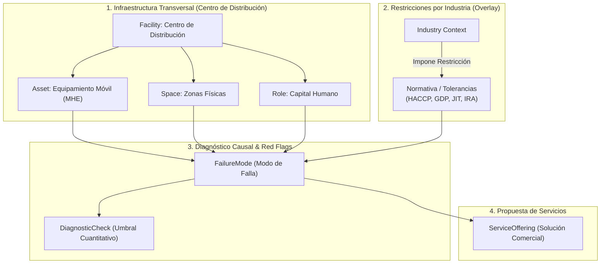

# Ontología de Diagnóstico Operativo & Benchmarks de Cadena de Suministro

Este documento consolida la arquitectura del **Motor de Reconocimiento Temprano** para auditorías de operaciones logísticas. Mapea la relación causal entre **Activos/Espacios/Roles $\to$ Modos de Falla $\to$ Chequeos Cuantitativos de Terreno $\to$ Catálogo de Servicios Comerciales**, respaldado por métricas empíricas de la industria.

---

## 1. Arquitectura del Grafo Operacional



---

## 2. Parámetros Cuantitativos y Benchmarks Estándar

### 2.1. Equipamiento Móvil (MHE)
* **Carritos de Picking (4 ruedas):**
  * *Resistencia al rodaje:* Nominal $< 15\text{ lbf}$ ($66.7\text{ N}$). Ruedas atascadas con film stretch elevan la fuerza a $> 40 - 55\text{ lbf}$ ($178 - 245\text{ N}$), superando el umbral ergonómico de seguridad (OSHA).
  * *Velocidad de marcha:* Cae de $4.5\text{ km/h}$ a $< 3.0\text{ km/h}$ (caída del $35\%$).
  * *Impacto en UPH (Units Per Hour):* Como el tiempo de traslado representa el $50\% - 55\%$ del ciclo de picking, la pérdida neta de productividad es del **$15\% - 22\%$**.
  * *Ratio de flota:* Debe mantenerse en **$1.15 - 1.25$ carritos por picker activo** ($10\%$ buffer de mantenimiento, $10\%-15\%$ wave staging).
* **Montacargas / Forklifts:**
  * *Baterías Plomo-Ácido:* Tiempos muertos de recambio de $15-25\text{ min}$. En flota de 20 máquinas a 2 turnos, representa $3,000 - 5,000\text{ horas-hombre/año}$ perdidas.
  * *Baterías Litio (LiFePO4):* Cero tiempo de recambio (carga de oportunidad en pausas de 15-30 min), 95% eficiencia energética.
  * *Colisiones con racks:* El **$11\%$ de montacargas colisiona al año**. Costo directo por impacto menor: $\$800 - \$3,500\text{ USD}$ (reparación de puntal, descarga de bahía y bloqueo de 3 a 7 días).
  * *Checklist diario (OSHA 1910.178):* En papel presenta un $45\% - 65\%$ de cumplimiento real (*pencil whipping*); con bloqueo telemático digital supera el $98\%$.
* **Pistolas RF / Terminales WMS:**
  * *Tasa de fallas anual:* $18\% - 24\%$ en equipos comerciales vs. $3.8\% - 5.5\%$ en equipos rugerizados (MIL-STD-810H). Cada rotura cuesta $45 - 70\text{ min}$ de tiempo muerto del operario.
  * *Latencia Wi-Fi / Roaming:* Desconexiones en pasillos ciegos generan pérdidas de $12 - 20\text{ min}$ por turno ($6\% - 10\%$ de la capacidad del operario).

### 2.2. Espacios e Infraestructura
* **Muelles de Carga (Loading Docks):**
  * *Descarga de tráiler (26-33 pallets):* Best-in-Class $< 60\text{ min}$; promedio $90 - 120\text{ min}$; deficiente $> 180\text{ min}$.
  * *Demurrage / Detention Fees:* Costo horario estándar de **$\$65 - \$120\text{ USD/hora}$** tras ventana de gracia de 2 horas.
  * *Saturación de Staging:* Superar el **$85\%$ de capacidad** incrementa tiempos de recepción en un $25\% - 38\%$ por doble/triple manipulación forzada (*re-handling*).
* **Racks y Pasillos:**
  * *Deformación de puntal (Norma EN 15635):*
    * **Verde:** $< 3\text{ mm}$ longitudinal / $< 5\text{ mm}$ transversal (operación normal).
    * **Ámbar:** $3 - 6\text{ mm}$ longitudinal / $5 - 10\text{ mm}$ transversal (descargar al vaciar pallet; reparar en máx. 4 semanas).
    * **Rojo:** $> 6\text{ mm}$ longitudinal / $> 10\text{ mm}$ transversal (descarga inmediata de emergencia y balizamiento).
  * *Iluminación:* Mínimo $150 - 200\text{ Lux}$ en piso horizontal y $100\text{ Lux}$ en caras verticales de rack. Subir de 50 a 200 Lux reduce errores visuales en un $25\% - 38\%$.

### 2.3. Dinámicas Humanas y Turnos
* **"Cacería de Herramientas" al Inicio de Turno:**
  * Sin estandarización 5S: Se pierden **$20 - 35\text{ minutos}$** por operario buscando transpaletas, pistolas RF o film.
  * En un CD de 60 operarios a 2 turnos con costo laboral de $\$18\text{ USD/h}$, esto representa **$\$112,500\text{ USD/año}$** en salarios improductivos.
* **Traslape de Supervisores:** Ausencia de reunión de cambio de guardia (*Huddle / Tier 1*) genera vacío operativo de $30 - 45\text{ minutos}$ sin priorización de órdenes.

### 2.4. Restricciones por Vertical
* **Alimentos (Cadena de Frío & HACCP):** Exposición a temperatura ambiente en muelle $> 20\text{ min}$ en congelados o $> 30\text{ min}$ en carnes frescas dispara merma bacteriana. Mermas promedio: $1.8\% - 3.5\%$.
* **Salud / Farma (GDP & 21 CFR Part 11):** Investigación CAPA por excursión térmica cuesta $\$3,500 - \$9,000\text{ USD}$. Pérdida por lote rechazado: $\$30,000$ a $>\$1,000,000\text{ USD}$.
* **Retail / E-commerce:** Exactitud de inventario (IRA) debe ser $\ge 99.7\%$. Tasa de *Pick Denials* (quiebre en ranura) $> 0.8\%$ drena de 3.5 a 7 min por incidencia y genera hasta 33% de abandono de clientes en online.
* **Construcción:** Tiempo de descarga de hormigón limitado a **$90\text{ minutos}$** (ASTM C94) antes de fraguado/pérdida de cono. Pérdida directa por camión rechazado: $\$1,200 - \$2,500\text{ USD}$.

---

## 3. Código de Inicialización del Grafo (Cypher / Neo4j)

```cypher
// ==========================================
// 1. RESTRICCIONES E ÍNDICES
// ==========================================
CREATE CONSTRAINT unique_asset_id IF NOT EXISTS FOR (a:Asset) REQUIRE a.id IS UNIQUE;
CREATE CONSTRAINT unique_failure_id IF NOT EXISTS FOR (f:FailureMode) REQUIRE f.id IS UNIQUE;
CREATE CONSTRAINT unique_check_id IF NOT EXISTS FOR (c:DiagnosticCheck) REQUIRE c.id IS UNIQUE;
CREATE CONSTRAINT unique_service_id IF NOT EXISTS FOR (s:ServiceOffering) REQUIRE s.id IS UNIQUE;

// ==========================================
// 2. ACTIVOS Y MODOS DE FALLA (EJEMPLO MHE)
// ==========================================
CREATE (cart:Asset {
    id: "AST_CART_PICK_01",
    name: "Carrito de Picking 4 Ruedas",
    category: "MHE_Manual",
    target_ratio_per_picker: 1.20
})

CREATE (fail_cart_friction:FailureMode {
    id: "FAIL_CART_WHEEL_RESISTANCE",
    name: "Fricción de Rodado Excesiva / Atascamiento por Film",
    impact_description: "Incrementa fuerza de arrastre a >45 lbf y reduce UPH de picking entre 15% y 22%",
    severity_score: 7,
    annual_cost_driver: "Labor Fatigue + Speed Drop"
})

CREATE (chk_cart:DiagnosticCheck {
    id: "CHK_CART_FORCE_TEST",
    name: "Prueba de Fuerza de Empuje Dinamómetro / Muestreo Visual",
    method: "Medir fuerza inicial en 20 carritos con dinamómetro digital y revisar acumulación de film en eje",
    red_flag_threshold: "Fuerza > 200 N o > 10% de la flota con ruedas bloqueadas"
})

CREATE (srv_cart_maint:ServiceOffering {
    id: "SRV_MHE_FLEET_OPTIMIZATION",
    name: "Auditoría de Flota MHE y Plan de Rodados Industriales de Poliuretano",
    category: "MRO & Ergonomics",
    pricing_structure: "Base Diagnostic Fee + Repuesto/Instalación por Unidad"
})

CREATE (cart)-[:VULNERABLE_TO]->(fail_cart_friction)
CREATE (fail_cart_friction)-[:DETECTED_BY]->(chk_cart)
CREATE (fail_cart_friction)-[:RESOLVED_BY]->(srv_cart_maint)

// ==========================================
// 3. INFRAESTRUCTURA Y RED FLAGS
// ==========================================
CREATE (dock:Space {
    id: "SPC_DOCK_INBOUND",
    name: "Muelle de Recepción Inbound",
    target_turnaround_min: 60
})

CREATE (fail_dock_dwell:FailureMode {
    id: "FAIL_DOCK_DETENTION",
    name: "Exceso de Tiempo de Estadía y Costos de Demurrage",
    impact_description: "Genera cobros de 65-120 USD/hora por camión demorado mas allá de 120 minutos",
    severity_score: 8
})

CREATE (chk_dock:DiagnosticCheck {
    id: "CHK_DOCK_DWELL_METRIC",
    name: "Auditoría de Registro Garita-a-Muelle (Gate-to-Door)",
    method: "Contrastar marcas horarias de WMS/YMS en últimos 30 días",
    red_flag_threshold: "Tiempo promedio > 135 min o > 15% de camiones superando 120 min"
})

CREATE (srv_dock_yms:ServiceOffering {
    id: "SRV_YARD_MANAGEMENT_LIGHT",
    name: "Implementación de Sistema de Citas y Control de Muelle (Dock Scheduling)",
    category: "Software & Process Engineering"
})

CREATE (dock)-[:PRONE_TO]->(fail_dock_dwell)
CREATE (fail_dock_dwell)-[:DETECTED_BY]->(chk_dock)
CREATE (fail_dock_dwell)-[:RESOLVED_BY]->(srv_dock_yms)
```

---

## 4. Estrategia de Búsqueda Vectorial (Embeddings)

Para habilitar la detección automática mediante notas de campo en lenguaje natural de los auditores, cada `FailureMode` y `DiagnosticCheck` almacena un documento enriquecido vectorizado con modelos de embeddings densos (ej. `text-embedding-3-large` o `BGE-M3`):

### Formato del Texto a Vectorizar:
```text
ID: FAIL_CART_WHEEL_RESISTANCE
Contexto: Centro de Distribución, Operación de Picking, Equipos Manuales.
Síntomas Observados: Operarios empujando con esfuerzo, chirrido metálico, ruedas trabadas con plástico film stretch, carritos desviándose de la trayectoria recta, quejas de dolor lumbar, retrasos en el cierre de olas de picking.
Impacto: Pérdida del 15% al 22% de UPH.
```

Cuando el auditor dicte o ingrese:
> *"Varios muchachos se quejan de que los carros no doblan bien y tienen hilos de plástico enredados en las ruedas traseras"*

El cálculo de similitud del coseno vinculará la consulta con `FAIL_CART_WHEEL_RESISTANCE` con un score $> 0.85$, desencadenando inmediatamente la consulta en el grafo para extraer:
1. Umbral de alerta: `CHK_CART_FORCE_TEST`
2. Impacto financiero precalculado para el reporte.
3. Propuesta comercial sugerida: `SRV_MHE_FLEET_OPTIMIZATION`.
