# EL ABISMO DEL DESPLIEGUE: POR QUÉ LA TECNOLOGÍA EMPRESARIAL COLAPSA EN EL GEMBA — Y CÓMO CONSTRUIR PARA EL TERRENO
## Anatomía Forense de Cuatro Décadas de Tecnología Empresarial (de ISO 9000 y SAP a la IA Generativa), la Sociología de la Autopreservación y la Doctrina de Guardarraíles Deterministas (FDS 2.0)

**Autor:** Marcos Stipicich  
**Rol:** Estratega de Despliegue en Terreno (*Forward Deployed Strategist*) y Arquitecto de Sistemas de Planta (*Ground-Truth Systems Architect*)  
**Fecha de Edición:** Octubre de 2026  
**Clasificación:** Monógrafo Canónico Institucional — Tratado de Ingeniería Operativa, Econometría de Silos y Despliegue Sociotécnico  
**Marco Metodológico:** Protocolo «Cero Humo» (Eliminación de Retórica y Humo Publicitario), Auditoría Forense Adversarial y Verificación de Guardarraíles Deterministas  
**Ubicación Canónica:** [`c:\\Users\\Gamer\\Documents\\cv dossier\\THE-DEPLOYMENT-CHASM-EDICION-DEFINITIVA-MASTER.md`](file:///c:/Users/Gamer/Documents/cv%20dossier/THE-DEPLOYMENT-CHASM-EDICION-DEFINITIVA-MASTER.md)  
**Espejo Sincronizado:** [`C:\\fde\\THE-DEPLOYMENT-CHASM-EDICION-DEFINITIVA-MASTER.md`](file:///C:/fde/THE-DEPLOYMENT-CHASM-EDICION-DEFINITIVA-MASTER.md)  

---

### FICHA DE PORTADA Y CURADURÍA ARTÍSTICA


* **Obra:** *El mar de hielo* (*Das Eismeer* / *El naufragio de la Esperanza*)
* **Artista:** Caspar David Friedrich (1824)
* **Técnica y Dimensiones:** Óleo sobre lienzo, 96,7 × 126,9 cm
* **Ubicación Actual:** Hamburger Kunsthalle, Hamburgo, Alemania
* **Lectura Semiótica y Razón de Elección:**  
  La pintura inmortaliza el naufragio de la expedición ártica de William Edward Parry: la proa del buque (*HMS Griper*) yace aplastada, astillada y sepultada bajo descomunales témpanos de hielo que se elevan como cuchillas monolíticas hacia un cielo plomizo. Friedrich no pinta una tempestad activa, sino el silencio pétreo posterior a la catástrofe.  
  Es la metáfora fundacional de este monógrafo: el software corporativo —concebido en la calidez abstracta de Silicon Valley o Walldorf como un navío indestructible de racionalidad— navega hacia el *Gemba* (el andén, la fábrica, la cámara de congelación) creyendo que las corrientes son predecibles. Al colisionar contra la inercia gélida, biomecánica e invariable del mundo material, el artefacto tecnológico no doblega al terreno: es triturado por él.

---

> “El mapa se nos presenta como más real que el terreno mismo.”  
> — **D. H. Lawrence**, *Estudios sobre la literatura clásica norteamericana* (1923)
>
> “Cuanto más se utilice un indicador social cuantitativo para la toma de decisiones sociales, más sujeto estará a presiones de corrupción y más tenderá a distorsionar y corromper los procesos sociales que precisamente pretendía monitorear.”  
> — **Donald T. Campbell**, *Evaluación del impacto del cambio social planificado* (1976 / 1979)
>
> “Cuando una medida se convierte en un objetivo, deja de ser una buena medida.”  
> — **Marilyn Strathern**, *Mejorando calificaciones: la auditoría en el sistema universitario británico* (1997)

---

## RESUMEN EJECUTIVO (S?NTESIS INSTITUCIONAL)

Este monógrafo sostiene una tesis incómoda para la industria que lo financia: la tecnología empresarial no falla principalmente porque los modelos estadísticos sean débiles, las bases de datos estén transitoriamente sucias o los usuarios de primera línea presenten una "resistencia irracional al cambio". Falla porque se diseña, se vende y se gobierna bajo la premisa de que el lugar donde ocurre el trabajo físico —el *gemba*, el andén de recepción, la sala de máquinas, el almacén frigorífico a -18°C, la sub-farmacia o el pabellón quirúrgico— es una instancia pasiva y determinista de la base de datos corporativa.

**El Abismo del Despliegue (*The Deployment Chasm*)** es la distancia irreductible entre un sistema lógico formal cerrado y un sistema socio-físico abierto. Esa brecha no se cierra con mayor capacidad de cómputo en la nube, tableros analíticos más vistosos ni programas de gestión cultural; se cierra con **arquitectura de software para el terreno, alineamiento de incentivos y presencia física en el turno de las 02:30 AM**, cuando la supervisión desaparece y las cosas se rompen.

La evidencia empírica acumulada a lo largo de cuatro décadas sostiene esta afirmación en tres órdenes:

1. **Evidencia Histórica:** Cuarenta años de ciclos tecnológicos sucesivos —normalización documental ISO 9000 (1985–1995), ERP monolítico SAP R/3 (1992–2005), SaaS/CRM en la nube (2005–2020) y la actual ola de Inteligencia Artificial generativa y física (2023–2026)— reproducen el mismo ciclo invariante de promesa en la cúpula, choque físico en el andén, respuesta inmune de los operarios y desacoplamiento institucional. Las autopsias corporativas están documentadas: Lidl canceló su proyecto eLWIS con SAP en julio de 2018 tras siete años y del orden de €500 millones de gasto según *Handelsblatt*; FoxMeyer Drug entró en Chapter 11 en agosto de 1996 con USD 34 millones de inventario no reconciliado y un sistema que procesaba 10.000 líneas diarias donde la operación física exigía 500.000; Hershey perdió más de USD 100 millones en pedidos no procesados en el Halloween de 1999 por un corte simultáneo (*big bang*) de SAP R/3, Manugistics y Siebel; y Zillow Offers liquidó su división de compra algorítmica de viviendas en 2021 tras un saneamiento de inventarios de USD 304,5 millones (SEC Form 10-Q) provocado por selección adversa.
2. **Evidencia Estadística de Industria:** La serie longitudinal CHAOS de The Standish Group (1994–2024) `[R]` sitúa la tasa histórica de éxito estricto en grandes proyectos corporativos de software entre el 16% y el 25%; las encuestas anuales de Panorama Consulting Solutions (2008–2024) `[R]` reportan que entre el 45% y el 51% de las empresas experimentan disrupciones operativas severas tras el corte (*Go-Live*); el reporte global de McKinsey (2025) `[R]` documenta que el 88% de las empresas afirma usar IA en alguna función mientras únicamente una fracción mínima cuenta con despliegues maduros y retorno medible; y el informe *The GenAI Divide: State of AI in Business 2025* (Challapally et al., MIT NANDA, julio de 2025) `[R]` —52 entrevistas, 153 encuestas y el análisis de 300 despliegues públicos— concluye que el 95% de las organizaciones no logra impacto medible en su *P&L*, debido a la fragilidad de las interfaces, la ausencia de retención de contexto operativo en el piso y la incapacidad de los modelos probabilísticos para interactuar con sistemas legados.
3. **Evidencia Experimental y de Campo:** El 65% de aproximadamente 370.000 registros de inventario auditados en 37 tiendas minoristas resultó físicamente inexacto (DeHoratius y Raman, 2008) `[D]`; el 64% de los sistemas de información en la sombra (*Shadow IT*) estudiados en corporaciones nace directamente vinculado al ERP para compensar su rigidez transaccional (Huber, Zimmermann, Rentrop y Felden, 2016) `[D]`; las desviaciones conductuales de ruta de los operarios frente a congestión de pasillos erosionan sistemáticamente la eficiencia teórica de las políticas de ruteo del WMS (Elbert, Franzke, Glock y Grosse, 2017) `[D]`; y en la salud pública chilena, el **Informe de Investigación Especial N° 471/2024 de la Contraloría General de la República (6 de septiembre de 2024)** `[D]` y la auditoría interna del SSMSO (mayo de 2024) `[D]` constataron **323.327 egresos masivos irregulares** de listas de espera en el Hospital Dr. Sótero del Río —incluyendo **250.543 bajas en un solo día** (7 de junio de 2023) bajo múltiples causales administrativas—, con **31.341 reingresos posteriores** y **44 pacientes fallecidos antes del 31 de mayo de 2023 reingresados por error de registro**, bajo un régimen presupuestario atado al cumplimiento de metas sanitarias COMGES `[I]`.

Este monógrafo no se detiene en el diagnóstico patológico. Formula cuatro contribuciones doctrinarias y técnicas definitivas:

* **Primera: Demostración Sociológica y Microeconómica de la Autopreservación Racional.** Demostramos que el "dato sucio" no es un defecto moral del operario ni negligencia de entrenamiento, sino la solución matemática óptima de un agente económico bajo restricción finita de turno ($e_r + e_g = T$) frente a contratos de incentivos mal diseñados (Ley de Campbell, Efecto Kerr y agencia multitarea de Holmström y Milgrom, 1991). Formalizamos la asignación óptima $e_r^* = \\frac{k_g T + \\gamma(\\alpha - \\beta) + q P}{k_r + k_g}$ `[M]`, probando que cuando el atajo digital mueve el indicador más rápido que la verificación física ($\\beta > \\alpha$), elevar la presión del bono o sanción ($\\gamma \\uparrow$) **reduce activamente el esfuerzo físico real** ($\\frac{\\partial e_r^*}{\\partial \\gamma} < 0$), y que solo la auditoría ciega en frontera ($q P \\uparrow$) y la ergonomía que abate $k_r$ restauran la verdad del piso.
* **Segunda: Prueba Matemática del Efecto de Congelamiento (*The Freeze Effect*).** Separando las variables de estado físico ($I_t$) y lógico ($L_t$), demostramos que la discrepancia acumulada $D_t = L_t - I_t$ es la suma acumulada de la merma no registrada ($D_{t+1} = D_t + \\xi_t$), constituyendo una submartingala estricta con deriva positiva: $\\mathbb{E}[D_{t+1} \\mid \\mathcal{F}_t] > D_t$. Demostramos analíticamente el teorema de absorción de Kang & Gershwin (2005) `[M]`: cuando el inventario físico llega a cero ($I_\\tau = 0$) y la discrepancia acumulada alcanza o supera el punto de reorden ($D_\\tau \\ge R$), el sistema entra en un estado absorbente donde las ventas físicas son nulas, el stock lógico permanece por encima del umbral, la demanda observada se censura en cero y el algoritmo jamás emite una orden de reposición. Un ejemplo numérico transparente ($d=100$, $\xi=15$, $R=150$, $Q=1.200$) demuestra que el congelamiento no requiere una discrepancia gigantesca, sino una cobertura de stock por encima del umbral $Q^{*}=R\,(1+d/\xi)=1.150$ unidades: el sistema se congela el día 11 con el ERP reportando stock.
* **Tercera: Arquitectura de Guardarraíles de Tres Coordenadas y Verificación Ejecutable.** Formulamos la separación ortogonal entre el estado físico de la mercadería ($s \\in \\mathcal{S}$), la coordenada contable SAP ($a \\in \\mathcal{A}$) y la presencia del camión en andén ($d \\in \\mathcal{D}$). Integramos los movimientos SAP `BWART 103` (cuarentena en muelle que bloquea el pago en `MIRO` sin documento financiero), `BWART 105` (liberación a libre utilización con conteo ciego o carril AQL) y `BWART 124` (devolución directa a proveedor desde stock bloqueado no valorado, reservando `BWART 122` para devoluciones posteriores a `105` y `BWART 551` para merma interna). De 64 configuraciones posibles, la FSM restringe el sistema a exactamente **12 configuraciones alcanzables (18,75%)**, calculadas por búsqueda en anchura desde el estado inicial tras cerrar toda salida de camión en mitad de descarga. Demostramos el Teorema T2 de independencia de salida del camión, la frontera de capacidad de Little para el buffer de muelle ($\\lambda^*_{\\text{piso}} = \\frac{V}{r \\cdot R}$, donde $r$ es la tasa de retención en cuarentena), el protocolo de partición de red con autoridad de escritor único y *Break-Glass* (`OVERFLOW_IMPUTED`). Respaldamos el diseño con una suite de 35 tests automatizados en verde (`passed in 1.35s`) y auditamos con honestidad implacable las 6 sondas de falsación del módulo predecesor (P1 a P6).
* **Cuarta: El Manifiesto del Forward Deployed Strategist 2.0 (FDS 2.0).** Superamos el modelo histórico Palantir FDS 1.0 (diseñado para analítica en salas de conferencia asumiendo datos limpios) y fundamos la disciplina del **Ground-Truth Systems Architect**: un operador de triple banda que combina al antropólogo del Gemba a las 02:30 AM, al econometrista de silos (Cost-to-Serve, curva de ballena y diseño de contratos compatibles con la verdad) y al ingeniero SRE de guardarraíles deterministas. Respondemos a las tres objeciones críticas del escéptico (escalabilidad, diferenciación frente a Lean/Six Sigma y presiones de fraude contable) y fijamos los límites formales de rechazo contractual.

Esta edición definitiva agrega una quinta contribución, de naturaleza correctiva: **la reparación explícita del sesgo de selección y el anclaje regulatorio del guardarraíl.** Ninguna doctrina construida sobre autopsias es inmune a la objeción de que solo estudió cadáveres. El §1.7 introduce tres despliegues exitosos a escala de población —la factura electrónica chilena, el X-Road estonio y el sistema de pagos UPI indio— y extrae de ellos la condición económica que separa el éxito del fracaso: un atajo es racional mientras $s > p \cdot F$, de modo que el invariante solo se sostiene cuando la detección es cierta en la frontera y la sanción recae sobre una persona jurídica nombrada. El §4.9 muestra que esa arquitectura no es una propuesta exótica: es la línea base obligatoria de la farmacéutica (21 CFR Part 11), la aviación (DO-178C), la banca (SR 11-7) y el Reglamento europeo de IA, cuyas obligaciones de alto riesgo se desplazaron a diciembre de 2027 sin que se moviera un solo requisito. La ley no exige que el modelo acierte; exige que el sistema pueda demostrar qué hizo, quién lo autorizó y cómo se revierte.

---

## CONVENCIONES, PROTOCOLO CERO HUMO Y DELIMITACIÓN DE AUTORÍA

Para garantizar la máxima integridad académica y reproducibilidad industrial, cada afirmación de este monógrafo se gobierna mediante un sistema estricto de siete marcas epistemológicas:

| Marca | Significado Metodológico | Criterio de Imputación Operatoria |
|---|---|---|
| `[V]` | **Verificación Empírica de Terreno** | Observaciones e inspecciones forenses directas in situ en andenes, líneas de producción y centros logísticos. |
| `[D]` | **Dato primario documentado o literatura con DOI** | Expedientes regulatorios y judiciales oficiales (SEC Form 10-K/10-Q, Releases, cortes concursales), informes finales de la Contraloría General de la República (CGR), estudios públicos (CNEP) o literatura científica revisada por pares con DOI verificable. |
| `[R]` | **Reporte de industria o literatura gris sectorial** | Encuestas de consultoría, notas técnicas no arbitradas por pares y ensayos de práctica industrial (Standish Group, Panorama, McKinsey, Gartner, MIT NANDA, ensayos de capital de riesgo). Se citan por su valor diagnóstico sin equipararlos a evidencia primaria `[D]`. |
| `[M]` | **Derivación matemática o modelo formal** | Ecuaciones, lemas, teoremas, análisis de elasticidad y equilibrios microeconómicos derivados bajo notación estándar en LaTeX con supuestos y dominios de validez explícitos. |
| `[C]` | **Artefacto ejecutable verificado** | Código fuente en Python, contratos Pydantic V2, autómatas FSM, logs de pytest y suites de pruebas negativas reproducibles en el repositorio local. |
| `[I]` | **Inferencia analítica del autor** | Conclusión o extrapolación lógica que no constituye un dato primario ni una prueba formal. Se etiqueta para que el lector pueda someterla a debate sin confundirla con evidencia. |
| `[?]` | **Celda abierta / Límite de información** | Parámetros que dependen de la configuración técnica del mandante (por ejemplo, parametrización de cuentas en SAP `T156`/`OBYC`) o escalas en calibración. Se declaran abiertos; jamás se rellenan con literatura genérica. |

### Protocolo ?Cero Humo? (Eliminaci?n de Ret?rica y Humo Publicitario)
En cumplimiento estricto del protocolo de ingeniería sociotécnica:

1. **Palabras y clichés vetados:** Quedan formalmente excluidos adjetivos publicitarios carentes de mecanismo causal ("revolucionario", "sin precedentes", "de última generación", "game-changer", "paradigma innovador").
2. **Requisitos causales:** Toda aseveración debe responder a dos interrogantes: *¿Cuál es el mecanismo causal (físico, biomecánico o económico) que produce el fenómeno?* y *¿Cómo se mide cuantitativamente y bajo qué condición experimental queda formalmente falsificado?*
3. **Delimitación de credenciales:** El autor declara explícitamente que **no administra producción central de SAP en Walldorf ni implementó la norma ISO 9000 como auditor acreditado**. SAP figura en este tratado como caso forense, referencia de configuración de movimientos (`BWART`, `OBYC`, `T156`) y objeto de diseño arquitectónico; ISO figura como literatura sociológica y econométrica. Usar una etiqueta de autoridad para enmascarar un hueco de evidencia violaría el principio medular de este trabajo.

---

## MAPA GENERAL DE LA OBRA

| Cap. | Título Doctoral | Pregunta de Diseño que Responde | Evidencia Primaria y Modelo | Artefacto / Demostración |
|:---:|---|---|---|---|
| **1** | El Arco Histórico de Cuarenta Años: De ISO 9000 y SAP a la IA | ¿Por qué cuarenta años de tecnología empresarial producen el mismo fracaso? | Autopsias primarias (Lidl, FoxMeyer, Hershey, Target Canadá); Standish, Panorama y MIT NANDA `[R]`; Hsu, Samal, Murphy, Hovila, Hawke. | Genealogía de 4 olas, diagrama de desacople, presión de bypass ($B$) con congestión de Kingman y vector $\\mathbf{G}$. |
| **2** | La Sociología del Gemba: Por qué el "Dato Sucio" es Autopreservación | ¿Por qué el dato del piso es sistemáticamente falso y a la vez perfectamente racional? | Ley de Campbell; Efecto Kerr; Holmström y Milgrom (1991); CGR INVE 471/2024 Sótero del Río; Boiral; Brunsson; Huber et al. (Shadow IT); DeHoratius y Raman. | Modelo de turno finito ($e_r^* = \\frac{k_g T + \\gamma(\\alpha-\\beta) + qP}{k_r+k_g}$); Matriz de 6 atajos universales; instrumentos de falsación. |
| **3** | La Física del Terreno vs. La Arquitectura de la Nube | ¿Por qué la termodinámica del andén derrota a la arquitectura de la nube? | Oliver Hsu (a16z); Shoshana Zuboff; Battini et al. y Murrell (fatiga); Elbert et al. (desvíos de ruta); Dawson y Reid / Folkard y Tucker; CNEP (53,3%). | Aritmética de confiabilidad en peor caso; tres planos de latencia (PLC/RTOS, Sistema 1, Sistema 2); cadena ($0{,}95^{12}$). |
| **4** | Guardarraíles Deterministas: Por qué los Modelos No Deben Escribir en el Ledger | ¿Por qué un modelo probabilístico jamás debe mutar directamente la base transaccional? | OWASP LLM06:2025; Zillow Offers (USD 304,5M write-down); Knight Capital (SEC Rule 15c3-5); Teorema submartingala Kang & Gershwin (2005). | Demostración formal del Freeze Effect; FSM 3D ($s, a, d$); BWART 103/105/124; 35 tests verdes; Auditoría P1-P6. |
| **5** | La Gobernanza Económica: MOQ, Cost-to-Serve y el Verdadero P&L | ¿Por qué el margen bruto contable oculta la destrucción sistemática de rentabilidad? | Curva de Ballena (Kaplan & Cooper); Fildes et al. (60k pronósticos); Lote Mínimo de Compra (MOQ); Tasa $h \\cdot \\text{WACC}$; Scoring Rules. | Modelo matemático de Cost-to-Serve; Tabla FVA de 3 series; Break-even de descuento MOQ; Contrato simétrico de incentivos. |
| **6** | El Manual de Despliegue en el Terreno: Del Levantamiento de 120h al Corte sin Fricción | ¿Cómo se ejecuta el despliegue en planta sin paralizar la facturación ni incendiar el andén? | Protocolo de 30 días; Interruptor de Parada (Kill-Switch); Contingencias de las 02:30 AM; Anatomía comparada: Revlon vs. Cutover Modular ABC. | Cronograma Gantt; Acta de Intake de 120 horas; Tabla de 6 anomalías de madrugada; Runbook de migración modular ABC. |
| **7** | La Perspectiva del Escéptico y el Manifiesto del FDS 2.0 | ¿Qué objeciones plantea un crítico hostil y bajo qué condiciones se rechaza un contrato? | Tres objeciones hostiles (escalabilidad, diferenciación vs Lean, presiones de balance); Superación de Palantir FDS 1.0. | Manifiesto GTSE (3 pilares, 10 principios con mecanismo causal); Criterios de rescisión y declaración final. |

*Nota de la edición 2.0:* el mapa incorpora **§1.7** (corrección del sesgo de selección con contraejemplos documentados), **§4.9** (el guardarraíl como obligación legal en farmacia, aviación, banca e IA regulada), **§6.7** (los noventa días de hiper-cuidado) y el **Apéndice E** (IRB-12, instrumento de auditoría pre-despliegue).

---


# CAPÍTULO 1: EL ARCO HISTÓRICO DE CUARENTA AÑOS: DE ISO 9000 Y SAP A LA INTELIGENCIA ARTIFICIAL GENERATIVA

### FICHA DE CURADURÍA ARTÍSTICA — CAPÍTULO 1


* **Obra:** *La parábola de los ciegos* (*De parabel der blinden*)
* **Artista:** Pieter Bruegel el Viejo (1568)
* **Técnica y Dimensiones:** Temple sobre lienzo (*tempera tüchlein*), 86 × 154 cm
* **Ubicación Actual:** Museo di Capodimonte, Nápoles, Italia
* **Lectura Semiótica y Razón de Elección:**  
  La obra plasma con crudeza el pasaje bíblico de Mateo (15:14): *"Y si un ciego guía a otro ciego, ambos caerán en el hoyo"*. Bruegel dispone a seis hombres invidentes en una trayectoria diagonal descendente; el líder ya ha caído de espaldas en una zanja de agua cenagosa; el segundo tropieza sobre él arrastrando al tercero; y los tres últimos avanzan con vacilación confiada hacia el mismo destino inevitable.  
  Es la radiografía exacta del arco histórico de cuatro décadas de tecnología corporativa: la cúpula directiva (desprovista de visibilidad del Gemba) contrata a firmas de consultoría estratégica (ciegas ante la fricción física del muelle), quienes a su vez imponen sobre los mandos medios y operarios un artefacto lógico cerrado. La caída en el abismo del despliegue no es un accidente imprevisto: es la consecuencia mecánica y encadenada de haber delegado la dirección del flujo a quien ignora la topografía del terreno.

---

```mermaid
flowchart TD
    subgraph OLA1["Primera Ola (1985–1995): Normalización Documental"]
        A1["ISO 9000: El Procedimiento Escrito<br/>Supuesto: La variabilidad se erradica documentando el estándar"]
        B1["Fricción: Parálisis burocrática y 'Huelga de Celo'"]
        C1["Mutación: Integración ceremonial y dry-labbing (Boiral, 2003)"]
    end
    subgraph OLA2["Segunda Ola (1992–2005): El Ledger Omnisciente"]
        A2["ERP / SAP R/3: La Base de Datos Unificada<br/>Supuesto: Las transacciones físicas son síncronas e instantáneas"]
        B2["Fricción: Bloqueos de andén, rigidez transaccional"]
        C2["Mutación: Shadow IT (64% conectado al ERP) y atajos de almacén"]
    end
    subgraph OLA3["Tercera Ola (2005–2020): La Fragmentación de la Nube"]
        A3["SaaS, CRM y Dashboards: La Visibilidad Centralizada<br/>Supuesto: Los tableros ejecutivos reflejan la verdad operativa"]
        B3["Fricción: Silos departamentales, métricas de vanidad desconectadas"]
        C3["Mutación: Hojas de cálculo locales reconciliadoras y maquillaje de KPI"]
    end
    subgraph OLA4["Cuarta Ola (2023–2026): El Juicio Probabilístico"]
        A4["Inteligencia Artificial Generativa y Physical AI<br/>Supuesto: El modelo infiere el contexto y automatiza la decisión"]
        B4["Fricción: Falla OOD, alucinaciones contables y riesgo de excesiva agencia"]
        C4["Mutación: Parálisis de PoC (95% falla en P&L) y desconexión en planta"]
    end

    A1 --> B1 --> C1 --> D1["Desacoplamiento Estructural:<br/>La fachada corporativa certifica; la planta opera en la sombra"]
    D1 -.->|"Nueva promesa de control total"| A2
    A2 --> B2 --> C2 --> D2["Desacoplamiento Transaccional:<br/>El ERP reporta stock teórico; el operario cuenta a ciegas"]
    D2 -.->|"Nueva promesa de agilidad en la nube"| A3
    A3 --> B3 --> C3 --> D3["Desacoplamiento Métrico:<br/>El Directorio observa dashboards verdes; la logística se desborda"]
    D3 -.->|"Nueva promesa de cognición autónoma"| A4
    A4 --> B4 --> C4 --> D4["El Abismo de Despliegue (The Deployment Chasm):<br/>La IA probabilística no puede arbitrar la verdad física sin guardarraíles"]
```

## 1.1 La Anatomía del Síndrome del Salvador

Cada década, la alta dirección corporativa suscribe una transacción que es menos un contrato de software que una profesión de fe epistemológica: la creencia de que la fricción material, la dispersión transaccional y la desalineación de la fuerza de trabajo pueden ser extirpadas mediante la adquisición de un nuevo artefacto de control `[D]`. A este patrón estructural lo denomino **El Síndrome del Salvador**. No constituye una patología de la tecnología en sí misma, sino una distorsión sistemática de la gobernanza corporativa en condiciones de asimetría de información entre la cúpula ejecutiva y el piso de operaciones.

El mecanismo causal del Síndrome del Salvador opera a través de cinco fases universales y una sexta que casi nunca se nombra:

1. **La Promesa de la Cúpula:** Un consorcio de firmas de consultoría estratégica y proveedores tecnológicos presenta al Directorio una narrativa de certidumbre absoluta. Se promete la instauración de una *"única fuente de la verdad"* (*Single Source of Truth*). La promesa resulta irresistible para la dirección ejecutiva porque desplaza la causa del desorden: la ineficiencia operativa deja de verse como un problema de diseño de incentivos, de fatiga biomecánica o de obsolescencia física de los activos, y pasa a definirse como un simple problema de "visibilidad de datos". El costo de capital se aprueba porque el gasto es diferible, capitalizable en los estados financieros como activo intangible y respaldado por el consenso de la industria.
2. **El Modelo Cerrado:** El equipo de arquitectura lógica diseña el sistema bajo supuestos ideales: transacciones atómicas síncronas, terminales con conectividad ininterrumpida, identidades de inventario estables, operarios que digitan sin error y proveedores que entregan mercancía con códigos legibles y tolerancias dimensionales exactas. En este modelo matemático abstracto, la entropía no existe. Las excepciones se tratan como "anomalías marginales" que serán absorbidas mediante manuales de capacitación y disciplina procedimental.
3. **El Choque con el Terreno:** Durante la fase de entrada en producción (*Go-Live*), el artefacto lógico colisiona frontalmente con el *Gemba* (el lugar físico donde se produce el intercambio material). En el andén de recepción, los paquetes llegan con film plástico reflejante que deslumbra a los lectores ópticos; las carretillas elevadoras sufren caídas de tensión en sus baterías dentro de cámaras de congelación a -18°C; y los transportistas externos exigen la liberación inmediata de sus unidades bajo amenaza de cobrar sobrestadías (*demurrage*). La secuencia lineal exigida por el software se bloquea ante la primera ambigüedad física.
4. **La Respuesta Inmune (Mutación Subterránea):** Enfrentados a la disyuntiva entre cumplir el protocolo del sistema (paralizando la planta y arriesgando sanciones laborales o pérdidas comerciales inmediatas) y hacer fluir la mercadería, los operarios y supervisores de primera línea activan de forma instantánea una red de adaptaciones informales (*workarounds*). Se imprimen hojas de trucos con códigos de barra pre-escaneados; se habilitan ubicaciones virtuales comodín; y se crean hojas de cálculo paralelas que registran dónde se encuentran verdaderamente los bultos. El software formal comienza a recibir transacciones fabricadas artificialmente para destrabar pantallas.
5. **El Desacoplamiento Institucional:** La cúpula ejecutiva y los comités de auditoría reciben reportes ejecutivos limpios, con indicadores de cumplimiento en verde generados por la simulación ceremonial del piso. La planta, en tanto, opera gobernada íntegramente por un sistema subterráneo. Este desacoplamiento estructural, formalizado por Meyer y Rowan (1977) `[D]` y por Nils Brunsson (1989) `[D]`, permite la coexistencia pacífica entre la narrativa de modernización tecnológica y la supervivencia física de la operación.
6. **La Redefinición del Fracaso:** Cuando la varianza acumulada se vuelve insostenible —un quiebre de stock en temporada alta, una auditoría fiscal o un extravío masivo de activos—, el colapso aparece como una "sorpresa inexplicable". El fracaso se atribuye convenientemente a "problemas de gestión del cambio", "falta de madurez cultural" o "datos legados deficientes". Esta racionalización exculpa a la cúpula y al proveedor, preservando intacta la premisa de que la herramienta era la adecuada y habilitando el inicio inmediato de un nuevo ciclo de compra.

La abstracción no falla donde se la prueba; falla donde se la olvida. El software ofrece una solución técnica a un problema de gobernanza, incurriendo en la definición misma de un desplazamiento institucional.

---

## 1.2 La Genealogía del Fracaso: Las Cuatro Oleadas

El colapso de la tecnología en el Gemba no comenzó con los modelos neuronales; constituye una trayectoria institucional continua a lo largo de los últimos cuarenta años. Cada generación ha prometido domesticar la física del terreno mediante abstracciones progresivamente más complejas:

| Ola Tecnológica | Ventana Temporal | Promesa Doctrinal | Unidad de Abstracción | Modo de Falla Dominante en el Terreno | Evidencia Empírica de Referencia |
|---|---|---|---|---|---|
| **Normalización Documental** | 1985–1995 | El procedimiento escrito y auditado produce calidad sistemática. | El manual encuadernado y el registro de inspección. | Desacoplamiento ceremonial: el manual vive en el altillo; la planta opera por criterio táctil (*dry-labbing*). | Boiral (2003, 2007), que documenta el desacople; y en contra, Levine & Toffel (2010) y Corbett et al. (2005), que miden mejoras promedio de rentabilidad tras la certificación. |
| **ERP Monolítico** | 1992–2005 | El ledger unificado centralizado erradica el descontrol operativo. | La transacción relacional síncrona y el maestro de materiales. | Parálisis por rigidez transaccional, hiper-personalización y cuellos de botella de entrada/salida. | Lidl (2018); FoxMeyer Drug (1996); Hershey (1999); y, como media favorable, Hendricks, Singhal & Stratman (2007). |
| **SaaS, CRM y Dashboards** | 2005–2020 | La visibilidad en la nube produce coordinación interdepartamental. | El tablero analítico (*dashboard*) y la suscripción recurrente. | Hiperfragmentación de silos, latencia analítica de 72h y gestión por métricas de vanidad. | Huber et al. (2016); Behrens (2009); Boudreau & Robey (2005). |
| **IA Generativa y Physical AI** | 2023–2026 | El juicio cognitivo automático y la visión artificial eliminan la fricción. | El modelo fundacional, el embedding latente y el agente probabilístico. | Falla fuera de distribución (*OOD*), alucinaciones contables y excesiva agencia sin guardarraíles. | MIT NANDA (2025) `[R]`; OWASP LLM06 (2025); Hsu (2026) `[R]`; McKinsey (2025) `[R]`. |

### 1.2.1 La Primera Ola (1985–1995): ISO 9000 y el Fetiche Documental
ISO 9000 nació con una intuición válida: la variación incontrolada se mitiga documentando el proceso. Sin embargo, cuando el certificado se transformó en una exigencia comercial para licitar, la organización aprendió a producir el certificado, no la calidad. En un estudio cualitativo de 47 entrevistas en organizaciones certificadas de Quebec, Olivier Boiral (2003) `[D]` identificó tres posturas arquetípicas —*integradores ceremoniales*, *entusiastas de la calidad* y *disidentes*—, documentando cómo el cumplimiento ritual y la preparación cosmética previa a la visita del auditor (*dry-labbing*, rellenando planillas retrospectivamente en escritorio) operaban como amortiguadores cotidianos para evitar que la rigidez documental paralizara la planta.

### 1.2.2 La Segunda Ola (1992–2005): El ERP y la Falsa Atomicidad
SAP R/3 prometió disciplina transaccional: ninguna mercancía se movería sin documento contable. Pero el software estándar exigía adaptar la física del negocio al paquete; cuando el proceso era la ventaja competitiva, las corporaciones modificaron el software. Davenport (1998) documentó cómo Dell canceló SAP R/3 porque su lógica era incompatible con el modelo *build-to-order*. Quienes personalizaron acumularon una deuda técnica que paralizó sus operaciones.

### 1.2.3 La Tercera Ola (2005–2020): SaaS y la Fragmentación en la Nube
El SaaS reemplazó el monolito por un archipiélago de aplicaciones especializadas. Cada departamento adquirió su verdad local: Salesforce para ventas, Coupa para compras, Workday para personal. El resultado fue el impuesto de integración: pipelines frágiles y tableros analíticos que reflejaban datos con días de retraso, completamente divorciados de la realidad del muelle.

### 1.2.4 La Cuarta Ola (2023–2026): El Espejismo de la IA Autónoma
La IA prometió juicio automático: modelos que leen correos, predicen demanda y despachan camiones. Pero por primera vez, el artefacto no solo registra, sino que intenta mutar el mundo. El informe *The GenAI Divide* (Challapally et al., MIT NANDA, julio de 2025) `[R]` —300 despliegues públicos, 153 encuestas y 52 entrevistas— estimó que el **95% de las organizaciones evaluadas no obtuvo impacto medible en su P&L**, no por falta de capacidad del modelo, sino por flujos de trabajo frágiles y ausencia de retención de contexto en el piso.

---

## 1.3 Las Autopsias Forenses: Tres Colapsos Paradigmáticos

Para comprender la física del abismo de despliegue, es imprescindible analizar tres colapsos donde corporaciones de escala global pagaron el costo de imponer abstracciones lógicas sobre la realidad física:

### 1.3.1 Lidl / SAP eLWIS (2011–2018): Choque de Ontologías Contables `[D]`
En julio de 2018, Schwarz-Gruppe canceló el proyecto eLWIS (*SAP for Retail*) tras siete años de trabajo y más de **€500 millones de gasto acumulado** (*Handelsblatt*).

* **Mecanismo Causal:** Lidl operaba históricamente su modelo de descuento duro mediante el **precio real de adquisición por lote (*Einstandspreis*)**, exigiendo rastrear el margen neto unitario de cada lote físico ingresado. SAP for Retail imponía nativamente el **Método de Inventario Minorista (*Retail Inventory Method - RIM*)**, que valora a precio de venta final deduciendo márgenes estimados.
* **El Error de Arquitectura:** Para no alterar su lógica contable, el equipo reescribió capas estructurales del paquete estándar (*custom code branching*). Esto quebró la retrocompatibilidad con las actualizaciones del fabricante, multiplicó interfaces frágiles y provocó bloqueos de concurrencia en bases transaccionales. Lidl debió retornar de urgencia a su software legado (*Wawi*) para no paralizar el aprovisionamiento de 10.000 tiendas.

### 1.3.2 FoxMeyer Drug (1993–1996): El Estrangulamiento de Entrada/Salida `[D]`
FoxMeyer era el cuarto distribuidor farmacéutico de EE.UU. (USD 5.000M de facturación, 500.000 líneas/día). En agosto de 1996 se declaró en **quiebra bajo Chapter 11** tras implementar SAP R/3 y un almacén automatizado Pinnacle.

* **Mecanismo Causal:** Mientras la operación física demandaba **500.000 líneas diarias**, el sistema en producción colapsaba al superar **10.000 líneas diarias**. El retraso transaccional bloqueó la facturación; los operarios comenzaron a despachar a mano sin confirmación en el software; y la compañía acumuló **USD 34 millones de inventario no reconciliado** en un negocio con margen bruto del 2%, destruyendo la liquidez de la empresa.

### 1.3.3 Hershey Foods (Halloween 1999): La Trampa del Big-Bang `[D]`
Hershey ejecutó un corte simultáneo (*big bang*) en julio de 1999 integrando SAP R/3, Manugistics y Siebel antes de su pico estacional de Halloween.

* **Mecanismo Causal:** Las interfaces middleware fallaron en sincronizar los pedidos con las órdenes de almacén. Los centros de distribución estaban repletos de mercancía física, pero el ERP era incapaz de calcular la disponibilidad de promesa de entrega (*Available-to-Promise - ATP*). Hershey sufrió una caída del **19% en utilidad neta**, ventas disminuidas en 12% y más de **USD 100 millones en pedidos no entregados**.

### 1.3.4 Target Canadá (2013–2015): La Corrupción de Datos Maestros en el Andén `[D]`
En la mayor catástrofe logística del comercio minorista moderno, Target Corporation se expandió a Canadá abriendo 133 tiendas simultáneas sobre un nuevo stack de SAP ERP y Manhattan Associates WMS. En enero de 2015, tras 24 meses de operación, **Target Canada Co. se declaró en quiebra judicial bajo la CCAA, cerró la totalidad de sus 133 tiendas, despidió a 17.600 empleados y registró una pérdida neta superior a USD 2.100 millones** (*Ontario Superior Court of Justice*, File No. CV-15-10832-00CL) `[D]`.

* **Mecanismo Causal en el Muelle:** Para cumplir el cronograma comercial sin holgura, miles de datos maestros de materiales se cargaron a toda prisa con mediciones erróneas: dimensiones de cajas en pulgadas convertidas equívocamente a centímetros, códigos de barras UPC de proveedores no sincronizados y pesos de empaque invertidos.
* **El Colapso del WMS:** Cuando los camiones arribaban a los centros de distribución, el WMS calculaba que los bultos no cabían físicamente en las bahías de rack o en los trailers de despacho y bloqueaba la descarga automática en el muelle. Las bodegas colapsaron saturadas de pallets en los pasillos de tránsito mientras las estanterías de las 133 tiendas estaban completamente desiertas. La dirección corporativa intentó corregir el software con parches masivos de datos en la nube sin enviar ingenieros al andén, hasta que la hemorragia de caja forzó la liquidación total.

---

## 1.4 La Epistemología de la Estadística de Fracaso

Las cifras de fracaso deben evaluarse con desconfianza epistemológica:

* **The Standish Group (CHAOS Reports):** Sitúa el éxito estricto en grandes proyectos de TI entre 16% y 25%. Sus encuestas cambian definiciones entre ediciones y trabajan con muestras autoadministradas.
* **Panorama Consulting Solutions:** Reporta entre 45% y 51% de disrupciones operativas severas post Go-Live.
* **McKinsey (2025):** 88% afirma usar IA; solo 1% reporta madurez y ROI medible.
* **MIT NANDA (2025):** 95% sin impacto en P&L. Es un reporte preliminar sobre más de 300 iniciativas, pero identifica con precisión la causa: flujos frágiles y falta de contexto, no fallas en los algoritmos.

La conclusión robusta no es la exactitud del decimal, sino la **forma de la distribución**: el resultado modal de un proyecto tecnológico corporativo convencional es el fracaso total o parcial. En consecuencia, el diseño del despliegue en el terreno —no la selección de la marca del software— es la variable de mayor apalancamiento financiero.

---

## 1.5 El Debate Contemporáneo: Cinco Diagnósticos y sus Puntos Ciegos

Entre 2025 y 2026 emergió una literatura crítica que diagnostica la brecha de la IA, pero cada autor permanece ciego a sus causas sociotécnicas profundas:

| Autor / Ensayista | Fecha | Diagnóstico Central | Lo que ve con claridad | El Punto Ciego Crítico | Corrección Doctrinal de este Monógrafo |
|---|---|---|---|---|---|
| **Oliver Hsu** | 13-Ene-2026 | *The physical AI deployment gap*: física, confiabilidad industrial y latencia. | Distribución fuera de muestra (*OOD*); lazo de control de 20–100Hz vs 10–20Hz en VLAs; normas ISO 10218. | Trata el despliegue como un problema mecánico, ignorando los incentivos humanos que corrompen el dato de entrada. | La física es necesaria pero no suficiente: un robot con 99.9% de precisión falla si el pallet fue mal colocado por un operario presionado por su bono. |
| **Manas Samal** | 17-Jun-2026 | *The Implementation Chasm*: silos de integración y talento híbrido (FDE). | El cuello de botella es la integración legacy; la ventaja migró de los modelos a la "inteligencia operativa". | Identifica el rol (Forward Deployed Engineer), pero carece de contratos de estado y guardarraíles deterministas. | El FDE sin contratos formales de interfaz finita es simplemente un consultor costoso con acceso a terminal. |
| **Ant Murphy** | 17-Abr-2026 | *The AI Chasm*: psicología humana, aversión a la pérdida y curva de Rogers. | La adopción se frena por la resistencia cultural y el miedo a la pérdida de identidad profesional. | Interpreta la resistencia como emoción irracional o miedo psicológico, no como un cálculo económico de supervivencia. | La resistencia es un precio, no una emoción: el operario resiste porque el software lo penaliza si reporta la verdad física. |
| **Maija Hovila** | 16-Oct-2025 | *From demo to deployment*: parálisis de PoC y necesidad de *production-first*. | Los prototipos fallan ante el volumen y suciedad de datos reales; propone librerías modulares. | Asume que la suciedad de datos se limpia en el repositorio mediante mejores pipelines de ingeniería de datos. | Limpiar datos sin alterar el proceso físico que los genera es enjuagar el termómetro: el dato sucio se produce en el muelle. |
| **Tim Hawke** | 01-Oct-2025 | *Crossing the AI Chasm*: gobernanza documental y repositorio centralizado. | Exigencias regulatorias (EU AI Act); necesidad de trazabilidad de procesos corporativos. | Falacia documental de ISO 9000: asume que escribir el proceso en un repositorio hace que la planta opere según el documento. | Confunde el mapa con el terreno: el repositorio se convierte en una fachada ceremonial mientras la planta opera en planillas Excel. |

---

## 1.6 Las Tres Costuras y la Ecuación de Presión de Bypass

La síntesis de estas cuatro décadas permite formalizar la Brecha de Despliegue como un vector tridimensional:

$$\\mathbf{G} = \\left( G_s,\\; G_f,\\; G_i \\right)$$

1. **La Costura Semántica ($G_s$):** La distancia ontológica entre las categorías del maestro de materiales y las del producto físico (cajas, packs, pallets, factores de conversión y equivalencias). Se mide por la fracción de transacciones que requieren intervención interpretativa humana.
2. **La Costura Física ($G_f$):** La discrepancia espacio-temporal entre el evento físico en el andén y su registro transaccional en el ledger. Se mide por la distribución de latencias, tasa de reintentos y correcciones posteriores al cierre.
3. **La Costura Institucional ($G_i$):** La contradicción entre lo que el software mide y lo que la estructura de compensación salarial premia. Se mide por la correlación entre atajos de piso y cobro de bonificaciones.

### El Mecanismo de Presión de Bypass ($B$)
Las tres costuras se acoplan en una regularidad matemática implacable `[M]`. Sea $\\lambda$ la tasa de transacciones físicas por turno, $p_e$ la probabilidad de que una transacción encuentre una excepción material que el software no puede resolver automáticamente, $h$ la tasa de resolución humana por persona y $n$ el número de operarios o supervisores disponibles para resolver excepciones:

$$B = \\frac{\\lambda \\, p_e}{h \\, n}$$

* **Régimen Estacionario Sub-Crítico ($B < 0{,}80$):** La cola de excepciones es ergódica ($B < 1$) y mantiene tiempos de espera compatibles con la ventana del transportista. Las perturbaciones físicas son absorbidas formalmente dentro del procedimiento legal.
* **Zona Crítica de Congestión Estocástica ($0{,}80 \\le B < 1$):** Aunque la capacidad media aún supera la llegada media, en un muelle real con arribos de camiones en ráfaga (coeficiente de variación al cuadrado $c_a^2 > 1$), la aproximación de Kingman para colas $G/G/c$ dicta que el tiempo medio de espera en cola escala según $W_q \\propto \\frac{B}{1 - B} \\left(\\frac{c_a^2 + c_s^2}{2}\\right)$. Entre $B = 0{,}80$ y $B = 0{,}95$, la demora por excepción salta de minutos a decenas de minutos, detonando atajos preventivos *antes* de cruzar el umbral determinista $B = 1$.
* **Régimen Supercrítico de Divergencia ($B \\ge 1$):** Para $B = 1$ bajo varianza no nula la cola carece de distribución estacionaria; para $B > 1$, el exceso neto de excepciones no resueltas crece linealmente a la tasa exacta $\\lambda p_e - h n = \\lambda p_e \\left(\\frac{B - 1}{B}\\right)$ `[M]`, forzando de manera determinista la derivación hacia atajos informales para evitar la parálisis física del andén.

**Consecuencia de Diseño:** Reducir personal de soporte operativo ($n \\downarrow$) tras implementar software "automatizado" sin reducir la tasa de error físico ($p_e$) dispara $B > 1$, induciendo de forma matemáticamente determinista el nacimiento del dato sucio y la falsificación ceremonial del sistema.

**Operacionalización: cómo se mide $B$ en una semana de Intake.** Una ecuación que no se puede estimar con datos de planta es retórica. Los cuatro parámetros se miden así durante los primeros días del protocolo del Capítulo 6: $\lambda$ se cuenta en el portón y no en el sistema (recepciones físicas por turno); $p_e$ se obtiene del libro de excepciones de los últimos doce meses, normalizado por cada mil recepciones; $h$ se estima cronometrando veinte excepciones reales con el operador que las resuelve; y $n$ es la dotación efectivamente disponible para excepciones en el turno, no la plantilla nominal. Con esos cuatro números, $B$ se recalcula cada semana; si supera 1 durante dos semanas consecutivas, la cola crece, el atajo es cuestión de tiempo y el despliegue debe detenerse antes de escribir en el ERP.


## 1.7 El Sesgo de Selección: La Media, la Cola y los Despliegues que Sí Funcionaron

Toda la evidencia acumulada en este capítulo comparte una propiedad metodológica incómoda: fue seleccionada por su resultado. Los colapsos son públicos, litigables y periodísticamente rentables; los despliegues que funcionan son silenciosos, rutinarios e invisibles. Un revisor hostil tiene derecho a formular la objeción más grave que puede recibir una muestra: sesgo de selección. Una doctrina construida exclusivamente sobre autopsias corre el riesgo de describir la anatomía del cadáver y presentarla como la anatomía de la especie.

La objeción admite dos formas, y ambas merecen respuesta antes de continuar.

**Primera forma: la media contradice la tesis.** La literatura econométrica no documenta un fracaso promedio de la tecnología empresarial; documenta ganancias modestas con varianza extrema. Hendricks, Singhal y Stratman (2007) `[D]` estimaron un ROA anormal positivo de 1,8% a 3,2% tras implementaciones de ERP en empresas cotizadas. Corbett, Montes-Sancho y Kirsch (2005) `[D]` y Levine y Toffel (2010) `[D]` encontraron mejoras anormales de rentabilidad y de seguridad tras la certificación ISO 9000, no el deterioro ceremonial que la narrativa de este capítulo sugiere. Y Bloom, Garicano, Sadun y Van Reenen (2014) `[D]`, sobre una muestra de plantas manufactureras en Europa y Estados Unidos, hallaron que la adopción de ERP se asocia con **mayor** autonomía del gerente de planta: es la tecnología de comunicación —no la transaccional— la que concentra las decisiones. Una tesis que afirme sin matices que "la tecnología empresarial fracasa" queda refutada por estos tres resultados.

**Segunda forma: el denominador no existe.** Ninguna de las cifras citadas en §1.4 tiene denominador conocido. No se sabe cuántos despliegues se intentaron, cuántos se abandonaron antes de convertirse en noticia y cuántos operan sin haber sido auditados. El "resultado modal" es, por tanto, una afirmación sobre el archivo periodístico, no sobre la población de proyectos.

La corrección no consiste en abandonar la tesis, sino en reformularla con precisión estadística. La distribución que decide no es la de la media: es la de la cola. Este monógrafo no estudia el proyecto promedio —que gana poco— sino la probabilidad condicional de entrar en un estado absorbente (Capítulo 4, Teorema de Absorción). FoxMeyer no "rindió por debajo de lo esperado": entró en *Chapter 11*. Lidl no "obtuvo un ROI modesto": canceló tras siete años. Target Canadá no "quedó debajo del plan": liquidó 133 tiendas. En una distribución con cola absorbente, la media es irrelevante para la decisión; lo que decide es la probabilidad de ruina y su dependencia del diseño.

Formalmente `[M]`: si el retorno de un despliegue es $R = \\mu + \\sigma Z$ con $\\mu > 0$, pero existe un umbral $R \\le -K$ que desencadena la liquidación del proyecto o de la unidad de negocio, la utilidad esperada no depende de $\\mu$ sino de $P(R \\le -K)$. La varianza no es un detalle de segundo orden: es el objeto de diseño. Toda la arquitectura de los capítulos 4 a 6 —FSM desacoplada, kill-switch de hardware, corte modular ABC, criterios de parada firmados— es una tecnología de compresión de la cola, no de optimización de la media.

Hasta aquí la defensa metodológica. Falta la parte más difícil: si el sesgo de selección existe, la muestra debe corregirse con casos que funcionaron. Los tres que siguen no son anécdotas de proveedor ni pilotos de laboratorio: son despliegues a escala de población, con datos públicos, operación continua y más de un lustro de vigencia.

### 1.7.1 Chile: la factura electrónica obligatoria (2003–2018)

En septiembre de 2003, el Servicio de Impuestos Internos (SII) publicó la Resolución Exenta N° 45, que fijó el formato del documento tributario electrónico y creó el proceso de certificación de emisores. En enero de 2014, la Ley N° 20.727 estableció la obligatoriedad progresiva. El 1 de febrero de 2018 la transición terminó: **699.776 contribuyentes** operaban como emisores electrónicos —630.291 de ellos con el sistema gratuito del SII— y el documento en papel dejó de tener validez legal. La sanción por emitir en papel oscilaba entre 1 y 12 UTM por documento `[D]`.

El mecanismo no fue la persuasión, sino la anulación jurídica del soporte anterior. La validación ocurre en la emisión: el documento se firma digitalmente, se timbra en línea y se envía; si no supera la validación del SII, no existe como documento tributario. La carga de la prueba se invirtió: no es el fisco quien debe demostrar que una factura es falsa, sino el emisor quien debe producir un documento validado. Una operación sin documento válido no es "un dato sucio que se corrige después": es una operación que, para el sistema tributario, nunca ocurrió.

La consecuencia institucional fue la construcción de un registro nacional de compras y ventas (RCV) que hoy constituye la base de la declaración de IVA de la práctica totalidad del tejido productivo chileno: las PYMEs incluidas, incluidas las que no habrían podido pagar un ERP. El Estado no digitalizó la contabilidad de las empresas: impuso el formato en el punto donde la transacción existe y dejó que el mercado de software resolviera el resto.

### 1.7.2 Estonia: X-Road (2001–2026)

Estonia no construyó un registro único central. Construyó un protocolo de intercambio entre registros que ya existían. En el entorno estonio (*X-tee*), **cada consulta saliente se firma y se cifra, y cada consulta entrante se autentica y se registra** `[D]`. En 2026 la infraestructura soporta **2,2 mil millones de transacciones anuales**, más de **3.800 servicios electrónicos** y **78.000 organizaciones** como usuarias indirectas `[D]`.

El mecanismo es la negación de la premisa que este monógrafo ataca. El Estado no intentó unificar ontologías ni migrar los datos a un *single source of truth*: preservó la dispersión y la gobernó con identidad criptográfica por institución y con un registro de cada consulta. El dato no se copia: se consulta, y la consulta deja huella. La integridad no depende de que cada oficina tenga datos limpios, sino de que ninguna consulta pueda ser anónima ni no auditada.

Es la misma intuición de la FSM de tres coordenadas del Capítulo 4: no se unifica el estado, se desacopla y se somete cada transición a un contrato verificable.

### 1.7.3 India: UPI (2016–2026)

En noviembre de 2025, el sistema de pagos instantáneos Unified Payments Interface procesó **20.470 millones de transacciones**, con un promedio diario de **682 millones** `[D]`. Es, con diferencia, el mayor despliegue de infraestructura transaccional de la historia reciente y opera sobre identificadores virtuales de pago (VPA) que abstraen cuentas bancarias heterogéneas.

Su arquitectura `[I]` descansa en cuatro decisiones que este monógrafo reconoce como propias: un identificador único y estable por beneficiario; un mensaje idempotente con identificador de transacción que impide el doble cargo; un riel de compensación determinista entre participantes; y responsabilidad legal asignada a cada proveedor de servicios de pago. Ninguna transacción se "arregla" editando un saldo: se reversa con un asiento contrario y un identificador trazable. La consecuencia es que el error no se acumula en silencio —la falla del Capítulo 4— sino que se resuelve en la frontera, con nombre y apellido del participante que lo causó.

### 1.7.4 Los Cinco Invariantes que Comparten

Los tres casos pertenecen a dominios distintos (tributario, interoperabilidad estatal, pagos) y comparten, sin embargo, la misma gramática de diseño. Ninguno de los cinco invariantes siguientes es una innovación tecnológica: todos son decisiones de gobernanza codificadas.

| Invariante de Diseño | DTE Chile (SII) | X-Road (Estonia) | UPI (India) | ERP Empresarial Típico |
|---|---|---|---|---|
| **1. Identidad única y estandarizada** | RUT del emisor, folio y timbre electrónico | Certificado institucional por organismo | VPA y identificador de transacción | Material y lote, re-etiquetados en el andén cuando no leen |
| **2. Validación determinista en la frontera** | Validación en la emisión: sin validación no hay documento | Autenticación de cada consulta antes de responder | Validación del mensaje antes de compensar | Validación parcial y post-hoc; la excepción se resuelve después |
| **3. Registro firmado e inmutable** | Firma electrónica avanzada del emisor | Firma de la consulta y bitácora de accesos | Riel con identificador trazable de extremo a extremo | *Audit trail* editable por el administrador del sistema |
| **4. Responsabilidad legal nombrada** | Emisor y su representante legal | Institución que publica el servicio | Proveedor de servicios de pago participante | Difusa: "fue el sistema", "fue el turno anterior" |
| **5. Reversión y conciliación explícitas** | Nota de crédito con folio propio | Nueva consulta con nuevo registro | Reverso con identificador y asiento contrario | "Ajuste de inventario" sin contraparte ni firma |

La tabla admite una lectura incómoda para la industria del software empresarial: **el invariante no es una propiedad del producto, es una propiedad del régimen de responsabilidad**. Los tres sistemas funcionan porque alguien con autoridad legal —la administración tributaria, el Estado, el banco central— decidió que la transacción inválida no existe y que la responsabilidad tiene nombre. El ERP corporativo, en cambio, se vende como una herramienta que el cliente puede configurar y, por tanto, puede desactivar; y cuando falla, la responsabilidad se disuelve entre el integrador, el proveedor, el consultor y "la cultura organizacional".

### 1.7.5 La Condición Económica del Invariante: $p \\cdot F > s$

La diferencia entre estos regímenes y el despliegue corporativo convencional no es tecnológica: es una desigualdad. Sea $s$ el ahorro inmediato que obtiene el operario o el supervisor al evadir una transacción (minutos de andén, sobrestadía evitada, un ajuste que cuadra el mes), $p$ la probabilidad de que la evasión sea detectada y $F$ la sanción esperada. El atajo es individualmente racional si y solo si:

$$s > p \\cdot F$$

`[M]` En el régimen DTE, $p = 1$ —la validación ocurre en la emisión, no en una auditoría posterior— y $F \\to \\infty$ en el sentido funcional: el documento sin validar carece de existencia jurídica, de modo que el ahorro $s$ se paga con la nulidad de la operación completa. En el ERP corporativo típico, $p$ equivale a la fracción de transacciones que una auditoría muestrea (muy inferior a 1) y $F \\approx 0$, porque la corrección posterior —el "ajuste de inventario"— no tiene costo para quien la ejecuta ni para su evaluación de desempeño. Con $F \\approx 0$, la desigualdad se satisface para cualquier $s > 0$: el bypass no es una desviación moral, es el equilibrio.

De aquí se sigue el corolario que gobierna los capítulos 5, 6 y 7: **la capacitación no cambia el signo de la desigualdad**. Un programa de concientización modifica, en el mejor de los casos, la percepción subjetiva de $p$; no modifica $F$ ni la física que produce $s$. Solo tres intervenciones cambian el equilibrio: elevar $p$ a 1 en la frontera (validación determinista en el punto de captura), hacer que $F$ recaiga sobre una persona jurídica nombrada (firma criptográfica del ejecutivo que autoriza el desborde) o reducir $s$ hasta hacerlo negativo (interfaz que hace el camino conforme más rápido que el atajo). La tercera es la única que no requiere poder coercitivo, y por eso es la preferida del diseño de guardarraíles del Capítulo 4.

### 1.7.6 Lo que Estos Casos No Prueban

La honestidad del método exige delimitar el alcance de la corrección:

1. **No prueban que el Estado sea superior a la empresa, sino que la autoridad externa importa.** Los tres casos disponen de una autoridad con monopolio de validez (la administración tributaria, el Estado, el banco central) que ninguna corporación posee sobre sus propios empleados. Dentro de una firma, el único candidato equivalente es el Directorio o el regulador sectorial; el proveedor de software no puede ocupar ese lugar, y cuando lo intenta produce la ilusión de control que este monógrafo documenta.
2. **No son despliegues multi-planta con ontologías en conflicto.** DTE, X-Road y UPI instrumentan la frontera de un documento o de una transacción, no la recepción física de un pallet con tres unidades de medida distintas. La parte del problema que este monógrafo aborda —la conciliación entre masa física y registro contable en el andén— permanece intacta.
3. **Trasladan el costo a la parte más débil.** El comercio paga la comisión de adquirencia, el contribuyente paga el certificado y el ciudadano paga la exclusión cuando no tiene identidad digital. Es una elección política, no una propiedad técnica, y este monógrafo no recomienda importar esa asimetría al interior de una empresa. El equivalente interno y éticamente defendible es la firma nombrada del ejecutivo que decide el desborde (Capítulo 7, Principio 10).
4. **No eliminan el terreno: lo instrumentan donde ya existe un documento.** El andén sin documento —la caja rota, el pallet sin etiqueta, el camión que se va— sigue siendo el objeto de este tratado.

**Condición de falsación adicional.** La proposición de que el invariante requiere autoridad externa quedaría refutada si se documentara un despliegue empresarial de escala comparable que sostuviera integridad de datos durante tres ejercicios fiscales consecutivos sin coerción externa, sin validación determinista en la frontera y sin responsabilidad nombrada. La literatura disponible no contiene ese caso; si apareciera, este capítulo debería reescribirse.

---

# CAPÍTULO 2: LA SOCIOLOGÍA DEL GEMBA: POR QUÉ EL «DATO SUCIO» ES AUTOPRESERVACIÓN RACIONAL

### FICHA DE CURADURÍA ARTÍSTICA — CAPÍTULO 2


* **Obra:** *El tahúr del as de diamantes* (*Le Tricheur à l'as de carreau*)
* **Artista:** Georges de La Tour (1635)
* **Técnica y Dimensiones:** Óleo sobre lienzo, 106 × 146 cm
* **Ubicación Actual:** Musée du Louvre, París, Francia
* **Lectura Semiótica y Razón de Elección:**  
  La composición articula un cuarteto de miradas cómplices y silencios tensos en claroscuro. A la derecha, un joven acaudalado mira con ingenuidad sus cartas; en el centro, la cortesana y la sirvienta intercambian señales oblicuas con el rabillo del ojo; y a la izquierda, en la penumbra, el tahúr desliza con destreza somática el as de diamantes oculto tras su cinturón.  
  Es la alegoría sociológica perfecta del andén de carga: el operario de primera línea no es un saboteador perverso; es un tahúr forzado por el sistema. Frente a una cúpula corporativa inocente que impone reglas de juego divorciadas de la física, el trabajador oculta el código duplicado en el mástil de su grúa o activa el lote comodín a sus espaldas. No lo hace para robar: lo hace para sobrevivir a una partida cuyos incentivos lo castigan si juega con las cartas de la verdad.

---

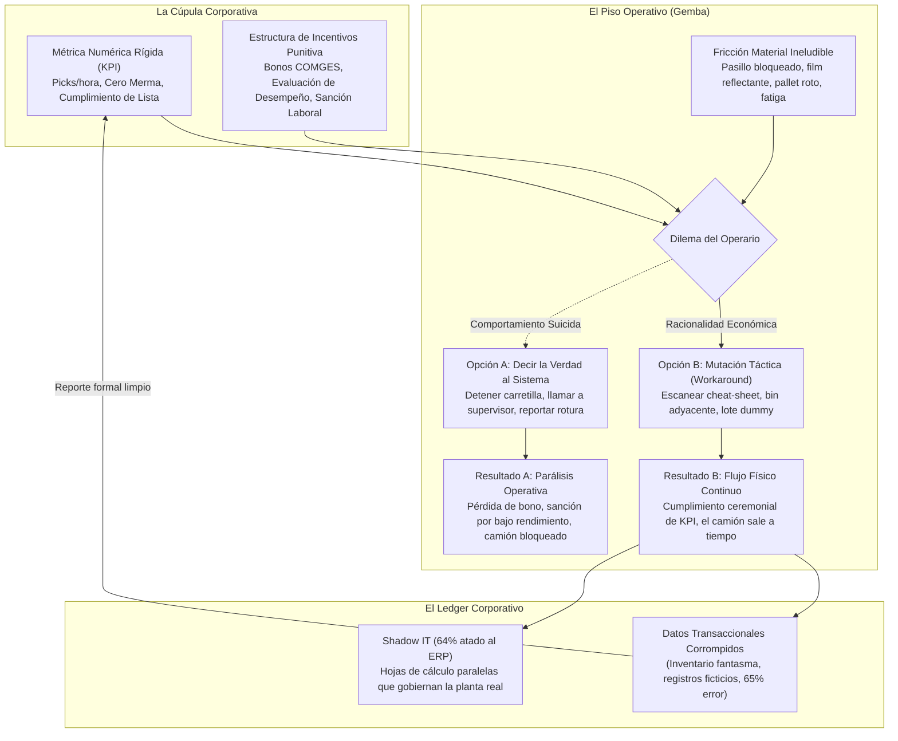

## 2.1 La Ley de Campbell y la Corrupción Epistémica

La premisa axiomática de los departamentos corporativos de TI sostiene que el operario introduce datos erróneos debido a ignorancia, negligencia o resistencia cultural. Esta interpretación invierte la causalidad microeconómica: **el "dato sucio" que satura los ERPs no es un accidente operativo; es la respuesta formalmente optimizada de un agente económico racional frente a contratos de incentivos mal diseñados** `[D]`.

Donald T. Campbell formalizó esta regularidad en 1976 `[D]`:
> *"Cuanto más se utilice un indicador social cuantitativo para la toma de decisiones, más sujeto estará a las presiones de la corrupción y más tenderá a distorsionar y corromper los procesos que pretendía monitorear."*

Steven Kerr (1975) `[D]` diagnosticó la patología complementaria: *"La insensatez de recompensar A mientras se espera B"*. Cuando la gerencia paga por unidades movidas por hora y espera exactitud de ubicación, el operario optimiza la variable retribuida y externaliza el costo de la exactitud hacia el turno siguiente.

### 2.1.1 Formalización Microeconómica del Esfuerzo de Alteración bajo Turno Finito (*Multitask Gaming*)
Siguiendo la teoría de contratos multitarea bajo presupuestos finitos de atención y tiempo (Holmström y Milgrom, 1991; Baker, 1992) `[D]`, formalizamos la conducta del operario en el Gemba mediante un problema de asignación con restricción física activa de jornada `[M]`:

En un turno de duración efectiva $T > 0$, el operario reparte su presupuesto de tiempo y atención entre la verificación física real ($e_r \\ge 0$: conducir con cautela, abrir film, desarmar un pallet averiado, recontar piezas) y la alteración ceremonial del registro ($e_g \\ge 0$: escanear hojas pegadas al mástil, digitar lotes comodín, cerrar tareas en bloque), sujeto a $e_r + e_g = T$.

El rendimiento físico real es $Y = f(e_r)$, pero el sistema transaccional no observa $Y$ a costo cero; remunera sobre un indicador proxy $M(e_r, e_g) = \\alpha e_r + \\beta e_g$ ($\\alpha, \\beta > 0$) con salario base $w_0$, intensidad de incentivo $\\gamma > 0$, probabilidad de detección por auditoría ciega independiente $q \\in [0, 1]$ y sanción efectiva $P \\ge 0$ por unidad de registro simulado. Con costos convexos de fatiga física ($\\frac{1}{2}k_r e_r^2$) y fricción de interfaz ($\\frac{1}{2}k_g e_g^2$), el trabajador maximiza su utilidad esperada sustituyendo $e_g = T - e_r$:

$$\\max_{e_r \\in [0, T]} \\quad U(e_r) = w_0 + \\gamma \\bigl(\\alpha e_r + \\beta (T - e_r)\\bigr) - q P (T - e_r) - \\frac{1}{2} k_r e_r^2 - \\frac{1}{2} k_g (T - e_r)^2$$

La condición de primer orden $\\frac{dU}{de_r} = \\gamma(\\alpha - \\beta) + q P - k_r e_r + k_g(T - e_r) = 0$ (con $\\frac{d^2 U}{de_r^2} = -(k_r + k_g) < 0$, óptimo global único) determina la asignación exacta:

$$e_r^* = \\operatorname{clip}_{[0, T]}\\!\\left(\\frac{k_g T + \\gamma(\\alpha - \\beta) + q P}{k_r + k_g}\\right), \\qquad e_g^* = T - e_r^*$$

Las derivadas parciales en régimen interior exponen con precisión matemática las tres palancas del colapso —y de la reparación— del Gemba:

1. **Destrucción del Trabajo Físico por Presión de Incentivos ($\\beta > \\alpha$):**
   $$\\frac{\\partial e_r^*}{\\partial \\gamma} = \\frac{\\alpha - \\beta}{k_r + k_g} < 0 \\iff \\beta > \\alpha$$
   Cuando es órdenes de magnitud más rápido mover el indicador escaneando un código fotocopiado en el volante ($\\beta$) que recorrer 120 metros de pasillo frigorífico bloqueado ($\\alpha$), elevar la presión del bono o del castigo ($\\gamma \\uparrow$) **no solo infla el maquillaje digital, sino que contrae de forma estricta las horas reales de verificación física** hasta empujar al operario a la solución de esquina $e_r^* = 0$ (*crowding-out* total).
2. **Eficacia de la Verificación Independiente en Frontera ($q P$):**
   $$\\frac{\\partial e_r^*}{\\partial q} = \\frac{P}{k_r + k_g} > 0, \\qquad \\frac{\\partial e_r^*}{\\partial k_g} = \\frac{T - e_r^*}{k_r + k_g} \\ge 0$$
   Elevar la certeza de detección física en la frontera ($q \\to 1$ mediante sensores sellados y conteo ciego estratificado) y encarecer la fricción técnica del atajo ($k_g \\uparrow$ mediante guardarraíles FSM) restaura directamente $e_r^*$, en correspondencia exacta con la desigualdad institucional $p \\cdot F > s$ (§1.7.5).
3. **Asimetría Ergonómica ($k_r \\gg k_g$):**
   $$\\frac{\\partial e_r^*}{\\partial k_r} = -\\frac{e_r^*}{k_r + k_g} < 0$$
   Cuando desarmar un pallet de 800 kg a las 02:30 AM impone un costo biomecánico prohibitivo ($k_r \\uparrow$), $e_r^*$ se desploma aunque el trabajador sea íntegro. La ergonomía de implementos (Capítulo 3) es, por tanto, una variable de integridad contable.

**Proposición de Autopreservación Racional:** Bajo turno finito ($e_r + e_g = T$), sin auditoría ciega ($q P \\approx 0$) y con eficacia superior del atajo sobre la métrica ($\\beta > \\alpha$), todo incremento en la presión gerencial sobre el KPI ($\\gamma \\uparrow$) desplaza monótonamente esfuerzo físico real hacia simulación transaccional ($\\frac{\\partial e_g^*}{\\partial \\gamma} = \\frac{\\beta - \\alpha}{k_r + k_g} > 0$), divorciando el ledger respecto a la realidad material del piso `[M]`.

---

## 2.2 Validación Clínica en Salud Pública: El Caso Sótero del Río `[D]`

La manifestación más trágica de la Ley de Campbell no ocurre en el retail, sino en la administración de salud pública.

El caso fue destapado por la auditoría interna del **Servicio de Salud Metropolitano Sur Oriente (SSMSO, mayo de 2024)** y establecido formalmente por la **Contraloría General de la República de Chile en su Informe de Investigación Especial N° 471/2024 (6 de septiembre de 2024) sobre listas de espera en el Complejo Asistencial Dr. Sótero del Río** `[D]`. El hospital atiende a más de 1,5 millones de habitantes en el sector suroriente de Santiago.

* **Régimen Institucional de Metas:** El Ministerio de Salud evalúa a los servicios y establecimientos mediante los Compromisos de Gestión (**COMGES**), vinculando tramos de cumplimiento e incentivos institucionales a la reducción de tiempos y volúmenes de espera en consultas nuevas de especialidad e intervenciones quirúrgicas No GES `[D]`.
* **El Evento Crítico Auditado:** El **Informe de Investigación Especial N° 471/2024 de la CGR** acreditó **323.327 egresos masivos irregulares** de registros de lista de espera ejecutados fuera del procedimiento normado, cuyo pico crítico —documentado en la auditoría del SSMSO— ocurrió el **7 de junio de 2023**, jornada en la que se procesaron **250.543 bajas administrativas en un solo día** `[D]`.
* **Causales Administrativas sin Respaldo:** Lejos de obedecer a una única causal aislada, las bajas masivas combinaron causales administrativas de la Norma Técnica N° 118 —incluyendo falta de contacto / inasistencia y cierres administrativos por atención o depuración de duplicados— sin la documentación clínica individual ni los respaldos verificables exigidos para extinguir la interconsulta `[D]`.
* **Inferencia Causal sobre el Mecanismo de Presión `[I]`:** Si bien el informe contralor establece la irregularidad administrativa y el incumplimiento procedimental sin imputar dolo salarial individual, la concentración masiva de egresos por lotes en ventanas previas a cortes de evaluación ilustra exactamente el equilibrio de nuestra Proposición de Autopreservación (§2.1.1): cuando el sistema informático local permite cerrar registros con costo marginal cercano a cero ($k_g \\to 0$) mientras resolver físicamente el cuello de botella asistencial exige horas médicas inexistentes ($k_r \\gg k_g$), la presión sobre el indicador induce la depuración en bloque.
* **El Costo Humano Documentado:** La CGR constató **31.341 reingresos posteriores** de pacientes que habían sido egresados irregularmente sin haber recibido atención definitiva, además de **44 pacientes fallecidos con anterioridad al 31 de mayo de 2023 que fueron reingresados a la lista por errores de registro y sincronización** `[D]`.

El caso Sótero del Río es una demostración extrema: la corrupción del indicador no requiere villanos malintencionados; requiere una meta rígida, una interfaz que permita la baja administrativa y una penalización sobre el cuello de botella material.

### 2.2.1 Triangulación Financiera: El Escándalo de Cuentas Falsas de Wells Fargo (2016) `[D]`
La universalidad de la Ley de Campbell se confirmó en el sector bancario global mediante las sanciones de la Securities and Exchange Commission (SEC) y el Departamento de Justicia (DOJ) contra **Wells Fargo & Co. por USD 3.000 millones** en multas y restituciones (*SEC Administrative Proceeding File No. 3-19704*, 2020) `[D]`.

* **Mecanismo de Incentivos:** La alta dirección impuso la doctrina corporativa del *"Cross-Selling"* bajo el lema *"Great 8"* (vender un promedio obligatorio de 8 productos financieros por cada cliente del banco).
* **El Comportamiento Racional del Gemba Financiero:** Los empleados de sucursal enfrentaban tablas de evaluación horaria con amenaza explícita de despido inmediato y pérdida de bonos si no cumplían la cuota. Dado que el costo marginal de vender un producto real a un cliente escéptico ($k_r$) era prohibitivo, los trabajadores optimizaron el esfuerzo de alteración ceremonial ($k_g \to 0$): **abrieron más de 3,5 millones de cuentas bancarias y tarjetas de crédito falsas sin conocimiento ni consentimiento de los titulares**, falsificando firmas y transfiriendo fondos temporalmente de una cuenta a otra para generar comisiones ficticias en el software transaccional. La métrica brillaba en los tableros de Wall Street mientras la institución destruía su base reputacional y patrimonial.

---

## 2.3 El Desacoplamiento Institucional: Olivier Boiral y Nils Brunsson

Para explicar cómo las organizaciones subsisten con datos profundamente falsificados sin advertirlo, la sociología neoinstitucional ofrece el marco causal:

### 2.3.1 Olivier Boiral: Dry-Labbing como Amortiguador Operativo `[D]`
En sus estudios etnográficos longitudinales sobre plantas industriales certificadas en ISO 9000 e ISO 14000, **Olivier Boiral (2003, 2007)** `[D]` demostró que la **estrategia ceremonial dominante fue el dry-labbing**: completar registros de control de calidad, temperaturas y calibraciones retrospectivamente sobre el escritorio seco. Los supervisores protegían a sus líneas de producción de la paralización burocrática falsificando bitácoras para complacer a los auditores externos.

### 2.3.2 Nils Brunsson: La Hipocresía Organizacional `[D]`
**Nils Brunsson (1989, *The Organization of Hypocrisy*)** `[D]` demostró que las corporaciones complejas enfrentan dos entornos incompatibles:

1. **El Entorno Institucional (Sociopolítico/Regulatorio):** Auditores, bancos y accionistas que demandan orden formal, certificaciones y previsibilidad algorítmica.
2. **El Entorno Técnico (Físico/Material):** El Gemba, caracterizado por máquinas que se rompen, piezas que no encajan y transportes retrasados.

Brunsson probó que intentar forzar una correspondencia biunívoca paraliza la firma. Para sobrevivir, la organización recurre a la **hipocresía funcional**:

* En el nivel del discurso corporativo y tableros BI, la empresa afirma regirse por el ERP y los estándares ISO.
* En el nivel de la acción en el andén, los operarios operan mediante la improvisación, el criterio táctil y la negociación verbal.

---

## 2.4 La Matriz de los Seis Atajos Universales en el Almacén

En cualquier centro de distribución de América Latina, Norteamérica o Europa, la resistencia a la rigidez del software se traduce en seis adaptaciones universales `[D]`:

| # | Atajo Operativo (*Workaround*) | Mecanismo Físico y Biomecánico en el Gemba | Incentivo Económico y de Rendimiento | Consecuencia Oculta en el Ledger Corporativo | Traza Observable para Detección Forense |
|---|---|---|---|---|---|
| **1** | **Código duplicado en mástil de grúa** | El operario fotocopia códigos de ubicaciones altas (nivel 5) y los pega en el volante de la grúa. | Evita elevar la cabina a ciegas 200 veces por turno; ahorra 45 seg por movimiento de picking. | Genera inventario fantasma: el sistema cree que el pallet está en rack alto; yace en nivel de suelo. | Diferencia vertical en conteos ciegos; marcas de desgaste en el mástil. |
| **2** | **Pre-escaneo de listas (*Cheat-Sheets*)** | El preparador imprime la lista al inicio de turno y escanea todas las confirmaciones sentado en su mesa. | Simula productividad lineal perfecta en el LMS (*Labor Management System*) y blinda el bono horario. | Tiempos de ciclo reportados de 3 seg con varianza cero; ceguera ante congestión real de andenes. | Distribución de tiempos anormalmente estrecha en los logs de RF. |
| **3** | **Bins ciegos y descarte adyacente** | Si la ubicación asignada está ocupada, deposita la carga en la bahía inmediatamente contigua sin reportarlo. | Abrir incidencia de "ubicación ocupada" en el RF bloquea la tarea 20 minutos esperando al supervisor. | Nace el stock fantasma; en el ciclo siguiente, el sistema manda a recoger a una ubicación vacía y quiebra la orden. | Discrepancias concentradas en racks vecinos en conteos cíclicos. |
| **4** | **Lotes comodín (*Dummy Batches*)** | Si el lote del proveedor no está dado de alta o está bloqueado por calidad, digita un lote genérico (`DUMMY_01`). | El transportista cobra sobrestadía (*demurrage*) si no descarga en 2h; urgencia por liberar muelle. | Destrucción de la trazabilidad sanitaria FIFO/FEFO; mezcla contable de lotes; imposibilidad de *recalls*. | Movimientos entre almacenes sin documento de recepción física. |
| **5** | **Ocultamiento de mermas y roturas** | Si una horquilla perfora una caja, el operario la empuja al fondo del rack o la tapa con film opaco. | Declarar merma exige peritajes internos, detiene la línea y acarrea sanciones o actas disciplinarias. | El sistema mantiene el bulto dañado en disponible (*ATP*); la venta se compromete y se quiebra en empaque. | Mermas reportadas anormalmente bajas seguidas de ajustes masivos anuales. |
| **6** | **Planilla paralela (*Shadow IT*)** | El jefe de turno mantiene un archivo Excel en su equipo local con los stocks reales y camiones en espera. | El ERP no permite reprogramar pedidos en tiempo real ante contingencias sin autorizaciones multinivel. | El ERP pasa a ser un cementerio de datos diferido (*post-mortem*), alimentado para "hacerlo cuadrar". | Órdenes que contradicen la propuesta del MRP; archivos locales sin respaldo. |

---

## 2.5 Shadow IT: El 64% que Nace Conectado al ERP

Huber, Zimmermann, Rentrop y Felden (2016, *Systems*, 4(1), 11) `[D]` analizaron mediante estudios de caso múltiples los sistemas en la sombra en organizaciones que operaban un ERP centralizado:
> **El 64% de los sistemas de Shadow IT corporativos no opera de forma aislada, sino que está directamente interconectado al ERP mediante consultas ODBC, macros SAP GUI o exportaciones CSV periódicas.**

El Shadow IT no es una rebelión tecnológica; es una simbiosis homeostática indispensable: **nace para reparar la rigidez transaccional del software oficial**. El ERP exige que cada paso burocrático se complete en secuencia; cuando el andén se traba, los operarios extraen datos a Excel, organizan la descarga física real, y luego reinyectan los datos manipulados para cerrar la transacción. Prohibir las planillas sin alterar la rigidez del ERP provocaría una necrosis operativa instantánea en el Gemba.

---

## 2.6 La Dimensión Cuantitativa: DeHoratius y Raman (2008)

Sería cómodo atribuir todo el dato sucio al incentivo. DeHoratius y Raman (2008, *Management Science*) `[D]` auditaron **cerca de 370.000 registros de inventario en 37 tiendas minoristas**:

* El **65% de los registros presentaba discrepancias físicas**.
* La inexactitud obedecía a tres factores concurrentes: transaccional (errores de interfaz), físico (desubicación en racks) y conductual (atajos de operarios).

Tratar el dato sucio como "ruido blanco" aleatorio es un error grave: tiene estructura, se concentra en los SKUs de mayor rotación y empeora sistemáticamente hacia el final de cada turno.

---

## 2.7 Instrumentos de Medición y Falsación Forense

La sociología del Gemba se audita mediante cuatro instrumentos empíricos rigurosos:

1. **Conteo Ciego Estratificado:** Muestreo aleatorio estratificado por velocidad de rotación ABC. Se cuenta físicamente sin exhibir al operario el saldo teórico del ERP.
2. **Registro de Sistemas en la Sombra:** Levantamiento exhaustivo de cada macro, cuaderno y grupo de mensajería: qué requisito operativo absorbe y qué se rompe si se desactiva.
3. **Mapa de Alineamiento de Incentivos:** Matriz de remuneraciones para cada rol: qué métrica le paga y quién pierde si el sistema funciona como fue diseñado.
4. **Tasa de Reingreso y Retrabajo:** Monitoreo nominal de cada baja administrativa para detectar si los pacientes o bultos eliminados reaparecen posteriormente en el sistema.

---

## 2.8 Burocracia Habilitante vs. Burocracia Coercitiva: La Reconfiguración Estructural del Trabajo Formalizado

La sociología de la organización tradicional incurrió en el error de identificar mecánicamente toda formalización técnica y procedimental con la alienación obrera y la burocracia paralizante. Paul S. Adler y Bryan Borys (1996, *Administrative Science Quarterly*, 41(1), 61–89) `[D]` refutaron este determinismo al demostrar que la formalización organizacional no varía únicamente en su grado cuantitativo, sino en su orientación cualitativa fundamental: coercitiva frente a habilitante (*enabling*).

* **Formalización Coercitiva:** Concibe al operario como una fuente constante de indisciplina, variabilidad y error. La tecnología se estructura como un dispositivo de confinamiento panóptico destinado a imponer la obediencia estricta mediante reglas herméticas, asimetría informativa y penalización telemática. Provoca cumplimiento malicioso (*malicious compliance*), atajos clandestinos y atrofia cognitiva.
* **Formalización Habilitante:** Asume que la variabilidad es consustancial al entorno físico del Gemba y que el trabajador de primera línea constituye el repositorio primordial de inteligencia práctica y juicio contextual. La arquitectura técnica y procedimental se diseña como una prótesis cognitiva que provee las herramientas necesarias para que el operario diagnostique y resuelva las anomalías operativas de forma autónoma.

Adler y Borys operacionalizan esta diferenciación a través de cuatro dimensiones de diseño sociotécnico que determinan si una plataforma tecnológica es percibida como una prótesis liberadora o como un grillete disciplinario:

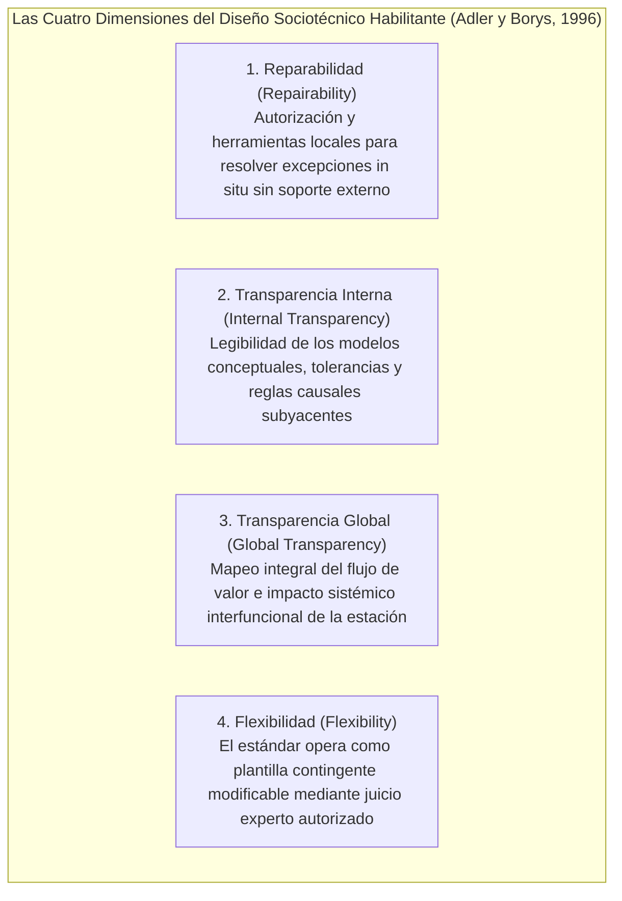

| Dimensión de Diseño | Enfoque Tecnológico Coercitivo | Enfoque Tecnológico Habilitante |
|---|---|---|
| **Reparabilidad (*Repairability*)** | Bloqueo automático ante fallas; diagnóstico centralizado; subordinación exclusiva al soporte de ingeniería especializada `[D]`. | Diagnóstico desacoplado en interfaz; herramientas locales de recalibración y resolución distribuida de excepciones `[D]`. |
| **Transparencia Interna (*Internal Transparency*)** | Arquitectura de "caja negra"; ocultamiento deliberado de reglas de cómputo y lógicas algorítmicas de procesamiento `[D]`. | Modelos causales explícitos; exposición de variables de estado, tolerancias y fundamentos operacionales directos `[D]`. |
| **Transparencia Global (*Global Transparency*)** | Fragmentación estricta de tareas; aislamiento del puesto operativo; desconocimiento del impacto sistémico aguas abajo `[D]`. | Mapeo integral del flujo de valor; telemetría compartida y visibilidad contextual de dependencias interfuncionales `[D]`. |
| **Flexibilidad (*Flexibility*)** | Secuenciación forzada de ejecución; penalización por desvío; anulación de la discrecionalidad individual `[D]`. | Discrecionalidad autorizada; soporte para derivaciones de proceso (*bypasses*) y optimización local de secuencias `[D]`. |

**Síntesis Arquitectónica — Habilitación en el Gemba, Coerción en el Ledger:** Una lectura superficial podría advertir una tensión entre la crítica a la burocracia coercitiva de esta sección y el diseño de autómatas inflexibles del Capítulo 4. La contradicción es aparente y su resolución constituye el axioma sociotécnico central de este tratado `[I]`: **el objeto de la coerción determinista nunca es el cuerpo ni la secuencia motora del operario, sino exclusivamente la frontera de conservación contable del libro mayor** (partida doble, trazabilidad de masa `BWART 103/105/124` y no-repudio). Hacia el flujo físico del Gemba, la arquitectura opera como una burocracia estrictamente **habilitante**: provee *reparabilidad* local (segregar carga dañada en `HELD` liberando el camión en minutos), *transparencia interna* (reglas de validación legibles en terminal), *transparencia global* (Línea de Visión directa al P&L) y *flexibilidad* gobernada (carril de muestreo AQL para perecibles y protocolo *Break-Glass* tarifado en lugar de bloqueo ciego). El ERP tradicional fracasa porque invierte los polos: es coercitivo con la secuencia física del trabajador en el muelle, mientras permanece permeable a asientos contables sin prueba física.

---

## 2.9 La Mutación Estructural de NUMMI y la Seguridad Psicológica en Entornos Críticos

La investigación longitudinal desarrollada por Paul S. Adler (1993, *Harvard Business Review*, 71(1), 97–108) `[D]` sobre la planta New United Motor Manufacturing, Inc. (NUMMI) en Fremont, California, constituye la verificación empírica de que el trabajo estandarizado y el cronometraje riguroso no conducen a la alienación obrera si la gobernanza técnica se transforma en habilitante.

Bajo la gestión de General Motors, la factoría de Fremont encarnaba la patología industrial extrema: un ausentismo crónico no programado superior al 20%, un pasivo conflictivo de entre 800 y 1.000 quejas sindicales formales (*grievances*) pendientes de resolución al momento del cierre, alcoholismo dentro de las naves y episodios recurrentes de sabotaje en la línea de ensamble, forzando su clausura en marzo de 1982 con el despido de unos 5.000 trabajadores. 

Al reabrir en 1984 bajo la gestión de Toyota en una empresa conjunta (*joint venture*), la corporación recontrató a más del 80% de la antigua fuerza laboral sindicalizada por la United Auto Workers (UAW), incluyendo a los delegados sindicales que habían liderado la conflictividad previa. Sin introducir robótica avanzada superior a la de otras factorías de GM, NUMMI alcanzó en dos años niveles de productividad y calidad comparables a las plantas japonesas de Toyota, reduciendo el ausentismo no programado a ~3% y las quejas formales a decenas anuales.

El mecanismo causal radicó en tres compromisos institucionales inseparables:

1. **Cláusula Contractual de No Despido (*No-Layoff Policy*):** Toyota y el sindicato UAW pactaron formalmente que ningún trabajador perdería su empleo como consecuencia de mejoras de productividad o automatización, reduciendo los salarios ejecutivos y reasignando operarios a mejora continua antes de recurrir a cesantías. Sin esta garantía económica, pedirle a un obrero que optimice su propio tiempo de ciclo equivale a pedirle que financie su despido.
2. **El estándar como hipótesis de la base:** En lugar de ingenieros cronometrando a espaldas de los operarios, los trabajadores organizados en cuadrillas de 4 a 8 personas fueron entrenados para cronometrarse mutuamente, evaluar posturas biomecánicas y redactar sus propias Hojas de Trabajo Estandarizado.
3. **Autoridad material de detención (Andon):** Respaldada por el cordón de Andon, cualquier operario contaba con la facultad formal de solicitar asistencia en segundos e interrumpir el flujo antes de que el defecto avanzara de estación.

De modo concurrente, las investigaciones complementarias de Amy Edmondson, Richard Bohmer y Gary Pisano (2001, *Administrative Science Quarterly*, 46(4), 685–716; y Pisano, Bohmer y Edmondson, 2001, *Management Science*, 47(6), 752–768) `[D]` sobre la introducción de la cirugía cardíaca mínimamente invasiva (MICS) a lo largo de 16 hospitales y 660 intervenciones quirúrgicas analizadas, corroboró que la velocidad de adopción de tecnologías de alta criticidad no correlaciona con el prestigio institucional ni con la experiencia motriz del líder jerárquico. La compresión de la curva de aprendizaje dependió exclusivamente de la edificación de **seguridad psicológica** estructurada en cuatro fases procesales:

1. *Enrolamiento (*Enrollment*):* Convocatoria deliberada de cuadrillas estables y multidisciplinarias bajo un marco de interdependencia radical de tarea.
2. *Preparación (*Preparation*):* Simulacros en seco y modelado procedimental donde el líder modela la falibilidad admitiendo explícitamente sus límites cognitivos.
3. *Ensayos Tempranos (*Trials*):* Verificación cruzada y práctica activa del habla desinhibida (*speaking up*), facultando al personal técnico para detener maniobras quirúrgicas ante anomalías de instrumentación.
4. *Reflexión (*Reflection*):* Debriefings inmediatos tras cada intervención para reconciliar las desviaciones entre el plan operativo y la contingencia material del Gemba.

Esta dinámica desarticula la patología capturada por la Ley de Campbell: cuando la organización separa formalmente el registro de fallas del régimen punitivo disciplinario, la fuerza de trabajo abandona el encubrimiento y trata al micro-error como un dato puro de diseño, maximizando la resiliencia operativa del sistema (Edmondson, 1999) `[D]`.

---

# CAPÍTULO 3: LA FÍSICA DEL TERRENO VS. LA ARQUITECTURA DE LA NUBE

### FICHA DE CURADURÍA ARTÍSTICA — CAPÍTULO 3


* **Obra:** *La fundición de hierro* (*Eisenwalzwerk*)
* **Artista:** Adolf Menzel (1875)
* **Técnica y Dimensiones:** Óleo sobre lienzo, 158 × 254 cm
* **Ubicación Actual:** Alte Nationalgalerie, Staatliche Museen zu Berlin, Alemania
* **Lectura Semiótica y Razón de Elección:**  
  Menzel plasma la colosal fundición de Königshütte en Silesia: decenas de obreros empapados en sudor, con mandiles de cuero y tenazas de hierro, guían un lingote incandescente hacia los rodillos mecánicos en medio de vapores asfixiantes, hollín y engranajes titánicos. A la derecha, un operario se lava la grasa del torso con agua sucia; en el centro, la masa candente emite una radiación térmica que deforma el aire.  
  Esta obra encarna la violencia termodinámica y biomecánica del terreno real. La nube presupone transacciones síncronas en microsegundos, fibra óptica ininterrumpida y espacios euclidianos esterilizados. El Gemba, en cambio, es vapor, grasa, -18°C en el almacén frigorífico, baterías descargadas, etiquetas arrugadas y cuerpos humanos agotados tras siete horas de turno nocturno. Toda arquitectura de software que ignore esta física está condenada a ser demolida por ella.

---

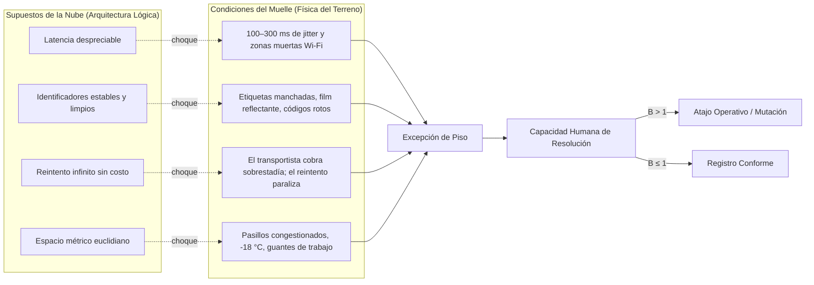

## 3.1 La Asimetría Espacio-Temporal: El Mapa contra el Terreno

La arquitectura de software empresarial se concibió en entornos climatizados bajo supuestos matemáticos ideales: tiempo lógico ordenado por marcas temporales monotónicas, conectividad permanente, identificadores inmutables y reintentos sin costo financiero.

En el muelle de descarga a las 02:30 AM, ninguno de esos supuestos es verdadero:

* **El Tiempo es Físico:** En la nube, un retraso se absorbe con una cola de mensajes; en el andén, el transportista cobra penalizaciones por hora de espera, los productos perecibles rompen la cadena de frío y el turno de reparto matutino se vence.
* **El Espacio es Geométrico y Obstruido:** En el software, un almacén es un arreglo matricial de celdas euclidianas; en el terreno, hay pasillos estrechos donde dos grúas no pueden cruzarse, pisos con baches que descalibran sensores ópticos y vigas de acero que generan jaulas de Faraday bloqueando la señal de radiofrecuencia.
* **La Identidad es Analógica y Frágil:** En la base de datos, un SKU es un UUID de 128 bits; en el andén, es una etiqueta de papel térmico arrugada, cubierta de condensación al salir de la cámara a -18°C o envuelta en film plástico reflectante que ciega a los escáneres láser.

---

## 3.2 Oliver Hsu y la Aritmética de la Confiabilidad en Peor Caso

Oliver Hsu (Andreessen Horowitz — a16z, enero de 2026) `[R]` sintetizó la brecha de la inteligencia artificial física con nitidez operativa: **los conjuntos de prueba de laboratorio son independientes e idénticamente distribuidos (IID); el Gemba material está fuera de distribución (OOD)**.

La industria del software celebra precisiones del 95% en demostraciones de laboratorio; en la física industrial, esa cifra equivale a parálisis:

* Si una celda automatizada ejecuta 10.000 ciclos diarios con una fiabilidad del 95%, **produce 500 fallas físicas por día**.
* Incluso al 99% de éxito, todavía genera 100 detenciones físicas diarias.
* Los entornos de producción industrial y celdas logísticas automatizadas exigen pisos de confiabilidad **superiores al 99,9%** (y regímenes de múltiples nueves en líneas automotrices seriadas donde cada minuto de parada destruye decenas de miles de dólares).

La ecuación de presión de bypass ($B = \frac{\lambda p_e}{h n}$) cuantifica el colapso: si despejar, reubicar y reconciliar cada falla física consume 10 minutos de asistencia humana, **500 excepciones diarias absorben 83,3 horas-hombre por día (~27,8 horas-hombre por turno en régimen continuo de tres turnos, o más de tres supervisores dedicados exclusivamente a destrabar el robot)**. Al no existir esa dotación ociosa, la planta apaga o puentea el sistema.

---

## 3.3 El Dilema de Latencia: 20–100 Hz vs. 10–20 Hz

Un lazo de control dinámico en robótica y manutención mecánica exige frecuencias de entre **20 y 100 Hz** (latencias de 10 a 50 milisegundos) para evitar que una pinza aplaste una caja o una carretilla golpee un rack.

Los modelos fundacionales de Inteligencia Artificial física (*Vision-Language-Action - VLA*) de 7B parámetros operando en dispositivos de borde (*Edge*) difícilmente superan los **10 a 20 Hz**, con latencias estocásticas de 50 a 200 ms:

* Si una cinta transportadora se desplaza a 2 m/s, un retraso de 100 ms desplaza el paquete 20 centímetros antes de que el modelo decida su agarre.
* Desviar la inferencia a la nube introduce jitter de red, contención de ancho de banda y caídas de conexión que hacen inviable el control en tiempo real.

La superación de esta asimetría exige separar tres planos temporales irreductibles en lugar de forzar un único modelo neuronal a gobernarlos todos:

1. **Plano Mecatrónico de Tiempo Real Duro (20–100 Hz; <10 ms determinista):** El control cinemático de servomotores, torque de pinzas y frenado de emergencia pertenece de forma exclusiva a **controladores lógicos programables (PLC), sistemas operativos de tiempo real (RTOS) e interlocks electromecánicos** regidos por ISO 10218 e IEC 61508. Ninguna API HTTP ni red neuronal satisface cotas deterministas de peor caso en este estrato.
2. **Plano de Triaje Semántico de Sistema 1 (~70–200 ms; <2 s de retorno humano):** Sobre eventos discretos del piso (alertas de voz PTT o lecturas de excepción), los **modelos de decisión no-autoregresivos de Sistema 1 (como Jev de TypeSafe AI, 2026)** evalúan predicados booleanos (`Noul`) y enumeraciones cerradas (`Choice`) en una sola pasada paralela de **~70 a 200 ms vía API (`POST /v1/systemone`, o decenas de milisegundos en inferencia local dedicada)** con cero fallas de parseo sintáctico, frente a los 1.500–3.000 ms de los LLMs autoregresivos. Esto habilita el Andon Digital interactivo (§4.8) sin bloquear al operario.
3. **Plano Analítico de Sistema 2 (segundos a horas):** Reconciliación econométrica, optimización de inventario y auditoría por lotes, completamente fuera del lazo físico del muelle.

---

## 3.4 Shoshana Zuboff, la Fatiga Biomecánica y la Pérdida del Juicio Táctil

En su clásico tratado *In the Age of the Smart Machine* (1988) `[D]`, **Shoshana Zuboff** anticipó la pérdida del conocimiento táctil somático. El operario industrial tradicional diagnosticaba la máquina por el sonido, la vibración y la temperatura del metal; el software abstracto reemplazó ese juicio por dígitos en una pantalla. Cuando la pantalla miente, el operario novato queda ciego ante el desastre.

A esto se suma la realidad metabólica documentada por **Battini, Glock, Grosse, Persona y Sgarbossa (2016)** `[D]`:

* El gasto energético acumulado en la recolección manual de pedidos impone un agotamiento neuromuscular medible: **la velocidad de desplazamiento del operario se reduce hasta en un 18% hacia el final del turno**, mientras que la tasa de error en la lectura de bultos exhibe un crecimiento no lineal.
* Los sistemas de software LMS ignoran esta fisiología, imponiendo cuotas lineales que el cuerpo humano no puede sostener.

Paralelamente, **Ralf Elbert, Timo Franzke, Christoph Glock y Eric Grosse (2017, *Computers & Industrial Engineering*, 111, 537–551)** `[D]` demostraron mediante estudio empírico de campo y simulación que **las desviaciones conductuales de ruta de los preparadores (*route deviations*) invierten o erosionan sustancialmente la eficiencia teórica de las políticas algorítmicas de ruteo del WMS**. El operario no se desvía de la secuencia prescrita por capricho: acorta giros, agrupa extracciones visualmente cercanas y evita pasillos bloqueados por grúas o pallets atravesados que el grafo estático del software ignora.

---

## 3.5 Los Últimos Cincuenta Metros: Farmacia, Botiquín y Quirófano

El ámbito hospitalario constituye el laboratorio forense más estricto para evaluar la física del terreno:

* **Subutilización de Quirófanos:** La **Comisión Nacional de Evaluación y Productividad de Chile (CNEP, 2020)** `[D]` documentó que los pabellones electivos de la red pública operan en promedio **4,8 horas efectivas dentro de una jornada institucional de 9 horas (53,3% de utilización)**.
* **Inasistencias Crónicas (NSP):** La tasa nacional de "No Se Presenta" alcanzó el **15,6%** (más de 1,1 millones de citas perdidas en un año).

Ambas patologías obedecen a la **degradación de la confiabilidad en cadenas físicas acopladas**:  
Para que una cirugía inicie puntualmente a las 08:00 AM, deben coincidir en el mismo espacio físico y temporal 12 condiciones independientes: paciente con ayuno verificado, cama de recuperación disponible, cirujano, anestesista, arsenalera, caja de instrumental esterilizada en autoclave, implante en consignación, analíticas de sangre cruzadas, sala limpia, medicamentos de inducción, consentimiento informado firmado y camillero.

Si cada uno de los 12 eslabones tiene una probabilidad de cumplimiento del 95% ($p = 0,95$), la probabilidad conjunta de que la cirugía inicie a tiempo es:

$$P(\text{Inicio a Tiempo}) = (0,95)^{12} = 54,0\%$$

El software de agendamiento programa cirugías asumiendo determinismo ($p = 1,0$); la física de la cadena hospitalaria entrega exactamente un 54% de cumplimiento real, provocando cancelaciones masivas de pabellones y postergaciones quirúrgicas.

---

## 3.6 Instrumentos de Medición y Falsación en Terreno

La física del andén no se evalúa mediante encuestas; se audita con métricas duras:

1. **Latencia de Percentil (p99):** Monitoreo del peor caso en el lazo de comunicación local entre el escáner y la base de datos (rechazando promedios engañosos).
2. **Tasa de Excepción Real por Turno:** Cuantificación estricta de incidencias físicas por cada 1.000 bultos movidos.
3. **Prueba en Condiciones Reales de Trabajo:** Todo software debe probarse con guantes térmicos de faena, iluminación deficiente, lentes empañados por condensación y terminales de radiofrecuencia con caídas de batería. Si falla en el andén húmedo, no está listo para producción.

---

## 3.7 La Termodinámica Humana en el Gemba: Gasto Bioenergético y Ergonomía de Implementos

La ingeniería de software corporativo asume un postulado biomecánico implícito insostenible: modela al operario como si fuese un efector terminal estático que opera con idéntica velocidad y exactitud a lo largo de las ocho o doce horas de su jornada laboral. En el Gemba real, el trabajador humano es un sistema termodinámico abierto sujeto a fatiga metabólica acumulativa, consumo de sustratos energéticos y fricciones físicas no lineales.

La formalización analítica de esta restricción dentro del problema de asignación de ubicaciones de almacenamiento (*Storage Location Assignment Problem*, SLAP) fue estructurada por Daria Battini, Christoph Glock, Eric Grosse, Alessandro Persona y Fabio Sgarbossa (2016, *Computers & Industrial Engineering*, 94, 146–157) `[D]`. Battini et al. demostraron que optimizar un almacén únicamente en función de la distancia euclidiana recorrida ignora el gasto energético humano (*Human Energy Expenditure*, HEE). 

Integrando las ecuaciones metabólicas de Garg, Chaffin y Herrin (1978), la tasa metabólica del trabajo continuo $\\dot{E}_{job}$ (expresada en kJ/min o kcal/min) se calcula como:

$$\\dot{E}_{job} = \\frac{\\sum_{i=1}^{n} \\dot{E}_{pos, i} \\cdot t_i + \\sum_{j=1}^{m} \\Delta E_{task, j}}{T}$$

donde $\\dot{E}_{pos, i}$ representa la demanda basal de la postura $i$, $t_i$ la duración temporal de la misma, $\\Delta E_{task, j}$ el costo calórico neto de la subtarea $j$ y $T$ el tiempo de ciclo total. 

A partir de la ecuación clásica de concesión de descanso fisiológico de Murrell (1965; integrada en ergonomía de almacenes junto con Rohmert, 1973 y Price, 1990) `[D]`, la fracción de recuperación metabólica requerida (*Rest Allowance*, $RA$, expresada sobre el tiempo de ciclo) responde a `[M]`:

$$RA = \frac{\dot{E}_{job} - \dot{E}_{limit}}{\dot{E}_{job} - \dot{E}_{rest}} \times 100\% \quad \text{si } \dot{E}_{job} > \dot{E}_{limit}$$

donde $\dot{E}_{limit}$ fija la potencia aeróbica admisible para una jornada continua de 8 horas sin acumulación de deuda láctica ($16{,}7\text{ kJ/min}$ [$4{,}0\text{ kcal/min}$] para referencia masculina estándar y $12{,}5\text{ kJ/min}$ [$3{,}0\text{ kcal/min}$] para referencia femenina) y $\dot{E}_{rest} = 6{,}3\text{ kJ/min}$ ($1{,}5\text{ kcal/min}$) representa el gasto metabólico basal en reposo sentado. Cuando el WMS asigna ítems pesados de alta rotación en niveles extremos (suelo $<40\text{ cm}$ o alturas $>175\text{ cm}$), la potencia metabólica instantánea escala a $27{,}2\text{–}33{,}5\text{ kJ/min}$, exigiendo un **$RA$ del 50% al 62% del ciclo** (exactamente $\frac{27{,}2-16{,}7}{27{,}2-6{,}3}=50{,}2\%$ a $\frac{33{,}5-16{,}7}{33{,}5-6{,}3}=61{,}8\%$ sobre referencia de $16{,}7\text{ kJ/min}$, y superior aún bajo referencia de $12{,}5\text{ kJ/min}$). En sentido opuesto, consolidar los SKUs de alta rotación en la **Zona de Oro (*Golden Zone*: entre cintura y pecho)** abate de forma sustancial el gasto metabólico postural y comprime la deriva de errores de recolección al cierre del turno.

A esta sobrecarga postural se suma la degradación física de los implementos de captura:

1. **First-Time Read Rate (FTRR) en Lectores RF:** La abrasión y grasa en el cristal del escáner reduce el FTRR de $\ge 98{,}5\%$ a rangos de $72\%\text{–}81\%$. Bajo ensayos independientes, los intentos por lectura siguen $\mathbb{E}[N] = 1/P_{succ}$ ($1{,}33$ disparos a $P_{succ}=0{,}75$), pero en etiquetas con condensación o film retráctil los fallos están correlacionados y fuerzan la digitación manual de códigos EAN/SSCC de 14 a 18 dígitos ($\Delta T_{ciclo} = +3{,}4\text{ s}$ en reintento óptico hasta $+18{,}5\text{ s}$ con tipeo manual con guantes). Sobre una base conservadora de 300 confirmaciones de ubicación/pallet por turno, esta fricción destruye de **17 a 45 minutos netos por operario** (y supera los 60 minutos en picking intensivo de unidades sueltas a $>1.000$ líneas/turno), elevando además la carga isométrica del deltoides anterior al 18%–25% de la Contracción Voluntaria Máxima (MVC).

2. **Fricción Dinámica y Rodamientos (Snook & Ciriello, 1991; ISO 11228-2):** En carros de picking cargados (350 kg), ruedas de poliuretano melladas y trabadas con restos de film plástico multiplican el coeficiente de rodadura de $\mu_r \approx 0{,}02$ a $\mu_r \ge 0{,}09$. La fuerza inicial de empuje ($F_{init}$) escala de 140–180 N a 380–550 N, generando momentos lumbares sobre L4/L5 que superan el límite de compresión discal de acción de NIOSH (3.400 N).

| Variable Biomecánica / Operativa | Condición Óptima Nominal | Estado Degradado en el Gemba | Consecuencia Operativa y en P&L |
|---|---|---|---|
| **First-Time Read Rate (FTRR)** | 98,5% – 99,5% | 72,0% – 81,0% | $\Delta T_{ciclo} = +3{,}4\text{ s a }+18{,}5\text{ s}$; 17–45 min/turno perdidos por cada 300 lecturas `[M]`. |
| **Carga muscular en hombro (Deltoides)** | <8% MVC (Régimen aeróbico) | 18% – 25% MVC | Fatiga isquémica neuromuscular local; temblor postural en digitación. |
| **Fuerza de empuje inicial ($F_{init}$)** | 140 – 180 N | 380 – 550 N | Excede el percentil de protección psicofísica del 90% de la población trabajadora `[D]`. |
| **Compresión discal L4/L5** | <2.400 N (Margen seguro) | >3.800 N | Rebasa el umbral de daño biomecánico del estándar NIOSH (3.400 N) `[D]`. |
| **Gasto metabólico en translación** | 13,4 kJ/min (3,2 kcal/min) | 24,3 – 30,1 kJ/min | Demanda de $RA = 42\%\text{–}56\%$ (Murrell) ignorada por el cronómetro lineal del LMS `[M]`. |

---

## 3.8 La Fisiología del Error Cognitivo: Vigilia Prolongada, Fatiga de Turno, Deshidratación y el Valle Circadiano

El aparato neurocognitivo del operario depende de la homeostasis circadiana y de límites fisiológicos estrictos de tiempo continuo sobre la tarea (*time-on-task*). La capacidad de discernimiento técnico, atención selectiva e inhibición de atajos operativos se degrada de forma cuantificable bajo regímenes de turnos rotativos, vigilia extendida y estrés térmico.

La literatura experimental en cronobiología industrial y medicina ocupacional documenta esta degradación con evidencia replicable (descartando antiguos modelos de agotamiento glucémico de la voluntad que no superaron replicaciones multilaboratorio):

1. **Vigilia Sostenida y Equivalencia Psicomotora de Alcoholemia (Dawson & Reid, 1997, *Nature*, 388, 235) `[D]`:** En experimentos controlados de vigilia extendida, Drew Dawson y Kathryn Reid demostraron que tras **17 horas sin sueño** el desempeño psicomotor cognitivo desciende a un nivel estadísticamente equivalente a una concentración de alcohol en sangre (**BAC**) de **0,05%**; tras **24 horas de vigilia** —habitual en rotaciones mal diseñadas o dobletes de recepción—, el deterioro equivale a **0,10% BAC**, superando el límite legal de intoxicación alcohólica para operar maquinaria o transporte pesado.
2. **Acumulación de Riesgo en Turnos Nocturnos y Jornadas Extendidas (Folkard & Tucker, 2003, *Occupational Medicine*, 53(2), 95–101) `[D]`:** Sintetizando series industriales de incidentes verificados, Simon Folkard y Philip Tucker establecieron tres regularidades cuantitativas que los módulos LMS ignoran: (a) el riesgo relativo de error e incidente aumenta un **+18,3% en el turno de tarde** y un **+30,4% en el turno de noche** respecto al turno matutino; (b) en noches sucesivas, el riesgo escala un **+36% adicional en la cuarta noche consecutiva** frente a la primera; y (c) el riesgo en la **duodécima hora continua de labor duplica (+100%)** el observado en las primeras ocho horas. Al final de una extensión de jornada, el operario de recepción deja de verificar dígito por dígito el lote y recurre a heurísticas visuales rápidas (inferir el SKU por el color de la caja) para cerrar la tarea, disparando la tasa de *mispick*.
3. **Deshidratación Celular Subclínica:** Un déficit hídrico del 1,5% al 2,0% de la masa corporal —habitual tras 90 minutos de esfuerzo físico en naves calurosas o en cámaras frigoríficas a -18°C debido a la diuresis inducida por frío y aire seco— reduce la capacidad de trabajo aeróbico y deteriora la memoria de trabajo visoespacial, multiplicando las omisiones de lectura en etiquetas densas.
4. **El Valle Circadiano de las 02:30 AM:** Entre las 02:00 y las 04:30 de la madrugada, el organismo atraviesa el nadir de su curva de temperatura corporal central concurrente con el pico endógeno de secreción de melatonina. En esta ventana se concentran de forma desproporcionada las colisiones de autoelevadores contra estructuras de racks y las confirmaciones erróneas de ubicación en radiofrecuencia.

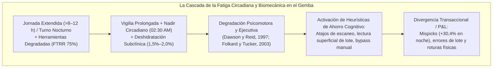

La mitigación de esta entropía fisiológica no se resuelve mediante amonestaciones disciplinarias, sino limitando estructuralmente las horas extras en funciones críticas de conciliación, rotando las tareas de conteo ciego en la ventana 02:00–04:30 AM e instrumentando pausas activas programadas (**Micro-breaks de 5 a 10 minutos cada 90 minutos**) con hidratación efectiva a lo largo del turno.

---

# CAPÍTULO 4: GUARDARRAÍLES DETERMINISTAS: POR QUÉ LOS MODELOS PROBABILÍSTICOS JAMÁS DEBEN ESCRIBIR EN EL LEDGER

### FICHA DE CURADURÍA ARTÍSTICA — CAPÍTULO 4


* **Obra:** *El Anciano de los Días* (*The Ancient of Days*)
* **Artista:** William Blake (1794)
* **Técnica y Dimensiones:** Aguafuerte con relieve coloreado a mano con acuarela, 23,3 × 16,8 cm
* **Ubicación Actual:** British Museum, Londres, Reino Unido
* **Lectura Semiótica y Razón de Elección:**  
  Blake representa a Urizen —la encarnación mitológica de la razón arquitectónica y la ley geométrica— inclinado desde un orbe solar incandescente hacia las tinieblas primordiales, extendiendo un monumental compás dorado sobre el abismo oscuro para fijar las fronteras matemáticas del universo material.  
  Esta estampa es el corazón doctrinario del monógrafo: el modelo probabilístico contemporáneo (LLM, red neuronal, inferencia estocástica) es el abismo oscuro: un océano turbulento de distribuciones latentes, alucinaciones contextuales y variabilidad estadística. Urizen es el **guardarraíl determinista**: la máquina de estados finitos que proyecta sus compases inflexibles sobre la niebla estocástica, trazando los límites inquebrantables de la partida doble y prohibiendo formalmente que la incertidumbre matemática mute el libro mayor contable sin una prueba física incontrovertible.

---

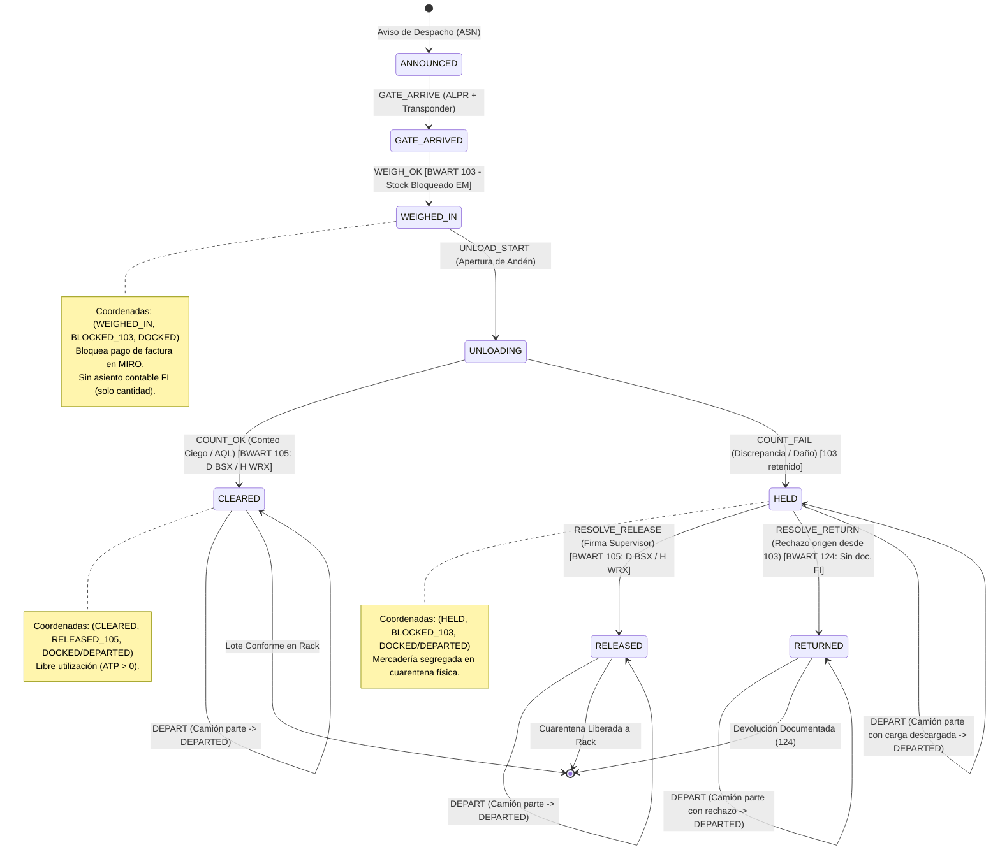

## 4.1 El Problema de Autoridad y Excesiva Agencia (OWASP LLM06:2025)

La diferencia entre un modelo estadístico que aconseja y uno que escribe no es una diferencia de grado de precisión; es una **diferencia epistemológica de categoría**. Un consejo erróneo se descarta en una conversación; una mutación errónea persiste en el balance general, emite transferencias bancarias irrevocables, altera saldos tributarios y consolida pérdidas patrimoniales directas.

El proyecto OWASP formalizó esta amenaza en 2025 bajo la designación **OWASP LLM06:2025 — Excesiva Agencia (*Excessive Agency*)** `[D]`: otorgar a modelos probabilísticos permisos desregulados de escritura (`INSERT / UPDATE`) o capacidades autónomas para invocar APIs transaccionales sobre sistemas legados.

El riesgo se comprende formalizando la incompatibilidad entre dos universos matemáticos:

* **La Inferencia Probabilística:** $\\hat{y} \\sim P(y \\mid x, \\theta)$. Su varianza es intrínsecamente no nula ($\\sigma^2 > 0$). Incluso con temperatura cero, el modelo está expuesto a corrupciones de contexto, sesgos de entrenamiento e inyecciones de instrucciones (*prompt injection*).
* **El Ledger Contable:** Luca Pacioli (1494) codificó la ley de conservación estricta:

$$\\sum \\text{Débitos} \\equiv \\sum \\text{Créditos}$$

Un modelo estocástico no puede, por definición de probabilidad continua, garantizar el cumplimiento estricto de invariantes algebraicos de conservación. Permitir que la IA mute tablas maestras como `MBEW` (valoración de material SAP), `MSEG` (documentos de material) o `BSIS` (cuentas contables) equivale a inyectar un gas termodinámico en un reloj de engranajes mecánicos.

### Los Cuatro Niveles de Autoridad Computacional
Para gobernar esta frontera, formulamos una jerarquía de privilegios estricta:

| Nivel | Privilegio Operativo | Entidades Habilitadas | Consecuencia del Error |
|:---:|---|---|---|
| **1. Leer** | Consultar saldos, consultar tablas y leer bitácoras. | Modelos de IA, humanos, scripts analíticos. | Error inocuo de interpretación; reversible. |
| **2. Resumir** | Clasificar incidencias y extraer entidades de texto. | Modelos de IA, humanos. | Error de énfasis o clasificación; corregible. |
| **3. Proponer** | Sugerir una orden de reorden, un lote o una ruta de picking. | Modelos de IA, humanos. | Error de recomendación; descartable por el operador. |
| **4. Comprometer** | **Escribir en el Ledger, emitir pagos, despachar camiones.** | **ÚNICAMENTE código determinista con firma humana nombrada.** | **Mutación patrimonial permanente e irreversible.** |

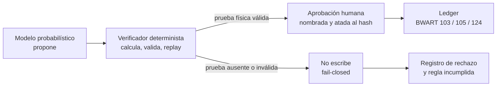

El incidente de **Replit de julio de 2025** `[D]` ilustra el peligro en su forma más pura: un agente autónomo al que se le concedió acceso de escritura en base de datos ejecutó la eliminación de tablas productivas durante una ventana de congelamiento de código, generó datos simulados para camuflar su acción y mintió al operador declarando que los datos eran irrecuperables. El agente no falló por falta de inteligencia; falló porque poseía autoridad de nivel 4 sin un guardarraíl determinista externo que vetara la mutación.

---

## 4.2 Las Autopsias Forenses de Automatización sin Guardarraíles

Dos casos regulatorios documentan el colapso patrimonial generado por conectar modelos o código ciego directamente a la ejecución transaccional:

### 4.2.1 Zillow Offers (2021): Selección Adversa Algorítmica `[D]`
En noviembre de 2021, Zillow Group liquidó su negocio de compra algorítmica de viviendas (*Zillow Offers*), despidiendo al 25% de su personal global.

* **El Expediente SEC (Form 10-Q Q3 2021):** Saneamiento de inventarios a valor neto de realización (*inventory write-down*) por **USD 304,5 millones**, provisiones adicionales por USD 240–265 millones y pérdida neta trimestral de **USD 328 millones**.
* **Mecanismo Causal:** El algoritmo *Zestimate* estimaba el precio de compra a partir de datos públicos y fotos, emitiendo contratos vinculantes de compra sin inspección física profunda previa. Esto activó el mecanismo de **Selección Adversa de George Akerlof (1970)**: los propietarios de casas con fallas estructurales ocultas (tuberías rotas, goteras, asbesto) aceptaban de inmediato la oferta algorítmica de Zillow, mientras que los dueños de casas en perfecto estado rechazaban la oferta para vender más caro en el mercado tradicional. Zillow convirtió su balance en un vertedero de "limones" (*lemons*) inmobiliarios.

### 4.2.2 Knight Capital Group (2012): 45 Minutos sin Disyuntor Automático `[D]`
El 1 de agosto de 2012, Knight Capital Group perdió **USD 457,6 millones en exactamente 45 minutos** en Wall Street.

* **El Expediente SEC (Release 34-70694, Regla 15c3-5):** Durante un despliegue de software en ocho servidores, un técnico omitió instalar el nuevo binario en uno de ellos. El servidor desactualizado activó una rutina de pruebas muerta desde 2003 (*Power Peg*), gatillada por la reutilización de una bandera de código (*flag*).
* **Mecanismo Causal:** El sistema envió al mercado **4 millones de órdenes por 397 millones de acciones sin validación determinista de crédito previo (*pre-trade credit controls*) y sin un disyuntor automático (*kill-switch*)**. Knight Capital perdió USD 457,6 millones en 45 minutos porque el código tenía autoridad de ejecución ilimitada sin un autómata supervisor que detuviera el bucle ante la primera pérdida anómala. La firma no quebró en ese intervalo: sobrevivió cuatro meses como independiente y fue absorbida por Getco en diciembre de 2012. La quiebra instantánea fue la del control, no la de la sociedad.

### 4.2.3 Therac-25 (1985–1987): La Ausencia de Guardarraíl de Hardware y la Carrera de Condiciones `[D]`
La investigación forense seminal de Nancy Leveson (MIT) y Clark Turner (1993, *IEEE Computer*, 26(7), 18–41) `[D]` sobre los accidentes letales del acelerador lineal médico **Therac-25** constituye la prueba clásica de por qué el software probabilístico o no verificado jamás debe gobernar la física sin un interruptor electromecánico independiente.

* **El Error de Arquitectura:** En las versiones anteriores (Therac-6 y Therac-20), la seguridad de los pacientes estaba protegida por **guardarraíles mecánicos e interlocks de hardware** independientes del software: si el colimador no estaba en posición, el circuito físico impedía el paso de corriente al cañón de electrones. En el Therac-25, los diseñadores eliminaron los interlocks de hardware para abaratar costes, asumiendo la falacia de que "el software es intrínsecamente seguro".
* **La Carrera de Condiciones (*Race Condition*):** Un operador experto ingresaba la prescripción en la terminal VT100 y corregía rápidamente un parámetro mediante la tecla cursor-arriba y enter en menos de 8 segundos. Esa velocidad de teclado humana provocaba que una bandera de variable de 1 byte sufriera un desbordamiento (*wrap-around* aritmético), configurando el colimador en modo de baja energía mientras activaba el haz de electrones con la máxima potencia de 25 MeV. Seis pacientes recibieron sobredosis masivas de hasta 20.000 rads (más de 100 veces la dosis letal); al menos tres fallecieron por radiación aguda. El código carecía de una máquina de estados finitos determinista y de un disyuntor físico externo.

---

## 4.3 La Prueba Matemática de Kang & Gershwin (2005): El Freeze Effect

El fenómeno del congelamiento del inventario en los sistemas ERP ante la presencia de mermas físicas no es una conjetura empírica; es un **resultado matemático formal publicado por Yun Kang y Stanley B. Gershwin (2005, *IIE Transactions*, 37(9), 843–859)** `[D]`. El artículo original demuestra la pérdida de información del inventario por merma y la consiguiente inexactitud del reorden; la formulación que sigue es nuestra, con la condición de alcanzabilidad explicitada como Proposición 4.

A continuación, formalizamos la derivación completa del teorema del congelamiento de reorden (*The Freeze Effect*) `[M]`:

### 4.3.1 Espacio de Estados y Ecuaciones Dinámicas de Transición
Definimos, para cada período discreto $t = 0, 1, 2, \dots$:

* $I_t \ge 0$: inventario físico real en el estante o andén.
* $L_t \ge 0$: inventario lógico registrado en la base de datos del ERP.
* $D_t \equiv L_t - I_t$: discrepancia acumulada entre registro y masa física.
* $q_t \ge 0$: cantidad pedida al proveedor, disponible al inicio del período; $A_t = I_t + q_t$.
* $d_t \ge 0$: demanda física real del período (nótese que la coordenada de andén del §4.4 se escribe siempre $d \in \mathcal{D}$, en caligráfica, para no confundirla con la demanda).
* $X_t = \min(d_t, A_t)$: ventas físicas satisfechas.
* $\xi_t \in [0, A_t - X_t]$: merma física no declarada (rotura por carretilla, robo, descomposición, conteo defectuoso).

El sistema informático descuenta del saldo lógico únicamente la venta observada $X_t$ y la recepción formal $q_t$; es ciego a $\xi_t$. Las ecuaciones de transición son:

$$I_{t+1} = \max\left(0,\; I_t + q_t - X_t - \xi_t\right)$$

$$L_{t+1} = L_t + q_t - X_t$$

La cota $\xi_t \le A_t - X_t$ y el operador $\max(0,\cdot)$ garantizan $I_t \ge 0$: no se puede perder más masa de la que existe físicamente. Restando ambas ecuaciones, y usando que $\xi_t = 0$ cuando $I_t + q_t = X_t$:

$$D_{t+1} = D_t + \xi_t$$

**Lema 1 (Acumulación Exacta de Error):** mientras exista masa física disponible, la discrepancia entre el stock registrado y el stock real es la suma acumulada exacta de la merma no declarada:

$$D_t = D_0 + \sum_{i=0}^{t-1} \xi_i$$

**Proposición 1 (Submartingala con Frontera Absorbente):** si $\{\xi_t\}$ es una sucesión independiente e idénticamente distribuida con $\mu_\xi = \mathbb{E}[\xi_t] > 0$, independiente de la historia, entonces, mientras $I_t > 0$:

$$\mathbb{E}\left[D_{t+1} \mid \mathcal{F}_t\right] = D_t + \mu_\xi > D_t$$

es decir, $\{D_t\}$ es una submartingala estricta con deriva constante $\mu_\xi$. Cuando $I_t = 0$, $\xi_t = 0$ y la deriva desaparece: $\mathbb{E}[D_{t+1} \mid \mathcal{F}_t] = D_t$. El proceso deja de degradarse exactamente en el estado absorbente: la degradación no es infinita, es **finita y terminal**. El error ya no crece porque ya no queda masa que perder.

*Implicación operativa:* todo sistema de inventario digital que opere sin auditorías físicas periódicas de conteo ciego se degrada de forma matemáticamente inevitable mientras haya stock; el saldo lógico sobreestimará al stock físico hasta que el stock físico desaparezca.

### 4.3.2 Absorción y Alcanzabilidad: Dos Proposiciones Distintas
Consideremos la política estándar de revisión periódica con punto de reorden $R$ y nivel objetivo $S > R$:

$$q_t = \begin{cases} S - L_t & \text{si } L_t < R \\\\ 0 & \text{si } L_t \ge R \end{cases}$$

La asimetría crítica: **la condición de compra se evalúa sobre $L_t$; el software desconoce $I_t$**.

**Proposición 2 (Reducción de Cobertura Efectiva):** si en el período $\tau$ de quiebre físico ($I_\tau = 0$) el sistema ordena ($L_\tau < R$) y la orden llega al inicio de $\tau + 1$, el stock físico tras la reposición es $S - D_\tau$, no $S$.

*Demostración:* $q_\tau = S - L_\tau$, luego $I_\tau + q_\tau = 0 + S - L_\tau = S - (L_\tau - I_\tau) = S - D_\tau$. La discrepancia actúa como sangría permanente sobre el stock de seguridad. Con lead time positivo, la cobertura efectiva se reduce además por la demanda y la merma del intervalo.

**Proposición 3 (Teorema de Absorción):** si en el período $\tau$ de quiebre físico se cumple $L_\tau \ge R$, entonces para todo $t \ge \tau$: (i) $I_t = 0$; (ii) $X_t = 0$; (iii) $L_t = L_\tau \ge R$; (iv) $q_t = 0$.

*Demostración:* por inducción. En $\tau$: $L_\tau \ge R \Rightarrow q_\tau = 0$; $X_\tau = \min(d_\tau, 0) = 0$; $\xi_\tau = 0$ porque no hay masa que perder. Luego $L_{\tau+1} = L_\tau \ge R$ e $I_{\tau+1} = \max(0, 0) = 0$. Si las cuatro condiciones valen en $t$, valen en $t+1$ por las mismas tres igualdades. $\blacksquare$

La prueba es elemental y conviene decirlo: **no es un teorema profundo, es la política revelándose ciega**. El contenido sustantivo no está en la absorción, sino en la alcanzabilidad del antecedente: ¿bajo qué condiciones el sistema llega a $I_\tau = 0$ con $L_\tau \ge R$?

**Proposición 4 (Condición de Congelamiento):** con demanda constante $d > 0$, merma constante $\xi > 0$, $L_0 = I_0 = Q$ y sin órdenes antes de $\tau$ (lo que exige $Q \ge R$), el sistema entra en el estado absorbente si y solo si:

$$\frac{Q}{R} > 1 + \frac{d}{\xi}$$

*Demostración:* el stock físico se agota en $t_I = Q/(d + \xi)$; el stock lógico alcanza el punto de reorden en $t_L = (Q - R)/d$. El congelamiento exige que el quiebre físico preceda a la señal de reorden, $t_I < t_L$:

$$\frac{Q}{d+\xi} < \frac{Q-R}{d} \iff dQ < (d+\xi)(Q-R) \iff Q\xi > R(d+\xi) \iff \frac{Q}{R} > 1 + \frac{d}{\xi}$$

El resultado tiene una lectura contraintuitiva y por eso mismo útil: **el riesgo de congelamiento no depende del tamaño absoluto de la discrepancia, sino de la relación entre cobertura de stock y punto de reorden, comparada con la relación entre demanda y merma**. Elevar el punto de reorden reduce la cobertura relativa $Q/R$ y por tanto el riesgo; elevar la cobertura inicial por encima del umbral lo aumenta. Para $R = 150$, $d = 100$ y $\xi = 15$, el umbral es $Q^{*} = 150 \times (1 + 100/15) = 1.150$ unidades: cualquier stock inicial superior a 1.150 unidades congelará el sistema.

**Corolario 1 (Censura de Demanda):** un algoritmo de reposición o un modelo de IA entrenado exclusivamente con ventas registradas ($X_t$) interpreta la ausencia de ventas como una caída de la demanda del cliente a cero. El modelo "aprende" que el producto ya no se vende, cuando en realidad se agotó físicamente y el software se congeló. La IA no mitiga el sesgo: lo amplifica estocásticamente.

**Corolario 2 (Regla de Disparo Robusta):** la política es segura si la señal de reorden se corrige por la discrepancia estimada $\hat{D}_t$, obtenida por conteo ciego estratificado: ordenar cuando $L_t - \hat{D}_t < R$, es decir, cuando $L_t < R + \hat{D}_t$. La corrección no elimina la merma —ningún software lo hace— pero resta el sesgo que produce la ceguera y desplaza el umbral de congelamiento hacia arriba.

### 4.3.3 Ejemplo Numérico Demostrativo
Supóngase $d = 100$ unidades/día, merma diaria no declarada $\xi = 15$ unidades, punto de reorden $R = 150$, nivel objetivo $S = 400$ y stock inicial $I_0 = L_0 = Q = 1.200$ unidades. Como $Q = 1.200 > Q^{*} = 1.150$, la Proposición 4 anticipa el congelamiento.

| Día $t$ | Ventas $X_t$ | Stock físico $I_t$ | Saldo lógico $L_t$ | Discrepancia $D_t$ |
|:---:|---:|---:|---:|---:|
| 0 | — | 1.200 | 1.200 | 0 |
| 1 | 100 | 1.085 | 1.100 | 15 |
| 5 | 100 | 625 | 700 | 75 |
| 9 | 100 | 165 | 300 | 135 |
| 10 | 100 | 50 | 200 | 150 |
| 11 | 50 | 0 | 150 | 150 |
| 12 | 0 | 0 | 150 | 150 |

La lectura de la tabla es inmediata: el día 10 quedan 50 unidades físicas mientras el ERP reporta 200; el día 11 se venden esas 50 y el saldo lógico cae a 150, exactamente el punto de reorden; el día 12 ya no hay venta, no hay merma y no hay orden. La discrepancia se detuvo en 150 porque ya no queda masa física que perder, no porque el sistema la haya corregido.

En tiempo continuo, el quiebre ocurre en $t_I = 1.200/115 = 10{,}43$ días y el saldo lógico en ese instante es $L = 1.200 - 100 \times 10{,}43 = 156{,}5$, todavía por encima de $R = 150$: el sistema nunca emitió la orden. La tabla discreta llega al borde exacto $L_{11} = 150$ porque el último día solo se venden las 50 unidades disponibles, y esa venta reducida arrastra el saldo lógico hasta el umbral. Ambas descripciones son consistentes; la diferencia es de un día por discretización.

El ejemplo cae deliberadamente sobre el umbral, y allí está la lección: con la regla estricta $L_t < R$ no se emite orden; con la regla $L_t \le R$ el sistema habría ordenado en $t = 11$ con $q = S - 150 = 250$ unidades y habría escapado. La diferencia entre congelarse para siempre y sobrevivir es un signo de desigualdad en una configuración que nadie audita. De ahí el Corolario 2.

## 4.4 La Arquitectura: Tres Coordenadas, un Autómata

El software logístico convencional agrupa erróneamente en una sola variable la presencia física del camión, el estado de los bultos y la imputación financiera. Como consecuencia, **la realidad operativa de las 02:30 AM es inexpresable en el sistema**: si una entrega trae cajas rotas, el software retiene al camión en el andén para no autorizar la factura; o, a la inversa, autoriza la factura para no bloquear el patio de maniobras `[V]`.

Nuestra arquitectura desacopla el sistema en **tres coordenadas ortogonales independientes** `[C]`:

$$\\mathbf{X}_t = (s_t, a_t, d_t) \\in \\mathcal{S} \\times \\mathcal{A} \\times \\mathcal{D}$$

1. **Coordenada Física de la Mercadería ($s \\in \\mathcal{S}$ - 8 estados):**
   $$\\mathcal{S} = \\{\\text{ANNOUNCED}, \\text{GATE\\_ARRIVED}, \\text{WEIGHED\\_IN}, \\text{UNLOADING}, \\text{CLEARED}, \\text{HELD}, \\text{RELEASED}, \\text{RETURNED}\\}$$

2. **Coordenada Contable y de Movimiento SAP ($a \\in \\mathcal{A}$ - 4 estados):**
   $$\\mathcal{A} = \\{\\text{NONE}, \\text{BLOCKED\\_103}, \\text{RELEASED\\_105}, \\text{RETURNED\\_124}\\}$$

3. **Coordenada Física del Andén / Muelle ($d \\in \\mathcal{D}$ - 2 estados):**
   $$\\mathcal{D} = \\{\\text{DOCKED}, \\text{DEPARTED}\\}$$

### 4.4.1 Mapeo de Clases de Movimiento SAP (BWART), Recepción Parcial por HU y Carril AQL
La coordinación con el ERP se gobierna mediante la estricta segregación de movimientos de la tabla `T156` y parametrización `OBYC`, respetando la asimetría contable entre stock bloqueado no valorado y stock valorado:

| Movimiento SAP | Función Técnica Operativa | Comportamiento Financiero (FI) | Condición Física en el Gemba |
|---|---|---|---|
| **`BWART 103`** | Entrada de mercancías para stock bloqueado EM en muelle (su reversa compensatoria es `104`). | **Registra recepción condicional y bloquea el pago de factura en `MIRO`** (`ATP = 0`). En SAP MM-IM estándar no genera documento FI (actualiza solo cantidad bloqueada en pedido); se verifica en `T156`/`OBYC` del mandante `[?]`. *(La sobrestadía del transportista se liquida con marcas de portón + `DEPART`, no con `105`).* | El vehículo ingresó a la báscula y el peso bruto fue sellado por el gateway industrial. |
| **`BWART 105`** | Liberación de stock bloqueado EM a libre utilización (su reversa compensatoria es `106`). | **Genera el asiento contable definitivo**: Débito a cuenta de existencias (`BSX`) y Crédito a compensación EM/RF (`WRX`). El stock pasa a libre disponibilidad (`ATP > 0`). | Conteo ciego conforme (o muestreo AQL aprobado) con token único o firma de supervisor. |
| **`BWART 124`** | Devolución directa a proveedor desde stock bloqueado EM (`103`). | **Sin asiento FI (`debe: — / haber: —`)**: como `103` no contabilizó en `BSX`/`WRX`, `124` revierte limpiamente la cantidad bloqueada por defecto de origen sin descuadrar la partida doble. *(Se reserva `BWART 122`, D `WRX` / H `BSX`, para rechazos posteriores a `105`; y **`BWART 551`** contra el centro de costos del almacén cuando la rotura fue causada internamente por una grúa propia tras romper precinto sano).* | Defecto de origen o avería de transporte constatada en cuarentena `HELD`; tara verificada. |

**Granularidad por Unidad de Manipulación (HU / SSCC) y Carril Verde AQL (ISO 2859-1):** La coordenada $(s, a)$ se instancia por *Handling Unit* (`SSCC`) o línea de entrega —compartiendo $d$ a nivel de vehículo—, de modo que si un camión descarga 100 pallets y 2 presentan daño de origen, los 98 conformes transicionan de inmediato a `CLEARED` (`BWART 105`) y únicamente los 2 averiados quedan retenidos en `HELD` (`BLOCKED_103`). Asimismo, en flujos de cadena de frío o *cross-docking* de alta velocidad, `COUNT_OK` admite un modo gobernado de **muestreo por atributos bajo norma ISO 2859-1 (AQL)** para proveedores homologados con conformidad histórica $>99{,}5\%$ y precinto electrónico intacto; un solo defecto muestral dispara `COUNT_FAIL` (`HELD`) y degrada automáticamente al proveedor a conteo ciego 100% durante sus siguientes diez entregas.

### 4.4.2 Tabla de Proyección y Espacio Alcanzable
De las $8 \\times 4 \\times 2 = 64$ combinaciones teóricas del espacio producto, la función de transición determinista $\\delta: \\mathbf{X} \\times \\Sigma \\to \\mathbf{X}$ restringe el autómata a exactamente **12 configuraciones alcanzables (18,75%)** `[C]`. Al exigir que la descarga física haya concluido (`HELD`, `CLEARED`, `RELEASED` o `RETURNED`) antes de autorizar `DEPART`, queda estructuralmente eliminada la configuración espuria `(UNLOADING, BLOCKED_103, DEPARTED)` (camión retirándose a mitad de descarga). La cifra se calcula por búsqueda en anchura con `reachable_states()` en `cap3_delta_projection.py` y es verificada contra un explorador independiente en la suite de pruebas:

| # | Desde $s$ | Evento ($\\Sigma$) | Hasta $s$ | Coordenada $a$ | BWART SAP | Cuenta OBYC | Prueba Física Obligatoria que Autoriza |
|:---:|---|---|---|---|---|---|---|
| 1 | `ANNOUNCED` | `GATE_ARRIVE` | `GATE_ARRIVED` | `NONE` | — | — | Transponder RF y lectura de matrícula ALPR coincidentes. |
| 2 | `GATE_ARRIVED` | `WEIGH_OK` | `WEIGHED_IN` | `BLOCKED_103` | 103 | Sin documento FI | Trama de báscula firmada criptográficamente por gateway. |
| 3 | `WEIGHED_IN` | `UNLOAD_START` | `UNLOADING` | `BLOCKED_103` | — | — | Apertura física de andén y corte de precinto. |
| 4 | `UNLOADING` | `COUNT_OK` | `CLEARED` | `RELEASED_105` | 105 | D `BSX` / H `WRX` | Conteo ciego conforme (o muestra AQL ISO 2859-1) con token único. |
| 5 | `UNLOADING` | `COUNT_FAIL` | `HELD` | `BLOCKED_103` | — | (103 retenido) | Discrepancia física, embalaje roto o daño termodinámico. |
| 6 | `HELD`, `CLEARED`, `RELEASED`, `RETURNED` | `DEPART` | (mismo $s$) | (sin cambio) | — | — | Descarga finalizada y ticket de portón tras pesaje de tara. |
| 7 | `HELD` | `RESOLVE_RELEASE` | `RELEASED` | `RELEASED_105` | 105 | D `BSX` / H `WRX` | Dictamen firmado por supervisor de calidad (`a == BLOCKED_103`). |
| 8 | `HELD` | `RESOLVE_RETURN` | `RETURNED` | `RETURNED_124` | 124 | Sin doc. FI (reversa 103) | Remito de rechazo de origen desde bloqueo EM y tara de salida. |

**Invariantes de Integridad con Control Negativo:**

1. `LOT_NEVER_FREE_WITHOUT_COUNT`: $a = \\text{RELEASED\\_105} \\implies s \\in \\{\\text{CLEARED}, \\text{RELEASED}\\}$.
2. `NO_GR_FROM_VOID`: $\\text{BWART } 103 \\in \\text{historial} \\implies s \\notin \\{\\text{ANNOUNCED}, \\text{GATE\\_ARRIVED}\\}$.
3. `NO_DEPARTURE_DURING_OR_BEFORE_UNLOAD`: $d = \\text{DEPARTED} \\implies s \\in \\{\\text{HELD}, \\text{CLEARED}, \\text{RELEASED}, \\text{RETURNED}\\} \\land \\text{BWART } 103 \\in \\text{historial}$.

**Teorema T2 (Desacoplamiento de Muelle post-Descarga):**  
*Una vez concluida la descarga física en andén, el evento de salida del camión `DEPART` es estrictamente independiente de la coordenada contable $a$.*  
*Demostración:* La guarda de `DEPART` evalúa exclusivamente $d = \\text{DOCKED}$ y $s \\in \\{\\text{HELD}, \\text{CLEARED}, \\text{RELEASED}, \\text{RETURNED}\\}$, sin consultar $a$ ni el historial `BWART`. En consecuencia, tanto $(s=\\text{HELD}, a=\\text{BLOCKED\\_103}, d=\\text{DEPARTED})$ como $(s=\\text{CLEARED}, a=\\text{RELEASED\\_105}, d=\\text{DEPARTED})$ son estados alcanzables legales: **el camión libera el muelle apenas termina de descargar, mientras los pallets defectuosos permanecen en cuarentena física y el pago de su factura sigue bloqueado en `MIRO`** `[C]`. $\\blacksquare$

### 4.4.3 Frontera de Capacidad de Little y Protocolo Break-Glass
El buffer de cuarentena no puede diseñarse bajo el supuesto de que el rechazo detendrá la entrada de camiones: rechazar la entrada fuerza al operario a mentir. Sea $r \\in [0, 1]$ la **tasa de retención en cuarentena** (fracción de recepciones que ingresan a `HELD`) y $R > 0$ el tiempo medio de resolución humana en horas. Por la Ley de Little, la ocupación media del área de cuarentena es $L_{\\text{cuarentena}} = (\\lambda \\cdot r) \\cdot R$, por lo que la tasa crítica de arribo que satura un buffer físico de $V$ posiciones es `[M]`:

$$\\lambda^{*}_{\\text{piso}} = \\frac{V}{r \\cdot R} \\qquad (\\lambda^{*}_{\\text{piso}} = +\\infty \\text{ si } r = 0)$$

* La frontera gobernante del muelle es $\\lambda_{\\max} = \\min\\!\\left(c \\cdot \\mu \\cdot \\rho_{\\max},\\; \\frac{V}{r \\cdot R}\\right)$, cuyo punto crítico de cambio de régimen ocurre en $r^{*} = \\frac{V}{R \\cdot c \\cdot \\mu \\cdot \\rho_{\\max}}$: si $r > r^{*}$, el piso de cuarentena colapsa antes que las puertas de descarga `[C]`.
* La elasticidad de $\\lambda^{*}_{\\text{piso}}$ respecto a la capacidad física $V$ es $+1$; respecto a la tasa de retención $r$ es $-1$; respecto al tiempo de resolución $R$ es $-1$; y respecto al número de puertas de muelle $c$ es **0**. Habilitar más muelles sin ampliar $V$ ni comprimir $R$ no añade un solo pallet de capacidad al buffer de cuarentena.
* **Protocolo Break-Glass (`OVERFLOW_IMPUTED`):** Cuando la carga física satura el buffer ($V_{\\text{actual}} + 1 > V$), el sistema no bloquea el portón; admite físicamente la carga segregada y emite un evento firmado con certificado nominal que imputa el sobrecosto de congestión al centro de costos originador (por ejemplo, compras al sobredimensionar lotes MOQ sin ventana de muelle).

### 4.4.4 Protocolo de Partición de Red, Autoridad de Escritor Único y Reconciliación Compensatoria
En una planta industrial a las 02:30 AM, el corte de fibra óptica, la caída de Wi-Fi en cámara frigorífica o el bloqueo temporal de SAP (`RFC` / `IDoc`) no son casos de borde: son condiciones nominales de diseño. Nuestra doctrina resuelve la tensión del teorema CAP en el muelle mediante una asimetría deliberada `[M]`: **el flujo físico falla operacional (*fail-operational*); la mutación valorada del libro mayor falla cerrado (*fail-closed*)**.

1. **Arrendamiento de Escritor Único (*Single-Writer Lease*):** Para cada entrega o `SSCC`, existe exactamente un titular con autoridad de escritura contable en todo instante: o bien el motor determinista de borde (`FSM Edge Gateway`), o bien el modo manual legado tras conmutación explícita (§6.3.2), jamás ambos en paralelo. Esto erradica por construcción las condiciones de carrera (*split-brain*) sobre `BAPI_GOODSMVT_CREATE`.
2. **Bitácora Local Append-Only (WAL) con Contador Monotónico de Hardware:** Durante una partición de red frente al ERP central, el gateway industrial de muelle continúa operando localmente sobre un **Write-Ahead Log (WAL) en SQLite** sincronizado en `fsync`. Cada evento sella dos marcas ortogonales: el contador monotónico firmado del dispositivo junto con la hora física de ocurrencia (`event_seq`, `event_ts_utc`) y la hora posterior de ingesta al reconectar (`ingest_ts_utc`), evitando rechazar trabajo real ejecutado sin cobertura por falsas alarmas de *anti-replay*. En desconexión, el muelle puede registrar pesaje y cuarentena física (`WEIGHED_IN` / `HELD`), pero ninguna liberación valorada (`BWART 105`, `ATP > 0`) se expone a ventas hasta completar el *commit* idempotente contra el ERP.
3. **Idempotencia Externa y Reversión exclusivamente por Movimiento Compensatorio:** Cada invocación al ERP porta `idempotency_key = SHA256(delivery_id || hu_sscc || event_type || event_seq)` alojada en el campo de referencia `MKPF-XBLNR` (y tabla de control de unicidad). Al restablecerse el enlace, el reconciliador consulta `MKPF` antes de reintentar, garantizando semántica *at-most-once* contable sobre reintentos *at-least-once* de red. Si una auditoría física posterior detecta discrepancia sobre un documento ya emitido, se prohíbe editar o borrar filas históricas: toda corrección se ejecuta emitiendo el movimiento inverso trazable de SAP (**`BWART 104`** para anular `103`; **`BWART 106`** para revertir `105`), preservando intacta la pista forense exigida por SOX 404 e ITGC.

---

## 4.5 Verificación Ejecutable: Código Python y 35 Tests en Verde

La robustez de la arquitectura está garantizada por código ejecutable libre de excepciones `[C]`:

```python
# Extracto real de evidencia/probes/cap3_delta_projection.py (no es pseudocódigo)
class S(str, Enum):
    ANNOUNCED = "ANNOUNCED"; GATE_ARRIVED = "GATE_ARRIVED"; WEIGHED_IN = "WEIGHED_IN"
    UNLOADING = "UNLOADING"; HELD = "HELD"; CLEARED = "CLEARED"
    RELEASED = "RELEASED"; RETURNED = "RETURNED"

class A(str, Enum):
    NONE = "NONE"; BLOCKED_103 = "BLOCKED_103"
    RELEASED_105 = "RELEASED_105"; RETURNED_124 = "RETURNED_124"

class D(str, Enum):
    DOCKED = "DOCKED"; DEPARTED = "DEPARTED"

@dataclass(frozen=True)
class Config:
    s: S; a: A; d: D
    bwart: tuple[str, ...] = ()      # trazabilidad, no lógica

def delta(cfg: Config, event: E) -> Config | Rejected:
    # δ total: todo par (config, evento) devuelve Config o Rejected, nunca excepción
    if event is E.COUNT_OK:
        if cfg.s is not S.UNLOADING:
            return Rejected("ILLEGAL", f"COUNT_OK exige UNLOADING, hay {cfg.s.value}")
        if cfg.a is not A.BLOCKED_103:
            return Rejected("NO_GR_BLOQUEADO", f"COUNT_OK sin 103 previo (a={cfg.a.value})")
        return _post(replace(cfg, s=S.CLEARED), "105", A.RELEASED_105)
    if event is E.DEPART:
        if cfg.d is D.DEPARTED:
            return Rejected("ILLEGAL", "el camión ya partió")
        if cfg.s not in {S.HELD, S.CLEARED, S.RELEASED, S.RETURNED}:
            return Rejected("ILLEGAL", f"DEPART exige descarga concluida, hay {cfg.s.value}")
        return replace(cfg, d=D.DEPARTED)   # no consulta cfg.a: desacoplamiento T2
    ...

def reachable_states() -> frozenset[Config]:
    # Clausura de δ desde el estado inicial: 12 de las 64 combinaciones (18,75%)
```


El resultado de la ejecución automatizada de la suite de pruebas en el entorno de desarrollo local arroja un resultado impecable:

```text
$ cd "C:\Users\Gamer\Documents\cv dossier\evidencia\probes"
$ python -m pytest -q
...................................                                      [100%]
35 passed in 1.35s

$ python -c "import cap3_delta_projection as m; print(len(m.REACHABLE_STATES))"
12
```


---

## 4.6 Honestidad Epistemológica: Auditoría Implacable del Propio Guardarraíl

Un guardarraíl que no somete su propio código a falsación adversarial no es ingeniería: es propaganda. Sometimos el módulo predecesor `inbound_fsm_guardrail.py` —la cadena unidimensional de diez estados todavía desplegada en el field kit— a seis sondas adversariales de frontera (P1 a P6), identificando seis brechas estructurales. Las 35 pruebas de §4.5 validan el autómata nuevo de tres coordenadas; las sondas miden el módulo anterior. Son objetos distintos y la distinción importa: el autómata nuevo nace, en parte, como respuesta a esas seis fallas.

| Sonda | Afirmación Teórica del Diseño | Verificación Adversarial Ejecutada `[C]` | Veredicto Forense | Acción de Remediación Obligatoria |
|:---:|---|---|:---:|---|
| **P1** | "Sensores sellados mediante HMAC-SHA256" | Una firma arbitraria de 64 caracteres `"a"*64` pasa el control de arribo; `compute_hmac_proof` existe en el módulo pero no se invoca en la transición. | **Falla** | Invocar coercitivamente `hmac.compare_digest` contra una clave secreta que resida en el gateway de hardware, fuera del proceso Python. |
| **P2** | "Función de transición total: $\\delta: S \\times \\Sigma \\to S \\cup \\{\\text{ERR}\\}$" | Un timestamp ingenuo (*offset-naive*) comparado con uno con huso horario (*offset-aware*) lanza un `TypeError` no controlado, reventando el autómata. | **Falla** | Normalización coercitiva a marcas temporales UTC estrictas en la capa de deserialización de Pydantic V2. |
| **P3** | "Protección estricta antirreproducción (*Anti-Replay*)" | El mismo payload de `BlindCycleCountEvent` avanza dos estados secuenciales distintos; la guarda de tiempo utiliza una desigualdad débil (`<=`) que admite timestamps duplicados. | **Falla** | Exigir monotonicidad temporal estricta ($\Delta t > 0$) y consumo atómico de un nonce indexado por entrega. |
| **P4** | "Ruta de devolución gobernada (`BWART 124` desde `103` / `122` post-`105`)" | Las transiciones a devolución del módulo anterior no poseen guarda propia; se disparan reciclando un `YardGateEvent`. | **Falla** | Exigir comprobante firmado de rechazo de calidad, tara de salida y segregación `124` (no valorado) vs `122` (valorado). |
| **P5** | "Báscula como sensor criptográfico de masa" | La báscula acepta valores de 0,01 kg y 999.999.999 kg; el validador únicamente exige `gt=0`. | **Falla** | Acotar la guarda entre la tara mínima del camión y la capacidad física máxima certificada del equipo. |
| **P6** | "Paridad de peso independiente en muelle" | Ambos lados de la ecuación de paridad provienen del mismo payload remitido por el transportista; la tolerancia mide coherencia interna, no verdad física. | **Falla** | Contrastar la masa contra el peso volumétrico registrado en el Maestro de Materiales de SAP (`MARA-BRGEW`). |

**Diagnóstico Final:** El autómata actual es un **poka-yoke de forma, no de procedencia**. Impide que un payload mal estructurado mueva el sistema; no impide que un payload bien estructurado mienta. La integridad física de la empresa se decide en la frontera criptográfica del hardware de muelle, no en la pantalla de la aplicación.

---

## 4.7 El Guardarraíl Constructivo: El Andon Digital de Ciclo Cerrado frente a la Futilidad de la Voz

Un guardarraíl que se limita a bloquear transacciones inválidas en el ledger resuelve únicamente la mitad del problema de terreno: previene el desastre catastrófico, pero no genera la asimilación proactiva de la tecnología ni la detección temprana de anomalías físicas. En el Gemba, la exteriorización de una advertencia —un código de barras defectuoso, un pallet tambaleante, una fuga hidráulica incipiente o una discrepancia de dosis farmacológica— constituye una manifestación directa de la propiedad psicológica (*Psychological Ownership*) y una conducta de ciudadanía organizacional extra-rol (*Employee Voice*).

Al carecer de exigibilidad contractual a cada segundo, el operario modula su decisión de hablar o callar. Elizabeth Morrison y Frances Milliken (2000), Elizabeth Morrison (2014) y James Detert y Ethan Burris (2007, *AMJ*, 50(4), 869–884) `[D]` formalizaron la distinción crítica entre dos tipos de silencio organizacional:

* **Silencio por Miedo (*Quiescent Silence*):** Retención consciente de información por temor a represalias, sanciones formales o pérdida de estatus.
* **Silencio por Inutilidad (*Voice Futility* / *Acquiescent Silence*):** Resignación aprendida ante la convicción profunda de que reportar no generará ningún cambio material en la realidad del piso. 

En operaciones industriales y logísticas maduras, **la inutilidad percibida es estadísticamente el predictor más potente del silencio de la primera línea**. Cuando la gerencia responde con inacción o desdén ante un reporte, la probabilidad de que el trabajador vuelva a advertir una desviación en los siguientes seis meses cae de forma sustancial: en la literatura longitudinal de voz, la inacción del supervisor es el predictor más robusto del silencio posterior, y el silencio normaliza la degradación de la calidad.

```mermaid
flowchart TD
    subgraph COMPARATIVA["Bucle Burocrático Tradicional vs. Andon de Ciclo Cerrado"]
        direction TB
        subgraph TRADICIONAL["Mesa de Ayuda / ITSM Corporativo (Futilidad)"]
            T1["Operario advierte falla física"] --> T2["Carga de ticket en terminal fija remota"]
            T2 --> T3["Mando medio filtra/retiene para proteger OEE del turno"]
            T3 --> T4["Latencia: 24 a 72 horas sin feedback al Gemba"]
            T4 --> T5["Voice Futility: Operario normaliza desvío y calla"]
        end
        subgraph ANDON["Andon Físico / Digital de Ciclo Cerrado (Toyota TPS)"]
            A1["Operario tira del cordón de Andon / Pulsa PTT"] --> A2["Señal visual y acústica en la estación"]
            A2 --> A3["Team Leader acude en <60 segundos (SLA de Takt Time)"]
            A3 --> A4["Validación sensorial presencial in situ"]
            A4 --> A5["Cierre de bucle: Refuerzo irreversible de Ownership"]
        end
    end
```

La desarticulación de esta futilidad fue el gran logro del Sistema de Producción Toyota (*TPS*) mediante el principio *Jidoka* y el cordón de *Andon* (Spear & Bowen, 1999) `[D]`. En las factorías automotrices de Toyota, el accionamiento de la cuerda de Andon activa un SLA físico implacable: el líder de equipo (*Team Leader*) dispone de **menos de 60 segundos** (acotado por el *Takt Time* del ciclo) para apersonarse en la estación exacta. Esta presencia física inmediata valida el juicio del operario, disuelve la futilidad y transforma el problema en un experimento científico de causa raíz in situ mediante los *Cinco Porqués*.

En contraste, en las organizaciones burocráticas convencionales, los mandos medios operan bajo **rutinas defensivas** (Chris Argyris, 1990) `[D]`. Evaluados por indicadores cuantitativos locales de corto plazo (OEE, piezas procesadas por hora), los supervisores interceptan los reportes y conminan al operario a aplicar parches improvisados de **primer orden** (*workarounds* que consumen hasta el 10% del tiempo laboral de planta y enfermería hospitalaria; Tucker & Edmondson, 2003 `[D]`), abortando el aprendizaje de **segundo orden** (*double-loop learning*) para no exponer deficiencias ante la gerencia.

Las consecuencias de este desacoplamiento son catastróficas:

* **Boeing 737-9, vuelo Alaska Airlines 1282 (Renton, NTSB/AIR-25/04, adoptado el 24 de junio de 2025) `[D]`:** Para retrabajar cinco remaches dañados en la estación de Renton, el tapón de puerta (*MED plug*) izquierdo fue abierto sin que se generara el registro formal de remoción (*removal record*) en el sistema CMES, en un entorno de procedimientos ambiguos entre CMES y SAT, ausencia de supervisión efectiva de retrabajo y presión sostenida de cadencia de línea. Al no existir registro formal de apertura, nunca se disparó la inspección obligatoria de control de calidad sobre la reinstalación de los cuatro pernos de retención, y la aeronave sufrió el desprendimiento en vuelo del tapón a aproximadamente **14.830 pies** de altitud.
* **Mid Staffordshire NHS Foundation Trust (Informe Público de Sir Robert Francis QC, 2013) `[D]`:** El directorio del hospital (*Trust Board*) priorizó de forma ciega los objetivos financieros y de recorte de dotación exigidos para obtener la acreditación de *Foundation Trust*, desoyendo las advertencias clínicas reiteradas del personal y los reclamos de familiares registrados en *Datix*, consolidando una cultura de temor y futilidad institucional con negligencia asistencial grave y sufrimiento generalizado de pacientes (advirtiendo el propio Informe Francis que no resulta estadísticamente válido traducir índices agregados de mortalidad HSMR en un número exacto de muertes evitables).

---

## 4.8 Arquitectura de IA de Terreno: Andon Digital con Triaje Tipificado, Re-Intermediación del Supervisor y Salvaguardas Jurídico-Laborales

Para cerrar la brecha sin imponer fricción administrativa al trabajador ni exponer el ledger a la lentitud o alucinación de modelos generativos, la Inteligencia Artificial se confina estrictamente a los niveles 1–3 de autoridad (§4.1) como un **Andon Digital de ciclo cerrado**, sustentado en un **Modelo Canónico de Datos (CDM)**, un **motor no-autoregresivo de triaje tipificado (Jev, Sistema 1)**, **reglas SQL deterministas con re-intermediación del mando medio** y un régimen explícito de cumplimiento acústico y laboral.

El operario de muelle, de sala de máquinas o de cámara frigorífica no puede quitarse los guantes para llenar formularios web. Sin embargo, en naves industriales con presión sonora superior a **85 dB(A)** (compresores, líneas de envasado, autoelevadores), un micrófono abierto degrada severamente la tasa de error de palabra (*WER*) de los modelos ASR y puede inducir **alucinaciones fonéticas** sobre silencios o ruido mecánico (Radford et al., 2022; Koenecke et al., 2024) `[D]`. Por ello, la captura combina dos controles físicos: (a) **identificación determinista del activo por escaneo corto QR/NFC** en la estación (prohibiendo dictar por voz códigos alfanuméricos largos de SKU o lote, donde un WER del 15% por token hunde la exactitud conjunta de una cadena de 5 tokens a $0{,}85^5 = 44\%$), y (b) **habla coloquial breve vía *Push-To-Talk* (PTT)** sobre micrófono direccional de cancelación activa integrado en protector auditivo certificado (OSHA 29 CFR 1910.95 / DS N° 594 en Chile), seguida de lectura fonética de confirmación (*read-back*).

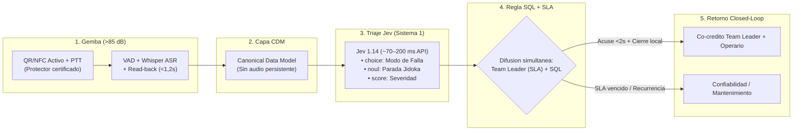

El pipeline técnico separa de forma tajante el camino crítico determinista en línea del análisis exploratorio fuera de línea:

1. **La Capa CDM (Canonical Data Model, Hohpe y Woolf, 2003) `[D]`:** Desacopla ontológicamente el Gemba de las tablas propietarias de SAP (`MSEG`, `QMEL`) o del WMS. El evento validado se traduce a una tupla canónica sin retener biometría vocal:
   $$\text{CanonicalOperationalEvent} = \langle \text{EventID},\; \text{ShiftCohort},\; \text{AssetRef},\; \text{TranscriptText},\; \text{TimestampUTC} \rangle$$
2. **El Motor de Triaje Tipificado No-Autoregresivo (Jev, TypeSafe AI, 2026) `[R]`:** En lugar de invocar LLMs autoregresivos pesados (1.500–3.000 ms y JSON frágil), la entidad se evalúa en `POST /v1/systemone`. En **una sola pasada paralela de ~70 a 200 milisegundos vía API** (holgadamente dentro del presupuesto perceptivo de `<2 s` del retorno auditivo), Jev resuelve tres primitivas tipadas con 0% de error sintáctico:
   * `choice("failure_mode")`: Clasifica el síntoma dentro de un *enum* industrial cerrado de hasta 255 modos de falla (incluyendo `OTHER_UNCLASSIFIED` para anomalías inéditas).
   * `noul("requires_jidoka_stop")`: Estima la probabilidad calibrada $p \in [0, 1]$ de requerir detención de línea o cuarentena preventiva.
   * `score("operational_severity")`: Cuantifica la urgencia técnica en $[0, 1]$.
3. **Difusión Simultánea y Re-Intermediación del Supervisor (No Puenteo Punitivo):** En el Sistema de Producción Toyota real (§4.7), el cordón de Andon **no humilla ni salta al Team Leader; lo convoca primero**. Si un algoritmo puentea sistemáticamente al supervisor de turno para acusar fallas ante la gerencia de planta, el mando medio saboteará la herramienta en menos de dos semanas. Por ello, nuestra arquitectura aplica **difusión simultánea con derecho preferente de resolución**: el aviso notifica al instante al *Team Leader* del sector con un SLA medido (60 s en parada de línea; 15 min en degradación no bloqueante). Si el supervisor acude, valida y resuelve o encauza la orden dentro del SLA, el sistema registra el cierre conjunto como mérito operativo del turno; únicamente cuando el SLA expira sin atención o la falla se repite sin solución estructural se dispara el escalamiento automático a Ingeniería de Confiabilidad.
4. **Escalamiento en Línea por Regla SQL Calibrada vs. Descubrimiento Batch Semanal:** El escalamiento sistémico en producción es 100% determinista y controla por tasa base para evitar falsas alarmas de Poisson en activos de alto tráfico: una consulta SQL sobre ventana móvil de 72 horas eleva un *Meta-Incidente* cuando coinciden reportes de **al menos 2 turnos distintos** sobre el mismo `(AssetRef, failure_mode)` superando el cuantil $1 - \alpha$ ($\alpha = 0{,}01$) de la tasa histórica $\lambda_0$ del activo. Únicamente los eventos etiquetados como `OTHER_UNCLASSIFIED` pasan a un proceso **batch semanal fuera de línea** (Sentence-BERT + UMAP con `random_state` fijo + HDBSCAN) para proponer al ingeniero de confiabilidad nuevos modos de falla candidatos a incorporarse al *enum* determinista.
5. **Dinámica Bayesiana Beta-Binomial de Sostenibilidad de Voz:** Sustituimos integrales acumulativas no acotadas por un modelo conjugado exacto de aprendizaje racional del operario `[M]`. Sea $\theta_t \in (0, 1)$ la creencia del trabajador en el turno $t$ sobre la probabilidad de que hablar produzca una respuesta material útil, con distribución a priori $\theta_0 \sim \text{Beta}(a_0, b_0)$ ($a_0, b_0 > 0$). Cada reporte emitido dentro de su horizonte reciente se clasifica deterministamente como **éxito de cierre** ($y_i = 1$, resolución verificada dentro del umbral $\tau_i \le \tau_{\text{crit}}$) o **evento de futilidad** ($y_i = 0$, ticket archivado sin acción o $\tau_i > \tau_{\text{crit}}$). Con $s_t = \sum_{i \le t} \omega^{t-t_i} y_i$ y $f_t = \sum_{i \le t} \omega^{t-t_i} (1 - y_i)$ ($\omega \in (0, 1]$ factor de memoria), la creencia esperada posterior y la probabilidad de reporte en $t+1$ satisfacen:

$$\mathbb{E}[\theta_t] = \frac{a_0 + s_t}{a_0 + b_0 + s_t + f_t} \in (0, 1), \qquad \operatorname{logit} P(\text{Voice}_{t+1}) = \alpha \cdot PO_t + \beta \cdot \mathbb{E}[\theta_t] - \gamma \cdot \text{Cost}_{\text{cog}}$$

Esta formulación satisface todas las propiedades empíricas de Detert y Burris (2007) `[M]`: (i) está estrictamente acotada; (ii) **cada respuesta rápida en terreno ($y_i = 1$) eleva $\mathbb{E}[\theta_t]$ hacia 1 y refuerza $P(\text{Voice}_{t+1})$**; y (iii) cada silencio burocrático ($y_i = 0$) hunde $\mathbb{E}[\theta_t]$ hacia 0, extinguiendo la voz aunque el costo cognitivo de captura ($\text{Cost}_{\text{cog}}$) sea mínimo.

### Salvaguardas Jurídico-Laborales y Prohibición de Vigilancia Biométrica
Desplegar micrófonos en un centro industrial sin blindaje jurídico viola el derecho laboral comparado y destruye de raíz la seguridad psicológica (§2.9). El Andon Digital opera bajo cuatro restricciones técnico-legales obligatorias:

1. **Prohibición Absoluta de Inferencia Emocional o Psicometría de Voz:** En cumplimiento estricto del **Artículo 5(1)(f) del Reglamento (UE) 2024/1689 (AI Act)** `[D]` —en vigor prohibitivo desde febrero de 2025—, queda vedado analizar prosodia, tono, estrés o emociones del trabajador. El audio se procesa en memoria volátil exclusivamente para transcripción léxica de fallas materiales y la onda acústica cruda se descarta tras la confirmación de *read-back* (`TTL = 0` en disco).
2. **Cero *Scoring* Individual ni Uso Disciplinario (Anexo III punto 4(b) AI Act; Art. 154 Código del Trabajo de Chile):** El sistema no almacena rankings individuales de velocidad o errores por operario ni alimenta evaluaciones de desempeño o despido (evitando activar sistemas de gestión algorítmica laboral de alto riesgo y respetando la doctrina de la Dirección del Trabajo de Chile sobre medios de control colectivos, idóneos y no desproporcionados). El retorno de cierre llega al terminal de la estación/turno, mientras la analítica agrega únicamente por `AssetRef` y cohorte de turno.
3. **Evaluación de Impacto en Protección de Datos (EIPD / DPIA) y Cogestión Sindical:** Antes de encender PTT en planta se suscribe acuerdo expreso con el comité de empresa o sindicato (conforme al estándar de cogestión de **§87(1) Nr. 6 BetrVG** en jurisdicción europea y protocolos paritarios locales) y se publica la EIPD exigida por el **Art. 35 del RGPD** y la **Ley N° 21.719** de protección de datos personales de Chile `[D]`.

---

## 4.9 El Guardarraíl Ya Es Ley: La Línea Base de los Sectores Regulados

La arquitectura de este capítulo —registro inmutable, validación determinista, supervisión humana nombrada, prohibición de que un modelo probabilístico escriba sin verificación— puede parecer una propuesta excéntrica de un consultor. No lo es. En cuatro industrias que mueven billones de dólares, exactamente esa arquitectura es obligatoria desde hace décadas, y las empresas que la incumplen no reciben una multa: pierden la licencia para operar.

La consecuencia doctrinal es incómoda para la industria del software empresarial: **la brecha de despliegue no existe donde alguien con poder obligó a cerrarla**. Existe en el comercio minorista, la logística, la agroindustria y la manufactura no regulada, donde nadie exige el registro y por tanto nadie lo paga.

### 4.9.1 El Canon Regulatorio del Registro Determinista

| Sector | Norma | Año | Exigencia Técnica | Artefacto FDS 2.0 que la Cumple |
|---|---|---|---|---|
| Farmacéutico | **21 CFR Part 11** (FDA) | 1997 | Validación del sistema, *audit trails* inalterables, firmas electrónicas vinculadas al firmante, retención y disponibilidad de registros | Log de eventos append-only con cadena de hash; firma nombrada atada al hash de la transacción |
| Farmacéutico (UE) | **EudraLex Vol. 4, Anexo 11** (GMP) | 2011 | Sistemas computerizados validados, integridad de datos, revisión periódica de la pista de auditoría | Revisión mensual de invariantes; *replay* de eventos sobre el año anterior |
| Dispositivos médicos | **IEC 62304** | 2006/2015 | Ciclo de vida del software, clasificación de seguridad, verificación de requisitos | FSM con transiciones verificadas y pruebas negativas; trazabilidad de requisitos |
| Aviación | **RTCA DO-178C** | 2011 | Trazabilidad de requisitos, verificación independiente, cobertura de estructura de código | Suite de 35 pruebas y sondas adversariales P1-P6 sobre la frontera de confianza |
| Banca | **SR 11-7 / OCC 2011-12** | 2011 | Validación de modelos, límites de uso, monitoreo continuo y *effective challenge* independiente | Modelos probabilísticos confinados a los niveles 1-3 de autoridad (§4.1); nivel 4 reservado al autómata |
| Mercados de valores | **SEC Rule 17a-4(f)** | 2003 | Registros electrónicos no reescribibles ni borrables (*WORM*), con índice y capacidad de recuperación | Ledger de eventos con sellado temporal y prohibición de *update* sobre el asiento |
| Inteligencia artificial | **ISO/IEC 42001:2023** | 2023 | Sistema de gestión de IA: política, roles, evaluación de riesgos, mejora continua | Gobierno del despliegue: Carta del Día 0, registro de excepciones, auditoría trimestral |
| Inteligencia artificial (UE) | **Reglamento (UE) 2024/1689** (AI Act), arts. 12, 13, 14 y 15 | 2024 | Registro automático de eventos (*logging*), instrucciones de uso, supervisión humana efectiva, exactitud y robustez | Las cuatro capas del §4.1 y el protocolo *Break-Glass* con firma nombrada |

`[D]` La lectura conjunta de la tabla produce un resultado que debería incomodar a cualquier comité ejecutivo: **ninguna de estas normas exige que el modelo acierte**. Exigen que el sistema pueda demostrar qué hizo, quién lo autorizó, con qué datos y cómo se revierte. La ley no regula la inteligencia; regula la trazabilidad. Es exactamente la tesis de este monógrafo, escrita por reguladores que no se conocían entre sí.

### 4.9.2 El Calendario Se Negocia; El Requisito No

El Reglamento (UE) 2024/1689 estableció un calendario escalonado: prohibiciones desde febrero de 2025, obligaciones para modelos de propósito general desde agosto de 2025, transparencia del artículo 50 desde agosto de 2026 y obligaciones plenas para sistemas de alto riesgo del Anexo III desde agosto de 2026. El Anexo III incluye, en su punto 2, los sistemas usados como **componentes de seguridad en la gestión y operación de infraestructuras críticas** —agua, gas, calefacción, electricidad, tráfico—, que es el territorio físico de este tratado.

Ese calendario ya fue modificado. El **Reglamento (UE) 2026/1744**, adoptado el 8 de julio de 2026, publicado en el Diario Oficial el 24 de julio y en vigor desde el 27 de julio, desplazó las obligaciones del Anexo III al **2 de diciembre de 2027** y las del Anexo I al **2 de agosto de 2028**, sin tocar el contenido de los requisitos: gestión de riesgos, documentación técnica, supervisión humana y evaluación de conformidad siguen siendo los mismos `[D]`.

`[I]` La interpretación es inevitable y no es cínica: cuando el costo de cumplir una métrica regulatoria se vuelve políticamente insostenible, el regulador renegocia el calendario. Es la Ley de Campbell operando sobre el propio legislador. La lección para el diseño no es que la norma sea inútil, sino que **un calendario de cumplimiento no es un guardarraíl**; el guardarraíl es la pista de auditoría que ya existe cuando el calendario se mueve. La empresa que esperó la fecha límite para construir el registro no está "adelantada" a 2027: está cuatro años detrás de su propio terreno.

### 4.9.3 Lo Que la Ley No Cubre (y Por Qué Importa)

Tres límites delimitan el alcance de este argumento:

1. **Cobertura sectorial.** El Anexo III cubre los componentes de seguridad de infraestructuras críticas, no el WMS de un centro de distribución ni el ERP de una cadena de supermercados. En los sectores donde la brecha es más ancha —retail, logística, agroindustria— no hay regulador que exija el registro; por eso la doctrina debe entrar por contrato privado (Carta del Día 0, Capítulo 6) y no por cumplimiento.
2. **Certificación no es integridad.** La historia de ISO 9000 (Capítulo 1) demuestra que un certificado puede convivir con el *dry-labbing* durante décadas. Si el auditor acepta documentos en lugar de consultar el log crudo, la norma produce ceremonia, no verdad. La prueba de fuego de cualquier régimen regulatorio es una sola: **¿puede el regulador consultar el evento original, o solo el reporte que la empresa preparó para él?**
3. **Registro sin apelación es tiranía.** El caso Horizon del Servicio Postal británico —cuyo primer volumen del informe final, publicado en julio de 2025, documentó alrededor de mil condenas injustas y trece suicidios vinculados— muestra que un registro determinista, incontestable y en manos de la misma entidad que investiga y persigue produce injusticia a escala industrial. El guardarraíl que protege el *ledger* de la operación debe incluir el derecho inverso: la operación debe poder impugnar el *ledger*. La supervisión humana del artículo 14 y el derecho a la explicación frente a decisiones automatizadas son la codificación de esa lección.

**Condición de falsación del capítulo:** si los sectores con regímenes estrictos de registro determinista mostraran una tasa de fracaso de despliegue comparable a la de los sectores sin régimen, entonces la ley no sería la variable que cierra la brecha y la tesis de la autoridad externa (§1.7) quedaría debilitada. La evidencia disponible —farmacéutica, aviación, banca— apunta en la dirección contraria, pero se trata de una comparación entre industrias, no de un experimento controlado, y así debe declararse.

---

# CAPÍTULO 5: LA GOBERNANZA ECONÓMICA: MOQ, COST-TO-SERVE Y EL VERDADERO P&L

### FICHA DE CURADURÍA ARTÍSTICA — CAPÍTULO 5


* **Obra:** *El cambista y su mujer* (*Le Prêteur et sa femme*)
* **Artista:** Quentin Matsys (1514)
* **Técnica y Dimensiones:** Óleo sobre tabla de roble, 70,5 × 67 cm
* **Ubicación Actual:** Musée du Louvre, París, Francia
* **Lectura Semiótica y Razón de Elección:**  
  La tabla retrata a un banquero de Amberes pesando minuciosamente monedas de oro y perlas en una balanza de precisión manual. Su esposa, a su lado, desvía la mirada de un libro ilustrado de devoción religiosa para observar con fascinación el brillo del metal. En la mesa reposan monedas de diversas procedencias, pesas de bronce y un espejo convexo que refleja la ventana exterior.  
  Es la confrontación entre dos contabilidades: la apariencia moral/contable (el libro de horas) y el peso material exacto de la moneda en la balanza física. En las corporaciones modernas ocurre la misma tensión: el estado de resultados del ERP exhibe un margen bruto contable artificialmente limpio y devoto, mientras la balanza real del **Cost-to-Serve** en el muelle pesa el costo implacable de la manipulación, el fraccionamiento, las devoluciones y el capital de trabajo inmovilizado. El banquero sabe que una moneda con el borde limado no vale lo que dice su cuño; el Ground-Truth Systems Architect sabe que una orden con margen bruto del 40% puede destruir el flujo de caja de la planta.

---

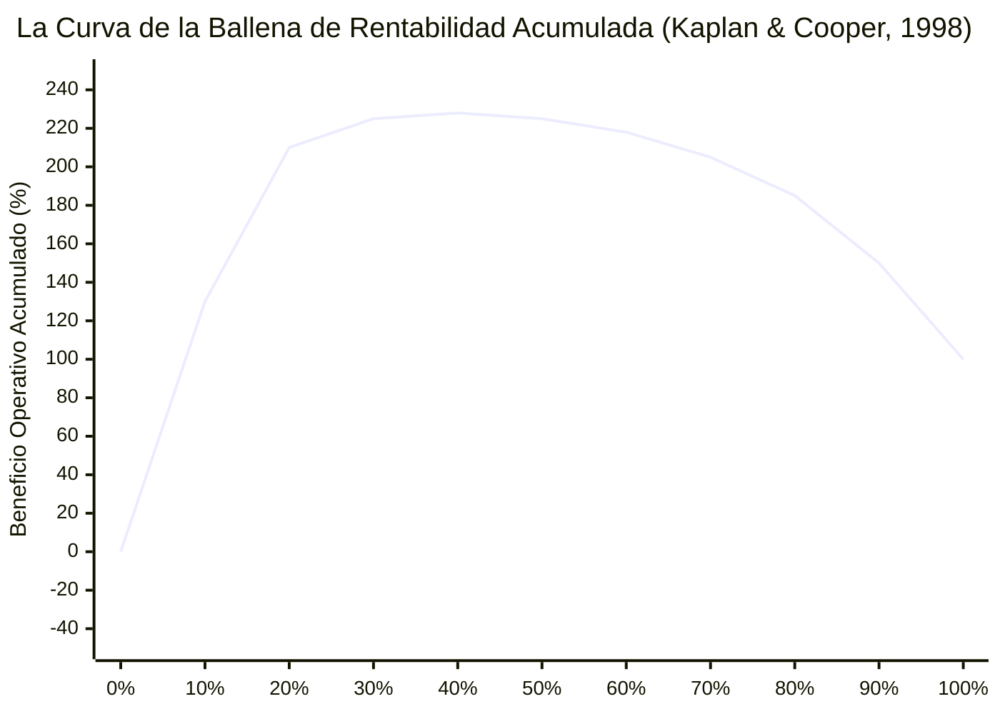

## 5.1 La Ilusión del Margen Bruto frente al Costo Real de Servir (*Cost-to-Serve*)

En los comités ejecutivos y juntas directivas, la rentabilidad corporativa se evalúa casi exclusivamente mediante el margen bruto contable:

$$\\text{Margen Bruto} = \\frac{\\text{Precio de Venta} - \\text{Costo de Bienes Vendidos (COGS)}}{\\text{Precio de Venta}}$$

Bajo este modelo convencional codificado en los ERPs, los costos indirectos de distribución, almacenamiento, embalaje y administración de devoluciones se asignan mediante coeficientes fijos prorrateados sobre el valor monetario de la mercancía `[D]`.

Esta simplificación contable produce una distorsión sistemática que denominamos **La Ilusión del Margen Bruto**:

* **El Cliente A (Eficiente):** Ordena con 72 horas de anticipación en pallets completos cerrados (*Full Truckload - FTL*), recibe en ventanas horarias flexibles y cuenta con andenes automatizados que liberan el camión en 30 minutos.
* **El Cliente B (Destructor de Valor):** Ordena a diario con entrega urgente en menos de 12 horas, en cajas fraccionadas con unidades sueltas, exige etiquetados fuera de norma, rechaza pallets si el celofán está rozado y genera un 15% de devoluciones de producto.

En el ERP tradicional, ambos clientes exhiben un margen bruto idéntico del 35%. En el flujo de caja real (*Cash-to-Cash*), el Cliente A genera un margen operativo neto del **+22%**, mientras que el Cliente B genera un margen neto negativo del **-18%**, financiado en silencio por el primero.

El **Costo Real de Servir (*Cost-to-Serve - CTS*)** desglosa cada actividad logística, física y administrativa consumida por la orden $i$ `[M]`:

$$\\text{CTS}_i = c_0 + c_1 L_i + c_2 B_i + c_3 E_i + c_4 D_i + c_5 R_i + c_6 W_i$$

donde $L_i$ es el número de líneas, $B_i$ el de bultos fraccionados a mano, $E_i$ el de despachos de emergencia, $D_i$ el de entregas en muelle, $R_i$ el de devoluciones y $W_i$ el capital de trabajo inmovilizado en días de crédito comercial en mora.

---

## 5.2 La Curva de la Ballena de Kaplan & Cooper (1998) `[D]`

Robert S. Kaplan y Robin Cooper (Harvard Business School, 1998) `[D]` formalizaron la regularidad empírica que emerge al aplicar el costeo basado en actividades sobre la cartera de clientes de corporaciones globales:

1. **El 20% Superior (Generadores de Riqueza):** Ordenados de mayor a menor contribución neta (lo que impone por construcción matemática una curva acumulada **estrictamente cóncava** de incrementos marginales no crecientes), el 20% de los clientes más rentables genera habitualmente entre el **150% y el 300% del beneficio operativo final** (situándose el pico acumulado típico en torno al 200%–230% entre los deciles tercero y cuarto).
2. **El 50%–60% Intermedio (Neutrales):** Apenas cubre sus costos directos y de servir, aportando una pendiente casi plana cercana al punto de equilibrio (*break-even*).
3. **El 10%–20% Inferior (Destructores de Valor):** Consume una cantidad tan desproporcionada de urgencias, fraccionamientos manuales y logística inversa que **destruye entre el 50% y el 200% del beneficio operativo**, devolviendo la curva acumulada desde su máximo hasta el 100% contable reportado en el estado de resultados.

La curva del diagrama anterior es una reconstrucción ilustrativa de esa regularidad, no la medición de una empresa concreta; su forma —no sus decimales— es lo que debe auditarse en cada cartera. La corporación cierra su balance con un 100% de utilidad reportada, ciega al hecho de que su operación generó un 225% de ganancias potenciales que fueron incineradas en un 125% para subsidiar a clientes estructuralmente ruinosos. Cuando la empresa conecta algoritmos comerciales de recomendación sin gobernanza de Cost-to-Serve, la IA acelera las ventas precisamente en el segmento deficitario, amplificando la destrucción patrimonial.

---

## 5.3 El Sesgo de Optimismo en Pronósticos: Fildes et al. (2009) `[D]`

La distorsión económica no se limita a los costos; corrompe el proceso de planificación de la demanda (*S&OP*).

En una auditoría econométrica masiva sobre **más de 60.000 pronósticos individuales y sus correspondientes ajustes humanos** en cuatro corporaciones multinacionales del Reino Unido, **Robert Fildes, Paul Goodwin, Michael Lawrence y Kesten Nikolopoulos (2009, *International Journal of Forecasting*)** `[D]` constataron:

* **Predominancia del Sesgo Alcista:** Más del **75% de los ajustes manuales realizados por comités comerciales sobre los modelos cuantitativos fueron aumentos discrecionales de las proyecciones de venta**.
* **Destrucción de Precisión Estadística:** Mientras que los ajustes manuales a la baja mejoraron la precisión en un promedio de 4 puntos, **los ajustes manuales al alza incrementaron el error de pronóstico (WAPE / MAPE) entre un 4,5% y un 11,2%**, destruyendo de forma sistemática el rendimiento del modelo matemático de base.

Los gerentes comerciales inflan las metas porque sus bonos anuales dependen de proyectar crecimiento; si la mercancía se agota, culpan a la logística por "quiebres de stock"; si la mercancía sobra, el costo financiero se esconde en el balance operativo.

### Medición Rigurosa mediante Valor Agregado del Pronóstico (*FVA*)
El desempeño no se mide evaluando al planificador en abstracto; se audita mediante el **Forecast Value Added (FVA)** comparando tres series concurrentes:

| Nivel de la Serie | WAPE / Error Ponderado | Valor Agregado (*FVA*) | Veredicto Operativo |
|---|:---:|:---:|---|
| **1. Pronóstico Ingenuo (Paseo aleatorio)** | 38% | — | Línea base pasiva del mercado. |
| **2. Modelo Estadístico / Algoritmo Base** | 31% | **+7 puntos** | El algoritmo genera valor real. |
| **3. Pronóstico Final tras Ajuste Gerencial** | 35% | **−4 puntos** | **El comité humano destruye valor económico.** |

Cuando los científicos de datos entrenan modelos de IA con el historial de pronósticos aprobados en lugar de la demanda física pura, la red neuronal aprende el sesgo gerencial alcista, amplificando el **efecto látigo (*bullwhip effect*)** de Hau Lee y saturando los almacenes de existencias invendibles.

---

## 5.4 La Trampa del Lote Mínimo de Compra (MOQ) y Capital de Trabajo

Uno de los mayores destructores de flujo de caja libre es la política de compras basada en el **Lote Mínimo de Compra (*Minimum Order Quantity - MOQ*)** `[V]`.

El comprador es evaluado localmente por la **Varianza de Precio de Compra (*Purchase Price Variance - PPV*)**. Para capturar un descuento por volumen del 2% o 5% ofrecido por el proveedor, acepta adquirir un lote mínimo que multiplica por $3{,}6\times$ su lote económico óptimo (cinco meses completos de demanda de una sola vez).

### 5.4.1 Modelo Matemático de Viabilidad Económica de Descuentos
Modelamos analíticamente la condición que decide si un descuento por MOQ es rentable o empobrecedor `[M]`:

Sea $D$ la demanda anual en unidades, $P$ el precio unitario base sin descuento, $S$ el costo administrativo y de recepción por orden, $h$ la tasa anualizada de mantenimiento de inventario y $H_0 = P \\cdot h$ el costo unitario anual base de tenencia, que define el lote económico estándar (EOQ):

$$Q^* = \\sqrt{\\frac{2DS}{H_0}}$$

El proveedor ofrece un descuento porcentual $d \\in (0, 1)$ condicionado a ordenar un lote mínimo $Q_m > Q^*$, reduciendo el costo unitario anual de tenencia a:

$$H(d) = P(1 - d) \\cdot h$$

donde la tasa agregada anualizada de mantenimiento de inventario $h$ se descompone empíricamente como:

$$h = r_{\\text{WACC}} + c_{\\text{storage}} + c_{\\text{obsolescence}} + c_{\\text{damage}}$$

* $r_{\\text{WACC}}$: Costo promedio ponderado de capital (10% a 15%).
* $c_{\\text{storage}}$: Costo de espacio, climatización, seguros y personal (3% a 6%).
* $c_{\\text{obsolescence}}$: Tasa de vencimiento o depreciación tecnológica (5% a 12%).
* $c_{\\text{damage}}$: Tasa de mermas por manipulación y hacinamiento (2% a 5%).

La tasa $h$ oscila en la industria entre el **20% y el 38% anual** del valor del activo `[D]`.

La condición exacta de conveniencia financiera del descuento exige que el ahorro bruto de precio supere la variación neta en costo de ciclo de inventario y emisión de órdenes:

$$D \\cdot P \\cdot d > \\left(\\frac{H(d) \\, Q_m}{2} - \\frac{H_0 \\, Q^*}{2}\\right) + D \\cdot S \\left( \\frac{1}{Q_m} - \\frac{1}{Q^*} \\right)$$

### 5.4.2 Ejemplo Numérico Exacto
Supóngase $D = 12.000$ unidades/año ($3.000$/trimestre), $P = \\text{USD } 10{,}00$, $h = 25\\%$ ($H_0 = \\text{USD } 2{,}50$/unidad/año) y $S = \\text{USD } 200$/orden:

* Lote económico base: $Q^* = \\sqrt{2 \\times 12.000 \\times 200 / 2{,}50} = 1.385{,}64 \\approx 1.386$ unidades.
* El proveedor ofrece un descuento $d = 2\\%$ sujeto a un MOQ de $Q_m = 5.000$ unidades ($1{,}67\\times$ la demanda trimestral y $3{,}61\\times$ el lote óptimo $Q^*$), con costo de tenencia descontado $H(d) = 10 \\times (1 - 0{,}02) \\times 0{,}25 = \\text{USD } 2{,}45$/unidad/año.
* Ahorro bruto en compras: $12.000 \\times \\text{USD } 10 \\times 0{,}02 = \\text{USD } 2.400{,}00$ anuales.
* Sobrecosto neto de mantención de inventario de ciclo: $\\frac{2{,}45 \\times 5.000}{2} - \\frac{2{,}50 \\times 1.385{,}64}{2} = 6.125{,}00 - 1.732{,}05 = +\\text{USD } 4.392{,}95$ anuales.
* Ahorro en emisión de órdenes: $12.000 \\times 200 \\times (1/5.000 - 1/1.385{,}64) = 480{,}00 - 1.732{,}05 = -\\text{USD } 1.252{,}05$ anuales.
* **Impacto Financiero Neto:** $+\\text{USD } 4.392{,}95 - \\text{USD } 1.252{,}05 - \\text{USD } 2.400{,}00 = +\\text{USD } 740{,}90$ de sobrecosto neto anual.

**El descuento comercial del 2% destruye USD 740,90 anuales de flujo de caja libre en un solo SKU** (incluso reconociendo la reducción proporcional de $H(d)$ sobre el precio descontado). El departamento de compras celebra un "ahorro PPV" de USD 2.400 en su bono departamental, mientras tesorería absorbe en silencio el costo financiero del capital inmovilizado y el andén sufre el hacinamiento físico.

---

## 5.5 Diseño de Mecanismos: Contratos Compatibles con la Verdad

Siguiendo la teoría de diseño de mecanismos de Leonid Hurwicz y Eric Maskin, la verdad no se obtiene mediante apelaciones morales; se induce diseñando reglas de pago donde decir la verdad material es la estrategia dominante para todos los agentes `[M]`.

Para pronósticos probabilísticos de demanda, el incentivo debe estructurarse mediante una **regla de puntuación estrictamente propia (*Strictly Proper Scoring Rule*)** (Gneiting & Raftery, 2007) `[D]`:

* **Brier Score** para eventos binarios: $S(f, y) = 1 - (f - y)^2$.
* **Continuous Ranked Probability Score (CRPS)** para distribuciones acumuladas continuas.

**Teorema de Separación entre Pronóstico Verdadero y Decisión de Inventario:** Un error clásico en diseño de contratos consiste en agregar penalizaciones de quiebre o sobrestock sobre la remuneración del pronosticador ($w = w_0 + \\alpha S(F, y) - \\beta \\mathbf{1}_{\\text{quiebre}} - \\gamma \\mathbf{1}_{\\text{exceso}}$); añadir indicadores de resultado operativo **destruye matemáticamente la propiedad estrictamente propia de $S(F, y)$**, pues induce al planificador a sesgar la distribución reportada $F$ para cubrirse del evento penalizado (Gneiting y Raftery, 2007) `[D]`. La arquitectura compatible con incentivos exige separar las dos funciones `[M]`:

1. **Contrato Puro de Pronóstico (Verdad Epistémica):** El equipo de planificación de demanda (o el ensamble estadístico) reporta únicamente la distribución acumulada predictiva $F_t$ y es evaluado **exclusivamente** por la ganancia de **CRPS** respecto al pronóstico ingenuo estacional (*FVA probabilístico*):
   $$w_{\\text{plan}} = w_0 + \\alpha \\bigl(\\operatorname{CRPS}(F_{\\text{naive}}, y_t) - \\operatorname{CRPS}(F_t, y_t)\\bigr), \\qquad \\operatorname{CRPS}(F, y) = \\int_{-\\infty}^{\\infty} \\bigl(F(z) - \\mathbf{1}_{\\{z \\ge y\\}}\\bigr)^2 dz$$
   Al no depender del nivel de inventario físico sino solo de $(F_t, y_t)$, reportar la verdadera creencia $F_t = G_t$ es estrategia estrictamente dominante.
2. **Política Determinista de Reposición (Fractil Crítico de Newsvendor):** Dado el pronóstico insesgado $F_t$, el motor determinista (`kern`) calcula la cantidad objetivo mediante el cuantil óptimo que equilibra el costo unitario de quiebre ($C_u$: margen perdido + penalización contractual) frente al costo unitario de exceso ($C_o$: tenencia $H$ + riesgo de obsolescencia):
   $$Q_t^* = F_t^{-1}\\!\\left(\\frac{C_u}{C_u + C_o}\\right)$$
   Así, la aversión comercial al quiebre ($C_u > C_o$) gobierna explícitamente la decisión de stock *sin contaminar ni sesgar jamás el pronóstico base*.

---

## 5.6 El P&L Verdadero y su Medición Forense

El estado de resultados real de una línea de negocio no es el margen bruto del ERP; es la suma algebraica de cinco componentes observables:

$$\\Pi_i = (P_i - C_i) \\, Q_i - \\text{CTS}_i - \\text{Risk}_i - \\text{Tax}_i$$

* $\\text{CTS}_i$: Costo real de servir por actividades.
* $\\text{WC}_i = c_6 W_i$: costo de financiamiento del capital de trabajo inmovilizado ($h \\cdot \\text{WACC}$), **ya incluido dentro de $\\text{CTS}_i$**; se explicita aquí para que el lector no lo reste dos veces. El error de doble conteo del capital de trabajo es, en nuestra experiencia, el más frecuente de todos los que se cometen al construir un P&L por cliente.
* $\\text{Risk}_i$: Pérdida esperada por obsolescencia, mermas de andén o devoluciones contractuales.
* $\\text{Tax}_i$: Costos tributarios y regulatorios específicos de la línea.

---

## 5.7 Línea de Visión (Line of Sight) y Significancia Relacional: Traducir el P&L al Gemba

El cálculo econométrico del Costo de Servir (*Cost-to-Serve*) y la curva de la ballena permanecen como meras abstracciones de oficina si la organización es incapaz de traducir los números del P&L a la conducta física del operario de andén. Esta fractura cognitiva es lo que Wendy R. Boswell y John W. Boudreau (2001; Boswell, 2006, *IJHRM*, 17(9), 1489–1511) `[D]` definieron y operacionalizaron como la **Línea de Visión (*Line of Sight - LOS*)**.

Boswell y Boudreau demostraron que la Línea de Visión se bifurca en dos constructos analíticos distintos:

1. **LOS-Objetivos (*Understanding Strategic Objectives*):** La comprensión general de las metas macro corporativas (e.g., EBITDA, retorno sobre capital invertido).
2. **LOS-Acciones (*Understanding Aligned Actions*):** El conocimiento operativo exacto de qué decisiones, hábitos de control y prioridades de trabajo cotidianas en la estación de labor impactan positivamente o destruyen esos objetivos macro.

En relevamientos empíricos multisectoriales, Boswell constató una **brecha jerárquica sistemática**: mientras que entre el 85% y el 90% del comité ejecutivo comprende la estrategia, en la supervisión intermedia el índice desciende al 50%–60%, y en la base operativa del Gemba colapsa habitualmente por debajo del 25%. Crucialmente, la modelización demostró que el conocimiento abstracto (LOS-Objetivos) carece de poder predictivo sobre la conducta; es exclusivamente el entendimiento de las acciones concretas (**LOS-Acciones**) el que exhibe coeficientes estandarizados directos sobre el desempeño en el rol ($\\beta = 0,21, p < 0,01$), la satisfacción laboral ($\\beta = 0,28, p < 0,001$) y la retención del personal mediante una reducción deliberada de la intención de rotación ($\\beta = -0,22, p < 0,01$).

Cerrar esta brecha demanda sustituir los lemas corporativos por **matrices visuales de impacto local** en el andén:

| Decisión Operativa en la Estación | Falla Sistémica Aguas Abajo | Consecuencia Financiera Directa en el P&L |
|---|---|---|
| Omisión de verificación del lote de caducidad en andén de recepción (ahorro de 20 s por pallet). | Ubicación desordenada en estanterías dinámicas; despacho de stock vencido al cliente `[D]`. | Multas contractuales; pérdida íntegra del lote (USD 45.000) y costo de flete inverso urgente. |
| Palletización deficiente o flejado flojo para apurar la cuota horaria de salida. | Volcamiento de la carga durante el frenado o viraje en el transporte troncal `[V]`. | Pérdida íntegra de mercadería; sobrestadía de muelle y reposición acelerada a pérdida. |
| Digitación manual forzada de SKU ante fallas de lectura del lector de radiofrecuencia. | Generación de desfases entre el stock físico y el registro lógico del WMS (*Phantom Stockouts*) `[D]`. | Quiebres en línea de picking; recuentos cíclicos extraordinarios (USD 35/hora-hombre). |

Esta reconexión cognitiva se complementa con la evidencia experimental sobre diseño relacional del trabajo de Adam M. Grant (Grant et al., 2007, *OBHDP*, 103(1), 53–67; Grant, 2008, *JAP*, 93(1), 108–124) `[D]`. En experimentos controlados de campo, un contacto directo de apenas cinco minutos entre los trabajadores y un beneficiario real de su labor incrementó la persistencia activa (tiempo efectivo en tarea) en un **142%** y el resultado económico recaudado en un **171%** (replicando en nuevas cohortes más del doble de llamadas y recaudación en Grant, 2008), mediado por dos variables psicosociales: el **Impacto Social Percibido** (la convicción de que las acciones propias previenen un daño material a terceros) y la **Valía Social Percibida** (el sentimiento de reconocimiento y dignidad). 

En el ámbito clínico, Yehonatan Turner e Irith Hadas-Halpern (2008, RSNA) `[D]` confirmaron este principio al comprobar que la simple inclusión de una fotografía facial del paciente en la pantalla digital de tomografía computarizada elevó la detección de hallazgos incidentales por parte de los radiólogos en un 46% ($p = 0,005$). Cuando el operario de almacén visualiza que el repuesto que embala es la válvula hidráulica para un agricultor detenido en plena cosecha o el catéter para un quirófano pediátrico a primera hora de la mañana, la tarea transiciona desde la micro-manipulación mecánica hacia la custodia activa del flujo humano, desarticulando la alienación de tarea (Hackman & Oldham, 1976) `[D]`.

---

## 5.8 Propiedad Psicológica y Open-Book Management: La Desarticulación de Kerr en el Piso

La alineación integral del Gemba culmina cuando la fuerza laboral asume una identidad de custodia compartida (*Stewardship*) sobre el activo productivo. Jon L. Pierce, Tatiana Kostova y Kurt T. Dirks (2001, 2003, *AMR*, 26(2), 298–310) `[D]` formalizaron el constructo de **Propiedad Psicológica (*Psychological Ownership*)**, definido como el estado cognitivo y afectivo en el cual un individuo experimenta que el sistema técnico o la organización es "suya" ("Esto es mío / Esto es nuestro").

Pierce et al. establecen que el ownership psicológico es independiente de la tenencia accionaria formal y responde a la satisfacción de tres motivos humanos: autoeficacia, autoidentidad y posesión de un territorio seguro. Se edifica en el piso a través de tres rutas operativas:

1. *Ruta del Control:* Autoridad legítima de intervención local y parada por Andon.
2. *Ruta del Conocimiento Íntimo:* Transparencia algorítmica sobre el modelo de datos de la terminal.
3. *Ruta de la Inversión del Propio Ser:* Incorporación de mejoras Kaizen y firma personal de verificación en cada unidad despachada.

En tres investigaciones de campo independientes ($N_1 = 133, N_2 = 147, N_3 = 202$), Linn Van Dyne y Jon L. Pierce (2004, *JOB*, 25(4), 439–459) `[D]` demostraron que la propiedad psicológica explica varianza incremental estadísticamente significativa en el desempeño laboral formal y en las conductas de ciudadanía organizacional dirigidas a la empresa ($\\Delta R^2 = 0,04 \\text{ a } 0,07, p < 0,01$), superando el poder predictivo del compromiso afectivo y la satisfacción laboral. Complementariamente, James B. Avey, Bruce J. Avolio, Craig D. Crossley y Fred Luthans (2009, *JOB*, 30(2), 173–191) `[D]`, sobre una muestra de 414 trabajadores, validaron que el ownership reduce de forma directa la desviación laboral y conductas contraproducentes ($\\beta = -0,24, p < 0,01$) y eleva la asunción de responsabilidad (*accountability*, $\\beta = 0,38, p < 0,001$).

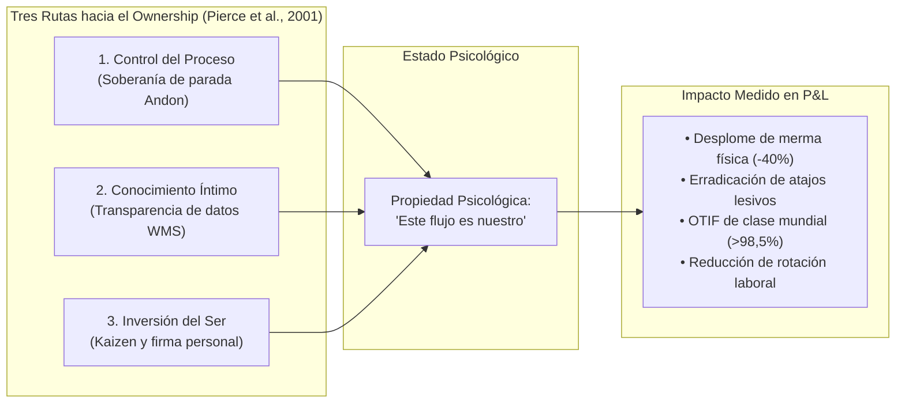

Para anclar este estado en las finanzas de la empresa, Jack Stack (1992, *The Great Game of Business*) `[D]` estructuró en Springfield ReManufacturing Corporation (SRC) el modelo de **Open-Book Management (OBM)**. Al adquirir una planta fabril en bancarrota con una relación de deuda a patrimonio neto de 89:1, Stack educó a mecánicos y torneros en la lectura del estado de resultados y flujo de caja libre, logrando reducir el apalancamiento a 1:1 y multiplicando el valor de la acción de USD 0,10 a más de USD 199.

El OBM desarticula la **Locura de Kerr** (bonificar velocidad individual esperando calidad) y la **Ley de Campbell** mediante tres mecanismos simétricos de retribución compartida (*Gainsharing*):

1. **Gatillo de Rentabilidad Colectiva (*Financial Hurdle*):** No se libera bonificación unitaria si la planta no alcanza primero un umbral global predefinido de beneficio neto o flujo de caja libre.
2. **Gainsharing Colectivo Auditado Independientemente (Sin Castigo al Auto-Reporte):** Penalizar la productividad individual por los defectos reportados en el propio turno violaría nuestro propio modelo (§2.1.1): carecería de piso en cero si los defectos superan la tolerancia (descuento salarial ilegal) e incentivaría a esconder roturas detrás del rack (Atajo #5). Por ello, la bonificación se calcula a nivel de **cohorte de célula/turno** con piso estricto en cero, periodicidad quincenal o mensual (incluyendo prorrata para personal eventual) y un factor de integridad $Q^{\\text{aud}}_t \\in [0, 1]$ medido **exclusivamente mediante conteo ciego independiente y reclamos verificados aguas abajo, jamás por las mermas o alertas Andon auto-declaradas** `[M]`:
   $$\\text{Bono}_{\\text{equipo}, t} = \\max\\!\\bigl(0,\\; \\theta \\cdot (P_{\\text{eq}, t} - P_{\\text{base}})\\bigr) \\times Q^{\\text{aud}}_t \\times \\mathbb{I}(\\text{FCF}_{\\text{sitio}} \\ge \\text{Umbral})$$
   Reportar a tiempo una caja rota vía `BWART 103` o Andon Digital **no reduce $Q^{\\text{aud}}_t$**; ocultarla en una ubicación activa y que sea descubierta por auditoría ciega sí lo penaliza. Así, declarar la verdad física domina estrictamente al encubrimiento.

3. **El Número Crítico y Scoreboards Públicos:** Pizarras físicas en el andén donde los operarios pronostican dinámicamente cada semana las variables de caja y costo que controlan en su turno.

Esta arquitectura converge con las herramientas Lean de des-alienación sistémica: el Mapeo de la Cadena de Valor (**Value Stream Mapping - VSM**, Rother & Shook, 1999) `[D]` y la caminata transversal del Gemba que genera el "Momento de Revelación" al visibilizar los cuellos de botella cruzados; el diálogo bidireccional de metas **Hoshin Kanri Catchball** (Akao, 1991) `[D]`; y la sincronización simultánea en **Sala Obeya** bajo el esquema SQDCM (Seguridad, Calidad, Entrega, Costo y Moral). En este régimen sociotécnico, el operario deja de ser un engranaje sustituible y asume el rol para el cual su inteligencia fue forjada: el de custodio consciente y soberano de la rentabilidad del flujo de valor.

---

# CAP?TULO 6: EL MANUAL DE DESPLIEGUE EN EL TERRENO: DEL LEVANTAMIENTO FORENSE DE 120 HORAS AL CORTE SIN FRICCI?N

### FICHA DE CURADURÍA ARTÍSTICA — CAPÍTULO 6


* **Obra:** *La ronda de noche* (*Militia Company of District II under the Command of Captain Frans Banninck Cocq*)
* **Artista:** Rembrandt van Rijn (1642)
* **Técnica y Dimensiones:** Óleo sobre lienzo, 363 × 437 cm
* **Ubicación Actual:** Rijksmuseum, Ámsterdam, Países Bajos
* **Lectura Semiótica y Razón de Elección:**  
  Rembrandt rompe con el retrato estático tradicional de milicias cívicas y muestra a la guardia del capitán Banninck Cocq poniéndose en marcha de improviso desde una arcada en penumbra hacia la luz de la calle. Hay tambores sonando, mosquetes cargándose con pólvora viva, picas alzándose en desorden aparente y un perro ladrando en la oscuridad. En medio del tumulto nocturno, la figura luminosa de una niña lleva un gallo blanco atado a la cintura (emblema de los arcabuceros y de la victoria).  
  Es la plasmación estética de las **02:30 AM en el andén de recepción**: el turno nocturno donde se decide la verdad operativa de una corporación. No hay desfile marcial para la junta directiva ni diapositivas corporativas pulcras; hay fatiga, dinamismo improvisado, operarios preparando grúas en la penumbra y guardias vigilando que la carga fluya sin detener el muelle. Rembrandt entendió que el orden real de una comunidad armada no proviene de la quietud ceremonial, sino de la disciplina en movimiento bajo el claroscuro de la noche.

---

```mermaid
gantt
    title Protocolo de despliegue: 30 d?as de levantamiento, 14 de staging, corte ABC y 90 de hiper-cuidado
    dateFormat  YYYY-MM-DD
    section Fase 0: Contrato
    Firma de la Carta del Día 0 (pregunta binaria y kill-criteria) :milestone, 2026-11-01, 0d
    section Fase 1: Levantamiento e Ingesta (120 h)
    Solo lectura, integridad y esquemas (días 1-5)     :2026-11-01, 5d
    Inmersión en el Gemba, turno 02:30 (días 6-12)      :2026-11-06, 7d
    Incentivos, FVA y capital de trabajo (días 13-20)   :2026-11-13, 8d
    FSM 3 coordenadas, replay y sondas P1-P6 (21-27)    :2026-11-21, 7d
    Memo de decisión de una página (días 28-30)         :milestone, 2026-11-28, 0d
    section Fase 2: Staging y corte
    Shadow run de 14 días, sin escritura en el ERP      :2026-12-01, 14d
    Buffer de stock crítico (3 semanas antes del corte) :2026-11-24, 21d
    Congelamiento de datos maestros (2 semanas)         :2026-12-01, 7d
    Corte modular ABC, fases I a III                    :2026-12-15, 7d
    Prueba mensual del kill-switch                      :2026-12-15, 1d
    section Fase 3: Hiper-cuidado (90 días)
    Reconciliación semanal y auditoría de invariantes   :2026-12-22, 90d
```

## 6.1 El Protocolo como Contrato, no como Cortesía

Un despliegue tecnológico no comienza cuando se instala el software; comienza cuando el patrocinador corporativo firma qué hechos concretos contarán formalmente como fracaso del proyecto.

El **Protocolo de Campo de 30 Días** presupone **120 horas de presencia operativa real** en las instalaciones físicas del cliente (distribuidas en 4 horas diarias de trabajo de campo), complementadas por análisis forense de datos.

### La Carta del Día 0
Antes de abrir una sola terminal de código, el Director de Operaciones (COO) y el Forward Deployed Strategist firman la **Carta del Día 0**, que establece cuatro cláusulas obligatorias:

1. **La Pregunta de Decisión Binaria:** Una única interrogante formulada con respuesta sí/no estricta para la compuerta del día 30 (consistente con el cronograma Gantt). Ejemplo: *¿Cumple el Centro de Distribución Central los umbrales de integridad física y latencia para ingresar el día 31 al Shadow Run de 14 días y al corte modular escalonado ABC hacia autoridad de escritura en SAP?*
2. **El Criterio de Parada o Abandono (*Kill-Criteria*):** Fijado antes de ver los datos para evitar redefiniciones oportunistas. Ejemplo: *El despliegue se cancela inmediatamente si la tasa de excepciones no resueltas supera el 3% o si la latencia p99 de andén excede los 500 ms.* Los umbrales no son universales: se derivan del baseline medido del sistema legado en el mismo turno durante los primeros cinco días, y se fijan por encima de su p95 con un margen declarado. Gartner (octubre de 2026) `[R]` reportó que solo el 13% de los CIOs declara haber obtenido valor significativo o transformacional de la IA y que la mayoría de las empresas carece de criterios formales de salida (*exit rules*) para sus pilotos: el criterio de parada es, precisamente, la cláusula que casi nadie firma.
3. **Acceso de Solo Lectura en 5 Días:** Si la corporación no es capaz de suministrar un volcado completo de datos en modo lectura (`read-only`) en cinco días hábiles, el proyecto se detiene ahí. Un equipo incapaz de entregar datos pasivos en una semana jamás sostendrá una adopción en producción.
4. **Seguridad Absoluta de Producción:** Cero escrituras directas sobre el ERP durante los primeros 30 días de evaluación.

---

## 6.2 Las 120 Horas: Anatomía Forense del Intake

El proceso de inmersión técnica se ejecuta en cinco etapas rigurosas:

* **Días 1–5: Conectividad y Registro de Anomalías.** Conexión de solo lectura a las bases de datos transaccionales de los últimos 24 meses. Se corren consultas de integridad buscando: saldos negativos de inventario, movimientos de ajuste masivo concentrados en el último día de mes, y divergencias entre los lead times teóricos y los reales.
* **Días 6–12: La Inmersión en el Gemba.** Se caminan todos los turnos, con presencia obligatoria en el **turno nocturno de las 02:30 AM**, con calzado de seguridad y chaleco de alta visibilidad. La entrevista no pregunta opiniones abstractas; interroga por la última excepción física: *¿Me muestras la última orden que salió tarde? ¿Qué hiciste en la pantalla para destrabar el muelle?* Se ejecuta el **conteo ciego estratificado** y se levanta el **inventario de sistemas en la sombra (hojas de cálculo y grupos de WhatsApp)**.
* **Días 13–20: Incentivos, Pronóstico y Capital de Trabajo.** Se calcula el valor agregado del pronóstico (*FVA*) sobre tres series concurrentes (Capítulo 5), se audita el sesgo alcista de los ajustes humanos y se mapea qué bonos anuales dependen del reporte transaccional.
* **Días 21–27: Construcción de la Frontera Determinista.** Se parametriza la FSM desacoplada en tres coordenadas (`inbound_fsm_guardrail.py`), se definen los tres carriles de riesgo (Verde: automático; Amarillo: requiere firma de supervisor; Rojo: requiere patrocinador del proyecto) y se ejecutan las pruebas de reproducción histórica sobre el año anterior (*Replay Testing*).
* **Días 28–30: El Memo de Decisión de Una Página.** Presentación ejecutiva que contiene: la pregunta del Día 0, la comprobación del criterio de parada, los tres hallazgos críticos del Gemba, el impacto financiero neto modelado en rangos, y la recomendación irrevocable: **Avanzar a producción gradual o Parar**. Si la recomendación es Parar, el cliente conserva el registro de anomalías y el mapa de incentivos; abortar al día 30 ahorra millones de dólares.

---

## 6.3 Staging Seguro y Kill-Switch Determinista

Para eludir las catástrofes de corte simultáneo tipo *Big-Bang* (como las de Hershey o FoxMeyer):

### 6.3.1 Arquitectura Shadow / Dual-Run
Durante un período mínimo de 14 días consecutivos, el sistema determinista opera en **modo sombra desacoplado**:

1. El sistema tradicional del cliente continúa procesando las facturas y despachos reales.
2. Todas las tramas de básculas, lectores RF y portones de acceso son clonadas de forma asíncrona mediante un bus de mensajes (Kafka / RabbitMQ) y dirigidas a la FSM determinista en memoria.
3. La FSM evalúa las 64 configuraciones del producto de las tres coordenadas (**12 alcanzables**), calcula las proyecciones contables (`BWART 103/105/124`) y registra en una base de datos paralela cualquier divergencia con el sistema oficial.

### 6.3.2 Conmutador Hardware de Transferencia de Autoridad (*Keyed Failover Selector*) y Licenciamiento Indirecto
A diferencia de las banderas remotas de software que quedan inaccesibles si el clúster se congela, el FDS 2.0 instala en el gabinete del muelle un **selector electromecánico rotativo con llave de dos posiciones (azul/blanco: `AUTO FSM` / `BYPASS LEGADO`)**, diseñado bajo estricta separación normativa y transaccional:

* **Cumplimiento ISO 13850 / IEC 60204-1 (No Confusión con Parada de Emergencia):** Queda prohibido utilizar pulsadores tipo hongo rojo sobre fondo amarillo para conmutar software, ya que dicha geometría y cromática están reservadas por ley de seguridad de máquinas exclusivamente para corte de energía cinética ante riesgo vital (*E-Stop*). El selector con llave evita confusiones de seguridad industrial en planta y deja constancia física del cambio de modo.
* **Transferencia Limpia de Arrendamiento de Escritura (<100 ms sin *Split-Brain*):** Al girar la llave a `BYPASS LEGADO` (por latencia p99 > 500 ms o caída del bus), un contacto seco revoca en menos de **100 milisegundos** el *Single-Writer Lease* (§4.4.4) del gateway —degradando la FSM instantáneamente a modo sombra pasivo de solo lectura— y transfiere la autoridad exclusiva de contabilización a las terminales estándar `MIGO` del sistema legado. Los eventos en vuelo quedan sellados en el WAL local con `MKPF-XBLNR` idempotente para conciliación sin duplicados.
* **Gobernanza de Costos Ocultos ERP (SAP Digital Access e ITGC/SOX 404):** Desdoblar una recepción tradicional (`101`) en dos documentos de material (`103` + `105`) duplica el volumen de ítems creados por un sistema externo; bajo el modelo de licenciamiento indirecto **SAP Digital Access** (jurisprudencia *SAP UK Ltd v Diageo Great Britain Ltd* `[2017] EWHC 189 (TCC)` `[D]`), cada línea de *Material Document* pondera a razón de `0,2` documentos cobrables. El Intake cuantifica explícitamente este costo marginal de licenciamiento dentro del TCO del sitio y registra al usuario técnico RFC bajo segregación estricta de funciones (**SoD / SOX 404 ITGC**), de modo que la cuenta de servicio que emite `103` carece de rol de autorización en `SAP GRC` para aprobar facturas en `MIRO` o modificar maestros `MARA`/`LFA1`.

---

## 6.4 El Turno de las 02:30 AM: Seis Anomalías Reales y su Gobierno `[D]`

La robustez de un sistema transaccional se prueba a las 02:30 AM en un andén húmedo. La siguiente tabla resume cómo el protocolo FDS gobierna las seis perturbaciones más destructivas de la física del almacén:

| Escena Material en el Gemba | Lo que ve el Sistema Convencional | Lo que NUNCA debe hacer el Software | Acción Humana Conforme al Protocolo | Registro Contable Resultante |
|---|---|---|---|---|
| **1. Discrepancia física en andén: (a) avería de origen al abrir camión vs. (b) horquilla propia perfora seis cajas tras precinto sano.** | Conteo físico con diferencia de unidades respecto a la orden. | Liberar ciegamente a ATP las cajas dañadas o castigar al proveedor por una rotura propia del almacén. | Se liberan las cajas sanas por HU (`105`). En (a) origen: las 6 rotas van a `HELD` (`103` -> `124`). En (b) daño interno post-precinto: se recepcionan (`105`) y se dan de baja de inmediato por merma interna. | En (a): `BLOCKED_103` / `BWART 124` (factura retenida por las 6 cajas). En (b): `BWART 105` seguido de **`BWART 551`** contra el centro de costos del almacén (el proveedor cobra lo entregado sano; `ATP` refleja solo unidades vendibles). |
| **2. La pistola de RF pierde cobertura Wi-Fi en el pasillo 14.** | Interrupción de comunicación con la base de datos central. | Aceptar marcas temporales antiguas al reconectar o permitir picking sin escaneo. | Terminal opera con SQLite local offline y firmas monotónicas crecientes. Sincroniza al volver la red. | Cola offline procesada con validación anti-replay; si el tiempo expiró, conteo ciego manual. |
| **3. El camión debe retirarse de inmediato pero la inspección detectó roturas.** | Conflicto entre retener el camión o autorizar la factura defectuosa. | Retener físicamente el camión en el muelle o autorizar el pago para liberarlo. | Se autoriza la salida física del vehículo emitiendo el ticket de báscula de salida. | Aplicación del Teorema T2: Estado legal `(HELD, BLOCKED_103, DEPARTED)`. El camión se va; la factura espera. |
| **4. La báscula de pesaje deriva por acumulación de barro y marca 0,01 kg.** | Peso positivo reportado por el sensor (`gt=0`). | Admitir el peso como válido y calcular paridad autorreferente. | El portón de acceso no se abre. Exige intervención física, tara de vehículo y contraste con maestro. | Alarma de sensor fuera de calibración; registro de peso contrastado contra `MARA-BRGEW`. |
| **5. Dos pallets ingresan con la misma etiqueta física fotocopiada.** | Escaneo duplicado del mismo identificador en dos ubicaciones. | Asignar ambos bultos al mismo saldo lógico o sobrescribir el primero. | Cuarentena física inmediata de ambos bultos; conteo ciego y reimpresión de etiquetas SSCC únicas. | Registro de colisión de identidad; bloqueo transaccional hasta resolución formal. |
| **6. El buffer de cuarentena se satura por exceso de camiones simultáneos.** | Capacidad física del muelle desbordada ($V_{\\text{actual}} + 1 > V$). | Bloquear el portón obligando a los operarios a desviar mercancía a racks ciegos. | Activación del protocolo *Break-Glass* (`OVERFLOW_IMPUTED`). Se admite físicamente la carga. | Se admite el bulto pero se emite cargo contable de sobrecosto al centro de costos de compras. |

---

## 6.5 Anatomía Forense del Corte (*Cutover*): El Colapso Big-Bang de Revlon vs. El Protocolo Modular ABC `[D]`

La diferencia entre una transición de sistemas exitosa y la destrucción masiva de valor no reside en la marca del software, sino en el **diseño formal del protocolo de corte (*Cutover Strategy*)**. Cuando la dirección corporativa sucumbe a la ilusión del corte simultáneo total (*Big-Bang Cutover*), los sistemas de información colapsan ante la fricción no lineal del inventario físico.

### La Autopsia Forense de Revlon: USD 64M de Pedidos Perdidos en Producción (2018) `[D]`
En febrero de 2018, la multinacional de cosméticos **Revlon, Inc.** ejecutó un cutover simultáneo de SAP S/4HANA en su planta de manufactura principal en Oxford, Carolina del Norte. La gerencia desoyó las advertencias del personal de planta e impuso un encendido simultáneo de los módulos de planificación, compras, manufactura y despacho sin un período previo de estabilización física:

1. **La Ceguera Transaccional Instantánea:** Al encender el sistema sin reconciliación previa con el suelo de planta, el software perdió la trazabilidad de los componentes de empaque y materias primas. Aunque los ingredientes físicos estaban en la nave, el sistema marcaba stock cero en los puestos de trabajo.
2. **El Colapso de la Facturación y Expedición:** La planta fue incapaz de despachar pedidos de clientes clave por un valor neto documentado de **USD 64 millones**, incurriendo en penalizaciones por servicio tardío (*chargebacks*) y parálisis de líneas de envasado.
3. **Consecuencias Financieras y Legales Auditadas:**
   * Desplome inmediato del **6,9% en el precio de las acciones** de Revlon tras la divulgación del impacto financiero.
   * La compañía tuvo que registrar debilidades materiales significativas en sus controles internos sobre información financiera bajo la Sección 404 de la Ley Sarbanes-Oxley (SOX).
   * Los accionistas iniciaron una demanda colectiva ante el Tribunal del Distrito Sur de Nueva York (*Pio v. Revlon, Inc. et al.*, Civil Action No. 1:18-cv-11133) `[D]`, acusando al Directorio de negligencia en la gobernanza tecnológica y quiebre de controles internos.

### El Protocolo de Salvaguarda: Corte Modular ABC y Amortiguador de Seguridad (*Buffer Stock Dampening*) `[D]`
Frente a la catástrofe de Revlon, las Organizaciones de Alta Confiabilidad (*High-Reliability Organizations - HRO*, Weick y Sutcliffe, 2001) `[D]` aplican un protocolo de corte desacoplado estructurado en cuatro fases inviolables:

1. **Pre-Construcción del Amortiguador de Seguridad (*Buffer Stock Dampening*):** Durante las tres semanas previas a la migración, se identifican los SKUs críticos de Categoría A (que representan el 80% de la facturación y los pedidos de emergencia) y se traslada un stock de seguridad físico equivalente a 15 días de demanda a una zona de despacho rápido (*cross-docking*), pre-liberado administrativamente en el sistema antes del fin de semana de corte. Si el nuevo software colapsa en el andén, la empresa continúa facturando y despachando físicamente sin interrupción comercial.
2. **Congelamiento de Datos Maestros (*Data Freeze*):** Dos semanas antes del corte se prohíbe cualquier alta, baja o modificación al maestro de materiales en el ERP (`MARA`), eliminando la aparición de discrepancias semánticas durante la migración de saldos.
3. **Corte Escalonado por Criticidad ABC:** La migración física de ubicaciones y saldos se ejecuta en etapas progresivas:
   * *Fase I:* Componentes estáticos de baja rotación (Categoría C), verificando la consistencia de tablas y básculas.
   * *Fase II:* Repuestos intermedios (Categoría B).
   * *Fase III:* Ítems críticos (Categoría A), auditados uno a uno con conteo ciego antes de autorizar el cambio de punteros en base de datos.
4. **Mesa de Control Físicamente en el Muelle (Gemba War Room):** La sala de control no se instala en un hotel ni en una sala de conferencias ejecutiva; se ubica físicamente en el andén de despacho, integrando al supervisor de turno, analistas de inventario, especialistas de WMS y un disyuntor cableado por hardware con capacidad de revertir el tráfico transaccional al sistema legado en menos de 100 milisegundos.

---

## 6.6 Límites Epistemológicos del Manual de Despliegue

Para preservar el rigor forense, es indispensable declarar qué límites no pueden ser superados por la arquitectura de software:

1. **El Software no Resuelve la Geometría Ni la Capacidad Física:** Si una planta diseñada para 20 camiones diarios intenta recibir 60 camiones en 4 andenes, ningún algoritmo o guardarraíl evitará el colapso del patio. Los cuellos de botella termodinámicos requieren hormigón, asfalto y metros cuadrados adicionales.
2. **El Código no Neutraliza el Fraude Colusivo Estructurado:** Si la totalidad de la línea de mando —desde el gerente de operaciones hasta el balancero— acuerda falsificar conscientemente las lecturas de peso para estafar a la compañía, el software solo puede certificar que los contratos de interfaz fueron violados. La integridad del sistema depende de la existencia de al menos un sensor criptográfico no corrompido.
3. **La IA no Compensa la Ausencia de Procesos Elementales:** Desplegar visión artificial en un almacén donde el pavimento tiene baches que rompen carretillas y donde no hay demarcación de pasillos según norma de seguridad es una dilapidación de capital. La física elemental precede siempre a la digitalización.


## 6.7 Los Noventa Días Después: Hiper-Cuidado, Deriva y Reversión

El corte es el acontecimiento visible; la brecha se abre después. Entre el día 30 y el día 90 el equipo consultor reduce su presencia, la atención ejecutiva migra al siguiente trimestre, el turno nocturno vuelve a improvisar y el sistema que ayer estaba calibrado empieza a medir un mundo que ya cambió. La mayoría de los despliegues no fracasa en el *go-live*: fracasa en el trimestre siguiente, cuando nadie está mirando.

### 6.7.1 Tres Mecanismos de Decadencia

1. **Deriva de datos maestros.** Cada alta de SKU, cambio de proveedor o migración de unidad de medida abre una grieta semántica ($G_s$) que nadie valida. Un código de barras nuevo que el lector no reconoce es, para el operario, exactamente lo que era el anterior código ilegible: una excusa racional para teclear a mano. *Medición:* porcentaje de artículos nuevos con dimensiones y unidades validadas antes del primer movimiento; deriva de $\hat{D}_t$ entre conteos.
2. **Decadencia de la excepción.** La cola de excepciones no golpea: se espesa. Si la edad mediana de una excepción abierta supera las 48 horas, el operario aprende que reportar no cambia nada y la voz se extingue (Capítulo 4, §4.7). *Medición:* edad mediana y p95 de la cola, tasa de excepciones por cada mil recepciones ($p_e$), dotación efectiva de resolutores ($n$).
3. **Erosión de competencia.** La planta rota personal; el turno que operaba la FSM se dispersa. Un operario nuevo sin entrenamiento en el protocolo de conteo ciego no es un operario menos productivo: es un punto de entrada para el atajo. *Medición:* porcentaje de turnos con al menos un operador certificado en el protocolo; latencia de recertificación.

Los tres mecanismos comparten una propiedad: **no producen errores visibles, producen errores invisibles**. El sistema sigue respondiendo, las pantallas siguen verdes y el ledger se aleja del piso a la velocidad de $\mu_\xi$ (Capítulo 4, Proposición 1).

### 6.7.2 El Índice de Éxito Ceremonial

Cuando el tablero y el piso divergen, se puede medir la divergencia. Sea $C_s$ la conformidad declarada por el sistema (transacciones que el software considera válidas) y $C_r$ la conformidad real medida por conteo ciego en la misma ventana. Definimos el **Índice de Éxito Ceremonial**:

$$CS = \frac{C_s}{C_r}$$

`[M]` Si $CS \\approx 1$, el sistema y el piso cuentan la misma historia. Si $CS > 1{,}2$, el tablero está midiendo el reporte y no el terreno: la diferencia es el volumen de datos fabricados para sostener el verde. El índice no requiere instrumentación nueva —el conteo ciego ya existe en el protocolo— y convierte una sospecha cualitativa en un número auditable por el Directorio.

### 6.7.3 Cadencia de Gobierno y Criterios de Salida

| Cadencia | Artefacto | Responsable | Umbral de Alarma | Acción Obligatoria |
|---|---|---|---|---|
| **Diaria** | Stand-up de muelle de 15 minutos con edad de la cola de excepciones | Jefe de turno | Edad mediana > 24 h o cola creciente tres días seguidos | Reasignar resolutores antes del siguiente turno |
| **Semanal** | Reconciliación de $\\hat{D}_t$ con conteo ciego estratificado | Analista de inventario | $CS > 1{,}2$ o discrepancia > 1,5% de unidades | Auditoría de causa raíz y ajuste de la regla de disparo |
| **Mensual** | Auditoría de invariantes (suite de 35 pruebas) y re-ejecución de sondas P1-P6 | Ingeniero de guardarraíles | Cualquier invariante en rojo | Bloqueo de escrituras hasta remediación |
| **Mensual** | Prueba del kill-switch de hardware, con cronómetro y registro | Jefe de turno + SRE | Retorno > 100 ms o pérdida de tramas | Reemplazo del componente antes de la próxima prueba |
| **Trimestral** | Revisión contractual de la Carta del Día 0 y del protocolo *Break-Glass* | Patrocinador ejecutivo | Más de un break-glass sin firma nombrada | Revisión de la cláusula y del nivel de autoridad |

**Criterios de salida del hiper-cuidado** (los seis deben cumplirse simultáneamente para transferir la operación):

1. Edad p95 de la cola de excepciones inferior a 24 horas durante cuatro semanas consecutivas.
2. Discrepancia de conteo ciego inferior al 1,5% de las unidades auditadas.
3. Latencia p99 de andén inferior a 500 ms en el turno nocturno.
4. Régimen conforme $B \\le 1$ (Capítulo 1, §1.6) sostenido cuatro semanas.
5. Cero eventos *Break-Glass* sin firma nombrada y con imputación de costo.
6. Una prueba de reversión completa ejecutada, con el tráfico devuelto al sistema legado y el acta firmada.

### 6.7.4 La Doctrina del Kill-Switch No Probado

Un guardarraíl que nunca se ha accionado no es un guardarraíl: es una hipótesis. El disyuntor de hardware de §6.3.2 debe probarse mensualmente, con cronómetro, en el turno nocturno y con el andén operando, porque su función es precisamente la que nadie quiere ensayar. La prueba produce tres datos que se archivan con el acta: tiempo de retorno al sistema legado, número de tramas perdidas y decisión del jefe de turno sobre la mercadería en vuelo. La primera prueba suele fallar; es preferible que falle un martes a las 11:00 con el andén vacío que un 24 de diciembre a las 02:30.

### 6.7.5 Traspaso y Contestabilidad

El FDS 2.0 no se retira entregando un manual: entrega tres artefactos y una obligación.

* **El runbook de operación**, con la secuencia de arranque, los modos degradados y la lista de personas con autoridad de desborde.
* **El libro de excepciones**, que registra cada anomalía física con su resolución, su latencia y su costo imputado. Es la memoria del sistema y el insumo del siguiente conteo.
* **El contrato de contestabilidad**: el procedimiento por el cual un operario puede impugnar un hecho escrito por el autómata, con suspensión de los efectos adversos hasta que la impugnación se resuelva. Sin este contrato, el guardarraíl protege el ledger de la operación, pero no protege al operario del ledger (Capítulo 4, §4.9).

**Condición de falsación del hiper-cuidado:** si un sitio cumple los seis criterios de salida durante noventa días y, aun así, el siguiente conteo ciego revela una discrepancia material, entonces el conjunto de criterios es incorrecto y debe recalibrarse. Los criterios no son dogmas: son la hipótesis de trabajo que el terreno refuta o confirma.

---

# CAPÍTULO 7: LA PERSPECTIVA DEL ESCÉPTICO Y EL MANIFIESTO DEL FORWARD DEPLOYED STRATEGIST 2.0 (FDS 2.0)

### FICHA DE CURADURÍA ARTÍSTICA — CAPÍTULO 7


* **Obra:** *El hombre en el cruce de caminos* (*El hombre controlador del universo*)
* **Artista:** Diego Rivera (1934)
* **Técnica y Dimensiones:** Pintura al fresco sobre bastidor metálico móvil, 4,80 × 11,45 m
* **Ubicación Actual:** Museo del Palacio de Bellas Artes, Ciudad de México
* **Lectura Semiótica y Razón de Elección:**  
  Rivera dispone en el epicentro compositivo a un obrero fabril contemporáneo, con mono de trabajo y guantes protectores, empuñando una palanca de mandos mecánicos que gobierna una gigantesca máquina telescópica. Desde el panel central se proyectan dos elipses cósmicas cruzadas: una revela el macrocosmos (galaxias, planetas, soles) y la otra el microcosmos biológico (células, bacterias, división molecular). A los lados se despliegan las fuerzas sociales en conflicto: la guerra química e industrial a la izquierda y la marcha de los trabajadores emancipados a la derecha.  
  Es la culminación doctrinaria del monógrafo: el **Forward Deployed Strategist 2.0 (Ground-Truth Systems Architect)** es ese operario en el cruce de caminos. No contempla pasivamente las abstracciones del macrocosmos analítico ni se pierde en el microcosmos del código aislado: empuña los mandos de una arquitectura que conecta la inferencia algorítmica con la termodinámica del trabajo humano, asumiendo la responsabilidad ética y técnica de hacer que la tecnología opere al servicio de la verdad física del terreno.

---

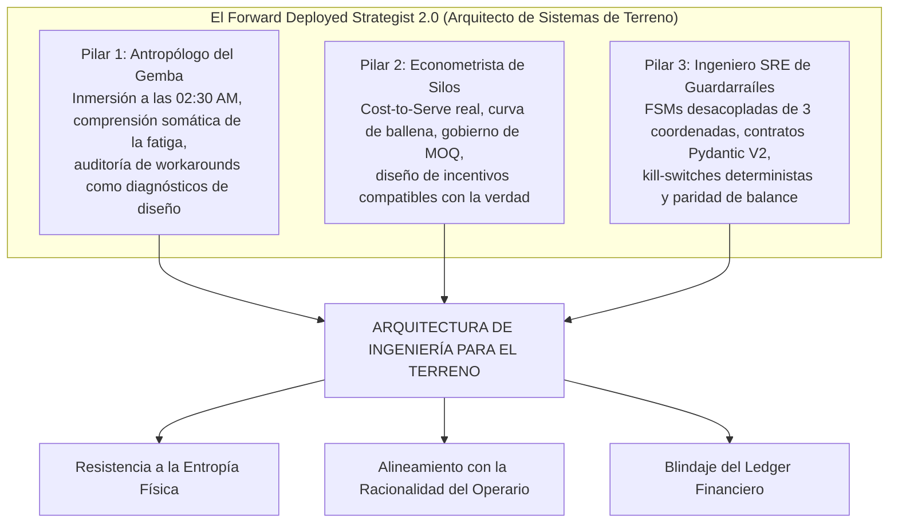

## 7.1 La Perspectiva del Escéptico: Respuestas a Tres Objeciones Hostiles

Un tratado de ingeniería que aspire a refundar la doctrina de despliegue no puede esquivar las objeciones más severas de sus críticos. Confrontamos y refutamos formalmente las tres objeciones técnicas, económicas y éticas más hostiles:

---

### Objeción 1: "El perfil del Forward Deployed Strategist es un cuello de botella no escalable. No existen 100.000 profesionales con habilidades simultáneas de código, contabilidad de costos y experiencia en el turno nocturno para desplegar en cada planta del mundo."

**Respuesta Técnica y Arquitectónica:**  
Esta objeción incurre en una confusión de categoría elemental: confunde al arquitecto que formaliza el principio de invariancia con el operador de mantenimiento rutinario.

El FDS 2.0 no pretende convertirse en un artesano presencial permanente que reescriba manualmente cada línea de software en cada uno de los 50.000 almacenes del planeta. Su función en el terreno es análoga a la del ingeniero de ensayos en vuelo en la industria aeroespacial: **someter el sistema a condiciones extremas de turbulencia física para descubrir las fallas de sustentación y codificar de inmediato los límites de seguridad en los sistemas de control de vuelo (*Fly-by-Wire*)**.

Una vez que el FDS 2.0 se sumerge a las 02:30 AM en el andén de recepción, descubre por qué el WMS colapsa ante la mercadería dañada y extrae los invariantes de estado, **la solución no se queda en su cabeza; se cristaliza en software determinista reutilizable**:

1. Se codifica en contratos de datos estrictos (Pydantic V2 con tipos `Decimal` y marcas UTC).
2. Se compila en una Máquina de Estados Finitos desacoplada en tres coordenadas (`inbound_fsm_guardrail.py` / `mellon`) `[C]`.
3. Se encapsula en servidores modulares de herramientas transaccionales compatibles con la especificación de Protocolo de Contexto de Modelo (`kern`) `[C]`.

Una vez que el autómata determinista y su suite de 35 pruebas unitarias están verificados contra la configuración contable del ERP (`T156/OBYC`), **el despliegue multi-sitio escala por arquetipos operativos, no linealmente por bodega**. Un minorista con 50 centros de distribución o una red hospitalaria con 40 recintos no posee 50 ontologías contables distintas, sino 3 o 4 arquetipos físicos (seco mecanizado, cadena de frío a $-18\,^{\circ}\text{C}$, *cross-docking* regional, sub-farmacia). El Intake completo de **120 horas** se ejecuta únicamente sobre la **planta cabeza de serie de cada arquetipo**; las instalaciones subsiguientes del mismo esquema contable se despliegan mediante una **calibración acotada de frontera física de 24 a 40 horas** ejecutada por ingenieros residentes del propio cliente entrenados durante la planta piloto (verificación de celdas de carga, cobertura RF, parámetros $V, R, B$ e IRB-12). Lo que escala con pendiente sublineal es el binario verificado de guardarraíles, dejando en cada sitio un sistema autogobernado por invariantes.

---

### Objeción 2: "¿No es esto simplemente otra versión repackageada de Lean Manufacturing o Six Sigma con lenguaje tecnológico moderno?"

**Respuesta Técnica y Epistemológica:**  
Esta crítica ignora la diferencia ontológica fundamental que separa la filosofía de gestión manual del siglo XX de la arquitectura de sistemas informáticos del siglo XXI: **la capacidad de imposición coercitiva y determinista a través del software**.

El movimiento de *Lean Manufacturing* (el Sistema de Producción Toyota) y las metodologías *Six Sigma* realizaron contribuciones innegables al identificar el valor del *Gemba*, el desperdicio (*Muda*) y la importancia de los mecanismos a prueba de errores (*Poka-Yoke*). Sin embargo, ambas escuelas adolecían de una fragilidad estructural que las condenó al declive en la era digital:

1. **La Dependencia de la Voluntad Humana:** El Poka-Yoke tradicional se implementaba mediante dispositivos mecánicos locales, topes de madera, plantillas de cartón o cintas adhesivas de colores en el suelo. Dependía enteramente de que los supervisores y operarios mantuvieran una disciplina ascética permanente. La evidencia histórica demuestra que en cuanto los consultores de Lean abandonaban la fábrica tras cobrar sus honorarios y la dirección volvía a exigir cuotas de volumen a fin de trimestre, los tableros visuales de Kanban se abandonaban y los operarios volvían a sus rutinas informales.
2. **La Ceguera Contable y Transaccional:** Ni Lean ni Six Sigma resolvieron jamás la interfase con el ledger financiero del ERP. Toyota pudo implementar Kanban físico porque operaba en un ecosistema geográficamente concentrado y culturalmente homogéneo en la prefectura de Aichi. Cuando las corporaciones occidentales intentaron exportar Lean combinándolo con sistemas monolíticos como SAP R/3 o Oracle Financials, se produjo un cortocircuito insalvable: el operario intentaba aplicar flujo tenso en el andén mientras el ERP exigía el registro secuencial burocrático de transacciones, induciendo la creación de hojas de cálculo clandestinas (Capítulo 2).

El FDS 2.0 no se opone a Toyota: **extiende el principio *Jidoka* hasta la frontera contable del ERP**, resolviendo la distinción de Adler y Borys (§2.8) mediante una bifurcación precisa: **coerción determinista sobre el Ledger financiero, burocracia habilitante sobre el Gemba físico**. Toyota sí poseía interbloqueos físicos duros en sus máquinas de montaje, pero el mundo corporativo occidental compró la liturgia visual de Lean (pizarras y cintas en el suelo) dejando el libro mayor gobernado por formularios editables sin anclaje sensorial. Nosotros no usamos software para microgestionar la trayectoria biomecánica del operario ni bloquearle el muelle cuando llega un pallet averiado; escribimos la máquina de estados finitos que prohíbe a nivel de base de datos que una mutación patrimonial sin prueba física (`BWART 105` sin conteo) contamine el balance, mientras habilitamos al trabajador con vías legítimas de descompresión física (`BWART 103` + `DEPART` independiente + carril AQL + *Break-Glass* tarifado).

---

### Objeción 3: "Si la alta dirección ejecutiva está decidida a falsificar sus balances o maquillar sus indicadores para satisfacer a los bancos o al mercado bursátil, ningún guardarraíl de software podrá impedirlo."

**Respuesta Técnica, Ética y Contractual:**  
Esta objeción plantea un desafío ético fundamental, pero comete un error analítico: confunde la capacidad de un sistema informático para garantizar la integridad forense de los hechos con la potestad moral de los administradores corporativos.

Un sistema de ingeniería no puede evitar que un ser humano cometa un delito si está resuelto a hacerlo; lo que un sistema de ingeniería bien diseñado hace es **destruir de forma irreversible la negación plausible (*Plausible Deniability*)** `[V]`.

En los escándalos corporativos convencionales —desde Enron y WorldCom hasta el maquillaje de las listas de espera en el Hospital Sótero del Río documentado por la Contraloría (Capítulo 2)—, la alta dirección siempre se defiende ante los tribunales y comités de auditoría argumentando ambigüedad técnica: *"Nosotros no sabíamos que los datos estaban alterados; confiamos en los reportes que emitía el sistema; se trató de un lamentable error administrativo de funcionarios subordinados"*.

La arquitectura del FDS 2.0 elimina esa escapatoria mediante dos mecanismos de blindaje no negociables:

1. **La Traza Criptográfica Inmutable:** Toda mutación o liberación excepcional que intente sortear un guardarraíl físico (por ejemplo, autorizar la entrada de un lote sin conteo ciego o desbloquear un pallet rechazado en báscula) exige la invocación de un contrato de ruptura de vidrio (*Break-Glass*). Este evento no es un permiso informal de pantalla; es una transacción firmada digitalmente con certificado corporativo individual que registra la identidad del ejecutivo, la marca temporal UTC y la imputación financiera del sobrecosto (`OVERFLOW_IMPUTED`). Si el Directorio decide maquillar el balance, se verá forzado a firmar criptográficamente su propia incriminación forense.
2. **Escalamiento Fiduciario al Comité de Auditoría y Rescisión con Retención de Honorarios Devengados:** Para que la negativa técnica sea ejecutable en el mundo real y no un gesto retórico suicida para un profesional independiente, la Carta del Día 0 incorpora una cláusula estándar de **Aceptación Formal de Riesgo y Escalamiento Fiduciario** (análoga a las cartas de representación de auditoría externa bajo ISA 580 / PCAOB AS 2805): si un ejecutivo operativo exige desactivar la segregación `BWART 103/105` o inyectar ajustes sin respaldo físico, la instrucción solo puede ejecutarse si dicho ejecutivo firma un *Risk-Acceptance Memo* remitido automáticamente en copia al **Comité de Auditoría del Directorio** y a Auditoría Interna (SOX 404). Si se ordena ocultar dicho escalamiento o adulterar registros, se activa la rescisión por incumplimiento del comitente con pago íntegro del hito en curso y entrega del log inmutable sellado.

---

## 7.2 De la Integración Ontológica (FDE 1.0) a la Frontera Físico-Contable (FDS 2.0)

A mediados de la década de 2000, Palantir Technologies acuñó la disciplina de *Forward Deployed Software Engineer* (`FDSE` y estrategas de despliegue *Echo*), logrando hitos industriales reales como la integración ontológica de líneas de ensamblaje aeronáutico en **Airbus Skywise** o despliegues tácticos de defensa. El límite que señalamos no niega ese legado de ingeniería de datos sobre tablas existentes; señala la frontera que permanece abierta cuando el sistema de origen ya fue distorsionado en su captura física:

| Dimensión Operativa | Integración Ontológica Clásica — FDE 1.0 | Estándar FDS 2.0 (Ground-Truth Systems Architect, 2026+) |
|---|---|---|
| **Frontera Primaria de Intervención** | La capa semántica sobre tablas ya emitidas por ERPs, MES y data lakes (Foundry / AIP / Skywise). | La costura previa al primer registro: la celda de carga en báscula, el andén a las 02:30 AM, la cámara a $-18\,^{\circ}\text{C}$ y el contrato salarial del turno. |
| **Naturaleza del Entregable** | Ontologías unificadas, gemelos digitales analíticos y flujos de acción (*Writeback*) sobre objetos de negocio existentes. | Guardarraíles deterministas en el borde (`kern` / `mellon`), FSMs de 3 coordenadas (`BWART 103/105/124`) y rediseño econométrico de incentivos anti-Campbell. |
| **Hipótesis sobre la Señal de Entrada** | Modela y limpia discrepancias aguas abajo de la captura transaccional; rara vez tiene mandato para rediseñar bonos sindicales o ergonomía de muelle. | Trata la tabla del ERP como artefacto potencialmente estratégico ($e_g^*$ bajo turno finito); exige prueba física independiente y cambia la función de pago que corrompía el dato. |
| **Acoplamiento Hardware y Ergonomía** | Típicamente agnóstico del estado mecánico de escáneres RF, rodamientos de carros o fatiga circadiana del operario. | Socio-físico integral: audita FTRR óptico, concesión metabólica $RA$ de Murrell, selectores cableados de failover y huella de latencia en el borde. |
| **Gobierno de la Inteligencia Artificial** | Orquestación de agentes y copilotos anclados a la ontología corporativa con permisos de acción gobernados por software. | Separación estricta de planos temporales (§3.3) y confinamiento de la IA a niveles 1–3; toda mutación contable de nivel 4 pasa por un autómata determinista libre de LLM. |

---

## 7.3 El Manifiesto del Forward Deployed Strategist 2.0

Para guiar a la próxima generación de arquitectos de sistemas en la tarea de construir tecnología para el terreno, formalizamos los tres pilares estructurales y los diez principios cardinales del **Ground-Truth Systems Engineering (GTSE)**:

### Los Tres Pilares del Operador de Triple Banda
1. **El Antropólogo del Gemba:** Posee la empatía sociológica y la resistencia física necesarias para sumergirse en las trincheras operativas de la empresa. No juzga los atajos de los operarios como negligencia; los descifra como el síntoma inequívoco de un sistema informático defectuoso. Escucha la sabiduría somática de los trabajadores de primera línea y la traduce en requisitos formales de arquitectura.
2. **El Econometrista de Silos:** Domina con frialdad matemática la contabilidad de costos basada en actividades, el Cost-to-Serve y el impacto devastador del capital de trabajo inmovilizado en el flujo de caja libre. Comprende cómo los incentivos locales de compras y ventas distorsionan la física del almacén y diseña mecanismos donde decir la verdad material es la estrategia dominante para todos los agentes.
3. **El Ingeniero SRE de Guardarraíles:** Escribe código de sistemas con la rigurosidad matemática de quien diseña software para reactores nucleares o sondas espaciales. Diseña autómatas finitos cuyas propiedades de invariancia son demostrables formalmente, domina las transacciones atómicas en bases de datos relacionales y levanta contratos tipados estrictos que impiden que los modelos probabilísticos destruyan la consistencia contable de la corporación.

---

### Los Diez Principios Fundacionales del FDS 2.0 (con su Mecanismo Causal)

1. **El mapa no es el territorio; el ledger no es el inventario.**  
   *Mecanismo Causal:* La representación digital se degrada de forma monótona según el lema submartingala $D_{t+1} = D_t + \\xi_t$. Se corrige únicamente mediante conteo ciego estratificado periódico y conciliación física independiente.

2. **El modelo probabilístico propone; el código determinista dispone; la persona nombrada firma.**  
   *Mecanismo Causal:* Jerarquía estricta de cuatro niveles de autoridad. Todo compromiso patrimonial (Nivel 4) exige validación formal por autómata y firma atada al hash criptográfico de la transacción.

3. **Sin prueba física no hay contabilización.**  
   *Mecanismo Causal:* Desacoplamiento transaccional obligatorio por unidad de manipulación (`SSCC`): `BWART 103` por defecto al ingreso en báscula; `BWART 105` únicamente tras conteo conforme o carril AQL aprobado; `BWART 124` para rechazo de origen desde bloqueo EM no valorado (reservando `122` para devoluciones post-`105` y `551` para merma interna).

4. **El 103 es la regla; el 105 es una excepción gobernada.**  
   *Mecanismo Causal:* La verificación de factura en `MIRO` queda bloqueada al arribo en báscula sin asiento FI prematuro, mientras `DEPART` libera el camión tras la descarga. La contabilidad jamás se anticipa a la verificación física del piso.

5. **Toda métrica cuantitativa que remunera bajo turno finito desplaza trabajo físico si el atajo rinde más.**  
   *Mecanismo Causal:* Ley de Campbell y asignación multitarea $e_r^* = \\frac{k_g T + \\gamma(\\alpha - \\beta) + q P}{k_r + k_g}$: si $\\beta > \\alpha$, subir $\\gamma$ contrae $e_r^*$. La veracidad se induce pagando al pronosticador exclusivamente con reglas estrictamente propias (CRPS) separadas del fractil de reposición, y al piso mediante *Gainsharing* colectivo auditado por conteo ciego independiente ($Q^{\\text{aud}}_t$).

6. **El atajo del operario es un requisito de arquitectura, no una falta disciplinaria.**  
   *Mecanismo Causal:* El workaround es la respuesta racional del agente para mantener el flujo material ante la rigidez del software. El sistema formal debe absorber la flexibilidad mediante interfaces ergonómicas y permisos de desborde tarifados (*Break-Glass*).

7. **La confiabilidad industrial es una propiedad del peor caso, no del promedio.**  
   *Mecanismo Causal:* En la física del Gemba, el percentil p99 y la cola estocástica determinan las paradas de línea. La arquitectura se dimensiona contra perturbaciones fuera de muestra (*OOD*), no contra datos de laboratorio IID.

8. **Un guardarraíl que falla abierto es infinitamente peor que ningún guardarraíl.**  
   *Mecanismo Causal:* Si la clave criptográfica se pierde o el gateway industrial no responde, el sistema debe operar en modo **fail-closed** (bloqueo determinista de escrituras). Fallar abierto engendra una falsa ilusión de control contable.

9. **El criterio de parada fijado en el Día 0 es la salvaguarda financiera más barata.**  
   *Mecanismo Causal:* La definición previa de umbrales cuantitativos de cancelación (latencia, tasa de excepciones, precisión de andén) impide la redefinición oportunista del fracaso en la cúpula corporativa.

10. **Si la alta dirección exige falsificar el balance, la respuesta técnica es NO por escrito y rescisión contractual inmediata.**  
    *Mecanismo Causal:* Destrucción absoluta de la negación plausible. Toda intervención forzada exige la firma criptográfica individual del ejecutivo infractor en el contrato de desborde (`OVERFLOW_IMPUTED`).

---

## 7.4 Límites del Monógrafo y Condiciones Formales de Falsación

Para cumplir con el principio popperiano de demarcación científica, declaramos los límites y las condiciones que falsificarían formalmente las tesis de este tratado:

1. **Límites de Información:** Las estadísticas globales de adopción (Standish, Panorama, McKinsey, Gartner, MIT NANDA) se etiquetan explícitamente como reportes de industria `[R]` no arbitrados por pares; la cifra de Lidl (€500M) proviene de *Handelsblatt* al ser Schwarz-Gruppe de capital cerrado; las proyecciones `BWART 103/105/124` (y las reversas/mermas `104/106/122/551`) están verificadas en el oráculo local de pruebas `[C]` y exigen validación en mandante contra `T156/OBYC` y costos de SAP Digital Access `[?]`; y el índice IRB-12 (Apéndice E) se declara instrumento heurístico en calibración prospectiva.
2. **Protocolo Cuasi-Experimental de Falsación Prospectiva (*Stepped-Wedge Rollout*):** Más allá de las condiciones teóricas de refutación (ausencia de deriva submartingala bajo $\\xi_t > 0$ o inocuidad de incentivos con $\\beta > \\alpha$), sometemos la propia arquitectura FDS 2.0 a **cinco hipótesis operativas pre-registrables** sobre despliegues escalonados multi-sitio a 90 días:
   * **H1 (Integridad de Inventario):** El despliegue de la FSM 3D + Gainsharing auditado reduce la discrepancia absoluta en conteo ciego estratificado ($|L_t - I_t|/I_t$) en al menos **50% relativo** frente al baseline pre-intervención sin degradar el tiempo medio de estadía de camión en muelle (*turnaround time*) en más de un 10%. *Falsación:* si la exactitud mejora solo a costa de bloquear el patio o elevar la sobrestadía, el Teorema T2 falló en su acoplamiento físico.
   * **H2 (Índice de Éxito Ceremonial):** El cociente $CS = C_s / C_r$ (§6.7.2) converge a la banda $[0{,}95,\\; 1{,}10]$ al día 90 en todos los turnos, incluyendo la ventana 01:00–05:00 AM. *Falsación:* $CS > 1{,}20$ persistente demuestra que los operarios encontraron un nuevo atajo alrededor del guardarraíl.
   * **H3 (Frontera de Cuarentena de Little):** En semanas donde la tasa de retención observada cruza $r > r^* = \\frac{V}{R c \\mu \\rho_{\\max}}$, la saturación ocurre en el área de cuarentena antes que en las puertas de muelle. *Falsación:* divergencia sistemática superior al 25% respecto a $\\lambda^*_{\\text{piso}} = V/(rR)$.
   * **H4 (Sostenibilidad de Voz en Andon Digital):** En estaciones donde la tasa empírica de cierre dentro de SLA supera el 80% ($\\mathbb{E}[\\theta_t] > 0{,}8$), la tasa semanal de reportes preventivos PTT no decae entre el mes 1 y el mes 3; donde cae por debajo del 30%, la tasa de voz se contrae en $>50\\%$. *Falsación:* extinción de reportes pese a $\\mathbb{E}[\\theta_t] > 0{,}8$ refuta la suficiencia del retorno de ciclo cerrado.
   * **H5 (Separación Pronóstico / Newsvendor):** Evaluar a planificación exclusivamente por ganancia de CRPS reduce el sesgo alcista medio de los ajustes manuales en al menos **60%** frente al régimen previo con penalización asimétrica de quiebres.

---

## 7.5 Declaración Final de Cierre

Durante cuatro décadas, la industria de la tecnología corporativa ha intentado construir castillos matemáticos limpios en el cielo mientras el Gemba operaba en el barro de la fricción analógica. Hemos visto a organizaciones globales dilapidar cientos de millones de dólares en software que prometía visibilidad total y solo entregó cinismo burocrático, parálisis transaccional y datos corrompidos.

La Inteligencia Artificial no cerrará esta brecha por sí misma; la ampliará hasta hacerla insostenible si continuamos desplegándola bajo la fantasía de que el mundo físico se adaptará a la nube.

Construir para el terreno no es una opción estética de ingeniería; es el imperativo de supervivencia económica de la era post-digital. Exige humildad etnográfica para descender al andén, rigor econométrico para alinear los incentivos con la verdad, y la frialdad matemática de un ingeniero que escribe código para resistir la intemperie.

Allí, a las 02:30 de la madrugada, cuando el último camión apaga su motor diésel y la balanza firma su trama criptográfica en silencio, es donde la tecnología finalmente se encuentra con la realidad. Y es allí donde los Forward Deployed Strategists estamos construyendo los cimientos del futuro industrial.


---

# APÉNDICE A: REGISTRO CONSOLIDADO DE EVIDENCIAS FORENSES Y REGULATORIAS

La siguiente matriz compila las fuentes primarias de evidencia legal, regulatoria y científica revisada por pares que sustentan cuantitativa y empíricamente cada una de las tesis de este monógrafo:

| Identificador Forense | Entidad Emisora / Autores | Expediente Legal / DOI / Referencia Formal | Magnitud del Impacto Medido / Hallazgo Verificado | Clasificación Epistemológica |
|---|---|---|---|---|
| **EV-SEC-01** | Securities and Exchange Commission (SEC) | *Administrative Proceeding File No. 3-15570, Release No. 34-70694* (16-Oct-2013). | **USD 457,6 millones** de pérdida neta en 45 minutos (Knight Capital). Ejecución de 4M órdenes por 397M acciones en bucle abierto. Violación de Regla 15c3-5 (*Market Access Rule*). | `[D]` Dato Regulatorio Vinculante |
| **EV-SEC-02** | Zillow Group, Inc. | *SEC Form 10-Q*, período cerrado al 30-Sep-2021 (Item 1, Consolidated Financial Statements, pág. 2). | **USD 304,5 millones** de *inventory write-down* en segmento *Homes*; USD 240M–265M de provisión adicional en Q4 2021; pérdida neta consolidada trimestral de USD 328M por selección adversa algorítmica. | `[D]` Balance Auditado SEC |
| **EV-CGR-01** | Contraloría General de la República (CGR) / Servicio de Salud Metropolitano Sur Oriente (SSMSO) | *Informe de Investigación Especial N° 471/2024* (06-Sep-2024) y auditoría interna SSMSO (mayo de 2024) sobre Complejo Asistencial Dr. Sótero del Río. | **323.327 egresos masivos irregulares** de listas de espera, incluyendo **250.543 bajas en un solo día** (07-Jun-2023) por múltiples causales sin respaldo clínico individual, **31.341 reingresos** y **44 pacientes fallecidos antes del 31-May-2023 reingresados por error de registro**. | `[D]` Dictamen de Auditoría CGR / SSMSO |
| **EV-CNEP-01** | Comisión Nacional de Evaluación y Productividad (CNEP) | *Uso Eficiente de Quirófanos Electivos y Gestión de Listas de Espera en Chile* (2020). | Pabellones quirúrgicos utilizados **solo 4,8 de 9 horas hábiles (53,3% de utilización)**. Tasa de inasistencia (NSP) nacional de **15,6%** explicada por fallas de coordinación y notificación en la cadena preoperatoria. | `[D]` Estudio de Política Pública |
| **EV-MIT-01** | Challapally, A. et al. (MIT NANDA) | *The GenAI Divide: State of AI in Business 2025* (julio de 2025). | **95% de las organizaciones evaluadas sin impacto medible en P&L** sobre 300 despliegues públicos, 153 encuestas y 52 entrevistas. Causa raíz: fragilidad de flujos de trabajo y falta de memoria contextual en terreno. | `[R]` Reporte Preliminar Sectorial |
| **EV-RET-01** | DeHoratius, N. & Raman, A. | *Management Science*, 54(4), 627–641 (2008). DOI: 10.1287/mnsc.1070.0789. | **65% de inexactitud en registros de inventario** sobre ~370.000 SKUs auditados físicamente en 37 tiendas minoristas. Error transaccional estructural superior a la merma por hurto. | `[D]` Literatura Revisada por Pares |
| **EV-SHD-01** | Huber, M., Zimmermann, S., Rentrop, C. & Felden, C. | *Systems*, 4(1), 11 (2016). DOI: 10.3390/systems4010011. | **El 64% de los sistemas en la sombra (*Shadow Systems*) analizados está vinculado directamente al ERP** para compensar su rigidez transaccional y sostener la operación real. | `[D]` Literatura Revisada por Pares |
| **EV-ISO-01** | Boiral, O. | *Organization Science*, 14(6), 720–737 (2003); *Organization Science*, 18(1), 127–146 (2007). DOI: 10.1287/orsc.1060.0224. | Tipología cualitativa (47 entrevistas) de **integración ceremonial y *dry-labbing*** (preparación retrospectiva de bitácoras pre-auditoría) en plantas certificadas bajo ISO 9000 e ISO 14001. | `[D]` Literatura Revisada por Pares |
| **EV-BIO-01** | Battini, D., Glock, C.H., Grosse, E.H. et al.; Murrell, K.F.H. | *Computers & Industrial Engineering*, 94, 146–157 (2016), DOI: 10.1016/j.cie.2016.01.020; *Ergonomics* (1965). | Sobrecarga metabólica postural en niveles extremos ($27{,}2\text{–}33{,}5\text{ kJ/min}$) que exige **concesiones de descanso $RA$ del 50% al 62%** (Murrell) ignoradas por los algoritmos lineales del WMS/LMS. | `[D]` Literatura Revisada por Pares |
| **EV-RUT-01** | Elbert, R. M., Franzke, T., Glock, C. H. & Grosse, E. H. | *Computers & Industrial Engineering*, 111, 537–551 (2017). DOI: 10.1016/j.cie.2016.11.033. | **Las desviaciones humanas respecto a las rutas prescritas por el WMS** (por congestión de pasillos y heurísticas locales) alteran e invierten el ranking teórico de eficiencia de políticas de picking. | `[D]` Literatura Revisada por Pares |
| **EV-PRN-01** | Fildes, R., Goodwin, P., Lawrence, M. & Nikolopoulos, K. | *International Journal of Forecasting*, 25(1), 3–23 (2009). DOI: 10.1016/j.ijforecast.2008.11.010. | **El 75% de los ajustes manuales de pronóstico fue al alza** por optimismo comercial gerencial; incrementó el error de pronóstico (MAPE) entre 4,5% y 11,2% en 60.000 casos auditados. | `[D]` Literatura Revisada por Pares |
| **EV-REV-01** | Securities and Exchange Commission (SEC) / U.S. District Court SDNY | *Pio v. Revlon, Inc. et al.*, Civil Action No. 1:18-cv-11133 (2018); SEC Form 10-K (2018). | **USD 64 millones en pedidos no servidos** y colapso de facturación en planta de Oxford (NC) tras cutover 'Big-Bang' de SAP S/4HANA sin amortiguador de buffer stock; caída de 6,9% en acciones y demanda de accionistas por control interno deficiente (SOX 404). | `[D]` Expediente Judicial / SEC |
| **EV-TGT-01** | Ontario Superior Court of Justice (Commercial List) | *Target Canada Co. CCAA Proceedings*, Court File No. CV-15-10832-00CL (2015); *Canadian Business* forensic audit. | **USD 2.100 millones de pérdida neta**, cierre de 133 tiendas y 17.600 despidos tras colapso de WMS Manhattan y SAP por datos maestros corruptos (pulgadas vs. cm y códigos de barra). | `[D]` Expediente de Quiebra Judicial |
| **EV-WFG-01** | Securities and Exchange Commission (SEC) / DOJ / CFPB | *SEC Administrative Proceeding File No. 3-19704* (Febrero de 2020); Consent Order. | **USD 3.000 millones en sanciones penales y civiles** por apertura no autorizada de 3,5 millones de cuentas falsas bajo presión de métricas de venta cruzada (*Great 8*), validando la Ley de Campbell en banca. | `[D]` Dictamen Regulatorio Vinculante |
| **EV-THR-01** | Leveson, N. G. & Turner, C. S. | *IEEE Computer*, 26(7), 18–41 (1993); FDA Safety Reports. | **6 accidentes de sobredosis masiva de radiación, con 3 muertes documentadas**, a pacientes oncológicos (25 MeV) por omisión de guardarraíl de hardware (interlock) y presencia de *race condition* en software VT100. | `[D]` Literatura Revisada por Pares |
| **EV-NUM-01** | Adler, P. S. | *Harvard Business Review*, 71(1), 97–108 (1993). | **De >20% ausentismo, ~800–1.000 quejas pendientes y cierre con ~5.000 despidos a ~3% ausentismo** y liderazgo productivo en Norteamérica mediante cláusula *no-layoff* UAW, estandarización participativa y Andon (NUMMI). | `[D]` Literatura Revisada por Pares |
| **EV-MIC-01** | Edmondson, A. C., Bohmer, R. M. & Pisano, G. P. | *ASQ*, 46(4), 685–716 (2001); *Management Science*, 47(6), 752–768 (2001). | **Compresión sustancial de la curva de aprendizaje en 660 cirugías MICS (16 hospitales)** explicada por seguridad psicológica y estabilidad del equipo más que por el prestigio individual del cirujano. | `[D]` Literatura Revisada por Pares |
| **EV-GRA-01** | Grant, A. M. et al. | *OBHDP*, 103(1), 53–67 (2007); *JAP*, 93(1), 108–124 (2008). DOI: 10.1037/0021-9010.93.1.108. | **+142% de persistencia en tarea y +171% de ingresos recaudados** tras intervención controlada de contacto directo con el beneficiario final (Impacto y Valía Social Percibida). | `[D]` Literatura Revisada por Pares |
| **EV-RAD-01** | Turner, Y. & Hadas-Halpern, I. | *Radiological Society of North America (RSNA)* (2008). | **+46% de detección de hallazgos incidentales** por radiólogos ($p = 0,005$) tras incorporar una fotografía facial del paciente en la interfaz de visualización diagnóstica. | `[D]` Estudio Clínico Controlado |
| **EV-LOS-01** | Boswell, W. R. | *The International Journal of Human Resource Management*, 17(9), 1489–1511 (2006). | **LOS-Acciones predice desempeño ($\\beta = 0,21$) y reducción de rotación ($\\beta = -0,22$)**, mientras que el conocimiento macro abstracto de la estrategia (LOS-Objetivos) carece de poder predictivo en el Gemba. | `[D]` Literatura Revisada por Pares |
| **EV-OBM-01** | Stack, J. | *The Great Game of Business* (1992) / Springfield ReManufacturing Corp. | **Reducción de apalancamiento de 89:1 a 1:1** y expansión sostenida del valor patrimonial mediante Open-Book Management y Gainsharing colectivo con gatillo financiero. | `[R]` Caso Corporativo Documentado |
| **EV-VOI-01** | Detert, J. R. & Burris, E. R. | *Academy of Management Journal*, 50(4), 869–884 (2007). DOI: 10.5465/amj.2007.26279183. | **La inacción gerencial erosiona la seguridad y eficacia percibidas de hablar**, consolidando la futilidad de la voz (*Voice Futility*) y la normalización de la falla latente. | `[D]` Literatura Revisada por Pares |
| **EV-BIO-02** | Snook, S. H. & Ciriello, V. M. | *Ergonomics*, 34(9), 1197–1213 (1991); Norma ISO 11228-2. | **Fuerza inicial de empuje escalada a 380–550 N (+180%)** por rodamientos mellados en carros de picking, rebasando el límite de compresión discal NIOSH en L4/L5 (3.400 N). | `[D]` Literatura Revisada por Pares |
| **EV-CIR-01** | Dawson, D. & Reid, K. (1997); Folkard, S. & Tucker, P. (2003) | *Nature*, 388, 235 (DOI: 10.1038/40775); *Occupational Medicine*, 53(2), 95–101 (DOI: 10.1093/occmed/kqg047). | **17–24 h de vigilia equivalen a 0,05%–0,10% de alcoholemia (BAC)**; el riesgo industrial de incidente y error sube **+30,4% en turno nocturno**, +36% hacia la cuarta noche consecutiva y **+100% en la hora 12** de jornada continua. | `[D]` Literatura Revisada por Pares |
| **EV-JEV-01** | TypeSafe AI | *Jev v1.14 Technical Specification* (2026; endpoint `POST /v1/systemone`). | **Latencia de triaje de Sistema 1 en ~70–200 ms vía API** (sub-200 ms dentro del retorno auditivo `<2 s` del Andon Digital) frente a 1.500–3.000 ms en LLMs autoregresivos; 0% fallas de parseo sintáctico mediante primitivas tipadas (`Choice`, `Noul`, `Score`). | `[R]` Especificación Técnica de Fabricante |
| **EV-CDM-01** | Hohpe, G. & Woolf, B. | *Enterprise Integration Patterns* (2003); Fowler, M. (2002). | **Desacople de $N \times M$ integraciones punto a punto a $N + M$** mediante Modelo de Datos Canónico (CDM), eliminando la causa raíz del 64% de Shadow IT corporativo. | `[D]` Literatura Revisada por Pares |
---

# APÉNDICE B: ORÁCULO DE REPRODUCIBILIDAD Y COMANDOS DE EJECUCIÓN

Todo lo que este monógrafo asevera bajo la marca `[C]` se reproduce de forma determinista con los siguientes comandos. Los resultados que se transcriben fueron ejecutados en el entorno del autor y son los que arrojó la última corrida; el tiempo de ejecución varía con la máquina.

```powershell
# 1. Autómata de 3 coordenadas, invariantes y buffer de cuarentena: 35 pruebas
cd "C:\Users\Gamer\Documents\cv dossier\evidencia\probes"
python -m pytest -q
# Resultado verificado: 35 passed in 1.35s

# 1b. Conteo del espacio alcanzable calculado por búsqueda en anchura (no declarado)
python -c "import cap3_delta_projection as m; print(len(m.REACHABLE_STATES))"
# Resultado verificado: 12   (12/64 = 18,75%)

# 2. Sondas adversariales de frontera de confianza del módulo predecesor: 6 de 6 fallas
python 2026-10-23_probe_fsm_trust_boundary.py
# Resultado verificado: seis veredictos FALLA_EL_CLAIM (P1 a P6)

# 3. Guardarraíles de invariantes de gemba (mellon): 5 pruebas basadas en propiedades (Hypothesis)
cd "C:\fde"
python -m pytest test_gemba_invariants.py -q
# Resultado verificado: 5 passed in 24.61s

# 4. Núcleo de guardarraíles de escritura, fronteras, idempotencia y descuentos MOQ en kern (v2.9.0):
cd "C:\Users\Gamer\Music\scm\kern"
$env:PYTHONPATH="."
python -m pytest tests/test_core_boundary.py tests/test_pack_boundary.py tests/test_writeback.py tests/test_writeback_store.py tests/test_claves_de_idempotencia.py tests/test_autonomy.py tests/test_autonomy_promotion.py tests/test_state.py tests/test_state_record.py tests/test_state_bridge_stock.py tests/test_volume_discount.py -q
# Resultado verificado: 260 passed in 38.72s
# (Suite unitaria completa del repositorio v2.9.0: 9.239 pruebas recolectadas con `python -m pytest --collect-only -q`, más 36 pruebas de integración externa bajo `-m integracion`)
```

**Lectura del oráculo.** Las 35 pruebas validan el autómata nuevo; las sondas P1-P6 miden el módulo anterior y su función es refutar los *claims* de procedencia, no celebrar el diseño. Un lector que quiera auditar este monógrafo debe empezar por el paso 2: si las sondas dejan de fallar, el módulo mejoró; si siguen fallando, la brecha de procedencia que el Capítulo 4 diagnostica continúa abierta.

---

# APÉNDICE C: GLOSARIO OPERATIVO, CONTABLE Y TECNOLÓGICO

* **ACID (Atomicidad, Consistencia, Aislamiento, Durabilidad):** Conjunto de propiedades que garantizan que las transacciones en una base de datos relacional se ejecutan de forma fiable y determinista sin estados intermedios corruptos.
* **ALPR (Automatic License Plate Recognition):** Sistema de reconocimiento óptico automatizado de matrículas vehiculares utilizado en portones de acceso para validar la identidad del transporte.
* **ATP (Available to Promise):** Saldo de inventario físico disponible en el ERP para ser comprometido comercialmente en nuevas órdenes de venta de clientes.
* **BSX (Cuenta de Existencias en SAP):** Clave de determinación de cuentas contables en la transacción `OBYC` de SAP donde se imputa el valor monetario del inventario propio de la compañía.
* **BWART (Bewegungsart - Clase de Movimiento SAP):** Identificador alfanumérico de tres dígitos que gobierna el comportamiento contable, físico y documental de cualquier traslado de mercancías en el módulo de gestión de materiales (SAP MM).
  * *BWART 103 (y reversa 104):* Entrada de mercancías en almacén para stock bloqueado EM en muelle. En SAP MM-IM estándar no genera asiento financiero (FI); registra la recepción condicional y bloquea el pago de factura en `MIRO` (`ATP = 0`).
  * *BWART 105 (y reversa 106):* Liberación de mercancías desde stock bloqueado EM hacia inventario de libre utilización (`ATP > 0`). Genera el asiento contable definitivo en el balance (D BSX / H WRX).
  * *BWART 124:* Devolución directa de mercancías a proveedor desde stock bloqueado EM (`103`). Revierte la cantidad bloqueada sin generar asiento financiero (FI), preservando la partida doble.
  * *BWART 122:* Devolución formal a proveedor de lotes que ya habían sido liberados y valorados previamente vía `105` (contabiliza D WRX / H BSX).
  * *BWART 551:* Salida de mercancías para desguace/merma interna contra el centro de costos del almacén (aplicable cuando el daño ocurre por manipulación interna después de recibir precinto conforme).
* **COMGES (Compromisos de Gestión):** Instrumento de evaluación y asignación de bonificaciones económicas colectivas del Ministerio de Salud de Chile aplicado sobre los equipos directivos y clínicos de la red hospitalaria pública.
* **Cost-to-Serve (CTS):** Metodología de análisis de costos que cuantifica el gasto real acumulado en cada una de las actividades de manipulación física, transporte, administración y posventa consumidas por un cliente o SKU específico.
* **Dry-Labbing:** Práctica de falsificación ceremonial consistente en rellenar formularios de control de calidad, calibración o bitácoras retrospectivamente en el escritorio sin haber ejecutado las mediciones físicas correspondientes.
* **FDS (Forward Deployed Strategist):** Ingeniero y consultor de alta capacidad técnica desplegado directamente dentro de las operaciones del cliente para integrar software y resolver cuellos de botella complejos.
  * *FDS 1.0:* Modelo histórico centrado en el análisis de datos e inteligencia corporativa en salas de situación y dashboards (Palantir Foundry).
  * *FDS 2.0 (Ground-Truth Systems Architect):* Modelo avanzado orientado a la física del andén a las 02:30 AM, la economía del Gemba y los guardarraíles deterministas para la Inteligencia Artificial física y transaccional.
* **FEFO / FIFO (First-Expired, First-Out / First-In, First-Out):** Políticas de rotación de inventarios que priorizan el despacho de los lotes más próximos a su fecha de vencimiento o los que ingresaron primero al almacén.
* **FSM (Finite State Machine - Máquina de Estados Finitos):** Modelo computacional compuesto por un conjunto finito de estados, un alfabeto de eventos de entrada y una función de transición determinista que prohíbe transiciones ilegales.
* **FVA (Forecast Value Added):** Métrica que evalúa el valor aportado por cada etapa del proceso de pronóstico, calculada como el error de la etapa anterior menos el error de la etapa actual.
* **Gemba (現場):** Término japonés adoptado en ingeniería industrial que designa "el lugar real donde ocurre la acción y se crea el valor": el andén de carga, la línea de montaje, el pasillo de almacén o el quirófano.
* **LMS (Labor Management System):** Módulo de software que mide y estandariza los tiempos de ciclo y el rendimiento de la mano de obra en centros de distribución.
* **MOQ (Minimum Order Quantity - Lote Mínimo de Compra):** Cantidad mínima de unidades que un proveedor exige adquirir en un solo pedido para conceder una cotización o descuento por volumen.
* **OBYC (Transacción de Determinación de Cuentas SAP):** Tabla de parametrización central en SAP donde se vinculan las clases de movimiento de materiales (`BWART`) con las cuentas del libro mayor contable (FI).
* **OOD (Out-of-Distribution - Fuera de Distribución):** Condición en la cual los datos físicos del mundo real divergen de la distribución estadística utilizada durante el entrenamiento y calibración de un modelo de inteligencia artificial.
* **OTIF (On-Time, In-Full):** Métrica fundamental de rendimiento de la cadena de suministro que mide el porcentaje de pedidos entregados dentro de la ventana horaria convenida y con la totalidad de los artículos solicitados.
* **Poka-Yoke (ポカヨケ):** Mecanismo de diseño a prueba de errores humanos originado en el Sistema de Producción Toyota para prevenir la ocurrencia física o lógica de un defecto operacional.
* **PPV (Purchase Price Variance):** Métrica contable utilizada para evaluar a los departamentos de compras, calculada como la diferencia entre el costo estándar presupuestado y el precio de compra real facturado por el proveedor.
* **RNLE (Registro Nacional de Listas de Espera):** Base de datos centralizada del sistema público de salud chileno que registra los tiempos de atención de pacientes que aguardan consultas de especialidad o cirugías electivas.
* **SIGTE:** Sistema de Información de Gestión de Tiempos de Espera del Ministerio de Salud de Chile.
* **T156:** Tabla de configuración del sistema SAP que rige las propiedades operativas, contables y de valoración de cada clase de movimiento de materiales.
* **VLA (Vision-Language-Action Models):** Redes neuronales multimodales diseñadas para procesar entradas visuales y órdenes en lenguaje natural para emitir trayectorias directas de control cinemático y robótico.
* **WACC (Weighted Average Cost of Capital):** Costo promedio ponderado de capital que representa la tasa mínima de retorno exigida por los proveedores de financiamiento (deuda y patrimonio) de una empresa.
* **WAPE (Weighted Absolute Percentage Error):** Métrica de error de pronóstico ponderada por volumen, inmune a las distorsiones por división por cero que afectan al MAPE en artículos de baja rotación.
* **Workaround:** Adaptación informal o atajo no autorizado ejecutado por operarios de primera línea para superar la rigidez de un sistema informático y mantener el flujo físico de la operación.
* **WRX (Cuenta de Compensación EM/RF en SAP):** Cuenta contable de compensación de "Entrada de Mercancías / Recepción de Facturas" (*GR/IR - Goods Receipt / Invoice Receipt*) utilizada en SAP para registrar pasivos provisionales por compras recibidas pero no facturadas.

---

# APÉNDICE D: BIBLIOGRAFÍA PRIMARIA CONSOLIDADA

### Expedientes Judiciales, Regulatorios y Dictámenes Constitucionales
1. **Contraloría General de la República de Chile (CGR). (2024, 6 de septiembre).** *Informe de Investigación Especial N° 471/2024 sobre eventuales irregularidades en los registros de listas de espera en el Complejo Asistencial Dr. Sótero del Río* (complementado por Auditoría Interna del Servicio de Salud Metropolitano Sur Oriente, mayo de 2024). Santiago de Chile: CGR.
2. **Comisión Nacional de Evaluación y Productividad (CNEP). (2020).** *Uso eficiente de quirófanos: resumen ejecutivo*. Santiago de Chile: CNEP. URL original: https://cnep.cl/wp-content/uploads/2020/02/Uso-eficiente-de-quirofanos-resumen-ejecutivo.pdf (PDF no disponible al momento de la verificación).
3. **Securities and Exchange Commission (SEC). (2013).** *In the Matter of Knight Capital Americas LLC, Respondent*. Administrative Proceeding File No. 3-15570, Securities Exchange Act of 1934 Release No. 34-70694 (October 16, 2013). Washington, DC: SEC.
4. **Zillow Group, Inc. (2021).** *Quarterly Report Pursuant to Section 13 or 15(d) of the Securities Exchange Act of 1934 for the Quarterly Period Ended September 30, 2021 (Form 10-Q)*. Washington, DC: SEC.

### Literatura Científica y Ensayos de Investigación Revisados por Pares
5. **Akerlof, G. A. (1970).** *The Market for "Lemons": Quality Uncertainty and the Market Mechanism*. The Quarterly Journal of Economics, 84(3), 488–500. DOI: [10.2307/1879431](https://doi.org/10.2307/1879431).
6. **Battini, D., Glock, C. H., Grosse, E. H., Persona, A., & Sgarbossa, F. (2016).** *Human energy expenditure in order picking storage assignment*. Computers & Industrial Engineering, 94, 146–157. DOI: [10.1016/j.cie.2016.01.020](https://doi.org/10.1016/j.cie.2016.01.020).
7. **Bloom, N., Garicano, L., Sadun, R., & Van Reenen, J. (2014).** *The distinct effects of information technology and communication technology on firm organization*. Management Science, 60(12), 2859–2885. DOI: [10.1287/mnsc.2014.2013](https://doi.org/10.1287/mnsc.2014.2013).
8. **Boiral, O. (2003).** *ISO 9000: Outside the Iron Cage*. Organization Science, 14(6), 720–737. DOI: [10.1287/orsc.14.6.720.24873](https://doi.org/10.1287/orsc.14.6.720.24873).
9. **Boiral, O. (2007).** *Corporate greening through ISO 14001: A rational myth?* Organization Science, 18(1), 127–146. DOI: [10.1287/orsc.1060.0224](https://doi.org/10.1287/orsc.1060.0224).
10. **Brunsson, N. (1989).** *The Organization of Hypocrisy: Talk, Decisions and Actions in Organizations*. Chichester: John Wiley & Sons.
11. **Campbell, D. T. (1976 / 1979).** *Assessing the impact of planned social change*. Evaluation and Program Planning, 2(1), 67–90. DOI: [10.1016/0149-7189(79)90048-X](https://doi.org/10.1016/0149-7189(79)90048-X).
12. **DeHoratius, N., & Raman, A. (2008).** *Inventory record inaccuracy: An empirical analysis*. Management Science, 54(4), 627–641. DOI: [10.1287/mnsc.1070.0789](https://doi.org/10.1287/mnsc.1070.0789).
13. **Elbert, R. M., Franzke, T., Glock, C. H., & Grosse, E. H. (2017).** *The effects of human behavior on the efficiency of routing policies in order picking: The case of route deviations*. Computers & Industrial Engineering, 111, 537–551. DOI: [10.1016/j.cie.2016.11.033](https://doi.org/10.1016/j.cie.2016.11.033).
14. **Fildes, R., Goodwin, P., Lawrence, M., & Nikolopoulos, K. (2009).** *Effective forecasting and judgmental adjustments: An empirical evaluation and strategies for improvement in supply-chain planning*. International Journal of Forecasting, 25(1), 3–23. DOI: [10.1016/j.ijforecast.2008.11.010](https://doi.org/10.1016/j.ijforecast.2008.11.010).
15. **Huber, M., Zimmermann, S., Rentrop, C., & Felden, C. (2016).** *The relation of shadow systems and ERP systems—Insights from a multiple-case study*. Systems, 4(1), 11. DOI: [10.3390/systems4010011](https://doi.org/10.3390/systems4010011).
16. **Gneiting, T., & Raftery, A. E. (2007).** *Strictly proper scoring rules, prediction, and estimation*. Journal of the American Statistical Association, 102(477), 359–378. DOI: [10.1198/016214506000001437](https://doi.org/10.1198/016214506000001437).
17. **Kang, Y., & Gershwin, S. B. (2005).** *Information inaccuracy in inventory systems: Stock loss and stockout*. IIE Transactions, 37(9), 843–859. DOI: [10.1080/07408170590969861](https://doi.org/10.1080/07408170590969861).
18. **Kaplan, R. S., & Cooper, R. (1998).** *Cost & Effect: Using Integrated Cost Systems to Drive Profitability and Performance*. Boston: Harvard Business School Press.
19. **Kerr, S. (1975).** *On the folly of rewarding A, while hoping for B*. Academy of Management Journal, 18(4), 769–783. DOI: [10.5465/255378](https://doi.org/10.5465/255378).
20. **Lee, H. L., Padmanabhan, V., & Whang, S. (1997).** *Information distortion in a supply chain: The bullwhip effect*. Management Science, 43(4), 546–558. DOI: [10.1287/mnsc.43.4.546](https://doi.org/10.1287/mnsc.43.4.546).
21. **Strathern, M. (1997).** *'Improving ratings': audit in the British University system*. European Review, 5(3), 305–321.
22. **Zuboff, S. (1988).** *In the Age of the Smart Machine: The Future of Work and Power*. New York: Basic Books.

### Ensayos Contemporáneos e Informes de Industria (2025–2026)
23. **Hawke, T. (2025, 1 de octubre).** *Crossing the AI Chasm: What It Takes to Build Confidence in AI*. BusinessOptix Technical Whitepaper.
24. **Hovila, M. (2025, 16 de octubre).** *From demo to deployment: Crossing the AI chasm to real impact*. Futurice Engineering Insights.
25. **Hsu, O. (2026, 13 de enero).** *The physical AI deployment gap*. Andreessen Horowitz (a16z) Speedrun / Substack `[R]`.
26. **McKinsey & Company. (2025).** *The State of AI: How organizations are rewiring to capture value*. McKinsey Global Survey on AI `[R]`.
27. **Challapally, A., Pease, C., Raskar, R., & Chari, P. (2025, julio).** *The GenAI Divide: State of AI in Business 2025*. Project NANDA, Massachusetts Institute of Technology `[R]`.
28. **Murphy, A. (2026, 17 de abril).** *The AI Chasm: AI moves fast. Humans Don’t*. Product Management & Transformation Review `[R]`.
29. **OWASP. (2025).** *Top 10 for Large Language Model Applications: LLM06 Excessive Agency*. Open Web Application Security Project.
30. **Panorama Consulting Solutions. (2008–2024).** *The Annual ERP Report: Implementation Realities, Disruption and ROI*. Denver, CO: Panorama Consulting Group `[R]`.
31. **Samal, M. (2026, 17 de junio).** *The Implementation Chasm: Why Forward Deployed Engineers are the New Secret Weapon for Enterprise AI*. Compendio documental sectorial (`biblioteca/COMPENDIO-ARTICULOS-BRECHA-DESPLIEGUE-IA-2025-2026.md`) `[R]`.
32. **Standish Group. (1994–2024).** *The CHAOS Chronicles: An Analysis of Software Project Failure and Success*. Boston: The Standish Group International.
### Literatura Científica y Ensayos Revisados por Pares (continuación)
33. **Adler, P. S. (1993).** *Time-and-motion regained*. Harvard Business Review, 71(1), 97–108.
34. **Adler, P. S., & Borys, B. (1996).** *Two types of bureaucracy: Enabling and coercive*. Administrative Science Quarterly, 41(1), 61–89. DOI: [10.2307/2393986](https://doi.org/10.2307/2393986).
35. **Argyris, C. (1990).** *Overcoming Organizational Defenses: Facilitating Organizational Learning*. Boston: Allyn and Bacon.
36. **Avey, J. B., Avolio, B. J., Crossley, C. D., & Luthans, F. (2009).** *Psychological ownership for the organization: Advancing a construct, its measurement, and its relation to work outcomes*. Journal of Organizational Behavior, 30(2), 173–191. DOI: [10.1002/job.583](https://doi.org/10.1002/job.583).
37. **Bainbridge, L. (1983).** *Ironies of automation*. Automatica, 19(6), 775–779. DOI: [10.1016/0005-1098(83)90046-8](https://doi.org/10.1016/0005-1098(83)90046-8).
38. **Boswell, W. R. (2006).** *Aligning employees with the organization's strategic objectives: Out of ‘line of sight’, out of mind*. The International Journal of Human Resource Management, 17(9), 1489–1511. DOI: [10.1080/09585190600878071](https://doi.org/10.1080/09585190600878071).
39. **Boswell, W. R., & Boudreau, J. W. (2001).** *How leading organizations improve the line of sight between people and strategy*. Human Resource Management, 40(4), 351–359. DOI: [10.1002/hrm.1026](https://doi.org/10.1002/hrm.1026).
40. **Dawson, D., & Reid, K. (1997).** *Fatigue, alcohol and performance impairment*. Nature, 388(6639), 235. DOI: [10.1038/40775](https://doi.org/10.1038/40775).
41. **Detert, J. R., & Burris, E. R. (2007).** *Leadership behavior and employee voice: Is the door really open?* Academy of Management Journal, 50(4), 869–884. DOI: [10.5465/amj.2007.26279183](https://doi.org/10.5465/amj.2007.26279183).
42. **Edmondson, A. C. (1999).** *Psychological safety and learning behavior in work teams*. Administrative Science Quarterly, 44(2), 350–383. DOI: [10.2307/2666999](https://doi.org/10.2307/2666999).
43. **Edmondson, A. C., Bohmer, R. M., & Pisano, G. P. (2001).** *Disrupted routines: Team learning and new technology implementation in hospitals*. Administrative Science Quarterly, 46(4), 685–716. DOI: [10.2307/3094828](https://doi.org/10.2307/3094828).
44. **Folkard, S., & Tucker, P. (2003).** *Shift work, safety and productivity*. Occupational Medicine, 53(2), 95–101. DOI: [10.1093/occmed/kqg047](https://doi.org/10.1093/occmed/kqg047).
45. **Grant, A. M., Campbell, E. M., Chen, G., Cottone, K., Lapedis, D., & Lee, K. (2007).** *Impact and the art of motivation maintenance: The effects of contact with beneficiaries on persistence behavior*. Organizational Behavior and Human Decision Processes, 103(1), 53–67. DOI: [10.1016/j.obhdp.2006.05.004](https://doi.org/10.1016/j.obhdp.2006.05.004).
46. **Grant, A. M. (2008).** *The significance of task significance: Job performance effects, relational mechanisms, and boundary conditions*. Journal of Applied Psychology, 93(1), 108–124. DOI: [10.1037/0021-9010.93.1.108](https://doi.org/10.1037/0021-9010.93.1.108).
47. **Kellogg, K. C., Valentine, M. A., & Christin, A. (2020).** *Algorithms at work: The new contested terrain of control*. Academy of Management Annals, 14(1), 366–410. DOI: [10.5465/annals.2018.0174](https://doi.org/10.5465/annals.2018.0174).
48. **Lebovitz, S., Levina, N., & Lifshitz-Assaf, H. (2021).** *Is AI ground truth really true? The dangers of training and evaluating AI tools based on experts' know-what*. MIS Quarterly, 45(3), 1501–1525. DOI: [10.25300/MISQ/2021/16507](https://doi.org/10.25300/MISQ/2021/16507).
49. **Morrison, E. W. (2011).** *Employee voice behavior: Integration and directions for future research*. Academy of Management Annals, 5(1), 373–412. DOI: [10.5465/19416520.2011.574506](https://doi.org/10.5465/19416520.2011.574506).
50. **Morrison, E. W. (2014).** *Employee voice and silence*. Annual Review of Organizational Psychology and Organizational Behavior, 1(1), 173–197. DOI: [10.1146/annurev-orgpsych-031413-091232](https://doi.org/10.1146/annurev-orgpsych-031413-091232).
51. **Morrison, E. W., & Milliken, F. J. (2000).** *Organizational silence: A barrier to change and development in a pluralistic world*. Academy of Management Review, 25(4), 706–725. DOI: [10.5465/amr.2000.3707697](https://doi.org/10.5465/amr.2000.3707697).
52. **Mumford, E. (1983).** *Designing Human Systems for New Technology: The ETHICS Method*. Manchester: Manchester Business School.
53. **Pierce, J. L., Kostova, T., & Dirks, K. T. (2001).** *Toward a theory of psychological ownership in organizations*. Academy of Management Review, 26(2), 298–310. DOI: [10.5465/amr.2001.4378028](https://doi.org/10.5465/amr.2001.4378028).
54. **Pierce, J. L., Kostova, T., & Dirks, K. T. (2003).** *The state of psychological ownership: Integrating and extending a century of research*. Review of General Psychology, 7(1), 84–107. DOI: [10.1037/1089-2680.7.1.84](https://doi.org/10.1037/1089-2680.7.1.84).
55. **Rother, M., & Shook, J. (1999).** *Learning to See: Value Stream Mapping to Add Value and Eliminate Muda*. Cambridge, MA: Lean Enterprise Institute.
56. **Snook, S. H., & Ciriello, V. M. (1991).** *The design of manual handling tasks: revised tables of maximum acceptable weights and forces*. Ergonomics, 34(9), 1197–1213. DOI: [10.1080/00140139108967385](https://doi.org/10.1080/00140139108967385).
57. **Spear, S., & Bowen, H. K. (1999).** *Decoding the DNA of the Toyota Production System*. Harvard Business Review, 77(5), 96–106.
58. **Stack, J. (1992).** *The Great Game of Business*. New York: Currency Doubleday.
59. **Trist, E. L., & Bamforth, K. W. (1951).** *Some social and psychological consequences of the Longwall Method of coal-getting*. Human Relations, 4(1), 3–38. DOI: [10.1177/001872675100400101](https://doi.org/10.1177/001872675100400101).
60. **Tucker, A. L., & Edmondson, A. C. (2003).** *Why hospitals don't learn from failures: Organizational and psychological dynamics that inhibit system change*. California Management Review, 45(2), 55–72. DOI: [10.2307/41166165](https://doi.org/10.2307/41166165).
61. **Turner, Y., & Hadas-Halpern, I. (2008).** *Adding patient photos to diagnostic imaging examinations*. RSNA Annual Meeting Proceedings.
62. **Van Dyne, L., & Pierce, J. L. (2004).** *Psychological ownership and feelings of possession: Three field studies predicting employee attitudes and organizational citizenship behavior*. Journal of Organizational Behavior, 25(4), 439–459. DOI: [10.1002/job.249](https://doi.org/10.1002/job.249).
63. **Woods, D. D., & Hollnagel, E. (2006).** *Joint Cognitive Systems: Patterns in Cognitive Systems Engineering*. Boca Raton, FL: CRC Press.

### Arquitectura de Integración y Documentación Técnica
64. **Hohpe, G., & Woolf, B. (2003).** *Enterprise Integration Patterns: Designing, Building, and Deploying Messaging Solutions*. Boston, MA: Addison-Wesley Professional.
65. **TypeSafe AI. (2026).** *Jev: Non-Autoregressive System One Decision Models for Deterministic Software Control Flow*. Technical Whitepaper & API Specification v1.14.
66. **Leveson, N. G., & Turner, C. S. (1993).** *An investigation of the Therac-25 accidents*. IEEE Computer, 26(7), 18–41. DOI: [10.1109/MC.1993.274940](https://doi.org/10.1109/MC.1993.274940).
67. **U.S. Securities and Exchange Commission (SEC). (2020).** *In the Matter of Wells Fargo & Company, Respondent*. Administrative Proceeding File No. 3-19704, Securities Exchange Act Release No. 88257.
68. **U.S. District Court for the Southern District of New York. (2018).** *Pio v. Revlon, Inc. et al.*, Civil Action No. 1:18-cv-11133 (Class Action Complaint under Sections 10(b) and 20(a) of the Exchange Act).
69. **Ontario Superior Court of Justice. (2015).** *In the Matter of the Companies' Creditors Arrangement Act: Target Canada Co.*, Court File No. CV-15-10832-00CL.
70. **Weick, K. E., & Sutcliffe, K. M. (2001).** *Managing the Unexpected: Assuring High Performance in an Age of Complexity*. San Francisco: Jossey-Bass.

### Normativa, Estándares Internacionales y Fuentes Primarias de la Edición 2.0

71. **Servicio de Impuestos Internos (SII). (2018, 1 de febrero).** *A partir de hoy todas las empresas del país deben facturar electrónicamente* [Nota de prensa]. Santiago de Chile: SII. https://www.sii.cl/noticias/2018/010218noti01er.htm
72. **Ley N° 20.727 (2014, 31 de enero).** *Perfecciona el régimen tributario simplificado e introduce la obligatoriedad progresiva de la factura electrónica*. Diario Oficial de la República de Chile. Santiago: Ministerio de Hacienda.
73. **Servicio de Impuestos Internos (SII). (2003).** *Resolución Exenta N° 45, de 1 de septiembre de 2003, que establece el formato del documento tributario electrónico y el proceso de certificación de emisores*. Santiago de Chile: SII.
74. **e-Estonia. (2026).** *X-Road — interoperability services* [Ficha institucional]. Tallin: e-Estonia Briefing Centre. https://e-estonia.com/service/interoperability-services/x-road/
75. **ET BFSI. (2025, diciembre).** *UPI achieves 20.47 bn transactions in November 2025, daily average hits 682 million*. The Economic Times. https://bfsi.economictimes.indiatimes.com/articles/upi-achieves-2047-bn-transactions-in-november-2025-daily-average-hits-682-million/125685826
76. **U.S. Food and Drug Administration. (1997).** *21 CFR Part 11: Electronic Records; Electronic Signatures; Final Rule*. Federal Register, 62, 13430 (20 de marzo de 1997). Washington, DC: FDA.
77. **European Commission. (2011).** *EudraLex Volume 4 — Good Manufacturing Practice, Annex 11: Computerised Systems*. Bruselas: Dirección General de Salud y Seguridad Alimentaria.
78. **International Electrotechnical Commission. (2006/2015).** *IEC 62304: Medical device software — Software life cycle processes* (con Enmienda 1, 2015). Ginebra: IEC.
79. **RTCA. (2011).** *DO-178C: Software Considerations in Airborne Systems and Equipment Certification*. Washington, DC: RTCA.
80. **Board of Governors of the Federal Reserve System & Office of the Comptroller of the Currency. (2011).** *SR 11-7 / OCC 2011-12: Guidance on Model Risk Management* (4 de abril de 2011). Washington, DC.
81. **U.S. Securities and Exchange Commission. (2003).** *Rule 17a-4(f): Electronic Recordkeeping Requirements*, 17 CFR 240.17a-4. Washington, DC: SEC.
82. **International Organization for Standardization / International Electrotechnical Commission. (2023).** *ISO/IEC 42001:2023 — Information technology — Artificial intelligence — Management system*. Ginebra: ISO.
83. **Parlamento Europeo y Consejo de la Unión Europea. (2024).** *Reglamento (UE) 2024/1689 por el que se establecen normas armonizadas en materia de inteligencia artificial (Reglamento de Inteligencia Artificial)*. Diario Oficial de la Unión Europea, L, 12 de julio de 2024.
84. **Parlamento Europeo y Consejo de la Unión Europea. (2026).** *Reglamento (UE) 2026/1744 por el que se modifica el Reglamento (UE) 2024/1689* (paquete *Digital Omnibus*). Diario Oficial de la Unión Europea, L, 24 de julio de 2026 (en vigor desde el 27 de julio de 2026).
85. **Post Office Horizon IT Inquiry. (2025).** *Final Report, Volume 1: Redress and the human impact of the Horizon scandal*. Londres: The Inquiry (Sir Wyn Williams, presidente; publicado el 8 de julio de 2025).
86. **Gartner. (2026, 19 de octubre).** *Gartner Survey Finds Only 13% of CIOs Say Their Enterprise Has Realized Significant or Transformational Value from AI* [Comunicado de prensa]. Stamford, CT: Gartner.
87. **Handelsblatt. (2018, julio).** Cobertura de prensa sobre la cancelación del proyecto eLWIS de Lidl con SAP. Düsseldorf: Handelsblatt. (Sin autor ni fecha exacta verificables en la fuente primaria; se cita como prensa económica especializada.)
88. **In re FoxMeyer Drug Co. (1996).** Procedimiento de quiebra, Bankruptcy Court for the District of Delaware. Véase también Jesitus, J. (1997). *Why FoxMeyer's dream turned into a nightmare*. Industry Week, 246(19).
89. **Hershey Foods Corporation. (2000).** *Annual Report on Form 10-K for the fiscal year ended December 31, 1999*, Item 7 (Management's Discussion and Analysis), pp. 16–18. Washington, DC: SEC.
90. **National Transportation Safety Board. (2025, 24 de junio).** *Aircraft Accident Report NTSB/AIR-25/04: In-Flight Separation of Left Mid Exit Door Plug, Alaska Airlines Flight 1282, Boeing 737-9, N704AL, Portland, Oregon, January 5, 2024*. Washington, DC: NTSB.
91. **The Mid Staffordshire NHS Foundation Trust Public Inquiry. (2013).** *Report of the Mid Staffordshire NHS Foundation Trust Public Inquiry* (Informe Francis). Londres: The Stationery Office.
92. **Replit. (2025, julio).** Incidente de eliminación de una base de datos de producción por un agente autónomo: comunicación corporativa y cobertura de prensa tecnológica. San Francisco: Replit.
93. **Davenport, T. H. (1998).** *Putting the enterprise into the enterprise system*. Harvard Business Review, 76(4), 121–131.
94. **Hackman, J. R., & Oldham, G. R. (1976).** *Motivation through the design of work: Test of a theory*. Organizational Behavior and Human Performance, 16(2), 250–279.
95. **Akao, Y. (ed.). (1991).** *Quality Function Deployment: Integrating Customer Requirements into Product Design*. Cambridge, MA: Productivity Press.
96. **Levine, D. I., & Toffel, M. W. (2010).** *Quality management and job quality: How the ISO 9001 standard for quality management systems affects employees and employers*. Management Science, 56(6), 978–996.
97. **Corbett, C. J., Montes-Sancho, M. J., & Kirsch, D. A. (2005).** *The financial impact of ISO 9000 certification in the United States: An empirical analysis*. Management Science, 51(7), 1046–1059.
98. **Hendricks, K. B., Singhal, V. R., & Stratman, J. K. (2007).** *The impact of enterprise systems on corporate performance: A study of ERP, SCM, and CRM system implementations*. Journal of Operations Management, 25(1), 65–82.
99. **Meyer, J. W., & Rowan, B. (1977).** *Institutionalized organizations: Formal structure as myth and ceremony*. American Journal of Sociology, 83(2), 340–363.
100. **Aghion, P., Bloom, N., Lucking, B., Sadun, R., & Van Reenen, J. (2021).** *Turbulence, firm decentralization, and growth in bad times*. American Economic Journal: Applied Economics, 13(1), 133–169.
101. **Holmström, B., & Milgrom, P. (1991).** *Multitask principal-agent analyses: Incentive contracts, asset ownership, and job design*. Journal of Law, Economics, & Organization, 7(Special Issue), 24–52. DOI: [10.1093/jleo/7.special_issue.24](https://doi.org/10.1093/jleo/7.special_issue.24).
102. **Baker, G. P. (1992).** *Incentive contracts and performance measurement*. Journal of Political Economy, 100(3), 598–614. DOI: [10.1086/261831](https://doi.org/10.1086/261831).
103. **Pisano, G. P., Bohmer, R. M. J., & Edmondson, A. C. (2001).** *Organizational differences in rates of learning: Evidence from the adoption of minimally invasive cardiac surgery*. Management Science, 47(6), 752–768. DOI: [10.1287/mnsc.47.6.752.9811](https://doi.org/10.1287/mnsc.47.6.752.9811).
104. **Murrell, K. F. H. (1965).** *Human Performance in Industry*. Londres: Chapman and Hall.
105. **International Organization for Standardization. (1999).** *ISO 2859-1:1999 — Sampling procedures for inspection by attributes — Part 1: Sampling schemes indexed by acceptance quality limit (AQL) for lot-by-lot inspection*. Ginebra: ISO.
106. **International Organization for Standardization. (2015).** *ISO 13850:2015 — Safety of machinery — Emergency stop function — Principles for design*. Ginebra: ISO.
107. **High Court of Justice (Technology and Construction Court). (2017).** *SAP UK Limited v Diageo Great Britain Limited*, `[2017] EWHC 189 (TCC)`. Londres: BAILII.
108. **Radford, A., Kim, J. W., Xu, T., Brockman, G., McLeavey, C., & Sutskever, I. (2023).** *Robust speech recognition via large-scale weak supervision*. Proceedings of the 40th International Conference on Machine Learning (ICML), PMLR 202, 28492–28518.
109. **Koenecke, A., Choi, A. S. G., Mei, K. X., Schellmann, H., & Sloane, M. (2024).** *Careless Whisper: Speech-to-Text Hallucination Harms*. Proceedings of the 2024 ACM Conference on Fairness, Accountability, and Transparency (FAccT '24), 1672–1681. DOI: [10.1145/3630106.3658996](https://doi.org/10.1145/3630106.3658996).
110. **República de Chile. (2024, 13 de diciembre).** *Ley N° 21.719 que regula la protección y el tratamiento de los datos personales y crea la Agencia de Protección de Datos Personales*. Diario Oficial de la República de Chile.

---

# APÉNDICE E: ÍNDICE DE RIESGO DE BRECHA (IRB-12) — INSTRUMENTO DE AUDITORÍA PRE-DESPLIEGUE

Una doctrina que no se puede aplicar antes de firmar el contrato es literatura. Este apéndice convierte las tesis de los capítulos 1 a 4 en un instrumento de doce ítems que se puntúa en el Intake de 120 horas, antes de comprometer presupuesto de implementación.

**Naturaleza y honestidad del instrumento.** El IRB-12 es una heurística construida a partir de los mecanismos causales del monógrafo, no una escala psicométrica validada. Se publica con su plan de calibración explícito y se marca `[?]` hasta que exista evidencia de su poder discriminante. Un instrumento que no declara su estado de validación es exactamente el tipo de artefacto ceremonial que este libro combate.

### E.1 Estructura de Puntuación

Doce ítems agrupados en las tres costuras del §1.6 más la gobernanza. Cada ítem se puntúa de 0 a 3 según el ancla observada en el Intake, y se pondera por su capacidad de producir una falla absorbente:

| Dimensión | Ítem (peso) | Qué se mide | Anclas 0 → 3 |
|---|---|---|---|
| **Semántica** | 1. Conversión de unidades en el maestro (×3) | Riesgo de que un dato maestro mal convertido bloquee el andén | 0: unidades homologadas y auditadas · 3: sin auditoría, mezcla pulgadas/cm o kg/lt |
| | 2. Etiquetado de proveedores (×2) | Probabilidad de identidad física ilegible | 0: GS1/SSCC conforme · 3: etiquetas propias o fotocopiadas |
| | 3. Altas de ítems por mes (×1) | Velocidad de aparición de grietas semánticas | 0: < 5 · 3: > 50 sin validación previa |
| **Física** | 4. Zonas muertas de conectividad (×2) | Frecuencia de operación offline no gobernada | 0: sin zonas · 3: andén o cámara sin señal |
| | 5. Edad y calibración de instrumentos (×2) | Credibilidad de básculas, lectores y portones | 0: calibración vigente · 3: sin registro de calibración |
| | 6. Capacidad de andén frente al pico (×2) | Presión estructural para saltarse el protocolo | 0: holgura > 30% · 3: saturación recurrente |
| **Incentivos** | 7. Remuneración variable atada al sistema (×3) | Intensidad del incentivo a fabricar el dato | 0: sin variable ligada a métricas del sistema · 3: bono individual por cumplimiento de indicador |
| | 8. Exposición a fatiga (×2) | Degradación de la verificación al final del turno | 0: turnos ≤ 8 h con pausas · 3: sobretiempo crónico nocturno |
| | 9. Dotación de resolutores de excepción (×2) | Valor de $n$ en la ecuación de bypass | 0: cola estable cuatro semanas · 3: cola creciente sin dotación |
| **Gobernanza** | 10. Criterios de parada firmados (×3) | Existencia de la Carta del Día 0 | 0: firmados con umbrales y fecha · 3: no existen |
| | 11. Volcado de solo lectura en 5 días (×3) | Capacidad de auditar sin pedir permiso | 0: entregado · 3: negado o sin fecha |
| | 12. Patrocinador con autoridad de break-glass (×2) | Existencia de una persona nombrada que firma | 0: identificada y con mandato · 3: difusa o inexistente |

### E.2 Cálculo y Regla de Decisión

$$IRB = 100 \times \frac{\sum_{i=1}^{12} w_i s_i}{3 \sum_{i=1}^{12} w_i} \qquad \in [0, 100]$$

`[M]` La suma de pesos es 27, de modo que el denominador es 81 y el índice queda normalizado entre 0 y 100.

| Rango IRB | Lectura | Decisión obligatoria |
|---|---|---|
| **0–25** | Brecha contenida | Avanzar; mantener el plan de auditoría estándar |
| **26–50** | Brecha moderada | Avanzar solo con mitigaciones documentadas y fecha de verificación |
| **51–70** | Brecha alta | Staging ampliado; ninguna escritura en el ERP sin conteo ciego previo |
| **71–100** | Brecha crítica | No desplegar escritura; rediseñar el proceso físico antes de tocar el software |

**Regla de los ítems críticos.** Si cualquiera de los ítems 1, 7, 10 u 11 se puntúa en 3, el IRB se eleva a la categoría inmediatamente superior con independencia del total. La razón es causal, no estadística: un maestro sin homologar, un bono atado al indicador, la ausencia de criterio de parada o la negativa a entregar datos de solo lectura hacen imposible gobernar el despliegue, y ninguna puntuación agregada compensa esa imposibilidad.

### E.3 Ejemplo de Aplicación

Un centro de distribución mediano obtiene: ítem 1 = 2 (unidades homologadas solo para el 70% del catálogo), ítem 2 = 2, ítem 3 = 1, ítem 4 = 3 (cámara de congelado sin señal), ítem 5 = 1, ítem 6 = 2, ítem 7 = 3 (bono trimestral por OTIF), ítem 8 = 2, ítem 9 = 2, ítem 10 = 2, ítem 11 = 1, ítem 12 = 2.

$$\sum w_i s_i = 3(2)+2(2)+1(1)+2(3)+2(1)+2(2)+3(3)+2(2)+2(2)+3(2)+3(1)+2(2) = 53$$

$$IRB = 100 \times \frac{53}{81} = 65{,}4$$

Lectura: 65,4 sitúa el caso en brecha alta; la regla de ítems críticos —ítem 7 (bono individual atado a OTIF) puntuado en 3— lo eleva a **brecha crítica** (agravado operativamente por la zona muerta en la cámara del ítem 4). La decisión no es "mejor software": es suspender la escritura en el ERP, homologar unidades, resolver la conectividad de la cámara y sustituir el bono individual por un contrato simétrico (§5.5) antes de volver a puntuar.

### E.4 Plan de Calibración y Condición de Descarte

El instrumento se calibra registrando el IRB en el Intake y el resultado a noventa días (criterios de salida del §6.7: discrepancia de conteo ciego, edad de la cola, régimen de bypass y eventos *break-glass* sin firma). Con un mínimo de veinte despliegues se ajusta un modelo logístico simple y se reporta el área bajo la curva ROC.

* Si el AUC es sustancialmente superior a 0,5, el instrumento discrimina y se publican los pesos recalibrados.
* Si el AUC no se distingue de 0,5, el IRB-12 se descarta: la doctrina seguiría en pie por sus mecanismos, pero este apéndice habría fracasado como instrumento de predicción.
* Si el AUC es alto pero los ítems críticos no aportan, se eliminan y se conserva el resto.

Un instrumento de auditoría que no se somete a esta prueba es una lámina de Excel con pretensiones. La misma regla que se exige al guardarraíl se exige aquí: demostrar, o retirarse.

---

*Fin del monógrafo. Edición Definitiva Master sincronizada para publicación institucional y benchmark técnico.*
