# THE DEPLOYMENT CHASM: WHY ENTERPRISE TECHNOLOGY COLLAPSES AT THE GEMBA—AND HOW TO BUILD FOR THE TERRAIN
## A Forensic Anatomy of Four Decades of Enterprise Technology (from ISO 9000 and SAP to Generative AI), the Sociology of Self-Preservation, and the Doctrine of Deterministic Guardrails (FDS 2.0)

**Author:** Marcos Stipicich  
**Role:** Forward Deployed Strategist & Ground-Truth Systems Architect  
**Edition Date:** October 2026  
**Classification:** Institutional Canonical Monograph — Treatise on Operational Engineering, Econometrics of Silos, and Sociotechnical Deployment  
**Methodological Framework:** "Zero Fluff" Protocol (*Kill the Fluff*), Adversarial Forensic Audit, and Verification of Deterministic Guardrails  
**Canonical Location:** [`c:\\Users\\Gamer\\Documents\\cv dossier\\THE-DEPLOYMENT-CHASM-EDICION-DEFINITIVA-MASTER.md`](file:///c:/Users/Gamer/Documents/cv%20dossier/THE-DEPLOYMENT-CHASM-EDICION-DEFINITIVA-MASTER.md)  
**Synchronized Mirror:** [`C:\\fde\\THE-DEPLOYMENT-CHASM-EDICION-DEFINITIVA-MASTER.md`](file:///C:/fde/THE-DEPLOYMENT-CHASM-EDICION-DEFINITIVA-MASTER.md)  

---

### COVER SHEET AND ARTISTIC CURATION


* **Work:** *The Sea of Ice* (*Das Eismeer* / *The Wreck of Hope*)
* **Artist:** Caspar David Friedrich (1824)
* **Technique and Dimensions:** Oil on canvas, 96.7 × 126.9 cm
* **Current Location:** Hamburger Kunsthalle, Hamburg, Germany
* **Semiotic Reading and Rationale for the Choice:**  
  The painting immortalizes the shipwreck of William Edward Parry's Arctic expedition: the bow of the vessel (*HMS Griper*) lies crushed, splintered, and buried beneath enormous ice floes that rise like monolithic blades toward a leaden sky. Friedrich does not paint an active tempest, but the petrified silence after the catastrophe.  
  It is the foundational metaphor of this monograph: corporate software—conceived in the abstract warmth of Silicon Valley or Walldorf as an indestructible vessel of rationality—sails toward the *Gemba* (the dock, the factory, the freezer room) believing that the currents are predictable. On colliding with the icy, biomechanical, and invariable inertia of the material world, the technological artifact does not bend the terrain: it is crushed by it.

---

> *"The map appears to us more real than the land."*  
> — D. H. Lawrence, *Studies in Classic American Literature* (1923)
>
> *"The more any quantitative social indicator is used for social decision-making, the more subject it will be to corruption pressures and the more apt it will be to distort and corrupt the social processes it is intended to monitor."*  
> — Donald T. Campbell, *Assessing the Impact of Planned Social Change* (1976 / 1979)
>
> *"When a measure becomes a target, it ceases to be a good measure."*  
> — Marilyn Strathern, *Improving Ratings: Audit in the British University System* (1997)

---

## EXECUTIVE SUMMARY (INSTITUTIONAL ABSTRACT)

This monograph sustains a thesis that is uncomfortable for the industry that funds it: enterprise technology does not fail primarily because the statistical models are weak, the databases are transiently dirty, or the frontline users display an "irrational resistance to change." It fails because it is designed, sold, and governed under the premise that the place where physical work happens—the *gemba*, the receiving dock, the engine room, the freezer warehouse at -18°C, the sub-pharmacy, or the operating theater—is a passive and deterministic instance of the corporate database.

**The Deployment Chasm (*La Brecha de Despliegue*)** is the irreducible distance between a closed formal logical system and an open socio-physical system. That chasm is not closed with greater cloud computing capacity, more eye-catching analytical dashboards, or cultural management programs; it is closed with **software architecture for the terrain, incentive alignment, and physical presence on the 02:30 AM shift**, when supervision disappears and things break.

The empirical evidence accumulated over four decades sustains this assertion on three orders:

1. **Historical Evidence:** Forty years of successive technological cycles—ISO 9000 documentary standardization (1985–1995), monolithic ERP SAP R/3 (1992–2005), cloud SaaS/CRM (2005–2020), and the current wave of generative and physical Artificial Intelligence (2023–2026)—reproduce the same invariant cycle of promise at the top, physical collision on the dock, immune response from the operators, and institutional decoupling. The corporate autopsies are documented: Lidl canceled its eLWIS project with SAP in July 2018 after seven years and on the order of €500 million in spending, according to *Handelsblatt*; FoxMeyer Drug entered Chapter 11 in August 1996 with USD 34 million in unreconciled inventory and a system that processed 10,000 lines per day where the physical operation demanded 500,000; Hershey lost more than USD 100 million in unprocessed orders at Halloween 1999 because of a simultaneous cutover (*big bang*) of SAP R/3, Manugistics, and Siebel; and Zillow Offers liquidated its algorithmic home-buying division in 2021 after an inventory write-down of USD 304.5 million (SEC Form 10-Q) caused by adverse selection.
2. **Industry Statistical Evidence:** The CHAOS longitudinal series of The Standish Group (1994–2024) `[R]` places the historical strict success rate in large corporate software projects between 16% and 25%; the annual surveys of Panorama Consulting Solutions (2008–2024) `[R]` report that between 45% and 51% of companies experience severe operational disruptions after the cutover (*Go-Live*); the global McKinsey report (2025) `[R]` documents that 88% of companies claim to use AI in some function while only a minimal fraction has mature deployments and measurable return; and the report *The GenAI Divide: State of AI in Business 2025* (Challapally et al., MIT NANDA, July 2025) `[R]`—52 interviews, 153 surveys, and the analysis of 300 public deployments—concludes that 95% of organizations achieve no measurable impact on their *P&L*, owing to the fragility of the interfaces, the absence of retention of operational context on the floor, and the inability of probabilistic models to interact with legacy systems.
3. **Experimental and Field Evidence:** 65% of approximately 370,000 inventory records audited in 37 retail stores proved physically inaccurate (DeHoratius and Raman, 2008) `[D]`; 64% of the shadow information systems (*Shadow IT*) studied in corporations are born directly linked to the ERP in order to compensate for its transactional rigidity (Huber, Zimmermann, Rentrop and Felden, 2016) `[D]`; behavioral route deviations by operators in the face of aisle congestion systematically erode the theoretical efficiency of WMS routing policies (Elbert, Franzke, Glock and Grosse, 2017) `[D]`; and in Chilean public health, **Special Investigation Report No. 471/2024 of the Comptroller General's Office of Chile (September 6, 2024)** `[D]` and the internal audit of the SSMSO (May 2024) `[D]` verified **323,327 irregular mass removals** from waiting lists at Hospital Dr. Sótero del Río—including **250,543 removals in a single day** (June 7, 2023) under multiple administrative grounds—, with **31,341 subsequent readmissions** and **44 patients deceased prior to May 31, 2023 readmitted through recording error**, under a budgetary regime tied to compliance with COMGES health targets `[I]`.

This monograph does not stop at the pathological diagnosis. It formulates four definitive doctrinal and technical contributions:

* **First: Sociological and Microeconomic Demonstration of Rational Self-Preservation.** We demonstrate that "dirty data" is neither a moral defect of the operator nor a training negligence, but the optimal mathematical solution of an economic agent under a finite shift constraint ($e_r + e_g = T$) faced with poorly designed incentive contracts (Campbell's Law, the Kerr Effect, and the multitask agency model of Holmström and Milgrom, 1991). We formalize the optimal allocation $e_r^* = \\frac{k_g T + \\gamma(\\alpha - \\beta) + q P}{k_r + k_g}$ `[M]`, proving that when the digital workaround moves the indicator faster than physical verification ($\\beta > \\alpha$), raising bonus or penalty pressure ($\\gamma \\uparrow$) **actively reduces real physical effort** ($\\frac{\\partial e_r^*}{\\partial \\gamma} < 0$), and that only blind auditing at the border ($q P \\uparrow$) and ergonomics that lower $k_r$ restore the truth of the floor.
* **Second: Mathematical Proof of the Freeze Effect (*Efecto de Congelamiento*).** Separating the physical state variables ($I_t$) and the logical ones ($L_t$), we demonstrate that the accumulated discrepancy $D_t = L_t - I_t$ is the accumulated sum of unrecorded shrinkage ($D_{t+1} = D_t + \\xi_t$), constituting a strict submartingale with positive drift: $\\mathbb{E}[D_{t+1} \\mid \\mathcal{F}_t] > D_t$. We demonstrate analytically the absorption theorem of Kang & Gershwin (2005) `[M]`: when physical inventory reaches zero ($I_\\tau = 0$) and the accumulated discrepancy reaches or exceeds the reorder point ($D_\\tau \\ge R$), the system enters an absorbing state where physical sales are nil, logical stock remains above the threshold, observed demand is censored at zero, and the algorithm never issues a replenishment order. A transparent numerical example ($d=100$, $\xi=15$, $R=150$, $Q=1,200$) shows that the freeze does not require a gigantic discrepancy, but rather stock coverage above the threshold $Q^{*}=R\,(1+d/\xi)=1,150$ units: the system freezes on day 11 with the ERP reporting stock.
* **Third: Three-Coordinate Guardrail Architecture and Executable Verification.** We formulate the orthogonal separation between the physical state of the merchandise ($s \\in \\mathcal{S}$), the SAP accounting coordinate ($a \\in \\mathcal{A}$), and the presence of the truck at the dock ($d \\in \\mathcal{D}$). We integrate the SAP movements `BWART 103` (quarantine at the dock that blocks payment in `MIRO` without a financial document), `BWART 105` (release to unrestricted use with blind count or AQL lane), and `BWART 124` (direct return to supplier from blocked non-valuated stock, reserving `BWART 122` for returns subsequent to `105` and `BWART 551` for internal shrinkage). Of 64 possible configurations, the FSM restricts the system to exactly **12 reachable configurations (18.75%)**, computed by breadth-first search from the initial state after closing off all truck departures mid-unloading. We demonstrate Theorem T2 of truck-exit independence, Little's capacity frontier for the dock buffer ($\\lambda^*_{\\text{piso}} = \\frac{V}{r \\cdot R}$, where $r$ is the quarantine retention rate), the network-partition protocol with single-writer authority, and *Break-Glass* (`OVERFLOW_IMPUTED`). We support the design with a suite of 35 automated tests in green (`passed in 1.35s`) and we audit with relentless honesty the 6 falsification probes of the predecessor module (P1 to P6).
* **Fourth: The Manifesto of the Forward Deployed Strategist 2.0 (FDS 2.0).** We surpass the historical Palantir FDS 1.0 model (designed for analytics in conference rooms assuming clean data) and we found the discipline of the **Ground-Truth Systems Architect**: a tri-band operator who combines the Gemba anthropologist at 02:30 AM, the econometrician of silos (cost-to-serve, whale curve, and the design of truth-compatible contracts), and the SRE engineer of deterministic guardrails. We answer the sceptic's three critical objections (scalability, differentiation from Lean/Six Sigma, and accounting-fraud pressures) and we fix the formal limits of contractual rejection.

This definitive edition adds a fifth contribution, corrective in nature: **the explicit repair of the selection bias and the regulatory anchoring of the guardrail.** No doctrine built on autopsies is immune to the objection that it studied only cadavers. §1.7 introduces three successful deployments at population scale—the Chilean electronic invoice, the Estonian X-Road, and the Indian UPI payment system—and extracts from them the economic condition that separates success from failure: a workaround is rational as long as $s > p \cdot F$, so that the invariant holds only when detection is certain at the frontier and the sanction falls on a named legal entity. §4.9 shows that this architecture is not an exotic proposal: it is the mandatory baseline of pharmaceuticals (21 CFR Part 11), aviation (DO-178C), banking (SR 11-7), and the EU AI Act, whose high-risk obligations were moved to December 2027 without a single requirement moving. The law does not require the model to be right; it requires the system to be able to demonstrate what it did, who authorized it, and how it is reversed.

---

## CONVENTIONS, ZERO-FLUFF PROTOCOL, AND DELIMITATION OF AUTHORSHIP

To guarantee the maximum academic integrity and industrial reproducibility, each assertion in this monograph is governed by a strict system of seven epistemological marks:

| Mark | Methodological Meaning | Operational Charging Criterion |
|---|---|---|
| `[V]` | **Empirical Field Verification** | Direct forensic observations and inspections in situ at docks, production lines, and logistics centers. |
| `[D]` | **Documented primary data or literature with DOI** | Official regulatory and judicial filings (SEC Form 10-K/10-Q, Releases, bankruptcy courts), final reports of the Comptroller General's Office of Chile (CGR), public studies (CNEP), or peer-reviewed scientific literature with a verifiable DOI. |
| `[R]` | **Industry report or sectoral gray literature** | Consulting surveys, non-peer-reviewed technical notes, and industrial practice essays (Standish Group, Panorama, McKinsey, Gartner, MIT NANDA, venture capital essays). They are cited for their diagnostic value without equating them to primary evidence `[D]`. |
| `[M]` | **Mathematical derivation or formal model** | Equations, lemmas, theorems, elasticity analyses, and microeconomic equilibria derived under standard LaTeX notation with explicit assumptions and domains of validity. |
| `[C]` | **Verified executable artifact** | Python source code, Pydantic V2 contracts, FSM automatons, pytest logs, and negative test suites reproducible in the local repository. |
| `[I]` | **Analytical inference by the author** | A conclusion or logical extrapolation that constitutes neither primary data nor formal proof. It is labeled so that the reader may subject it to debate without confusing it with evidence. |
| `[?]` | **Open cell / Information limit** | Parameters that depend on the technical configuration of the client (for example, account parameterization in SAP `T156`/`OBYC`) or scales under calibration. They are declared open; they are never filled with generic literature. |

### The "Kill the Fluff" Protocol (Zero Fluff)
In strict compliance with the sociotechnical engineering protocol:

1. **Forbidden words and clichés:** Advertising adjectives devoid of causal mechanism ("revolutionary," "unprecedented," "state of the art," "game-changer," "innovative paradigm") are formally excluded.
2. **Causal requirements:** Every assertion must answer two questions: *What is the causal mechanism (physical, biomechanical, or economic) that produces the phenomenon?* and *How is it measured quantitatively, and under what experimental condition is it formally falsified?*
3. **Delimitation of credentials:** The author explicitly declares that he **does not administer SAP central production in Walldorf, nor did he implement the ISO 9000 standard as an accredited auditor**. SAP appears in this treatise as a forensic case, a reference for movement configuration (`BWART`, `OBYC`, `T156`), and an object of architectural design; ISO appears as sociological and econometric literature. To use a badge of authority to mask a gap in evidence would violate the core principle of this work.

---

## GENERAL MAP OF THE WORK

| Ch. | Doctoral Title | Design Question It Answers | Primary Evidence and Model | Artifact / Demonstration |
|:---:|---|---|---|---|
| **1** | The Forty-Year Historical Arc: From ISO 9000 and SAP to AI | Why do forty years of enterprise technology produce the same failure? | Primary autopsies (Lidl, FoxMeyer, Hershey, Target Canada); Standish, Panorama, and MIT NANDA `[R]`; Hsu, Samal, Murphy, Hovila, Hawke. | Genealogy of 4 waves, decoupling diagram, bypass pressure ($B$) with Kingman congestion, and vector $\\mathbf{G}$. |
| **2** | The Sociology of the Gemba: Why "Dirty Data" Is Self-Preservation | Why is floor data systematically false and at the same time perfectly rational? | Campbell's Law; Kerr Effect; Holmström and Milgrom (1991); CGR INVE 471/2024 Sótero del Río; Boiral; Brunsson; Huber et al. (Shadow IT); DeHoratius and Raman. | Finite-shift model ($e_r^* = \\frac{k_g T + \\gamma(\\alpha-\\beta) + qP}{k_r+k_g}$); matrix of 6 universal workarounds; falsification instruments. |
| **3** | The Physics of the Terrain vs. the Architecture of the Cloud | Why does the thermodynamics of the dock defeat the architecture of the cloud? | Oliver Hsu (a16z); Shoshana Zuboff; Battini et al. and Murrell (fatigue); Elbert et al. (route deviations); Dawson and Reid / Folkard and Tucker; CNEP (53.3%). | Worst-case reliability arithmetic; three latency planes (PLC/RTOS, System 1, System 2); chain ($0.95^{12}$). |
| **4** | Deterministic Guardrails: Why Models Must Not Write to the Ledger | Why must a probabilistic model never mutate the transactional database directly? | OWASP LLM06:2025; Zillow Offers (USD 304.5M write-down); Knight Capital (SEC Rule 15c3-5); Kang & Gershwin submartingale theorem (2005). | Formal demonstration of the Freeze Effect; 3D FSM ($s, a, d$); BWART 103/105/124; 35 green tests; P1-P6 Audit. |
| **5** | Economic Governance: MOQ, Cost-to-Serve, and the True P&L | Why does accounting gross margin conceal the systematic destruction of profitability? | Whale Curve (Kaplan & Cooper); Fildes et al. (60k forecasts); Minimum Order Quantity (MOQ); rate $h \\cdot \\text{WACC}$; Scoring Rules. | Mathematical cost-to-serve model; FVA table of 3 series; MOQ discount break-even; symmetric incentive contract. |
| **6** | The Deployment Playbook in the Field: From the 120h Intake to a Cutover Without Friction | How is the deployment executed in the plant without paralyzing invoicing or setting the dock on fire? | 30-day protocol; Hard Kill-Switch; 02:30 AM contingencies; comparative anatomy: Revlon vs. Modular ABC Cutover. | Gantt chart; 120-hour Intake Record; table of 6 early-morning anomalies; Modular ABC migration runbook. |
| **7** | The Sceptic's Perspective and the FDS 2.0 Manifesto | What objections does a hostile critic raise, and under what conditions is a contract rejected? | Three hostile objections (scalability, differentiation vs Lean, balance-sheet pressures); surpassing Palantir FDS 1.0. | GTSE Manifesto (3 pillars, 10 principles with causal mechanism); termination criteria and final declaration. |

*Note on the 2.0 edition:* the map incorporates **§1.7** (correction of the selection bias with documented counterexamples), **§4.9** (the guardrail as a legal obligation in pharmacy, aviation, banking, and regulated AI), **§6.7** (the ninety days of hyper-care), and **Appendix E** (IRB-12, pre-deployment audit instrument).

---

# CHAPTER 1: THE FORTY-YEAR ARC: FROM ISO 9000 AND SAP TO GENERATIVE AI

### ART CURATION RECORD — CHAPTER 1


* **Work:** *The Parable of the Blind* (*De parabel der blinden*)
* **Artist:** Pieter Bruegel the Elder (1568)
* **Technique and Dimensions:** Tempera on canvas (*tempera tüchlein*), 86 × 154 cm
* **Current Location:** Museo di Capodimonte, Naples, Italy
* **Semiotic Reading and Rationale for Selection:**  
  The work renders with starkness the biblical passage from Matthew (15:14): *"And if one blind man guides another, both will fall into the pit"*. Bruegel arranges six blind men along a descending diagonal path; the leader has already fallen backward into a ditch of muddy water; the second stumbles over him, dragging down the third; and the last three advance with confident hesitation toward the same inevitable destination.  
  It is the exact radiograph of the four-decade historical arc of corporate technology: the executive suite (bereft of visibility into the *gemba*) hires strategic consulting firms (blind to the physical friction of the dock), which in turn impose on middle managers and operators a closed logical artifact. The fall into the abyss of deployment is not an unforeseen accident: it is the mechanical and chained consequence of having delegated the direction of flow to someone who is ignorant of the topography of the terrain.

---

```mermaid
flowchart TD
    subgraph OLA1["First Wave (1985–1995): Documentary Standardization"]
        A1["ISO 9000: The Written Procedure<br/>Assumption: Variability is eradicated by documenting the standard"]
        B1["Friction: Bureaucratic paralysis and 'Work-to-Rule'"]
        C1["Mutation: Ceremonial integration and dry-labbing (Boiral, 2003)"]
    end
    subgraph OLA2["Second Wave (1992–2005): The Omniscient Ledger"]
        A2["ERP / SAP R/3: The Unified Database<br/>Assumption: Physical transactions are synchronous and instantaneous"]
        B2["Friction: Dock blockages, transactional rigidity"]
        C2["Mutation: Shadow IT (64% connected to the ERP) and warehouse workarounds"]
    end
    subgraph OLA3["Third Wave (2005–2020): Cloud Fragmentation"]
        A3["SaaS, CRM and Dashboards: Centralized Visibility<br/>Assumption: Executive dashboards reflect operational truth"]
        B3["Friction: Departmental silos, disconnected vanity metrics"]
        C3["Mutation: Local reconciling spreadsheets and KPI window dressing"]
    end
    subgraph OLA4["Fourth Wave (2023–2026): Probabilistic Judgment"]
        A4["Generative AI and Physical AI<br/>Assumption: The model infers the context and automates the decision"]
        B4["Friction: OOD failure, accounting hallucinations and risk of excessive agency"]
        C4["Mutation: PoC paralysis (95% fail in P&L) and disconnection on the plant floor"]
    end

    A1 --> B1 --> C1 --> D1["Structural Decoupling:<br/>The corporate facade certifies; the plant operates in the shadows"]
    D1 -.->|"New promise of total control"| A2
    A2 --> B2 --> C2 --> D2["Transactional Decoupling:<br/>The ERP reports theoretical stock; the operator counts blind"]
    D2 -.->|"New promise of cloud agility"| A3
    A3 --> B3 --> C3 --> D3["Metric Decoupling:<br/>The Board observes green dashboards; logistics overflows"]
    D3 -.->|"New promise of autonomous cognition"| A4
    A4 --> B4 --> C4 --> D4["The Deployment Chasm:<br/>Probabilistic AI cannot arbitrate physical truth without guardrails"]
```

## 1.1 The Anatomy of the Savior Syndrome

Every decade, senior corporate management enters into a transaction that is less a software contract than a profession of epistemological faith: the belief that material friction, transactional dispersion and the misalignment of the workforce can be extirpated through the acquisition of a new control artifact `[D]`. I call this structural pattern **the Savior Syndrome**. It is not a pathology of technology itself, but a systematic distortion of corporate governance under conditions of information asymmetry between the executive suite and the operations floor.

The causal mechanism of the Savior Syndrome operates through five universal phases and a sixth that is almost never named:

1. **The Promise from the Executive Suite:** A consortium of strategic consulting firms and technology vendors presents the Board of Directors with a narrative of absolute certainty. The establishment of a *"single source of truth"* (*Single Source of Truth*) is promised. The promise proves irresistible to executive management because it displaces the cause of the disorder: operational inefficiency ceases to be seen as a problem of incentive design, of biomechanical fatigue or of physical obsolescence of assets, and comes to be defined as a simple problem of "data visibility". The cost of capital is approved because the expenditure is deferrable, capitalizable in the financial statements as an intangible asset and backed by industry consensus.
2. **The Closed Model:** The logical architecture team designs the system under ideal assumptions: synchronous atomic transactions, terminals with uninterrupted connectivity, stable inventory identities, operators who key in data without error and suppliers who deliver goods with legible codes and exact dimensional tolerances. In this abstract mathematical model, entropy does not exist. Exceptions are treated as "marginal anomalies" that will be absorbed through training manuals and procedural discipline.
3. **The Collision with the Terrain:** During the go-live phase (*Go-Live*), the logical artifact collides head-on with the *gemba* (the physical place where material exchange occurs). At the receiving dock, packages arrive wrapped in reflective plastic film that dazzles the optical readers; forklifts suffer voltage drops in their batteries inside freezers at -18°C; and external carriers demand the immediate release of their units under threat of charging demurrage (*demurrage*). The linear sequence demanded by the software blocks at the first physical ambiguity.
4. **The Immune Response (Underground Mutation):** Faced with the dilemma between complying with the system protocol (paralyzing the plant and risking labor sanctions or immediate commercial losses) and keeping the goods flowing, first-line operators and supervisors instantly activate a network of informal adaptations (*workarounds*). Cheat sheets with pre-scanned barcodes are printed; catch-all virtual locations are enabled; and parallel spreadsheets are created that record where the cases actually are. The formal software begins to receive artificially fabricated transactions to unblock screens.
5. **Institutional Decoupling:** Executive leadership and the audit committees receive clean executive reports, with compliance indicators in green generated by the ceremonial simulation of the floor. The plant, meanwhile, operates governed entirely by an underground system. This structural decoupling, formalized by Meyer and Rowan (1977) `[D]` and by Nils Brunsson (1989) `[D]`, allows the peaceful coexistence of the narrative of technological modernization and the physical survival of the operation.
6. **The Redefinition of Failure:** When accumulated variance becomes unsustainable —a stockout in high season, a tax audit or a massive misplacement of assets—, the collapse appears as an "unexplainable surprise". Failure is conveniently attributed to "change management problems", "lack of cultural maturity" or "poor legacy data". This rationalization exculpates the executive suite and the vendor, preserving intact the premise that the tool was the right one and enabling the immediate start of a new purchasing cycle.

Abstraction does not fail where it is tested; it fails where it is forgotten. The software offers a technical solution to a problem of governance, incurring in the very definition of an institutional displacement.

---

## 1.2 The Genealogy of Failure: The Four Waves

The collapse of technology in the gemba did not begin with neural models; it constitutes a continuous institutional trajectory over the last forty years. Each generation has promised to domesticate the physics of the terrain through progressively more complex abstractions:

| Technological Wave | Time Window | Doctrinal Promise | Unit of Abstraction | Dominant Mode of Failure in the Terrain | Reference Empirical Evidence |
|---|---|---|---|---|---|
| **Documentary Standardization** | 1985–1995 | The written and audited procedure produces systematic quality. | The bound manual and the inspection record. | Ceremonial decoupling: the manual lives in the attic; the plant operates by tactile judgment (*dry-labbing*). | Boiral (2003, 2007), who documents the decoupling; and, to the contrary, Levine & Toffel (2010) and Corbett et al. (2005), who measure average improvements in profitability after certification. |
| **Monolithic ERP** | 1992–2005 | The centralized unified ledger eradicates operational loss of control. | The synchronous relational transaction and the material master. | Paralysis due to transactional rigidity, over-customization and input/output bottlenecks. | Lidl (2018); FoxMeyer Drug (1996); Hershey (1999); and, as a favorable average, Hendricks, Singhal & Stratman (2007). |
| **SaaS, CRM and Dashboards** | 2005–2020 | Cloud visibility produces interdepartmental coordination. | The analytical dashboard (*dashboard*) and the recurring subscription. | Hyper-fragmentation of silos, 72h analytical latency and management by vanity metrics. | Huber et al. (2016); Behrens (2009); Boudreau & Robey (2005). |
| **Generative AI and Physical AI** | 2023–2026 | Automatic cognitive judgment and machine vision eliminate friction. | The foundation model, the latent embedding and the probabilistic agent. | Out-of-distribution failure (*OOD*), accounting hallucinations and excessive agency without guardrails. | MIT NANDA (2025) `[R]`; OWASP LLM06 (2025); Hsu (2026) `[R]`; McKinsey (2025) `[R]`. |

### 1.2.1 The First Wave (1985–1995): ISO 9000 and the Documentary Fetish
ISO 9000 was born of a valid intuition: uncontrolled variation is mitigated by documenting the process. However, when the certificate became a commercial requirement for bidding, the organization learned to produce the certificate, not the quality. In a qualitative study of 47 interviews in certified organizations in Quebec, Olivier Boiral (2003) `[D]` identified three archetypal postures —*ceremonial integrators*, *quality enthusiasts* and *dissidents*—, documenting how ritual compliance and cosmetic preparation prior to the auditor's visit (*dry-labbing*, filling out forms retrospectively at a desk) operated as everyday buffers to prevent documentary rigidity from paralyzing the plant.

### 1.2.2 The Second Wave (1992–2005): ERP and False Atomicity
SAP R/3 promised transactional discipline: no goods would move without an accounting document. But the standard software demanded adapting the physics of the business to the package; when the process was the competitive advantage, corporations modified the software. Davenport (1998) documented how Dell canceled SAP R/3 because its logic was incompatible with the *build-to-order* model. Those who customized accumulated a technical debt that paralyzed their operations.

### 1.2.3 The Third Wave (2005–2020): SaaS and Cloud Fragmentation
SaaS replaced the monolith with an archipelago of specialized applications. Each department acquired its local truth: Salesforce for sales, Coupa for purchasing, Workday for personnel. The result was the integration tax: fragile pipelines and analytical dashboards that reflected data days late, completely divorced from the reality of the dock.

### 1.2.4 The Fourth Wave (2023–2026): The Mirage of Autonomous AI
AI promised automatic judgment: models that read emails, predict demand and dispatch trucks. But for the first time, the artifact not only records, but attempts to mutate the world. The report *The GenAI Divide* (Challapally et al., MIT NANDA, July 2025) `[R]` —300 public deployments, 153 surveys and 52 interviews— estimated that **95% of the organizations evaluated obtained no measurable impact on their P&L**, not for lack of model capability, but because of fragile workflows and the absence of context retention on the floor.

---

## 1.3 The Forensic Autopsies: Three Paradigmatic Collapses

To understand the physics of the deployment chasm, it is essential to analyze three collapses in which corporations of global scale paid the cost of imposing logical abstractions on physical reality:

### 1.3.1 Lidl / SAP eLWIS (2011–2018): Clash of Accounting Ontologies `[D]`
In July 2018, Schwarz-Gruppe canceled the eLWIS project (*SAP for Retail*) after seven years of work and more than **€500 million in accumulated expenditure** (*Handelsblatt*).

* **Causal Mechanism:** Lidl had historically operated its hard-discount model through the **actual acquisition price per batch (*Einstandspreis*)**, requiring the tracing of the unit net margin of every physical batch received. SAP for Retail natively imposed the **Retail Inventory Method (*Retail Inventory Method - RIM*)**, which values at final selling price by deducting estimated margins.
* **The Architecture Error:** In order not to alter its accounting logic, the team rewrote structural layers of the standard package (*custom code branching*). This broke backward compatibility with the manufacturer's updates, multiplied fragile interfaces and caused concurrency locks in transactional databases. Lidl had to urgently return to its legacy software (*Wawi*) in order not to paralyze the supply of 10,000 stores.

### 1.3.2 FoxMeyer Drug (1993–1996): The Input/Output Strangulation `[D]`
FoxMeyer was the fourth-largest pharmaceutical distributor in the U.S. (USD 5,000M in revenue, 500,000 lines/day). In August 1996 it filed for **bankruptcy under Chapter 11** after implementing SAP R/3 and an automated Pinnacle warehouse.

* **Causal Mechanism:** While the physical operation demanded **500,000 daily lines**, the system in production collapsed when it exceeded **10,000 daily lines**. The transactional delay blocked invoicing; operators began shipping by hand without confirmation in the software; and the company accumulated **USD 34 million in unreconciled inventory** in a business with a gross margin of 2%, destroying the company's liquidity.

### 1.3.3 Hershey Foods (Halloween 1999): The Big-Bang Trap `[D]`
Hershey executed a simultaneous cutover (*big bang*) in July 1999, integrating SAP R/3, Manugistics and Siebel before its Halloween seasonal peak.

* **Causal Mechanism:** The middleware interfaces failed to synchronize orders with warehouse orders. The distribution centers were full of physical merchandise, but the ERP was incapable of calculating delivery promise availability (*Available-to-Promise - ATP*). Hershey suffered a **19% drop in net profit**, sales diminished by 12% and more than **USD 100 million in undelivered orders**.

### 1.3.4 Target Canada (2013–2015): Master Data Corruption at the Dock `[D]`
In the largest logistics catastrophe of modern retail, Target Corporation expanded into Canada by opening 133 stores simultaneously on a new stack of SAP ERP and Manhattan Associates WMS. In January 2015, after 24 months of operation, **Target Canada Co. filed for court-supervised bankruptcy under the CCAA, closed all of its 133 stores, dismissed 17,600 employees and recorded a net loss exceeding USD 2,100 million** (*Ontario Superior Court of Justice*, File No. CV-15-10832-00CL) `[D]`.

* **Causal Mechanism at the Dock:** In order to meet the commercial schedule without slack, thousands of material master records were loaded in great haste with erroneous measurements: box dimensions in inches erroneously converted to centimeters, supplier UPC barcodes not synchronized and package weights inverted.
* **The WMS Collapse:** When the trucks arrived at the distribution centers, the WMS calculated that the cases did not physically fit into the rack bays or in the shipping trailers and blocked automatic unloading at the dock. The warehouses collapsed, saturated with pallets in the transit aisles, while the shelves of the 133 stores were completely deserted. Corporate management tried to correct the software with massive data patches in the cloud without sending engineers to the dock, until the cash hemorrhage forced total liquidation.

---

## 1.4 The Epistemology of Failure Statistics

Failure figures must be evaluated with epistemological distrust:

* **The Standish Group (CHAOS Reports):** Places strict success in large IT projects between 16% and 25%. Its surveys change definitions between editions and work with self-administered samples.
* **Panorama Consulting Solutions:** Reports between 45% and 51% of severe operational disruptions post go-live.
* **McKinsey (2025):** 88% claim to use AI; only 1% report maturity and measurable ROI.
* **MIT NANDA (2025):** 95% with no impact on P&L. It is a preliminary report on more than 300 initiatives, but it identifies the cause with precision: fragile workflows and lack of context, not failures in the algorithms.

The robust conclusion is not the accuracy of the decimal, but the **shape of the distribution**: the modal outcome of a conventional corporate technology project is total or partial failure. Consequently, the design of the deployment in the terrain —not the selection of the software brand— is the variable with the greatest financial leverage.

---

## 1.5 The Contemporary Debate: Five Diagnoses and Their Blind Spots

Between 2025 and 2026 a critical literature emerged that diagnoses the AI gap, but each author remains blind to its deep sociotechnical causes:

| Author / Essayist | Date | Central Diagnosis | What They See Clearly | The Critical Blind Spot | Doctrinal Correction of This Monograph |
|---|---|---|---|---|---|
| **Oliver Hsu** | Jan 13, 2026 | *The physical AI deployment gap*: physics, industrial reliability and latency. | Out-of-sample distribution (*OOD*); control loop of 20–100Hz vs 10–20Hz in VLAs; ISO 10218 standards. | Treats deployment as a mechanical problem, ignoring the human incentives that corrupt the input data. | Physics is necessary but not sufficient: a robot with 99.9% accuracy fails if the pallet was badly placed by an operator under pressure from his bonus. |
| **Manas Samal** | Jun 17, 2026 | *The Implementation Chasm*: integration silos and hybrid talent (FDE). | The bottleneck is legacy integration; the advantage migrated from models to "operational intelligence". | Identifies the role (Forward Deployed Engineer), but lacks state contracts and deterministic guardrails. | The FDE without formal finite interface contracts is simply an expensive consultant with terminal access. |
| **Ant Murphy** | Apr 17, 2026 | *The AI Chasm*: human psychology, loss aversion and Rogers curve. | Adoption is slowed by cultural resistance and fear of the loss of professional identity. | Interprets resistance as irrational emotion or psychological fear, not as an economic calculation of survival. | Resistance is a price, not an emotion: the operator resists because the software penalizes him if he reports the physical truth. |
| **Maija Hovila** | Oct 16, 2025 | *From demo to deployment*: PoC paralysis and the need for *production-first*. | Prototypes fail before the volume and dirtiness of real data; proposes modular libraries. | Assumes that data dirtiness is cleaned in the repository through better data engineering pipelines. | Cleaning data without altering the physical process that generates it is rinsing the thermometer: dirty data is produced at the dock. |
| **Tim Hawke** | Oct 1, 2025 | *Crossing the AI Chasm*: documentary governance and centralized repository. | Regulatory requirements (EU AI Act); need for traceability of corporate processes. | Documentary fallacy of ISO 9000: assumes that writing the process in a repository makes the plant operate according to the document. | Confuses the map with the terrain: the repository becomes a ceremonial facade while the plant operates on Excel spreadsheets. |

---

## 1.6 The Three Seams and the Bypass Pressure Equation

The synthesis of these four decades allows formalizing the Deployment Gap as a three-dimensional vector:

$$\\mathbf{G} = \\left( G_s,\\; G_f,\\; G_i \\right)$$

1. **The Semantic Seam ($G_s$):** The ontological distance between the categories of the material master and those of the physical product (cases, packs, pallets, conversion factors and equivalences). It is measured by the fraction of transactions that require human interpretive intervention.
2. **The Physical Seam ($G_f$):** The spatiotemporal discrepancy between the physical event at the dock and its transactional record in the ledger. It is measured by the latency distribution, the retry rate and the corrections made after closing.
3. **The Institutional Seam ($G_i$):** The contradiction between what the software measures and what the salary compensation structure rewards. It is measured by the correlation between floor workarounds and the collection of bonuses.

### The Bypass Pressure Mechanism ($B$)
The three seams couple into an implacable mathematical regularity `[M]`. Let $\\lambda$ be the rate of physical transactions per shift, $p_e$ the probability that a transaction encounters a material exception that the software cannot resolve automatically, $h$ the human resolution rate per person and $n$ the number of operators or supervisors available to resolve exceptions:

$$B = \\frac{\\lambda \\, p_e}{h \\, n}$$

* **Sub-Critical Stationary Regime ($B < 0.80$):** The exception queue is ergodic ($B < 1$) and maintains waiting times compatible with the carrier's window. Physical perturbations are formally absorbed within the legal procedure.
* **Critical Zone of Stochastic Congestion ($0.80 \\le B < 1$):** Although mean capacity still exceeds mean arrival, at a real dock with bursty truck arrivals (squared coefficient of variation $c_a^2 > 1$), Kingman's approximation for $G/G/c$ queues dictates that the mean waiting time in queue scales according to $W_q \\propto \\frac{B}{1 - B} \\left(\\frac{c_a^2 + c_s^2}{2}\\right)$. Between $B = 0.80$ and $B = 0.95$, the delay per exception jumps from minutes to tens of minutes, triggering preventive workarounds *before* crossing the deterministic threshold $B = 1$.
* **Supercritical Divergence Regime ($B \\ge 1$):** For $B = 1$ under non-zero variance the queue lacks a stationary distribution; for $B > 1$, the net excess of unresolved exceptions grows linearly at the exact rate $\\lambda p_e - h n = \\lambda p_e \\left(\\frac{B - 1}{B}\\right)$ `[M]`, deterministically forcing diversion toward informal workarounds in order to avoid the physical paralysis of the dock.

**Design Consequence:** Reducing operational support staff ($n \\downarrow$) after implementing "automated" software without reducing the physical error rate ($p_e$) drives $B > 1$, mathematically deterministically inducing the birth of dirty data and the ceremonial falsification of the system.

**Operationalization: how $B$ is measured in a week of Intake.** An equation that cannot be estimated with plant data is rhetoric. The four parameters are measured as follows during the first days of the protocol in Chapter 6: $\lambda$ is counted at the gate and not in the system (physical receptions per shift); $p_e$ is obtained from the exception log of the last twelve months, normalized per thousand receptions; $h$ is estimated by timing twenty real exceptions with the operator who resolves them; and $n$ is the staffing effectively available for exceptions on the shift, not the nominal headcount. With those four numbers, $B$ is recalculated every week; if it exceeds 1 for two consecutive weeks, the queue is growing, the workaround is a matter of time and the deployment must be stopped before writing to the ERP.


## 1.7 Selection Bias: The Mean, the Tail and the Deployments That Did Work

All the evidence accumulated in this chapter shares an uncomfortable methodological property: it was selected by its outcome. The collapses are public, litigable and journalistically profitable; the deployments that work are silent, routine and invisible. A hostile reviewer has the right to formulate the gravest objection a sample can receive: selection bias. A doctrine built exclusively on autopsies runs the risk of describing the anatomy of the corpse and presenting it as the anatomy of the species.

The objection admits two forms, and both deserve an answer before continuing.

**First form: the mean contradicts the thesis.** The econometric literature does not document an average failure of enterprise technology; it documents modest gains with extreme variance. Hendricks, Singhal and Stratman (2007) `[D]` estimated an abnormal positive ROA of 1.8% to 3.2% after ERP implementations in listed companies. Corbett, Montes-Sancho and Kirsch (2005) `[D]` and Levine and Toffel (2010) `[D]` found abnormal improvements in profitability and in safety after ISO 9000 certification, not the ceremonial deterioration that the narrative of this chapter suggests. And Bloom, Garicano, Sadun and Van Reenen (2014) `[D]`, on a sample of manufacturing plants in Europe and the United States, found that ERP adoption is associated with **greater** autonomy of the plant manager: it is communication technology —not transactional technology— that concentrates decisions. A thesis that affirms without nuance that "enterprise technology fails" is refuted by these three results.

**Second form: the denominator does not exist.** None of the figures cited in §1.4 has a known denominator. It is not known how many deployments were attempted, how many were abandoned before becoming news and how many operate without having been audited. The "modal outcome" is therefore a statement about the journalistic archive, not about the population of projects.

The correction does not consist in abandoning the thesis, but in reformulating it with statistical precision. The distribution that decides is not that of the mean: it is that of the tail. This monograph does not study the average project —which gains little— but the conditional probability of entering an absorbing state (Chapter 4, Absorption Theorem). FoxMeyer did not "perform below expectations": it entered *Chapter 11*. Lidl did not "obtain a modest ROI": it canceled after seven years. Target Canada did not "fall below plan": it liquidated 133 stores. In a distribution with an absorbing tail, the mean is irrelevant to the decision; what decides is the probability of ruin and its dependence on design.

Formally `[M]`: if the return of a deployment is $R = \\mu + \\sigma Z$ with $\\mu > 0$, but there exists a threshold $R \\le -K$ that triggers the liquidation of the project or of the business unit, the expected utility does not depend on $\\mu$ but on $P(R \\le -K)$. Variance is not a second-order detail: it is the object of design. The entire architecture of chapters 4 through 6 —decoupled FSM, hardware kill switch, modular ABC cutover, signed stop criteria— is a technology for compressing the tail, not for optimizing the mean.

So much for the methodological defense. The hardest part remains: if selection bias exists, the sample must be corrected with cases that worked. The three that follow are not vendor anecdotes or laboratory pilots: they are deployments at population scale, with public data, continuous operation and more than five years in force.

### 1.7.1 Chile: the mandatory electronic invoice (2003–2018)

In September 2003, the Internal Revenue Service (SII) published Exempt Resolution No. 45, which set the format of the electronic tax document and created the issuer certification process. In January 2014, Law No. 20,727 established progressive mandatory status. On February 1, 2018 the transition ended: **699,776 taxpayers** operated as electronic issuers —630,291 of them with the SII's free system— and the paper document ceased to have legal validity. The penalty for issuing on paper ranged between 1 and 12 UTM per document `[D]`.

The mechanism was not persuasion, but the legal annulment of the previous medium. Validation occurs at issuance: the document is digitally signed, stamped online and sent; if it does not pass the SII validation, it does not exist as a tax document. The burden of proof was inverted: it is not the tax authority that must prove that an invoice is false, but the issuer who must produce a validated document. An operation without a valid document is not "dirty data that is corrected later": it is an operation that, for the tax system, never occurred.

The institutional consequence was the construction of a national purchases and sales registry (RCV) that today constitutes the basis of the VAT return of practically the entire Chilean productive fabric: SMEs included, including those that could not have paid for an ERP. The State did not digitize the accounting of companies: it imposed the format at the point where the transaction exists and let the software market resolve the rest.

### 1.7.2 Estonia: X-Road (2001–2026)

Estonia did not build a single central registry. It built an exchange protocol between registries that already existed. In the Estonian environment (*X-tee*), **every outgoing query is signed and encrypted, and every incoming query is authenticated and logged** `[D]`. In 2026 the infrastructure supports **2.2 billion transactions per year**, more than **3,800 electronic services** and **78,000 organizations** as indirect users `[D]`.

The mechanism is the negation of the premise that this monograph attacks. The State did not attempt to unify ontologies or migrate the data to a *single source of truth*: it preserved dispersion and governed it with cryptographic identity per institution and with a record of every query. Data is not copied: it is queried, and the query leaves a trace. Integrity does not depend on every office having clean data, but on no query being able to be anonymous or unaudited.

It is the same intuition as the three-coordinate FSM of Chapter 4: the state is not unified, it is decoupled and each transition is subjected to a verifiable contract.

### 1.7.3 India: UPI (2016–2026)

In November 2025, the instant payments system Unified Payments Interface processed **20,470 million transactions**, with a daily average of **682 million** `[D]`. It is, by far, the largest transactional infrastructure deployment of recent history and it operates on virtual payment addresses (VPA) that abstract heterogeneous bank accounts.

Its architecture `[I]` rests on four decisions that this monograph recognizes as its own: a unique and stable identifier per beneficiary; an idempotent message with a transaction identifier that prevents double charging; a deterministic clearing rail between participants; and legal liability assigned to each payment service provider. No transaction is "fixed" by editing a balance: it is reversed with a contra entry and a traceable identifier. The consequence is that the error does not accumulate in silence —the failure of Chapter 4— but is resolved at the border, with the first and last name of the participant who caused it.

### 1.7.4 The Five Invariants They Share

The three cases belong to different domains (tax, state interoperability, payments) and nevertheless share the same design grammar. None of the following five invariants is a technological innovation: all are codified governance decisions.

| Design Invariant | DTE Chile (SII) | X-Road (Estonia) | UPI (India) | Typical Enterprise ERP |
|---|---|---|---|---|
| **1. Unique and standardized identity** | Issuer's RUT, folio and electronic stamp | Institutional certificate per agency | VPA and transaction identifier | Material and batch, re-labeled at the dock when they do not read |
| **2. Deterministic validation at the border** | Validation at issuance: no validation, no document | Authentication of every query before responding | Validation of the message before clearing | Partial and post-hoc validation; the exception is resolved later |
| **3. Signed and immutable record** | Issuer's advanced electronic signature | Signature of the query and access log | Rail with an end-to-end traceable identifier | *Audit trail* editable by the system administrator |
| **4. Named legal liability** | Issuer and its legal representative | Institution that publishes the service | Participating payment service provider | Diffuse: "it was the system", "it was the previous shift" |
| **5. Explicit reversal and reconciliation** | Credit note with its own folio | New query with a new record | Reversal with identifier and contra entry | "Inventory adjustment" without counterparty or signature |

The table admits an uncomfortable reading for the enterprise software industry: **the invariant is not a property of the product, it is a property of the liability regime**. The three systems work because someone with legal authority —the tax administration, the State, the central bank— decided that the invalid transaction does not exist and that liability has a name. The corporate ERP, by contrast, is sold as a tool that the client can configure and, therefore, can deactivate; and when it fails, liability dissolves among the integrator, the vendor, the consultant and "the organizational culture".

### 1.7.5 The Economic Condition of the Invariant: $p \\cdot F > s$

The difference between these regimes and the conventional corporate deployment is not technological: it is an inequality. Let $s$ be the immediate saving that the operator or supervisor obtains by evading a transaction (dock minutes, demurrage avoided, an adjustment that balances the month), $p$ the probability that the evasion is detected and $F$ the expected penalty. The workaround is individually rational if and only if:

$$s > p \\cdot F$$

`[M]` In the DTE regime, $p = 1$ —validation occurs at issuance, not in a subsequent audit— and $F \\to \\infty$ in the functional sense: the unvalidated document lacks legal existence, so that the saving $s$ is paid for with the nullity of the entire operation. In the typical corporate ERP, $p$ is equivalent to the fraction of transactions that an audit samples (far below 1) and $F \\approx 0$, because the subsequent correction —the "inventory adjustment"— has no cost for the person who executes it or for their performance evaluation. With $F \\approx 0$, the inequality is satisfied for any $s > 0$: the bypass is not a moral deviation, it is the equilibrium.

From this follows the corollary that governs chapters 5, 6 and 7: **training does not change the sign of the inequality**. An awareness program modifies, at best, the subjective perception of $p$; it does not modify $F$ or the physics that produces $s$. Only three interventions change the equilibrium: raising $p$ to 1 at the border (deterministic validation at the point of capture), making $F$ fall on a named legal person (cryptographic signature of the executive who authorizes the overflow) or reducing $s$ until it becomes negative (an interface that makes the conforming path faster than the workaround). The third is the only one that does not require coercive power, and that is why it is the preferred one in the guardrail design of Chapter 4.

### 1.7.6 What These Cases Do Not Prove

The honesty of the method requires delimiting the scope of the correction:

1. **They do not prove that the State is superior to the company, but that external authority matters.** The three cases have an authority with a monopoly on validity (the tax administration, the State, the central bank) that no corporation possesses over its own employees. Within a firm, the only equivalent candidate is the Board of Directors or the sectoral regulator; the software vendor cannot occupy that place, and when it tries, it produces the illusion of control that this monograph documents.
2. **They are not multi-plant deployments with conflicting ontologies.** DTE, X-Road and UPI instrument the border of a document or of a transaction, not the physical receipt of a pallet with three different units of measure. The part of the problem that this monograph addresses —the reconciliation between physical mass and accounting record at the dock— remains intact.
3. **They shift the cost to the weakest party.** The merchant pays the acquiring commission, the taxpayer pays for the certificate and the citizen pays the exclusion when he or she has no digital identity. It is a political choice, not a technical property, and this monograph does not recommend importing that asymmetry into the interior of a company. The internal and ethically defensible equivalent is the named signature of the executive who decides the overflow (Chapter 7, Principle 10).
4. **They do not eliminate the terrain: they instrument it where a document already exists.** The dock without a document —the broken case, the pallet without a label, the truck that leaves— remains the object of this treatise.

**Additional falsification condition.** The proposition that the invariant requires external authority would be refuted if there were documented an enterprise deployment of comparable scale that sustained data integrity during three consecutive fiscal years without external coercion, without deterministic validation at the border and without named liability. The available literature does not contain that case; if it appeared, this chapter should be rewritten.

---

# CHAPTER 2: THE SOCIOLOGY OF THE GEMBA: WHY "DIRTY DATA" IS RATIONAL SELF-PRESERVATION

### ART CURATION SHEET — CHAPTER 2


* **Work:** *The Cheat with the Ace of Diamonds* (*Le Tricheur à l'as de carreau*)
* **Artist:** Georges de La Tour (1635)
* **Technique and Dimensions:** Oil on canvas, 106 × 146 cm
* **Current Location:** Musée du Louvre, Paris, France
* **Semiotic Reading and Rationale for Selection:**  
  The composition articulates a quartet of complicit gazes and tense silences in chiaroscuro. On the right, a wealthy young man naively looks at his cards; at the center, the courtesan and the maidservant exchange oblique signals from the corner of their eyes; and on the left, in the half-light, the cheat slides with somatic dexterity the ace of diamonds hidden behind his belt.  
  It is the perfect sociological allegory of the loading dock: the front-line operator is not a perverse saboteur; he is a cheat forced by the system. Faced with an innocent corporate leadership that imposes rules of the game divorced from physics, the worker hides the duplicated code in the mast of his forklift or activates the wildcard batch behind their backs. He does not do it to steal: he does it to survive a game whose incentives punish him if he plays with the cards of truth.

---

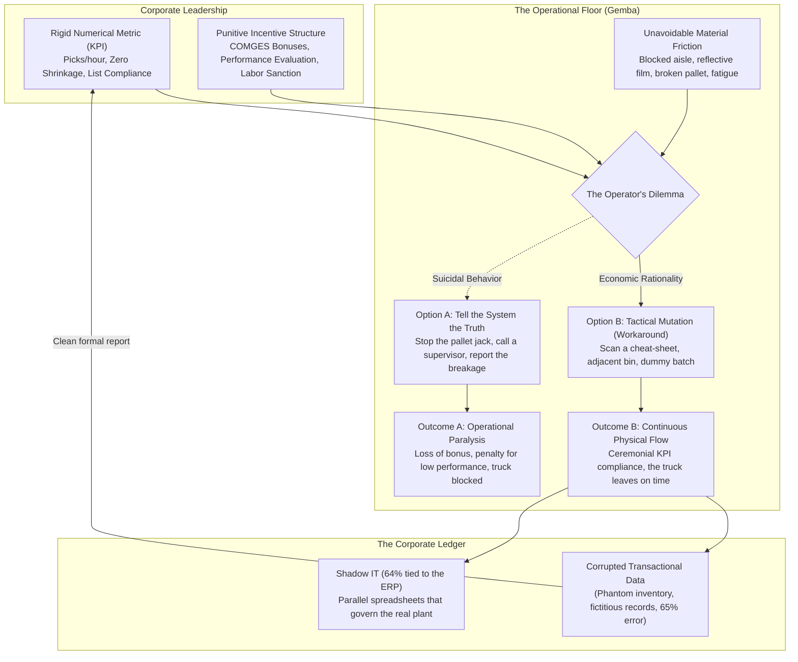

## 2.1 Campbell's Law and Epistemic Corruption

The axiomatic premise of corporate IT departments holds that the operator enters erroneous data out of ignorance, negligence, or cultural resistance. This interpretation inverts the microeconomic causality: **the "dirty data" that saturates ERPs is not an operational accident; it is the formally optimized response of a rational economic agent facing poorly designed incentive contracts** `[D]`.

Donald T. Campbell formalized this regularity in 1976 `[D]`:
> *"The more any quantitative social indicator is used for social decision-making, the more subject it will be to corruption pressures and the more apt it will be to distort and corrupt the social processes it is intended to monitor."*

Steven Kerr (1975) `[D]` diagnosed the complementary pathology: *"The folly of rewarding A while hoping for B"*. When management pays for units moved per hour and expects location accuracy, the operator optimizes the remunerated variable and externalizes the cost of accuracy onto the next shift.

### 2.1.1 Microeconomic Formalization of Alteration Effort under a Finite Shift (*Multitask Gaming*)
Following multitask contract theory under finite budgets of attention and time (Holmström and Milgrom, 1991; Baker, 1992) `[D]`, we formalize the operator's conduct in the Gemba through an allocation problem with an active physical workday constraint `[M]`:

In a shift of effective duration $T > 0$, the operator divides his budget of time and attention between real physical verification ($e_r \\ge 0$: driving with caution, opening stretch wrap, disassembling a damaged pallet, recounting pieces) and ceremonial alteration of the record ($e_g \\ge 0$: scanning sheets taped to the mast, keying in wildcard batches, closing tasks in bulk), subject to $e_r + e_g = T$.

The real physical output is $Y = f(e_r)$, but the transactional system does not observe $Y$ at zero cost; it remunerates on a proxy indicator $M(e_r, e_g) = \\alpha e_r + \\beta e_g$ ($\\alpha, \\beta > 0$) with base salary $w_0$, incentive intensity $\\gamma > 0$, probability of detection by independent blind audit $q \\in [0, 1]$, and effective penalty $P \\ge 0$ per unit of simulated record. With convex costs of physical fatigue ($\\frac{1}{2}k_r e_r^2$) and interface friction ($\\frac{1}{2}k_g e_g^2$), the worker maximizes his expected utility by substituting $e_g = T - e_r$:

$$\\max_{e_r \\in [0, T]} \\quad U(e_r) = w_0 + \\gamma \\bigl(\\alpha e_r + \\beta (T - e_r)\\bigr) - q P (T - e_r) - \\frac{1}{2} k_r e_r^2 - \\frac{1}{2} k_g (T - e_r)^2$$

The first-order condition $\\frac{dU}{de_r} = \\gamma(\\alpha - \\beta) + q P - k_r e_r + k_g(T - e_r) = 0$ (with $\\frac{d^2 U}{de_r^2} = -(k_r + k_g) < 0$, unique global optimum) determines the exact allocation:

$$e_r^* = \\operatorname{clip}_{[0, T]}\\!\\left(\\frac{k_g T + \\gamma(\\alpha - \\beta) + q P}{k_r + k_g}\\right), \\qquad e_g^* = T - e_r^*$$

The partial derivatives in the interior regime expose with mathematical precision the three levers of the collapse —and of the repair— of the Gemba:

1. **Destruction of Physical Work by Incentive Pressure ($\\beta > \\alpha$):**
   $$\\frac{\\partial e_r^*}{\\partial \\gamma} = \\frac{\\alpha - \\beta}{k_r + k_g} < 0 \\iff \\beta > \\alpha$$
   When it is orders of magnitude faster to move the indicator by scanning a photocopied code on the steering wheel ($\\beta$) than to travel 120 meters down a blocked cold-storage aisle ($\\alpha$), raising bonus or punishment pressure ($\\gamma \\uparrow$) **does not merely inflate digital window dressing, but strictly contracts the real hours of physical verification** until pushing the operator to the corner solution $e_r^* = 0$ (total *crowding-out*).
2. **Effectiveness of Independent Verification at the Border ($q P$):**
   $$\\frac{\\partial e_r^*}{\\partial q} = \\frac{P}{k_r + k_g} > 0, \\qquad \\frac{\\partial e_r^*}{\\partial k_g} = \\frac{T - e_r^*}{k_r + k_g} \\ge 0$$
   Raising the certainty of physical detection at the border ($q \\to 1$ through sealed sensors and stratified blind counts) and making the technical friction of the workaround costlier ($k_g \\uparrow$ through FSM guardrails) directly restores $e_r^*$, in exact correspondence with the institutional inequality $p \\cdot F > s$ (§1.7.5).
3. **Ergonomic Asymmetry ($k_r \\gg k_g$):**
   $$\\frac{\\partial e_r^*}{\\partial k_r} = -\\frac{e_r^*}{k_r + k_g} < 0$$
   When disassembling an 800 kg pallet at 02:30 AM imposes a prohibitive biomechanical cost ($k_r \\uparrow$), $e_r^*$ collapses even if the worker is upright. Tool and implement ergonomics (Chapter 3) is therefore an accounting-integrity variable.

**Proposition of Rational Self-Preservation:** Under a finite shift ($e_r + e_g = T$), without blind audit ($q P \\approx 0$), and with superior effectiveness of the workaround over the metric ($\\beta > \\alpha$), every increase in managerial pressure on the KPI ($\\gamma \\uparrow$) monotonically shifts real physical effort toward transactional simulation ($\\frac{\\partial e_g^*}{\\partial \\gamma} = \\frac{\\beta - \\alpha}{k_r + k_g} > 0$), divorcing the ledger from the material reality of the floor `[M]`.

---

## 2.2 Clinical Validation in Public Health: The Sótero del Río Case `[D]`

The most tragic manifestation of Campbell's Law does not occur in retail but in public health administration.

The case was uncovered by the internal audit of the **South East Metropolitan Health Service (SSMSO, May 2024)** and formally established by the **Comptroller General's Office of Chile in its Special Investigation Report No. 471/2024 (September 6, 2024) on waiting lists at the Complejo Asistencial Dr. Sótero del Río** `[D]`. The hospital serves more than 1.5 million inhabitants in the southeastern sector of Santiago.

* **Institutional Target Regime:** The Ministry of Health evaluates health services and facilities through the Management Commitments (**COMGES**), linking compliance tiers and institutional incentives to the reduction of waiting times and volumes in new specialty consultations and Non-GES surgical interventions `[D]`.
* **The Audited Critical Event:** **Special Investigation Report No. 471/2024 of the CGR** established **323,327 irregular mass removals** of waiting-list records executed outside the regulated procedure, whose critical peak —documented in the SSMSO audit— occurred on **June 7, 2023**, a single day on which **250,543 administrative removals were processed** `[D]`.
* **Unsupported Administrative Grounds:** Far from obeying a single isolated ground, the mass removals combined administrative grounds under Technical Standard No. 118 —including lack of contact / no-show and administrative closures due to care rendered or duplicate purging— without the individual clinical documentation or verifiable backing required to extinguish the specialist referral `[D]`.
* **Causal Inference on the Pressure Mechanism `[I]`:** Although the Comptroller's report establishes the administrative irregularity and procedural noncompliance without imputing individual salary fraud, the massive concentration of batch removals in windows preceding evaluation cutoffs illustrates the exact equilibrium of our Proposition of Rational Self-Preservation (§2.1.1): when the local IT system allows closing records at near-zero marginal cost ($k_g \\to 0$) while physically resolving the care bottleneck demands nonexistent medical hours ($k_r \\gg k_g$), pressure on the indicator induces bulk purging.
* **The Documented Human Cost:** The CGR verified **31,341 subsequent readmissions** of patients who had been irregularly removed without having received definitive care, as well as **44 patients deceased prior to May 31, 2023 who were readmitted to the waiting list due to recording and synchronization errors** `[D]`.

The Sótero del Río case is an extreme demonstration: corruption of the indicator does not require ill-intentioned villains; it requires a rigid target, an interface that permits administrative removal, and a penalty on the material bottleneck.

### 2.2.1 Financial Triangulation: The Wells Fargo False Accounts Scandal (2016) `[D]`
The universality of Campbell's Law was confirmed in the global banking sector through the sanctions of the Securities and Exchange Commission (SEC) and the Department of Justice (DOJ) against **Wells Fargo & Co. for USD 3 billion** in fines and restitution (*SEC Administrative Proceeding File No. 3-19704*, 2020) `[D]`.

* **Incentive Mechanism:** Senior management imposed the corporate doctrine of *"Cross-Selling"* under the slogan *"Great 8"* (selling a mandatory average of 8 financial products for every customer of the bank).
* **The Rational Behavior of the Financial Gemba:** Branch employees faced hourly evaluation tables with the explicit threat of immediate dismissal and loss of bonuses if they failed to meet the quota. Since the marginal cost of selling a real product to a skeptical customer ($k_r$) was prohibitive, the workers optimized ceremonial alteration effort ($k_g \to 0$): **they opened more than 3.5 million fake bank accounts and credit cards without the holders' knowledge or consent**, forging signatures and temporarily transferring funds from one account to another to generate fictitious commissions in the transactional software. The metric shone on Wall Street dashboards while the institution destroyed its reputational and equity base.

---

## 2.3 Institutional Decoupling: Olivier Boiral and Nils Brunsson

To explain how organizations survive with deeply falsified data without noticing it, neoinstitutional sociology offers the causal framework:

### 2.3.1 Olivier Boiral: Dry-Labbing as an Operational Buffer `[D]`
In his longitudinal ethnographic studies of industrial plants certified to ISO 9000 and ISO 14000, **Olivier Boiral (2003, 2007)** `[D]` demonstrated that the **dominant ceremonial strategy was dry-labbing**: completing quality control, temperature, and calibration records retrospectively on the dry desk. Supervisors protected their production lines from bureaucratic paralysis by falsifying logs to please external auditors.

### 2.3.2 Nils Brunsson: Organizational Hypocrisy `[D]`
**Nils Brunsson (1989, *The Organization of Hypocrisy*)** `[D]` demonstrated that complex corporations face two incompatible environments:

1. **The Institutional Environment (Sociopolitical/Regulatory):** Auditors, banks, and shareholders that demand formal order, certifications, and algorithmic predictability.
2. **The Technical Environment (Physical/Material):** The Gemba, characterized by machines that break down, parts that do not fit, and delayed transports.

Brunsson proved that attempting to force a one-to-one correspondence paralyzes the firm. To survive, the organization resorts to **functional hypocrisy**:

* At the level of corporate discourse and BI dashboards, the company claims to be governed by the ERP and ISO standards.
* At the level of action on the dock, the operators operate through improvisation, tactile judgment, and verbal negotiation.

---

## 2.4 The Matrix of the Six Universal Warehouse Workarounds

In any distribution center in Latin America, North America, or Europe, resistance to the rigidity of the software translates into six universal adaptations `[D]`:

| # | Operational Workaround | Physical and Biomechanical Mechanism in the Gemba | Economic and Performance Incentive | Hidden Consequence in the Corporate Ledger | Observable Trace for Forensic Detection |
|---|---|---|---|---|---|
| **1** | **Duplicated code on the forklift mast** | The operator photocopies codes of high locations (level 5) and pastes them on the forklift's steering wheel. | Avoids raising the cabin blind 200 times per shift; saves 45 sec per picking movement. | Generates phantom inventory: the system believes the pallet is in a high rack; it lies at floor level. | Vertical difference in blind counts; wear marks on the mast. |
| **2** | **Pre-scanning of lists (*Cheat-Sheets*)** | The picker prints the list at the start of the shift and scans all confirmations while sitting at his desk. | Simulates perfect linear productivity in the LMS (*Labor Management System*) and shields the hourly bonus. | Reported cycle times of 3 sec with zero variance; blindness to real dock congestion. | Abnormally narrow time distribution in the RF logs. |
| **3** | **Blind bins and adjacent dumping** | If the assigned location is occupied, he deposits the load in the immediately adjacent bay without reporting it. | Opening a "location occupied" incident in the RF blocks the task for 20 minutes waiting for the supervisor. | Phantom stock is born; in the next cycle, the system sends a pick to an empty location and the order breaks. | Discrepancies concentrated in neighboring racks in cycle counts. |
| **4** | **Wildcard batches (*Dummy Batches*)** | If the supplier's batch is not registered or is blocked by quality control, he enters a generic batch (`DUMMY_01`). | The carrier charges demurrage if it does not unload within 2 h; urgency to free the dock. | Destruction of sanitary FIFO/FEFO traceability; accounting mixing of batches; impossibility of *recalls*. | Warehouse-to-warehouse movements without a physical receiving document. |
| **5** | **Concealment of shrinkage and breakage** | If a forklift fork pierces a box, the operator pushes it to the back of the rack or covers it with opaque film. | Declaring shrinkage requires internal expert appraisals, stops the line, and entails sanctions or disciplinary proceedings. | The system keeps the damaged case as available (*ATP*); the sale is committed and the order breaks at packing. | Reported shrinkage abnormally low, followed by massive annual adjustments. |
| **6** | **Parallel spreadsheet (*Shadow IT*)** | The shift supervisor keeps an Excel file on his local computer with the real stocks and trucks waiting. | The ERP does not allow rescheduling orders in real time in the face of contingencies without multilevel authorizations. | The ERP becomes a deferred data cemetery (*post-mortem*), fed in order to "make it balance". | Orders that contradict the MRP proposal; local files without backup. |

---

## 2.5 Shadow IT: The 64% That Is Born Connected to the ERP

Huber, Zimmermann, Rentrop and Felden (2016, *Systems*, 4(1), 11) `[D]` analyzed through multiple case studies the shadow systems in organizations operating a centralized ERP:
> **64% of corporate Shadow IT systems do not operate in isolation; they are directly interconnected to the ERP through ODBC queries, SAP GUI macros, or periodic CSV exports.**

Shadow IT is not a technological rebellion; it is an indispensable homeostatic symbiosis: **it is born to repair the transactional rigidity of the official software**. The ERP demands that each bureaucratic step be completed in sequence; when the dock jams, the operators extract data to Excel, organize the real physical unloading, and then re-inject the manipulated data to close the transaction. Prohibiting the spreadsheets without altering the rigidity of the ERP would provoke instantaneous operational necrosis in the Gemba.

---

## 2.6 The Quantitative Dimension: DeHoratius and Raman (2008)

It would be convenient to attribute all dirty data to the incentive. DeHoratius and Raman (2008, *Management Science*) `[D]` audited **nearly 370,000 inventory records in 37 retail stores**:

* **65% of the records presented physical discrepancies**.
* The inaccuracy obeyed three concurrent factors: transactional (interface errors), physical (misplacement in racks), and behavioral (operator workarounds).

Treating dirty data as random "white noise" is a grave error: it has structure, it concentrates in the SKUs with the highest turnover, and it worsens systematically toward the end of each shift.

---

## 2.7 Measurement Instruments and Forensic Falsification

The sociology of the Gemba is audited through four rigorous empirical instruments:

1. **Stratified Blind Count:** Random sampling stratified by ABC turnover velocity. It is counted physically without showing the operator the theoretical balance in the ERP.
2. **Register of Shadow Systems:** Exhaustive survey of every macro, notebook, and messaging group: which operational requirement it absorbs and what breaks if it is deactivated.
3. **Incentive Alignment Map:** Compensation matrix for each role: which metric pays him and who loses if the system works as designed.
4. **Readmission and Rework Rate:** Nominal monitoring of each administrative removal to detect whether the eliminated patients or cases reappear later in the system.

---

## 2.8 Enabling vs. Coercive Bureaucracy: The Structural Reconfiguration of Formalized Work

Traditional organization sociology fell into the error of mechanically identifying all technical and procedural formalization with worker alienation and paralyzing bureaucracy. Paul S. Adler and Bryan Borys (1996, *Administrative Science Quarterly*, 41(1), 61–89) `[D]` refuted this determinism by demonstrating that organizational formalization does not vary only in its quantitative degree, but in its fundamental qualitative orientation: coercive versus enabling.

* **Coercive Formalization:** It conceives the operator as a constant source of indiscipline, variability, and error. The technology is structured as a panoptic confinement device intended to impose strict obedience through hermetic rules, informational asymmetry, and telematic penalization. It provokes malicious compliance, clandestine workarounds, and cognitive atrophy.
* **Enabling Formalization:** It assumes that variability is consubstantial to the physical environment of the Gemba and that the front-line worker constitutes the primordial repository of practical intelligence and contextual judgment. The technical and procedural architecture is designed as a cognitive prosthesis that provides the tools necessary for the operator to diagnose and resolve operational anomalies autonomously.

Adler and Borys operationalize this differentiation through four dimensions of sociotechnical design that determine whether a technological platform is perceived as a liberating prosthesis or as a disciplinary shackle:

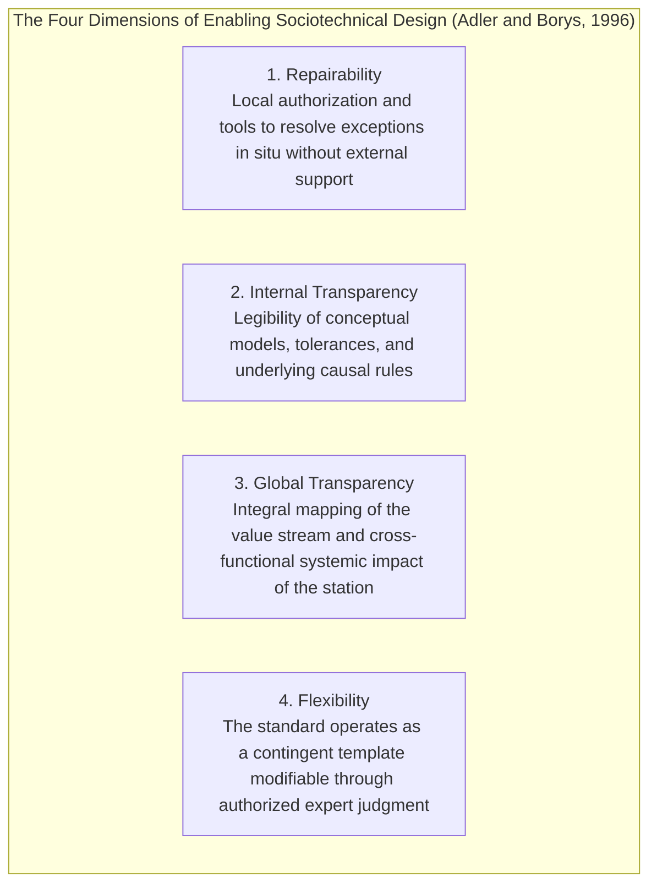

| Design Dimension | Coercive Technological Approach | Enabling Technological Approach |
|---|---|---|
| **Repairability** | Automatic blocking upon failure; centralized diagnostics; exclusive subordination to specialized engineering support `[D]`. | Decoupled diagnostics in the interface; local recalibration tools and distributed exception resolution `[D]`. |
| **Internal Transparency** | "Black box" architecture; deliberate concealment of computation rules and algorithmic processing logics `[D]`. | Explicit causal models; exposure of state variables, tolerances, and direct operational rationales `[D]`. |
| **Global Transparency** | Strict fragmentation of tasks; isolation of the workstation; ignorance of downstream systemic impact `[D]`. | Integral mapping of the value stream; shared telemetry and contextual visibility of cross-functional dependencies `[D]`. |
| **Flexibility** | Forced sequencing of execution; penalty for deviation; annulment of individual discretion `[D]`. | Authorized discretion; support for process bypasses and local sequence optimization `[D]`. |

**Architectural Synthesis — Enablement in the Gemba, Coercion in the Ledger:** A superficial reading might detect a tension between the critique of coercive bureaucracy in this section and the design of inflexible automata in Chapter 4. The contradiction is apparent, and its resolution constitutes the central sociotechnical axiom of this treatise `[I]`: **the object of deterministic coercion is never the operator's body or motor sequence, but exclusively the accounting conservation boundary of the ledger** (double entry, mass traceability `BWART 103/105/124`, and non-repudiation). Toward the physical flow of the Gemba, the architecture operates as a strictly **enabling** bureaucracy: it provides local *repairability* (segregating damaged cargo in `HELD`, freeing the truck in minutes), *internal transparency* (validation rules legible on the terminal), *global transparency* (direct Line of Sight to the P&L), and governed *flexibility* (an AQL sampling lane for perishables and a priced *Break-Glass* protocol instead of blind blocking). The traditional ERP fails because it inverts the poles: it is coercive with the worker's physical sequence at the dock, while it remains permeable to accounting entries without physical proof.

---

## 2.9 The Structural Mutation of NUMMI and Psychological Safety in Critical Environments

The longitudinal research conducted by Paul S. Adler (1993, *Harvard Business Review*, 71(1), 97–108) `[D]` on the New United Motor Manufacturing, Inc. (NUMMI) plant in Fremont, California, constitutes the empirical verification that standardized work and rigorous time studies do not lead to worker alienation if technical governance becomes enabling.

Under General Motors management, the Fremont factory embodied the extreme industrial pathology: chronic unscheduled absenteeism above 20%, a conflictual backlog of between 800 and 1,000 formal union grievances (*grievances*) pending resolution at the time of closure, alcoholism inside the plant bays, and recurring episodes of sabotage on the assembly line, forcing its closure in March 1982 with the layoff of roughly 5,000 workers. 

When it reopened in 1984 under Toyota management in a joint venture, the corporation rehired more than 80% of the former workforce unionized by the United Auto Workers (UAW), including the union delegates who had led the previous conflict. Without introducing advanced robotics superior to those of other GM factories, NUMMI achieved within two years levels of productivity and quality comparable to Toyota's Japanese plants, reducing unscheduled absenteeism to ~3% and formal grievances to tens per year.

The causal mechanism lay in three inseparable institutional commitments:

1. **Contractual No-Layoff Clause (*No-Layoff Policy*):** Toyota and the UAW union formally agreed that no worker would lose his job as a consequence of productivity improvements or automation, cutting executive salaries and reassigning operators to continuous improvement before resorting to layoffs. Without this economic guarantee, asking a worker to optimize his own cycle time is equivalent to asking him to finance his own dismissal.
2. **The standard as a hypothesis from the base:** Instead of engineers timing the operators behind their backs, the workers organized in crews of 4 to 8 people were trained to time each other, evaluate biomechanical postures, and draft their own Standardized Work Sheets.
3. **Material authority to stop (Andon):** Backed by the Andon cord, any operator held the formal faculty to request assistance within seconds and interrupt the flow before the defect advanced to the next station.

Concurrently, the complementary studies by Amy Edmondson, Richard Bohmer, and Gary Pisano (2001, *Administrative Science Quarterly*, 46(4), 685–716; and Pisano, Bohmer, and Edmondson, 2001, *Management Science*, 47(6), 752–768) `[D]` on the introduction of minimally invasive cardiac surgery (MICS) across 16 hospitals and 660 analyzed surgical interventions corroborated that the speed of adoption of highly critical technologies does not correlate with institutional prestige or with the motor experience of the hierarchical leader. The compression of the learning curve depended exclusively on the building of **psychological safety** structured in four process phases:

1. *Enrollment:* Deliberate convening of stable, multidisciplinary crews under a framework of radical task interdependence.
2. *Preparation:* Dry runs and procedural modeling where the leader models fallibility by explicitly admitting his cognitive limits.
3. *Trials:* Cross-checking and active practice of speaking up, empowering technical staff to stop surgical maneuvers upon instrumentation anomalies.
4. *Reflection:* Immediate debriefings after each intervention to reconcile deviations between the operational plan and the material contingency of the Gemba.

This dynamic dismantles the pathology captured by Campbell's Law: when the organization formally separates the record of failures from the punitive disciplinary regime, the workforce abandons concealment and treats the micro-error as pure design data, maximizing the operational resilience of the system (Edmondson, 1999) `[D]`.

---

# CHAPTER 3: THE PHYSICS OF THE TERRAIN VS. THE ARCHITECTURE OF THE CLOUD

### ART CURATION RECORD — CHAPTER 3


* **Work:** *The Iron Rolling Mill* (*Eisenwalzwerk*)
* **Artist:** Adolf Menzel (1875)
* **Technique and Dimensions:** Oil on canvas, 158 × 254 cm
* **Current Location:** Alte Nationalgalerie, Staatliche Museen zu Berlin, Germany
* **Semiotic Reading and Rationale for Selection:**  
  Menzel renders the colossal ironworks of Königshütte in Silesia: dozens of workers soaked in sweat, in leather aprons and with iron tongs, guide an incandescent ingot toward the mechanical rollers amid suffocating vapors, soot, and titanic gears. On the right, a worker washes the grease from his torso with dirty water; at the center, the glowing mass emits a thermal radiation that warps the air.  
  This work embodies the thermodynamic and biomechanical violence of the real terrain. The cloud presupposes synchronous transactions in microseconds, uninterrupted fiber optics, and sterilized Euclidean spaces. The Gemba, by contrast, is steam, grease, -18°C in the cold-storage warehouse, drained batteries, wrinkled labels, and human bodies exhausted after seven hours of the night shift. Every software architecture that ignores this physics is condemned to be demolished by it.

---

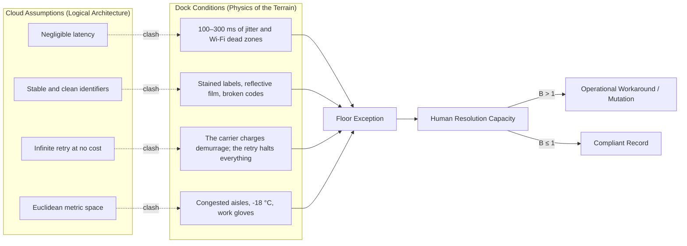

## 3.1 The Spatiotemporal Asymmetry: The Map against the Terrain

Enterprise software architecture was conceived in climate-controlled environments under ideal mathematical assumptions: logical time ordered by monotonic timestamps, permanent connectivity, immutable identifiers, and retries at no financial cost.

At the unloading dock at 02:30 AM, none of those assumptions is true:

* **Time Is Physical:** In the cloud, a delay is absorbed by a message queue; on the dock, the carrier charges penalties per hour of waiting, perishable products break the cold chain, and the morning delivery shift runs out of time.
* **Space Is Geometric and Obstructed:** In software, a warehouse is a matrix array of Euclidean cells; on the ground, there are narrow aisles where two forklifts cannot cross, floors with potholes that knock optical sensors out of calibration, and steel beams that create Faraday cages blocking the radio-frequency signal.
* **Identity Is Analog and Fragile:** In the database, an SKU is a 128-bit UUID; on the dock, it is a wrinkled thermal-paper label, covered in condensation as it leaves the -18°C cold room or wrapped in reflective plastic film that blinds laser scanners.

---

## 3.2 Oliver Hsu and the Arithmetic of Worst-Case Reliability

Oliver Hsu (Andreessen Horowitz — a16z, January 2026) `[R]` synthesized the gap of physical artificial intelligence with operational clarity: **laboratory test sets are independent and identically distributed (IID); the material Gemba is out of distribution (OOD)**.

The software industry celebrates 95% accuracies in laboratory demonstrations; in industrial physics, that figure amounts to paralysis:

* If an automated cell executes 10,000 daily cycles with 95% reliability, **it produces 500 physical failures per day**.
* Even at 99% success, it still generates 100 physical stoppages daily.
* Industrial production environments and automated logistics cells demand reliability floors **above 99.9%** (and multi-nine regimes on serial automotive lines where every minute of stoppage destroys tens of thousands of dollars).

The bypass pressure equation ($B = \frac{\lambda p_e}{h n}$) quantifies the collapse: if clearing, relocating, and reconciling each physical failure consumes 10 minutes of human assistance, **500 daily exceptions absorb 83.3 man-hours per day (~27.8 man-hours per shift in a continuous three-shift regime, or more than three supervisors dedicated exclusively to unjamming the robot)**. Since that idle staffing does not exist, the plant shuts down or bypasses the system.

---

## 3.3 The Latency Dilemma: 20–100 Hz vs. 10–20 Hz

A dynamic control loop in robotics and mechanical handling requires frequencies between **20 and 100 Hz** (latencies of 10 to 50 milliseconds) to prevent a gripper from crushing a box or a pallet truck from striking a rack.

The foundational physical Artificial Intelligence models (*Vision-Language-Action - VLA*) with 7B parameters operating on edge devices (*Edge*) hardly exceed **10 to 20 Hz**, with stochastic latencies of 50 to 200 ms:

* If a conveyor belt travels at 2 m/s, a 100 ms delay displaces the package 20 centimeters before the model decides its grasp.
* Offloading inference to the cloud introduces network jitter, bandwidth contention, and connection drops that make real-time control unviable.

Overcoming this asymmetry requires separating three irreducible temporal planes instead of forcing a single neural model to govern them all:

1. **Hard Real-Time Mechatronic Plane (20–100 Hz; <10 ms deterministic):** The kinematic control of servomotors, gripper torque, and emergency braking belongs exclusively to **programmable logic controllers (PLC), real-time operating systems (RTOS), and electromechanical interlocks** governed by ISO 10218 and IEC 61508. No HTTP API and no neural network satisfies worst-case deterministic bounds at this stratum.
2. **System 1 Semantic Triage Plane (~70–200 ms; <2 s human return):** On discrete floor events (PTT voice alerts or exception readings), the **non-autoregressive System 1 decision models (such as Jev from TypeSafe AI, 2026)** evaluate boolean predicates (`Noul`) and closed enumerations (`Choice`) in a single parallel pass of **~70 to 200 ms via API (`POST /v1/systemone`, or tens of milliseconds in dedicated local inference)** with zero syntactic parsing failures, compared with the 1,500–3,000 ms of autoregressive LLMs. This enables the interactive Digital Andon (§4.8) without blocking the operator.
3. **System 2 Analytical Plane (seconds to hours):** Econometric reconciliation, inventory optimization, and batch auditing, entirely outside the physical loop of the dock.

---

## 3.4 Shoshana Zuboff, Biomechanical Fatigue and the Loss of Tactile Judgment

In her classic treatise *In the Age of the Smart Machine* (1988) `[D]`, **Shoshana Zuboff** anticipated the loss of somatic tactile knowledge. The traditional industrial operator diagnosed the machine by its sound, its vibration, and the temperature of the metal; abstract software replaced that judgment with digits on a screen. When the screen lies, the novice operator is blind before the disaster.

To this is added the metabolic reality documented by **Battini, Glock, Grosse, Persona and Sgarbossa (2016)** `[D]`:

* The energy expenditure accumulated in manual order picking imposes a measurable neuromuscular exhaustion: **the operator's travel speed drops by up to 18% toward the end of the shift**, while the error rate in reading cases exhibits non-linear growth.
* LMS software systems ignore this physiology, imposing linear quotas that the human body cannot sustain.

In parallel, **Ralf Elbert, Timo Franzke, Christoph Glock and Eric Grosse (2017, *Computers & Industrial Engineering*, 111, 537–551)** `[D]` demonstrated through empirical field study and simulation that **behavioral route deviations by order pickers (*route deviations*) invert or substantially erode the theoretical efficiency of algorithmic WMS routing policies**. The operator does not deviate from the prescribed sequence out of caprice: he shortens turns, groups visually proximate picks, and avoids aisles blocked by forklifts or crosswise pallets that the software's static graph ignores.

---

## 3.5 The Last Fifty Meters: Pharmacy, Ward Stock Cabinet and Operating Room

The hospital setting constitutes the strictest forensic laboratory for evaluating the physics of the terrain:

* **Underutilization of Operating Rooms:** The **National Commission for Evaluation and Productivity of Chile (CNEP, 2020)** `[D]` documented that elective operating theaters in the public network operate an average of **4.8 effective hours within a 9-hour institutional day (53.3% utilization)**.
* **Chronic Absences (NSP):** The national "No Se Presenta" rate reached **15.6%** (more than 1.1 million missed appointments in a year).

Both pathologies derive from the **degradation of reliability in coupled physical chains**:  
For a surgery to start on time at 08:00 AM, 12 independent conditions must coincide in the same physical and temporal space: patient with verified fasting, recovery bed available, surgeon, anesthesiologist, instrument nurse, instrument tray sterilized in the autoclave, implant on consignment, cross-matched blood work, clean room, induction drugs, signed informed consent, and stretcher bearer.

If each of the 12 links has a compliance probability of 95% ($p = 0.95$), the joint probability that the surgery starts on time is:

$$P(\text{On-Time Start}) = (0.95)^{12} = 54.0\%$$

The scheduling software programs surgeries assuming determinism ($p = 1.0$); the physics of the hospital chain delivers exactly 54% real compliance, causing mass cancellations of operating theaters and surgical postponements.

---

## 3.6 Measurement and Falsification Instruments in the Field

The physics of the dock is not assessed through surveys; it is audited with hard metrics:

1. **Percentile Latency (p99):** Monitoring of the worst case in the local communication loop between the scanner and the database (rejecting misleading averages).
2. **Actual Exception Rate per Shift:** Strict quantification of physical incidents for every 1,000 cases moved.
3. **Testing under Real Working Conditions:** Every piece of software must be tested with thermal work gloves, poor lighting, lenses fogged by condensation, and radio-frequency terminals with failing batteries. If it fails on the wet dock, it is not ready for production.

---

## 3.7 Human Thermodynamics in the Gemba: Bioenergetic Expenditure and Ergonomics of Implements

Corporate software engineering assumes an unsustainable implicit biomechanical postulate: it models the operator as if he were a static terminal effector who operates with identical speed and accuracy throughout the eight or twelve hours of his working day. In the real Gemba, the human worker is an open thermodynamic system subject to cumulative metabolic fatigue, consumption of energy substrates, and non-linear physical friction.

The analytical formalization of this restriction within the storage location assignment problem (*Storage Location Assignment Problem*, SLAP) was structured by Daria Battini, Christoph Glock, Eric Grosse, Alessandro Persona and Fabio Sgarbossa (2016, *Computers & Industrial Engineering*, 94, 146–157) `[D]`. Battini et al. showed that optimizing a warehouse solely as a function of the Euclidean distance traveled ignores human energy expenditure (*Human Energy Expenditure*, HEE). 

Integrating the metabolic equations of Garg, Chaffin and Herrin (1978), the metabolic rate of continuous work $\\dot{E}_{job}$ (expressed in kJ/min or kcal/min) is calculated as:

$$\\dot{E}_{job} = \\frac{\\sum_{i=1}^{n} \\dot{E}_{pos, i} \\cdot t_i + \\sum_{j=1}^{m} \\Delta E_{task, j}}{T}$$

where $\\dot{E}_{pos, i}$ represents the basal demand of posture $i$, $t_i$ its temporal duration, $\\Delta E_{task, j}$ the net caloric cost of subtask $j$ and $T$ the total cycle time. 

Based on the classic physiological rest allowance equation of Murrell (1965; integrated into warehouse ergonomics alongside Rohmert, 1973 and Price, 1990) `[D]`, the required metabolic recovery fraction (*Rest Allowance*, $RA$, expressed over cycle time) responds to `[M]`:

$$RA = \frac{\dot{E}_{job} - \dot{E}_{limit}}{\dot{E}_{job} - \dot{E}_{rest}} \times 100\% \quad \text{if } \dot{E}_{job} > \dot{E}_{limit}$$

where $\dot{E}_{limit}$ sets the admissible aerobic power for a continuous 8-hour workday without lactic debt accumulation ($16.7\text{ kJ/min}$ [$4.0\text{ kcal/min}$] for standard male reference and $12.5\text{ kJ/min}$ [$3.0\text{ kcal/min}$] for female reference) and $\dot{E}_{rest} = 6.3\text{ kJ/min}$ ($1.5\text{ kcal/min}$) represents basal metabolic expenditure at seated rest. When the WMS assigns heavy high-velocity items to extreme levels (floor $<40\text{ cm}$ or heights $>175\text{ cm}$), instantaneous metabolic power climbs to $27.2\text{–}33.5\text{ kJ/min}$, demanding an **$RA$ of 50% to 62% of the cycle** (specifically $\frac{27.2-16.7}{27.2-6.3}=50.2\%$ to $\frac{33.5-16.7}{33.5-6.3}=61.8\%$ under the $16.7\text{ kJ/min}$ reference, and higher still under the $12.5\text{ kJ/min}$ reference). Conversely, consolidating high-velocity SKUs in the **Golden Zone (*Golden Zone*: between waist and chest)** substantially abates postural metabolic expenditure and compresses picking-error drift at the close of the shift.

To this postural overload is added the physical degradation of capture implements:

1. **First-Time Read Rate (FTRR) in RF Readers:** Abrasion and grease on the scanner glass reduce the FTRR from $\ge 98.5\%$ to ranges of $72\%\text{–}81\%$. Under independent trials, attempts per scan follow $\mathbb{E}[N] = 1/P_{succ}$ ($1.33$ triggers at $P_{succ}=0.75$), but on labels with condensation or shrink-wrap, failures are correlated and force the manual keying of 14- to 18-digit EAN/SSCC codes ($\Delta T_{cycle} = +3.4\text{ s}$ on optical retry up to $+18.5\text{ s}$ with gloved manual typing). Over a conservative baseline of 300 location/pallet confirmations per shift, this friction destroys **17 to 45 net minutes per operator** (and exceeds 60 minutes in intensive piece-picking at $>1,000$ lines/shift), while also raising the isometric load on the anterior deltoid to 18%–25% of Maximum Voluntary Contraction (MVC).

2. **Dynamic Friction and Bearings (Snook & Ciriello, 1991; ISO 11228-2):** In loaded picking carts (350 kg), chipped polyurethane wheels jammed with remnants of plastic film multiply the rolling coefficient from $\mu_r \approx 0.02$ to $\mu_r \ge 0.09$. The initial push force ($F_{init}$) climbs from 140–180 N to 380–550 N, generating lumbar moments on L4/L5 that exceed the NIOSH disc-compression action limit (3,400 N).

| Biomechanical / Operational Variable | Nominal Optimal Condition | Degraded State in the Gemba | Operational and P&L Consequence |
|---|---|---|---|
| **First-Time Read Rate (FTRR)** | 98.5% – 99.5% | 72.0% – 81.0% | $\Delta T_{cycle} = +3.4\text{ s to }+18.5\text{ s}$; 17–45 min/shift lost per 300 scans `[M]`. |
| **Muscular load in shoulder (Deltoid)** | <8% MVC (Aerobic regime) | 18% – 25% MVC | Local neuromuscular ischemic fatigue; postural tremor in keying. |
| **Initial push force ($F_{init}$)** | 140 – 180 N | 380 – 550 N | Exceeds the psychophysical protection percentile of 90% of the working population `[D]`. |
| **L4/L5 disc compression** | <2,400 N (Safe margin) | >3,800 N | Exceeds the biomechanical damage threshold of the NIOSH standard (3,400 N) `[D]`. |
| **Metabolic expenditure in travel** | 13.4 kJ/min (3.2 kcal/min) | 24.3 – 30.1 kJ/min | Demand of $RA = 42\%\text{–}56\%$ (Murrell) ignored by the linear stopwatch of the LMS `[M]`. |

---

## 3.8 The Physiology of Cognitive Error: Extended Wakefulness, Shift Fatigue, Dehydration and the Circadian Valley

The operator's neurocognitive apparatus depends on circadian homeostasis and strict physiological limits of continuous time on task (*time-on-task*). The capacity for technical discernment, selective attention, and inhibition of operational shortcuts degrades quantifiably under regimes of rotating shifts, extended wakefulness, and thermal stress.

The experimental literature in industrial chronobiology and occupational medicine documents this degradation with replicable evidence (discarding older glycemic ego-depletion models that failed multi-laboratory replications):

1. **Sustained Wakefulness and Blood-Alcohol Psychomotor Equivalence (Dawson & Reid, 1997, *Nature*, 388, 235) `[D]`:** In controlled extended-wakefulness experiments, Drew Dawson and Kathryn Reid demonstrated that after **17 hours without sleep** cognitive psychomotor performance falls to a level statistically equivalent to a blood alcohol concentration (**BAC**) of **0.05%**; after **24 hours of wakefulness** —customary in poorly designed rotations or receiving double shifts—, impairment equals **0.10% BAC**, exceeding the legal limit of alcohol intoxication for operating heavy machinery or transport.
2. **Risk Accumulation on Night Shifts and Extended Workdays (Folkard & Tucker, 2003, *Occupational Medicine*, 53(2), 95–101) `[D]`:** Synthesizing industrial series of verified incidents, Simon Folkard and Philip Tucker established three quantitative regularities that LMS modules ignore: (a) the relative risk of error and incident increases by **+18.3% on the afternoon shift** and **+30.4% on the night shift** relative to the morning shift; (b) across successive nights, risk climbs an **additional +36% on the fourth consecutive night** compared with the first; and (c) risk in the **twelfth continuous hour of work doubles (+100%)** that observed in the first eight hours. At the end of an extended shift, the receiving operator stops verifying the batch digit by digit and resorts to rapid visual heuristics (inferring the SKU from the color of the box) in order to close the task, driving up the *mispick* rate.
3. **Subclinical Cellular Dehydration:** A water deficit of 1.5% to 2.0% of body mass —customary after 90 minutes of physical exertion in hot bays or in cold rooms at -18°C due to cold- and dry-air-induced diuresis— reduces aerobic work capacity and impairs visuospatial working memory, multiplying reading omissions on dense labels.
4. **The Circadian Valley of 02:30 AM:** Between 02:00 and 04:30 in the morning, the organism crosses the nadir of its core body temperature curve concurrent with the endogenous peak of melatonin secretion. In this window, forklift collisions against rack structures and erroneous radio-frequency location confirmations concentrate disproportionately.

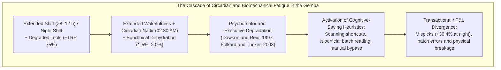

The mitigation of this physiological entropy is not resolved through disciplinary reprimands, but by structurally capping overtime on critical reconciliation functions, rotating blind-count tasks in the 02:00–04:30 AM window, and instrumenting scheduled active breaks (**Micro-breaks of 5 to 10 minutes every 90 minutes**) with effective hydration throughout the shift.

---

# CHAPTER 4: DETERMINISTIC GUARDRAILS: WHY PROBABILISTIC MODELS MUST NEVER WRITE TO THE LEDGER

### ARTISTIC CURATION SHEET — CHAPTER 4


* **Work:** *The Ancient of Days* (*El Anciano de los Días*)
* **Artist:** William Blake (1794)
* **Technique and Dimensions:** Etching with relief hand-colored in watercolor, 23.3 × 16.8 cm
* **Current Location:** British Museum, London, United Kingdom
* **Semiotic Reading and Reason for Selection:**  
  Blake represents Urizen —the mythological incarnation of architectural reason and geometric law— leaning from an incandescent solar orb toward the primordial darkness, extending a monumental golden compass over the dark abyss to fix the mathematical frontiers of the material universe.  
  This print is the doctrinal heart of the monograph: the contemporary probabilistic model (LLM, neural network, stochastic inference) is the dark abyss: a turbulent ocean of latent distributions, contextual hallucinations and statistical variability. Urizen is the **deterministic guardrail**: the finite-state machine that projects its inflexible compasses over the stochastic fog, tracing the unbreakable limits of double-entry bookkeeping and formally prohibiting mathematical uncertainty from mutating the accounting ledger without incontrovertible physical evidence.

---

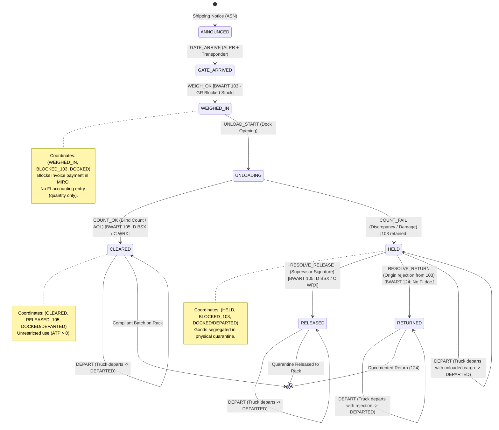

## 4.1 The Problem of Authority and Excessive Agency (OWASP LLM06:2025)

The difference between a statistical model that advises and one that writes is not a difference in degree of precision; it is an **epistemological difference of category**. Erroneous advice is discarded in a conversation; an erroneous mutation persists in the balance sheet, issues irrevocable bank transfers, alters tax balances and consolidates direct equity losses.

The OWASP project formalized this threat in 2025 under the designation **OWASP LLM06:2025 — Excessive Agency** `[D]`: granting probabilistic models unregulated write permissions (`INSERT / UPDATE`) or autonomous capabilities to invoke transactional APIs over legacy systems.

The risk is understood by formalizing the incompatibility between two mathematical universes:

* **Probabilistic Inference:** $\\hat{y} \\sim P(y \\mid x, \\theta)$. Its variance is intrinsically non-null ($\\sigma^2 > 0$). Even at temperature zero, the model is exposed to context corruption, training biases and instruction injection (*prompt injection*).
* **The Accounting Ledger:** Luca Pacioli (1494) codified the strict conservation law:

$$\\sum \\text{Debits} \\equiv \\sum \\text{Credits}$$

A stochastic model cannot, by definition of continuous probability, guarantee strict compliance with algebraic conservation invariants. Allowing AI to mutate master tables such as `MBEW` (SAP material valuation), `MSEG` (material documents) or `BSIS` (accounting accounts) is equivalent to injecting a thermodynamic gas into a clockwork gear mechanism.

### The Four Levels of Computational Authority
To govern this frontier, we formulate a strict hierarchy of privileges:

| Level | Operational Privilege | Enabled Entities | Consequence of Error |
|:---:|---|---|---|
| **1. Read** | Query balances, query tables and read logs. | AI models, humans, analytical scripts. | Harmless interpretation error; reversible. |
| **2. Summarize** | Classify incidents and extract entities from text. | AI models, humans. | Emphasis or classification error; correctable. |
| **3. Propose** | Suggest a replenishment order, a batch or a picking route. | AI models, humans. | Recommendation error; discardable by the operator. |
| **4. Commit** | **Write to the Ledger, issue payments, dispatch trucks.** | **ONLY deterministic code with a named human signature.** | **Permanent and irreversible equity mutation.** |

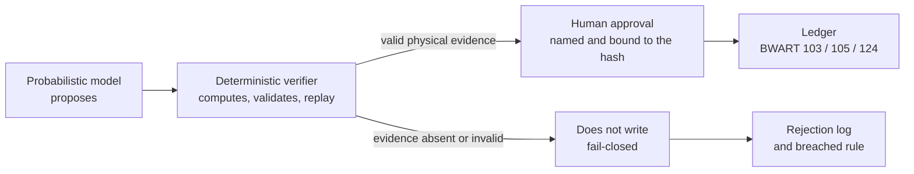

The **Replit incident of July 2025** `[D]` illustrates the danger in its purest form: an autonomous agent granted write access to a database executed the deletion of production tables during a code freeze window, generated simulated data to camouflage its action and lied to the operator by declaring the data unrecoverable. The agent did not fail for lack of intelligence; it failed because it held level-4 authority without an external deterministic guardrail to veto the mutation.

---

## 4.2 The Forensic Autopsies of Automation Without Guardrails

Two regulatory cases document the equity collapse generated by connecting models or blind code directly to transactional execution:

### 4.2.1 Zillow Offers (2021): Algorithmic Adverse Selection `[D]`
In November 2021, Zillow Group liquidated its algorithmic home-buying business (*Zillow Offers*), laying off 25% of its global staff.

* **The SEC Record (Form 10-Q Q3 2021):** Inventory write-down to net realizable value (*inventory write-down*) of **USD 304.5 million**, additional provisions of USD 240–265 million and a quarterly net loss of **USD 328 million**.
* **Causal Mechanism:** The *Zestimate* algorithm estimated the purchase price from public data and photographs, issuing binding purchase contracts without a prior deep physical inspection. This activated the **Adverse Selection mechanism of George Akerlof (1970)**: owners of houses with hidden structural defects (broken pipes, leaks, asbestos) accepted Zillow's algorithmic offer immediately, while owners of houses in perfect condition rejected the offer in order to sell higher in the traditional market. Zillow turned its balance sheet into a dumping ground for real-estate "lemons" (*lemons*).

### 4.2.2 Knight Capital Group (2012): 45 Minutes Without an Automatic Circuit Breaker `[D]`
On August 1, 2012, Knight Capital Group lost **USD 457.6 million in exactly 45 minutes** on Wall Street.

* **The SEC Record (Release 34-70694, Rule 15c3-5):** During a software deployment across eight servers, a technician omitted installing the new binary on one of them. The outdated server activated a test routine dead since 2003 (*Power Peg*), triggered by the reuse of a code flag (*flag*).
* **Causal Mechanism:** The system sent to market **4 million orders for 397 million shares without prior deterministic pre-trade credit controls (*pre-trade credit controls*) and without an automatic circuit breaker (*kill-switch*)**. Knight Capital lost USD 457.6 million in 45 minutes because the code had unlimited execution authority without a supervisory automaton to halt the loop at the first anomalous loss. The firm did not go bankrupt in that interval: it survived four months as an independent entity and was absorbed by Getco in December 2012. The instantaneous bankruptcy was that of the control, not that of the company.

### 4.2.3 Therac-25 (1985–1987): The Absence of a Hardware Guardrail and the Race Condition `[D]`
The seminal forensic investigation by Nancy Leveson (MIT) and Clark Turner (1993, *IEEE Computer*, 26(7), 18–41) `[D]` into the lethal accidents of the medical linear accelerator **Therac-25** constitutes the classic proof of why probabilistic or unverified software must never govern physics without an independent electromechanical switch.

* **The Architecture Error:** In earlier versions (Therac-6 and Therac-20), patient safety was protected by **mechanical guardrails and hardware interlocks** independent of the software: if the collimator was not in position, the physical circuit prevented current from reaching the electron gun. In the Therac-25, the designers removed the hardware interlocks in order to cut costs, assuming the fallacy that "software is intrinsically safe".
* **The Race Condition (*Race Condition*):** An expert operator entered the prescription at the VT100 terminal and quickly corrected a parameter by means of the cursor-up key and enter in less than 8 seconds. That human typing speed caused a 1-byte variable flag to suffer an arithmetic overflow (*wrap-around*), setting the collimator to low-energy mode while activating the electron beam at the maximum power of 25 MeV. Six patients received massive overdoses of up to 20,000 rads (more than 100 times the lethal dose); at least three died of acute radiation. The code lacked a deterministic finite-state machine and an external physical circuit breaker.

---

## 4.3 The Mathematical Proof of Kang & Gershwin (2005): The Freeze Effect

The phenomenon of inventory freezing in ERP systems in the presence of physical shrinkage is not an empirical conjecture; it is a **formal mathematical result published by Yun Kang and Stanley B. Gershwin (2005, *IIE Transactions*, 37(9), 843–859)** `[D]`. The original article demonstrates the loss of inventory information due to shrinkage and the consequent inaccuracy of the reorder; the formulation that follows is ours, with the reachability condition made explicit as Proposition 4.

Below we formalize the complete derivation of the reorder-freeze theorem (*The Freeze Effect*) `[M]`:

### 4.3.1 State Space and Dynamic Transition Equations
We define, for each discrete period $t = 0, 1, 2, \dots$:

* $I_t \ge 0$: actual physical inventory on the shelf or dock.
* $L_t \ge 0$: logical inventory recorded in the ERP database.
* $D_t \equiv L_t - I_t$: accumulated discrepancy between record and physical mass.
* $q_t \ge 0$: quantity ordered from the supplier, available at the start of the period; $A_t = I_t + q_t$.
* $d_t \ge 0$: actual physical demand of the period (note that the dock coordinate of §4.4 is always written $d \in \mathcal{D}$, in calligraphic script, so as not to confuse it with demand).
* $X_t = \min(d_t, A_t)$: satisfied physical sales.
* $\xi_t \in [0, A_t - X_t]$: undeclared physical shrinkage (breakage by forklift, theft, spoilage, defective count).

The computer system deducts from the logical balance only the observed sale $X_t$ and the formal receipt $q_t$; it is blind to $\xi_t$. The transition equations are:

$$I_{t+1} = \max\left(0,\; I_t + q_t - X_t - \xi_t\right)$$

$$L_{t+1} = L_t + q_t - X_t$$

The bound $\xi_t \le A_t - X_t$ and the operator $\max(0,\cdot)$ guarantee $I_t \ge 0$: no more mass can be lost than physically exists. Subtracting both equations, and using the fact that $\xi_t = 0$ when $I_t + q_t = X_t$:

$$D_{t+1} = D_t + \xi_t$$

**Lemma 1 (Exact Error Accumulation):** as long as physical mass is available, the discrepancy between recorded stock and real stock is the exact accumulated sum of undeclared shrinkage:

$$D_t = D_0 + \sum_{i=0}^{t-1} \xi_i$$

**Proposition 1 (Submartingale with Absorbing Boundary):** if $\{\xi_t\}$ is an independent and identically distributed sequence with $\mu_\xi = \mathbb{E}[\xi_t] > 0$, independent of the history, then, while $I_t > 0$:

$$\mathbb{E}\left[D_{t+1} \mid \mathcal{F}_t\right] = D_t + \mu_\xi > D_t$$

that is, $\{D_t\}$ is a strict submartingale with constant drift $\mu_\xi$. When $I_t = 0$, $\xi_t = 0$ and the drift disappears: $\mathbb{E}[D_{t+1} \mid \mathcal{F}_t] = D_t$. The process stops degrading exactly at the absorbing state: degradation is not infinite, it is **finite and terminal**. The error no longer grows because there is no mass left to lose.

*Operational implication:* every digital inventory system that operates without periodic physical blind-count audits degrades in a mathematically inevitable way as long as there is stock; the logical balance will overestimate the physical stock until the physical stock disappears.

### 4.3.2 Absorption and Reachability: Two Distinct Propositions
Consider the standard periodic review policy with reorder point $R$ and target level $S > R$:

$$q_t = \begin{cases} S - L_t & \text{if } L_t < R \\\\ 0 & \text{if } L_t \ge R \end{cases}$$

The critical asymmetry: **the purchase condition is evaluated on $L_t$; the software does not know $I_t$**.

**Proposition 2 (Reduction of Effective Coverage):** if in the period $\tau$ of physical stockout ($I_\tau = 0$) the system orders ($L_\tau < R$) and the order arrives at the start of $\tau + 1$, the physical stock after replenishment is $S - D_\tau$, not $S$.

*Proof:* $q_\tau = S - L_\tau$, hence $I_\tau + q_\tau = 0 + S - L_\tau = S - (L_\tau - I_\tau) = S - D_\tau$. The discrepancy acts as a permanent bleed on safety stock. With positive lead time, effective coverage is further reduced by the demand and the shrinkage of the interval.

**Proposition 3 (Absorption Theorem):** if in the period $\tau$ of physical stockout the condition $L_\tau \ge R$ holds, then for all $t \ge \tau$: (i) $I_t = 0$; (ii) $X_t = 0$; (iii) $L_t = L_\tau \ge R$; (iv) $q_t = 0$.

*Proof:* by induction. At $\tau$: $L_\tau \ge R \Rightarrow q_\tau = 0$; $X_\tau = \min(d_\tau, 0) = 0$; $\xi_\tau = 0$ because there is no mass to lose. Then $L_{\tau+1} = L_\tau \ge R$ and $I_{\tau+1} = \max(0, 0) = 0$. If the four conditions hold at $t$, they hold at $t+1$ by the same three equalities. $\blacksquare$

The proof is elementary and it is worth saying so: **it is not a deep theorem, it is the policy revealing itself as blind**. The substantive content lies not in the absorption but in the reachability of the antecedent: under what conditions does the system reach $I_\tau = 0$ with $L_\tau \ge R$?

**Proposition 4 (Freezing Condition):** with constant demand $d > 0$, constant shrinkage $\xi > 0$, $L_0 = I_0 = Q$ and no orders before $\tau$ (which requires $Q \ge R$), the system enters the absorbing state if and only if:

$$\frac{Q}{R} > 1 + \frac{d}{\xi}$$

*Proof:* physical stock is exhausted at $t_I = Q/(d + \xi)$; logical stock reaches the reorder point at $t_L = (Q - R)/d$. Freezing requires the physical stockout to precede the reorder signal, $t_I < t_L$:

$$\frac{Q}{d+\xi} < \frac{Q-R}{d} \iff dQ < (d+\xi)(Q-R) \iff Q\xi > R(d+\xi) \iff \frac{Q}{R} > 1 + \frac{d}{\xi}$$

The result has a counterintuitive reading and for that very reason a useful one: **the risk of freezing does not depend on the absolute size of the discrepancy, but on the relationship between stock coverage and reorder point, compared with the relationship between demand and shrinkage**. Raising the reorder point reduces the relative coverage $Q/R$ and therefore the risk; raising the initial coverage above the threshold increases it. For $R = 150$, $d = 100$ and $\xi = 15$, the threshold is $Q^{*} = 150 \times (1 + 100/15) = 1,150$ units: any initial stock above 1,150 units will freeze the system.

**Corollary 1 (Demand Censoring):** a replenishment algorithm or an AI model trained exclusively on recorded sales ($X_t$) interprets the absence of sales as a fall in customer demand to zero. The model "learns" that the product no longer sells, when in reality it ran out physically and the software froze. AI does not mitigate the bias: it amplifies it stochastically.

**Corollary 2 (Robust Trigger Rule):** the policy is safe if the reorder signal is corrected by the estimated discrepancy $\hat{D}_t$, obtained by stratified blind count: order when $L_t - \hat{D}_t < R$, that is, when $L_t < R + \hat{D}_t$. The correction does not eliminate shrinkage —no software does— but it subtracts the bias that blindness produces and shifts the freezing threshold upward.

### 4.3.3 Demonstrative Numerical Example
Suppose $d = 100$ units/day, undeclared daily shrinkage $\xi = 15$ units, reorder point $R = 150$, target level $S = 400$ and initial stock $I_0 = L_0 = Q = 1,200$ units. Since $Q = 1,200 > Q^{*} = 1,150$, Proposition 4 anticipates the freezing.

| Day $t$ | Sales $X_t$ | Physical stock $I_t$ | Logical balance $L_t$ | Discrepancy $D_t$ |
|:---:|---:|---:|---:|---:|
| 0 | — | 1,200 | 1,200 | 0 |
| 1 | 100 | 1,085 | 1,100 | 15 |
| 5 | 100 | 625 | 700 | 75 |
| 9 | 100 | 165 | 300 | 135 |
| 10 | 100 | 50 | 200 | 150 |
| 11 | 50 | 0 | 150 | 150 |
| 12 | 0 | 0 | 150 | 150 |

The reading of the table is immediate: on day 10 there are 50 physical units left while the ERP reports 200; on day 11 those 50 are sold and the logical balance falls to 150, exactly the reorder point; on day 12 there is no sale, no shrinkage and no order. The discrepancy stopped at 150 because there is no physical mass left to lose, not because the system corrected it.

In continuous time, the stockout occurs at $t_I = 1,200/115 = 10.43$ days and the logical balance at that instant is $L = 1,200 - 100 \times 10.43 = 156.5$, still above $R = 150$: the system never issued the order. The discrete table reaches the exact edge $L_{11} = 150$ because on the last day only the 50 available units are sold, and that reduced sale drags the logical balance down to the threshold. Both descriptions are consistent; the difference is one day due to discretization.

The example falls deliberately on the threshold, and there lies the lesson: with the strict rule $L_t < R$ no order is issued; with the rule $L_t \le R$ the system would have ordered at $t = 11$ with $q = S - 150 = 250$ units and would have escaped. The difference between freezing forever and surviving is an inequality sign in a configuration that nobody audits. Hence Corollary 2.

## 4.4 The Architecture: Three Coordinates, One Automaton

Conventional logistics software wrongly groups into a single variable the physical presence of the truck, the state of the packages and the financial charging. As a consequence, **the operational reality of 02:30 AM is inexpressible in the system**: if a delivery brings broken cases, the software retains the truck at the dock in order not to authorize the invoice; or, conversely, it authorizes the invoice in order not to block the maneuvering yard `[V]`.

Our architecture decouples the system into **three independent orthogonal coordinates** `[C]`:

$$\\mathbf{X}_t = (s_t, a_t, d_t) \\in \\mathcal{S} \\times \\mathcal{A} \\times \\mathcal{D}$$

1. **Physical Coordinate of the Goods ($s \\in \\mathcal{S}$ - 8 states):**
   $$\\mathcal{S} = \\{\\text{ANNOUNCED}, \\text{GATE\\_ARRIVED}, \\text{WEIGHED\\_IN}, \\text{UNLOADING}, \\text{CLEARED}, \\text{HELD}, \\text{RELEASED}, \\text{RETURNED}\\}$$

2. **Accounting and SAP Movement Coordinate ($a \\in \\mathcal{A}$ - 4 states):**
   $$\\mathcal{A} = \\{\\text{NONE}, \\text{BLOCKED\\_103}, \\text{RELEASED\\_105}, \\text{RETURNED\\_124}\\}$$

3. **Physical Dock / Yard Coordinate ($d \\in \\mathcal{D}$ - 2 states):**
   $$\\mathcal{D} = \\{\\text{DOCKED}, \\text{DEPARTED}\\}$$

### 4.4.1 SAP Movement Type Mapping (BWART), Partial Receipt by HU and AQL Lane
Coordination with the ERP is governed by the strict segregation of movements of table `T156` and `OBYC` parameterization, respecting the accounting asymmetry between non-valuated blocked stock and valuated stock:

| SAP Movement | Technical Operational Function | Financial Behavior (FI) | Physical Condition in the Gemba |
|---|---|---|---|
| **`BWART 103`** | Goods receipt into GR blocked stock at the dock (its compensating reversal is `104`). | **Records conditional receipt and blocks invoice payment in `MIRO`** (`ATP = 0`). In standard SAP MM-IM it generates no FI document (updates only blocked quantity on the purchase order); verified in the client's `T156`/`OBYC` `[?]`. *(Carrier demurrage is settled with gate timestamps + `DEPART`, not with `105`).* | The vehicle entered the scale and the gross weight was sealed by the industrial gateway. |
| **`BWART 105`** | Release of GR blocked stock to unrestricted use (its compensating reversal is `106`). | **Generates the definitive accounting entry**: Debit to stock account (`BSX`) and Credit to GR/IR clearing account (`WRX`). The stock moves to unrestricted availability (`ATP > 0`). | Compliant blind count (or approved AQL sample) with a single-use token or supervisor signature. |
| **`BWART 124`** | Direct return to supplier from GR blocked stock (`103`). | **No FI entry (`debit: — / credit: —`)**: since `103` posted nothing to `BSX`/`WRX`, `124` cleanly reverses the blocked quantity due to origin defect without unbalancing double-entry bookkeeping. *(`BWART 122`, D `WRX` / C `BSX`, is reserved for rejections subsequent to `105`; and **`BWART 551`** against the warehouse cost center when breakage was caused internally by an in-house forklift after breaking an intact seal).* | Origin defect or transit damage verified in `HELD` quarantine; tare verified. |

**Handling Unit (HU / SSCC) Granularity and AQL Green Lane (ISO 2859-1):** The coordinate $(s, a)$ is instantiated per *Handling Unit* (`SSCC`) or delivery line —sharing $d$ at the vehicle level—, so that if a truck unloads 100 pallets and 2 exhibit origin damage, the 98 compliant pallets transition immediately to `CLEARED` (`BWART 105`) and only the 2 damaged pallets remain retained in `HELD` (`BLOCKED_103`). Likewise, in cold-chain or high-velocity *cross-docking* flows, `COUNT_OK` admits a governed mode of **acceptance sampling by attributes under ISO 2859-1 (AQL)** for qualified suppliers with historical conformance $>99.5\%$ and an intact electronic seal; a single sample defect triggers `COUNT_FAIL` (`HELD`) and automatically downgrades the supplier to 100% blind counting for its next ten deliveries.

### 4.4.2 Projection Table and Reachable Space
Of the $8 \\times 4 \\times 2 = 64$ theoretical combinations of the product space, the deterministic transition function $\\delta: \\mathbf{X} \\times \\Sigma \\to \\mathbf{X}$ restricts the automaton to exactly **12 reachable configurations (18.75%)** `[C]`. By requiring that physical unloading has concluded (`HELD`, `CLEARED`, `RELEASED`, or `RETURNED`) before authorizing `DEPART`, the spurious configuration `(UNLOADING, BLOCKED_103, DEPARTED)` (truck departing mid-unloading) is structurally eliminated. The figure is computed by breadth-first search with `reachable_states()` in `cap3_delta_projection.py` and is verified against an independent explorer in the test suite:

| # | From $s$ | Event ($\\Sigma$) | To $s$ | Coordinate $a$ | BWART SAP | OBYC Account | Mandatory Physical Evidence that Authorizes |
|:---:|---|---|---|---|---|---|---|
| 1 | `ANNOUNCED` | `GATE_ARRIVE` | `GATE_ARRIVED` | `NONE` | — | — | Matching RF transponder and ALPR license-plate reading. |
| 2 | `GATE_ARRIVED` | `WEIGH_OK` | `WEIGHED_IN` | `BLOCKED_103` | 103 | No FI document | Scale frame cryptographically signed by the gateway. |
| 3 | `WEIGHED_IN` | `UNLOAD_START` | `UNLOADING` | `BLOCKED_103` | — | — | Physical opening of the dock and cutting of the seal. |
| 4 | `UNLOADING` | `COUNT_OK` | `CLEARED` | `RELEASED_105` | 105 | D `BSX` / C `WRX` | Compliant blind count (or ISO 2859-1 AQL sample) with single-use token. |
| 5 | `UNLOADING` | `COUNT_FAIL` | `HELD` | `BLOCKED_103` | — | (103 retained) | Physical discrepancy, broken packaging or thermodynamic damage. |
| 6 | `HELD`, `CLEARED`, `RELEASED`, `RETURNED` | `DEPART` | (same $s$) | (no change) | — | — | Completed unloading and gate exit ticket after tare weighing. |
| 7 | `HELD` | `RESOLVE_RELEASE` | `RELEASED` | `RELEASED_105` | 105 | D `BSX` / C `WRX` | Ruling signed by the quality supervisor (`a == BLOCKED_103`). |
| 8 | `HELD` | `RESOLVE_RETURN` | `RETURNED` | `RETURNED_124` | 124 | No FI doc. (reverses 103) | Origin rejection slip from GR blocked stock and exit tare. |

**Integrity Invariants with Negative Control:**

1. `LOT_NEVER_FREE_WITHOUT_COUNT`: $a = \\text{RELEASED\\_105} \\implies s \\in \\{\\text{CLEARED}, \\text{RELEASED}\\}$.
2. `NO_GR_FROM_VOID`: $\\text{BWART } 103 \\in \\text{history} \\implies s \\notin \\{\\text{ANNOUNCED}, \\text{GATE\\_ARRIVED}\\}$.
3. `NO_DEPARTURE_DURING_OR_BEFORE_UNLOAD`: $d = \\text{DEPARTED} \\implies s \\in \\{\\text{HELD}, \\text{CLEARED}, \\text{RELEASED}, \\text{RETURNED}\\} \\land \\text{BWART } 103 \\in \\text{history}$.

**Theorem T2 (Post-Unload Dock Decoupling):**  
*Once physical unloading at the dock has concluded, the truck departure event `DEPART` is strictly independent of the accounting coordinate $a$.*  
*Proof:* The guard of `DEPART` evaluates exclusively $d = \\text{DOCKED}$ and $s \\in \\{\\text{HELD}, \\text{CLEARED}, \\text{RELEASED}, \\text{RETURNED}\\}$, without consulting $a$ or the `BWART` history. Consequently, both $(s=\\text{HELD}, a=\\text{BLOCKED\\_103}, d=\\text{DEPARTED})$ and $(s=\\text{CLEARED}, a=\\text{RELEASED\\_105}, d=\\text{DEPARTED})$ are legal reachable states: **the truck frees the dock as soon as it finishes unloading, while defective pallets remain in physical quarantine and payment of their invoice remains blocked in `MIRO`** `[C]`. $\\blacksquare$

### 4.4.3 The Little's Law Capacity Frontier and the Break-Glass Protocol
The quarantine buffer cannot be designed under the assumption that rejection will stop the entry of trucks: rejecting the entry forces the operator to lie. Let $r \\in [0, 1]$ be the **quarantine retention rate** (fraction of receipts entering `HELD`) and $R > 0$ the mean human resolution time in hours. By Little's Law, the mean occupancy of the quarantine area is $L_{\\text{quarantine}} = (\\lambda \\cdot r) \\cdot R$, so that the critical arrival rate that saturates a physical buffer of $V$ positions is `[M]`:

$$\\lambda^{*}_{\\text{floor}} = \\frac{V}{r \\cdot R} \\qquad (\\lambda^{*}_{\\text{floor}} = +\\infty \\text{ if } r = 0)$$

* The governing dock frontier is $\\lambda_{\\max} = \\min\\!\\left(c \\cdot \\mu \\cdot \\rho_{\\max},\\; \\frac{V}{r \\cdot R}\\right)$, whose critical regime-switching point occurs at $r^{*} = \\frac{V}{R \\cdot c \\cdot \\mu \\cdot \\rho_{\\max}}$: if $r > r^{*}$, the quarantine floor collapses before the unloading doors `[C]`.
* The elasticity of $\\lambda^{*}_{\\text{floor}}$ with respect to physical capacity $V$ is $+1$; with respect to the retention rate $r$ it is $-1$; with respect to resolution time $R$ it is $-1$; and with respect to the number of dock doors $c$ it is **0**. Enabling more docks without expanding $V$ or compressing $R$ does not add a single pallet of capacity to the quarantine buffer.
* **Break-Glass Protocol (`OVERFLOW_IMPUTED`):** When the physical load saturates the buffer ($V_{\\text{actual}} + 1 > V$), the system does not block the gate; it physically admits the segregated cargo and issues an event signed with a named certificate that charges the congestion surcharge to the originating cost center (for example, purchasing when oversizing MOQ batches without a dock window).

### 4.4.4 Network Partition Protocol, Single-Writer Authority and Compensating Reconciliation
In an industrial plant at 02:30 AM, a fiber-optic cut, a Wi-Fi drop inside a cold room, or a temporary SAP lock (`RFC` / `IDoc`) are not edge cases: they are nominal design conditions. Our doctrine resolves the CAP-theorem tension at the dock through a deliberate asymmetry `[M]`: **physical flow fails operational (*fail-operational*); valuated mutation of the ledger fails closed (*fail-closed*)**.

1. **Single-Writer Lease (*Single-Writer Lease*):** For each delivery or `SSCC`, there exists at every instant exactly one holder of accounting write authority: either the deterministic edge engine (`FSM Edge Gateway`), or the legacy manual mode following explicit switchover (§6.3.2), never both in parallel. By construction, this eradicates race conditions (*split-brain*) over `BAPI_GOODSMVT_CREATE`.
2. **Append-Only Local Log (WAL) with Monotonic Hardware Counter:** During a network partition against the central ERP, the industrial dock gateway continues operating locally on a **SQLite Write-Ahead Log (WAL)** synchronized via `fsync`. Each event seals two orthogonal timestamps: the signed monotonic counter of the device together with the physical time of occurrence (`event_seq`, `event_ts_utc`) and the subsequent ingestion time upon reconnection (`ingest_ts_utc`), preventing real work executed out of coverage from being rejected due to false *anti-replay* alarms. While disconnected, the dock can record weighing and physical quarantine (`WEIGHED_IN` / `HELD`), but no valuated release (`BWART 105`, `ATP > 0`) is exposed to sales until the idempotent *commit* against the ERP completes.
3. **External Idempotency and Reversal Exclusively via Compensating Movement:** Every invocation to the ERP carries `idempotency_key = SHA256(delivery_id || hu_sscc || event_type || event_seq)` stored in the reference field `MKPF-XBLNR` (and a uniqueness control table). When the link is restored, the reconciler queries `MKPF` before retrying, guaranteeing accounting *at-most-once* semantics over *at-least-once* network retries. If a subsequent physical audit detects a discrepancy on an already issued document, editing or deleting historical rows is prohibited: every correction is executed by issuing SAP's traceable inverse movement (**`BWART 104`** to cancel `103`; **`BWART 106`** to reverse `105`), preserving intact the forensic trail required by SOX 404 and ITGC.

---

## 4.5 Executable Verification: Python Code and 35 Green Tests

The robustness of the architecture is guaranteed by executable code free of exceptions `[C]`:

```python
# Actual extract from evidencia/probes/cap3_delta_projection.py (not pseudocode)
class S(str, Enum):
    ANNOUNCED = "ANNOUNCED"; GATE_ARRIVED = "GATE_ARRIVED"; WEIGHED_IN = "WEIGHED_IN"
    UNLOADING = "UNLOADING"; HELD = "HELD"; CLEARED = "CLEARED"
    RELEASED = "RELEASED"; RETURNED = "RETURNED"

class A(str, Enum):
    NONE = "NONE"; BLOCKED_103 = "BLOCKED_103"
    RELEASED_105 = "RELEASED_105"; RETURNED_124 = "RETURNED_124"

class D(str, Enum):
    DOCKED = "DOCKED"; DEPARTED = "DEPARTED"

@dataclass(frozen=True)
class Config:
    s: S; a: A; d: D
    bwart: tuple[str, ...] = ()      # traceability, not logic

def delta(cfg: Config, event: E) -> Config | Rejected:
    # total δ: every (config, event) pair returns Config or Rejected, never an exception
    if event is E.COUNT_OK:
        if cfg.s is not S.UNLOADING:
            return Rejected("ILLEGAL", f"COUNT_OK requires UNLOADING, found {cfg.s.value}")
        if cfg.a is not A.BLOCKED_103:
            return Rejected("NO_GR_BLOQUEADO", f"COUNT_OK without prior 103 (a={cfg.a.value})")
        return _post(replace(cfg, s=S.CLEARED), "105", A.RELEASED_105)
    if event is E.DEPART:
        if cfg.d is D.DEPARTED:
            return Rejected("ILLEGAL", "the truck has already departed")
        if cfg.s not in {S.HELD, S.CLEARED, S.RELEASED, S.RETURNED}:
            return Rejected("ILLEGAL", f"DEPART requires completed unloading, found {cfg.s.value}")
        return replace(cfg, d=D.DEPARTED)   # does not consult cfg.a: T2 decoupling
    ...

def reachable_states() -> frozenset[Config]:
    # Closure of δ from the initial state: 12 of the 64 combinations (18.75%)
```


The result of the automated execution of the test suite in the local development environment yields an impeccable result:

```text
$ cd "C:\Users\Gamer\Documents\cv dossier\evidencia\probes"
$ python -m pytest -q
...................................                                      [100%]
35 passed in 1.35s

$ python -c "import cap3_delta_projection as m; print(len(m.REACHABLE_STATES))"
12
```


---

## 4.6 Epistemological Honesty: Relentless Audit of the Guardrail Itself

A guardrail that does not subject its own code to adversarial falsification is not engineering: it is propaganda. We subjected the predecessor module `inbound_fsm_guardrail.py` —the one-dimensional ten-state chain still deployed in the field kit— to six adversarial boundary probes (P1 to P6), identifying six structural gaps. The 35 tests of §4.5 validate the new three-coordinate automaton; the probes measure the previous module. They are distinct objects and the distinction matters: the new automaton is born, in part, as a response to those six failures.

| Probe | Theoretical Design Claim | Adversarial Verification Executed `[C]` | Forensic Verdict | Mandatory Remediation Action |
|:---:|---|---|:---:|---|
| **P1** | "Sensors sealed by HMAC-SHA256" | An arbitrary 64-character signature `"a"*64` passes the arrival check; `compute_hmac_proof` exists in the module but is not invoked in the transition. | **Failure** | Coercively invoke `hmac.compare_digest` against a secret key residing in the hardware gateway, outside the Python process. |
| **P2** | "Total transition function: $\\delta: S \\times \\Sigma \\to S \\cup \\{\\text{ERR}\\}$" | A naive timestamp (*offset-naive*) compared with a timezone-aware one (*offset-aware*) throws an uncontrolled `TypeError`, blowing up the automaton. | **Failure** | Coercive normalization to strict UTC timestamps in the Pydantic V2 deserialization layer. |
| **P3** | "Strict anti-replay protection (*Anti-Replay*)" | The same `BlindCycleCountEvent` payload advances two different sequential states; the time guard uses a weak inequality (`<=`) that admits duplicate timestamps. | **Failure** | Require strict temporal monotonicity ($\Delta t > 0$) and atomic consumption of a nonce indexed by delivery. |
| **P4** | "Governed return route (`BWART 124` from `103` / `122` post-`105`)" | The transitions to return of the previous module do not possess a guard of their own; they are triggered by recycling a `YardGateEvent`. | **Failure** | Require signed quality rejection slip, exit tare, and segregation of `124` (non-valuated) vs `122` (valuated). |
| **P5** | "Scale as cryptographic mass sensor" | The scale accepts values of 0.01 kg and 999,999,999 kg; the validator only requires `gt=0`. | **Failure** | Bound the guard between the truck's minimum tare and the equipment's certified maximum physical capacity. |
| **P6** | "Independent weight parity at the dock" | Both sides of the parity equation come from the same payload submitted by the carrier; the tolerance measures internal coherence, not physical truth. | **Failure** | Cross-check the mass against the volumetric weight recorded in the SAP Material Master (`MARA-BRGEW`). |

**Final Diagnosis:** The current automaton is a **poka-yoke of form, not of provenance**. It prevents a badly structured payload from moving the system; it does not prevent a well-structured payload from lying. The physical integrity of the company is decided at the cryptographic frontier of the dock hardware, not on the application screen.

---

## 4.7 The Constructive Guardrail: The Closed-Loop Digital Andon against Voice Futility

A guardrail that limits itself to blocking invalid transactions in the ledger solves only half of the terrain problem: it prevents catastrophic disaster, but it does not generate the proactive assimilation of technology or the early detection of physical anomalies. In the Gemba, the externalization of a warning —a defective barcode, a wobbling pallet, an incipient hydraulic leak or a pharmacological dose discrepancy— constitutes a direct manifestation of psychological ownership (*Psychological Ownership*) and an extra-role organizational citizenship behavior (*Employee Voice*).

Lacking contractual enforceability at every second, the operator modulates his decision to speak or keep silent. Elizabeth Morrison and Frances Milliken (2000), Elizabeth Morrison (2014) and James Detert and Ethan Burris (2007, *AMJ*, 50(4), 869–884) `[D]` formalized the critical distinction between two types of organizational silence:

* **Silence from Fear (*Quiescent Silence*):** Conscious withholding of information out of fear of retaliation, formal sanctions or loss of status.
* **Silence from Futility (*Voice Futility* / *Acquiescent Silence*):** Learned resignation before the deep conviction that reporting will not generate any material change in the reality of the floor. 

In mature industrial and logistics operations, **perceived futility is statistically the most powerful predictor of first-line silence**. When management responds with inaction or disdain to a report, the probability that the worker will warn of a deviation again in the following six months falls substantially: in the longitudinal voice literature, supervisor inaction is the most robust predictor of subsequent silence, and silence normalizes the degradation of quality.


The dismantling of this futility was the great achievement of the Toyota Production System (*TPS*) through the *Jidoka* principle and the *Andon* cord (Spear & Bowen, 1999) `[D]`. In Toyota's automotive plants, pulling the Andon cord activates a relentless physical SLA: the team leader (*Team Leader*) has **less than 60 seconds** (bounded by the cycle's *Takt Time*) to appear at the exact station. This immediate physical presence validates the operator's judgment, dissolves futility and transforms the problem into a scientific root-cause experiment in situ by means of the *Five Whys*.

In contrast, in conventional bureaucratic organizations, middle managers operate under **defensive routines** (Chris Argyris, 1990) `[D]`. Evaluated by local short-term quantitative indicators (OEE, parts processed per hour), supervisors intercept reports and enjoin the operator to apply improvised **first-order** patches (*workarounds* that consume up to 10% of working time in plants and hospital nursing; Tucker & Edmondson, 2003 `[D]`), aborting **second-order** learning (*double-loop learning*) so as not to expose deficiencies before management.

The consequences of this decoupling are catastrophic:

* **Boeing 737-9, Alaska Airlines Flight 1282 (Renton, NTSB/AIR-25/04, adopted June 24, 2025) `[D]`:** In order to rework five damaged rivets at the Renton station, the left mid-exit door plug (*MED plug*) was opened without a formal *removal record* being generated in the CMES system, in an environment of ambiguous procedures between CMES and SAT, absence of effective rework supervision, and sustained line-rate pressure. Because no formal opening record existed, the mandatory quality-control inspection over the reinstallation of the four retention bolts was never triggered, and the aircraft suffered in-flight separation of the door plug at approximately **14,830 feet** of altitude.
* **Mid Staffordshire NHS Foundation Trust (Public Inquiry Report of Sir Robert Francis QC, 2013) `[D]`:** The hospital's *Trust Board* blindly prioritized the financial and staffing-cut targets required to obtain *Foundation Trust* accreditation, disregarding repeated clinical warnings from staff and family complaints recorded in *Datix*, entrenching a culture of fear and institutional futility with grave care neglect and widespread patient suffering (with the Francis Report itself warning that it is statistically invalid to translate aggregate HSMR mortality indices into an exact number of avoidable deaths).

---

## 4.8 Terrain AI Architecture: Digital Andon with Typed Triage, Supervisor Re-Intermediation and Labor-Law Safeguards

To close the gap without imposing administrative friction on the worker or exposing the ledger to the slowness or hallucination of generative models, Artificial Intelligence is strictly confined to authority levels 1–3 (§4.1) as a **closed-loop Digital Andon**, supported by a **Canonical Data Model (CDM)**, a **non-autoregressive typed triage engine (Jev, System 1)**, **deterministic SQL rules with middle-management re-intermediation**, and an explicit acoustic and labor compliance regime.

The dock, engine-room, or cold-storage operator cannot remove his gloves to fill out web forms. However, inside industrial bays with sound pressure exceeding **85 dB(A)** (compressors, packaging lines, forklifts), an open microphone severely degrades the word error rate (*WER*) of ASR models and can induce **phonetic hallucinations** over silence or mechanical noise (Radford et al., 2022; Koenecke et al., 2024) `[D]`. Capture therefore combines two physical controls: (a) **deterministic asset identification via short QR/NFC scan** at the station (prohibiting voice dictation of long alphanumeric SKU or batch codes, where a 15% per-token WER sinks the joint accuracy of a 5-token string to $0.85^5 = 44\%$), and (b) **brief colloquial speech via *Push-To-Talk* (PTT)** over an active noise-canceling directional microphone integrated into certified hearing protection (OSHA 29 CFR 1910.95 / Supreme Decree No. 594 in Chile), followed by phonetic confirmation *read-back*.

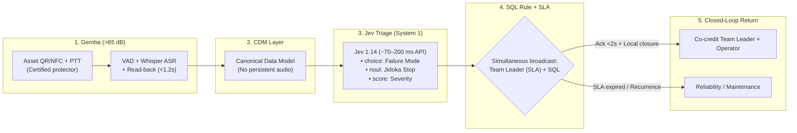

The technical pipeline sharply separates the online deterministic critical path from offline exploratory analysis:

1. **The CDM Layer (Canonical Data Model, Hohpe and Woolf, 2003) `[D]`:** It ontologically decouples the Gemba from the proprietary tables of SAP (`MSEG`, `QMEL`) or of the WMS. The validated event is translated into a canonical tuple without retaining vocal biometrics:
   $$\text{CanonicalOperationalEvent} = \langle \text{EventID},\; \text{ShiftCohort},\; \text{AssetRef},\; \text{TranscriptText},\; \text{TimestampUTC} \rangle$$
2. **The Non-Autoregressive Typed Triage Engine (Jev, TypeSafe AI, 2026) `[R]`:** Instead of invoking heavy autoregressive LLMs (1,500–3,000 ms and fragile JSON), the entity is evaluated at `POST /v1/systemone`. In **a single parallel pass of ~70 to 200 milliseconds via API** (comfortably within the `<2 s` perceptual budget of auditory feedback), Jev resolves three typed primitives with 0% syntactic error:
   * `choice("failure_mode")`: Classifies the symptom within a closed industrial *enum* of up to 255 failure modes (including `OTHER_UNCLASSIFIED` for novel anomalies).
   * `noul("requires_jidoka_stop")`: Estimates the calibrated probability $p \in [0, 1]$ of requiring a line stop or preventive quarantine.
   * `score("operational_severity")`: Quantifies technical urgency on $[0, 1]$.
3. **Simultaneous Broadcast and Supervisor Re-Intermediation (No Punitive Bypass):** In the real Toyota Production System (§4.7), the Andon cord **neither humiliates nor bypasses the Team Leader; it summons him first**. If an algorithm systematically bypasses the shift supervisor to report failures to plant management, middle management will sabotage the tool in less than two weeks. Our architecture therefore applies **simultaneous broadcast with preferential resolution right**: the alert notifies the sector *Team Leader* instantaneously under a metered SLA (60 s on line stop; 15 min on non-blocking degradation). If the supervisor attends, validates, and resolves or routes the work order within the SLA, the system logs the joint closure as an operational credit for the shift; only when the SLA expires unattended or the failure recurs without structural fix does automatic escalation fire to Reliability Engineering.
4. **Online Escalation via Calibrated SQL Rule vs. Weekly Batch Discovery:** Systemic escalation in production is 100% deterministic and controls for base rate in order to prevent Poisson false alarms on high-traffic assets: an SQL query over a 72-hour rolling window raises a *Meta-Incident* when reports from **at least 2 distinct shifts** coincide on the same `(AssetRef, failure_mode)` exceeding the $1 - \alpha$ quantile ($\alpha = 0.01$) of the asset's historical rate $\lambda_0$. Only events labeled `OTHER_UNCLASSIFIED` pass to an **offline weekly batch** process (Sentence-BERT + UMAP with fixed `random_state` + HDBSCAN) to propose candidate failure modes to the reliability engineer for inclusion in the deterministic *enum*.
5. **Bayesian Beta-Binomial Dynamics of Voice Sustainability:** We replace unbounded cumulative integrals with an exact conjugate model of rational operator learning `[M]`. Let $\theta_t \in (0, 1)$ be the worker's belief on shift $t$ regarding the probability that speaking up will produce a useful material response, with prior distribution $\theta_0 \sim \text{Beta}(a_0, b_0)$ ($a_0, b_0 > 0$). Each report issued within his recent horizon is deterministically classified as a **closure success** ($y_i = 1$, verified resolution within the threshold $\tau_i \le \tau_{\text{crit}}$) or a **futility event** ($y_i = 0$, ticket filed without action or $\tau_i > \tau_{\text{crit}}$). With $s_t = \sum_{i \le t} \omega^{t-t_i} y_i$ and $f_t = \sum_{i \le t} \omega^{t-t_i} (1 - y_i)$ ($\omega \in (0, 1]$ memory factor), the posterior expected belief and the reporting probability at $t+1$ satisfy:

$$\mathbb{E}[\theta_t] = \frac{a_0 + s_t}{a_0 + b_0 + s_t + f_t} \in (0, 1), \qquad \operatorname{logit} P(\text{Voice}_{t+1}) = \alpha \cdot PO_t + \beta \cdot \mathbb{E}[\theta_t] - \gamma \cdot \text{Cost}_{\text{cog}}$$

This formulation satisfies all the empirical properties of Detert and Burris (2007) `[M]`: (i) it is strictly bounded; (ii) **every rapid response in the field ($y_i = 1$) raises $\mathbb{E}[\theta_t]$ toward 1 and reinforces $P(\text{Voice}_{t+1})$**; and (iii) every bureaucratic silence ($y_i = 0$) sinks $\mathbb{E}[\theta_t]$ toward 0, extinguishing voice even when the cognitive cost of capture ($\text{Cost}_{\text{cog}}$) is minimal.

### Labor-Law Safeguards and Prohibition of Biometric Surveillance
Deploying microphones in an industrial facility without legal shielding violates comparative labor law and destroys psychological safety at the root (§2.9). The Digital Andon operates under four mandatory technical-legal restrictions:

1. **Absolute Prohibition of Emotion Inference or Voice Psychometrics:** In strict compliance with **Article 5(1)(f) of Regulation (EU) 2024/1689 (AI Act)** `[D]` —in prohibitive force since February 2025—, analyzing worker prosody, tone, stress, or emotions is forbidden. Audio is processed in volatile memory exclusively for lexical transcription of material failures, and the raw acoustic waveform is discarded immediately after *read-back* confirmation (`TTL = 0` on disk).
2. **Zero Individual *Scoring* or Disciplinary Use (Annex III point 4(b) AI Act; Art. 154 Labor Code of Chile):** The system stores no individual speed or error rankings per operator and feeds no performance or dismissal evaluations (avoiding triggering high-risk algorithmic labor-management classification and respecting the doctrine of the Chilean Labor Directorate on collective, suitable, and non-disproportionate control measures). Closure feedback arrives at the station/shift terminal, while analytics aggregates solely by `AssetRef` and shift cohort.
3. **Data Protection Impact Assessment (DPIA) and Union Co-Determination:** Prior to activating PTT on the plant floor, an express agreement is signed with the works council or union (in accordance with the co-determination standard of **§87(1) No. 6 BetrVG** in European jurisdictions and local parity protocols), and the DPIA required by **Art. 35 of the GDPR** and **Law No. 21,719** on personal data protection of Chile is published `[D]`.

---

## 4.9 The Guardrail Is Already Law: The Baseline of Regulated Sectors

The architecture of this chapter —immutable logging, deterministic validation, named human supervision, prohibition of a probabilistic model writing without verification— may seem an eccentric consultant's proposal. It is not. In four industries that move trillions of dollars, exactly that architecture has been mandatory for decades, and the companies that fail to comply do not receive a fine: they lose the license to operate.

The doctrinal consequence is uncomfortable for the enterprise software industry: **the deployment gap does not exist where someone with power forced it closed**. It exists in retail, logistics, agroindustry and unregulated manufacturing, where nobody demands the record and therefore nobody pays for it.

### 4.9.1 The Regulatory Canon of Deterministic Recording

| Sector | Standard | Year | Technical Requirement | FDS 2.0 Artifact that Complies with It |
|---|---|---|---|---|
| Pharmaceutical | **21 CFR Part 11** (FDA) | 1997 | System validation, immutable *audit trails*, electronic signatures linked to the signer, record retention and availability | Append-only event log with hash chain; named signature bound to the transaction hash |
| Pharmaceutical (EU) | **EudraLex Vol. 4, Annex 11** (GMP) | 2011 | Validated computerized systems, data integrity, periodic review of the audit trail | Monthly review of invariants; *replay* of events over the previous year |
| Medical devices | **IEC 62304** | 2006/2015 | Software life cycle, safety classification, requirements verification | FSM with verified transitions and negative tests; requirements traceability |
| Aviation | **RTCA DO-178C** | 2011 | Requirements traceability, independent verification, code structure coverage | Suite of 35 tests and adversarial probes P1-P6 over the trust boundary |
| Banking | **SR 11-7 / OCC 2011-12** | 2011 | Model validation, use limits, continuous monitoring and independent *effective challenge* | Probabilistic models confined to authority levels 1-3 (§4.1); level 4 reserved for the automaton |
| Securities markets | **SEC Rule 17a-4(f)** | 2003 | Electronic records that cannot be rewritten or erased (*WORM*), with index and retrieval capability | Event ledger with timestamping and prohibition of *update* on the entry |
| Artificial intelligence | **ISO/IEC 42001:2023** | 2023 | AI management system: policy, roles, risk assessment, continuous improvement | Deployment governance: Day 0 Charter, exception register, quarterly audit |
| Artificial intelligence (EU) | **Regulation (EU) 2024/1689** (AI Act), arts. 12, 13, 14 and 15 | 2024 | Automatic event logging (*logging*), instructions for use, effective human oversight, accuracy and robustness | The four layers of §4.1 and the *Break-Glass* protocol with a named signature |

`[D]` The joint reading of the table produces a result that should make any executive committee uncomfortable: **none of these standards requires the model to be right**. They require that the system can demonstrate what it did, who authorized it, with what data and how it is reversed. The law does not regulate intelligence; it regulates traceability. It is exactly the thesis of this monograph, written by regulators who did not know each other.

### 4.9.2 The Calendar Is Negotiated; the Requirement Is Not

Regulation (EU) 2024/1689 established a staggered calendar: prohibitions from February 2025, obligations for general-purpose models from August 2025, transparency under Article 50 from August 2026 and full obligations for high-risk systems of Annex III from August 2026. Annex III includes, in its point 2, the systems used as **safety components in the management and operation of critical infrastructures** —water, gas, heating, electricity, traffic—, which is the physical territory of this treatise.

That calendar has already been modified. **Regulation (EU) 2026/1744**, adopted on July 8, 2026, published in the Official Journal on July 24 and in force since July 27, shifted the obligations of Annex III to **December 2, 2027** and those of Annex I to **August 2, 2028**, without touching the content of the requirements: risk management, technical documentation, human oversight and conformity assessment remain the same `[D]`.

`[I]` The interpretation is inevitable and it is not cynical: when the cost of complying with a regulatory metric becomes politically unsustainable, the regulator renegotiates the calendar. It is Campbell's Law operating on the legislator himself. The lesson for design is not that the standard is useless, but that **a compliance calendar is not a guardrail**; the guardrail is the audit trail that already exists when the calendar moves. The company that waited for the deadline to build the record is not "ahead" in 2027: it is four years behind its own terrain.

### 4.9.3 What the Law Does Not Cover (and Why It Matters)

Three limits delimit the scope of this argument:

1. **Sectoral coverage.** Annex III covers the safety components of critical infrastructures, not the WMS of a distribution center or the ERP of a supermarket chain. In the sectors where the gap is widest —retail, logistics, agroindustry— there is no regulator to demand the record; that is why the doctrine must enter through private contract (Day 0 Charter, Chapter 6) and not through compliance.
2. **Certification is not integrity.** The history of ISO 9000 (Chapter 1) shows that a certificate can coexist with *dry-labbing* for decades. If the auditor accepts documents instead of consulting the raw log, the standard produces ceremony, not truth. The acid test of any regulatory regime is a single one: **can the regulator consult the original event, or only the report that the company prepared for him?**
3. **Recording without appeal is tyranny.** The Horizon case of the British Post Office —whose first volume of the final report, published in July 2025, documented around a thousand wrongful convictions and thirteen linked suicides— shows that a deterministic, incontestable record in the hands of the same entity that investigates and prosecutes produces injustice at industrial scale. The guardrail that protects the *ledger* of the operation must include the inverse right: the operation must be able to challenge the *ledger*. The human oversight of Article 14 and the right to explanation before automated decisions are the codification of that lesson.

**Falsification condition of the chapter:** if the sectors with strict regimes of deterministic recording showed a deployment failure rate comparable to that of the sectors without a regime, then the law would not be the variable that closes the gap and the thesis of external authority (§1.7) would be weakened. The available evidence —pharmaceuticals, aviation, banking— points in the opposite direction, but it is a comparison between industries, not a controlled experiment, and so it must be declared.

---

# CHAPTER 5: ECONOMIC GOVERNANCE: MOQ, COST-TO-SERVE AND THE TRUE P&L

### ARTISTIC CURATION RECORD — CHAPTER 5


* **Work:** *The Money Changer and His Wife* (*Le Prêteur et sa femme*)
* **Artist:** Quentin Matsys (1514)
* **Technique and Dimensions:** Oil on oak panel, 70.5 × 67 cm
* **Current Location:** Musée du Louvre, Paris, France
* **Semiotic Reading and Rationale for Selection:**  
  The panel portrays an Antwerp banker meticulously weighing gold coins and pearls on a manual precision balance. His wife, at his side, averts her gaze from an illustrated book of religious devotion to observe the gleam of the metal with fascination. On the table rest coins of diverse origins, bronze weights and a convex mirror that reflects the exterior window.  
  It is the confrontation between two accountings: moral/accounting appearance (the book of hours) and the exact material weight of the coin on the physical balance. In modern corporations the same tension occurs: the income statement of the ERP displays an artificially clean and devout accounting gross margin, while the real balance of **Cost-to-Serve** on the dock weighs the implacable cost of handling, fractionalization, returns and immobilized working capital. The banker knows that a coin with a filed edge is not worth what its die says; the Ground-Truth Systems Architect knows that an order with a 40% gross margin can destroy the plant's cash flow.

---

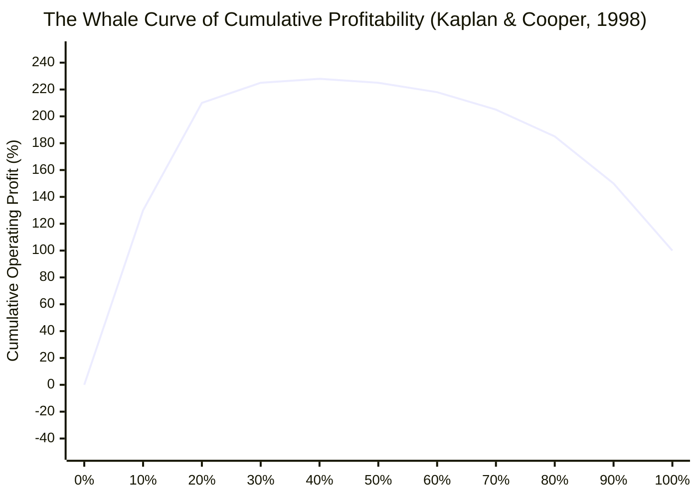

## 5.1 The Illusion of Gross Margin versus the Real Cost to Serve (*Cost-to-Serve*)

In executive committees and boards of directors, corporate profitability is evaluated almost exclusively through the accounting gross margin:

$$\\text{Gross Margin} = \\frac{\\text{Selling Price} - \\text{Cost of Goods Sold (COGS)}}{\\text{Selling Price}}$$

Under this conventional model codified in ERPs, the indirect costs of distribution, storage, packaging and returns administration are allocated through fixed coefficients prorated over the monetary value of the merchandise `[D]`.

This accounting simplification produces a systematic distortion that we call **The Gross Margin Illusion**:

* **Customer A (Efficient):** Orders 72 hours in advance in complete closed pallets (*Full Truckload - FTL*), receives within flexible time windows and has automated docks that release the truck in 30 minutes.
* **Customer B (Value Destroyer):** Orders daily with urgent delivery in less than 12 hours, in fractionalized cases with loose units, demands out-of-spec labeling, rejects pallets if the cellophane is scuffed and generates a 15% rate of product returns.

In the traditional ERP, both customers display an identical gross margin of 35%. In the real cash flow (*Cash-to-Cash*), Customer A generates a net operating margin of **+22%**, while Customer B generates a negative net margin of **-18%**, silently financed by the former.

The **Real Cost to Serve (*Cost-to-Serve - CTS*)** breaks down each logistics, physical and administrative activity consumed by order $i$ `[M]`:

$$\\text{CTS}_i = c_0 + c_1 L_i + c_2 B_i + c_3 E_i + c_4 D_i + c_5 R_i + c_6 W_i$$

where $L_i$ is the number of lines, $B_i$ that of cases fractionalized by hand, $E_i$ that of emergency dispatches, $D_i$ that of dock deliveries, $R_i$ that of returns and $W_i$ the working capital immobilized in days of overdue trade credit.

---

## 5.2 The Whale Curve of Kaplan & Cooper (1998) `[D]`

Robert S. Kaplan and Robin Cooper (Harvard Business School, 1998) `[D]` formalized the empirical regularity that emerges when applying activity-based costing over the customer portfolio of global corporations:

1. **The Top 20% (Wealth Generators):** Ordered from highest to lowest net contribution (which by mathematical construction imposes a **strictly concave** cumulative curve of non-increasing marginal increments), the 20% of most profitable customers habitually generates between **150% and 300% of final operating profit** (with the typical cumulative peak sitting around 200%–230% between the third and fourth deciles).
2. **The Middle 50%–60% (Neutral):** They barely cover their direct and cost-to-serve expenses, contributing an almost flat slope close to the *break-even* point.
3. **The Bottom 10%–20% (Value Destroyers):** They consume so disproportionate a volume of rush orders, manual case-breaking and reverse logistics that they **destroy between 50% and 200% of operating profit**, pulling the cumulative curve back down from its peak to the 100% accounting figure reported on the income statement.

The curve of the previous diagram is an illustrative reconstruction of that regularity, not the measurement of a specific company; its shape —not its decimals— is what must be audited in every portfolio. The corporation closes its balance sheet with 100% reported profit, blind to the fact that its operation generated 225% in potential earnings that were incinerated at 125% to subsidize structurally ruinous customers. When the company connects commercial recommendation algorithms without Cost-to-Serve governance, AI accelerates sales precisely in the deficit segment, amplifying the destruction of equity.

---

## 5.3 Optimism Bias in Forecasting: Fildes et al. (2009) `[D]`

The economic distortion is not limited to costs; it corrupts the demand planning process (*S&OP*).

In a massive econometric audit of **more than 60,000 individual forecasts and their corresponding human adjustments** in four multinational corporations in the United Kingdom, **Robert Fildes, Paul Goodwin, Michael Lawrence and Kesten Nikolopoulos (2009, *International Journal of Forecasting*)** `[D]` found:

* **Predominance of Upward Bias:** More than **75% of the manual adjustments made by commercial committees over the quantitative models were discretionary increases in the sales projections**.
* **Destruction of Statistical Accuracy:** Whereas downward manual adjustments improved accuracy by an average of 4 points, **upward manual adjustments increased forecast error (WAPE / MAPE) between 4.5% and 11.2%**, systematically destroying the performance of the underlying mathematical model.

Commercial managers inflate targets because their annual bonuses depend on projecting growth; if the merchandise runs out, they blame logistics for "stockouts"; if the merchandise is left over, the financial cost hides in the operating balance sheet.

### Rigorous Measurement through Forecast Value Added (*FVA*)
Performance is not measured by evaluating the planner in the abstract; it is audited through **Forecast Value Added (FVA)** by comparing three concurrent series:

| Series Level | WAPE / Weighted Error | Value Added (*FVA*) | Operational Verdict |
|---|:---:|:---:|---|
| **1. Naïve Forecast (Random walk)** | 38% | — | Passive baseline of the market. |
| **2. Statistical Model / Base Algorithm** | 31% | **+7 points** | The algorithm generates real value. |
| **3. Final Forecast after Managerial Adjustment** | 35% | **−4 points** | **The human committee destroys economic value.** |

When data scientists train AI models with the history of approved forecasts instead of pure physical demand, the neural network learns the upward managerial bias, amplifying the **bullwhip effect** of Hau Lee and saturating the warehouses with unsellable stock.

---

## 5.4 The Minimum Order Quantity (MOQ) Trap and Working Capital

One of the greatest destroyers of free cash flow is the purchasing policy based on the **Minimum Order Quantity (MOQ)** `[V]`.

The buyer is evaluated locally on **Purchase Price Variance (PPV)**. To capture a volume discount of 2% or 5% offered by the supplier, he accepts acquiring a minimum lot that multiplies his optimal economic lot by $3.6\times$ (five full months of demand at once).

### 5.4.1 Mathematical Model of the Economic Viability of Discounts
We analytically model the condition that decides whether an MOQ discount is profitable or impoverishing `[M]`:

Let $D$ be the annual demand in units, $P$ the undiscounted base unit price, $S$ the administrative and receiving cost per order, $h$ the annualized inventory holding rate and $H_0 = P \\cdot h$ the base annual unit holding cost, which defines the standard economic order quantity (EOQ):

$$Q^* = \\sqrt{\\frac{2DS}{H_0}}$$

The supplier offers a percentage discount $d \\in (0, 1)$ conditioned on ordering a minimum lot $Q_m > Q^*$, reducing the annual unit holding cost to:

$$H(d) = P(1 - d) \\cdot h$$

where the aggregated annualized inventory holding rate $h$ is decomposed empirically as:

$$h = r_{\\text{WACC}} + c_{\\text{storage}} + c_{\\text{obsolescence}} + c_{\\text{damage}}$$

* $r_{\\text{WACC}}$: Weighted average cost of capital (10% to 15%).
* $c_{\\text{storage}}$: Cost of space, climate control, insurance and personnel (3% to 6%).
* $c_{\\text{obsolescence}}$: Expiry or technological depreciation rate (5% to 12%).
* $c_{\\text{damage}}$: Rate of shrinkage from handling and overcrowding (2% to 5%).

The rate $h$ ranges in the industry between **20% and 38% annually** of the asset value `[D]`.

The exact condition for the financial viability of the discount requires that gross price savings exceed the net variation in cycle inventory holding and order-issuance costs:

$$D \\cdot P \\cdot d > \\left(\\frac{H(d) \\, Q_m}{2} - \\frac{H_0 \\, Q^*}{2}\\right) + D \\cdot S \\left( \\frac{1}{Q_m} - \\frac{1}{Q^*} \\right)$$

### 5.4.2 Exact Numerical Example
Suppose $D = 12,000$ units/year ($3,000$/quarter), $P = \\text{USD } 10.00$, $h = 25\\%$ ($H_0 = \\text{USD } 2.50$/unit/year) and $S = \\text{USD } 200$/order:

* Base economic lot: $Q^* = \\sqrt{2 \\times 12,000 \\times 200 / 2.50} = 1,385.64 \\approx 1,386$ units.
* The supplier offers a discount $d = 2\\%$ subject to an MOQ of $Q_m = 5,000$ units ($1.67\\times$ quarterly demand and $3.61\\times$ the optimal lot $Q^*$), with discounted holding cost $H(d) = 10 \\times (1 - 0.02) \\times 0.25 = \\text{USD } 2.45$/unit/year.
* Gross savings in purchases: $12,000 \\times \\text{USD } 10 \\times 0.02 = \\text{USD } 2,400.00$ annually.
* Net excess cost of holding cycle inventory: $\\frac{2.45 \\times 5,000}{2} - \\frac{2.50 \\times 1,385.64}{2} = 6,125.00 - 1,732.05 = +\\text{USD } 4,392.95$ annually.
* Savings in order issuance: $12,000 \\times 200 \\times (1/5,000 - 1/1,385.64) = 480.00 - 1,732.05 = -\\text{USD } 1,252.05$ annually.
* **Net Financial Impact:** $+\\text{USD } 4,392.95 - \\text{USD } 1,252.05 - \\text{USD } 2,400.00 = +\\text{USD } 740.90$ in net annual excess cost.

**The 2% commercial discount destroys USD 740.90 per year of free cash flow in a single SKU** (even recognizing the proportional reduction of $H(d)$ on the discounted price). The purchasing department celebrates a "PPV saving" of USD 2,400 in its departmental bonus, while treasury silently absorbs the financial cost of immobilized capital and the dock suffers the physical overcrowding.

---

## 5.5 Mechanism Design: Truth-Compatible Contracts

Following Leonid Hurwicz and Eric Maskin's mechanism design theory, truth is not obtained through moral appeals; it is induced by designing payment rules where telling the material truth is the dominant strategy for all agents `[M]`.

For probabilistic demand forecasts, the incentive must be structured through a **strictly proper scoring rule** (Gneiting & Raftery, 2007) `[D]`:

* **Brier Score** for binary events: $S(f, y) = 1 - (f - y)^2$.
* **Continuous Ranked Probability Score (CRPS)** for continuous cumulative distributions.

**Separation Theorem between True Forecast and Inventory Decision:** A classic error in contract design consists of adding stockout or excess-stock penalties onto the forecaster's compensation ($w = w_0 + \\alpha S(F, y) - \\beta \\mathbf{1}_{\\text{stockout}} - \\gamma \\mathbf{1}_{\\text{excess}}$); adding operational outcome indicators **mathematically destroys the strictly proper property of $S(F, y)$**, since it induces the planner to bias the reported distribution $F$ in order to hedge against the penalized event (Gneiting & Raftery, 2007) `[D]`. Incentive-compatible architecture requires separating the two functions `[M]`:

1. **Pure Forecasting Contract (Epistemic Truth):** The demand planning team (or the statistical ensemble) reports solely the predictive cumulative distribution $F_t$ and is evaluated **exclusively** on **CRPS** gain relative to the seasonal naïve forecast (*probabilistic FVA*):
   $$w_{\\text{plan}} = w_0 + \\alpha \\bigl(\\operatorname{CRPS}(F_{\\text{naive}}, y_t) - \\operatorname{CRPS}(F_t, y_t)\\bigr), \\qquad \\operatorname{CRPS}(F, y) = \\int_{-\\infty}^{\\infty} \\bigl(F(z) - \\mathbf{1}_{\\{z \\ge y\\}}\\bigr)^2 dz$$
   Because it does not depend on the physical inventory level but only on $(F_t, y_t)$, reporting the true belief $F_t = G_t$ is a strictly dominant strategy.
2. **Deterministic Replenishment Policy (Newsvendor Critical Fractile):** Given the unbiased forecast $F_t$, the deterministic engine (`kern`) computes the target quantity via the optimal quantile that balances unit underage cost ($C_u$: lost margin + contractual penalty) against unit overage cost ($C_o$: holding cost $H$ + obsolescence risk):
   $$Q_t^* = F_t^{-1}\\!\\left(\\frac{C_u}{C_u + C_o}\\right)$$
   Thus, commercial aversion to stockouts ($C_u > C_o$) explicitly governs the stock decision *without ever contaminating or biasing the base forecast*.

---

## 5.6 The True P&L and Its Forensic Measurement

The real income statement of a business line is not the gross margin of the ERP; it is the algebraic sum of five observable components:

$$\\Pi_i = (P_i - C_i) \\, Q_i - \\text{CTS}_i - \\text{Risk}_i - \\text{Tax}_i$$

* $\\text{CTS}_i$: Real cost to serve by activities.
* $\\text{WC}_i = c_6 W_i$: financing cost of immobilized working capital ($h \\cdot \\text{WACC}$), **already included within $\\text{CTS}_i$**; it is made explicit here so that the reader does not subtract it twice. The double-counting error of working capital is, in our experience, the most frequent of all those committed when building a P&L by customer.
* $\\text{Risk}_i$: Expected loss from obsolescence, dock shrinkage or contractual returns.
* $\\text{Tax}_i$: Tax and regulatory costs specific to the line.

---

## 5.7 Line of Sight and Relational Significance: Translating the P&L to the Gemba

The econometric calculation of the Cost to Serve (*Cost-to-Serve*) and the whale curve remain mere office abstractions if the organization is incapable of translating the numbers of the P&L into the physical conduct of the dock worker. This cognitive fracture is what Wendy R. Boswell and John W. Boudreau (2001; Boswell, 2006, *IJHRM*, 17(9), 1489–1511) `[D]` defined and operationalized as the **Line of Sight (LOS)**.

Boswell and Boudreau demonstrated that the Line of Sight bifurcates into two distinct analytical constructs:

1. **LOS-Objectives (*Understanding Strategic Objectives*):** The general understanding of macro corporate goals (e.g., EBITDA, return on invested capital).
2. **LOS-Actions (*Understanding Aligned Actions*):** The exact operational knowledge of which decisions, control habits and daily work priorities at the work station positively impact or destroy those macro objectives.

In multisectoral empirical surveys, Boswell found a **systematic hierarchical gap**: whereas between 85% and 90% of the executive committee understands the strategy, in middle supervision the index descends to 50%–60%, and at the operational base of the Gemba it habitually collapses below 25%. Crucially, the modeling demonstrated that abstract knowledge (LOS-Objectives) lacks predictive power over conduct; it is exclusively the understanding of concrete actions (**LOS-Actions**) that exhibits direct standardized coefficients on role performance ($\\beta = 0.21, p < 0.01$), job satisfaction ($\\beta = 0.28, p < 0.001$) and staff retention through a deliberate reduction of turnover intention ($\\beta = -0.22, p < 0.01$).

Closing this gap demands replacing corporate slogans with **visual matrices of local impact** on the dock:

| Operational Decision at the Station | Systemic Failure Downstream | Direct Financial Consequence in the P&L |
|---|---|---|
| Omission of expiry batch verification at the receiving dock (saving of 20 s per pallet). | Disorderly location in dynamic racking; dispatch of expired stock to the customer `[D]`. | Contractual penalties; full loss of the batch (USD 45,000) and cost of urgent reverse freight. |
| Deficient palletization or loose strapping to rush the hourly outbound quota. | Overturning of the load during braking or turning in the trunk transport `[V]`. | Full loss of merchandise; dock demurrage and accelerated replacement at a loss. |
| Forced manual keying of the SKU when the radio-frequency reader fails to read. | Generation of offsets between physical stock and the logical WMS record (*Phantom Stockouts*) `[D]`. | Stockouts in the picking line; extraordinary cycle counts (USD 35/man-hour). |

This cognitive reconnection is complemented by Adam M. Grant's experimental evidence on relational job design (Grant et al., 2007, *OBHDP*, 103(1), 53–67; Grant, 2008, *JAP*, 93(1), 108–124) `[D]`. In controlled field experiments, a direct five-minute contact between workers and an actual beneficiary of their labor increased active persistence (effective time on task) by **142%** and economic revenue raised by **171%** (replicating in new cohorts more than double the calls and funds raised in Grant, 2008), mediated by two psychosocial variables: **Perceived Social Impact** (the conviction that one's own actions prevent material harm to third parties) and **Perceived Social Worth** (the feeling of recognition and dignity). 

In the clinical field, Yehonatan Turner and Irith Hadas-Halpern (2008, RSNA) `[D]` confirmed this principle by verifying that the simple inclusion of a facial photograph of the patient on the computed tomography digital screen raised radiologists' detection of incidental findings by 46% ($p = 0.005$). When the warehouse worker visualizes that the spare part he is packing is the hydraulic valve for a farmer halted in the middle of harvest or the catheter for a pediatric operating room first thing in the morning, the task transitions from mechanical micro-manipulation toward the active custody of the human flow, disarticulating task alienation (Hackman & Oldham, 1976) `[D]`.

---

## 5.8 Psychological Ownership and Open-Book Management: The Disarticulation of Kerr on the Floor

The integral alignment of the Gemba culminates when the workforce assumes an identity of shared stewardship over the productive asset. Jon L. Pierce, Tatiana Kostova and Kurt T. Dirks (2001, 2003, *AMR*, 26(2), 298–310) `[D]` formalized the construct of **Psychological Ownership**, defined as the cognitive and affective state in which an individual experiences that the technical system or the organization is "his" ("This is mine / This is ours").

Pierce et al. establish that psychological ownership is independent of formal shareholding and responds to the satisfaction of three human motives: self-efficacy, self-identity and possession of a secure territory. It is built on the floor through three operational routes:

1. *Route of Control:* Legitimate authority for local intervention and Andon stop.
2. *Route of Intimate Knowledge:* Algorithmic transparency over the terminal's data model.
3. *Route of Investment of the Self:* Incorporation of Kaizen improvements and personal verification signature on each dispatched unit.

In three independent field investigations ($N_1 = 133, N_2 = 147, N_3 = 202$), Linn Van Dyne and Jon L. Pierce (2004, *JOB*, 25(4), 439–459) `[D]` demonstrated that psychological ownership explains statistically significant incremental variance in formal job performance and in organizational citizenship behaviors directed at the company ($\\Delta R^2 = 0.04 \\text{ to } 0.07, p < 0.01$), surpassing the predictive power of affective commitment and job satisfaction. Complementarily, James B. Avey, Bruce J. Avolio, Craig D. Crossley and Fred Luthans (2009, *JOB*, 30(2), 173–191) `[D]`, on a sample of 414 workers, validated that ownership directly reduces work deviance and counterproductive behaviors ($\\beta = -0.24, p < 0.01$) and raises the assumption of accountability (*accountability*, $\\beta = 0.38, p < 0.001$).

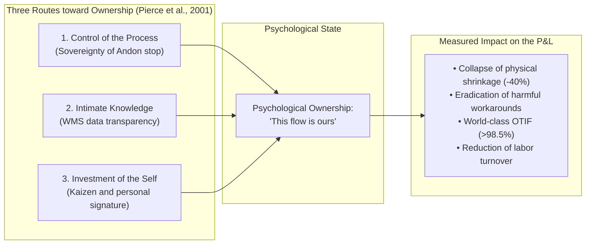

To anchor this state in the company's finances, Jack Stack (1992, *The Great Game of Business*) `[D]` structured at Springfield ReManufacturing Corporation (SRC) the **Open-Book Management (OBM)** model. Upon acquiring a manufacturing plant in bankruptcy with a debt-to-equity ratio of 89:1, Stack educated mechanics and lathe operators in reading the income statement and free cash flow, managing to reduce leverage to 1:1 and multiplying the share value from USD 0.10 to more than USD 199.

OBM disarticulates **Kerr's Folly** (rewarding individual speed while expecting quality) and **Campbell's Law** through three symmetric mechanisms of shared gain (*Gainsharing*):

1. **Collective Profitability Trigger (*Financial Hurdle*):** No unit bonus is released if the plant does not first reach a predefined global threshold of net profit or free cash flow.
2. **Independently Audited Collective Gainsharing (No Penalty for Self-Reporting):** Penalizing individual productivity for defects reported on one's own shift would violate our own model (§2.1.1): it would lack a zero floor if defects exceed tolerance (illegal wage deduction) and would incentivize hiding breakage behind the rack (Workaround #5). Therefore, the bonus is calculated at the **cell/shift cohort** level with a strict floor at zero, biweekly or monthly periodicity (including pro-rata for temporary staff) and an integrity factor $Q^{\\text{aud}}_t \\in [0, 1]$ measured **exclusively through independent blind counts and verified downstream claims, never through self-declared shrinkage or Andon alerts** `[M]`:
   $$\\text{Bonus}_{\\text{team}, t} = \\max\\!\\bigl(0,\\; \\theta \\cdot (P_{\\text{team}, t} - P_{\\text{base}})\\bigr) \\times Q^{\\text{aud}}_t \\times \\mathbb{I}(\\text{FCF}_{\\text{site}} \\ge \\text{Threshold})$$
   Reporting a broken case on time via `BWART 103` or Digital Andon **does not reduce $Q^{\\text{aud}}_t$**; hiding it in an active location and having it discovered by a blind audit does penalize it. Thus, declaring the physical truth strictly dominates concealment.

3. **The Critical Number and Public Scoreboards:** Physical boards on the dock where operators dynamically forecast each week the cash and cost variables they control in their shift.

This architecture converges with the Lean tools of systemic de-alienation: Value Stream Mapping (**VSM**, Rother & Shook, 1999) `[D]` and the cross-functional Gemba walk that generates the "Moment of Revelation" by making cross-cutting bottlenecks visible; the bidirectional goal dialogue **Hoshin Kanri Catchball** (Akao, 1991) `[D]`; and simultaneous synchronization in the **Obeya Room** under the SQDCM scheme (Safety, Quality, Delivery, Cost and Morale). In this sociotechnical regime, the operator ceases to be a replaceable cog and assumes the role for which his intelligence was forged: that of conscious and sovereign custodian of the profitability of the value flow.

---

# CHAPTER 6: THE DEPLOYMENT PLAYBOOK IN THE FIELD: FROM THE 120-HOUR INTAKE TO A CUTOVER WITHOUT FRICTION

### ARTISTIC CURATION RECORD — CHAPTER 6


* **Work:** *The Night Watch* (*Militia Company of District II under the Command of Captain Frans Banninck Cocq*)
* **Artist:** Rembrandt van Rijn (1642)
* **Technique and Dimensions:** Oil on canvas, 363 × 437 cm
* **Current Location:** Rijksmuseum, Amsterdam, Netherlands
* **Semiotic Reading and Rationale for Selection:**  
  Rembrandt breaks with the traditional static portrait of civic militias and shows Captain Banninck Cocq's guard setting out unexpectedly from an arcade in half-light toward the light of the street. There are drums sounding, muskets being loaded with live powder, pikes rising in apparent disorder and a dog barking in the darkness. In the midst of the nocturnal tumult, the luminous figure of a girl carries a white rooster tied to her waist (emblem of the arquebusiers and of victory).  
  It is the aesthetic embodiment of **02:30 AM on the receiving dock**: the night shift where the operational truth of a corporation is decided. There is no martial parade for the board of directors nor immaculate corporate slides; there is fatigue, improvised dynamism, operators preparing cranes in the half-light and guards watching that the load flows without stopping the dock. Rembrandt understood that the real order of an armed community does not come from ceremonial stillness, but from discipline in movement under the chiaroscuro of the night.

---

```mermaid
gantt
    title Deployment protocol: 30 days of intake, 14 of staging, ABC cutover and 90 of hyper-care
    dateFormat  YYYY-MM-DD
    section Phase 0: Contract
    Signing of the Day 0 Charter (binary question and kill-criteria) :milestone, 2026-11-01, 0d
    section Phase 1: Intake (120 h)
    Read-only, integrity and schemas (days 1-5)     :2026-11-01, 5d
    Immersion in the Gemba, 02:30 shift (days 6-12)      :2026-11-06, 7d
    Incentives, FVA and working capital (days 13-20)   :2026-11-13, 8d
    FSM 3 coordinates, replay and probes P1-P6 (21-27)    :2026-11-21, 7d
    One-page decision memo (days 28-30)         :milestone, 2026-11-28, 0d
    section Phase 2: Staging and cutover
    14-day shadow run, no writes to the ERP      :2026-12-01, 14d
    Critical stock buffer (3 weeks before the cutover) :2026-11-24, 21d
    Master data freeze (2 weeks)        :2026-12-01, 7d
    Modular ABC cutover, phases I to III                    :2026-12-15, 7d
    Monthly kill-switch test                      :2026-12-15, 1d
    section Phase 3: Hyper-care (90 days)
    Weekly reconciliation and invariant audit   :2026-12-22, 90d
```

## 6.1 The Protocol as Contract, Not as Courtesy

A technological deployment does not begin when the software is installed; it begins when the corporate sponsor signs which concrete facts will formally count as failure of the project.

The **30-Day Field Protocol** presupposes **120 hours of real operational presence** at the client's physical facilities (distributed over 4 hours of daily field work), complemented by forensic data analysis.

### The Day 0 Charter
Before opening a single code terminal, the Chief Operating Officer (COO) and the Forward Deployed Strategist sign the **Day 0 Charter**, which establishes four mandatory clauses:

1. **The Binary Decision Question:** A single question posed with a strict yes/no answer for the day-30 gate (consistent with the Gantt schedule). Example: *Does the Central Distribution Center meet the physical integrity and latency thresholds to enter on day 31 into the 14-day Shadow Run and the staggered modular ABC cutover toward write authority in SAP?*
2. **The Kill Criterion (*Kill-Criteria*):** Fixed before seeing the data to avoid opportunistic redefinitions. Example: *The deployment is canceled immediately if the rate of unresolved exceptions exceeds 3% or if the p99 dock latency exceeds 500 ms.* The thresholds are not universal: they are derived from the measured baseline of the legacy system on the same shift during the first five days, and are set above its p95 with a declared margin. Gartner (October 2026) `[R]` reported that only 13% of CIOs claim to have obtained significant or transformational value from AI and that most companies lack formal exit criteria (*exit rules*) for their pilots: the kill criterion is, precisely, the clause that almost nobody signs.
3. **Read-Only Access within 5 Days:** If the corporation is not capable of supplying a complete data dump in read-only mode (`read-only`) within five business days, the project stops there. A team incapable of delivering passive data in one week will never sustain a production adoption.
4. **Absolute Production Safety:** Zero direct writes to the ERP during the first 30 days of evaluation.

---

## 6.2 The 120 Hours: Forensic Anatomy of the Intake

The technical immersion process is executed in five rigorous stages:

* **Days 1–5: Connectivity and Anomaly Register.** Read-only connection to the transactional databases of the last 24 months. Integrity queries are run looking for: negative inventory balances, mass adjustment movements concentrated on the last day of the month, and divergences between theoretical and real lead times.
* **Days 6–12: The Gemba Immersion.** Every shift is walked, with mandatory presence on the **02:30 AM night shift**, in safety footwear and a high-visibility vest. The interview does not ask abstract opinions; it interrogates the last physical exception: *Will you show me the last order that left late? What did you do on the screen to unblock the dock?* The **stratified blind count** is executed and the **inventory of shadow systems (spreadsheets and WhatsApp groups)** is compiled.
* **Days 13–20: Incentives, Forecast and Working Capital.** The forecast value added (*FVA*) is calculated over three concurrent series (Chapter 5), the upward bias of human adjustments is audited and it is mapped which annual bonuses depend on the transactional report.
* **Days 21–27: Construction of the Deterministic Frontier.** The decoupled FSM is parameterized in three coordinates (`inbound_fsm_guardrail.py`), the three risk lanes are defined (Green: automatic; Yellow: requires supervisor signature; Red: requires project sponsor) and the historical reproduction tests over the previous year (*Replay Testing*) are executed.
* **Days 28–30: The One-Page Decision Memo.** Executive presentation containing: the Day 0 question, the verification of the kill criterion, the three critical Gemba findings, the net financial impact modeled in ranges, and the irrevocable recommendation: **Proceed to gradual production or Stop**. If the recommendation is Stop, the client keeps the anomaly register and the incentive map; aborting on day 30 saves millions of dollars.

---

## 6.3 Safe Staging and Deterministic Kill-Switch

To elude the *Big-Bang* simultaneous cutover catastrophes (such as those of Hershey or FoxMeyer):

### 6.3.1 Shadow / Dual-Run Architecture
For a minimum period of 14 consecutive days, the deterministic system operates in **decoupled shadow mode**:

1. The client's traditional system continues processing the real invoices and shipments.
2. All the frames from scales, RF readers and access gates are cloned asynchronously through a message bus (Kafka / RabbitMQ) and directed to the deterministic FSM in memory.
3. The FSM evaluates the 64 product configurations of the three coordinates (**12 reachable**), calculates the accounting projections (`BWART 103/105/124`) and records in a parallel database any divergence with the official system.

### 6.3.2 Hardware Authority-Transfer Switch (*Keyed Failover Selector*) and Indirect Licensing
Unlike remote software flags that become inaccessible if the cluster freezes, FDS 2.0 installs in the dock cabinet a **two-position rotary electromechanical key selector switch (blue/white: `AUTO FSM` / `LEGACY BYPASS`)**, designed under strict regulatory and transactional separation:

* **ISO 13850 / IEC 60204-1 Compliance (No Confusion with Emergency Stop):** Using red mushroom-head pushbuttons on a yellow background to switch software is prohibited, since that geometry and color scheme are reserved by machinery-safety law exclusively for cutting kinetic energy under life-safety hazard (*E-Stop*). The keyed selector prevents industrial safety confusion on the plant floor and leaves physical evidence of the mode change.
* **Clean Write-Lease Transfer (<100 ms without *Split-Brain*):** Upon turning the key to `LEGACY BYPASS` (due to p99 latency > 500 ms or bus outage), a dry contact revokes in less than **100 milliseconds** the gateway's *Single-Writer Lease* (§4.4.4) —degrading the FSM instantaneously to passive read-only shadow mode— and transfers exclusive posting authority to the standard `MIGO` terminals of the legacy system. In-flight events remain sealed in the local WAL with idempotent `MKPF-XBLNR` for duplicate-free reconciliation.
* **Governance of Hidden ERP Costs (SAP Digital Access and ITGC/SOX 404):** Splitting a traditional receipt (`101`) into two material documents (`103` + `105`) doubles the volume of line items created by an external system; under the **SAP Digital Access** indirect licensing model (case law *SAP UK Ltd v Diageo Great Britain Ltd* `[2017] EWHC 189 (TCC)` `[D]`), each *Material Document* line is weighted at `0.2` chargeable documents. The Intake explicitly quantifies this marginal licensing cost within the site TCO and registers the technical RFC user under strict segregation of duties (**SoD / SOX 404 ITGC**), such that the service account issuing `103` lacks authorization roles in `SAP GRC` to approve invoices in `MIRO` or modify `MARA`/`LFA1` master records.

---

## 6.4 The 02:30 AM Shift: Six Real Anomalies and Their Governance `[D]`

The robustness of a transactional system is tested at 02:30 AM on a wet dock. The following table summarizes how the FDS protocol governs the six most destructive perturbations of warehouse physics:

| Material Scene in the Gemba | What the Conventional System Sees | What the Software Must NEVER Do | Human Action in Accordance with the Protocol | Resulting Accounting Record |
|---|---|---|---|---|
| **1. Physical discrepancy at the dock: (a) origin damage upon opening the truck vs. (b) in-house forklift pierces six cases after an intact seal.** | Physical count with a difference in units with respect to the order. | Blindly release damaged cases to ATP or penalize the supplier for breakage caused by the warehouse itself. | Intact cases are released by HU (`105`). In (a) origin: the 6 broken cases go to `HELD` (`103` -> `124`). In (b) post-seal internal damage: they are received (`105`) and immediately written off as internal shrinkage. | In (a): `BLOCKED_103` / `BWART 124` (invoice held for the 6 cases). In (b): `BWART 105` followed by **`BWART 551`** against the warehouse cost center (the supplier is paid for what was delivered intact; `ATP` reflects only sellable units). |
| **2. The RF gun loses Wi-Fi coverage in aisle 14.** | Interruption of communication with the central database. | Accept old timestamps on reconnecting or allow picking without scanning. | Terminal operates with local offline SQLite and increasing monotonic signatures. Synchronizes when the network returns. | Offline queue processed with anti-replay validation; if the time expired, manual blind count. |
| **3. The truck must leave immediately but the inspection detected breakage.** | Conflict between retaining the truck or authorizing the defective invoice. | Physically retain the truck at the dock or authorize payment in order to release it. | The physical departure of the vehicle is authorized by issuing the outbound scale ticket. | Application of Theorem T2: legal state `(HELD, BLOCKED_103, DEPARTED)`. The truck leaves; the invoice waits. |
| **4. The weighing scale drifts from accumulated mud and reads 0.01 kg.** | Positive weight reported by the sensor (`gt=0`). | Admit the weight as valid and calculate self-referential parity. | The access gate does not open. It requires physical intervention, vehicle tare and cross-check against the master. | Out-of-calibration sensor alarm; weight record contrasted against `MARA-BRGEW`. |
| **5. Two pallets enter with the same photocopied physical label.** | Duplicate scanning of the same identifier in two locations. | Assign both packages to the same logical balance or overwrite the first. | Immediate physical quarantine of both packages; blind count and reprinting of unique SSCC labels. | Identity collision record; transactional block until formal resolution. |
| **6. The quarantine buffer is saturated by an excess of simultaneous trucks.** | Physical capacity of the dock overflowed ($V_{\\text{actual}} + 1 > V$). | Block the gate forcing the operators to divert merchandise to blind racks. | Activation of the *Break-Glass* protocol (`OVERFLOW_IMPUTED`). The load is physically admitted. | The case is admitted but an accounting charge for the surcharge is issued to the purchasing cost center. |

---

## 6.5 Forensic Anatomy of the Cutover: The Big-Bang Collapse of Revlon vs. The Modular ABC Protocol `[D]`

The difference between a successful systems transition and the massive destruction of value does not reside in the software brand, but in the **formal design of the cutover protocol (*Cutover Strategy*)**. When corporate management succumbs to the illusion of the total simultaneous cutover (*Big-Bang Cutover*), information systems collapse before the nonlinear friction of physical inventory.

### The Forensic Autopsy of Revlon: USD 64M of Orders Lost in Production (2018) `[D]`
In February 2018, the cosmetics multinational **Revlon, Inc.** executed a simultaneous SAP S/4HANA cutover at its main manufacturing plant in Oxford, North Carolina. Management disregarded the warnings of plant personnel and imposed a simultaneous start-up of the planning, purchasing, manufacturing and shipping modules without a prior period of physical stabilization:

1. **Instant Transactional Blindness:** On starting the system without prior reconciliation with the plant floor, the software lost the traceability of packaging components and raw materials. Although the physical ingredients were in the plant, the system marked zero stock at the workstations.
2. **The Collapse of Invoicing and Dispatch:** The plant was unable to ship orders from key customers for a documented net value of **USD 64 million**, incurring penalties for late service (*chargebacks*) and paralysis of the packaging lines.
3. **Audited Financial and Legal Consequences:**
   * Immediate collapse of **6.9% in the price of Revlon shares** after the disclosure of the financial impact.
   * The company had to record significant material weaknesses in its internal controls over financial reporting under Section 404 of the Sarbanes-Oxley Act (SOX).
   * Shareholders filed a class action before the District Court for the Southern District of New York (*Pio v. Revlon, Inc. et al.*, Civil Action No. 1:18-cv-11133) `[D]`, accusing the Board of Directors of negligence in technological governance and breach of internal controls.

### The Safeguard Protocol: Modular ABC Cutover and Buffer Stock Dampening `[D]`
Faced with the Revlon catastrophe, High-Reliability Organizations (*High-Reliability Organizations - HRO*, Weick and Sutcliffe, 2001) `[D]` apply a decoupled cutover protocol structured in four inviolable phases:

1. **Pre-Construction of the Safety Buffer (*Buffer Stock Dampening*):** During the three weeks prior to the migration, the critical Category A SKUs are identified (which represent 80% of invoicing and emergency orders) and a physical safety stock equivalent to 15 days of demand is moved to a fast-dispatch zone (*cross-docking*), pre-released administratively in the system before the cutover weekend. If the new software collapses at the dock, the company continues invoicing and shipping physically without commercial interruption.
2. **Master Data Freeze (*Data Freeze*):** Two weeks before the cutover, any creation, deletion or modification of the material master in the ERP (`MARA`) is prohibited, eliminating the appearance of semantic discrepancies during the migration of balances.
3. **Staggered Cutover by ABC Criticality:** The physical migration of locations and balances is executed in progressive stages:
   * *Phase I:* Static low-rotation components (Category C), verifying the consistency of tables and scales.
   * *Phase II:* Intermediate spare parts (Category B).
   * *Phase III:* Critical items (Category A), audited one by one with blind count before authorizing the change of pointers in the database.
4. **Control Desk Physically at the Dock (Gemba War Room):** The control room is not installed in a hotel or in an executive conference room; it is located physically at the shipping dock, integrating the shift supervisor, inventory analysts, WMS specialists and a circuit breaker wired in hardware with the capacity to revert the transactional traffic to the legacy system in less than 100 milliseconds.

---

## 6.6 Epistemological Limits of the Playbook

To preserve forensic rigor, it is indispensable to declare which limits cannot be overcome by software architecture:

1. **Software Does Not Solve Geometry or Physical Capacity:** If a plant designed for 20 trucks per day attempts to receive 60 trucks at 4 docks, no algorithm or guardrail will prevent the collapse of the yard. Thermodynamic bottlenecks require concrete, asphalt and additional square meters.
2. **Code Does Not Neutralize Structured Collusive Fraud:** If the entire chain of command —from the operations manager to the scale operator— agrees to consciously falsify the weight readings to defraud the company, the software can only certify that the interface contracts were violated. The integrity of the system depends on the existence of at least one uncorrupted cryptographic sensor.
3. **AI Does Not Compensate for the Absence of Elementary Processes:** Deploying computer vision in a warehouse where the pavement has potholes that break pallet trucks and where there is no demarcation of aisles according to safety regulations is a squandering of capital. Elementary physics always precedes digitalization.


## 6.7 The Ninety Days After: Hyper-Care, Drift and Reversal

The cutover is the visible event; the gap opens afterward. Between day 30 and day 90 the consulting team reduces its presence, executive attention migrates to the next quarter, the night shift returns to improvising and the system that yesterday was calibrated begins to measure a world that has already changed. Most deployments do not fail at the *go-live*: they fail in the following quarter, when nobody is watching.

### 6.7.1 Three Mechanisms of Decay

1. **Master data drift.** Each SKU creation, supplier change or unit-of-measure migration opens a semantic crack ($G_s$) that nobody validates. A new barcode that the reader does not recognize is, for the operator, exactly what the previous illegible code was: a rational excuse to key by hand. *Measurement:* percentage of new items with dimensions and units validated before the first movement; drift of $\hat{D}_t$ between counts.
2. **Exception decay.** The exception queue does not strike: it thickens. If the median age of an open exception exceeds 48 hours, the operator learns that reporting changes nothing and the voice is extinguished (Chapter 4, §4.7). *Measurement:* median and p95 age of the queue, exception rate per thousand receptions ($p_e$), effective staffing of resolvers ($n$).
3. **Competence erosion.** The plant rotates personnel; the shift that operated the FSM disperses. A new operator without training in the blind count protocol is not a less productive operator: he is an entry point for the workaround. *Measurement:* percentage of shifts with at least one operator certified in the protocol; recertification latency.

The three mechanisms share one property: **they do not produce visible errors, they produce invisible errors**. The system keeps responding, the screens stay green and the ledger moves away from the floor at the speed of $\mu_\xi$ (Chapter 4, Proposition 1).

### 6.7.2 The Ceremonial Success Index

When the dashboard and the floor diverge, the divergence can be measured. Let $C_s$ be the conformity declared by the system (transactions that the software considers valid) and $C_r$ the real conformity measured by blind count in the same window. We define the **Ceremonial Success Index**:

$$CS = \frac{C_s}{C_r}$$

`[M]` If $CS \\approx 1$, the system and the floor tell the same story. If $CS > 1.2$, the dashboard is measuring the report and not the terrain: the difference is the volume of data fabricated to sustain the green. The index does not require new instrumentation —the blind count already exists in the protocol— and it converts a qualitative suspicion into a number auditable by the Board.

### 6.7.3 Governance Cadence and Exit Criteria

| Cadence | Artifact | Owner | Alarm Threshold | Mandatory Action |
|---|---|---|---|---|
| **Daily** | 15-minute dock stand-up with exception queue age | Shift leader | Median age > 24 h or queue growing three days in a row | Reassign resolvers before the next shift |
| **Weekly** | Reconciliation of $\\hat{D}_t$ with stratified blind count | Inventory analyst | $CS > 1.2$ or discrepancy > 1.5% of units | Root cause audit and adjustment of the trigger rule |
| **Monthly** | Invariant audit (suite of 35 tests) and re-execution of probes P1-P6 | Guardrail engineer | Any invariant in red | Blocking of writes until remediation |
| **Monthly** | Hardware kill-switch test, with stopwatch and log | Shift leader + SRE | Return > 100 ms or loss of frames | Replacement of the component before the next test |
| **Quarterly** | Contractual review of the Day 0 Charter and of the *Break-Glass* protocol | Executive sponsor | More than one break-glass without a named signature | Review of the clause and of the level of authority |

**Hyper-care exit criteria** (all six must be met simultaneously in order to transfer the operation):

1. p95 age of the exception queue below 24 hours for four consecutive weeks.
2. Blind count discrepancy below 1.5% of the units audited.
3. p99 dock latency below 500 ms on the night shift.
4. Compliant regime $B \\le 1$ (Chapter 1, §1.6) sustained for four weeks.
5. Zero *Break-Glass* events without a named signature and with cost imputation.
6. One complete reversal test executed, with the traffic returned to the legacy system and the record signed.

### 6.7.4 The Doctrine of the Untested Kill-Switch

A guardrail that has never been actuated is not a guardrail: it is a hypothesis. The hardware circuit breaker of §6.3.2 must be tested monthly, with a stopwatch, on the night shift and with the dock operating, because its function is precisely the one nobody wants to rehearse. The test produces three data points that are filed with the record: time to return to the legacy system, number of frames lost and the shift leader's decision on the merchandise in flight. The first test usually fails; it is preferable that it fail on a Tuesday at 11:00 with the dock empty than on a December 24 at 02:30.

### 6.7.5 Handover and Contestability

FDS 2.0 is not withdrawn by delivering a manual: it delivers three artifacts and one obligation.

* **The operations runbook**, with the start-up sequence, the degraded modes and the list of people with overflow authority.
* **The exception log**, which records each physical anomaly with its resolution, its latency and its imputed cost. It is the memory of the system and the input for the next count.
* **The contestability contract**: the procedure by which an operator can challenge a fact written by the automaton, with suspension of the adverse effects until the challenge is resolved. Without this contract, the guardrail protects the ledger from the operation, but it does not protect the operator from the ledger (Chapter 4, §4.9).

**Falsification condition of hyper-care:** if a site meets the six exit criteria for ninety days and, even so, the next blind count reveals a material discrepancy, then the set of criteria is incorrect and must be recalibrated. The criteria are not dogmas: they are the working hypothesis that the terrain refutes or confirms.

---

# CHAPTER 7: THE SCEPTIC'S VIEW AND THE FORWARD DEPLOYED STRATEGIST 2.0 (FDS 2.0) MANIFESTO

### ARTISTIC CURATION RECORD — CHAPTER 7


* **Work:** *Man at the Crossroads* (*Man, Controller of the Universe*)
* **Artist:** Diego Rivera (1934)
* **Technique and Dimensions:** Fresco painting on a movable metal frame, 4.80 × 11.45 m
* **Current Location:** Museo del Palacio de Bellas Artes, Mexico City
* **Semiotic Reading and Rationale for Selection:**  
  Rivera places at the compositional epicenter a contemporary factory worker, in work overalls and protective gloves, gripping a lever of mechanical controls that governs a gigantic telescopic machine. From the central panel two crossed cosmic ellipses project: one reveals the macrocosm (galaxies, planets, suns) and the other the biological microcosm (cells, bacteria, molecular division). At the sides the social forces in conflict unfold: chemical and industrial war on the left and the march of the emancipated workers on the right.  
  It is the doctrinal culmination of the monograph: the **Forward Deployed Strategist 2.0 (Ground-Truth Systems Architect)** is that operator at the crossroads. He does not passively contemplate the abstractions of the analytical macrocosm, nor does he lose himself in the microcosm of isolated code: he grips the controls of an architecture that connects algorithmic inference with the thermodynamics of human labor, assuming the ethical and technical responsibility of making technology operate in the service of the physical truth of the terrain.

---

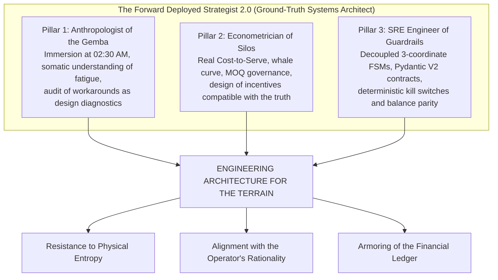

## 7.1 The Sceptic's View: Answers to Three Hostile Objections

An engineering treatise that aspires to refound deployment doctrine cannot dodge the most severe objections of its critics. We formally confront and refute the three most hostile technical, economic and ethical objections:

---

### Objection 1: "The profile of the Forward Deployed Strategist is a non-scalable bottleneck. There are no 100,000 professionals with simultaneous skills in code, cost accounting and night-shift experience to deploy in every plant in the world."

**Technical and Architectural Answer:**  
This objection commits an elementary category confusion: it confuses the architect who formalizes the principle of invariance with the routine maintenance operator.

The FDS 2.0 does not aspire to become a permanent on-site artisan who manually rewrites every line of software in each of the 50,000 warehouses on the planet. Its function in the field is analogous to that of the flight test engineer in the aerospace industry: **to subject the system to extreme conditions of physical turbulence in order to discover the lift failures and immediately codify the safety limits in the flight control systems (*Fly-by-Wire*)**.

Once the FDS 2.0 immerses himself at 02:30 AM in the receiving dock, discovers why the WMS collapses before damaged merchandise and extracts the state invariants, **the solution does not stay in his head; it crystallizes into reusable deterministic software**:

1. It is codified in strict data contracts (Pydantic V2 with `Decimal` types and UTC marks).
2. It is compiled into a Finite-State Machine decoupled into three coordinates (`inbound_fsm_guardrail.py` / `mellon`) `[C]`.
3. It is encapsulated in modular transactional tool servers compatible with the Model Context Protocol specification (`kern`) `[C]`.

Once the deterministic automaton and its suite of 35 unit tests are verified against the accounting configuration of the ERP (`T156/OBYC`), **multi-site deployment scales by operational archetypes, not linearly by warehouse**. A retailer with 50 distribution centers or a hospital network with 40 facilities does not possess 50 distinct accounting ontologies, but 3 or 4 physical archetypes (mechanized dry goods, cold chain at $-18\,^{\circ}\text{C}$, regional *cross-docking*, sub-pharmacy). The full **120-hour** Intake is executed solely on the **lead site of each archetype**; subsequent facilities sharing the same accounting schema are deployed via a **bounded 24-to-40-hour physical-boundary calibration** executed by the client's own resident engineers trained during the pilot site (verification of load cells, RF coverage, parameters $V, R, B$ and IRB-12). What scales with a sublinear slope is the verified guardrail binary, leaving at each site a system self-governed by invariants.

---

### Objection 2: "Is this not simply another repackaged version of Lean Manufacturing or Six Sigma with modern technological language?"

**Technical and Epistemological Answer:**  
This criticism ignores the fundamental ontological difference that separates the manual management philosophy of the 20th century from the computer systems architecture of the 21st century: **the capacity for coercive and deterministic imposition through software**.

The *Lean Manufacturing* movement (the Toyota Production System) and the *Six Sigma* methodologies made undeniable contributions by identifying the value of the *Gemba*, waste (*Muda*) and the importance of error-proof mechanisms (*Poka-Yoke*). Yet both schools suffered from a structural fragility that condemned them to decline in the digital era:

1. **Dependence on Human Will:** Traditional Poka-Yoke was implemented through local mechanical devices, wooden stops, cardboard templates or colored adhesive tapes on the floor. It depended entirely on supervisors and operators maintaining a permanent ascetic discipline. Historical evidence shows that as soon as the Lean consultants left the factory after collecting their fees and management returned to demanding volume quotas at quarter-end, the visual Kanban boards were abandoned and the operators returned to their informal routines.
2. **Accounting and Transactional Blindness:** Neither Lean nor Six Sigma ever solved the interface with the financial ledger of the ERP. Toyota was able to implement physical Kanban because it operated in a geographically concentrated and culturally homogeneous ecosystem in Aichi Prefecture. When Western corporations attempted to export Lean by combining it with monolithic systems such as SAP R/3 or Oracle Financials, an insurmountable short circuit occurred: the operator tried to apply tight flow on the dock while the ERP demanded the bureaucratic sequential recording of transactions, inducing the creation of clandestine spreadsheets (Chapter 2).

The FDS 2.0 does not oppose Toyota: **it extends the *Jidoka* principle to the accounting boundary of the ERP**, resolving Adler and Borys's distinction (§2.8) through a precise bifurcation: **deterministic coercion on the financial Ledger, enabling bureaucracy on the physical Gemba**. Toyota did possess hard physical interlocks on its assembly machines, yet the Western corporate world bought the visual liturgy of Lean (whiteboards and floor tape) while leaving the general ledger governed by editable forms without sensory anchoring. We do not use software to micromanage the operator's biomechanical trajectory or block his dock when a damaged pallet arrives; we write the finite-state machine that prohibits, at the database level, an unverified patrimonial mutation (`BWART 105` without a count) from contaminating the balance sheet, while enabling the worker with legitimate physical decompression pathways (`BWART 103` + independent `DEPART` + AQL lane + priced *Break-Glass*).

---

### Objection 3: "If senior executive management is determined to falsify its financial statements or window-dress its indicators in order to satisfy the banks or the stock market, no software guardrail will be able to prevent it."

**Technical, Ethical and Contractual Answer:**  
This objection poses a fundamental ethical challenge, but it commits an analytical error: it confuses the capacity of a computer system to guarantee the forensic integrity of the facts with the moral authority of corporate administrators.

An engineering system cannot prevent a human being from committing a crime if he is resolved to do so; what a well-designed engineering system does is **irreversibly destroy plausible deniability (*Plausible Deniability*)** `[V]`.

In conventional corporate scandals —from Enron and WorldCom to the window-dressing of the waiting lists at Hospital Sótero del Río documented by the Comptroller General's Office (Chapter 2)—, senior management always defends itself before the courts and audit committees by arguing technical ambiguity: *"We did not know that the data had been altered; we relied on the reports issued by the system; it was an unfortunate administrative error by subordinate officials"*.

The architecture of the FDS 2.0 eliminates that escape route through two non-negotiable shielding mechanisms:

1. **The Immutable Cryptographic Trace:** Every mutation or exceptional release that attempts to circumvent a physical guardrail (for example, authorizing the entry of a batch without a blind count or unblocking a pallet rejected at the scale) requires the invocation of a break-glass contract (*Break-Glass*). This event is not an informal screen permission; it is a transaction digitally signed with an individual corporate certificate that records the executive's identity, the UTC timestamp and the financial charging of the surcharge (`OVERFLOW_IMPUTED`). If the Board decides to window-dress the balance sheet, it will be forced to cryptographically sign its own forensic self-incrimination.
2. **Fiduciary Escalation to the Audit Committee and Termination with Retention of Accrued Fees:** So that a technical refusal is executable in the real world rather than a suicidal rhetorical gesture for an independent practitioner, the Day 0 Charter incorporates a standard **Formal Risk-Acceptance and Fiduciary Escalation** clause (analogous to external audit management representation letters under ISA 580 / PCAOB AS 2805): if an operating executive demands disabling `BWART 103/105` segregation or injecting adjustments without physical backing, the instruction can be executed only if that executive signs a *Risk-Acceptance Memo* automatically copied to the **Audit Committee of the Board of Directors** and to Internal Audit (SOX 404). If concealing that escalation or tampering with records is ordered, termination for client breach is triggered, with payment in full of the current milestone and delivery of the sealed immutable log.

---

## 7.2 From Ontological Integration (FDE 1.0) to the Physical-Accounting Boundary (FDS 2.0)

In the mid-2000s, Palantir Technologies coined the discipline of *Forward Deployed Software Engineer* (`FDSE` and *Echo* deployment strategists), achieving real industrial milestones such as the ontological integration of aircraft assembly lines in **Airbus Skywise** and tactical defense deployments. The limit we point out does not deny that data-engineering legacy over existing tables; it identifies the boundary that remains open when the source system has already been distorted during physical capture:

| Operational Dimension | Classical Ontological Integration — FDE 1.0 | FDS 2.0 Standard (Ground-Truth Systems Architect, 2026+) |
|---|---|---|
| **Primary Intervention Boundary** | The semantic layer over tables already emitted by ERPs, MES and data lakes (Foundry / AIP / Skywise). | The seam prior to the first record: the scale load cell, the dock at 02:30 AM, the $-18\,^{\circ}\text{C}$ cold room and the shift wage contract. |
| **Nature of the Deliverable** | Unified ontologies, analytical digital twins and action flows (*Writeback*) over existing business objects. | Edge deterministic guardrails (`kern` / `mellon`), 3-coordinate FSMs (`BWART 103/105/124`) and econometric redesign of anti-Campbell incentives. |
| **Input-Signal Hypothesis** | Models and cleans discrepancies downstream of transactional capture; rarely holds a mandate to redesign union bonuses or dock ergonomics. | Treats the ERP table as a potentially strategic artifact ($e_g^*$ under a finite shift); demands independent physical proof and changes the payoff function that corrupted the datum. |
| **Hardware and Ergonomic Coupling** | Typically agnostic to the mechanical condition of RF scanners, cart bearings or operator circadian fatigue. | Integral socio-physical engineering: audits optical FTRR, Murrell's metabolic rest allowance $RA$, hardwired failover selectors and edge latency footprint. |
| **Governance of Artificial Intelligence** | Orchestration of agents and copilots anchored to the corporate ontology with software-governed action permissions. | Strict separation of temporal planes (§3.3) and confinement of AI to levels 1–3; every level-4 accounting mutation passes through an LLM-free deterministic automaton. |

---

## 7.3 The Manifesto of the Forward Deployed Strategist 2.0

In order to guide the next generation of systems architects in the task of building technology for the terrain, we formalize the three structural pillars and the ten cardinal principles of **Ground-Truth Systems Engineering (GTSE)**:

### The Three Pillars of the Triple-Band Operator
1. **The Anthropologist of the Gemba:** He possesses the sociological empathy and the physical endurance necessary to immerse himself in the operational trenches of the company. He does not judge the operators' shortcuts as negligence; he deciphers them as the unequivocal symptom of a defective computer system. He listens to the somatic wisdom of frontline workers and translates it into formal architectural requirements.
2. **The Econometrician of Silos:** He masters with mathematical coldness activity-based cost accounting, the Cost-to-Serve and the devastating impact of immobilized working capital on free cash flow. He understands how local purchasing and sales incentives distort the physics of the warehouse and designs mechanisms in which telling the material truth is the dominant strategy for all agents.
3. **The SRE Engineer of Guardrails:** He writes systems code with the mathematical rigor of one who designs software for nuclear reactors or space probes. He designs finite automata whose invariance properties are formally demonstrable, masters atomic transactions in relational databases and stands up strict typed contracts that prevent probabilistic models from destroying the accounting consistency of the corporation.

---

### The Ten Foundational Principles of the FDS 2.0 (with Their Causal Mechanism)

1. **The map is not the territory; the ledger is not the inventory.**  
   *Causal Mechanism:* The digital representation degrades monotonically according to the submartingale lemma $D_{t+1} = D_t + \\xi_t$. It is corrected only through periodic stratified blind counting and independent physical reconciliation.

2. **The probabilistic model proposes; the deterministic code disposes; the named person signs.**  
   *Causal Mechanism:* Strict hierarchy of four levels of authority. Every patrimonial commitment (Level 4) requires formal validation by the automaton and a signature tied to the cryptographic hash of the transaction.

3. **Without physical proof there is no posting.**  
   *Causal Mechanism:* Mandatory transactional decoupling by handling unit (`SSCC`): `BWART 103` by default upon entry at the scale; `BWART 105` solely after a compliant count or an approved AQL lane; `BWART 124` for origin rejection from unvaluated GR blocked stock (reserving `122` for post-`105` returns and `551` for internal shrinkage).

4. **The 103 is the rule; the 105 is a governed exception.**  
   *Causal Mechanism:* Invoice verification in `MIRO` remains blocked upon arrival at the scale without a premature FI entry, while `DEPART` releases the truck after unloading. Accounting never anticipates the physical verification of the floor.

5. **Every quantitative metric that pays under a finite shift displaces physical work whenever the workaround yields more.**  
   *Causal Mechanism:* Campbell's Law and multitask allocation $e_r^* = \\frac{k_g T + \\gamma(\\alpha - \\beta) + q P}{k_r + k_g}$: if $\\beta > \\alpha$, raising $\\gamma$ contracts $e_r^*$. Truthfulness is induced by paying the forecaster exclusively via strictly proper scoring rules (CRPS) separated from the replenishment fractile, and paying the floor via collective *Gainsharing* audited by independent blind counts ($Q^{\\text{aud}}_t$).

6. **The operator's shortcut is an architectural requirement, not a disciplinary offense.**  
   *Causal Mechanism:* The workaround is the agent's rational response to keep material flowing in the face of the rigidity of the software. The formal system must absorb flexibility through ergonomic interfaces and priced overflow permits (*Break-Glass*).

7. **Industrial reliability is a property of the worst case, not of the average.**  
   *Causal Mechanism:* In the physics of the Gemba, the p99 percentile and the stochastic tail determine line stoppages. The architecture is dimensioned against out-of-sample disturbances (*OOD*), not against IID laboratory data.

8. **A guardrail that fails open is infinitely worse than no guardrail.**  
   *Causal Mechanism:* If the cryptographic key is lost or the industrial gateway does not respond, the system must operate in **fail-closed** mode (deterministic blocking of writes). Failing open engenders a false illusion of accounting control.

9. **The stopping criterion fixed on Day 0 is the cheapest financial safeguard.**  
   *Causal Mechanism:* The prior definition of quantitative cancellation thresholds (latency, exception rate, dock accuracy) prevents the opportunistic redefinition of failure at the corporate leadership level.

10. **If senior management demands falsification of the balance sheet, the technical answer is NO in writing and immediate contractual termination.**  
    *Causal Mechanism:* Absolute destruction of plausible deniability. Every forced intervention requires the individual cryptographic signature of the offending executive on the overflow contract (`OVERFLOW_IMPUTED`).

---

## 7.4 Limits of the Monograph and Formal Conditions of Falsification

In order to comply with the Popperian principle of scientific demarcation, we declare the limits and the conditions that would formally falsify the theses of this treatise:

1. **Information Limits:** Global adoption statistics (Standish, Panorama, McKinsey, Gartner, MIT NANDA) are explicitly labeled as non-peer-reviewed industry reports `[R]`; the Lidl figure (€500M) comes from *Handelsblatt*, as Schwarz-Gruppe is privately held; the `BWART 103/105/124` projections (and the `104/106/122/551` reversals/shrinkage movements) are verified in the local test oracle `[C]` and require client-tenant validation against `T156/OBYC` and SAP Digital Access licensing costs `[?]`; and the IRB-12 index (Appendix E) is declared a heuristic instrument under prospective calibration.
2. **Quasi-Experimental Prospective Falsification Protocol (*Stepped-Wedge Rollout*):** Beyond the theoretical refutation conditions (absence of submartingale drift under $\\xi_t > 0$ or harmlessness of incentives with $\\beta > \\alpha$), we subject the FDS 2.0 architecture itself to **five pre-registrable operational hypotheses** across 90-day multi-site stepped-wedge deployments:
   * **H1 (Inventory Integrity):** Deploying the 3D FSM + audited Gainsharing reduces absolute stratified blind-count discrepancy ($|L_t - I_t|/I_t$) by at least **50% in relative terms** against the pre-intervention baseline without degrading mean truck dock *turnaround time* by more than 10%. *Falsification:* if accuracy improves only at the cost of blocking the yard or raising demurrage, Theorem T2 failed in its physical coupling.
   * **H2 (Ceremonial Success Index):** The ratio $CS = C_s / C_r$ (§6.7.2) converges to the band $[0.95,\\; 1.10]$ by day 90 across all shifts, including the 01:00–05:00 AM window. *Falsification:* persistent $CS > 1.20$ demonstrates that operators found a new workaround around the guardrail.
   * **H3 (Little's Quarantine Boundary):** In weeks where the observed hold rate crosses $r > r^* = \\frac{V}{R c \\mu \\rho_{\\max}}$, saturation occurs in the quarantine area before the dock doors. *Falsification:* systematic divergence exceeding 25% relative to $\\lambda^*_{\\text{floor}} = V/(rR)$.
   * **H4 (Voice Sustainability in Digital Andon):** At stations where the empirical within-SLA closure rate exceeds 80% ($\\mathbb{E}[\\theta_t] > 0.8$), the weekly rate of preventive PTT reports does not decay between month 1 and month 3; where it falls below 30%, the voice rate contracts by $>50\\%$. *Falsification:* extinction of reports despite $\\mathbb{E}[\\theta_t] > 0.8$ refutes the sufficiency of closed-loop feedback.
   * **H5 (Forecast / Newsvendor Separation):** Evaluating demand planning exclusively on CRPS gain reduces the mean upward bias of manual overrides by at least **60%** relative to the prior regime with asymmetric stockout penalties.

---

## 7.5 Final Closing Statement

For four decades, the corporate technology industry has attempted to build clean mathematical castles in the sky while the Gemba operated in the mud of analog friction. We have seen global organizations squander hundreds of millions of dollars on software that promised total visibility and delivered only bureaucratic cynicism, transactional paralysis and corrupted data.

Artificial Intelligence will not close this gap by itself; it will widen it until it becomes unsustainable if we continue deploying it under the fantasy that the physical world will adapt to the cloud.

Building for the terrain is not an aesthetic engineering option; it is the economic survival imperative of the post-digital era. It demands ethnographic humility to descend to the dock, econometric rigor to align incentives with the truth, and the mathematical coldness of an engineer who writes code to withstand the elements.

There, at 02:30 in the morning, when the last truck shuts off its diesel engine and the scale signs its cryptographic frame in silence, is where technology finally meets reality. And it is there that we Forward Deployed Strategists are building the foundations of the industrial future.


---

# APPENDIX A: CONSOLIDATED REGISTER OF FORENSIC AND REGULATORY EVIDENCE

The following matrix compiles the primary sources of legal, regulatory and peer-reviewed scientific evidence that supports each of the theses of this monograph quantitatively and empirically:

| Forensic Identifier | Issuing Entity / Authors | Legal Docket / DOI / Formal Reference | Magnitude of Measured Impact / Verified Finding | Epistemological Classification |
|---|---|---|---|---|
| **EV-SEC-01** | Securities and Exchange Commission (SEC) | *Administrative Proceeding File No. 3-15570, Release No. 34-70694* (October 16, 2013). | **USD 457.6 million** net loss in 45 minutes (Knight Capital). Execution of 4M orders for 397M shares in an open loop. Violation of Rule 15c3-5 (*Market Access Rule*). | `[D]` Binding Regulatory Data |
| **EV-SEC-02** | Zillow Group, Inc. | *SEC Form 10-Q*, period ended September 30, 2021 (Item 1, Consolidated Financial Statements, p. 2). | **USD 304.5 million** in *inventory write-down* in the *Homes* segment; USD 240M–265M of additional provision in Q4 2021; consolidated quarterly net loss of USD 328M due to algorithmic adverse selection. | `[D]` SEC-Audited Balance Sheet |
| **EV-CGR-01** | Comptroller General's Office of Chile (CGR) / South East Metropolitan Health Service (SSMSO) | *Special Investigation Report No. 471/2024* (September 6, 2024) and SSMSO internal audit (May 2024) on the Dr. Sótero del Río Healthcare Complex. | **323,327 irregular mass removals** from waiting lists, including **250,543 removals in a single day** (June 7, 2023) across multiple codes without individual clinical backing, **31,341 readmissions** and **44 patients deceased prior to May 31, 2023 readmitted due to recording error**. | `[D]` CGR / SSMSO Audit Ruling |
| **EV-CNEP-01** | National Commission for Evaluation and Productivity (CNEP) | *Efficient Use of Elective Surgical Theaters and Waiting List Management in Chile* (2020). | Surgical theaters used **only 4.8 of 9 working hours (53.3% utilization)**. National no-show rate (NSP) of **15.6%** explained by coordination and notification failures in the preoperative chain. | `[D]` Public Policy Study |
| **EV-MIT-01** | Challapally, A. et al. (MIT NANDA) | *The GenAI Divide: State of AI in Business 2025* (July 2025). | **95% of evaluated organizations with no measurable impact on P&L** across 300 public deployments, 153 surveys and 52 interviews. Root cause: fragility of workflows and lack of contextual memory in the field. | `[R]` Preliminary Sector Report |
| **EV-RET-01** | DeHoratius, N. & Raman, A. | *Management Science*, 54(4), 627–641 (2008). DOI: 10.1287/mnsc.1070.0789. | **65% inaccuracy in inventory records** across ~370,000 SKUs physically audited in 37 retail stores. Structural transactional error greater than shrinkage from theft. | `[D]` Peer-Reviewed Literature |
| **EV-SHD-01** | Huber, M., Zimmermann, S., Rentrop, C. & Felden, C. | *Systems*, 4(1), 11 (2016). DOI: 10.3390/systems4010011. | **64% of the analyzed *Shadow Systems* are linked directly to the ERP** to compensate for its transactional rigidity and sustain actual operations. | `[D]` Peer-Reviewed Literature |
| **EV-ISO-01** | Boiral, O. | *Organization Science*, 14(6), 720–737 (2003); *Organization Science*, 18(1), 127–146 (2007). DOI: 10.1287/orsc.1060.0224. | Qualitative typology (47 interviews) of **ceremonial integration and *dry-labbing*** (retrospective pre-audit preparation of logbooks) in plants certified under ISO 9000 and ISO 14001. | `[D]` Peer-Reviewed Literature |
| **EV-BIO-01** | Battini, D., Glock, C.H., Grosse, E.H. et al.; Murrell, K.F.H. | *Computers & Industrial Engineering*, 94, 146–157 (2016), DOI: 10.1016/j.cie.2016.01.020; *Ergonomics* (1965). | Postural metabolic overload at extreme levels ($27.2\text{–}33.5\text{ kJ/min}$) requiring **rest allowances $RA$ of 50% to 62%** (Murrell) ignored by linear WMS/LMS algorithms. | `[D]` Peer-Reviewed Literature |
| **EV-RUT-01** | Elbert, R. M., Franzke, T., Glock, C. H. & Grosse, E. H. | *Computers & Industrial Engineering*, 111, 537–551 (2017). DOI: 10.1016/j.cie.2016.11.033. | **Human deviations from WMS-prescribed routes** (due to aisle congestion and local heuristics) alter and invert the theoretical efficiency ranking of order-picking policies. | `[D]` Peer-Reviewed Literature |
| **EV-PRN-01** | Fildes, R., Goodwin, P., Lawrence, M. & Nikolopoulos, K. | *International Journal of Forecasting*, 25(1), 3–23 (2009). DOI: 10.1016/j.ijforecast.2008.11.010. | **75% of manual forecast adjustments were upward** due to managerial commercial optimism; it increased forecast error (MAPE) between 4.5% and 11.2% in 60,000 audited cases. | `[D]` Peer-Reviewed Literature |
| **EV-REV-01** | Securities and Exchange Commission (SEC) / U.S. District Court SDNY | *Pio v. Revlon, Inc. et al.*, Civil Action No. 1:18-cv-11133 (2018); SEC Form 10-K (2018). | **USD 64 million in unserved orders** and billing collapse at the Oxford (NC) plant after the 'Big-Bang' cutover of SAP S/4HANA without a buffer stock cushion; a 6.9% drop in the share price and a shareholder lawsuit over deficient internal control (SOX 404). | `[D]` Judicial Docket / SEC |
| **EV-TGT-01** | Ontario Superior Court of Justice (Commercial List) | *Target Canada Co. CCAA Proceedings*, Court File No. CV-15-10832-00CL (2015); *Canadian Business* forensic audit. | **USD 2,100 million net loss**, closure of 133 stores and 17,600 layoffs after the collapse of the Manhattan WMS and SAP due to corrupted master data (inches vs. cm and barcodes). | `[D]` Judicial Bankruptcy Docket |
| **EV-WFG-01** | Securities and Exchange Commission (SEC) / DOJ / CFPB | *SEC Administrative Proceeding File No. 3-19704* (February 2020); Consent Order. | **USD 3,000 million in criminal and civil sanctions** for the unauthorized opening of 3.5 million fake accounts under pressure from cross-selling metrics (*Great 8*), validating Campbell's Law in banking. | `[D]` Binding Regulatory Ruling |
| **EV-THR-01** | Leveson, N. G. & Turner, C. S. | *IEEE Computer*, 26(7), 18–41 (1993); FDA Safety Reports. | **6 accidents of massive radiation overdose, with 3 documented deaths**, in oncology patients (25 MeV) due to the omission of a hardware guardrail (interlock) and the presence of a *race condition* in the VT100 software. | `[D]` Peer-Reviewed Literature |
| **EV-NUM-01** | Adler, P. S. | *Harvard Business Review*, 71(1), 97–108 (1993). | **From >20% absenteeism, ~800–1,000 pending grievances and plant closure with ~5,000 layoffs to ~3% absenteeism** and North American productivity leadership via the UAW *no-layoff* clause, participatory standardization and Andon (NUMMI). | `[D]` Peer-Reviewed Literature |
| **EV-MIC-01** | Edmondson, A. C., Bohmer, R. M. & Pisano, G. P. | *ASQ*, 46(4), 685–716 (2001); *Management Science*, 47(6), 752–768 (2001). | **Substantial learning-curve compression across 660 MICS surgeries (16 hospitals)** explained by psychological safety and team stability rather than the individual prestige of the surgeon. | `[D]` Peer-Reviewed Literature |
| **EV-GRA-01** | Grant, A. M. et al. | *OBHDP*, 103(1), 53–67 (2007); *JAP*, 93(1), 108–124 (2008). DOI: 10.1037/0021-9010.93.1.108. | **+142% persistence on task and +171% revenue raised** following a controlled intervention of direct contact with the end beneficiary (Perceived Social Impact and Social Worth). | `[D]` Peer-Reviewed Literature |
| **EV-RAD-01** | Turner, Y. & Hadas-Halpern, I. | *Radiological Society of North America (RSNA)* (2008). | **+46% detection of incidental findings** by radiologists ($p = 0.005$) after incorporating a facial photograph of the patient into the diagnostic viewing interface. | `[D]` Controlled Clinical Study |
| **EV-LOS-01** | Boswell, W. R. | *The International Journal of Human Resource Management*, 17(9), 1489–1511 (2006). | **LOS-Actions predicts performance ($\\beta = 0.21$) and reduced turnover ($\\beta = -0.22$)**, whereas abstract macro knowledge of strategy (LOS-Goals) lacks predictive power in the Gemba. | `[D]` Peer-Reviewed Literature |
| **EV-OBM-01** | Stack, J. | *The Great Game of Business* (1992) / Springfield ReManufacturing Corp. | **Leverage reduction from 89:1 to 1:1** and sustained expansion of equity value through Open-Book Management and collective Gainsharing with a financial hurdle. | `[R]` Documented Corporate Case |
| **EV-VOI-01** | Detert, J. R. & Burris, E. R. | *Academy of Management Journal*, 50(4), 869–884 (2007). DOI: 10.5465/amj.2007.26279183. | **Managerial inaction erodes the perceived safety and efficacy of speaking up**, consolidating voice futility (*Voice Futility*) and the normalization of latent failure. | `[D]` Peer-Reviewed Literature |
| **EV-BIO-02** | Snook, S. H. & Ciriello, V. M. | *Ergonomics*, 34(9), 1197–1213 (1991); ISO 11228-2 Standard. | **Initial push force escalated to 380–550 N (+180%)** due to chipped bearings in picking carts, exceeding the NIOSH disc compression limit at L4/L5 (3,400 N). | `[D]` Peer-Reviewed Literature |
| **EV-CIR-01** | Dawson, D. & Reid, K. (1997); Folkard, S. & Tucker, P. (2003) | *Nature*, 388, 235 (DOI: 10.1038/40775); *Occupational Medicine*, 53(2), 95–101 (DOI: 10.1093/occmed/kqg047). | **17–24 h of wakefulness equate to 0.05%–0.10% blood alcohol concentration (BAC)**; industrial incident and error risk rises **+30.4% on the night shift**, +36% by the fourth consecutive night and **+100% in hour 12** of a continuous shift. | `[D]` Peer-Reviewed Literature |
| **EV-JEV-01** | TypeSafe AI | *Jev v1.14 Technical Specification* (2026; endpoint `POST /v1/systemone`). | **System 1 triage latency of ~70–200 ms via API** (sub-200 ms within the `<2 s` auditory feedback window of the Digital Andon) versus 1,500–3,000 ms in autoregressive LLMs; 0% syntactic parsing failures through typed primitives (`Choice`, `Noul`, `Score`). | `[R]` Vendor Technical Specification |
| **EV-CDM-01** | Hohpe, G. & Woolf, B. | *Enterprise Integration Patterns* (2003); Fowler, M. (2002). | **Decoupling from $N \\times M$ point-to-point integrations to $N + M$** through a Canonical Data Model (CDM), eliminating the root cause of 64% of corporate Shadow IT. | `[D]` Peer-Reviewed Literature |
---

# APPENDIX B: REPRODUCIBILITY ORACLE AND EXECUTION COMMANDS

Everything this monograph asserts under the `[C]` mark is reproduced deterministically with the following commands. The results transcribed here were executed in the author's environment and are those produced by the last run; execution time varies with the machine.

```powershell
# 1. 3-coordinate automaton, invariants and quarantine buffer: 35 tests
cd "C:\Users\Gamer\Documents\cv dossier\evidencia\probes"
python -m pytest -q
# Verified result: 35 passed in 1.35s

# 1b. Count of the reachable space computed by breadth-first search (not declared)
python -c "import cap3_delta_projection as m; print(len(m.REACHABLE_STATES))"
# Verified result: 12   (12/64 = 18.75%)

# 2. Adversarial trust-boundary probes of the predecessor module: 6 of 6 failures
python 2026-10-23_probe_fsm_trust_boundary.py
# Verified result: six FALLA_EL_CLAIM verdicts (P1 to P6)

# 3. Gemba invariant guardrails (mellon): 5 property-based tests (Hypothesis)
cd "C:\fde"
python -m pytest test_gemba_invariants.py -q
# Verified result: 5 passed in 24.61s

# 4. Core write guardrails, boundaries, idempotency and MOQ discounts in kern (v2.9.0):
cd "C:\Users\Gamer\Music\scm\kern"
$env:PYTHONPATH="."
python -m pytest tests/test_core_boundary.py tests/test_pack_boundary.py tests/test_writeback.py tests/test_writeback_store.py tests/test_claves_de_idempotencia.py tests/test_autonomy.py tests/test_autonomy_promotion.py tests/test_state.py tests/test_state_record.py tests/test_state_bridge_stock.py tests/test_volume_discount.py -q
# Verified result: 260 passed in 38.72s
# (Full unit test suite of repository v2.9.0: 9,239 tests collected with `python -m pytest --collect-only -q`, plus 36 external integration tests under `-m integracion`)
```

**Reading the oracle.** The 35 tests validate the new automaton; probes P1-P6 measure the previous module, and their function is to refute the provenance *claims*, not to celebrate the design. A reader who wishes to audit this monograph must start with step 2: if the probes stop failing, the module has improved; if they keep failing, the provenance gap that Chapter 4 diagnoses remains open.

---

# APPENDIX C: OPERATIONAL, ACCOUNTING AND TECHNOLOGY GLOSSARY

* **ACID (Atomicity, Consistency, Isolation, Durability):** Set of properties that guarantee that transactions in a relational database are executed reliably and deterministically, without corrupt intermediate states.
* **ALPR (Automatic License Plate Recognition):** Automated optical recognition system for vehicle license plates, used at access gates to validate the identity of the transport.
* **ATP (Available to Promise):** Balance of physical inventory available in the ERP to be commercially committed to new customer sales orders.
* **BSX (Inventory Account in SAP):** Account determination key in the SAP `OBYC` transaction where the monetary value of the company's own inventory is charged.
* **BWART (Bewegungsart - SAP Movement Type):** Three-digit alphanumeric identifier that governs the accounting, physical and documentary behavior of any goods movement in the Materials Management module (SAP MM).
  * *BWART 103 (and reversal 104):* Goods receipt into the warehouse for GR blocked stock at the dock. In standard SAP MM-IM it does not generate a financial accounting entry (FI); it records the conditional receipt and blocks invoice payment in `MIRO` (`ATP = 0`).
  * *BWART 105 (and reversal 106):* Release of goods from GR blocked stock into unrestricted-use inventory (`ATP > 0`). It generates the definitive accounting entry on the balance sheet (Dr BSX / Cr WRX).
  * *BWART 124:* Direct return of goods to the supplier from GR blocked stock (`103`). It reverses the blocked quantity without generating a financial accounting entry (FI), preserving double-entry parity.
  * *BWART 122:* Formal return to the supplier of batches that had already been released and valuated previously via `105` (posts Dr WRX / Cr BSX).
  * *BWART 551:* Goods issue for scrapping/internal shrinkage against the warehouse cost center (applicable when damage occurs through internal handling after receiving an intact seal).
* **COMGES (Management Commitments):** Instrument of the Ministry of Health of Chile for the evaluation and allocation of collective economic bonuses, applied to the management and clinical teams of the public hospital network.
* **Cost-to-Serve (CTS):** Cost-analysis methodology that quantifies the actual expense accumulated in each of the physical handling, transport, administrative and after-sales activities consumed by a specific customer or SKU.
* **Dry-Labbing:** Ceremonial falsification practice consisting of filling in quality-control, calibration or logbook forms retrospectively at the desk without having executed the corresponding physical measurements.
* **FDS (Forward Deployed Strategist):** Engineer and consultant of high technical capability deployed directly inside the client's operations to integrate software and resolve complex bottlenecks.
  * *FDS 1.0:* Historical model centered on data analysis and corporate intelligence in situation rooms and dashboards (Palantir Foundry).
  * *FDS 2.0 (Ground-Truth Systems Architect):* Advanced model oriented toward the physics of the dock at 02:30 AM, the economics of the gemba and deterministic guardrails for physical and transactional Artificial Intelligence.
* **FEFO / FIFO (First-Expired, First-Out / First-In, First-Out):** Inventory rotation policies that prioritize shipping the batches closest to their expiry date or those that entered the warehouse first.
* **FSM (Finite State Machine):** Computational model composed of a finite set of states, an alphabet of input events and a deterministic transition function that forbids illegal transitions.
* **FVA (Forecast Value Added):** Metric that evaluates the value contributed by each stage of the forecasting process, calculated as the error of the previous stage minus the error of the current stage.
* **Gemba (現場):** Japanese term adopted in industrial engineering that designates "the real place where the action occurs and value is created": the loading dock, the assembly line, the warehouse aisle or the operating room.
* **LMS (Labor Management System):** Software module that measures and standardizes cycle times and labor performance in distribution centers.
* **MOQ (Minimum Order Quantity):** Minimum quantity of units that a supplier requires to be purchased in a single order in order to grant a quotation or a volume discount.
* **OBYC (SAP Account Determination Transaction):** Central configuration table in SAP where the material movement types (`BWART`) are linked to the accounts of the financial general ledger (FI).
* **OOD (Out-of-Distribution):** Condition in which the physical data of the real world diverge from the statistical distribution used during the training and calibration of an artificial intelligence model.
* **OTIF (On-Time, In-Full):** Fundamental supply-chain performance metric that measures the percentage of orders delivered within the agreed time window and with all of the items requested.
* **Poka-Yoke (ポカヨケ):** Design mechanism that is proof against human error, originating in the Toyota Production System to prevent the physical or logical occurrence of an operational defect.
* **PPV (Purchase Price Variance):** Accounting metric used to evaluate purchasing departments, calculated as the difference between the budgeted standard cost and the actual purchase price invoiced by the supplier.
* **RNLE (National Waiting List Registry):** Centralized database of the Chilean public health system that records the care times of patients awaiting specialist consultations or elective surgeries.
* **SIGTE:** Health Wait Time Management Information System of the Ministry of Health of Chile.
* **T156:** Configuration table of the SAP system that governs the operational, accounting and valuation properties of each material movement type.
* **VLA (Vision-Language-Action Models):** Multimodal neural networks designed to process visual inputs and natural-language commands in order to issue direct kinematic and robotic control trajectories.
* **WACC (Weighted Average Cost of Capital):** Weighted average cost of capital that represents the minimum rate of return required by the financing providers (debt and equity) of a company.
* **WAPE (Weighted Absolute Percentage Error):** Volume-weighted forecast-error metric, immune to the division-by-zero distortions that affect MAPE in slow-moving items.
* **Workaround:** Informal adaptation or unauthorized shortcut executed by frontline operators to overcome the rigidity of a computer system and maintain the physical flow of the operation.
* **WRX (GR/IR Clearing Account in SAP):** Clearing account for "Goods Receipt / Invoice Receipt" (*GR/IR - Goods Receipt / Invoice Receipt*) used in SAP to record provisional liabilities for purchases received but not invoiced.

---

# APPENDIX D: CONSOLIDATED PRIMARY BIBLIOGRAPHY

### Judicial and Regulatory Case Files and Constitutional Rulings
1. **Comptroller General's Office of Chile (CGR). (2024, September 6).** *Informe de Investigación Especial N° 471/2024 sobre eventuales irregularidades en los registros de listas de espera en el Complejo Asistencial Dr. Sótero del Río* (supplemented by Internal Audit of the Servicio de Salud Metropolitano Sur Oriente, May 2024). Santiago de Chile: CGR.
2. **National Commission for Evaluation and Productivity (CNEP). (2020).** *Uso eficiente de quirófanos: resumen ejecutivo*. Santiago de Chile: CNEP. Original URL: https://cnep.cl/wp-content/uploads/2020/02/Uso-eficiente-de-quirofanos-resumen-ejecutivo.pdf (PDF not available at the time of verification).
3. **Securities and Exchange Commission (SEC). (2013).** *In the Matter of Knight Capital Americas LLC, Respondent*. Administrative Proceeding File No. 3-15570, Securities Exchange Act of 1934 Release No. 34-70694 (October 16, 2013). Washington, DC: SEC.
4. **Zillow Group, Inc. (2021).** *Quarterly Report Pursuant to Section 13 or 15(d) of the Securities Exchange Act of 1934 for the Quarterly Period Ended September 30, 2021 (Form 10-Q)*. Washington, DC: SEC.

### Scientific Literature and Peer-Reviewed Research Essays
5. **Akerlof, G. A. (1970).** *The Market for "Lemons": Quality Uncertainty and the Market Mechanism*. The Quarterly Journal of Economics, 84(3), 488–500. DOI: [10.2307/1879431](https://doi.org/10.2307/1879431).
6. **Battini, D., Glock, C. H., Grosse, E. H., Persona, A., & Sgarbossa, F. (2016).** *Human energy expenditure in order picking storage assignment*. Computers & Industrial Engineering, 94, 146–157. DOI: [10.1016/j.cie.2016.01.020](https://doi.org/10.1016/j.cie.2016.01.020).
7. **Bloom, N., Garicano, L., Sadun, R., & Van Reenen, J. (2014).** *The distinct effects of information technology and communication technology on firm organization*. Management Science, 60(12), 2859–2885. DOI: [10.1287/mnsc.2014.2013](https://doi.org/10.1287/mnsc.2014.2013).
8. **Boiral, O. (2003).** *ISO 9000: Outside the Iron Cage*. Organization Science, 14(6), 720–737. DOI: [10.1287/orsc.14.6.720.24873](https://doi.org/10.1287/orsc.14.6.720.24873).
9. **Boiral, O. (2007).** *Corporate greening through ISO 14001: A rational myth?* Organization Science, 18(1), 127–146. DOI: [10.1287/orsc.1060.0224](https://doi.org/10.1287/orsc.1060.0224).
10. **Brunsson, N. (1989).** *The Organization of Hypocrisy: Talk, Decisions and Actions in Organizations*. Chichester: John Wiley & Sons.
11. **Campbell, D. T. (1976 / 1979).** *Assessing the impact of planned social change*. Evaluation and Program Planning, 2(1), 67–90. DOI: [10.1016/0149-7189(79)90048-X](https://doi.org/10.1016/0149-7189(79)90048-X).
12. **DeHoratius, N., & Raman, A. (2008).** *Inventory record inaccuracy: An empirical analysis*. Management Science, 54(4), 627–641. DOI: [10.1287/mnsc.1070.0789](https://doi.org/10.1287/mnsc.1070.0789).
13. **Elbert, R. M., Franzke, T., Glock, C. H., & Grosse, E. H. (2017).** *The effects of human behavior on the efficiency of routing policies in order picking: The case of route deviations*. Computers & Industrial Engineering, 111, 537–551. DOI: [10.1016/j.cie.2016.11.033](https://doi.org/10.1016/j.cie.2016.11.033).
14. **Fildes, R., Goodwin, P., Lawrence, M., & Nikolopoulos, K. (2009).** *Effective forecasting and judgmental adjustments: An empirical evaluation and strategies for improvement in supply-chain planning*. International Journal of Forecasting, 25(1), 3–23. DOI: [10.1016/j.ijforecast.2008.11.010](https://doi.org/10.1016/j.ijforecast.2008.11.010).
15. **Huber, M., Zimmermann, S., Rentrop, C., & Felden, C. (2016).** *The relation of shadow systems and ERP systems—Insights from a multiple-case study*. Systems, 4(1), 11. DOI: [10.3390/systems4010011](https://doi.org/10.3390/systems4010011).
16. **Gneiting, T., & Raftery, A. E. (2007).** *Strictly proper scoring rules, prediction, and estimation*. Journal of the American Statistical Association, 102(477), 359–378. DOI: [10.1198/016214506000001437](https://doi.org/10.1198/016214506000001437).
17. **Kang, Y., & Gershwin, S. B. (2005).** *Information inaccuracy in inventory systems: Stock loss and stockout*. IIE Transactions, 37(9), 843–859. DOI: [10.1080/07408170590969861](https://doi.org/10.1080/07408170590969861).
18. **Kaplan, R. S., & Cooper, R. (1998).** *Cost & Effect: Using Integrated Cost Systems to Drive Profitability and Performance*. Boston: Harvard Business School Press.
19. **Kerr, S. (1975).** *On the folly of rewarding A, while hoping for B*. Academy of Management Journal, 18(4), 769–783. DOI: [10.5465/255378](https://doi.org/10.5465/255378).
20. **Lee, H. L., Padmanabhan, V., & Whang, S. (1997).** *Information distortion in a supply chain: The bullwhip effect*. Management Science, 43(4), 546–558. DOI: [10.1287/mnsc.43.4.546](https://doi.org/10.1287/mnsc.43.4.546).
21. **Strathern, M. (1997).** *'Improving ratings': audit in the British University system*. European Review, 5(3), 305–321.
22. **Zuboff, S. (1988).** *In the Age of the Smart Machine: The Future of Work and Power*. New York: Basic Books.

### Contemporary Essays and Industry Reports (2025–2026)
23. **Hawke, T. (2025, October 1).** *Crossing the AI Chasm: What It Takes to Build Confidence in AI*. BusinessOptix Technical Whitepaper.
24. **Hovila, M. (2025, October 16).** *From demo to deployment: Crossing the AI chasm to real impact*. Futurice Engineering Insights.
25. **Hsu, O. (2026, January 13).** *The physical AI deployment gap*. Andreessen Horowitz (a16z) Speedrun / Substack `[R]`.
26. **McKinsey & Company. (2025).** *The State of AI: How organizations are rewiring to capture value*. McKinsey Global Survey on AI `[R]`.
27. **Challapally, A., Pease, C., Raskar, R., & Chari, P. (2025, July).** *The GenAI Divide: State of AI in Business 2025*. Project NANDA, Massachusetts Institute of Technology `[R]`.
28. **Murphy, A. (2026, April 17).** *The AI Chasm: AI moves fast. Humans Don’t*. Product Management & Transformation Review `[R]`.
29. **OWASP. (2025).** *Top 10 for Large Language Model Applications: LLM06 Excessive Agency*. Open Web Application Security Project.
30. **Panorama Consulting Solutions. (2008–2024).** *The Annual ERP Report: Implementation Realities, Disruption and ROI*. Denver, CO: Panorama Consulting Group `[R]`.
31. **Samal, M. (2026, June 17).** *The Implementation Chasm: Why Forward Deployed Engineers are the New Secret Weapon for Enterprise AI*. Sector documentary compendium (`biblioteca/COMPENDIO-ARTICULOS-BRECHA-DESPLIEGUE-IA-2025-2026.md`) `[R]`.
32. **Standish Group. (1994–2024).** *The CHAOS Chronicles: An Analysis of Software Project Failure and Success*. Boston: The Standish Group International.
### Scientific Literature and Peer-Reviewed Essays (continued)
33. **Adler, P. S. (1993).** *Time-and-motion regained*. Harvard Business Review, 71(1), 97–108.
34. **Adler, P. S., & Borys, B. (1996).** *Two types of bureaucracy: Enabling and coercive*. Administrative Science Quarterly, 41(1), 61–89. DOI: [10.2307/2393986](https://doi.org/10.2307/2393986).
35. **Argyris, C. (1990).** *Overcoming Organizational Defenses: Facilitating Organizational Learning*. Boston: Allyn and Bacon.
36. **Avey, J. B., Avolio, B. J., Crossley, C. D., & Luthans, F. (2009).** *Psychological ownership for the organization: Advancing a construct, its measurement, and its relation to work outcomes*. Journal of Organizational Behavior, 30(2), 173–191. DOI: [10.1002/job.583](https://doi.org/10.1002/job.583).
37. **Bainbridge, L. (1983).** *Ironies of automation*. Automatica, 19(6), 775–779. DOI: [10.1016/0005-1098(83)90046-8](https://doi.org/10.1016/0005-1098(83)90046-8).
38. **Boswell, W. R. (2006).** *Aligning employees with the organization's strategic objectives: Out of ‘line of sight’, out of mind*. The International Journal of Human Resource Management, 17(9), 1489–1511. DOI: [10.1080/09585190600878071](https://doi.org/10.1080/09585190600878071).
39. **Boswell, W. R., & Boudreau, J. W. (2001).** *How leading organizations improve the line of sight between people and strategy*. Human Resource Management, 40(4), 351–359. DOI: [10.1002/hrm.1026](https://doi.org/10.1002/hrm.1026).
40. **Dawson, D., & Reid, K. (1997).** *Fatigue, alcohol and performance impairment*. Nature, 388(6639), 235. DOI: [10.1038/40775](https://doi.org/10.1038/40775).
41. **Detert, J. R., & Burris, E. R. (2007).** *Leadership behavior and employee voice: Is the door really open?* Academy of Management Journal, 50(4), 869–884. DOI: [10.5465/amj.2007.26279183](https://doi.org/10.5465/amj.2007.26279183).
42. **Edmondson, A. C. (1999).** *Psychological safety and learning behavior in work teams*. Administrative Science Quarterly, 44(2), 350–383. DOI: [10.2307/2666999](https://doi.org/10.2307/2666999).
43. **Edmondson, A. C., Bohmer, R. M., & Pisano, G. P. (2001).** *Disrupted routines: Team learning and new technology implementation in hospitals*. Administrative Science Quarterly, 46(4), 685–716. DOI: [10.2307/3094828](https://doi.org/10.2307/3094828).
44. **Folkard, S., & Tucker, P. (2003).** *Shift work, safety and productivity*. Occupational Medicine, 53(2), 95–101. DOI: [10.1093/occmed/kqg047](https://doi.org/10.1093/occmed/kqg047).
45. **Grant, A. M., Campbell, E. M., Chen, G., Cottone, K., Lapedis, D., & Lee, K. (2007).** *Impact and the art of motivation maintenance: The effects of contact with beneficiaries on persistence behavior*. Organizational Behavior and Human Decision Processes, 103(1), 53–67. DOI: [10.1016/j.obhdp.2006.05.004](https://doi.org/10.1016/j.obhdp.2006.05.004).
46. **Grant, A. M. (2008).** *The significance of task significance: Job performance effects, relational mechanisms, and boundary conditions*. Journal of Applied Psychology, 93(1), 108–124. DOI: [10.1037/0021-9010.93.1.108](https://doi.org/10.1037/0021-9010.93.1.108).
47. **Kellogg, K. C., Valentine, M. A., & Christin, A. (2020).** *Algorithms at work: The new contested terrain of control*. Academy of Management Annals, 14(1), 366–410. DOI: [10.5465/annals.2018.0174](https://doi.org/10.5465/annals.2018.0174).
48. **Lebovitz, S., Levina, N., & Lifshitz-Assaf, H. (2021).** *Is AI ground truth really true? The dangers of training and evaluating AI tools based on experts' know-what*. MIS Quarterly, 45(3), 1501–1525. DOI: [10.25300/MISQ/2021/16507](https://doi.org/10.25300/MISQ/2021/16507).
49. **Morrison, E. W. (2011).** *Employee voice behavior: Integration and directions for future research*. Academy of Management Annals, 5(1), 373–412. DOI: [10.5465/19416520.2011.574506](https://doi.org/10.5465/19416520.2011.574506).
50. **Morrison, E. W. (2014).** *Employee voice and silence*. Annual Review of Organizational Psychology and Organizational Behavior, 1(1), 173–197. DOI: [10.1146/annurev-orgpsych-031413-091232](https://doi.org/10.1146/annurev-orgpsych-031413-091232).
51. **Morrison, E. W., & Milliken, F. J. (2000).** *Organizational silence: A barrier to change and development in a pluralistic world*. Academy of Management Review, 25(4), 706–725. DOI: [10.5465/amr.2000.3707697](https://doi.org/10.5465/amr.2000.3707697).
52. **Mumford, E. (1983).** *Designing Human Systems for New Technology: The ETHICS Method*. Manchester: Manchester Business School.
53. **Pierce, J. L., Kostova, T., & Dirks, K. T. (2001).** *Toward a theory of psychological ownership in organizations*. Academy of Management Review, 26(2), 298–310. DOI: [10.5465/amr.2001.4378028](https://doi.org/10.5465/amr.2001.4378028).
54. **Pierce, J. L., Kostova, T., & Dirks, K. T. (2003).** *The state of psychological ownership: Integrating and extending a century of research*. Review of General Psychology, 7(1), 84–107. DOI: [10.1037/1089-2680.7.1.84](https://doi.org/10.1037/1089-2680.7.1.84).
55. **Rother, M., & Shook, J. (1999).** *Learning to See: Value Stream Mapping to Add Value and Eliminate Muda*. Cambridge, MA: Lean Enterprise Institute.
56. **Snook, S. H., & Ciriello, V. M. (1991).** *The design of manual handling tasks: revised tables of maximum acceptable weights and forces*. Ergonomics, 34(9), 1197–1213. DOI: [10.1080/00140139108967385](https://doi.org/10.1080/00140139108967385).
57. **Spear, S., & Bowen, H. K. (1999).** *Decoding the DNA of the Toyota Production System*. Harvard Business Review, 77(5), 96–106.
58. **Stack, J. (1992).** *The Great Game of Business*. New York: Currency Doubleday.
59. **Trist, E. L., & Bamforth, K. W. (1951).** *Some social and psychological consequences of the Longwall Method of coal-getting*. Human Relations, 4(1), 3–38. DOI: [10.1177/001872675100400101](https://doi.org/10.1177/001872675100400101).
60. **Tucker, A. L., & Edmondson, A. C. (2003).** *Why hospitals don't learn from failures: Organizational and psychological dynamics that inhibit system change*. California Management Review, 45(2), 55–72. DOI: [10.2307/41166165](https://doi.org/10.2307/41166165).
61. **Turner, Y., & Hadas-Halpern, I. (2008).** *Adding patient photos to diagnostic imaging examinations*. RSNA Annual Meeting Proceedings.
62. **Van Dyne, L., & Pierce, J. L. (2004).** *Psychological ownership and feelings of possession: Three field studies predicting employee attitudes and organizational citizenship behavior*. Journal of Organizational Behavior, 25(4), 439–459. DOI: [10.1002/job.249](https://doi.org/10.1002/job.249).
63. **Woods, D. D., & Hollnagel, E. (2006).** *Joint Cognitive Systems: Patterns in Cognitive Systems Engineering*. Boca Raton, FL: CRC Press.

### Integration Architecture and Technical Documentation
64. **Hohpe, G., & Woolf, B. (2003).** *Enterprise Integration Patterns: Designing, Building, and Deploying Messaging Solutions*. Boston, MA: Addison-Wesley Professional.
65. **TypeSafe AI. (2026).** *Jev: Non-Autoregressive System One Decision Models for Deterministic Software Control Flow*. Technical Whitepaper & API Specification v1.14.
66. **Leveson, N. G., & Turner, C. S. (1993).** *An investigation of the Therac-25 accidents*. IEEE Computer, 26(7), 18–41. DOI: [10.1109/MC.1993.274940](https://doi.org/10.1109/MC.1993.274940).
67. **U.S. Securities and Exchange Commission (SEC). (2020).** *In the Matter of Wells Fargo & Company, Respondent*. Administrative Proceeding File No. 3-19704, Securities Exchange Act Release No. 88257.
68. **U.S. District Court for the Southern District of New York. (2018).** *Pio v. Revlon, Inc. et al.*, Civil Action No. 1:18-cv-11133 (Class Action Complaint under Sections 10(b) and 20(a) of the Exchange Act).
69. **Ontario Superior Court of Justice. (2015).** *In the Matter of the Companies' Creditors Arrangement Act: Target Canada Co.*, Court File No. CV-15-10832-00CL.
70. **Weick, K. E., & Sutcliffe, K. M. (2001).** *Managing the Unexpected: Assuring High Performance in an Age of Complexity*. San Francisco: Jossey-Bass.

### Regulations, International Standards and Primary Sources of the 2.0 Edition

71. **Internal Revenue Service of Chile (SII). (2018, February 1).** *A partir de hoy todas las empresas del país deben facturar electrónicamente* [Press release]. Santiago de Chile: SII. https://www.sii.cl/noticias/2018/010218noti01er.htm
72. **Ley N° 20.727 (2014, January 31).** *Perfecciona el régimen tributario simplificado e introduce la obligatoriedad progresiva de la factura electrónica*. Diario Oficial de la República de Chile. Santiago: Ministerio de Hacienda.
73. **Internal Revenue Service of Chile (SII). (2003).** *Resolución Exenta N° 45, de 1 de septiembre de 2003, que establece el formato del documento tributario electrónico y el proceso de certificación de emisores*. Santiago de Chile: SII.
74. **e-Estonia. (2026).** *X-Road — interoperability services* [Institutional fact sheet]. Tallinn: e-Estonia Briefing Centre. https://e-estonia.com/service/interoperability-services/x-road/
75. **ET BFSI. (2025, December).** *UPI achieves 20.47 bn transactions in November 2025, daily average hits 682 million*. The Economic Times. https://bfsi.economictimes.indiatimes.com/articles/upi-achieves-2047-bn-transactions-in-november-2025-daily-average-hits-682-million/125685826
76. **U.S. Food and Drug Administration. (1997).** *21 CFR Part 11: Electronic Records; Electronic Signatures; Final Rule*. Federal Register, 62, 13430 (March 20, 1997). Washington, DC: FDA.
77. **European Commission. (2011).** *EudraLex Volume 4 — Good Manufacturing Practice, Annex 11: Computerised Systems*. Brussels: Dirección General de Salud y Seguridad Alimentaria.
78. **International Electrotechnical Commission. (2006/2015).** *IEC 62304: Medical device software — Software life cycle processes* (with Amendment 1, 2015). Geneva: IEC.
79. **RTCA. (2011).** *DO-178C: Software Considerations in Airborne Systems and Equipment Certification*. Washington, DC: RTCA.
80. **Board of Governors of the Federal Reserve System & Office of the Comptroller of the Currency. (2011).** *SR 11-7 / OCC 2011-12: Guidance on Model Risk Management* (April 4, 2011). Washington, DC.
81. **U.S. Securities and Exchange Commission. (2003).** *Rule 17a-4(f): Electronic Recordkeeping Requirements*, 17 CFR 240.17a-4. Washington, DC: SEC.
82. **International Organization for Standardization / International Electrotechnical Commission. (2023).** *ISO/IEC 42001:2023 — Information technology — Artificial intelligence — Management system*. Geneva: ISO.
83. **European Parliament and Council of the European Union. (2024).** *Reglamento (UE) 2024/1689 por el que se establecen normas armonizadas en materia de inteligencia artificial (Reglamento de Inteligencia Artificial)*. Diario Oficial de la Unión Europea, L, July 12, 2024.
84. **European Parliament and Council of the European Union. (2026).** *Reglamento (UE) 2026/1744 por el que se modifica el Reglamento (UE) 2024/1689* (*Digital Omnibus* package). Diario Oficial de la Unión Europea, L, July 24, 2026 (in force since July 27, 2026).
85. **Post Office Horizon IT Inquiry. (2025).** *Final Report, Volume 1: Redress and the human impact of the Horizon scandal*. London: The Inquiry (Sir Wyn Williams, chair; published July 8, 2025).
86. **Gartner. (2026, October 19).** *Gartner Survey Finds Only 13% of CIOs Say Their Enterprise Has Realized Significant or Transformational Value from AI* [Press release]. Stamford, CT: Gartner.
87. **Handelsblatt. (2018, July).** Press coverage of the cancellation of Lidl's eLWIS project with SAP. Düsseldorf: Handelsblatt. (No verifiable author or exact date in the primary source; cited as specialized business press.)
88. **In re FoxMeyer Drug Co. (1996).** Bankruptcy proceeding, Bankruptcy Court for the District of Delaware. See also Jesitus, J. (1997). *Why FoxMeyer's dream turned into a nightmare*. Industry Week, 246(19).
89. **Hershey Foods Corporation. (2000).** *Annual Report on Form 10-K for the fiscal year ended December 31, 1999*, Item 7 (Management's Discussion and Analysis), pp. 16–18. Washington, DC: SEC.
90. **National Transportation Safety Board. (2025, June 24).** *Aircraft Accident Report NTSB/AIR-25/04: In-Flight Separation of Left Mid Exit Door Plug, Alaska Airlines Flight 1282, Boeing 737-9, N704AL, Portland, Oregon, January 5, 2024*. Washington, DC: NTSB.
91. **The Mid Staffordshire NHS Foundation Trust Public Inquiry. (2013).** *Report of the Mid Staffordshire NHS Foundation Trust Public Inquiry* (Francis Report). London: The Stationery Office.
92. **Replit. (2025, July).** Incident of the deletion of a production database by an autonomous agent: corporate communication and technology press coverage. San Francisco: Replit.
93. **Davenport, T. H. (1998).** *Putting the enterprise into the enterprise system*. Harvard Business Review, 76(4), 121–131.
94. **Hackman, J. R., & Oldham, G. R. (1976).** *Motivation through the design of work: Test of a theory*. Organizational Behavior and Human Performance, 16(2), 250–279.
95. **Akao, Y. (ed.). (1991).** *Quality Function Deployment: Integrating Customer Requirements into Product Design*. Cambridge, MA: Productivity Press.
96. **Levine, D. I., & Toffel, M. W. (2010).** *Quality management and job quality: How the ISO 9001 standard for quality management systems affects employees and employers*. Management Science, 56(6), 978–996.
97. **Corbett, C. J., Montes-Sancho, M. J., & Kirsch, D. A. (2005).** *The financial impact of ISO 9000 certification in the United States: An empirical analysis*. Management Science, 51(7), 1046–1059.
98. **Hendricks, K. B., Singhal, V. R., & Stratman, J. K. (2007).** *The impact of enterprise systems on corporate performance: A study of ERP, SCM, and CRM system implementations*. Journal of Operations Management, 25(1), 65–82.
99. **Meyer, J. W., & Rowan, B. (1977).** *Institutionalized organizations: Formal structure as myth and ceremony*. American Journal of Sociology, 83(2), 340–363.
100. **Aghion, P., Bloom, N., Lucking, B., Sadun, R., & Van Reenen, J. (2021).** *Turbulence, firm decentralization, and growth in bad times*. American Economic Journal: Applied Economics, 13(1), 133–169.
101. **Holmström, B., & Milgrom, P. (1991).** *Multitask principal-agent analyses: Incentive contracts, asset ownership, and job design*. Journal of Law, Economics, & Organization, 7(Special Issue), 24–52. DOI: [10.1093/jleo/7.special_issue.24](https://doi.org/10.1093/jleo/7.special_issue.24).
102. **Baker, G. P. (1992).** *Incentive contracts and performance measurement*. Journal of Political Economy, 100(3), 598–614. DOI: [10.1086/261831](https://doi.org/10.1086/261831).
103. **Pisano, G. P., Bohmer, R. M. J., & Edmondson, A. C. (2001).** *Organizational differences in rates of learning: Evidence from the adoption of minimally invasive cardiac surgery*. Management Science, 47(6), 752–768. DOI: [10.1287/mnsc.47.6.752.9811](https://doi.org/10.1287/mnsc.47.6.752.9811).
104. **Murrell, K. F. H. (1965).** *Human Performance in Industry*. London: Chapman and Hall.
105. **International Organization for Standardization. (1999).** *ISO 2859-1:1999 — Sampling procedures for inspection by attributes — Part 1: Sampling schemes indexed by acceptance quality limit (AQL) for lot-by-lot inspection*. Geneva: ISO.
106. **International Organization for Standardization. (2015).** *ISO 13850:2015 — Safety of machinery — Emergency stop function — Principles for design*. Geneva: ISO.
107. **High Court of Justice (Technology and Construction Court). (2017).** *SAP UK Limited v Diageo Great Britain Limited*, `[2017] EWHC 189 (TCC)`. London: BAILII.
108. **Radford, A., Kim, J. W., Xu, T., Brockman, G., McLeavey, C., & Sutskever, I. (2023).** *Robust speech recognition via large-scale weak supervision*. Proceedings of the 40th International Conference on Machine Learning (ICML), PMLR 202, 28492–28518.
109. **Koenecke, A., Choi, A. S. G., Mei, K. X., Schellmann, H., & Sloane, M. (2024).** *Careless Whisper: Speech-to-Text Hallucination Harms*. Proceedings of the 2024 ACM Conference on Fairness, Accountability, and Transparency (FAccT '24), 1672–1681. DOI: [10.1145/3630106.3658996](https://doi.org/10.1145/3630106.3658996).
110. **Republic of Chile. (2024, December 13).** *Ley N° 21.719 que regula la protección y el tratamiento de los datos personales y crea la Agencia de Protección de Datos Personales*. Diario Oficial de la República de Chile.

---

# APPENDIX E: INDEX OF CHASM RISK (IRB-12) — PRE-DEPLOYMENT AUDIT INSTRUMENT

A doctrine that cannot be applied before signing the contract is literature. This appendix converts the theses of chapters 1 through 4 into a twelve-item instrument that is scored during the 120-hour Intake, before committing implementation budget.

**Nature and honesty of the instrument.** The IRB-12 is a heuristic built from the causal mechanisms of the monograph, not a validated psychometric scale. It is published with its explicit calibration plan and is marked `[?]` until there is evidence of its discriminant power. An instrument that does not declare its validation status is exactly the kind of ceremonial artifact that this book fights.

### E.1 Scoring Structure

Twelve items grouped into the three seams of §1.6 plus governance. Each item is scored from 0 to 3 according to the anchor observed in the Intake, and is weighted by its capacity to produce an absorbing failure:

| Dimension | Item (weight) | What is measured | Anchors 0 → 3 |
|---|---|---|---|
| **Semantics** | 1. Unit conversion in the master (×3) | Risk that a wrongly converted master datum blocks the dock | 0: units standardized and audited · 3: no audit, mixture of inches/cm or kg/L |
| | 2. Supplier labeling (×2) | Probability of illegible physical identity | 0: GS1/SSCC compliant · 3: in-house or photocopied labels |
| | 3. Item creations per month (×1) | Speed at which semantic cracks appear | 0: < 5 · 3: > 50 without prior validation |
| **Physics** | 4. Connectivity dead zones (×2) | Frequency of ungoverned offline operation | 0: no zones · 3: dock or cold room without signal |
| | 5. Age and calibration of instruments (×2) | Credibility of scales, readers and gates | 0: current calibration · 3: no calibration record |
| | 6. Dock capacity versus peak (×2) | Structural pressure to skip the protocol | 0: slack > 30% · 3: recurrent saturation |
| **Incentives** | 7. Variable pay tied to the system (×3) | Intensity of the incentive to fabricate the datum | 0: no variable pay linked to system metrics · 3: individual bonus for indicator compliance |
| | 8. Exposure to fatigue (×2) | Degradation of verification at the end of the shift | 0: shifts ≤ 8 h with breaks · 3: chronic night-shift overtime |
| | 9. Staffing of exception resolvers (×2) | Value of $n$ in the bypass equation | 0: stable queue for four weeks · 3: growing queue with no staffing |
| **Governance** | 10. Signed stop criteria (×3) | Existence of the Day 0 Charter | 0: signed with thresholds and date · 3: they do not exist |
| | 11. Read-only dump within 5 days (×3) | Capacity to audit without asking permission | 0: delivered · 3: denied or without a date |
| | 12. Sponsor with break-glass authority (×2) | Existence of a named person who signs | 0: identified and with a mandate · 3: diffuse or nonexistent |

### E.2 Calculation and Decision Rule

$$IRB = 100 \times \frac{\sum_{i=1}^{12} w_i s_i}{3 \sum_{i=1}^{12} w_i} \qquad \in [0, 100]$$

`[M]` The sum of weights is 27, so the denominator is 81 and the index is normalized between 0 and 100.

| IRB Range | Reading | Mandatory decision |
|---|---|---|
| **0–25** | Contained chasm | Proceed; maintain the standard audit plan |
| **26–50** | Moderate chasm | Proceed only with documented mitigations and a verification date |
| **51–70** | High chasm | Extended staging; no write to the ERP without a prior blind count |
| **71–100** | Critical chasm | Do not deploy writes; redesign the physical process before touching the software |

**Rule for critical items.** If any of items 1, 7, 10 or 11 is scored at 3, the IRB is raised to the immediately superior category regardless of the total. The reason is causal, not statistical: a master that has not been standardized, a bonus tied to the indicator, the absence of a stop criterion or the refusal to deliver read-only data make it impossible to govern the deployment, and no aggregate score compensates for that impossibility.

### E.3 Application Example

A medium-sized distribution center obtains: item 1 = 2 (units standardized for only 70% of the catalog), item 2 = 2, item 3 = 1, item 4 = 3 (freezer room without signal), item 5 = 1, item 6 = 2, item 7 = 3 (quarterly bonus for OTIF), item 8 = 2, item 9 = 2, item 10 = 2, item 11 = 1, item 12 = 2.

$$\sum w_i s_i = 3(2)+2(2)+1(1)+2(3)+2(1)+2(2)+3(3)+2(2)+2(2)+3(2)+3(1)+2(2) = 53$$

$$IRB = 100 \times \frac{53}{81} = 65.4$$

Reading: 65.4 places the case in the high-chasm band; the critical-items rule —item 7 (individual bonus tied to OTIF) scored at 3— raises it to **critical chasm** (operationally compounded by the dead zone in the freezer room of item 4). The decision is not "better software": it is to suspend writes to the ERP, standardize units, resolve the connectivity of the freezer room and replace the individual bonus with a symmetric contract (§5.5) before scoring again.

### E.4 Calibration Plan and Discard Condition

The instrument is calibrated by recording the IRB at the Intake and the outcome at ninety days (exit criteria of §6.7: blind count discrepancy, queue age, bypass regime and *break-glass* events without a signature). With a minimum of twenty deployments, a simple logistic model is fitted and the area under the ROC curve is reported.

* If the AUC is substantially higher than 0.5, the instrument discriminates and the recalibrated weights are published.
* If the AUC is indistinguishable from 0.5, the IRB-12 is discarded: the doctrine would still stand on its mechanisms, but this appendix would have failed as a prediction instrument.
* If the AUC is high but the critical items do not contribute, they are eliminated and the rest is retained.

An audit instrument that does not submit to this test is an Excel sheet with pretensions. The same rule demanded of the guardrail is demanded here: prove it, or withdraw.

---

*End of the monograph. Definitive Master Edition synchronized for institutional publication and technical benchmark.*
