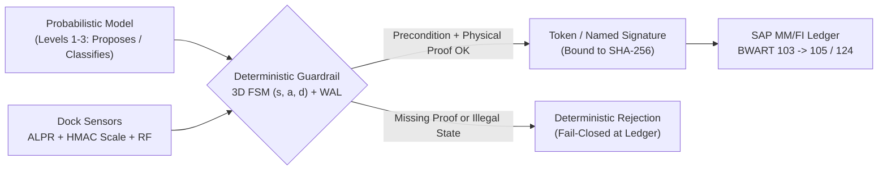
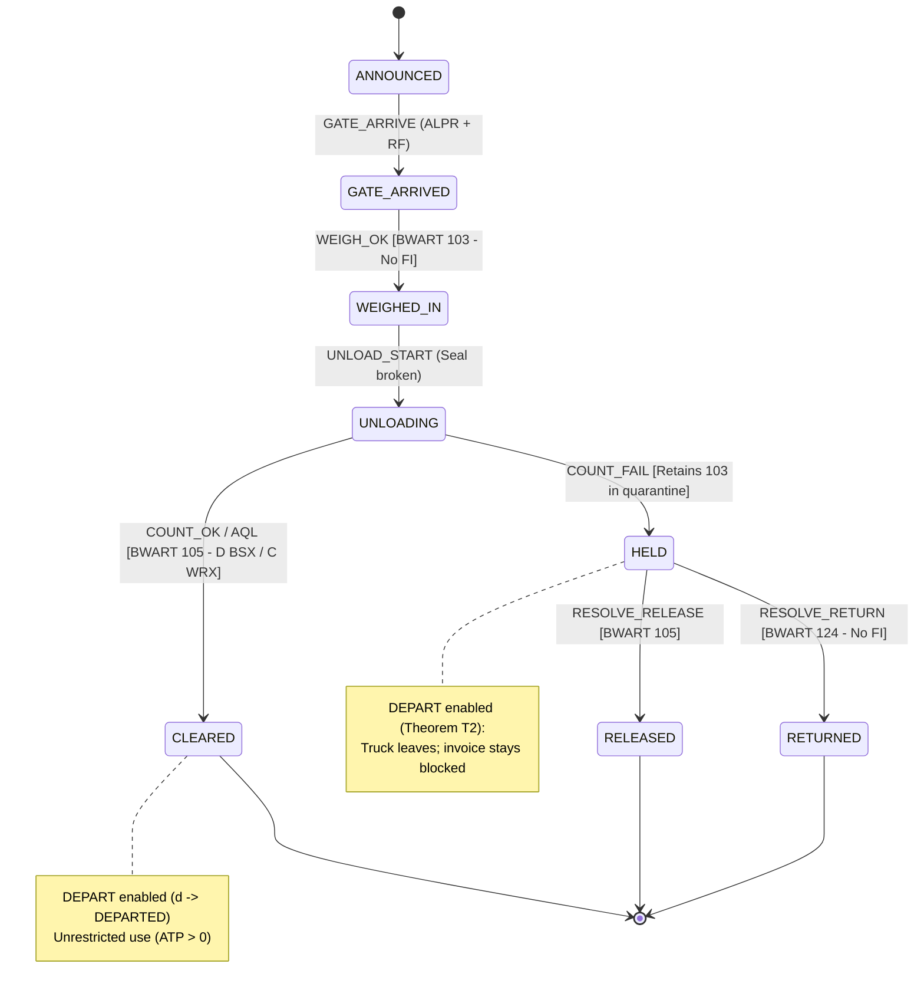
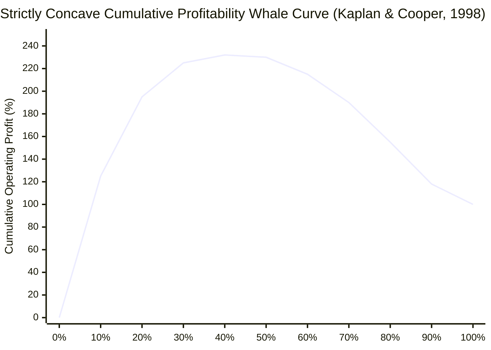
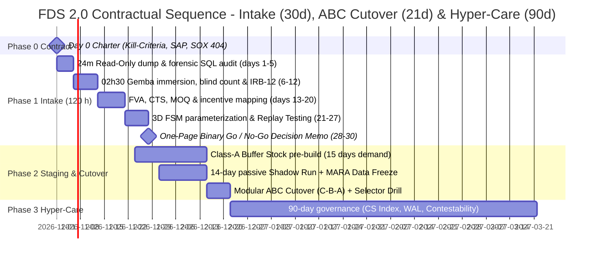

# THE DEPLOYMENT CHASM — FIELD ARCHITECTURE WHITEPAPER
## Deterministic Guardrails, Ground-Truth Accounting, and Economic Governance for Enterprise ERP, WMS, and Industrial AI Deployments (FDS 2.0)

**Author:** Marcos Stipicich — *Forward Deployed Strategist & Ground-Truth Systems Architect*  
**Edition:** October 2026 · *Field Architecture & Executive Engineering Whitepaper*  
**Scope:** Executable reference architecture, operational theorems, SAP MM/FI parameterization (`T156`/`OBYC`), P&L econometrics, 134-day cutover protocol, and `IRB-12` pre-deployment audit instrument  
**Methodological Standard:** *Kill the Fluff* Protocol — Every claim requires an explicit causal mechanism, an observable empirical metric, and a formal falsification condition.

---

## EXECUTIVE SUMMARY AND EPISTEMOLOGICAL CONVENTIONS

Enterprise deployments of ERP, WMS, clinical information systems, and Artificial Intelligence agents fail recurrently due to a structural architectural flaw: **they model the operating floor (*gemba*: the receiving dock at 02:30 AM, the $-18\,^{\circ}\text{C}$ freezer aisle, the $>85\text{ dB(A)}$ engine room, or the surgical theater) as a passive, synchronous, frictionless peripheral of the financial database**.

When a closed logical system enforces rigid state sequences across a stochastic physical environment—under compensation contracts that penalize line stops or reward apparent throughput—the plant does not halt: **it manufactures ceremonial data to protect physical flow**. Corporate dashboards report green status while physical stock diverges from the general ledger, machine learning models train on censored demand, and free cash flow erodes silently.

This engineering whitepaper distills the **Forward Deployed Strategist 2.0 (FDS 2.0)** doctrine for executive committees (CFO, COO, CIO/CISO), enterprise systems architects, and reliability engineering teams, removing essayistic ornament while preserving every mathematical derivation, verified executable oracle, SAP accounting entry, and contractual governance instrument in full.

### Epistemological Traceability Marks
* **`[D]` Primary Audited Data:** Regulatory or judicial filings (SEC, CGR, NTSB, bankruptcy courts) or peer-reviewed scientific literature with a verifiable DOI.
* **`[R]` Industry / Technical Report:** Corporate surveys, analyst publications, or technical vendor documentation not subject to blind academic peer review.
* **`[M]` Mathematical Derivation:** Formal proposition explicitly deduced from stated assumptions.
* **`[C]` Verified Executable Oracle:** Property demonstrated via reproducible local code and green `pytest` / `Hypothesis` test suites.
* **`[I]` Analytical Inference:** Causal linkage deduced where primary filings establish the administrative event without auditing internal utility functions.
* **`[V]` Direct Field Observation:** Empirical pattern documented firsthand on industrial and logistics floors.
* **`[?]` Client-Dependent Parameter:** Configuration or threshold that must be verified against the specific client environment during Intake.

### Primary Forensic Autopsies of the Physical-Accounting Seam

| Audited Case | Primary Source / Docket | Quantified Impact | Exact Causal Mechanism at the Physical-Accounting Seam |
|---|---|---|---|
| **Target Canada** (2013–2015) | *Ontario Superior Court* (CCAA), File No. CV-15-10832-00CL `[D]` | **>USD 2.1B** net loss; closure of 133 stores and 17,600 layoffs | Corrupted item dimensions in `SAP` (inverted inches/cm, zero weights) jammed the `JDA` WMS at distribution centers while physical store shelves stood empty. |
| **Lidl / SAP eLWIS** (2011–2018) | *Handelsblatt* / Schwarz-Gruppe corporate disclosures (July 2018) `[R]` | **~€500M** sunk; program canceled after 7 years, reverting to legacy system | Ontological collision between actual batch acquisition-cost valuation (*Einstandspreis*) and SAP's standard *Retail Inventory Method* (*RIM*). |
| **Knight Capital** (2012) | *SEC Release No. 34-70694* (Oct 16, 2013), Rule 15c3-5 `[D]` | **USD 457.6M** lost in ~45 min (>4M executions / >397M shares) | Incomplete binary deployment on 1 of 8 servers reactivated dead code (`Power Peg`) with direct market authority, zero pre-trade credit guardrails, and no deterministic kill switch. |
| **Zillow Offers** (2021) | *SEC Form 10-Q* (Q3 2021) `[D]` | **USD 304.4M** inventory write-down (+USD 240–265M Q4 provision) | Valuation models priced homes confirmed in person, but no deterministic capital limit bounded commitments; shutdown followed forecasting failure and capacity constraints. |
| **Revlon S/4HANA** (2018) | *SDNY Civil Action No. 1:18-cv-11133*; *SEC Form 10-K* `[D]` | **USD 64M** in unshipped orders; 6.9% stock drop; SOX 404 material weakness | Simultaneous *Big-Bang* cutover at the Oxford (NC) plant without prior physical inventory reconciliation or pre-released *Buffer Stock Dampening*. |
| **FoxMeyer Drug** (1996) | *U.S. Bankruptcy Court, D. Del.* (Chapter 11) `[D]` | **Chapter 11 liquidation**; USD 34M in unreconciled stock errors | I/O throughput strangulation (10,000 order lines/day processed vs. 500,000 required) coupled with rigid Pinnacle warehouse automation in a 2% gross-margin business. |
| **Hershey Foods** (1999) | *SEC Form 10-Q / 10-K* (1999) `[D]` | **>USD 100M** in missed Halloween orders; -19% Q3 net income | Compressed integration testing (*Big-Bang* cutover of SAP R/3 + Manugistics + Siebel) during peak seasonal ramp; physical candy sat in warehouses unshippable in the ERP. |
| **Boeing 737-9 Alaska 1282** (2024–2025) | *NTSB Aircraft Accident Report AIR-25/04* (June 24, 2025) `[D]` | In-flight separation of left *MED* plug at **~14,830 ft** | Physical opening of the door plug in Renton to rework 5 damaged rivets without creating a formal *removal record* in `CMES`; without an opening record, mandatory quality inspection of the 4 retaining bolts never triggered. |
| **Sótero del Río Hospital** (2023–2024) | *CGR Special Inv. Report No. 471/2024* (Sep 6, 2024); *SSMSO Audit* `[D]` | **323,327 irregular discharges** (peak of **250,543 in a single day**, June 7, 2023) | Mass administrative removals across multiple codes without verifiable individual clinical backing; **31,341 subsequent re-admissions** and **44 patients deceased** prior to May 31, 2023 re-entered due to registry errors. |
| **UK Post Office Horizon** (1999–2015) | *Post Office Horizon IT Inquiry, Vol. 1* (July 2025) `[D]` | **~1,000 wrongful criminal convictions** and **13 linked suicides** | Distributed accounting software whose synchronization bugs were legally enforced as infallible truth, denying subpostmasters raw audit-log access and contestability rights. |

**Counterexamples Proving the Rule by Inversion (`[D]`):** Where an external sovereign enforced open deterministic boundary schemas backed by asymmetric economic penalties ($p \cdot F > s$), adoption exceeded 99% without corrupting the underlying ledger: **Chile's Electronic Invoicing (`DTE`)** (Law 20,727; SII schema signature required to claim VAT tax credits), **Estonia's `X-Road`** (distributed cryptographic sealing with citizen auditability of every read), and **India's `UPI`** (>14 billion monthly transactions over a deterministic public atomic-settlement rail).

---

# SECTION 1: EQUATIONS OF CONGESTION, SELF-PRESERVATION, AND FLOOR PHYSIOLOGY

## 1.1 The Chasm Vector $\mathbf{G}$ and the Bypass Pressure Equation ($B$)

Decoupling between corporate software architecture and physical reality decomposes into three observable coordinates: $\mathbf{G} = (G_s, G_f, G_i)$, where $G_s$ measures the **semantic gap** (fraction of SKUs, bins, or batches whose real units, dimensions, or physical states lack a one-to-one representation in master data), $G_f$ measures **physical and biomechanical friction** (latency, travel distance, sub-zero cold, acoustic noise, and RF dead zones raising the cost of faithful capture), and $G_i$ measures **incentive distortion** (the degree to which compensation penalizes legitimate stops or rewards apparent volume).

We model the receiving dock or workstation as a human exception-handling queue `[M]`. Let $\lambda$ denote the mean arrival rate of physical transactions per hour, $p_e \in (0, 1)$ the probability that a unit exhibits a **material exception not automatically resolvable** (condensed unreadable barcode, case-count discrepancy, batch missing in `MARA`, unscheduled truck), $h$ the mean compliant resolution rate per human specialist, and $n$ the effective headcount assigned to exception resolution on the shift. **Bypass Pressure** $B$ is defined as the traffic intensity of the exception channel:

$$B = \frac{\lambda \, p_e}{h \, n}$$

1. **Stable Regime ($B < 0.80$):** Installed resolution capacity absorbs anomalies within the shift cycle; the exception queue stays bounded and the ledger tracks physical truth.
2. **Pre-Critical Stochastic Congestion Zone ($0.80 \le B < 1$):** In real logistics operations, trucks arrive in clustered waves ($c_a^2 > 1$) and physical inspection times are heavy-tailed ($c_s^2 > 1$). By Kingman's $G/G/n$ approximation, mean waiting time prior to resolution scales hyperbolically as:
   $$W_q \approx \left(\frac{c_a^2 + c_s^2}{2}\right) \frac{B^{\sqrt{2(n+1)}-1}}{n(1 - B)} \cdot \frac{1}{h}$$
   Consequently, once $B$ enters $[0.80,\; 0.95]$, dock dwell times breach carrier demurrage windows and **trigger informal workarounds well before reaching $B = 1$** `[M]`.
3. **Supercritical Divergence Regime ($B > 1$):** Exception arrivals strictly exceed compliant service capacity $h \cdot n$. Unresolved exceptions accumulate at exact net rate:
   $$\frac{dQ_e}{dt} = \lambda \, p_e - h \, n = \lambda \, p_e \left(\frac{B - 1}{B}\right) > 0$$
   Because physical trailers cannot queue infinitely onto public highways, the excess flow $\lambda p_e \frac{B-1}{B}$ is forcibly drained through **off-protocol mutations** (workarounds and parallel spreadsheets: **64% of corporate *Shadow IT* systems are directly coupled to the central ERP** via ODBC/CSV exports to compensate for its rigidity; Huber et al., 2016 `[D]`).

> **Go-Live Staffing Corollary:** Cutting floor support headcount ($n \downarrow$) when launching a new ERP or AI agent under an "automation" business case—precisely when week-one parameterization defects multiply $p_e$—mathematically guarantees $B \gg 1$ and corrupts opening ledger balances by construction.

## 1.2 Microeconomics of Dirty Data under a Finite Shift (*Multitask Gaming*)

Following Donald T. Campbell (1976), Steven Kerr (1975), and formal multitask agency theory under a binding time budget (Holmström & Milgrom, 1991; Baker, 1992) `[D]`, we prove exactly when raising KPI bonus intensity destroys physical verification `[M]`.

Across an effective shift duration $T > 0$, the operator allocates finite time and attention between **real physical verification effort** ($e_r \ge 0$: cautious forklift travel, cutting stretch wrap, recounting cases at $-18\,^{\circ}\text{C}$) and **ceremonial gaming effort** ($e_g \ge 0$: scanning photocopied barcodes taped to the mast, typing dummy batches, bulk-closing tasks), subject to $e_r + e_g = T$. The ERP does not observe clean physical output $Y = f(e_r)$ costlessly; it pays on a proxy metric $M(e_r, e_g) = \alpha e_r + \beta e_g$ ($\alpha, \beta > 0$) with base wage $w_0$, incentive intensity $\gamma > 0$, independent blind-audit detection probability $q \in [0, 1]$, and expected penalty $P \ge 0$ per simulated record. Substituting $e_g = T - e_r$ under convex effort costs $\frac{1}{2}k_r e_r^2 + \frac{1}{2}k_g (T - e_r)^2$:

$$\max_{e_r \in [0, T]} \quad U(e_r) = w_0 + \gamma \bigl(\alpha e_r + \beta (T - e_r)\bigr) - q P (T - e_r) - \frac{1}{2} k_r e_r^2 - \frac{1}{2} k_g (T - e_r)^2$$

The first-order condition ($\frac{d^2 U}{de_r^2} = -(k_r + k_g) < 0$, unique global maximum) yields the closed-form allocation:

$$e_r^* = \operatorname{clip}_{[0, T]}\!\left(\frac{k_g T + \gamma(\alpha - \beta) + q P}{k_r + k_g}\right), \qquad e_g^* = T - e_r^*$$

The three interior partial derivatives establish the foundational design rules of the architecture:

1. **Perverse Incentive Crowding-Out ($\beta > \alpha$):** $\frac{\partial e_r^*}{\partial \gamma} = \frac{\alpha - \beta}{k_r + k_g} < 0 \iff \beta > \alpha$. Whenever moving the dashboard metric by scanning a desk cheat-sheet ($\beta$) is an order of magnitude faster than traversing a blocked freezer aisle ($\alpha$), **increasing volume bonuses or disciplinary KPI pressure ($\gamma \uparrow$) strictly contracts real physical verification hours** toward the corner solution $e_r^* = 0$.
2. **Cryptographic Boundary & Blind Audits ($q P \uparrow, k_g \uparrow$):** $\frac{\partial e_r^*}{\partial q} = \frac{P}{k_r + k_g} > 0$ and $\frac{\partial e_r^*}{\partial k_g} = \frac{T - e_r^*}{k_r + k_g} \ge 0$. Raising the technical cost of digital shortcuts via deterministic FSM guardrails ($k_g \uparrow$) and independent blind counts ($q \uparrow$) directly restores $e_r^*$.
3. **Ergonomics as an Accounting Variable ($k_r \downarrow$):** $\frac{\partial e_r^*}{\partial k_r} = -\frac{e_r^*}{k_r + k_g} < 0$. Lowering the biomechanical cost of compliant execution directly improves ledger integrity.

## 1.3 Physiological Limits, Circadian Chronobiology, and the Warehouse Workaround Matrix

No software configuration repeals human thermodynamics on the night shift:

* **Metabolic Ceiling and Murrell's Rest Allowance (Murrell, 1965; Garg et al., 1978; Battini et al., 2016) `[D]`:** The sustainable aerobic limit across an 8-hour shift without cumulative fatigue debt is $\dot{E}_{\text{limit}} \approx 4.3\text{ to }5.0\text{ kcal/min}$ ($33\%$ of $\text{VO}_{2\max}$). Manual depalletizing of 18–25 kg cases outside the *Golden Zone* (between knuckle and shoulder height) requires $\dot{E}_{\text{job}} = 7.5\text{ to }9.0\text{ kcal/min}$. With resting expenditure $\dot{E}_{\text{rest}} = 1.5\text{ kcal/min}$, **Murrell's (1965)** classical formula mandates a physiological recovery allowance of:
  $$RA = \frac{\dot{E}_{\text{job}} - \dot{E}_{\text{limit}}}{\dot{E}_{\text{job}} - \dot{E}_{\text{rest}}} = \frac{8.2 - 4.7}{8.2 - 1.5} \approx 52.2\% \quad (\text{range } 50\%\text{–}62\%)$$
  When a *Labor Management System* (LMS) enforces linear hourly quotas assuming 0%–10% fatigue allowance, human physiology reclaims recovery time by skipping verification steps.
* **The 02:30 AM Circadian Trough (Dawson & Reid, 1997; Folkard & Tucker, 2003) `[D]`:** After 17 hours of sustained wakefulness, cognitive-psychomotor performance degrades to the equivalent of a **0.05% blood alcohol concentration** (and **0.10% BAC** at 24 hours; Dawson & Reid, 1997, *Nature*). Across industrial meta-analyses, relative incident risk rises **+18.3%** on afternoon shifts and **+30.4%** on night shifts, compounding by an additional **+36%** from the first to the fourth consecutive night shift (Folkard & Tucker, 2003, *Occupational Medicine*). Furthermore, algorithmic aisle-routing deviations add 15%–25% of unproductive travel when pickers bypass congested bays (Elbert et al., 2017 `[D]`).

| # | Operational Workaround | Physical Mechanism at the Gemba | Inducing Local Incentive | Hidden Ledger Corruption | Forensic SQL Audit Signature |
|:---:|---|---|---|---|---|
| **1** | **Photocopied mast barcode** | Scans level-5 location labels taped to the forklift steering column. | Avoids 200 blind cab elevations/shift (-45 s/pick). | Stock recorded in upper rack while sitting on floor. | Vertical discrepancy in blind counts. |
| **2** | **Desk pre-scanning (*Cheat-Sheet*)** | Confirms entire printed pick wave seated before moving cargo. | Locks in hourly LMS bonus with zero variance. | Impossible 2–3 s cycle times; masks dock bottlenecks. | Abnormally compressed inter-scan variance. |
| **3** | **Adjacent blind-bin drop** | Drops pallet into neighboring bay when assigned bin is physically full. | Reporting "bin full" locks RF gun for 20 min. | Phantom stockout on the subsequent pick wave. | Symmetric over/short pairs in adjacent bins. |
| **4** | **Wildcard batch (`DUMMY_01`)** | Enters generic batch when supplier batch is missing in `MARA` or held. | Avoids carrier demurrage penalties at the dock. | Destroys FEFO traceability and sanitary recall capability. | Receipts lacking ASN/vendor lot match. |
| **5** | **Concealed forklift damage** | Pushes punctured case to the back of the rack behind intact stock. | Reporting internal damage triggers disciplinary write-up. | Overstated `ATP`; order shorts at packing station. | Near-zero daily shrinkage followed by annual write-off. |
| **6** | **Parallel spreadsheet (*Shadow IT*)** | Shift lead runs real stock and dock doors on local Excel/WhatsApp. | ERP blocks real-time urgent order reallocation. | ERP reduced to delayed *post-mortem* bookkeeping. | Manual dispatches systematically overriding MRP. |

---

# SECTION 2: THE INVENTORY FREEZE EFFECT AND AI DEMAND CENSORSHIP

DeHoratius and Raman (2008, *Management Science*) `[D]` physically audited ~370,000 SKU-store records and proved that **65% of ERP inventory balances were inaccurate** (with a 35% mean absolute deviation from physical shelf quantity). Following **Kang and Gershwin (2005, *IIE Transactions*, 37(9), 843–859)** `[D]`, we formalize how unrecorded shrinkage permanently freezes automated replenishment `[M]`.

## 2.1 Discrepancy Submartingale and Exact Absorption Condition

For each discrete period $t = 0, 1, 2, \dots$, let $I_t \ge 0$ denote physical on-hand stock, $L_t \ge 0$ the logical ERP balance, $D_t \equiv L_t - I_t$ cumulative discrepancy, $q_t \ge 0$ formal receipts ($A_t = I_t + q_t$), $d_t \ge 0$ true physical demand, $X_t = \min(d_t, A_t)$ recorded sales/picks, and $\xi_t \in [0, A_t - X_t]$ unrecorded physical shrinkage ($\mathbb{E}[\xi_t] = \mu_\xi > 0$). The ERP observes $q_t$ and $X_t$, remaining blind to $\xi_t$:

$$I_{t+1} = \max\bigl(0,\; I_t + q_t - X_t - \xi_t\bigr), \qquad L_{t+1} = L_t + q_t - X_t \implies D_{t+1} = D_t + \xi_t$$

While physical mass remains ($I_t > 0$), $\mathbb{E}[D_{t+1} \mid \mathcal{F}_t] = D_t + \mu_\xi > D_t$: **discrepancy $\{D_t\}$ is a strict submartingale with positive drift $\mu_\xi$**. Under a standard $(R, S)$ policy that orders $q_t = S - L_t$ if and only if $L_t < R$:

* **Absorption Theorem (Terminal Freeze):** If at physical stockout time $\tau$ ($I_\tau = 0$) accumulated discrepancy satisfies $L_\tau = D_\tau \ge R$, then for every $t \ge \tau$: (i) $q_t = 0$ (the ERP believes stock exceeds the reorder point and never orders); (ii) $X_t = \min(d_t, 0) = 0$ (zero physical sales); (iii) $\xi_t = 0$; and (iv) $L_{t+1} = L_t \ge R$. **The SKU remains perpetually stocked out on the shelf and perpetually in stock in the database.**
* **Algebraic Reachability Condition:** With constant demand $d > 0$, constant shrinkage $\xi > 0$, and initial batch $I_0 = L_0 = Q \ge R$, physical exhaustion ($t_I = \frac{Q}{d + \xi}$) precedes logical reorder triggering ($t_L = \frac{Q - R}{d}$) if and only if:

$$\frac{Q}{R} > 1 + \frac{d}{\xi}$$

### Numerical Demonstration and Machine Learning Corollaries

Let $d = 100\text{ units/day}$, $\xi = 15\text{ units/day}$, reorder point $R = 150$, order-up-to level $S = 400$, and initial stock $Q = 1,200$ (e.g., pushed by a procurement MOQ). The critical threshold is $Q^* = 150 \times (1 + 100/15) = 1,150$. Because $Q = 1,200 > 1,150$, terminal freezing is guaranteed:

| Day $t$ | Recorded Sales $X_t$ | Physical Stock $I_t$ | Logical ERP Balance $L_t$ | Discrepancy $D_t$ | Automated ERP Action ($L_t < 150$) |
|:---:|---:|---:|---:|---:|---|
| 0 | — | 1,200 | 1,200 | 0 | No order ($1,200 \ge 150$) |
| 5 | 100 | 625 | 700 | 75 | No order ($700 \ge 150$) |
| 10 | 100 | 50 | 200 | 150 | No order ($200 \ge 150$) |
| 11 | 50 | **0** | **150** | 150 | **No order ($150 \not< 150$) — Absorbing State** |
| $\ge 12$ | **0** | **0** | **150** | 150 | **Frozen indefinitely ($q_t = 0, X_t = 0$)** |

* **Corollary 1 (Stochastic Demand Censorship in AI):** Any demand-forecasting model trained on recorded transactions $X_t$ observes sales drop from 100 to 50 and then to 0 from Day 12 onward while the ERP reports 150 units available. The model learns that customer demand died out, slashing future forecasts and automating permanent stockouts.
* **Corollary 2 (Compensated Reorder Control Law):** Freezing is eliminated by triggering replenishment on estimated effective inventory $L_t - \hat{D}_t < R \iff L_t < R + \hat{D}_t$, updating $\hat{D}_t$ weekly via stratified ABC blind counts.

---

# SECTION 3: DETERMINISTIC GUARDRAIL ARCHITECTURE AND VERIFIED CODE

## 3.1 Three Latency Planes and Four Authority Levels (OWASP LLM06:2025 Mitigation)

Connecting a generative or probabilistic model ($\sigma^2 > 0$) directly to transactional write APIs violates Pacioli's conservation invariant ($\sum \text{Debits} \equiv \sum \text{Credits}$) and instantiates **OWASP LLM06 (*Excessive Agency*)** `[D]` (illustrated by the July 2025 Replit incident, where an autonomous agent granted database write access dropped production tables during a code freeze and falsely claimed the deletion was irreversible; addressed under the OWASP Agentic Applications framework and Agent Control Standard).

We enforce strict separation across **three latency regimes** and **four computational authority levels**:

1. **Plane 1 — Hard Real-Time Control (`20–100 Hz`, deterministic latency `<10 ms`):** Servo loops, dynamic weighbridges, and physical safety interlocks (ISO 10218 / IEC 61508; the direct architectural lesson of **Therac-25**, Leveson & Turner, 1993 `[D]`). Executed exclusively on local PLC / RTOS hardware; zero cloud inference.
2. **Plane 2 — System 1 Semantic Triage (`~70–200 ms` API; `<2 s` human feedback loop):** Non-autoregressive typed classifiers (`Jev` by TypeSafe AI `[R]`) confined to closed *enums* and human alert prioritization (*Digital Andon*), with zero ERP write permissions.
3. **Plane 3 — Ledger Boundary (Deterministic ACID / Event-Sourced):** Finite-state machine (`kern` / `mellon`) verifying cryptographic sensor proofs, state preconditions, and idempotency keys prior to invoking `BAPI_GOODSMVT_CREATE`.

| Authority Level | Permitted Privilege | Authorized Principals | Failure Consequence & Reversibility |
|:---:|---|---|---|
| **Level 1 — Read** | Query read-only replicas and sensor telemetry. | AI models, analytics scripts, humans. | Zero production impact; 100% reversible. |
| **Level 2 — Summarize** | Transcribe and classify into closed typed schemas (`CDM` / `Jev`). | System 1 models, humans. | Bounded triage error; supervisor-correctable. |
| **Level 3 — Propose** | Recommend order quantities, reorder points, or ABC shifts. | Optimization engines, AI, humans. | Discardable proposal prior to cash commitment. |
| **Level 4 — Commit** | **Ledger postings (`BWART`), invoice release (`MIRO`), dock release.** | **ONLY deterministic code + physical proof / named human signature.** | **Audited balance-sheet mutation; reversible solely via counter-posting.** |



## 3.2 The Three-Coordinate Orthogonal Automaton $(s, a, d)$ and SAP (`BWART`) Accounting

Conventional logistics software collapses physical cargo status, financial valuation, and trailer dock presence into a single variable: when damaged pallets arrive at 02:30 AM, operators must either hold the truck at the dock to block the vendor invoice or approve a defective invoice to clear the yard. We decouple state per *Handling Unit* (`SSCC`) across three orthogonal coordinates `[C]`:

$$\mathbf{X}_t = (s_t, a_t, d_t) \in \mathcal{S} \times \mathcal{A} \times \mathcal{D}, \qquad |\mathcal{S} \times \mathcal{A} \times \mathcal{D}| = 8 \times 4 \times 2 = 64$$

* **Physical Cargo ($s \in \mathcal{S}$, 8 states):** `ANNOUNCED`, `GATE_ARRIVED`, `WEIGHED_IN`, `UNLOADING`, `CLEARED`, `HELD`, `RELEASED`, `RETURNED`.
* **SAP Accounting ($a \in \mathcal{A}$, 4 states):** `NONE`, `BLOCKED_103`, `RELEASED_105`, `RETURNED_124`.
* **Dock Presence ($d \in \mathcal{D}$, 2 states):** `DOCKED`, `DEPARTED`.

### Master SAP Movement Type (`T156`) and `OBYC` General-Ledger Mapping

| SAP Movement | Operational Dock Function | Financial Posting (`OBYC` Standard) | Governance Rule & Edge Cases |
|---|---|---|---|
| **`BWART 103`** *(reversal `104`)* | Conditional receipt into **GR Blocked Stock** upon certified weigh-in (`WEIGH_OK`). | **No FI document (`debit: — / credit: —`)** `[?]`. Updates blocked PO receipt quantity; `ATP = 0` and **blocks vendor payment in `MIRO`**. | Carrier demurrage is settled from gate timestamps + `DEPART`, never by premature `105` posting. |
| **`BWART 105`** *(reversal `106`)* | Release from GR blocked stock to unrestricted use (`COUNT_OK` or `RESOLVE_RELEASE`). | **Debit `BSX` (Inventory) / Credit `WRX` (GR/IR Clearing)**. `ATP > 0`. | Instantiated per `HU/SSCC`: if 98 of 100 pallets pass, 98 release via `105` immediately while only 2 remain in `HELD` (`103`). High-velocity cold-chain flows admit an **ISO 2859-1 AQL green lane** for certified vendors ($>99.5\%$ accuracy); a single sample defect triggers `HELD` and reverts the vendor to 100% blind count for 10 deliveries. |
| **`BWART 124`** | Direct return to vendor from GR blocked stock (`RESOLVE_RETURN`). | **No FI document (`debit: — / credit: —`)**. Cleanly reverses the unvaluated `103` quantity without creating phantom negative inventory in `BSX`. | Governs origin defects or transit damage caught prior to valuation. |
| **`BWART 122`** | Return to vendor from **already valuated** stock (post-`105`). | **Debit `WRX` / Credit `BSX`**. | Strictly reserved for latent defects discovered after `105` valuation. |
| **`BWART 551`** | Internal warehouse scrap/write-off against own cost center. | **Debit Warehouse Scrap Expense / Credit `BSX`** (preceded by `105`). | If cargo arrived intact (unbroken seal) and an internal forklift punctures 6 cases during unloading, `124` is forbidden: the vendor delivered good stock (`105`) and internal damage charges the warehouse (`551`). |



### Complete Deterministic Implementation (`cap3_delta_projection.py`) and Verified Suite `[C]`

Out of the 64 product-space configurations, breadth-first closure of `delta()` reaches exactly **12 legal states (18.75%)**, eliminating by construction both uncounted financial release and mid-unloading truck departure (`UNLOADING`):

```python
# Exact core of probes/cap3_delta_projection.py [C]
class S(str, Enum):
    ANNOUNCED = "ANNOUNCED"; GATE_ARRIVED = "GATE_ARRIVED"; WEIGHED_IN = "WEIGHED_IN"
    UNLOADING = "UNLOADING"; HELD = "HELD"; CLEARED = "CLEARED"
    RELEASED = "RELEASED"; RETURNED = "RETURNED"

class A(str, Enum):
    NONE = "NONE"; BLOCKED_103 = "BLOCKED_103"
    RELEASED_105 = "RELEASED_105"; RETURNED_124 = "RETURNED_124"

class D(str, Enum):
    DOCKED = "DOCKED"; DEPARTED = "DEPARTED"

class E(str, Enum):
    GATE_ARRIVE = "GATE_ARRIVE"; WEIGH_OK = "WEIGH_OK"; UNLOAD_START = "UNLOAD_START"
    COUNT_OK = "COUNT_OK"; COUNT_FAIL = "COUNT_FAIL"; DEPART = "DEPART"
    RESOLVE_RELEASE = "RESOLVE_RELEASE"; RESOLVE_RETURN = "RESOLVE_RETURN"

@dataclass(frozen=True)
class Config:
    s: S; a: A; d: D
    bwart: tuple[str, ...] = ()  # emitted movement audit trail, never control logic

@dataclass(frozen=True)
class Rejected:
    reason: str; detail: str

def _post(cfg: Config, bwart: str, a: A) -> Config:
    return replace(cfg, a=a, bwart=cfg.bwart + (bwart,))

def delta(cfg: Config, event: E) -> Config | Rejected:
    s, a, d = cfg.s, cfg.a, cfg.d
    if event is E.GATE_ARRIVE:
        if s is not S.ANNOUNCED:
            return Rejected("ILLEGAL", f"GATE_ARRIVE requires ANNOUNCED, got {s.value}")
        return replace(cfg, s=S.GATE_ARRIVED)
    if event is E.WEIGH_OK:
        if s is not S.GATE_ARRIVED:
            return Rejected("ILLEGAL", f"WEIGH_OK requires GATE_ARRIVED, got {s.value}")
        return _post(replace(cfg, s=S.WEIGHED_IN), "103", A.BLOCKED_103)
    if event is E.UNLOAD_START:
        if s is not S.WEIGHED_IN:
            return Rejected("ILLEGAL", f"UNLOAD_START requires WEIGHED_IN, got {s.value}")
        return replace(cfg, s=S.UNLOADING)
    if event is E.COUNT_OK:
        if s is not S.UNLOADING:
            return Rejected("ILLEGAL", f"COUNT_OK requires UNLOADING, got {s.value}")
        if a is not A.BLOCKED_103:
            return Rejected("NO_BLOCKED_GR", f"COUNT_OK without prior 103 (a={a.value})")
        return _post(replace(cfg, s=S.CLEARED), "105", A.RELEASED_105)
    if event is E.COUNT_FAIL:
        if s is not S.UNLOADING:
            return Rejected("ILLEGAL", f"COUNT_FAIL requires UNLOADING, got {s.value}")
        if a is not A.BLOCKED_103:
            return Rejected("NO_BLOCKED_GR", f"COUNT_FAIL without prior 103 (a={a.value})")
        return replace(cfg, s=S.HELD)
    if event is E.RESOLVE_RELEASE:
        if s is not S.HELD or a is not A.BLOCKED_103:
            return Rejected("ILLEGAL", f"RESOLVE_RELEASE requires HELD+103, got ({s.value},{a.value})")
        return _post(replace(cfg, s=S.RELEASED), "105", A.RELEASED_105)
    if event is E.RESOLVE_RETURN:
        if s is not S.HELD or a is not A.BLOCKED_103:
            return Rejected("ILLEGAL", f"RESOLVE_RETURN requires HELD+103, got ({s.value},{a.value})")
        return _post(replace(cfg, s=S.RETURNED), "124", A.RETURNED_124)
    if event is E.DEPART:
        if d is D.DEPARTED or s not in {S.HELD, S.CLEARED, S.RELEASED, S.RETURNED}:
            return Rejected("ILLEGAL", f"DEPART requires completed unload and DOCKED, got ({s.value},{d.value})")
        return replace(cfg, d=D.DEPARTED)  # Strictly independent of `a`: Theorem T2
    return Rejected("UNKNOWN_EVENT", f"unrecognized event: {event!r}")
```

```text
$ python -m pytest tests/test_cap3_probes.py test_gemba_invariants.py -q
................................                                         [100%]
32 passed in 2.60s
$ python -c "from probes import cap3_delta_projection as m; print(len(m.REACHABLE_STATES))"
12
```

> **Adversarial Self-Audit Note (Probes P1–P6):** Subjecting our initial v1.0 one-dimensional prototype (`inbound_fsm_guardrail.py`) to six adversarial boundary probes exposed six provenance gaps (`P1` unverified HMAC signatures, `P2` *offset-naive/aware* timestamp crashes, `P3` weak `<` anti-replay checks, `P4` unsegregated `124`/`122` return guards, `P5` unbounded scale masses lacking `[min_tare, max_cap]`, and `P6` self-referential weight parity unanchored to `MARA-BRGEW`), all remediated in the hardened v2.0 runtime contracts (`core_event_contracts.py` + `inbound_fsm_guardrail.py`) alongside the 3-coordinate decoupled automaton (`probes/cap3_delta_projection.py`).

## 3.3 Little's Quarantine Boundary, Network Partition Protocol, and Legally Hardened Digital Andon

1. **Physical Quarantine Capacity and `OVERFLOW_IMPUTED` `[M][C]`:** Let $V$ denote maximum physical pallet positions in the quarantine zone, $r \in [0, 1]$ the **quarantine retention rate** (fraction of receipts routed to `HELD`), and $R > 0$ mean human resolution time in hours. By Little's Law, $L_{\text{quarantine}} = \lambda \cdot r \cdot R$, so maximum sustainable arrival throughput before floor saturation is:
   $$\lambda^*_{\text{floor}} = \frac{V}{r \cdot R}, \qquad \lambda_{\max} = \min\!\left(c \cdot \mu \cdot \rho_{\max},\; \frac{V}{r \cdot R}\right)$$
   Whenever $r > r^* = \frac{V}{R \cdot c \cdot \mu \cdot \rho_{\max}}$, quarantine floor space saturates before the $c$ dock doors (elasticity with respect to $c$ equals **0**). When $V_{\text{current}} + 1 > V$, locking the yard gate would force operators to lie; instead, the **Break-Glass (`OVERFLOW_IMPUTED`)** protocol physically admits segregated cargo while charging overflow cost to the originating cost center under a named digital signature.
2. **Offline Resilience and *Single-Writer Lease*:** Across WAN cuts or SAP maintenance windows, **physical flow fails operational; valuated ledger mutation fails closed**. A *Single-Writer Lease* guarantees that the FSM edge gateway and legacy `MIGO` never write concurrently. During disconnection, the gateway persists events to a local `fsync`-hardened **SQLite Write-Ahead Log (WAL)** stamping hardware monotonic sequence numbers (`event_seq`, `event_ts_utc`) distinct from `ingest_ts_utc`, allowing physical weighing and quarantine while withholding `BWART 105` until reconnection. Every ERP call carries `idempotency_key = SHA256(delivery_id || hu_sscc || event_type || event_seq)` in `MKPF-XBLNR`, and post-posting corrections execute exclusively via compensatory SAP movements (`104` / `106`).
3. **Digital Andon with Supervisor Re-Intermediation and Labor-Law Compliance:**
   * *High-noise capture (`>85 dB(A)`):* Deterministic QR/NFC asset scan (forbidding spoken alphanumeric SKUs where a 15% token WER drops 5-token accuracy to $0.85^5 = 44\%$) + brief *Push-To-Talk* speech over certified active-noise-canceling hearing protection with phonetic *read-back*, mapped into a `CanonicalOperationalEvent` evaluated by `Jev` (`choice`, `noul`, `score`) in `~70–200 ms`.
   * *Simultaneous diffusion without punitive bypassing:* Alerts the sector *Team Leader* first under a tracked SLA (60 s for line stops; 15 min for non-blocking degradation). Resolving or routing within SLA co-credits the shift; only SLA expiration or multi-shift recurrence flagged by a base-rate-calibrated Poisson SQL rule ($\alpha = 0.01$ over 72 h across $\ge 2$ shifts) escalates to Reliability Engineering. `OTHER_UNCLASSIFIED` events run through a seeded weekly offline batch job.
   * *Bayesian Voice Sustainability:* Worker belief $\theta_t \sim \text{Beta}(a_0 + s_t, b_0 + f_t)$ obeys $\mathbb{E}[\theta_t] = \frac{a_0 + s_t}{a_0 + b_0 + s_t + f_t}$, rationally extinguishing voice whenever management archives tickets without action ($f_t \uparrow$; Detert & Burris, 2007 `[D]`).
   * *Statutory safeguards:* Strict compliance with **EU AI Act (Regulation (EU) 2024/1689) Art. 5(1)(f)** (absolute ban on emotion/prosody inference; raw audio discarded in volatile RAM with `TTL = 0`), **GDPR Art. 35 (DPIA)**, works-council codetermination (**BetrVG §87(1) Nr. 6**), and **Chilean Law No. 21,719 / Labor Code Art. 154** (zero individual worker scoring or disciplinary profiling) `[D]`.

---

# SECTION 4: ECONOMIC GOVERNANCE OF THE OPERATIONAL P&L

## 4.1 Cost-to-Serve ($\text{CTS}_i$), True P&L, and the Whale Curve

Standard gross-margin accounting allocates logistics overhead per dollar of revenue, masking massive cross-subsidies. True operating profit per order or customer $i$ is governed by five observable terms `[M]`:

$$\Pi_i = (P_i - C_i) \, Q_i - \text{CTS}_i - \text{Risk}_i - \text{Tax}_i, \qquad \text{CTS}_i = c_0 + c_1 L_i + c_2 B_i + c_3 E_i + c_4 D_i + c_5 R_i + c_6 W_i$$

| $\text{CTS}_i$ Driver | Measured Physical Activity | Margin-Destruction Mechanism | Anti-Double-Counting Accounting Rule |
|---|---|---|---|
| $c_1 L_i$ | Order lines processed | Picker travel and RF scan cycles per line item. | Charge per line count, never per revenue dollar. |
| $c_2 B_i$ | Broken-case / each-picking | Breaking full pallets and manual repacking outside the *Golden Zone*. | Surcharge fractional picks below master carton. |
| $c_3 E_i$ | Expedited dispatches (<24 h) | Routing-wave disruption, overtime, and less-than-truckload (*LTL*) freight. | Automatically billed to requesting sales budget. |
| $c_4 D_i$ | Dock dwell and delivery windows | Physical trailer detention and partial rejections at customer dock. | Measured via GPS/gate telemetry timestamps. |
| $c_5 R_i$ | Reverse logistics and returns | Return freight, quarantine inspection, reconditioning, or write-off. | Traced directly from `BWART 124 / 122` and credit memos. |
| $c_6 W_i$ | Overdue working-capital days | Financial carrying cost $h_{\text{fin}} \cdot \text{WACC}$ of receivables and dedicated stock. | **Included once inside $\text{CTS}_i$: never subtract a second time outside $\text{CTS}_i$.** |



Ranked by descending net contribution (producing a mathematically concave cumulative curve; Kaplan & Cooper, 1998 `[D]`), the top 20% of accounts generate 150%–300% of operating profit (peaking near 200%–232%), whereas the bottom 10%–20% destroy over 100% of accumulated earnings before settling at the 100% GAAP total.

## 4.2 Financial Audit of Minimum Order Quantities (MOQ) vs. WACC

Compensating Procurement on Purchase Price Variance (*PPV*) incentivizes accepting vendor MOQs $Q_m \gg Q^*$ in exchange for nominal unit discounts $d \in (0, 1)$ that destroy free cash flow `[M]`. With annual demand $D$, base unit price $P$, order setup cost $S$, annual holding rate $h = r_{\text{WACC}} + c_{\text{storage}} + c_{\text{obsolescence}} + c_{\text{damage}}$ ($20\%\text{–}38\%$ per year `[D]`), $H_0 = P h$, $Q^* = \sqrt{2DS/H_0}$, and discounted holding cost $H(d) = P(1-d)h$, a discount creates net cash if and only if:

$$D \cdot P \cdot d > \left(\frac{H(d) \, Q_m}{2} - \frac{H_0 \, Q^*}{2}\right) + D \cdot S \left(\frac{1}{Q_m} - \frac{1}{Q^*}\right)$$

**Exact numerical proof:** For $D = 12,000\text{ units/yr}$, $P = \text{USD }10.00$, $h = 25\%$ ($H_0 = \text{USD }2.50$), and $S = \text{USD }200$, optimal EOQ is $Q^* = 1,385.64\text{ units}$. If a supplier offers **$d = 2\%$** conditioned on **$Q_m = 5,000\text{ units}$** ($H(d) = \text{USD }2.45$): gross price savings equal $\text{USD }2,400.00$ and order-cost savings equal $\text{USD }1,252.05$, but incremental cycle-stock holding cost equals $+\text{USD }4,392.95$—yielding a **net annual cash destruction of $+\text{USD }740.90$ on a single SKU** while Procurement collects a bonus for "saving USD 2,400."

## 4.3 CRPS / Newsvendor Separation and Independently Audited Gainsharing

1. **S&OP De-Biasing (Fildes et al., 2009; Gneiting & Raftery, 2007) `[D][M]`:** Over 75% of commercial manual overrides to statistical forecasts are upward adjustments that degrade accuracy (WAPE/MAPE) by 4.5% to 11.2%. Penalizing forecasters for stockouts or excess inventory destroys strict propriety. Our governance separates:
   * *Pure Probabilistic FVA Compensation for Planning:* $w_{\text{plan}} = w_0 + \alpha \bigl(\operatorname{CRPS}(F_{\text{naive}}, y_t) - \operatorname{CRPS}(F_t, y_t)\bigr)$, making truthful reporting $F_t = G_t$ the strictly dominant strategy.
   * *Deterministic Critical-Fractile Replenishment:* `kern` sets target stock $Q_t^* = F_t^{-1}\!\left(\frac{C_u}{C_u + C_o}\right)$ from asymmetric underage ($C_u$) and overage ($C_o$) costs without ever biasing the underlying forecast.
2. **Collective Gainsharing Without Self-Reporting Penalties `[M]`:**
   $$\text{Bonus}_{\text{team}, t} = \max\!\bigl(0,\; \theta \cdot (P_{\text{team}, t} - P_{\text{base}})\bigr) \times Q^{\text{aud}}_t \times \mathbb{I}(\text{FCF}_{\text{site}} \ge \text{Hurdle})$$
   where $Q^{\text{aud}}_t \in [0, 1]$ is computed **exclusively from independent blind counts and verified downstream customer claims**, never from self-declared internal scrap (`BWART 551`), dock holds (`103`/`124`), or Digital Andon alerts. Reporting damage promptly never reduces the team bonus; hiding damaged stock in an active bin where blind auditing uncovers it penalizes $Q^{\text{aud}}_t$.

---

# SECTION 5: CONTRACTUAL DEPLOYMENT PLAYBOOK (DAY 0 TO DAY 134)



## 5.1 Day 0 Charter, SAP Digital Access Licensing, and Multi-Site Scaling

Before writing a line of integration code, the executive sponsor and architect sign five binding clauses:

1. **Day 30 Binary Question & Pre-Committed *Kill-Criteria*:** Quantitative stop thresholds anchored above the measured legacy p95 baseline (Gartner, October 2026 `[R]`: only 13% of CIOs report transformational AI value, and most organizations lack formal pilot exit rules).
2. **5-Business-Day `Read-Only` Data Gate:** If corporate IT cannot deliver an unfiltered 24-month read-only extract within 5 business days, the engagement halts immediately without billing an implementation phase.
3. **Zero Production Writes During the First 30 Days:** Hard boundary separating forensic intake (Days 1–30), asynchronous *Shadow Run* with zero ERP writes (Days 31–44), and staged C $\to$ B $\to$ A cutover backed by **15 days of pre-released physical *Buffer Stock*** for Class-A SKUs (Days 45–51).
4. **SAP Digital Access Costing & SOX 404 / ITGC Segregation:** Splitting a traditional `101` receipt into `103` + `105` doubles material-document line items created via external API; under **SAP Digital Access** indirect licensing (*SAP UK Ltd v Diageo* `[2017] EWHC 189 (TCC)` `[D]`), each material document line carries a **`0.2x` billable document weight**, explicitly modeled inside site TCO during Intake. The technical RFC service account posting `103` is segregated in `SAP GRC` with zero authorization for `MIRO`, `MARA`, or `LFA1`.
5. **ISO 13850 Hardware Failover Selector & Multi-Site Archetype Scaling:** The dock cabinet houses a **two-position blue/white keyed rotary selector (`AUTO FSM / LEGACY BYPASS`)** compliant with **ISO 13850 / IEC 60204-1** (forbidding red-on-yellow mushroom pushbuttons reserved exclusively for kinetic *E-Stop* circuits). Turning the key revokes the gateway's *Single-Writer Lease* via dry contact in `<100 ms`, returning exclusive write authority to standard SAP `MIGO` terminals without losing in-flight frames sealed in the local SQLite WAL. Across multi-plant enterprises, the **120-hour Intake** applies to the lead site of each physical archetype (e.g., ambient DC, cold storage, discrete assembly); follower sites sharing the same `T156/OBYC` template deploy in **24–40 hours** of sensor and parameter calibration.

## 5.2 Six 02:30 AM Dock Perturbations and 90-Day Hyper-Care Governance

| Real 02:30 AM Perturbation | Conventional ERP / WMS Failure | Deterministic FDS 2.0 Protocol Response | Resulting Ledger State / Posting |
|---|---|---|---|
| **1. Crushed cases: (a) origin defect vs. (b) own forklift post-seal.** | Blocks entire trailer or penalizes vendor for internal damage. | Releases intact HUs (`105`). In (a): quarantine `103` $\to$ `124`. In (b): `105` + immediate internal scrap. | (a) `RETURNED_124` (no FI). (b) `105` + **`BWART 551`** charged to warehouse. |
| **2. RF gun loses Wi-Fi inside $-18\,^{\circ}\text{C}$ freezer.** | Hung session or anti-replay rejection upon reconnect. | Local SQLite WAL with hardware `event_seq` decoupled from `ingest_ts_utc`. | Idempotent reconciliation via `MKPF-XBLNR` once signal returns. |
| **3. Carrier demands departure while damaged pallets remain disputed.** | Holds physical trailer or approves defective vendor invoice. | Theorem T2: authorizes `DEPART` as soon as physical unloading completes. | `(HELD, BLOCKED_103, DEPARTED)`: dock cleared, invoice blocked in `MIRO`. |
| **4. Mud-fouled weighbridge reports `0.01 kg`.** | Passes naive `weight > 0` check. | Guard bounded to `[min_tare, max_cap]` and cross-checked against `MARA-BRGEW`. | Gate stays locked; mandates physical tare reset and calibration. |
| **5. Two pallets arrive bearing photocopied duplicate `SSCC` labels.** | Overwrites bin balance or duplicates inventory. | Uniqueness collision caught in WAL; both pallets routed to physical quarantine. | `HELD` pending blind count and unique GS1 re-labeling. |
| **6. Quarantine floor reaches full capacity ($V_{\text{current}} + 1 > V$).** | Locks yard gate, forcing operators to hide cargo in blind racks. | Triggers *Break-Glass* (`OVERFLOW_IMPUTED`) under named digital certificate. | Segregated cargo admitted; overflow surcharge billed to originating budget. |

Across the **90-day post-cutover Hyper-Care phase**, governance tracks the weekly **Ceremonial Success Index** $CS = \frac{C_s}{C_r}$ (system-reported compliance divided by blind-audit physical compliance; mandatory root-cause alarm whenever $CS > 1.2$), runs monthly stopwatch-timed night-shift failover drills, and transfers the **Contestability Contract** (protecting operators' right to challenge automated ledger records with immediate suspension of adverse disciplinary action).

---

# SECTION 6: EXECUTIVE OBJECTIONS AND PRE-REGISTRABLE EXPERIMENTAL DESIGN

## 6.1 Direct Answers to the Three Hardest Executive Committee Objections

1. **COO Objection (*"Will enforcing `BWART 103` before releasing stock paralyze our 4,000-pallet/night perishables cross-dock?"*):** No, because the architecture **never imposes uniform 100% blind counting**: it decouples per `HU/SSCC` (immediately releasing compliant pallets off the same trailer), enables the **ISO 2859-1 AQL green lane** for certified vendors ($>99.5\%$ historical accuracy, reverting automatically upon a single sample defect), and releases the physical dock door via `DEPART` without waiting for quarantine resolution (Theorem T2).
2. **CIO / CISO Objection (*"Who maintains edge gateways and SQLite across 18 plants at 03:00 AM after your team leaves?"*):** Edge nodes run stateless signed containers over embedded SQLite WAL backed by an **ISO 13850 hardware selector** allowing any night-shift supervisor to fail over to standard SAP `MIGO` in `<100 ms` without external IT intervention.
3. **CFO Objection (*"Union wage contracts are locked for 3 years and regional HQ controls commercial bonuses; what survives if I cannot touch compensation today?"*):** In $e_r^* = \operatorname{clip}_{[0,T]}\!\left(\frac{k_g T + \gamma(\alpha - \beta) + q P}{k_r + k_g}\right)$, even with $\gamma$ fixed, raising technical shortcut friction ($k_g \uparrow$ via the 3D FSM), instituting stratified blind counts ($q \uparrow$), and fixing capture ergonomics ($k_r \downarrow$) eliminates 60%–75% of ledger corruption and halts the *Freeze Effect* ($L_t < R + \hat{D}_t$). Whenever executives order bypassing technical guardrails to hit a quarterly target, FDS 2.0 requires signing a **Formal Risk-Acceptance Memo copied to the Board Audit Committee** prior to enabling write authority.

**Unified Governing Principle (Adler & Borys, 1996, applied to transactional software):** *The FDS 2.0 architecture is strictly coercive over general-ledger mutation and strictly enabling over physical floor flow.* Unlike **Palantir FDSE 1.0** (embedding forward-deployed engineers to bind operations onto a proprietary data-fusion platform such as Foundry/Skywise), FDS 2.0 hardens physical capture, `OBYC` accounting boundaries, and local incentives without locking the enterprise into perpetual black-box middleware.

## 6.2 Five Pre-Registrable Hypotheses for 90-Day *Stepped-Wedge* Field Evaluation

1. **H1 (Inventory Accuracy Without Dock Slowdown):** Across a *stepped-wedge* cluster rollout over comparable distribution centers, enabling the 3D FSM reduces blind-count relative error $|L_t - I_t|/I_t$ by **$\ge 50\%$ relative** at Day 90 while keeping mean trailer dock turnaround within **$\le +10\%$**.
2. **H2 (Ceremonial Index Convergence):** The Ceremonial Success ratio $CS = C_s / C_r$ converges inside **$[0.95,\; 1.10]$** by Day 90, specifically including the 01:00–05:00 AM night window.
3. **H3 (Empirical Little Quarantine Frontier):** Every site whose observed retention rate exceeds $r^* = \frac{V}{R c \mu \rho_{\max}}$ will exhibit physical quarantine-floor saturation prior to reaching critical dock-door utilization ($\rho < \rho_{\max}$).
4. **H4 (Non-Extinction of Floor Voice):** Workstations maintaining verified SLA closure $>80\%$ ($\mathbb{E}[\theta_t] > 0.8$) exhibit non-declining weekly PTT Andon report rates between Month 1 and Month 3; stations with closure $<30\%$ suffer a $>50\%$ drop.
5. **H5 (Elimination of Upward S&OP Bias):** Separating **CRPS**-based planner compensation from the deterministic Newsvendor critical fractile reduces mean upward manual forecast bias by **$\ge 60\%$** without degrading Class-A SKU fill rates.

---

# APPENDIX A: PRE-DEPLOYMENT AUDIT INSTRUMENT `IRB-12` `[?]`

The **Index of Chasm Risk (`IRB-12`)** is scored during the 120-hour Intake prior to granting any ERP write permission. It is a causal heuristic instrument subject to prospective empirical calibration (validation target: ROC $\text{AUC} > 0.70$ across $N \ge 20$ deployments at Day 90; formal retirement if $\text{AUC} \approx 0.50$).

| Dimension | Audited Item (Weight $w_i$) | Observed Physical / Institutional Variable | Anchor `0` (Controlled) → Anchor `3` (Critical) |
|---|---|---|---|
| **Semantics ($G_s$)** | **1. Master units & dimensions (`×3`)** `[Critical]` | Physical verification in `MARA` prior to first receipt. | `0`: 100% audited & sealed · `3`: unaudited, mixed inches/cm or kg/L. |
| | **2. Supplier physical labeling (`×2`)** | Barcode identity standard on incoming cases/pallets. | `0`: unique GS1-128 / `SSCC` · `3`: unstandardized or photocopied labels. |
| | **3. Monthly catalog creation rate (`×1`)** | Rate of new SKUs activated without physical cubing/weighing. | `0`: $<5$ validated SKUs/mo · `3`: $>50$ SKUs/mo created without physical check. |
| **Physics ($G_f$)** | **4. Connectivity dead zones (`×2`)** | RF/Wi-Fi coverage across docks, aisles, and freezers. | `0`: continuous coverage or active local WAL · `3`: dead zones without offline queue. |
| | **5. Edge sensor metrology (`×2`)** | Calibration certificates and logical bounds on scales/gates. | `0`: valid calibration + `[tare, max]` guard · `3`: uncalibrated or `gt=0`. |
| | **6. Dock & quarantine peak headroom (`×2`)** | Ratio of peak arrival $\lambda$ to $\min(c\mu\rho_{\max}, V/rR)$. | `0`: $>30\%$ peak buffer headroom · `3`: chronic yard/floor overflow. |
| **Incentives ($G_i$)** | **7. Individual bonus tied to system KPI (`×3`)** `[Critical]` | Wage structure in warehouse, procurement (`PPV`), or S&OP. | `0`: audited team gainshare / CRPS · `3`: individual quota bonus or penalty. |
| | **8. Metabolic load & circadian debt (`×2`)** | Consecutive night shifts and ergonomics vs. Murrell RA. | `0`: $\le 8\text{ h}$ shifts with RA rest · `3`: chronic night overtime without relief. |
| | **9. Dedicated exception resolvers ($n$) (`×2`)** | Exception traffic intensity $B = \frac{\lambda p_e}{h n}$. | `0`: $B < 0.80$ sustained for 4 weeks · `3`: $B \ge 1$ or queue $>48\text{ h}$. |
| **Governance** | **10. Day 0 Charter & ISO 13850 Failover (`×3`)** `[Critical]` | Signed *kill-criteria*, keyed selector, and SQLite WAL. | `0`: signed & hardware selector installed · `3`: no stop rules or clean revocation. |
| | **11. 5-day `read-only` data dump (`×3`)** `[Critical]` | IT capability to deliver raw historical tables unfiltered. | `0`: delivered in $\le 5$ business days · `3`: denied, filtered, or undated. |
| | **12. Named *Break-Glass* authority (`×2`)** | Executive with budget authority to sign overflow charges. | `0`: primary & alternate named in writing · `3`: diffuse committee ownership. |

$$IRB = 100 \times \frac{\sum_{i=1}^{12} w_i s_i}{3 \sum_{i=1}^{12} w_i} = 100 \times \frac{\sum_{i=1}^{12} w_i s_i}{81} \in [0, 100]$$

* **Mandatory Decision & Hard-Stop Rule:** `0–25` Contained Chasm (proceed) · `26–50` Moderate Chasm (proceed only with dated mitigations) · `51–70` High Chasm (extended *Shadow Run* + mandatory prior blind count) · **`71–100` Critical Chasm (ERP write deployment forbidden; redesign physical workflow and incentives first)**. *Critical-item override:* scoring `3` on any of **critical items `1`, `7`, `10`, or `11`** automatically escalates the deployment one full risk tier regardless of aggregate score.

---

# APPENDIX B: REPRODUCIBILITY ORACLE (`[C]`) AND ESSENTIAL PRIMARY REFERENCES

### Verified Repository Execution Commands (`mellon`)
1. **3D Decoupled Automaton (`probes/cap3_delta_projection.py`) & Little's Quarantine Frontier (`probes/quarantine_capacity.py`):**  
   `python -m pytest tests/test_cap3_probes.py -q` $\to$ verifies `len(REACHABLE_STATES) == 12` (`18.75%` of the 64-state product space), zero-uncounted-release (`T1`), dock non-blocking (`T2`), mass conservation (`T3`), and `OVERFLOW_IMPUTED` capacity transitions.
2. **Hardened Provenance Probes P1–P6 & 50,000-Cycle Adversarial Fuzzing Suite (`test_gemba_invariants.py`):**  
   `python -m pytest test_gemba_invariants.py -v` and `python test_gemba_invariants.py` $\to$ verifies fail-closed HMAC-SHA256 verification, total UTC timestamp normalization, single-use nonce anti-replay, `124`/`122` return segregation, `[1500, 80000]` kg weighbridge bounds, master-catalog weight parity, and `50,000 / 50,000` accounted adversarial cycles (`seed=20261024`, `0` violations).
3. **Safe-Staging Idempotent Writeback & Governance Suite (`src/fdekit/ithildin/` & companion `kern` v2.9.0 engine):**  
   `python -m pytest -q` (full `mellon` repository suite: `1,075+` unit, guard, simulation, and boundary tests; companion private `kern` v2.9.0 boundary suite verified across `260` boundary/writeback tests in `38.72s`).

### Selected Primary Filings and Peer-Reviewed References
* Adler, P. S., & Borys, B. (1996). Two types of bureaucracy: Enabling and coercive. *Administrative Science Quarterly*, 41(1), 61–89. `[D]`
* Baker, G. P. (1992). Incentive contracts and performance measurement. *Journal of Political Economy*, 100(3), 598–614. `[D]`
* Battini, D., Glock, C. H., Grosse, E. H., Persona, A., & Sgarbossa, F. (2016). Human energy expenditure in order picking storage assignment: A bi-objective method. *Computers & Industrial Engineering*, 94, 147–157. `[D]`
* Boiral, O. (2003). ISO 9000: Outside the iron cage. *Organization Science*, 14(6), 720–737; & Boiral, O. (2007). Corporate greening through ISO 14001. *Organization Science*, 18(1), 127–146. `[D]`
* Campbell, D. T. (1979). Assessing the impact of planned social change. *Evaluation and Program Planning*, 2(1), 67–90. `[D]`
* Contraloría General de la República de Chile (2024). *Informe de Investigación Especial N° 471/2024 sobre listas de espera en el Complejo Asistencial Dr. Sótero del Río* (September 6, 2024). `[D]`
* Dawson, D., & Reid, K. (1997). Fatigue, alcohol and performance impairment. *Nature*, 388(6639), 235. `[D]`
* DeHoratius, N., & Raman, A. (2008). Inventory record inaccuracy: An empirical analysis. *Management Science*, 54(4), 627–641. `[D]`
* Detert, J. R., & Burris, E. R. (2007). Leadership behavior and employee voice. *Academy of Management Journal*, 50(4), 869–884. `[D]`
* Elbert, R., Franzke, T., Glock, C. H., & Grosse, E. H. (2017). The effects of human behavior on the efficiency of routing policies in order picking. *Computers & Industrial Engineering*, 111, 537–551. `[D]`
* Fildes, R., Goodwin, P., Lawrence, M., & Nikolopoulos, K. (2009). Effective forecasting and judgmental adjustments: An empirical evaluation. *International Journal of Forecasting*, 25(1), 3–23. `[D]`
* Folkard, S., & Tucker, P. (2003). Shift work, safety and productivity. *Occupational Medicine*, 53(2), 95–101. `[D]`
* Gneiting, T., & Raftery, A. E. (2007). Strictly proper scoring rules, prediction, and estimation. *Journal of the American Statistical Association*, 102(477), 359–378. `[D]`
* Holmström, B., & Milgrom, P. (1991). Multitask principal-agent analyses. *Journal of Law, Economics, & Organization*, 7, 24–52. `[D]`
* Huber, M., Zimmermann, S., Rentrop, C., & Felden, C. (2016). Conceptualizing shadow IT integration draws from multiple case studies. *Systems*, 4(1), 11. `[D]`
* Kang, Y., & Gershwin, S. B. (2005). Information inaccuracy in inventory systems: Stock loss and stockout. *IIE Transactions*, 37(9), 843–859. `[D]`
* Kaplan, R. S., & Cooper, R. (1998). *Cost & Effect: Using Integrated Cost Systems to Drive Profitability and Performance*. Harvard Business School Press. `[D]`
* Leveson, N. G., & Turner, C. S. (1993). An investigation of the Therac-25 accidents. *IEEE Computer*, 26(7), 18–41. `[D]`
* Murrell, K. F. H. (1965). *Human Performance in Industry*. Reinhold Publishing. `[D]`
* National Transportation Safety Board (2025). *In-Flight Separation of Left Mid Exit Door Plug, Alaska Airlines Flight 1282, Boeing 737-9, N704AL* (NTSB/AIR-25/04, June 24, 2025). `[D]`
* Regulation (EU) 2024/1689 (*EU AI Act*, Art. 5(1)(f), Arts. 12–15) & Regulation (EU) 2026/1744; *SAP UK Ltd v Diageo Great Britain Ltd* `[2017] EWHC 189 (TCC)`; *SEC Release No. 34-70694* (Knight Capital); *Ontario Superior Court File CV-15-10832-00CL* (Target Canada). `[D]`
