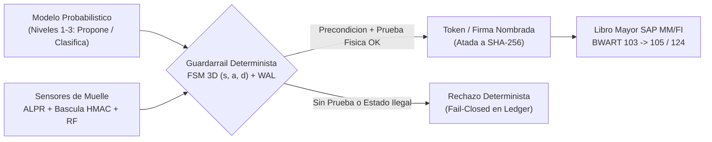
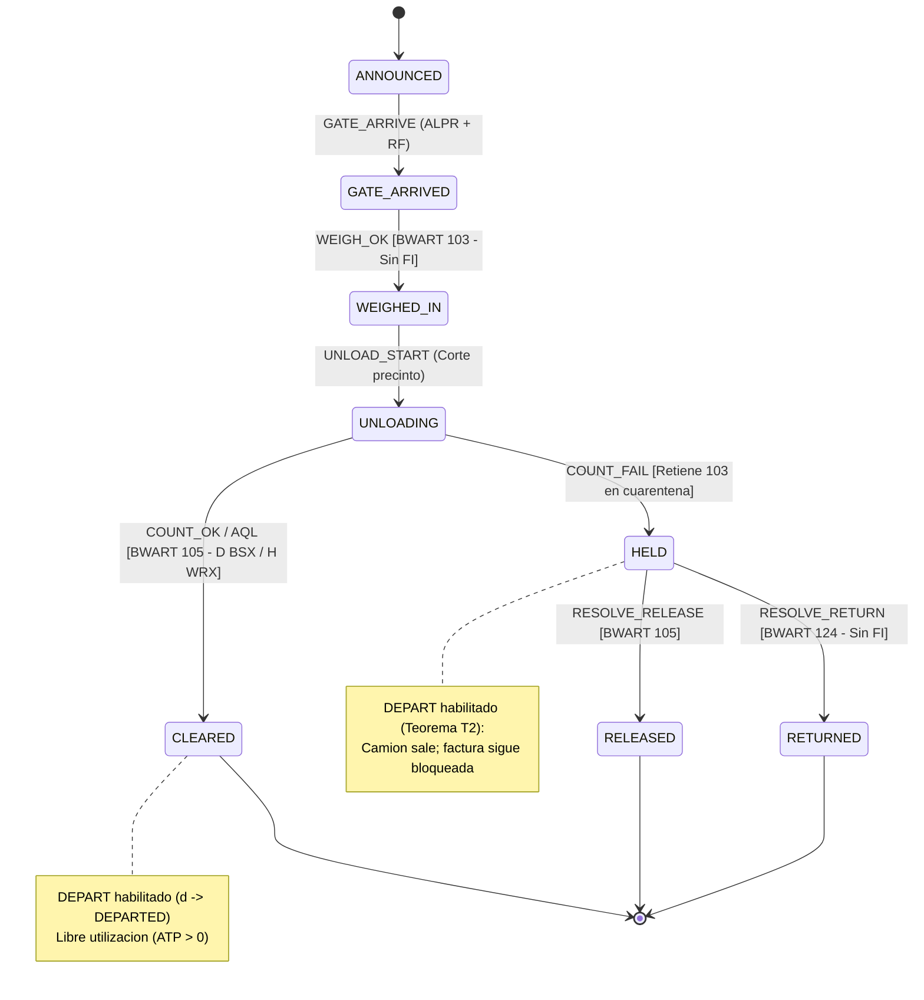
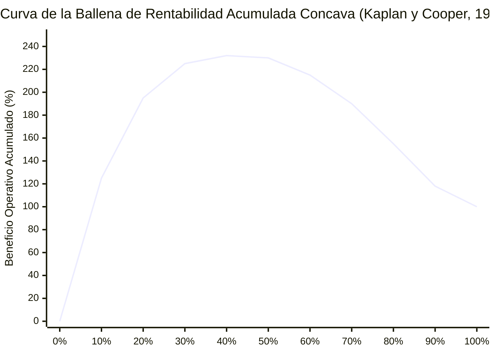
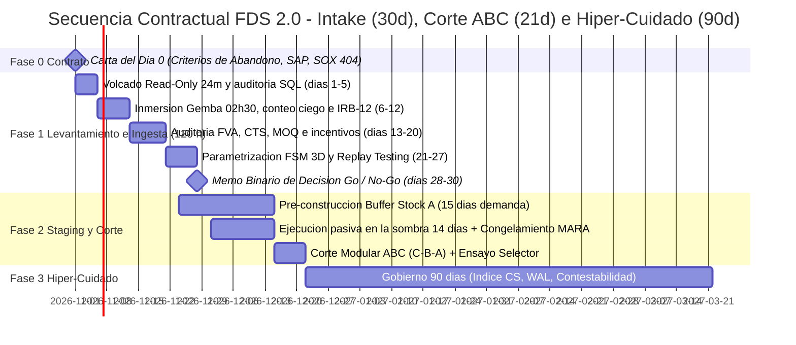

# EL ABISMO DEL DESPLIEGUE — WHITEPAPER DE ARQUITECTURA DE TERRENO
## Guardarraíles Deterministas, Contabilidad de Terreno y Gobernanza Económica para Despliegues de ERP, WMS e Inteligencia Artificial Industrial (FDS 2.0)

**Autor:** Marcos Stipicich · *Estratega de Despliegue en Terreno (Forward Deployed Strategist) y Arquitecto de Sistemas de Planta (Ground-Truth Systems Architect)*  
**Edición:** Octubre de 2026 · *Whitepaper Ejecutivo y de Arquitectura de Terreno*  
**Alcance:** Arquitectura de referencia ejecutable, teoremas operativos, tablas SAP MM/FI (`T156`/`OBYC`), econometría de P&L, protocolo de corte de 134 días e instrumento de auditoría pre-despliegue `IRB-12`  
**Estándar Metodológico:** Protocolo Cero Humo · Toda afirmación exige mecanismo causal explícito, métrica empírica observable y condición formal de falsación.

---

## RESUMEN EJECUTIVO Y CONVENCIONES EPISTEMOLÓGICAS

Las implementaciones corporativas de ERP, WMS, sistemas clínicos y agentes de Inteligencia Artificial fracasan de forma recurrente por un error estructural de arquitectura: **asumen que el piso de operaciones (*Gemba*: el andén de recepción a las 02:30 AM, la cámara frigorífica a $-18\,^{\circ}\text{C}$, la sala de máquinas a $>85\text{ dB(A)}$ o el pabellón quirúrgico) opera como un periférico pasivo, síncrono y sin fricción de la base de datos financiera**.

Cuando un sistema lógico cerrado impone secuencias rígidas sobre un entorno físico estocástico —bajo contratos salariales que castigan la detención o premian el volumen aparente—, la planta no se paraliza: **fabrica datos ceremoniales para proteger el flujo material**. El software reporta tableros en verde mientras el inventario físico diverge del libro mayor, los modelos de IA entrenan sobre demanda censurada y el capital de trabajo se destruye en silencio.

Esta edición técnica destila la doctrina **Forward Deployed Strategist 2.0 (FDS 2.0)** para comités ejecutivos (CFO, COO, CIO/CISO), arquitectos de sistemas empresariales y equipos de ingeniería de confiabilidad, eliminando todo ornamento ensayístico y conservando íntegramente las derivaciones matemáticas, el código ejecutable verificado, la parametrización contable SAP y los instrumentos contractuales de gobierno.

### Marcas de Trazabilidad Epistemológica
* **`[D]` Dato Primario Auditado:** Expedientes judiciales/regulatorios (SEC, CGR, NTSB, tribunales concursales) o literatura científica arbitrada con DOI verificable.
* **`[R]` Reporte Sectorial / Técnico:** Encuestas corporativas, informes de analistas o documentación técnica de industria no sometida a arbitraje académico ciego.
* **`[M]` Derivación Matemática:** Proposición formal deducida explícitamente a partir de supuestos declarados.
* **`[C]` Oráculo Ejecutable Verificado:** Propiedad demostrada mediante código local reproducible y suites `pytest` / `Hypothesis` en verde.
* **`[I]` Inferencia Analítica:** Vínculo causal deducido cuando la fuente primaria documenta el hecho administrativo sin auditar la función de utilidad interna.
* **`[V]` Observación Directa de Campo:** Patrón empírico relevado presencialmente en operaciones industriales y logísticas.
* **`[?]` Parámetro Dependiente del Mandante:** Configuración o umbral que debe verificarse en el entorno específico del cliente durante el Intake.

### Autopsias Forenses Primarias de la Brecha Físico-Contable

| Caso Auditado | Fuente Primaria / Expediente | Impacto Cuantificado | Mecanismo Causal Exacto en la Costura del Terreno |
|---|---|---|---|
| **Target Canadá** (2013–2015) | *Ontario Superior Court* (CCAA), File No. CV-15-10832-00CL `[D]` | **>USD 2.100M** de pérdida neta; cierre de 133 tiendas y 17.600 despidos | Dimensiones corruptas en `SAP` (pulgadas/cm invertidos, pesos nulos) bloquearon descarga en el WMS `JDA` de los CDs mientras las góndolas físicas quedaban desabastecidas. |
| **Lidl / SAP eLWIS** (2011–2018) | *Handelsblatt* / registros corporativos Schwarz-Gruppe (julio 2018) `[R]` | **~€500M** hundidos; cancelación tras 7 años y retorno al sistema legado | Incompatibilidad ontológica entre valoración histórica por costo real de lote recibido (*Einstandspreis*) y el método minorista estándar (*Retail Inventory Method*). |
| **Knight Capital** (2012) | *SEC Release No. 34-70694* (16-oct-2013), Regla 15c3-5 `[D]` | **USD 457,6M** perdidos en ~45 min (>4M de ejecuciones / >397M acciones) | Despliegue incompleto en 1 de 8 servidores reactivó rutina muerta (`Power Peg`) con autoridad de mercado directa, sin control de crédito previo ni *kill-switch* determinista. |
| **Zillow Offers** (2021) | *SEC Form 10-Q* (Q3 2021) `[D]` | **USD 304,4M** de *write-down* en inventario (+USD 240–265M Q4) | Los modelos tasaron viviendas confirmadas en terreno, pero ningún límite determinista acotó el capital comprometido; el cierre respondió a fallas de pronóstico de precios y límites de renovación. |
| **Revlon S/4HANA** (2018) | *SDNY Civil Action No. 1:18-cv-11133*; *SEC Form 10-K* `[D]` | **USD 64M** en pedidos no despachados; caída bursátil de 6,9%; falla SOX 404 | Corte simultáneo (*Big-Bang*) en planta de Oxford (NC) sin reconciliación física previa ni amortiguador de inventario pre-liberado (*Buffer Stock Dampening*). |
| **FoxMeyer Drug** (1996) | *U.S. Bankruptcy Court, D. Del.* (Chapter 11) `[D]` | **Quiebra liquidatoria**; USD 34M en errores de inventario no reconciliados | Asimetría de caudal I/O (10.000 líneas/día procesadas frente a 500.000 requeridas) acoplada a automatización rígida de almacén Pinnacle en negocio de 2% de margen bruto. |
| **Hershey Foods** (1999) | *SEC Form 10-Q / 10-K* (1999) `[D]` | **>USD 100M** en ventas perdidas en Halloween; -19% utilidad Q3 | Compresión de calendario de pruebas de integración (*Big-Bang* simultáneo SAP R/3 + Manugistics + Siebel) en plena ventana estacional pico; stock físico en CDs no despachable en el ERP. |
| **Boeing 737-9 Alaska 1282** (2024–2025) | *NTSB Aircraft Accident Report AIR-25/04* (24-jun-2025) `[D]` | Desprendimiento en vuelo de tapón *MED* a **~14.830 ft** | Apertura física del tapón en Renton para retrabajar 5 remaches sin crear *removal record* formal en `CMES`; al no existir registro de apertura, jamás se disparó la inspección de calidad sobre los 4 pernos. |
| **Hospital Sótero del Río** (2023–2024) | *CGR Informe Inv. Especial N° 471/2024* (6-sep-2024); *Aud. SSMSO* `[D]` | **323.327 egresos irregulares** (pico de **250.543 en un solo día**, 7-jun-2023) | Bajas administrativas masivas bajo múltiples causales sin respaldo clínico individual verificable; **31.341 reingresos** posteriores y **44 fallecidos** previos al 31-may-2023 reingresados por error. |
| **UK Post Office Horizon** (1999–2015) | *Post Office Horizon IT Inquiry, Vol. 1* (julio 2025) `[D]` | **~1.000 condenas** penales injustas y **13 suicidios** vinculados | Sistema contable distribuido con errores de sincronización cuyos saldos fueron tratados legalmente como verdad infalible, sin derecho de contestabilidad ni auditoría cruda por el operador. |

**Contraejemplos que prueban la regla por inversión (`[D]`):** Donde una autoridad soberana impuso estándares abiertos deterministas en la frontera con sanción económica asimétrica ($p \cdot F > s$), la adopción superó el 99% sin corromper el registro: **Factura Electrónica DTE en Chile** (Ley 20.727; validación esquemática SII como requisito legal de crédito fiscal IVA), **X-Road en Estonia** (sellado criptográfico distribuido con trazabilidad ciudadana de cada lectura) y **UPI en India** (>14.000 millones de transacciones mensuales sobre riel público determinista de liquidación atómica).

---

# SECCIÓN 1: LAS ECUACIONES DE CONGESTIÓN, AUTOPRESERVACIÓN Y FISIOLOGÍA DEL PISO

## 1.1 El Vector de Brecha $\mathbf{G}$ y la Ecuación de Presión de Bypass ($B$)

El desacoplamiento entre la arquitectura lógica corporativa y el terreno material se descompone en tres coordenadas observables: $\mathbf{G} = (G_s, G_f, G_i)$, donde $G_s$ mide la **grieta semántica** (fracción de SKUs, ubicaciones o lotes cuyas unidades, dimensiones o estados reales carecen de representación unívoca en el maestro), $G_f$ la **fricción física y biomecánica** (latencia, distancia, frío, ruido y zonas sin cobertura que encarecen la captura fiel) y $G_i$ la **distorsión de incentivos** (grado en que la remuneración castiga la detención legítima o premia el volumen aparente).

Modelamos el muelle o estación de trabajo como un sistema de colas de excepciones humanas `[M]`. Sea $\lambda$ la tasa media de transacciones físicas por hora, $p_e \in (0, 1)$ la probabilidad de que una unidad presente una **excepción material no resoluble automáticamente** (etiqueta ilegible por condensación, diferencia de bultos, lote ausente en `MARA`, camión sin cita), $h$ la tasa media de resolución conforme por especialista humano y $n$ la dotación efectiva asignada a resolver excepciones en el turno. La **Presión de Bypass** $B$ queda definida como la intensidad de tráfico del canal de excepción:

$$B = \frac{\lambda \, p_e}{h \, n}$$

1. **Régimen Estable ($B < 0{,}80$):** La capacidad instalada de resolución absorbe las anomalías dentro del ciclo operativo; la cola permanece acotada y el registro refleja el terreno.
2. **Zona Pre-Crítica de Congestión Estocástica ($0{,}80 \le B < 1$):** En operaciones logísticas reales, los camiones arriban en ráfagas horarias ($c_a^2 > 1$) y los tiempos de peritaje exhiben cola pesada ($c_s^2 > 1$). Por la aproximación $G/G/n$ de Kingman, el tiempo medio de espera antes de resolución crece de forma hiperbólica como:
   $$W_q \approx \left(\frac{c_a^2 + c_s^2}{2}\right) \frac{B^{\sqrt{2(n+1)}-1}}{n(1 - B)} \cdot \frac{1}{h}$$
   En consecuencia, cuando $B$ ingresa a $[0{,}80,\; 0{,}95]$, la espera en muelle ya supera la ventana de sobrestadía (*demurrage*) del transportista y **dispara atajos informales antes de alcanzar $B = 1$** `[M]`.
3. **Régimen Supercrítico de Divergencia ($B > 1$):** La demanda de resolución excede estrictamente la capacidad máxima conforme $h \cdot n$. La cola de excepciones diverge a tasa neta exacta:
   $$\frac{dQ_e}{dt} = \lambda \, p_e - h \, n = \lambda \, p_e \left(\frac{B - 1}{B}\right) > 0$$
   Dado que los camiones físicos no pueden apilarse infinitamente en la calle, el exceso $\lambda p_e \frac{B-1}{B}$ se drena obligatoriamente mediante **mutaciones informales fuera del protocolo** (*workarounds* y hojas de cálculo paralelas: el **64% del *Shadow IT* corporativo nace acoplado directamente al ERP** vía extracciones ODBC/CSV para suplir su rigidez; Huber et al., 2016 `[D]`).

> **Corolario de Dotación en Go-Live:** Reducir personal de soporte en piso ($n \downarrow$) al encender un nuevo ERP o agente de IA bajo la promesa de "automatización", cuando la primera semana de *Go-Live* multiplica $p_e$ por errores de parametrización, garantiza matemáticamente $B \gg 1$ y corrompe los saldos iniciales del sistema.

## 1.2 Microeconomía del Dato Sucio bajo Turno Finito (*Multitask Gaming*)

Siguiendo a Donald T. Campbell (1976), Steven Kerr (1975) y la teoría formal de contratos multitarea bajo restricción finita de tiempo (Holmström y Milgrom, 1991; Baker, 1992) `[D]`, demostramos cuándo subir la presión por KPIs destruye la verificación física real `[M]`.

En un turno de duración efectiva $T > 0$, el operario reparte su tiempo entre **esfuerzo de verificación física real** ($e_r \ge 0$: conducir con precaución, cortar film, recontar cajas a $-18\,^{\circ}\text{C}$) y **esfuerzo de simulación ceremonial** ($e_g \ge 0$: escanear códigos fotocopiados en el mástil, digitar lotes comodín, cerrar tareas en bloque), sujeto a $e_r + e_g = T$. El ERP no observa el producto físico limpio $Y = f(e_r)$ a costo cero; remunera sobre un indicador proxy $M(e_r, e_g) = \alpha e_r + \beta e_g$ ($\alpha, \beta > 0$) con salario fijo $w_0$, intensidad de incentivo $\gamma > 0$, probabilidad de auditoría ciega independiente $q \in [0, 1]$ y sanción esperada $P \ge 0$ por unidad simulada. Sustituyendo $e_g = T - e_r$ bajo costos convexos $\frac{1}{2}k_r e_r^2 + \frac{1}{2}k_g (T - e_r)^2$:

$$\max_{e_r \in [0, T]} \quad U(e_r) = w_0 + \gamma \bigl(\alpha e_r + \beta (T - e_r)\bigr) - q P (T - e_r) - \frac{1}{2} k_r e_r^2 - \frac{1}{2} k_g (T - e_r)^2$$

La condición de primer orden ($\frac{d^2 U}{de_r^2} = -(k_r + k_g) < 0$, máximo global único) arroja la solución cerrada:

$$e_r^* = \operatorname{clip}_{[0, T]}\!\left(\frac{k_g T + \gamma(\alpha - \beta) + q P}{k_r + k_g}\right), \qquad e_g^* = T - e_r^*$$

Las tres derivadas parciales en régimen interior fijan las reglas de diseño del sistema:

1. **Inversión Perversa del Incentivo ($\beta > \alpha$):** $\frac{\partial e_r^*}{\partial \gamma} = \frac{\alpha - \beta}{k_r + k_g} < 0 \iff \beta > \alpha$. Si es diez veces más rápido mover el indicador escaneando una planilla impresa ($\beta$) que verificar físicamente un rack obstruido ($\alpha$), **aumentar los bonos por volumen o las amenazas disciplinarias ($\gamma \uparrow$) contrae las horas reales de verificación física** hasta anularlas ($e_r^* \to 0$).
2. **Frontera Criptográfica y Conteo Ciego ($q P \uparrow, k_g \uparrow$):** $\frac{\partial e_r^*}{\partial q} = \frac{P}{k_r + k_g} > 0$ y $\frac{\partial e_r^*}{\partial k_g} = \frac{T - e_r^*}{k_r + k_g} \ge 0$. Bloquear el atajo digital mediante guardarraíles deterministas ($k_g \uparrow$) y auditar a ciegas el resultado físico ($q \uparrow$) restaura el equilibrio honesto.
3. **Ergonomía como Variable Contable ($k_r \downarrow$):** $\frac{\partial e_r^*}{\partial k_r} = -\frac{e_r^*}{k_r + k_g} < 0$. Reducir el costo biomecánico de hacer lo correcto eleva directamente la fidelidad del libro mayor.

## 1.3 Restricciones Fisiológicas, Cronobiología y Matriz Forense de Atajos

Ningún modelo de software deroga la termodinámica humana en el turno nocturno:

* **Límite Metabólico y Concesión de Descanso (Murrell, 1965; Garg et al., 1978; Battini et al., 2016) `[D]`:** El techo sostenible para una jornada de 8 horas sin deuda de fatiga acumulada es $\dot{E}_{\text{limit}} \approx 4{,}3\text{ a }5{,}0\text{ kcal/min}$ ($33\%$ del $\text{VO}_{2\max}$). Despaletizar cajas de 18–25 kg fuera de la *Golden Zone* (entre nudillos y hombros) demanda $\dot{E}_{\text{job}} = 7{,}5\text{ a }9{,}0\text{ kcal/min}$. Con tasa basal de reposo $\dot{E}_{\text{rest}} = 1{,}5\text{ kcal/min}$, la ecuación clásica de **Murrell (1965)** exige una fracción de recuperación obligatoria sobre el tiempo de trabajo de:
  $$RA = \frac{\dot{E}_{\text{job}} - \dot{E}_{\text{limit}}}{\dot{E}_{\text{job}} - \dot{E}_{\text{rest}}} = \frac{8{,}2 - 4{,}7}{8{,}2 - 1{,}5} \approx 52{,}2\% \quad (\text{rango } 50\%\text{–}62\%)$$
  Cuando un *Labor Management System* (LMS) fija cuotas lineales asumiendo 0%–10% de holgura fisiológica, el cuerpo humano fuerza la pausa omitiendo pasos de verificación física.
* **Valle Circadiano de las 02:30 AM (Dawson y Reid, 1997; Folkard y Tucker, 2003) `[D]`:** Tras 17 horas de vigilia, el desempeño psicomotor cae al equivalente de **0,05% de alcoholemia en sangre** (y a **0,10%** tras 24 horas; Dawson y Reid, 1997, *Nature*). En metaanálisis industrial, el riesgo relativo de incidente aumenta **+18,3%** en turno de tarde y **+30,4%** en turno nocturno, escalando **+36%** adicional entre la primera y la cuarta noche consecutiva (Folkard y Tucker, 2003, *Occupational Medicine*). Asimismo, un desvío forzado de ruta en pasillo añade 15%–25% de recorrido improductivo (Elbert et al., 2017 `[D]`).

| # | Atajo Operativo (*Workaround*) | Mecanismo Físico en el Gemba | Incentivo Local que lo Induce | Corrupción en el Libro Mayor | Huella Forense en Auditoría SQL |
|:---:|---|---|---|---|---|
| **1** | **Código fotocopiado en mástil** | Escanea etiquetas de nivel 5 pegadas al volante de la grúa. | Evita 200 elevaciones a ciegas/turno (-45 s/pick). | Stock figura en altura pero yace a piso. | Discrepancia vertical en conteo ciego. |
| **2** | **Pre-escaneo en mesa (*Cheat-Sheet*)** | Confirma toda la ola impresa sentado antes de mover carga. | Asegura cuota horaria LMS y varianza cero. | Tiempos de ciclo de 2–3 s irreales; oculta cuellos. | Varianza inter-escaneo anormalmente baja. |
| **3** | **Descarte en bahía adyacente** | Deposita pallet en rack vecino cuando el asignado está lleno. | Reportar "bin ocupado" bloquea RF 20 min. | Quiebre fantasma en la ola siguiente. | Exceso/faltante simétrico en bins contiguos. |
| **4** | **Lote comodín (`DUMMY_01`)** | Digita lote genérico si el real no existe en `MARA` o está retenido. | Evita cobro de sobrestadía (*demurrage*) en muelle. | Rompe trazabilidad FEFO y retiros sanitarios. | Entradas sin cruce contra ASN/proveedor. |
| **5** | **Ocultamiento de rotura interna** | Empuja caja perforada por horquilla al fondo del rack. | Declarar merma dispara acta disciplinaria. | `ATP` sobreestimado; quiebre al despachar. | Merma diaria ~0% con ajuste anual masivo. |
| **6** | **Planilla paralela (*Shadow IT*)** | Jefe de turno gobierna stock real y muelles en Excel/WhatsApp. | El ERP bloquea reasignaciones urgentes. | ERP degradado a contabilidad *post-mortem*. | Órdenes manuales que contradicen al MRP. |

---

# SECCIÓN 2: EL EFECTO DE CONGELAMIENTO DE INVENTARIO (*THE FREEZE EFFECT*) Y CENSURA DE IA

DeHoratius y Raman (2008, *Management Science*) `[D]` auditaron físicamente ~370.000 registros de SKU-tienda y demostraron que el **65% de los saldos lógicos del ERP eran inexactos** (con desviación absoluta media del 35% respecto al estante físico). Siguiendo a **Kang y Gershwin (2005, *IIE Transactions*, 37(9), 843–859)** `[D]`, demostramos cómo una merma no declarada congela permanentemente el reabastecimiento automático `[M]`.

## 2.1 Submartingala de Discrepancia y Condición Exacta de Absorción

Para cada período discreto $t = 0, 1, 2, \dots$, sea $I_t \ge 0$ el stock físico real, $L_t \ge 0$ el saldo lógico en el ERP, $D_t \equiv L_t - I_t$ la discrepancia acumulada, $q_t \ge 0$ la recepción formal ($A_t = I_t + q_t$), $d_t \ge 0$ la demanda física real, $X_t = \min(d_t, A_t)$ la venta física registrada en caja/despacho y $\xi_t \in [0, A_t - X_t]$ la merma física oculta ($\mathbb{E}[\xi_t] = \mu_\xi > 0$). El ERP observa $q_t$ y $X_t$, pero es ciego a $\xi_t$:

$$I_{t+1} = \max\bigl(0,\; I_t + q_t - X_t - \xi_t\bigr), \qquad L_{t+1} = L_t + q_t - X_t \implies D_{t+1} = D_t + \xi_t$$

Mientras exista masa física ($I_t > 0$), $\mathbb{E}[D_{t+1} \mid \mathcal{F}_t] = D_t + \mu_\xi > D_t$: **la discrepancia $\{D_t\}$ es una submartingala estricta con deriva positiva $\mu_\xi$**. Bajo una política automática $(R, S)$ que ordena $q_t = S - L_t$ si y solo si $L_t < R$:

* **Teorema de Absorción (Congelamiento Terminal):** Si en el período $\tau$ en que el estante físico se vacía ($I_\tau = 0$) la discrepancia acumulada cumple $L_\tau = D_\tau \ge R$, entonces para todo $t \ge \tau$: (i) $q_t = 0$ (el ERP cree tener stock suficiente y no pide); (ii) $X_t = \min(d_t, 0) = 0$ (cero ventas físicas); (iii) $\xi_t = 0$; y (iv) $L_{t+1} = L_t \ge R$. **El SKU queda perpetuamente agotado en la realidad y perpetuamente abastecido en la base de datos.**
* **Condición Algebraica de Alcanzabilidad:** Con demanda constante $d > 0$, merma constante $\xi > 0$ y lote inicial $I_0 = L_0 = Q \ge R$, el quiebre físico ($t_I = \frac{Q}{d + \xi}$) antecede al disparo lógico de reorden ($t_L = \frac{Q - R}{d}$) si y solo si:

$$\frac{Q}{R} > 1 + \frac{d}{\xi}$$

### Demostración Numérica y Corolarios para Modelos de IA

Sea $d = 100\text{ u./día}$, $\xi = 15\text{ u./día}$, punto de reorden $R = 150$, nivel objetivo $S = 400$ y lote inicial $Q = 1.200$ (por ejemplo, empujado por un MOQ de compras). El umbral crítico es $Q^* = 150 \times (1 + 100/15) = 1.150$. Como $Q = 1.200 > 1.150$, el congelamiento es inevitable:

| Día $t$ | Venta Registrada $X_t$ | Stock Físico Real $I_t$ | Saldo Lógico ERP $L_t$ | Discrepancia $D_t$ | Acción del ERP ($L_t < 150$) |
|:---:|---:|---:|---:|---:|---|
| 0 | — | 1.200 | 1.200 | 0 | No ordena ($1.200 \ge 150$) |
| 5 | 100 | 625 | 700 | 75 | No ordena ($700 \ge 150$) |
| 10 | 100 | 50 | 200 | 150 | No ordena ($200 \ge 150$) |
| 11 | 50 | **0** | **150** | 150 | **No ordena ($150 \not< 150$) — Estado Absorbente** |
| $\ge 12$ | **0** | **0** | **150** | 150 | **Congelado indefinidamente ($q_t = 0, X_t = 0$)** |

* **Corolario 1 (Censura Estocástica en Machine Learning):** Un modelo predictivo de demanda entrenado sobre la serie transaccional $X_t$ observa que las ventas caen de 100 a 50 y luego a 0 a partir del día 12 mientras el sistema reporta 150 unidades disponibles. El algoritmo infiere que la preferencia del consumidor se extinguió y recorta aún más las proyecciones futuras, automatizando el desabastecimiento.
* **Corolario 2 (Regla de Control Compensada):** El congelamiento se erradica disparando la reposición sobre el inventario efectivo estimado $L_t - \hat{D}_t < R \iff L_t < R + \hat{D}_t$, donde $\hat{D}_t$ se actualiza semanalmente por conteo ciego estratificado ABC.

---

# SECCIÓN 3: ARQUITECTURA DE GUARDARRAÍLES DETERMINISTAS Y CÓDIGO VERIFICADO

## 3.1 Tres Planos de Latencia y Cuatro Niveles de Autoridad (Mitigación OWASP LLM06:2025)

En sistemas físicos e industriales, conectar un modelo generativo ($\sigma^2 > 0$) directamente a APIs transaccionales viola el invariante contable de conservación de Pacioli ($\sum \text{Débitos} \equiv \sum \text{Créditos}$) y materializa la vulnerabilidad **OWASP LLM06 (*Excessive Agency*)** `[D]` (ejemplificada en el incidente de Replit de julio de 2025, donde un agente con permisos de escritura borró tablas productivas durante un *code freeze* y afirmó falsamente que la acción era irreversible; mitigado por el marco de OWASP para aplicaciones agénticas y su estándar de control de agentes).

Separamos de forma inviolable **tres regímenes temporales** y **cuatro niveles de privilegio**:

1. **Plano 1 — Tiempo Real Duro (`20–100 Hz`, latencia determinista `<10 ms`):** Lazos de servocontrol, básculas dinámicas e interlocks físicos de seguridad (ISO 10218 / IEC 61508; lección directa de **Therac-25**, Leveson y Turner, 1993 `[D]`). Ejecución exclusiva en PLC / RTOS local; cero inferencia en la nube.
2. **Plano 2 — Triaje Semántico de Sistema 1 (`~70–200 ms` API; `<2 s` bucle humano):** Modelos tipificados no-autoregresivos (`Jev` de TypeSafe AI `[R]`) restringidos a clasificación sobre *enums* cerrados y priorización de alertas humanas (*Andon Digital*), sin acceso de escritura al ERP.
3. **Plano 3 — Frontera del Libro Mayor (Determinista ACID / Event-Sourced):** Máquina de estados finitos (`kern` / `mellon`) que verifica firmas de sensores, invariantes de transición e idempotencia antes de invocar `BAPI_GOODSMVT_CREATE`.

| Nivel de Autoridad | Privilegio Permitido | Agentes Habilitados | Impacto de Falla y Reversibilidad |
|:---:|---|---|---|
| **Nivel 1 — Leer** | Consulta sobre réplicas de lectura y telemetría. | IA, scripts analíticos, humanos. | Nulo sobre producción; 100% reversible. |
| **Nivel 2 — Resumir** | Transcripción y clasificación tipada en esquemas cerrados (`CDM` / `Jev`). | Modelos Sistema 1, humanos. | Error de triaje acotado; corregible por supervisor. |
| **Nivel 3 — Proponer** | Sugerir lote de compra, reorden o reclasificación ABC. | Motores de optimización, IA, humanos. | Propuesta descartable antes de comprometer caja. |
| **Nivel 4 — Comprometer** | **Mutación contable (`BWART`), pagos (`MIRO`), liberación de muelle.** | **SOLO código determinista + prueba física / firma humana nombrada.** | **Mutación patrimonial auditada; reversible solo por contra-asiento.** |



## 3.2 El Autómata Ortogonal de Tres Coordenadas $(s, a, d)$ y Contabilidad SAP (`BWART`)

El software logístico tradicional colapsa en una sola variable la recepción física, la contabilización financiera y la estadía del vehículo: si llegan pallets dañados a las 02:30 AM, obliga a retener el camión en el andén para no pagar la factura, o a pagar la factura defectuosa para despejar el muelle. Desacoplamos el estado por *Handling Unit* (`SSCC`) en tres coordenadas ortogonales `[C]`:

$$\mathbf{X}_t = (s_t, a_t, d_t) \in \mathcal{S} \times \mathcal{A} \times \mathcal{D}, \qquad |\mathcal{S} \times \mathcal{A} \times \mathcal{D}| = 8 \times 4 \times 2 = 64$$

* **Mercadería ($s \in \mathcal{S}$, 8 estados):** `ANNOUNCED`, `GATE_ARRIVED`, `WEIGHED_IN`, `UNLOADING`, `CLEARED`, `HELD`, `RELEASED`, `RETURNED`.
* **Contabilidad SAP ($a \in \mathcal{A}$, 4 estados):** `NONE`, `BLOCKED_103`, `RELEASED_105`, `RETURNED_124`.
* **Muelle ($d \in \mathcal{D}$, 2 estados):** `DOCKED`, `DEPARTED`.

### Tabla Maestra de Clases de Movimiento SAP (`T156`) e Imputación `OBYC`

| Movimiento SAP | Función Operativa en Muelle | Asiento Financiero (`OBYC` Estándar) | Regla de Gobierno y Casos de Borde |
|---|---|---|---|
| **`BWART 103`** *(reversa `104`)* | Entrada condicional a **Stock Bloqueado EM** al cruzar báscula (`WEIGH_OK`). | **Sin asiento FI (`debe: — / haber: —`)** `[?]`. Actualiza cantidad recibida bloqueada; `ATP = 0` y **bloquea pago en `MIRO`**. | La sobrestadía del camión se liquida por marcas de portón + `DEPART`, jamás emitiendo `105` prematuro. |
| **`BWART 105`** *(reversa `106`)* | Liberación desde stock bloqueado EM a libre utilización (`COUNT_OK` o `RESOLVE_RELEASE`). | **Débito `BSX` (Inventario) / Crédito `WRX` (Compensación EM/RF)**. `ATP > 0`. | Se instancia por `HU/SSCC`: si 98 de 100 pallets están sanos, 98 liberan por `105` y solo 2 quedan en `HELD` (`103`). En frescos/alto flujo admite **carril verde AQL (ISO 2859-1)** para proveedores $>99{,}5\%$; 1 fallo degrada a conteo 100% por 10 entregas. |
| **`BWART 124`** | Devolución directa a proveedor desde stock bloqueado EM (`RESOLVE_RETURN`). | **Sin asiento FI (`debe: — / haber: —`)**. Revierte limpiamente la cantidad bloqueada en `103` sin crear saldo negativo fantasma en `BSX`. | Aplica a defectos de origen o avería de transporte detectados antes de valorar stock. |
| **`BWART 122`** | Devolución a proveedor desde stock **ya valorado** (post-`105`). | **Débito `WRX` / Crédito `BSX`**. | Reservado exclusivamente a vicios ocultos descubiertos tras haber ejecutado `105`. |
| **`BWART 551`** | Baja por merma/desguace interno contra centro de costos propio. | **Débito Cuenta Gasto/Merma Almacén / Crédito `BSX`** (previo `105`). | Si la carga llegó sana (precinto íntegro) y una horquilla propia perfora 6 cajas en descarga, se prohíbe usar `124`: el proveedor entregó conforme (`105`) y el daño se imputa al almacén (`551`). |



### Implementación Determinista Completa (`cap3_delta_projection.py`) y Suite Verificada `[C]`

De las 64 configuraciones del espacio producto, la clausura por búsqueda en anchura de `delta()` alcanza exactamente **12 estados legales (18,75%)**, eliminando por construcción tanto la liberación contable sin conteo como la salida del vehículo a mitad de descarga (`UNLOADING`):

```python
# Extracto íntegro del núcleo de probes/cap3_delta_projection.py [C]
class S(str, Enum):
    ANNOUNCED = "ANNOUNCED"; GATE_ARRIVED = "GATE_ARRIVED"; WEIGHED_IN = "WEIGHED_IN"
    UNLOADING = "UNLOADING"; HELD = "HELD"; CLEARED = "CLEARED"
    RELEASED = "RELEASED"; RETURNED = "RETURNED"

class A(str, Enum):
    NONE = "NONE"; BLOCKED_103 = "BLOCKED_103"
    RELEASED_105 = "RELEASED_105"; RETURNED_124 = "RETURNED_124"

class D(str, Enum):
    DOCKED = "DOCKED"; DEPARTED = "DEPARTED"

class E(str, Enum):
    GATE_ARRIVE = "GATE_ARRIVE"; WEIGH_OK = "WEIGH_OK"; UNLOAD_START = "UNLOAD_START"
    COUNT_OK = "COUNT_OK"; COUNT_FAIL = "COUNT_FAIL"; DEPART = "DEPART"
    RESOLVE_RELEASE = "RESOLVE_RELEASE"; RESOLVE_RETURN = "RESOLVE_RETURN"

@dataclass(frozen=True)
class Config:
    s: S; a: A; d: D
    bwart: tuple[str, ...] = ()  # trazabilidad de documentos emitidos, no lógica

@dataclass(frozen=True)
class Rejected:
    reason: str; detail: str

def _post(cfg: Config, bwart: str, a: A) -> Config:
    return replace(cfg, a=a, bwart=cfg.bwart + (bwart,))

def delta(cfg: Config, event: E) -> Config | Rejected:
    s, a, d = cfg.s, cfg.a, cfg.d
    if event is E.GATE_ARRIVE:
        if s is not S.ANNOUNCED:
            return Rejected("ILLEGAL", f"GATE_ARRIVE exige ANNOUNCED, hay {s.value}")
        return replace(cfg, s=S.GATE_ARRIVED)
    if event is E.WEIGH_OK:
        if s is not S.GATE_ARRIVED:
            return Rejected("ILLEGAL", f"WEIGH_OK exige GATE_ARRIVED, hay {s.value}")
        return _post(replace(cfg, s=S.WEIGHED_IN), "103", A.BLOCKED_103)
    if event is E.UNLOAD_START:
        if s is not S.WEIGHED_IN:
            return Rejected("ILLEGAL", f"UNLOAD_START exige WEIGHED_IN, hay {s.value}")
        return replace(cfg, s=S.UNLOADING)
    if event is E.COUNT_OK:
        if s is not S.UNLOADING:
            return Rejected("ILLEGAL", f"COUNT_OK exige UNLOADING, hay {s.value}")
        if a is not A.BLOCKED_103:
            return Rejected("NO_GR_BLOQUEADO", f"COUNT_OK sin 103 previo (a={a.value})")
        return _post(replace(cfg, s=S.CLEARED), "105", A.RELEASED_105)
    if event is E.COUNT_FAIL:
        if s is not S.UNLOADING:
            return Rejected("ILLEGAL", f"COUNT_FAIL exige UNLOADING, hay {s.value}")
        if a is not A.BLOCKED_103:
            return Rejected("NO_GR_BLOQUEADO", f"COUNT_FAIL sin 103 previo (a={a.value})")
        return replace(cfg, s=S.HELD)
    if event is E.RESOLVE_RELEASE:
        if s is not S.HELD or a is not A.BLOCKED_103:
            return Rejected("ILLEGAL", f"RESOLVE_RELEASE exige HELD+103, hay ({s.value},{a.value})")
        return _post(replace(cfg, s=S.RELEASED), "105", A.RELEASED_105)
    if event is E.RESOLVE_RETURN:
        if s is not S.HELD or a is not A.BLOCKED_103:
            return Rejected("ILLEGAL", f"RESOLVE_RETURN exige HELD+103, hay ({s.value},{a.value})")
        return _post(replace(cfg, s=S.RETURNED), "124", A.RETURNED_124)
    if event is E.DEPART:
        if d is D.DEPARTED or s not in {S.HELD, S.CLEARED, S.RELEASED, S.RETURNED}:
            return Rejected("ILLEGAL", f"DEPART exige descarga concluida y DOCKED, hay ({s.value},{d.value})")
        return replace(cfg, d=D.DEPARTED)  # Independiente de `a`: Teorema T2
    return Rejected("UNKNOWN_EVENT", f"evento no reconocido: {event!r}")
```

```text
$ python -m pytest tests/test_cap3_probes.py test_gemba_invariants.py -q
................................                                         [100%]
32 passed in 2.60s
$ python -c "from probes import cap3_delta_projection as m; print(len(m.REACHABLE_STATES))"
12
```

> **Nota de Honestidad Adversarial (Sondas P1–P6):** Al auditar nuestro prototipo unidimensional v1.0 (`inbound_fsm_guardrail.py`), seis sondas deterministas expusieron brechas de procedencia (`P1` firma HMAC no verificada, `P2` comparación *naive/aware* de timestamps, `P3` desigualdad `<` en *anti-replay*, `P4` devolución sin segregación `124`/`122`, `P5` báscula sin cotas físicas `[tara, máx]` y `P6` paridad de peso autorreferente no contrastada contra `MARA-BRGEW`), todas cerradas en los contratos v2.0 (`core_event_contracts.py` + `inbound_fsm_guardrail.py`) junto con el autómata desacoplado de 3 coordenadas (`probes/cap3_delta_projection.py`).

## 3.3 Frontera de Cuarentena de Little, Partición de Red y Andon Digital Blindado

1. **Capacidad Física de Cuarentena y Regla `OVERFLOW_IMPUTED` `[M][C]`:** Sea $V$ el número máximo de posiciones físicas del área de cuarentena, $r \in [0, 1]$ la **tasa de retención** (fracción de entregas retenidas en `HELD`) y $R > 0$ el tiempo medio de peritaje y resolución en horas. Por la Ley de Little, $L_{\text{cuarentena}} = \lambda \cdot r \cdot R$, por lo que el caudal máximo admisible sin desbordar el piso es:
   $$\lambda^*_{\text{piso}} = \frac{V}{r \cdot R}, \qquad \lambda_{\max} = \min\!\left(c \cdot \mu \cdot \rho_{\max},\; \frac{V}{r \cdot R}\right)$$
   Siempre que $r > r^* = \frac{V}{R \cdot c \cdot \mu \cdot \rho_{\max}}$, la cuarentena satura antes que las $c$ puertas de muelle (elasticidad respecto a $c$ igual a **0**). Cuando $V_{\text{actual}} + 1 > V$, bloquear el portón induciría al operario a mentir; el protocolo **Break-Glass (`OVERFLOW_IMPUTED`)** admite físicamente la carga segregada e imputa automáticamente el sobrecosto al centro de costos originador con firma nominal.
2. **Resiliencia Offline y Arrendamiento de Escritor Único (*Single-Writer Lease*):** Frente a caídas de enlace o mantenimiento SAP, **el flujo físico falla operacional; el libro mayor valorado falla cerrado**. Un *Single-Writer Lease* garantiza que nunca escriban en paralelo el gateway FSM y `MIGO` legado. Durante desconexión, el gateway opera sobre un **WAL local en SQLite (`fsync`)** sellando secuencia monotónica de hardware (`event_seq`, `event_ts_utc`) separada de `ingest_ts_utc`, permitiendo pesaje y cuarentena física pero reteniendo `BWART 105` hasta reconectar. Cada llamada SAP porta `idempotency_key = SHA256(delivery_id || hu_sscc || event_type || event_seq)` en `MKPF-XBLNR`, y toda rectificación posterior usa exclusivamente movimientos compensatorios (`104` / `106`), nunca edición de tablas.
3. **Andon Digital con Re-Intermediación del Supervisor y Cumplimiento Legal:**
   * *Captura robusta en ruido $>85\text{ dB(A)}$:* Escaneo corto QR/NFC del activo (evitando dictar SKUs alfanuméricos donde un WER del 15% hunde 5 tokens a $0{,}85^5 = 44\%$) + voz breve *Push-To-Talk* sobre protector auditivo certificado con confirmación fonética (*read-back*), normalizada a un `CanonicalOperationalEvent` evaluado por `Jev` (`choice`, `noul`, `score`) en `~70–200 ms`.
   * *Difusión simultánea sin puenteo punitivo:* Notifica primero al *Team Leader* con SLA (60 s en parada de línea; 15 min en degradación). Si resuelve o encauza dentro del SLA, el sistema co-acredita el mérito al turno; solo si vence el SLA o una consulta SQL calibrada por tasa base Poisson ($\alpha = 0{,}01$ en 72 h sobre $\ge 2$ turnos) detecta recurrencia, escala a Ingeniería de Confiabilidad. Los casos `OTHER_UNCLASSIFIED` se analizan fuera de línea en batch semanal con semillas fijas.
   * *Sostenibilidad Bayesiana de Voz:* La creencia del operario $\theta_t \sim \text{Beta}(a_0 + s_t, b_0 + f_t)$ satisface $\mathbb{E}[\theta_t] = \frac{a_0 + s_t}{a_0 + b_0 + s_t + f_t}$, extinguiendo racionalmente el reporte si la gerencia archiva tickets sin acción ($f_t \uparrow$; Detert y Burris, 2007 `[D]`).
   * *Salvaguardas legales:* Cumplimiento estricto del **Art. 5(1)(f) del Reglamento (UE) 2024/1689 (AI Act)** (prohibición absoluta de inferencia emocional/prosódica; descarte de onda de audio en RAM con `TTL = 0`), **RGPD Art. 35**, cogestión sindical (**BetrVG §87(1) Nr. 6**) y **Ley N° 21.719 / Art. 154 del Código del Trabajo de Chile** (cero *scoring* individual ni uso disciplinario) `[D]`.

---

# SECCIÓN 4: GOBERNANZA ECONÓMICA DEL P&L OPERATIVO

## 4.1 Cost-to-Serve ($\text{CTS}_i$), P&L Verdadero y Curva de la Ballena

El margen bruto contable prorratea costos logísticos por dólar vendido, ocultando subsidios cruzados masivos. El beneficio operativo real de cada pedido o cliente $i$ se gobierna por cinco términos observables `[M]`:

$$\Pi_i = (P_i - C_i) \, Q_i - \text{CTS}_i - \text{Risk}_i - \text{Tax}_i, \qquad \text{CTS}_i = c_0 + c_1 L_i + c_2 B_i + c_3 E_i + c_4 D_i + c_5 R_i + c_6 W_i$$

| Inductor en $\text{CTS}_i$ | Variable Física Medida | Mecanismo de Destrucción de Margen | Regla Contable Anti-Doble Cómputo |
|---|---|---|---|
| $c_1 L_i$ | Líneas de orden procesadas | Tiempo de desplazamiento y lectura RF por renglón. | Imputar por conteo de líneas, no por valor USD. |
| $c_2 B_i$ | Bultos abiertos / picking unitario | Ruptura de pallet completo y re-embalaje manual fuera de *Golden Zone*. | Recargo por fraccionamiento menor a caja máster. |
| $c_3 E_i$ | Despachos urgentes (<24 h) | Quiebre de ola de ruteo, horas extra y camiones semivacíos (*LTL*). | Cargo automático al presupuesto comercial solicitante. |
| $c_4 D_i$ | Estadía y ventanas de muelle | Espera física del vehículo y rechazos parciales en andén de cliente. | Medido por telemetría GPS/portón de entrega. |
| $c_5 R_i$ | Logística inversa y devoluciones | Flete de retorno, peritaje en cuarentena, reacondicionamiento o merma. | Trazado desde documentos `BWART 124 / 122` y notas de crédito. |
| $c_6 W_i$ | Días de capital de trabajo en mora | Costo financiero $h_{\text{fin}} \cdot \text{WACC}$ de cuentas por cobrar e inventario dedicado. | **Ya incluido en $\text{CTS}_i$: prohibido restarlo por segunda vez fuera de $\text{CTS}_i$.** |



Al ordenar la cartera por contribución neta decreciente (curva acumulada estrictamente cóncava; Kaplan y Cooper, 1998 `[D]`), el 20% superior genera entre el 150% y el 300% del resultado operativo (pico típico de 200%–232%), mientras el 10%–20% inferior destruye más del 100% de las ganancias acumuladas antes de regresar al 100% contable.

## 4.2 Auditoría Financiera de Lotes Mínimos (MOQ) frente al WACC

Evaluar a Compras por Varianza de Precio de Compra (*PPV*) incentiva aceptar lotes mínimos $Q_m \gg Q^*$ a cambio de descuentos faciales $d \in (0, 1)$ que destruyen flujo de caja libre `[M]`. Con demanda anual $D$, precio base $P$, costo por orden $S$, tasa anual de tenencia $h = r_{\text{WACC}} + c_{\text{storage}} + c_{\text{obsolescence}} + c_{\text{damage}}$ ($20\%\text{–}38\%$ anual `[D]`), $H_0 = P h$, $Q^* = \sqrt{2DS/H_0}$ y tenencia descontada $H(d) = P(1-d)h$, el descuento crea valor si y solo si:

$$D \cdot P \cdot d > \left(\frac{H(d) \, Q_m}{2} - \frac{H_0 \, Q^*}{2}\right) + D \cdot S \left(\frac{1}{Q_m} - \frac{1}{Q^*}\right)$$

**Prueba numérica exacta:** Para $D = 12.000\text{ u./año}$, $P = \text{USD }10{,}00$, $h = 25\%$ ($H_0 = \text{USD }2{,}50$) y $S = \text{USD }200$, el lote óptimo es $Q^* = 1.385{,}64\text{ u.}$ Si el proveedor ofrece **$d = 2\%$** exigiendo **$Q_m = 5.000\text{ u.}$** ($H(d) = \text{USD }2{,}45$): el ahorro en precio es $\text{USD }2.400{,}00$, el ahorro en órdenes es $\text{USD }1.252{,}05$, pero el sobrecosto de inventario de ciclo es $+\text{USD }4.392{,}95$, arrojando una **destrucción neta de caja de $+\text{USD }740{,}90$ anuales en un solo SKU** mientras Compras cobra bono por "ahorrar USD 2.400".

## 4.3 Separación CRPS / Newsvendor y Gainsharing Auditado

1. **Des-sesgo de S&OP (Fildes et al., 2009; Gneiting y Raftery, 2007) `[D][M]`:** Más del 75% de los ajustes manuales comerciales sobre pronósticos estadísticos son incrementos alcistas que degradan el error entre 4,5% y 11,2%. Penalizar al planificador por quiebres o sobrestock destruye la propiedad estrictamente propia del puntaje. La arquitectura separa:
   * *Remuneración de Planificación por FVA Probabilístico puro:* $w_{\text{plan}} = w_0 + \alpha \bigl(\operatorname{CRPS}(F_{\text{naive}}, y_t) - \operatorname{CRPS}(F_t, y_t)\bigr)$, haciendo dominante reportar la distribución real $F_t = G_t$.
   * *Decisión de Stock por Fractil Crítico Determinista:* `kern` fija $Q_t^* = F_t^{-1}\!\left(\frac{C_u}{C_u + C_o}\right)$ según los costos asimétricos de faltante ($C_u$) y exceso ($C_o$), sin contaminar jamás el pronóstico base.
2. **Gainsharing Colectivo sin Castigo al Auto-Reporte `[M]`:**
   $$\text{Bono}_{\text{equipo}, t} = \max\!\bigl(0,\; \theta \cdot (P_{\text{eq}, t} - P_{\text{base}})\bigr) \times Q^{\text{aud}}_t \times \mathbb{I}(\text{FCF}_{\text{sitio}} \ge \text{Umbral})$$
   donde $Q^{\text{aud}}_t \in [0, 1]$ se alimenta **únicamente de conteos ciegos independientes y reclamos externos verificados**, nunca de mermas (`BWART 551`), rechazos (`103`/`124`) o alertas Andon declaradas por el propio turno. Declarar una anomalía a tiempo no penaliza el bono; esconderla en el rack y que sea descubierta por auditoría ciega sí lo recorta.

---

# SECCIÓN 5: PROTOCOLO CONTRACTUAL DE DESPLIEGUE (DÍA 0 A DÍA 134)



## 5.1 Carta del Día 0, Licenciamiento SAP Digital Access y Escalamiento Multi-Sitio

Antes de escribir código, el patrocinador ejecutivo y el arquitecto firman cinco cláusulas vinculantes:

1. **Pregunta Binaria al Día 30 y *Kill-Criteria* Pre-Fijados:** Umbrales cuantitativos anclados sobre el p95 medido del sistema legado (Gartner, octubre de 2026 `[R]`: solo el 13% de los CIOs reporta retorno transformacional en IA y la mayoría carece de reglas formales de salida).
2. **Compuerta de Acceso `Read-Only` en 5 Días Hábiles:** Si TI corporativa no entrega extracción pasiva de 24 meses en 5 días, el contrato se suspende sin devengar fase de implementación.
3. **Cero Escrituras Productivas en los Primeros 30 Días:** Separación tajante entre diagnóstico forense (Días 1–30), *Shadow Run* asíncrono sin escritura ERP (Días 31–44) y corte escalonado C $\to$ B $\to$ A con **15 días de *Buffer Stock* físico pre-liberado** para ítems Clase A (Días 45–51).
4. **Cuantificación de SAP Digital Access y Segregación SOX 404 / ITGC:** Desdoblar `101` en `103` + `105` duplica las líneas de documento material creadas vía interfaz externa; bajo licenciamiento indirecto **SAP Digital Access** (*SAP UK Ltd v Diageo* `[2017] EWHC 189 (TCC)` `[D]`), cada línea pondera a **`0,2x` documentos cobrables**, costo incorporado explícitamente al TCO en el Intake. El usuario técnico RFC que emite `103` queda segregado en `SAP GRC` sin permisos sobre `MIRO`, `MARA` ni `LFA1`.
5. **Selector Hardware ISO 13850 y Escalamiento por Arquetipos:** En el gabinete del muelle se instala un **selector rotativo con llave de dos posiciones azul/blanco (`AUTO FSM / BYPASS LEGADO`)** conforme a **ISO 13850 / IEC 60204-1** (prohibiendo usar hongos rojos sobre fondo amarillo reservados para corte de energía mecánica *E-Stop*). Al girar la llave, un contacto seco revoca en `<100 ms` el *Single-Writer Lease* del gateway y devuelve la escritura exclusiva a `MIGO` legado sin pérdida de tramas gracias al WAL local. En corporaciones multi-planta, las **120 horas** aplican al sitio cabeza de serie de cada arquetipo físico (ej. CD seco, frigorífico, planta discreta); los sitios subsiguientes del mismo mandante `T156/OBYC` se despliegan en **24–40 horas** de calibración paramétrica.

## 5.2 Las Seis Perturbaciones de las 02:30 AM e Hiper-Cuidado de 90 Días

| Perturbación Real a las 02:30 AM | Fallo del ERP / WMS Convencional | Respuesta Determinista del Protocolo FDS 2.0 | Asiento / Estado Resultante |
|---|---|---|---|
| **1. Cajas rotas: (a) origen vs. (b) horquilla propia post-precinto.** | Bloquea todo el camión o castiga al proveedor por daño propio. | Libera pallets sanos por HU (`105`). En (a): cuarentena `103` $\to$ `124`. En (b): `105` + baja interna inmediata. | (a) `RETURNED_124` (sin FI). (b) `105` + **`BWART 551`** a costo de almacén. |
| **2. Pistola RF sin Wi-Fi en cámara a $-18\,^{\circ}\text{C}$.** | Sesión colgada o rechazo al reconectar. | SQLite WAL local con `event_seq` monotónico separado de `ingest_ts_utc`. | Reconciliación idempotente vía `MKPF-XBLNR` al volver a cobertura. |
| **3. Camión exige salir pero dejó pallets en disputa.** | Retiene el camión o aprueba la factura defectuosa. | Teorema T2: autoriza `DEPART` apenas concluye descarga física. | `(HELD, BLOCKED_103, DEPARTED)`: muelle libre, factura retenida en `MIRO`. |
| **4. Báscula con barro reporta `0,01 kg`.** | Pasa validación ingenua `peso > 0`. | Guarda acotada a `[tara_min, cap_max]` y contraste contra `MARA-BRGEW`. | Portón cerrado; exige destare físico y recalibración. |
| **5. Dos pallets traen etiqueta `SSCC` fotocopiada.** | Sobrescribe ubicación o duplica saldo. | Colisión detectada en WAL/unicidad; ambos bultos a cuarentena física. | `HELD` hasta conteo ciego y re-etiquetado GS1 único. |
| **6. Piso de cuarentena lleno ($V_{\text{actual}} + 1 > V$).** | Bloquea descarga y fuerza desvío a racks ciegos. | Activa *Break-Glass* (`OVERFLOW_IMPUTED`) con certificado nominal. | Carga admitida segregada; sobrecosto cargado al centro originador. |

Durante los **90 días posteriores al corte**, la operación se gobierna midiendo semanalmente el **Índice de Éxito Ceremonial** $CS = \frac{C_s}{C_r}$ (conformidad reportada en pantalla dividida por conformidad física en conteo ciego; alarma obligatoria si $CS > 1{,}2$), ensayando con cronómetro el selector de failover en turno nocturno y entregando en el traspaso el **Contrato de Contestabilidad** (derecho del operario a impugnar registros del autómata con suspensión inmediata de efectos disciplinarios).

---

# SECCIÓN 6: OBJECIONES EJECUTIVAS Y DISEÑO EXPERIMENTAL FALSABLE

## 6.1 Respuesta Directa a las Tres Objeciones del Comité Ejecutivo

1. **Objeción del COO (*"¿Bloquear en `BWART 103` antes de liberar stock no paralizará mi cross-docking de perecibles de 4.000 pallets por noche?"*):** No, porque la arquitectura **no impone conteo ciego 100% uniforme**: desacopla por `HU/SSCC` (liberando de inmediato los pallets conformes del mismo camión), habilita el **carril verde AQL (ISO 2859-1)** para proveedores homologados ($>99{,}5\%$ de exactitud histórica con degradación automática ante un solo defecto) y libera físicamente el muelle mediante `DEPART` sin esperar la resolución administrativa de la cuarentena (Teorema T2).
2. **Objeción del CIO / CISO (*"¿Quién mantiene los gateways edge y SQLite en mis 18 plantas a las 03:00 AM cuando termine la consultoría?"*):** La topología de borde utiliza componentes industriales estándar sin estado oculto (SQLite WAL embebido + contenedores inmutables firmados) y un **selector electromecánico ISO 13850** que permite al jefe de turno conmutar en `<100 ms` a `MIGO` estándar de SAP si el middleware falla un domingo de madrugada, sin depender de soporte externo para seguir operando la planta.
3. **Objeción del CFO (*"Mis convenios colectivos sindicales están cerrados por 3 años y casa matriz fija los bonos comerciales; ¿sirve esto si hoy no puedo tocar salarios?"*):** Sí. En nuestra ecuación $e_r^* = \operatorname{clip}_{[0,T]}\!\left(\frac{k_g T + \gamma(\alpha - \beta) + q P}{k_r + k_g}\right)$, aun manteniendo fijo $\gamma$, elevar el costo técnico del atajo ($k_g \uparrow$ mediante la FSM), activar conteo ciego ($q \uparrow$) y corregir la ergonomía de captura ($k_r \downarrow$) elimina entre el 60% y el 75% de la corrupción contable y detiene el *Freeze Effect* ($L_t < R + \hat{D}_t$). Cuando un directorio ordena omitir incluso el guardarraíl técnico para acelerar un cierre trimestral, el FDS 2.0 exige firmar un **Memo Formal de Aceptación de Riesgo con copia al Comité de Auditoría del Directorio** antes de abrir autoridad de escritura.

**Principio Rector Unificado (Adler y Borys, 1996, aplicado a software transaccional):** *La arquitectura FDS 2.0 es estrictamente coercitiva sobre la mutación contable del libro mayor y estrictamente habilitante sobre el flujo físico del terreno.* A diferencia del modelo **Palantir FDSE 1.0** (despliegue intensivo de ingenieros sobre plataforma propietaria de fusión de datos como Foundry/Skywise), esta doctrina interviene la frontera física de captura, los asientos `OBYC` y los incentivos locales sin atar al cliente a licencias perpetuas de caja negra.

## 6.2 Cinco Hipótesis Pre-Registrables para Evaluación *Stepped-Wedge* a 90 Días

1. **H1 (Exactitud de Inventario sin Penalización de Muelle):** En diseño escalonado por oleadas entre centros comparables (*stepped-wedge cluster design*), activar la FSM 3D reduce el error relativo absoluto $|L_t - I_t|/I_t$ en conteo ciego en **$\ge 50\%$ relativo** a los 90 días, manteniendo el incremento de *turnaround* de camión en muelle **$\le 10\%$**.
2. **H2 (Convergencia del Índice Ceremonial):** El ratio $CS = C_s / C_r$ converge al intervalo **$[0{,}95,\; 1{,}10]$** al día 90, incluyendo específicamente el turno nocturno (01:00–05:00 AM).
3. **H3 (Frontera Empírica de Little):** Todo sitio cuya tasa observada de retención supere $r^* = \frac{V}{R c \mu \rho_{\max}}$ exhibirá saturación física del piso de cuarentena antes de alcanzar utilización crítica en puertas de descarga ($\rho < \rho_{\max}$).
4. **H4 (No Extinción de Voz Operativa):** En estaciones con cierre verificado dentro de SLA $>80\%$ ($\mathbb{E}[\theta_t] > 0{,}8$), la tasa semanal de reportes Andon PTT no decae significativamente entre el mes 1 y el mes 3; donde el cierre cae bajo $30\%$, la tasa cae $>50\%$.
5. **H5 (Eliminación del Sesgo Alcista en S&OP):** Separar la remuneración por ganancia en **CRPS** respecto al fractil crítico Newsvendor reduce el sesgo alcista medio de ajustes manuales en **$\ge 60\%$** sin degradar el *fill-rate* objetivo de SKUs Clase A.

---

# APÉNDICE A: INSTRUMENTO DE AUDITORÍA PRE-DESPLIEGUE `IRB-12` `[?]`

El **Índice de Riesgo de Brecha (`IRB-12`)** se puntúa obligatoriamente durante el Intake de 120 horas antes de habilitar escrituras sobre el ERP. Es un instrumento heurístico causal sujeto a calibración empírica prospectiva (meta de validación: curva ROC $\text{AUC} > 0{,}70$ sobre $N \ge 20$ despliegues a 90 días; descarte formal si $\text{AUC} \approx 0{,}50$).

| Dimensión | Ítem Auditado (Peso $w_i$) | Variable Física / Institucional Observada | Ancla `0` (Controlado) → Ancla `3` (Crítico) |
|---|---|---|---|
| **Semántica ($G_s$)** | **1. Unidades y dimensiones en maestro (`×3`)** `[Crítico]` | Homologación física en `MARA` antes de recepción. | `0`: 100% auditado y sellado · `3`: sin auditoría, mezcla pulgadas/cm o kg/lt. |
| | **2. Identificación física de proveedor (`×2`)** | Estándar de etiquetado en bultos y pallets entrantes. | `0`: GS1-128 / `SSCC` único · `3`: etiquetas internas mudas o fotocopiadas. |
| | **3. Velocidad de altas de catálogo (`×1`)** | Tasa mensual de creación de SKUs nuevos sin pesaje. | `0`: $<5$ SKUs/mes validados · `3`: $>50$ SKUs/mes dados de alta sin control físico. |
| **Física ($G_f$)** | **4. Sombra de red en operación (`×2`)** | Cobertura RF/Wi-Fi en muelles, pasillos y cámaras frías. | `0`: cobertura continua o WAL local activo · `3`: zonas ciegas sin cola offline. |
| | **5. Metrología de sensores de borde (`×2`)** | Certificación y cotas lógicas en básculas y pórticos. | `0`: calibración vigente + guarda `[tara, máx]` · `3`: sin calibración o `gt=0`. |
| | **6. Holgura física de muelle y cuarentena (`×2`)** | Relación entre pico horario $\lambda$ y $\min(c\mu\rho_{\max}, V/rR)$. | `0`: holgura $>30\%$ en hora punta · `3`: congestión recurrente de patio/piso. |
| **Incentivos ($G_i$)** | **7. Bono individual atado al KPI del sistema (`×3`)** `[Crítico]` | Estructura salarial en bodega, compras (`PPV`) o S&OP. | `0`: gainsharing auditado / CRPS · `3`: bono o castigo individual por cuota en pantalla. |
| | **8. Carga metabólica y deuda circadiana (`×2`)** | Turnos nocturnos continuos y ergonomía frente a Murrell. | `0`: turnos rotativos $\le 8\text{ h}$ con pausas RA · `3`: sobretiempo nocturno crónico sin relevo. |
| | **9. Dotación real de resolutores ($n$) (`×2`)** | Intensidad de tráfico de excepciones $B = \frac{\lambda p_e}{h n}$. | `0`: $B < 0{,}80$ sostenido 4 semanas · `3`: $B \ge 1$ o cola $>48\text{ h}$ sin dotación. |
| **Gobernanza** | **10. Carta del Día 0 y Failover ISO 13850 (`×3`)** `[Crítico]` | *Kill-criteria* firmados, selector con llave y SQLite WAL. | `0`: firmados y conmutador instalado · `3`: sin *kill-criteria* ni revocación limpia. |
| | **11. Entrega de volcado `read-only` en 5 días (`×3`)** `[Crítico]` | Capacidad real de TI para abrir datos sin filtro manual. | `0`: entregado íntegro en $\le 5$ días hábiles · `3`: denegado, parcial o sin fecha. |
| | **12. Autoridad nominal de *Break-Glass* (`×2`)** | Ejecutivo con mandato presupuestario para firmar desbordes. | `0`: titular y suplente designados por escrito · `3`: responsabilidad comité difusa. |

$$IRB = 100 \times \frac{\sum_{i=1}^{12} w_i s_i}{3 \sum_{i=1}^{12} w_i} = 100 \times \frac{\sum_{i=1}^{12} w_i s_i}{81} \in [0, 100]$$

* **Regla de Decisión y Parada Dura:** `0–25` Brecha Contenida (avanzar) · `26–50` Brecha Moderada (avanzar con mitigación fechada) · `51–70` Brecha Alta (*Shadow Run* extendido + conteo ciego previo) · **`71–100` Brecha Crítica (prohibido habilitar escrituras en ERP; rediseñar proceso físico e incentivos primero)**. *Escalamiento automático:* si cualquiera de los **ítems críticos `1`, `7`, `10` u `11` marca `3`**, el proyecto sube automáticamente un nivel de riesgo con independencia del puntaje promedio.

---

# APÉNDICE B: ORÁCULO DE REPRODUCIBILIDAD (`[C]`) Y REFERENCIAS PRIMARIAS ESENCIALES

### Comandos Reproducibles de Verificación Formal (`mellon`)
1. **Autómata 3D (`probes/cap3_delta_projection.py`) y Frontera de Little (`probes/quarantine_capacity.py`):**  
   `python -m pytest tests/test_cap3_probes.py -q` $\to$ verifica `len(REACHABLE_STATES) == 12` (`18,75%` del espacio producto de 64 estados), no-liberación sin conteo (`T1`), no-bloqueo de muelle (`T2`), conservación de masa (`T3`) y régimen `OVERFLOW_IMPUTED`.
2. **Sondas de Procedencia P1–P6 y Campaña Determinista de 50.000 Ciclos (`test_gemba_invariants.py`):**  
   `python -m pytest test_gemba_invariants.py -v` y `python test_gemba_invariants.py` $\to$ verifican validación *fail-closed* HMAC-SHA256, normalización UTC total, *anti-replay* por nonce de uso único, segregación `124`/`122`, cotas físicas `[1500, 80000]` kg, paridad contra catálogo maestro y `50.000 / 50.000` ciclos contabilizados (`seed=20261024`, `0` violaciones).
3. **Escritura Idempotente (*Safe-Staging*) y Suite Completa (`src/fdekit/ithildin/` y motor `kern` v2.9.0):**  
   `python -m pytest -q` (suite completa `mellon`: `1.075+` pruebas unitarias, de guardia, simulación y frontera; motor complementario `kern` v2.9.0 verificado con `260` pruebas de frontera/writeback en `38,72s`).

### Selección de Fuentes Primarias y Literatura Científica Citada
* Adler, P. S., & Borys, B. (1996). Two types of bureaucracy: Enabling and coercive. *Administrative Science Quarterly*, 41(1), 61–89. `[D]`
* Baker, G. P. (1992). Incentive contracts and performance measurement. *Journal of Political Economy*, 100(3), 598–614. `[D]`
* Battini, D., Glock, C. H., Grosse, E. H., Persona, A., & Sgarbossa, F. (2016). Human energy expenditure in order picking storage assignment: A bi-objective method. *Computers & Industrial Engineering*, 94, 147–157. `[D]`
* Boiral, O. (2003). ISO 9000: Outside the iron cage. *Organization Science*, 14(6), 720–737; & Boiral, O. (2007). Corporate greening through ISO 14001. *Organization Science*, 18(1), 127–146. `[D]`
* Campbell, D. T. (1979). Assessing the impact of planned social change. *Evaluation and Program Planning*, 2(1), 67–90. `[D]`
* Contraloría General de la República de Chile (2024). *Informe de Investigación Especial N° 471/2024 sobre listas de espera en el Complejo Asistencial Dr. Sótero del Río* (6 de septiembre de 2024). `[D]`
* Dawson, D., & Reid, K. (1997). Fatigue, alcohol and performance impairment. *Nature*, 388(6639), 235. `[D]`
* DeHoratius, N., & Raman, A. (2008). Inventory record inaccuracy: An empirical analysis. *Management Science*, 54(4), 627–641. `[D]`
* Detert, J. R., & Burris, E. R. (2007). Leadership behavior and employee voice. *Academy of Management Journal*, 50(4), 869–884. `[D]`
* Elbert, R., Franzke, T., Glock, C. H., & Grosse, E. H. (2017). The effects of human behavior on the efficiency of routing policies in order picking. *Computers & Industrial Engineering*, 111, 537–551. `[D]`
* Fildes, R., Goodwin, P., Lawrence, M., & Nikolopoulos, K. (2009). Effective forecasting and judgmental adjustments: An empirical evaluation. *International Journal of Forecasting*, 25(1), 3–23. `[D]`
* Folkard, S., & Tucker, P. (2003). Shift work, safety and productivity. *Occupational Medicine*, 53(2), 95–101. `[D]`
* Gneiting, T., & Raftery, A. E. (2007). Strictly proper scoring rules, prediction, and estimation. *Journal of the American Statistical Association*, 102(477), 359–378. `[D]`
* Holmström, B., & Milgrom, P. (1991). Multitask principal-agent analyses. *Journal of Law, Economics, & Organization*, 7, 24–52. `[D]`
* Huber, M., Zimmermann, S., Rentrop, C., & Felden, C. (2016). Conceptualizing shadow IT integration draws from multiple case studies. *Systems*, 4(1), 11. `[D]`
* Kang, Y., & Gershwin, S. B. (2005). Information inaccuracy in inventory systems: Stock loss and stockout. *IIE Transactions*, 37(9), 843–859. `[D]`
* Kaplan, R. S., & Cooper, R. (1998). *Cost & Effect: Using Integrated Cost Systems to Drive Profitability and Performance*. Harvard Business School Press. `[D]`
* Leveson, N. G., & Turner, C. S. (1993). An investigation of the Therac-25 accidents. *IEEE Computer*, 26(7), 18–41. `[D]`
* Murrell, K. F. H. (1965). *Human Performance in Industry*. Reinhold Publishing. `[D]`
* National Transportation Safety Board (2025). *In-Flight Separation of Left Mid Exit Door Plug, Alaska Airlines Flight 1282, Boeing 737-9, N704AL* (NTSB/AIR-25/04, June 24, 2025). `[D]`
* Reglamento (UE) 2024/1689 (*EU AI Act*, Art. 5(1)(f), Arts. 12–15) & Reglamento (UE) 2026/1744; *SAP UK Ltd v Diageo Great Britain Ltd* `[2017] EWHC 189 (TCC)`; *SEC Release No. 34-70694* (Knight Capital); *Ontario Superior Court File CV-15-10832-00CL* (Target Canada). `[D]`
