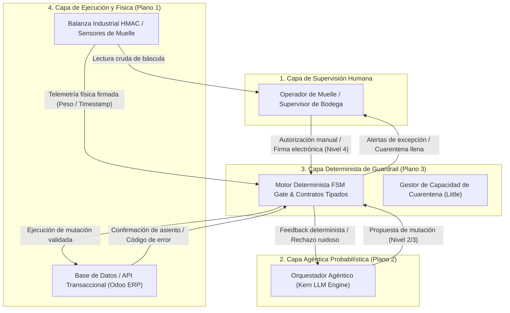

# Análisis STPA Formal: Control Seguro de Escritura de Agentes de IA en ERP (Kern $\to$ ERP, ilustrado con movimientos SAP; aplicable a Odoo)

> **Capa: TÉCNICA / ESPECIFICACIÓN FORMAL**  
> **Estándar:** STPA Handbook (Leveson & Thomas, MIT, 2018)  
> **Sistema Bajo Análisis:** Ruta de mutación transaccional gobernada por modelos probabilísticos hacia sistemas de registro de inventario (ERP Odoo / WMS).  
> **Objetivo:** Demostrar el análisis formal de seguridad sistémica exigido para la validación del whitepaper ante la comunidad STAMP/STPA (MIT PSAS).

---

## 1. Definición del Propósito del Análisis

El objetivo de este análisis STPA (*Systems-Theoretic Process Analysis*) es identificar las condiciones operativas y las interacciones de control bajo las cuales un agente probabilístico de IA ($\sigma^2 > 0$) puede inducir estados inseguros en la base de datos transaccional de una bodega o centro de distribución, derivando en pérdidas financieras o físicas irreversibles.

*Nota de correspondencia transaccional:* Este análisis se formula utilizando la nomenclatura canónica de movimientos SAP (`BWART 103`, `105`, `124`) como semántica formal de referencia para distinguir stock bloqueado en muelle, liberación valorada a libre utilización y devolución a proveedor; en Odoo y WMS equivalentes, mapea directamente a operaciones de ubicación de cuarentena (`WH/Input/Quarantine`), transferencia interna a stock vendible (`WH/Stock`) y albarán de devolución a proveedor (`WH/Output/Return`).

### 1.1 Pérdidas a Nivel de Sistema (System Losses - $L$)
* **$L_1$ (Pérdida Financiera por Inconsistencia Contable):** Desbalance patrimonial o discrepancia monetaria no reconciliada entre inventario físico y contabilidad general (violación de partida doble).
* **$L_2$ (Pérdida Operativa por Rotura de Cadena de Suministro):** Parada de línea de producción o retraso crítico de despacho por quiebre de stock no detectado o falsas existencias (*phantom inventory*).
* **$L_3$ (Pérdida por Saturación Física de Instalaciones):** Atochamiento severo de andenes o zona de inspección que bloquea físicamente la operación y genera costos de sobrestadía (*demurrage*).
* **$L_4$ (Pérdida de Integridad Forense y Cumplimiento Legal):** Imposibilidad de auditar la autoría de una mutación transaccional ante entes regulatorios (fiscal, aduanero o laboral).

### 1.2 Peligros a Nivel de Sistema (System Hazards - $H$)
* **$H_1$:** El sistema autoriza o ejecuta una mutación en las tablas de inventario sin contrapartida contable válida bit a bit [$L_1$].
* **$H_2$:** El sistema compromete o asigna inventario físico que no ha sido físicamente verificado ni recibido en el muelle [$L_1, L_2$].
* **$H_3$:** La tasa de liberación o ingreso de órdenes supera la capacidad física máxima de amortiguación de la zona de cuarentena/inspección [$L_3$].
* **$H_4$:** Se aplica una mutación irreversible en el ERP basada en telemetría corrupta, repetida (*replay attack*) o inferencia no supervisada de un modelo estocástico [$L_1, L_4$].

### 1.3 Restricciones de Seguridad del Sistema (System Safety Constraints - $SSC$)
* **$SSC_1$:** Ninguna transacción de inventario debe registrarse en el ERP si el balance contable asociado ($\sum \text{Débitos} - \sum \text{Créditos}$) no es idénticamente cero [$H_1$].
* **$SSC_2$:** Ningún SKU debe transicionar al estado `AVAILABLE_FOR_SALE` (ATP $> 0$) sin confirmación criptográfica de recepción física e inspección previa [$H_2$].
* **$SSC_3$:** La tasa de admisión de pedidos a inspección no debe exceder la capacidad física dimensionada $V$ de la zona de peritaje [$H_3$].
* **$SSC_4$:** Toda acción de escritura debe contar con firma de hardware (HMAC), verificación de unicidad temporal (anti-replay) y, para mutaciones críticas, autorización explícita de un operador humano autenticado [$H_4$].

---

## 2. Estructura de Control Jerárquica (Hierarchical Control Structure)

### Componentes de Control y Modelos de Proceso
1. **Controlador Humano:** Mantiene el modelo mental de la operación física en el piso. Dispone de autoridad de veto y firma final en transacciones de Nivel 4 (irreversibles).
2. **Controlador Agéntico (Kern):** Infiere clasificaciones, propone recepciones y genera drafts de asientos. Su *process model* es probabilístico y sujeto a alucinación o deriva de contexto.
3. **Controlador Determinista (FSM Gate):** Aplica la lógica constitucional. No optimiza: bloquea o permite de forma booleana en función de invariantes matemáticos y físicos.
4. **Actuador (Odoo API / DB):** Ejecuta `INSERT` / `UPDATE` solo ante payloads pre-firmados por el FSM Gate.

---

## 3. Identificación de Acciones de Control Inseguras (UCAs)

Siguiendo el estándar STPA, se analizan las cuatro formas canónicas en que una acción de control puede ser insegura:

| Acción de Control | Tipo 1: No proporcionar la acción causa peligro | Tipo 2: Proporcionar la acción causa peligro | Tipo 3: Proporcionar muy temprano, muy tarde o fuera de orden | Tipo 4: Detener demasiado pronto o aplicar demasiado tiempo |
|---|---|---|---|---|
| **`EMIT_WRITE_PAYLOAD`**   *(Agente $\to$ ERP)* | N/A (el sistema no se degrada a peligro si el agente omite escribir; requiere fallback humano). | **UCA-1:** El agente emite escritura directa al ERP alterando stock sin haber pasado por el FSM Gate [$H_1, H_4$]. | **UCA-2:** El agente envía la mutación de recepción antes de que la balanza física confirme el pesaje en andén [$H_2$]. | **UCA-3:** El agente reintenta indefinidamente una mutación fallida generando entradas contables duplicadas [$H_1, H_4$]. |
| **`VALIDATE_DOUBLE_ENTRY`**   *(FSM Gate)* | **UCA-4:** El FSM omite la validación de balance contable bit a bit debido a un timeout o bypass de excepción [$H_1$]. | **UCA-5:** El FSM aprueba un asiento con partida descuadrada debido a redondeo numérico flotante permisivo [$H_1$]. | N/A | N/A |
| **`ENFORCE_QUARANTINE_CAPACITY`**   *(Buffer Manager)* | **UCA-6:** No bloquear nuevos ingresos cuando la bahía de inspección alcanza la capacidad $V$ [$H_3$]. | N/A | **UCA-7:** Activar el protocolo `OVERFLOW_IMPUTED` tardíamente cuando los camiones ya colapsaron el patio de maniobras [$H_3$]. | **UCA-8:** Mantener bloqueada la entrada de camiones después de que la zona de inspección liberó espacio [$L_2$]. |
| **`REQUEST_HUMAN_SIGN_OFF`**   *(FSM Gate $\to$ Supervisor)* | **UCA-9:** El sistema omite solicitar aprobación humana para una anulación de factura o ajuste mayor a USD $1,000 [$H_4$]. | N/A | **UCA-10:** Se presenta la solicitud de firma después de haber ejecutado la mutación transaccional preliminar [$H_4$]. | **UCA-11:** Expiración prematura del token de aprobación (TTL $< 30$ s) que induce al operario a crear atajos operativos [$L_2$]. |

---

## 4. Escenarios de Pérdida (Loss Scenarios) y Mecanismos de Mitigación

### Escenario 1: Deriva del Modelo de Proceso del Agente (Process Model Flaw)
* **Causalidad:** El agente asume que una orden de compra fue totalmente entregada porque el proveedor subió un albarán digital en PDF, e intenta emitir un asiento `BWART 105` (liberación desde stock bloqueado) sin que la carga haya sido descargada.
* **Mitigación Arquitectónica:** El autómata FSM del Plano 3 define una topología de estados donde `CLEARED` no tiene transición directa desde `ANNOUNCED`. Es físicamente imposible transicionar sin el evento telemétrico firmado `TELEMETRY_WEIGHT_CAPTURED`.

### Escenario 2: Retraso de Retroalimentación en la Capacidad de Inspección (Feedback Delay)
* **Causalidad:** Una aceleración transaccional inducida por agentes clasifica camiones a alta velocidad; la tasa de rechazo temporal sube de 2% a 15%, pero el sistema no recalcula la acumulación en la zona de cuarentena hasta el cierre de turno. Los bultos saturan el andén y bloquean las vías de escape de grúas horquilla.
* **Mitigación Arquitectónica:** Implementación estricta de la cota $V$ derivada de la Ley de Little ($L = \lambda W$). El gestor de capacidad del FSM descuenta en tiempo real los metros cuadrados disponibles en cada asignación a peritaje. Si $\text{Stock}_{\text{cuarentena}} \ge V$, la compuerta rechaza transacciones entrantes con error `QUARANTINE_OVERFLOW`.

### Escenario 3: Ataque por Repetición o Desincronización de Relojes (Replay / Clock Skew)
* **Causalidad:** Una intermitencia de red en las pistolas RF o terminales de andén provoca el reenvío de un payload telemétrico ya procesado 10 minutos antes, duplicando el inventario físico en el ERP.
* **Mitigación Arquitectónica:** Verificación anti-replay estricta: almacenamiento de un histórico determinista de `transaction_id` procesados en ventana de tiempo y verificación de monotonicidad estricta en las marcas de tiempo firmadas.

---

## 5. Rúbrica de Conformidad STPA para la Versión 1.1 del Paper

Este análisis formal transforma la mención declarativa de STPA en una especificación auditable:
1. **Pérdidas y Peligros:** Definidos formalmente ($L_1-L_4$, $H_1-H_4$).
2. **Estructura de Control:** Diagramada en 4 niveles con separación estricta entre control estocástico y guardrails deterministas.
3. **UCAs:** Matriz de 11 acciones de control inseguras cubriendo omisión, comisión, desfase temporal y duración.
4. **Mitigaciones:** Enlazadas a las baterías de tests de `test_gemba_invariants.py` y `core_event_contracts.py`.
