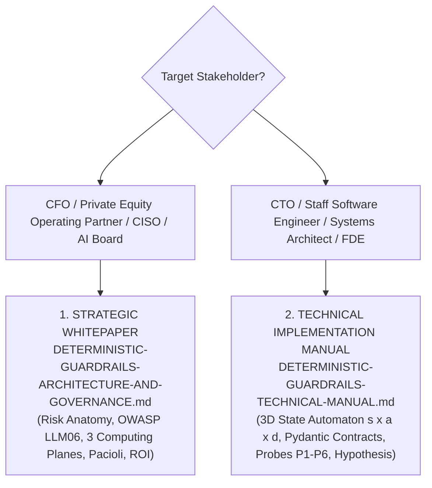

# Canonical Collection: Deterministic AI Guardrails

> **Directory:** `papers/guardrails/`  
> **Consolidated:** October 24, 2026  
> **Author:** Marcos Stipicich  
> **Purpose:** Provide an inviolable engineering standard for the design, formal state modeling, and adversarial verification of deterministic guardrails governing agentic and transactional enterprise workflows.

---

## 1. Stakeholder Dispatch Matrix

| Document | Tier | Primary Audience | Core Focus and Value |
| :--- | :---: | :--- | :--- |
| [`DETERMINISTIC-GUARDRAILS-ARCHITECTURE-AND-GOVERNANCE.md`](DETERMINISTIC-GUARDRAILS-ARCHITECTURE-AND-GOVERNANCE.md) | `C0` Executive / Strategic | **CFOs, COOs, CISOs, IT Directors, PE Operating Partners, and AI Committees.** | Answers **WHERE deterministic guardrails are non-negotiable**, why cloud semantic filters (e.g., Llama Guard) fail on transactional ledgers, the Three Computing Planes, economic failure governance, and refutations to the 3 board-level objections. |
| [`DETERMINISTIC-GUARDRAILS-TECHNICAL-MANUAL.md`](DETERMINISTIC-GUARDRAILS-TECHNICAL-MANUAL.md) | `C0` Technical / Specialist | ***Staff Engineers*, Software Architects, Security Auditors, and FDEs.** | Answers **HOW to build and evaluate them**: immutable Pydantic v2 telemetry contracts, 3D decoupled automata $(s, a, d)$, six adversarial probes (`P1`–`P6`), `Hypothesis` property-based testing, and the 1–10 certification rubric. |

---

## 2. Integration with Repository Assets

These papers are directly verified against operational code running in this repository:

* [`core_event_contracts.py`](../../core_event_contracts.py): Immutable Pydantic v2 contracts with HMAC-SHA256 signatures and physical sensor bounds.
* [`inbound_fsm_guardrail.py`](../../inbound_fsm_guardrail.py): Zero-bypass finite state machine enforcing preconditions before ledger mutation.
* [`test_gemba_invariants.py`](../../test_gemba_invariants.py): Adversarial property-based testing harness with `Hypothesis` (50k state transitions).
* [`probes/cap3_delta_projection.py`](../../probes/cap3_delta_projection.py): Decoupled 3D state projection engine ($s \times a \times d$) proving reachability of 12 legal states out of 64.
